# 3000元启动，3个月撬动50万营收：同城高客单项目复盘

大家好，我是龙哥，目前聚焦同城高客单的获客实操。

今天复盘的是一个二线城市的真实操盘案例。因涉及商家隐私，本文不披露具体品类和服务细节，只拆解可复用到其他同城项目的决策逻辑、方法论、工具栈和踩坑记录。

先说结果。

前期现金投入约3000元。三个月累计为商家带来约500名到店用户，商家合计营收约50万元，我按营业额分成获得约10万元利润。

时间节奏：

- 第1月 商家流水约20万
- 第2月 商家流水约20万
- 第3月 商家流水约10万

我本人在项目上的每日投入约1小时。这一小时不是亲自做全套，而是做判断与分发：找素材、筛爆款、判定内容方向、用AI润色文案、把任务沉到飞书多维表格和腾讯云文档，再交由素人执行。

项目没有靠重度投放起盘。

3000元里，1000元为入驻启动固定成本，剩余约2000元主要用于素人发布费和少量作品加热。路径是：素人种草 → 第三方信任背书 → 用户主动咨询 → 到店 → 商家完成成交 → 我按营业额提成。

后来我把这套路径总结为 “A种B收”。

A端负责造势预热，用第三方视角先把信任埋进用户心智；B端负责承接转化，将前端种下的信任变成到店和营收。这不是简单的素人代发换壳，而是先以第三方视角完成用户的预热与定势，再由商家或主号承接这部分具备信任基础的流量。

500个到店有登记系统可查，后续可提供脱敏截图。50万营收与10万利润来自成交后的对账分佣统计。

所以本文的核心不是“3000元投出50万”的噱头，而是3000元现金撬动一套低成本分发系统，通过到店分佣实现盈利。

## 01｜从全国项目转向同城：不是换赛道，是降维

我并非一开始就做本项目。先做全国婚恋项目，很快意识到：全国盘流量大，但高客单的信任很难在线上快速建立。用户仅在线上看到与沟通，安全感不足。

线下有实体门店时，信任感会明显提升。用户会觉得有落点、有团队、有可验证的场景，不像纯线上那样虚无。信任上来，客单才有空间，转化也更顺。

同时315对原方向造成冲击，继续做全国盘，竞争、信任、合规压力都在增大。

判断是：将全国项目积累的流量能力，迁移到同城实体商家上，效率会更高。因为多数同城商家服务能力不差，有门店、有老板、有团队、有真实客户，缺的是线上获客的体系化能力。

具体缺口：不擅长内容、不懂线上引流、不会用AI、不懂素人管理、无法打通线上到线下到店、没有一套追踪内容-任务-到店-成交的数据闭环。

这就是机会。我没有空谈，而是线下逐家拜访，与老板沟通碰撞。发现多数商家线下很强，线上几乎空白。他们缺的不是服务，而是一个线上获客部门。这个部门，我可以用极低成本先帮他们搭建。

## 02｜商家筛选标准

当时看过七八家，最终选中这家，原因是符合以下五点。

其一，线上近乎空白。对很多人是劣势，对我而言是空间。若商家线上已成熟，我的价值有限。我偏好线下实力在线、线上无体系的标的，最适合用内容流量切入。

其二，后端承接与成交能力强。很多商家不缺流量，缺的是承接能力。客户到店后，话术、流程、后端产品衔接混乱，前端流量越大越失控。该商家过往服务中高端客群，转化能力可观，形态类似私人会所，客单可拉高。这也是500人到店能产生50万流水的原因，没有后端承接，再多到店也只是热闹。

其三，单客价值可做厚。同城高客单看的不是引流价，而是后端利润。客户初次到店后能否持续成交、做长期服务、把LTV做厚？只靠低价一次性消费的项目不优先，账面太薄。

其四，老板心态开放。筛掉了多家：无线上意识、连锁决策链过长、不愿配合、已有美团基础但抗拒新打法。现在我更直接，配合度不足直接排除。同城项目不是单人闭环，商家不配合后期必拖累。

其五，适合第三方信任种草。该品类本身有信任门槛，越需要信任第三方种草价值越大。商家自夸用户天然设防，而素人视角讲述“我为何来、到店见啥、体验如何、为何靠谱”，接受度更高。因此素人种草+第三方分发+到店成交匹配度高。

## 03｜2000元意向金启动测试

合作初期我只收2000元意向金。对商家而言试错成本极低，对我而言重点不是这笔钱，而是锁定合作拿真实项目验证。

做全国生意时，老板对全国盘没体感，他们只关心：能不能给我店带人？因此我没有上来要高额代运营费，而是用低门槛确定意向。那时我对流量能力有把握，知道第一步做什么内容、如何跑起来，也清楚该商家最缺的就是线上获客引擎。

未承诺具体结果。模式：2000元意向金+营业额20%分成。商家是否信任自行判断，但他确实需要线上获客能力而自身没有，最终选择尝试。

关键点：必须签协议。无协议风险极大：业绩不报备、线上客户被归为老客、成交被否认等。你有客户联系方式，却难以掌控后端真实成交。协议需明确数据归属、核算方式、分佣边界，项目跑起来后问题才会暴露。

## 04｜30天验证：内容能否带来真实到店

第一次有效信号出现在作品发布首周。测试期前10条左右出现百万播放作品。

我并未因播放乐观，播放只是表象。真正让我确信的是流量出来后门店电话被打爆，客户真在咨询、真想上门。甚至因传播广，咨询来源不限于本地，还有外地专程前来。江苏常州期间，就有浙江用户专程赶来。

这是重要信号：内容不只是有声量，而是打中了真实需求与信任点。

前期最先带到店的内容，都不是商家自说自话，而是第三方素人视角的种草。同城高客单里，用户更想看到：别人为何而来、到店体验如何、是否真实存在、服务氛围怎样、是否有人已踩点。

因此前期不硬广，用素人内容铺垫信任。核心在于用不同素人视角让用户产生“很多人都去过，这个店不是凭空冒出，有真实客户与场景”的感觉。第一次看到可能仅有印象，第二次产生好奇，第三次恰逢需求就会咨询。

这就是第三方种草的价值。

也有播放高但不带客的情况，后来我将这套打法总结为 “A种B收”。

A可以是素人号、本地小号、第三方体验号或偏生活化的内容号，负责三件事：

第一，造势。在同城范围内让用户反复刷到人、商家、场景。

第二，定势。不直接说“我很强”，而是通过环境、人物、过程、体验、第三方描述，让用户自行形成“这家似乎不一样”的判断。

第三，降低信任成本。用户首次看到官方账号易认为是广告，若此前已在多个第三方内容中见过，再看主账号或到店场景，防备会明显降低。

B负责承接，可为主账号、IP号、门店电话、POI、小程序或线下到店系统。用户并非被A直接成交，而是先被A种下印象，再由B完成承接转化。

因此模型重点不在谁发内容，而在前端谁种信任、后端谁收结果。它更适合文化属性、专业属性、信任门槛高的高客单项目。低价快消看价格即下单，价值有限；而大健康、传统文化、高端定制、本地专业服务等，用户买的是信任、氛围与判断，第三方内容作用被放大。

不过账号质量会影响结果。相同结构的内容在不同素人号上效果差异大，有的人群不匹配、有的显假、有播放但用户不精准。故后期需兼顾内容、账号质量、素人执行力与客户匹配度。

## 05｜两个参考案例：先种信任再回收

“A种B收”不止用于同城服务，本质是通用信任转化模型：先用内容完成价值塑造与心理铺垫，再导向可成交阵地。

按内容账号与成交账号是否同一主体，可分为：

A种A收：同一账号既种草也通过橱窗/直播间成交
A种B收：A端种信任，B端客服/私域/门店/销售成交

### 案例一：78元一串葡萄的溢价路径，A种A收

主角是辽宁产妮娜皇后葡萄，单串78元，净重1.3-1.5斤。

先赋予产品身份。内容反复强调原产地、品种、克重、奶香草莓香红酒香等风味特征，让用户不再只用普通葡萄比价，而是关注品种差异与口感想象。

用家庭故事增温度。讲述父亲种葡萄被市场压价，子女心疼不忍父亲蹲守市场，于是自己拍视频尝试线上销售。表面是辛苦故事，实际叠加三层信息：谁种的、为何自卖、背后经历。产品从无来历商品变为家庭、果园、劳动的载体。

用感官描述制造购买想象。不说“好吃”，而具象为奶香、草莓香等，让用户在购买前就脑补口感。辨识度提升后购买欲随之提升。

同一账号闭环交易。路径为：内容触达→产品认知→家庭故事→信任积累→进主页→橱窗或直播间成交。关键在于先给身份、加人物故事、用细节解释价格、最后把流量收回自有交易阵地。

### 案例二：订单下滑的手工床垫厂续命，A种B收

床垫成交需沟通尺寸、材料、软硬、运输售后，不能线上直接下单，故采用A种B收：A端负责吸睛、立人设、展示产品；B端负责咨询、报价、成交。

用真实困境吸睛。视频开头不谈床垫，而是说：
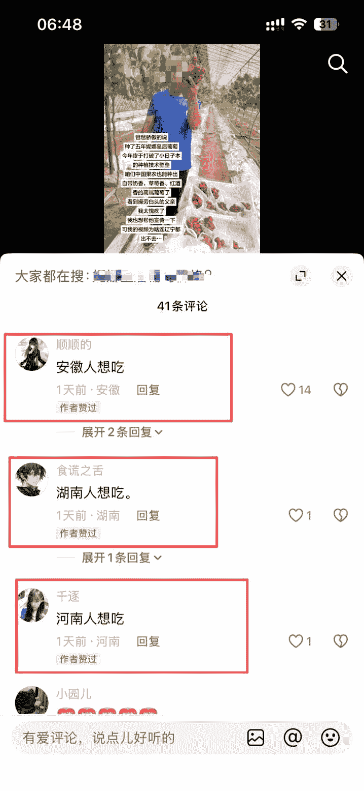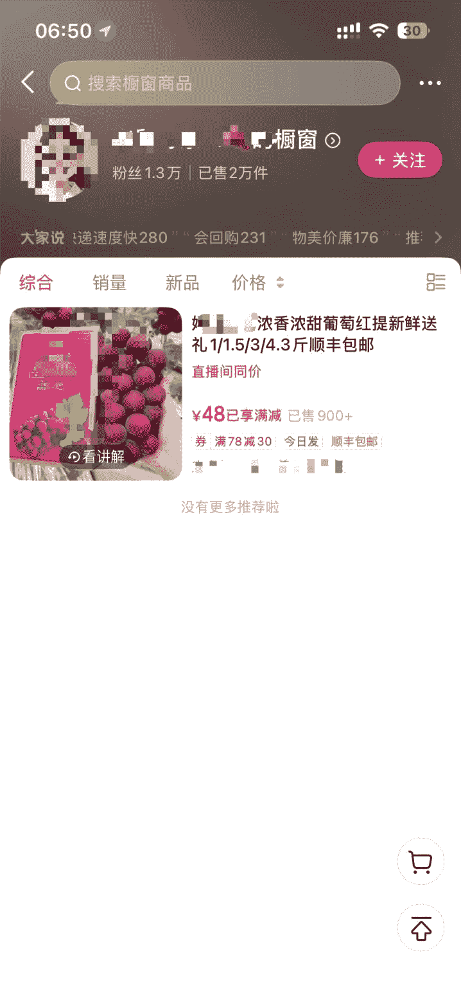
爸爸不懂什么是互联网，只知道厂里的订单越来越少。
一句话交代工厂困境、父亲不懂线上、女儿准备介入。用户继续看是为了想知道这家厂能否撑住。

用父女关系立情感支点。画面中女儿站在工厂，情绪低落，文案为：
我不能看着爸爸半辈子的心血就这样结束。小时候爸爸是我的靠山，长大以后，我来做爸爸的靠山。
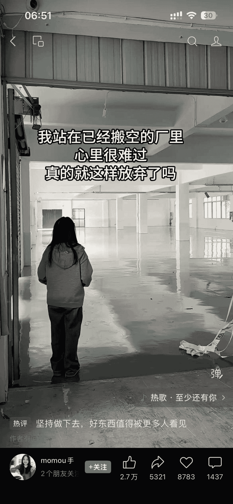
这把经营问题变成人物任务：女儿用互联网帮父亲守住心血。用户关注的不只是产品，更是这个人能否把事做成。

从情绪转向行动。内容未停留在卖惨，女儿拿起手机在厂里拍视频，表示要试试把爸爸做的床垫重新卖出去。人物从被动等待同情转为主动解决问题，才更具说服力。

用生产过程证明价值。随后展示工人手工操作、材料铺设、内部结构、真实生产环境，卖点总结为手工缝制、环保材料及“0胶水、0化工”。让用户看见产品如何制成，降低信息差。
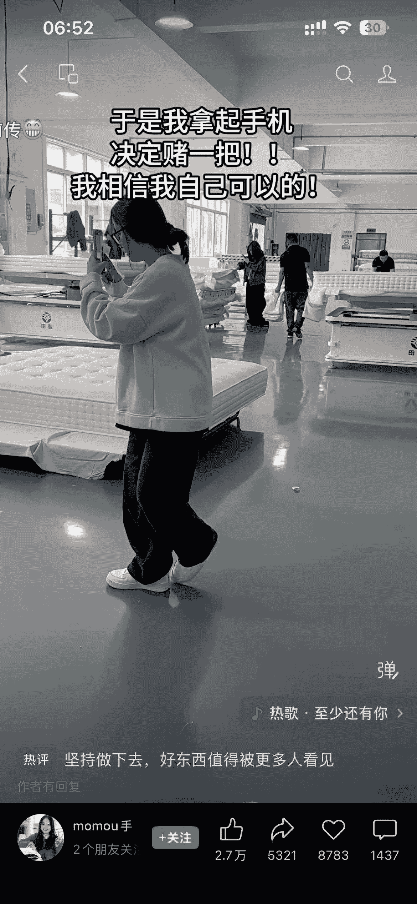

A端种信任，B端收结果。视频末尾展示长串订单，验证内容已带来商业结果。但床垫并非在视频内直接成交，用户需通过主页联系方式、客服或私域继续沟通确认细节后成交。

这套体系的方法、踩坑和复用逻辑，可继续沉淀为可复制的同城高客单打法。

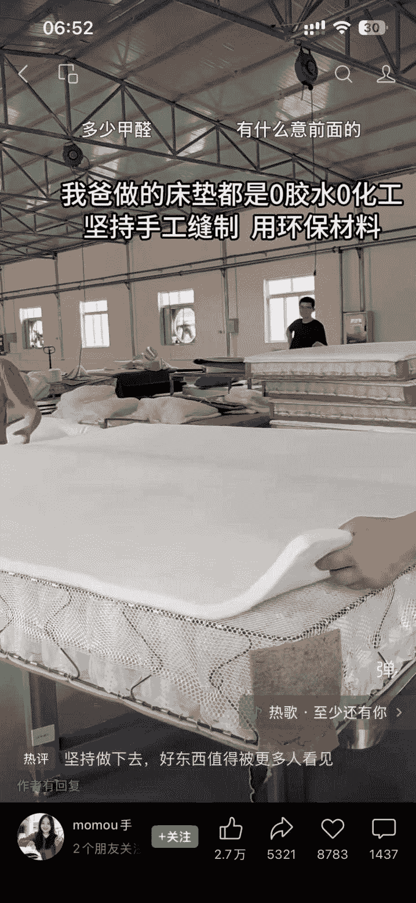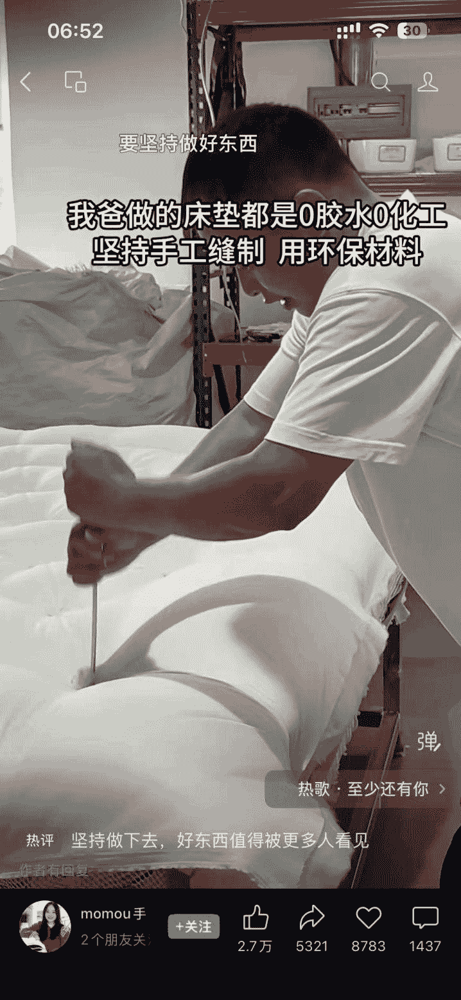

先讲一个床垫商的复盘。

顾客买床垫前，一般会纠结这六点：规格、软硬、材质、价格、配送、售后。如果一个账号能在图文里把这些讲透，信任就会提前长出来。

那个床垫商的故事是这样的：工厂没了订单，女儿站出来。她没卖惨，而是把生产车间、材料、做工一步步拍出来。看到这些真实过程的人，开始主动咨询。随后，客服和私域接手，完成一单单交易。

所以，值得拿走的不是“女儿救厂”的剧情，而是这条五段式结构：

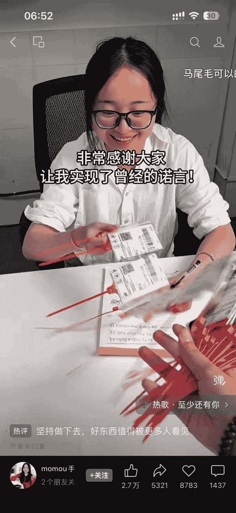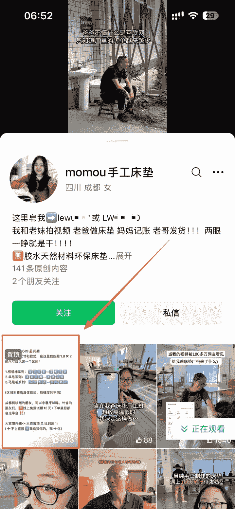

① 用真实的经营压力强行制造注意力；
② 把故事放到“父女”这个关系里，情感就落地了；
③ 主角必须做具体的动作，而不是空谈；
④ 用材料、工艺、流程去证明产品价值；
⑤ 把高意向用户导给最适合做转化的人。

对比两个样本，你会发现两种收口模式。

葡萄那个叫“一体式收口”：账号自己发内容，自己开橱窗，自己直播卖货，种草和交易都在同一个阵地。适合单价透明、能在线直接下单的东西。

床垫这个叫“分流式收口”：种草归种草，转化归转化。客服和私域负责深度沟通，敲定合同。适合高单价、非标、必须聊清楚了才买的品类。

两种没有天然的优劣，只看哪个角色来承接信任跑得最顺。但有一个共同点：任何内容引爆后，都必须有一个“落脚点”。如果用户看完只能划走，没有主页、橱窗、直播、客服、门店或IP可找，那波热度就废了。流量不能是过路风，要把它灌进自己的账号、交易入口和可持续触达的用户池里。

我在这套业务里每天只花一小时，其余时间都交给工具和人。

当时主打图文，节奏快。实况图用醒图做，素材拍摄也顺手，最快五分钟能拍完一周的量。剩下的事只有两件：挖爆款，把它改写成新的图文。这里，AI帮我从改写里解放出来了。

具体思路：先拿一个已经被市场验证过的爆款骨架，再把商家的真实信息和用户痛点塞进去，让AI生成多个“不同人设”的版本。我要做的只有审核：语气像真人吗？有广告感吗？是不是夸大？素人敢不敢发？平台会不会限流？

数据管理放在飞书表格里。每条作品的形式、标题、正文、图片、背景音乐、发布时间、是否爆过，全都记录在案。这张表最大的好处，不是显得专业，而是我不用记忆：发过什么、没发过什么、哪些能复用、哪些该扔。

给兼职人员用的是腾讯在线文档。文案、素材、图片、BGM全放在里面，他们自己打开、自己取、自己发。比在群里一条条发省事多了，新人来了也能直接上手。

老板的活不是自己干，而是把任务拆到别人能执行。

（素材来源：多维表格操作来自赚钱圈友，二创提示词来自@哆元，素人玩法来自@晴天。）

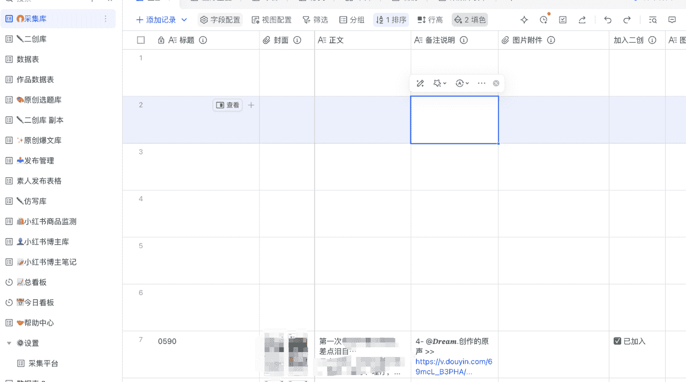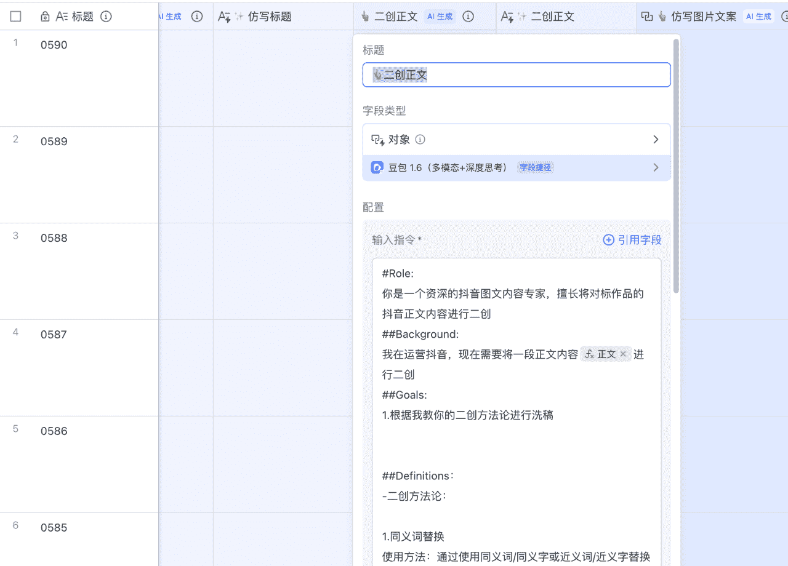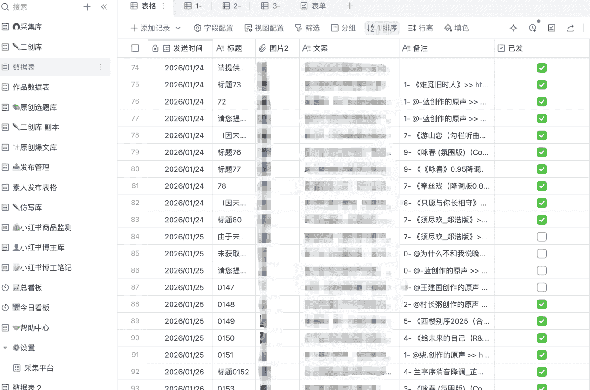

兼职人员管理，我从来不做培训，只做筛选。

招募渠道是招聘软件和闲鱼。我用自己的账号做引流，把人带到群里。一开始进来接近200人，最后发过作品的只有五六十人。这个比例说明一切：愿意说的人多，愿意做的人少。

所以我在一开始就埋了几个小动作，比如：

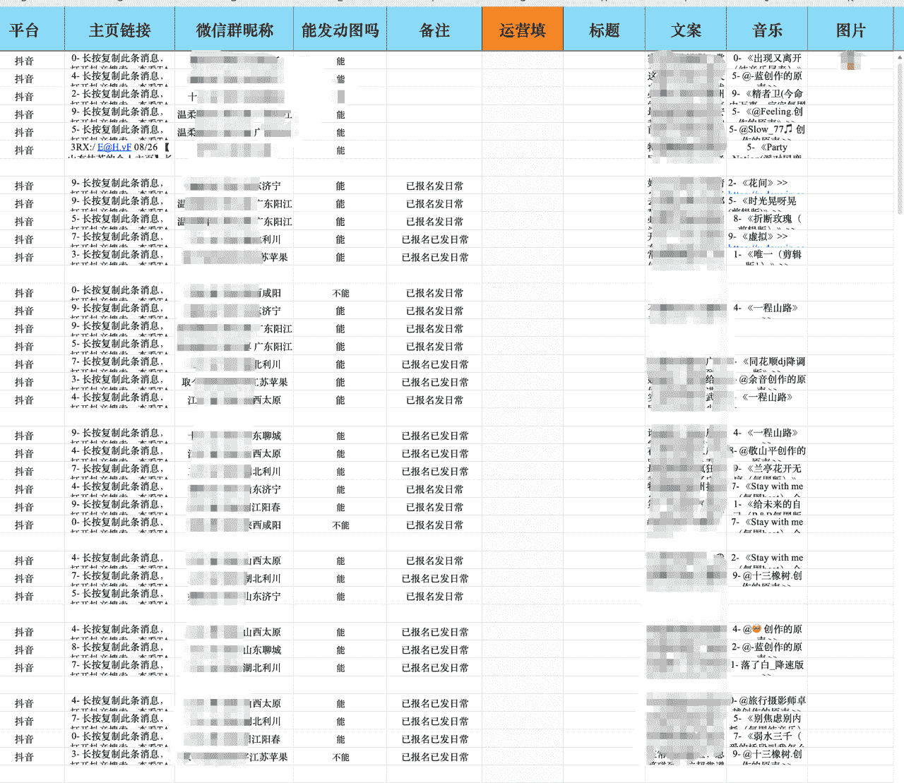

进群先改昵称，格式包含手机系统、能否发GIF、所在城市。

这个动作小，却非常管用。连昵称都不肯改的人，你还能指望他按时发帖、回传链接、回复评论、收客资？不可能。执行力差的人，第一关就暴露了。越早筛掉，后面越省心。

最后稳定配合的也就二十来人，大多数人都只冒过一两次泡。结算周期48小时，别人给10元一条，我只给3到5元。为什么便宜？因为简单。对方不需要创作，进文档拿素材发就是了。我要的不是天才，而是能稳定完成简单任务的人。那五六十个人，就是我后续所有投放的执行池。

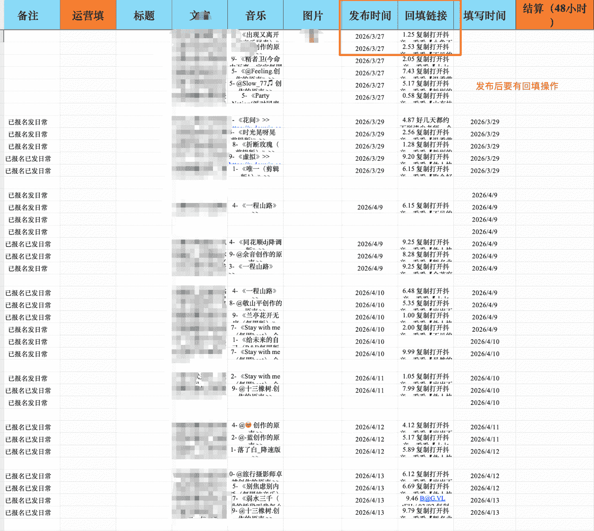

还有一条铁律：从内容到任务，从进店到转化，全链必须能追踪。

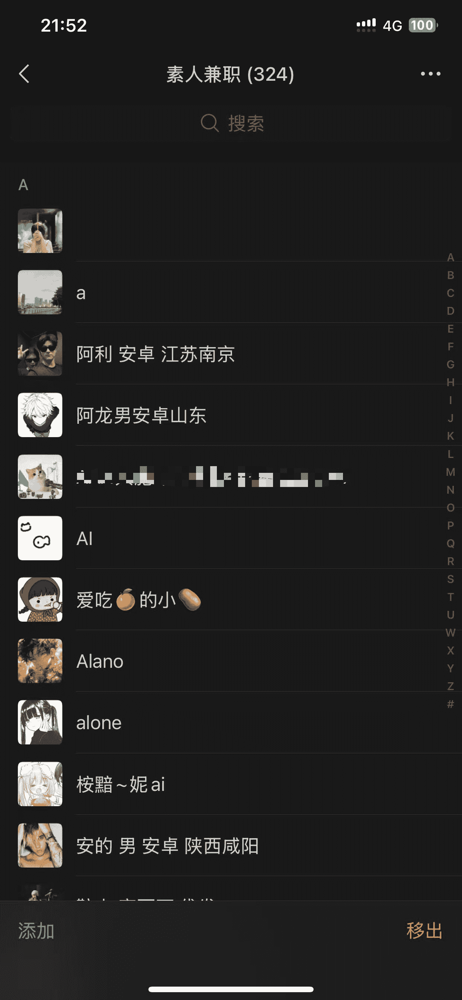

如果追踪断了，一切都会变成糊涂账。你搞不清哪条内容带人，哪个兼职账号有效，客户从什么渠道来，商家到底成交了多少，自己该分多少。

本地高价生意最怕的，就是前端热闹、后端无账。所以刚开始就要把数字追踪立起来。我至少会盯五件事：

一，每条笔记到底发没发，有没有流量信号。一旦有起量苗头，马上让兼职人员在评论区埋钩子，把人引到👸号。早期没干这事，白白丢了流量。

二，发布后的作品表现如何，有没有播放、有没有爆、有没有带来私信。

三，真正到店的客户数字。500个进店，来自登记系统的统计，不是拍脑袋。

四，到店之后是否转化。商家有了实际营业额，再按比例分钱。

五，什么样的内容值得继续加码。能持续带客的，就加重投；播放高但没转化的，需要判断账号人群还是表达问题。

说到底，图文只是入口，进店、付款才是利润所在。只会制作内容，不会跟踪结果，就是给商家免费打工。

整个操盘跑了三个月，500人进店，商家做了50万业绩，我个人拿到10万。表面光鲜，但收费模式的问题也在后期暴露了。

一开始收2000元诚意金，是为了降低合作门槛。冷启动阶段很好用，商家没压力，我也能快速进场。可当项目越做越重，内容要迭代、素材要更新、兼职要管理、数据要看、需求要处理，我实际上成了半个运营部。收费却还是最初的“2000元加分成”，结果就是后期用人力硬扛。这不是谁的错，而是合作只设计了开局，没设计发展。

所以教训很清楚：低门槛适合用来试，不适合用来长期依赖。一旦进入系统化交付，就必须重构收费和边界。

如果重来一次，我会把合作拆成五块：

第一，固定服务费。承担内容、工具、任务管理这些成本。后端没转化，前面的工作也不是免费的。

第二，试跑期。先跑30天，定清楚发布量、兼职数量、平台、指标。达标就继续，不达标就停。

第三，比例分成。保留分成，但算账口径提前锁定：按到店算、按成交算、按营业额算、按利润算，必须选定一种。

第四，额外工作另外计价。拍视频、投流量、代运营账号、私域跟进、培训员工、建SOP，都要单独收费，不能从轻获客干成全案运营还不加钱。

第五，透明原则写进合同。客户登记、转化反馈、结算周期、漏报如何处理，白纸黑字写清楚。

能赚钱，不代表模式健康。一次成功只能说明你踩中了机会，能不能持续，取决于协作结构、数据管理和交付边界。

哪些人能玩转本地高价生意？至少要有五个本事：挑商家，能看出谁有转化能力；懂用户，能抓住“我为什么要去、会不会被坑、值不值”；会改写，写得像人话；能管事儿，不被琐碎任务淹没；会看数，能从流量一路看到回款。

相反，想靠一条爆款翻身的人、不敢和商家划边界的人、讨厌细节的人、算不清账的人、一上来就想铺规模的人，都不该进场。

这个活看起来漂亮，实际上全是细碎的功夫。真正的竞争壁垒，不是你会不会发图文，而是你能不能把流量、信任、进店、成交、对账、分佣捏成一套系统。

最后，要感谢龙哥盟里的几位朋友。易芝一直鼓励我，这篇文字也是他推着写的；晴天帮我解决了兼职发布者从招募到筛选的一系列问题；珍妮姐关于本地生意和内容获客的文章，让我少走了很多弯路。还要谢谢整个社群，让我看到大量真实的一线经验。

这些方法不是我发明的，我只是把四处学来的东西放进一个真实盘子里验证，再提炼出有效与无效的部分。

现在再看，本地高价生意不是代运营生意，而是系统搭建生意。

链路是：选商家 → 第三方种草 → 兼职分发 → 咨询承接 → 到店登记 → 门店成交 → 数据核对 → 利润分配 → 流程固化。以前我总想着“怎么帮商家获客”，后来才明白，获客只是一个模块。真正值钱的，是把图文、工具、人、任务、进店、付款、核算全部串成一个整体。

机会是有的，但别把它当成代运营。一直谈单、一直沟通、一直交付，最后只会变成低复利的人力劳动。更好的做法是：先在一个项目里跑通，再把筛选、生产、分发、管理、追踪和合作方式沉淀成SOP。这样，它才不是一次性的赚钱机会，而是可以复制到其他本地高价行业的系统资产。

共勉：愿诸君各循其道，行而不辍；凡益之道，与时偕行。一起龙哥盟。

---

看完这篇复盘，你可能觉得自己会了。但90%的人一动手，第一关就卡住。

工具和教程只是最浅的壁垒，真正的护城河是“立刻执行”和“圈子信息差”。

我们不聊虚的，只拆商业闭环、压榨AI效率。现在已沉淀1000多个跑通的套利局。

👉 完整数字资产与上车条件：https://lazyso.com/insider/

备注：【实操上车】，不闲聊。

