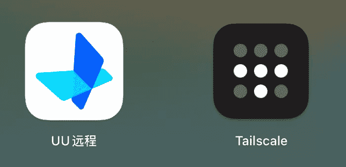
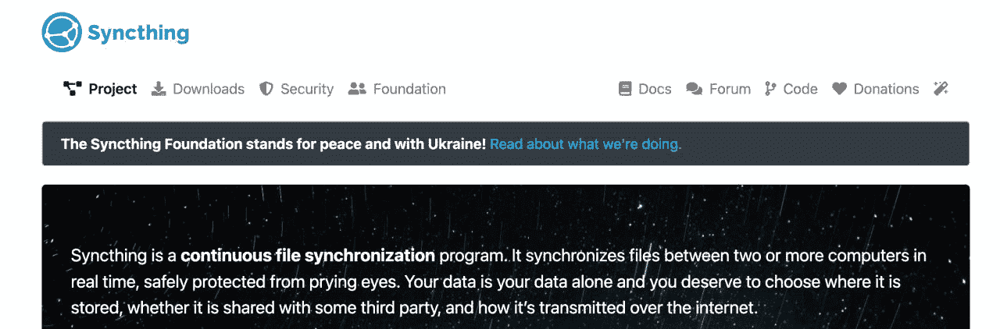
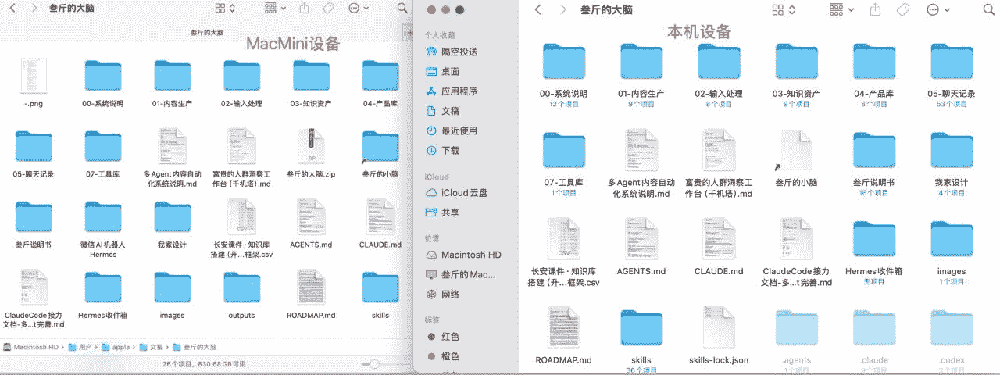
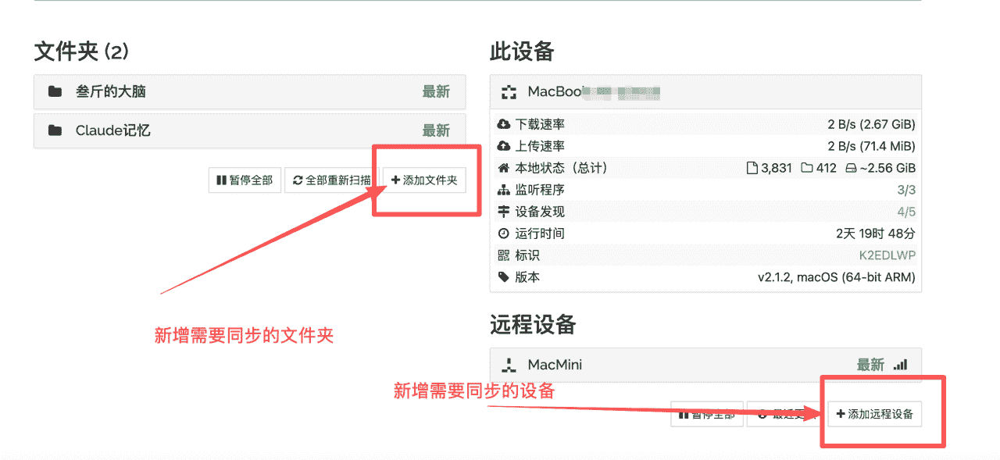
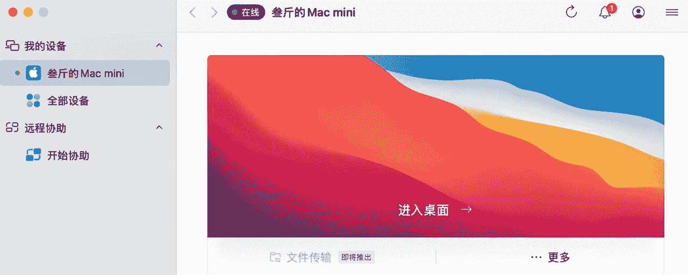
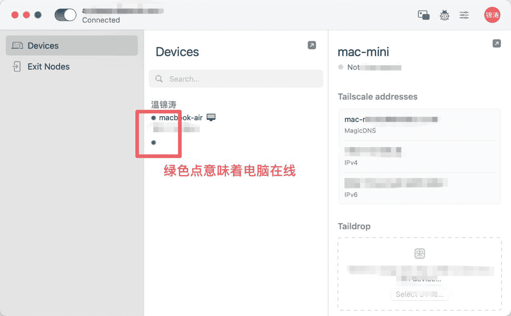
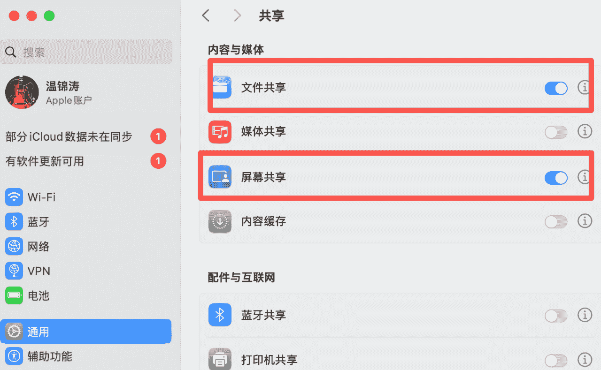
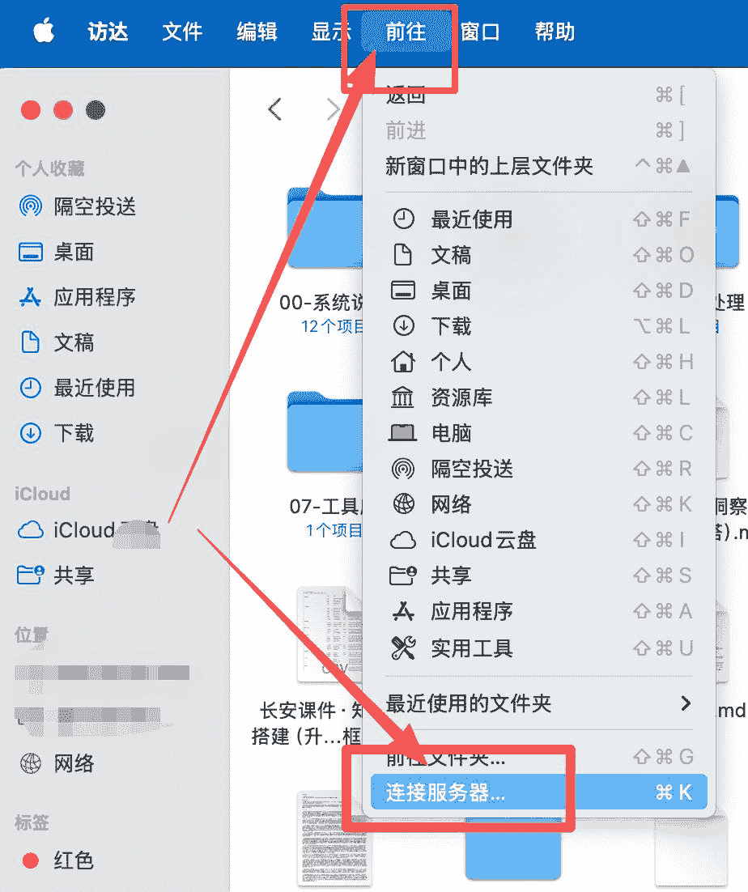
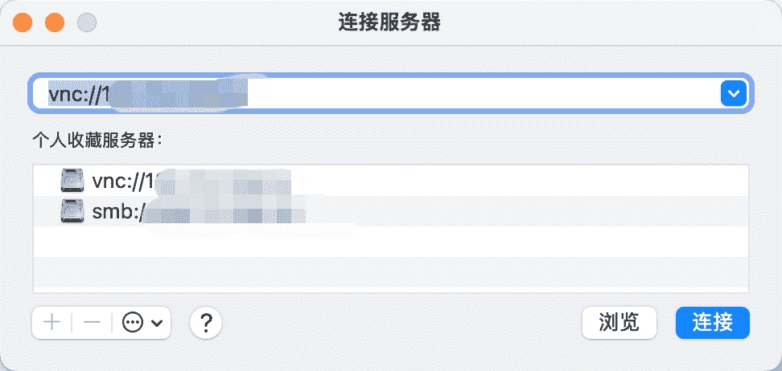
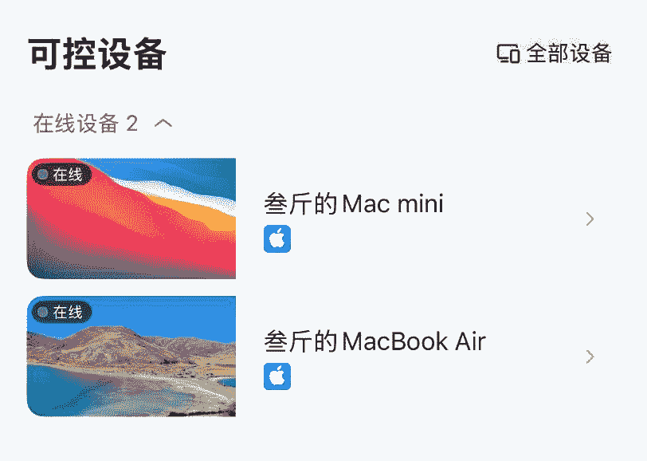

# Obsidian 多设备同步 + 远程操控，我的零成本全套方案

大家好，我是龙哥。一个人经营公司，用 Obsidian 和 AI 搭了一套知识库。最近因为需要，添了台 Mac Mini，结果发现两台设备协作问题不断：出门没法直接操作家里的 Mac Mini，两边的资料也没法自动统一。之前线下课就有同学被这个问题折磨，干脆把 Mac Mini 连显示器一起背到教室。

后来我和 AI 反复沟通，终于把这个问题彻底解决了。现在，我的知识库和 AI 记忆在多设备间完全同步，远程操控也很自由，而且整套方案一分钱都不用花。


不用开网盘会员，也不用自己研究原理，AI 会帮你搞定。

先看看我的设备组合：家里一台 32G 内存 + 1T 硬盘的 Mac Mini，常年开机，没有配屏幕，负责所有重活，比如跑知识库、定时采集、自动整理、视频剪辑等。出门带一台 16G + 256G 的 MacBook Air，只做写内容之类的轻任务。手机时刻不离身，用来记录灵感、远程操作 Mac Mini、给 AI 下指令。为什么不用一台高性能笔记本走天下？因为好配置的笔记本太贵，而且笔记本合上盖子就休眠，定时任务没法触发。想让 AI 7×24 小时替你干活，就得有一台不关机的电脑。Mac Mini 便宜、省电、不占地方，插在那儿就不用管了。另外，如果你用苹果生态，可以顺手开启 iCloud，把手机上的想法自动同步到电脑，这个可选。

我要同步的内容包括两个文件夹：一个是知识库，也就是“叁斤的大脑”，里面是所有笔记、素材、方法论和 skill；另一个是 AI 记忆，也就是 Claude、Codex 记录的关于我的习惯、偏好和对话。这样，我在家对 AI 讲过的话，出门打开笔记本，它全都记得。两台电脑上是同一个 AI，而不是两个。

这套方案用到的核心工具有：Syncthing（免费开源的文件同步软件）、Tailscale（组网工具）、uu 远程（远程桌面，免费版够用），以及可选的 iCloud。全部配置免费，没有容量限制，硬盘多大就能同步多大。

## 一、知识库同步方案

知识库同步只要搞定 Syncthing 就够了。它可以指定某些文件夹在多台设备间持续同步，任何一端有改动，其他端自动更新。





这些界面看不懂也没关系，我也未必完全理解，但后面的流程可以全部交给 AI，零门槛。

它和网盘有三个本质区别：第一，文件始终保存在你自己的电脑上，不占用网盘空间，传输依赖自己的网络，传过来的文件 AI 可以直接读取；第二，设备之间是点对点传输，知识库不会落在别人的服务器上；第三，没有容量限制，也不用付费，硬盘多大就能同步多大。另外，Syncthing 自己就能跨网络连接，哪怕一台电脑在家、一台在国外，它也能自动找到对方。

### 开始前的准备

你需要两台电脑和一个已经在用的 Obsidian 文件夹。第一次同步最好把两台电脑放在同一个 WiFi 下，因为要完整地把整个知识库传一遍，速度最快，几分钟就能搞定。



### 第一步：安装 Syncthing

把下面这段指令发给 Claude Code 或者 Codex，两台电脑上分别执行一次：

```text
请帮我在这台电脑上安装 Syncthing，我要用它在两台电脑之间同步我的知识库文件夹。

要求：

1. 先检查我的操作系统，参考官网 https://syncthing.net/downloads/ 选择合适的安装方式。
2. 我不是程序员，装哪个版本你来判断，但有一个硬要求：装完之后你要能用命令行帮我完成后面所有配置，我不想自己去网页上点来点去。
3. 装完要设置成开机自动启动，因为我要它一直在后台盯着文件夹。
4. 装完后告诉我两件事：
   a. 管理页面的网址，我要用它看同步状态；
   b. 我这台电脑的设备身份码，直接显示出来给我，下一步要用。
5. 这一步只把软件装好就行，先别加文件夹、别连设备，下一步我再让你配。
6. 每一步先用大白话告诉我你要做什么，再动手。如果哪一步失败了，把原因翻译成我能看懂的话，告诉我下一步怎么办。
```

安装完成后，所有操作都在网页里进行，它会返回一个本地地址，大概长这样：

```text
http://127.0.xxxxxx
```

用浏览器打开这个地址，只有你自己电脑能访问，其他人打不开。网页分成左右两栏，左边是文件夹，右边是设备。两台电脑都能打开这个页面，就说明安装成功了。接下来，把两台电脑的设备 ID 都找出来备用，位置在右上角“操作 → 显示设备 ID”，是一长串大写字母和数字，用横杠连接，类似这样：

```text
YIAWF5A-QKB6L3P-XXXXXXX-XXXXXXX-XXXXXXX-XXXXXXX-XXXXXXX-XXXXXXX
```

### 第二步：让两台电脑共享知识库

这一步要完成三件事：添加远程设备、共享文件夹、开启防误删机制。如果你知识库中有很多自定义工具和缓存，可以先跳到第三步设置排除清单，再回来同步，能省不少带宽。这三件事都能交给 AI，你只需要把两台电脑的设备 ID 互相贴过去。先在家里电脑上发送配置指令：

```text
我两台电脑都装好 Syncthing 了，现在要把我的知识库同步到另一台。

我这台是主力机，知识库原件在这里：
【把你的知识库路径贴在这里】

另一台电脑的设备身份码是：
【把另一台的身份码贴在这里】

请帮我配好，不用我去网页上点：

1. 把另一台添加成远程设备，名字就叫「笔记本」。
2. 把我的知识库加成一个共享文件夹，编号用 my-brain，名字叫「我的知识库」。
3. 把这个文件夹共享给刚才那台设备。
4. 给这个文件夹打开「简易文件版本控制」，保留 30 天。因为同步是双向的，我在一台上删掉的文件另一台也会跟着走，我要能捞回来。
5. 动配置之前先备份一份现在的配置，万一配坏了能还原。
6. 配完告诉我现在的状态，以及我这台的设备身份码是多少，我要拿去另一台上用。
7. 每一步先用大白话告诉我你要做什么。哪一步失败了，把原因翻译成我能看懂的话。
```

再去笔记本上发送对应指令：

```text
我这台电脑已经装好 Syncthing 了。家里那台已经配好，正在把知识库共享给我。

家里那台的设备身份码是：
【把家里那台的身份码贴在这里】

请帮我配好：

1. 把家里那台添加成远程设备，名字就叫「主力机」。
2. 接受它共享过来的那个知识库文件夹，存到我这台电脑的这个位置：
【你想把知识库放在哪，比如 ~/Documents/我的知识库】
3. 给这个文件夹也打开「简易文件版本控制」，保留 30 天。
4. 动配置之前先备份一份现在的配置。
5. 配完告诉我现在传到哪了，大概还要多久传完。
6. 每一步先用大白话告诉我你要做什么。哪一步失败了，把原因翻译成我能看懂的话。
```

发完这些，同步就自动开始了。

顺便说一下防误删机制的作用：开启后，任何被删除或被覆盖的文件都会被保留一份，存 30 天。因为同步是双向的，在一台电脑上删掉的文件，另一台也会被删掉，有了这个保险就不怕误删了。这个功能免费，顺手就能开启。如果你喜欢手动操作，也可以在管理页面上设置：右侧“添加远程设备”填设备 ID，左侧“添加文件夹”选择路径，在“共享”里勾选对方的设备，然后在“文件版本控制”里选“简易文件版本控制”。两边各设置一次，效果一样。我自己是让 AI 配的，比较省事。



验证同步：在家里的知识库新建一个文件，去笔记本上看是否自动出现；然后在笔记本上修改这个文件，再回家里电脑检查改动是否同步。两个方向都成功，就说明没问题了。

### 第三步：让 AI 帮你确定同步范围

不是所有文件都需要同步。我们是为了让两台电脑的 AI 都能执行任务、了解知识库，所以只需要同步知识库本体和 AI 记忆。像 Markdown 文件、skill、AI 记忆、图片、PPT、PDF、思维导图，这些是你的知识库资产，必须同步。而工具程序、临时文件、缓存等，不同步能节省大量空间。至于具体排除哪些，可以让 AI 扫描一遍你的文件夹来判断。

```text
我用 Syncthing 同步我的知识库文件夹，路径是：
【把你的知识库路径贴在这里】

请帮我做两件事。

第一件，做一份「排除清单」，告诉 Syncthing 哪些东西不用同步。我的原则是：

同步「人读的东西」（Markdown、图片、文档、我写的 skill、AI 的记忆），不同步「机器跑的东西」（我自己做的工具、程序缓存、安装依赖、临时文件、系统垃圾文件）。

1. 先扫描这个文件夹，按占用空间从大到小，列出前 20 个文件夹，告诉我每个是干什么的。
2. 逐个给出你的建议：同步/不同步，每一条都要说明理由，用大白话。
3. 如果发现存着密码、密钥、登录凭据的文件，单独列出来提醒我，这些绝对不能同步。
4. 清单定好之后，直接帮我配置进去，不用我自己去网页上粘贴。
5. 告诉我另一台电脑要不要也设一遍，要的话给我一段能直接发给那台电脑上 AI 的说明。

第二件，顺便帮我检查一个隐患：我两台电脑的用户名可能不一样，扫一下我的知识库里有没有写死了完整路径的文件（比如 /Users/某某某/Documents/... 这种）。如果有，告诉我有多少个、会有什么影响、怎么改最省事；如果没有，告诉我一声就行。
```

AI 还会把排除规则同步到另一台电脑，保证两边一致。

### 第四步：让两台电脑的 AI 保持一致

知识库同步后，AI 的全局配置和记忆也要同步。这些文件通常藏在系统用户目录，是隐藏的，不在知识库文件夹内，因此不会自动同步。有两种解决办法：一是把配置文件移到知识库里，然后在两台电脑的原位置创建快捷方式指向它；二是在 Syncthing 里把 AI 记忆文件夹作为一个独立的共享文件夹，跟知识库一样操作。我就是用第二种方法，所以两台电脑上的 AI 是同一个。你可以把这两件事都交给 AI 处理：

```text
我要让两台电脑上的 AI 保持完全一致，包括全局规矩和它记住的东西。

请帮我做：

第一件，处理全局规矩文件：

1. 找出我这台电脑上 AI 的全局规矩文件在哪（比如 ~/.claude/CLAUDE.md）。
2. 搬动之前先备份一份，备份文件名带上今天的日期。
3. 把本体移到我的知识库里的【知识库路径】/AI 全局配置/下面。
4. 在原位置建一个指向它的快捷方式。
5. 验证一下：从原位置还能不能正常读到内容，内容跟搬之前完全一样。

第二件，告诉我 AI 的记忆文件存在哪个文件夹，我要在 Syncthing 里把它也设成一个共享文件夹，让两台电脑的 AI 记住同样的事。给我具体路径，以及在另一台电脑上对应的位置。

注意：存有密码、密钥、登录凭据的文件夹不要加入同步范围。如果你发现这类文件在附近，提醒我一声，不要动它。
```

完成后，在每台电脑上问 AI 同一个问题，比如“你现在的全局规矩第一条是什么？”，如果回答一致，就说明配置同步成功了。

做到这里，你出门带笔记本和在家办公就没有区别了。如果家里那台电脑没有必须一直运行的工具，看到这里就可以收工了。

## 二、远程操控方案

但如果你有必须留在家里电脑上的东西，比如大型软件或高性能任务，远程操控就很有必要。毕竟很多工具复制到笔记本上也没法运行，而且笔记本性能有限，大任务还得靠 Mac Mini。我自己配了两套方案：第一套是 uu 远程，下载即用，手机端也方便，我日常临时操作最常用；第二套是 Tailscale 加屏幕共享，配置稍多，但好处是这条连接是你自己的，更清晰。



网络状况好的时候清晰度差距不大，但确实更细腻。另外 uu 远程截图不太方便，因为远程电脑上没有登录🛰️，无法用🛰️截图，所以我配了第二套来弥补。

远程操控和知识库同步还有个区别：电脑不能休眠，台式机要设成永不休眠；停电后还需要设置自动开机。这两件事让 AI 一次设置好，只在家里那台上发指令即可：

```text
我这台电脑要当作常年开机的主力机，我人在外面时需要远程连回来操作它。

请帮我做两件事，做完告诉我怎么验证真的生效了：

1. 设置成插着电源时永不休眠（屏幕可以关，但电脑不能睡）。
2. 打开「断电恢复供电后自动开机」，这样家里跳闸之后它能自己启动。

要求：

- 每一步先用大白话告诉我你要改什么，再动手。
- 如果我这台是笔记本，告诉我笔记本有没有这些选项，没有的话有什么替代办法。
- 不要改我的其他系统设置。
```

自动开机功能不一定每台设备都有，如果没有，就只能手动按电源键了。

### 方案一：uu 远程

uu 远程的用法很简单：在家里的电脑和你常用的设备（手机或笔记本）上都安装，登录同一个账号，就能看到并操作家里电脑的桌面。我在外面临时要操作 Mac Mini 时用得最多，尤其是手机端，非常方便。而且即使电脑重启卡在锁屏界面，也能通过手机解锁，非常实用。

### 方案二：Tailscale 加屏幕共享

Tailscale 可以让你的所有设备像在同一 WiFi 下一样互联，无论身在何处。安装后，Mac 菜单栏会出现 Tailscale 图标，Windows 则在系统托盘。登录时两台电脑必须使用同一个账号，这是它们互相可见的前提。登录后，设备列表里每台会有一个以 100 开头的 IP，这就是设备在你私有网络中的门牌号。接下来，在家里的电脑上打开屏幕共享，然后在另一台电脑上通过这个 IP 连接即可。整个过程不经过第三方服务器，私密性更好，画质也更高。手机端同样可以安装 Tailscale 和 uu 远程，登录同一账号就能接入整个协作网络。

以上就是我的免费全套方案。所有工具都免费或开源，配合 AI 辅助配置，几乎零门槛。如果你也在被多设备同步和远程办公的问题困扰，不妨照这个思路试试。有问题欢迎在评论区留言，或者直接问 AI 也能解决。

> 4. 主机端只需开启画面分享功能，文件互通、远程登录这类未点名的服务，一律别碰。



Mac 端的激活入口在「系统设定」→「通用」→「共享」面板中，将「画面分享」拨到开启位置。另一台 Mac 无需装任何插件，调出系统预装的「画面分享」工具，录入远端主机的 Tailscale 地址码与开机口令即可握手。

常规路径：打开访达，进入顶部「前往」菜单，点击最底部的连接入口。

地址栏里的协议前缀决定用途：VNC 抓取画面流，适合远程接管桌面；SMB 挂载文件流，适合远程检索目录。尾部的设备编码是这台机器在 Tailscale 网络中的专属编号，找不到就让 AI 帮你引路。





发起连接前，还要填写目标机上的登录账号口令，等同于以该账号的身份直接坐进那台主机。

Windows 阵营则依赖系统自带的桌面遥控功能，具体开关位置取决于系统版本，问 AI 即可。

补充一个隐性福利：两条链路同时部署后，Syncthing 往往能额外发现一条私有直连通道，让双机流量全部走自家内网。无需任何手动调配，它内置的路径选择机制将自行锁定时延最优的线路——算是白赚的性能余量。

该通道还附带文件能力——采用 SMB 协议后，Mac mini 内所有磁盘分区都会出现在可访问列表里（远不止共享目录），甚至能像本地文件一样直接打开。

代价同样明显：一是文件规模一大，目录刷新就明显变慢；二是数据本体始终留在远端，本机只能隔着网络借阅，断线即失联。

因此它只适合当替补，日常主力同步依旧交给 Syncthing。

## 4、移动端如何纳入体系

双机互通之后，剩下要解决的是移动端这块拼图。



我的移动端并未安装 Tailscale，走的是两条更轻省的替代路线。

灵感捕捉交给 iCloud。人在户外冒出想法时，无需掏电脑，也无需敲字，拿起手机口述一句，语音转文字便自动生成一条记录。手机里的 Obsidian 直接交由 iCloud 承接存储，只要 Apple ID 统一，内容便会即时汇合，返回书桌时已经整整齐齐躺在库里。

这摊零碎内容 iCloud 完全扛得住，不必惊动 Syncthing。工具链不必大一统，够顺手就是王道。

遥控家中主机交给 UU 远程。前面说过，它在移动端的顺手程度没有对手。

给 AI 派活同样不复杂，使用官方 App 就好——Claude、ChatGPT 的移动客户端能够直接调度宿主主机里的 AI，从户外传一句话回去，那头机器就闷头开工。

## 5、途中卡住如何自救

整套部署一般不会太折腾。万一真有环节卡壳，别埋头硬啃，也别来找我，把这段文字完整复制丢给 AI，剩下的事由它逐项带你排除。



跟 AI 协作的铁律：先让 AI 诊断。

同步链路告警时抛这段：

> 我正借助 Syncthing 打理双主机间的资料同步，眼下冒出了状况：【描述异常细节，像是两端始终无法完成握手/拉取速度奇慢/个别文件一直不出现/界面蹦出错误弹窗】
>
> 请按下述次序逐项检测，每核对完一项就给我一个结论，全程讲人话，用不着我来处理晦涩的底层推断：
>
> 1. 先确认 Syncthing 进程目前是否存活，再看双机各自呈现何种握手状态。
> 2. 判断链路是端到端直连还是借道中继，同时评估我当前所在网络环境是否存在硬件或策略层面的毛病。
> 3. 分别清点两台主机磁盘里的实际文件体量，随后做数值对照。
>
> （清点时跳过 `.syncthing` 前导的临时产物，那只是传输中途留下的分片。）
>
> 4. 核对双端的忽略规则表是否完全一致。
> 5. 扫描是否存在冲突副本。
> 6. 汇总以上各步发现，给出嫌疑最大的诱因，以及我接下来该执行的动作。

远程断连时投这段：

> 我正通过【UU 远程】或【Tailscale+画面分享】访问家中主机，但连接中断了：
>
> 【描述异常表现】
>
> 请按流程逐项处理，每处理完一项就反馈一次结论，用词直白一点：
>
> 1. 判断主机是否处于断电或休眠状态，并指一条我能用的核实路径。
> 2. 若走的是 Tailscale，核验双端是否挂载在同一账户名下，以及能否从节点列表里看到彼此。
> 3. 分析当前上网链路是否遭遇限制，以及是否值得换网再试一次。
> 4. 给出嫌疑最大的根因和推荐的应对措施。
> 5. 若该办法在现有系统环境下注定无法落地，给出其它可选路线。

另外有一条铁律：链路异常时，先切换网络环境，把移动热点当作临时网络往往立竿见影。不少故障换条线路就自行痊愈了。

## 6、这套部署的底层收益

整套体系落地后，你首先挣脱的是「被工位绑架」的状态——外出时无需再把笨重主机塞进背包。

上课或参会，哪怕安排现场实机环节，一台轻薄本就够。现场生成的文档与素材会主动回传至家中那台 Mac mini，几乎感知不到同步的存在。

更关键的是安全感：过去所有家当都集中在一台主机里，机器一旦出事，多年积累的资料库直接蒸发。现在双机各有一份全量副本，还附带 30 天的回滚缓冲，论稳妥远超一般备份方案。

你不再需要回到工位才能开工，任何角落都可以成为操作台。家中那台机器安静蹲守，真正扮演一个 7×24 小时在线的工作节点。

————分隔线————

读完这套流程，你可能自认已经全懂了。但 90% 的人会在真正着手的那一刻卡在原地。

工具与文档只是最表层的入门票，实打实的胜负手是“立刻下场”的执行决心，和你周围的信息圈层。


这里不谈虚的，只拆解打法和榨干 AI 的每一分生产效率。圈内已有 1000+ 个跑通的变现实战范例沉淀。

👉 沉淀资源与入局说明：https://lazyso.com/insider/


