# 从「翻🛰️记录找灵感」到「用 Codex 把 IMA、Obsidian、飞书串成一条可用的内容流水线」

260804 副业SC 精华


这不是一份单纯的工具清单。

我会以自身真实的业务运转为线索，从手机随手收藏、电脑浏览、🛰️历史以及已经写过的材料出发，借助 Codex 把 IMA、Obsidian、飞书串联起来，再把🛰️、网页、👸号等来源的信息加工成可检索的知识库、沉淀为站点，以及产出可直接用在👸号、短视频、朋友圈、方案里的素材。

更重要的是，我会把完整跑通的过程、踩过的坑、以及新手可照着执行的最小启动步骤讲透。

本期提供两种形态，一种是阅读版的当前文档，另一种是可自由组合的分层【知识库版本】。

知识库版：


⬇⬇先看几个阅览图，更有感觉知道接下来要说什么、做什么！


社群对应的官网

内容工作台

航海家圈友参照做的“作业”

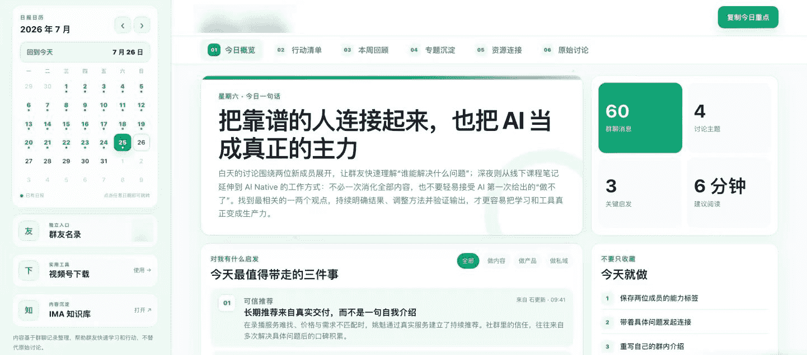

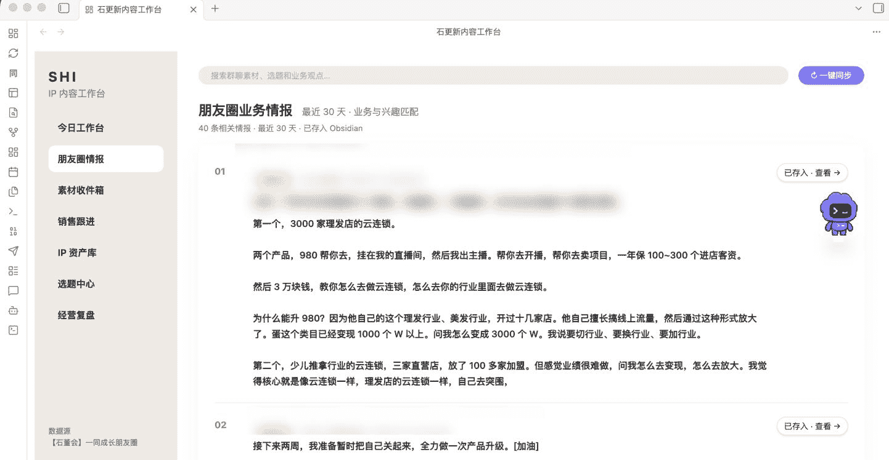

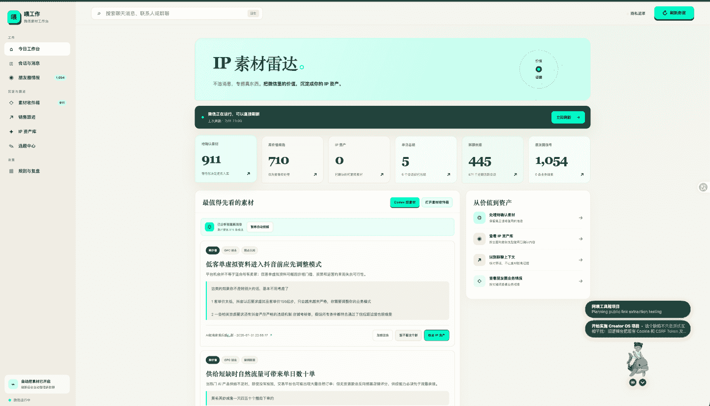

随时跟🛰️机器人对话，读取🛰️聊天记录，然后帮我找到适合我的选题。

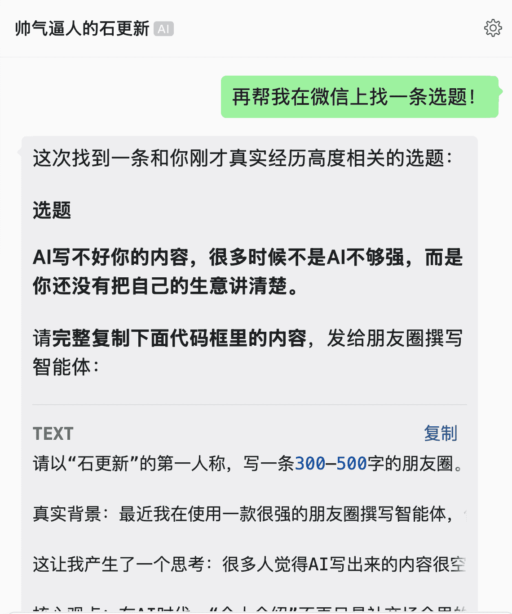

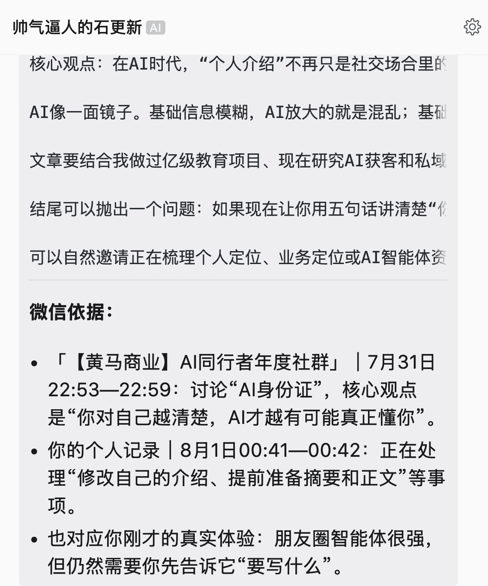

一条文章生成许多个「语料块」

反向链接关联

AI 一键生成高质量「👸号」，并且做自动排版，并且推送到「👸号草稿箱」，直接手动编辑下发布即可。

正式开始。

## 一、起点的那场不算酷的分享

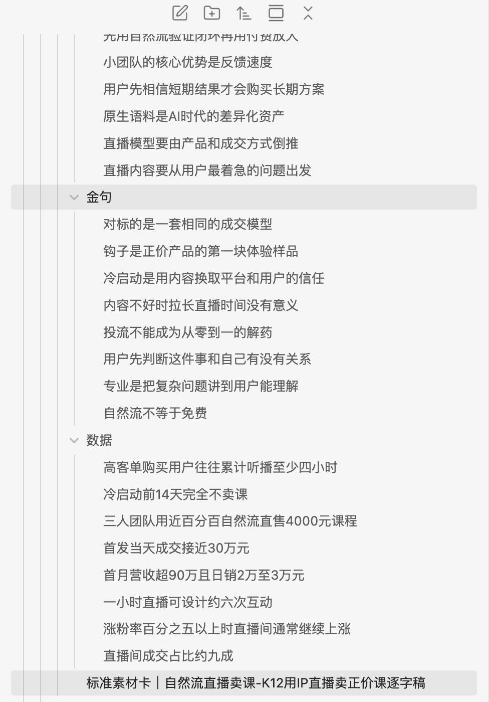

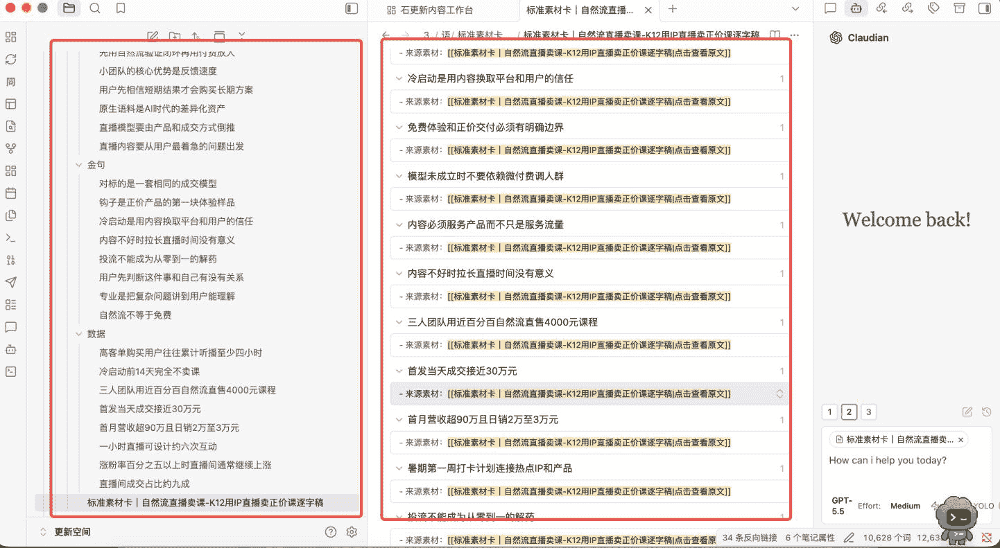

7 月 26 日，我在龙哥盟航海家线下大课上，展示了我正在使用的运转方式：如何调取电脑里的🛰️历史，如何把手机与网络内容送进知识库，再由 AI 进行整理调用。

轮到我时现场人已不多，我心里没底：内容不花哨，没有“输入一句立刻变现”的桥段，会不会只对我自己有效。

分享结束后有人说：“石老师，你讲得太好了。”也有人说：“没白等到最后。”


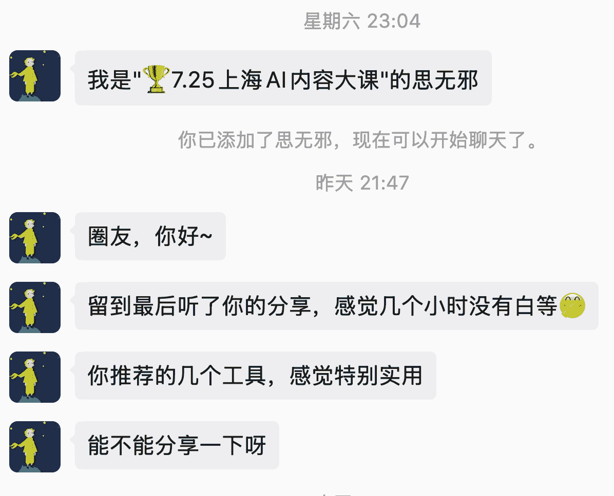

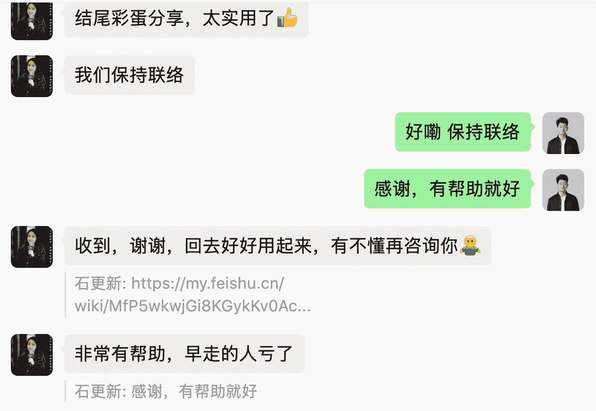


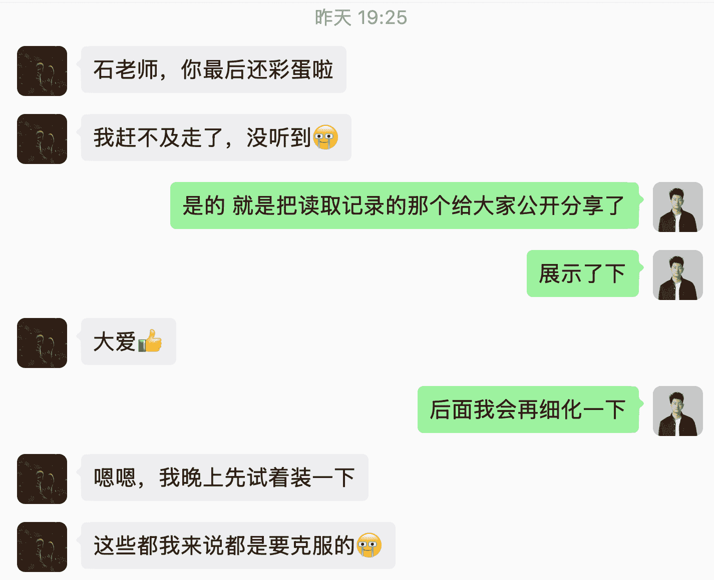

那一刻我才明白，这套做法的价值被低估了。

很多人缺的不是更多 AI 软件，而是一条能长期持续的路径：

- 今天存下的东西明天还能检索到；
- 检索到后能转化为自己的表达；
- 写👸号、拍短视频、发朋友圈、做方案时能即时调用。

我过往的状态很典型：客户问题在🛰️，文章收藏在手机，网页开在浏览器，长文堆在飞书，零散笔记散在各文件夹。每个地方都有信息，真正要产出时却要从零起步。

于是我搭建这套系统，不是为了把所有工具都装一遍，而是为了回答三个朴素问题：

1. 好内容能不能以最短路径先收下来？
2. 收进来后能不能被加工，而不是躺在收藏夹？
3. 加工后的知识能不能顺畅进入发布和交付环节？

## 二、一句话记住分工：IMA 收，Obsidian 炼，飞书 享，Codex 调

| 工具 | 核心定位 | 使用场景 |
|---|---|---|
| IMA | 收 | 手机临时保存文章网页，基于已存内容做问答 |
| Obsidian | 炼 | 本地 Markdown 保存，拆解观点、建关联、沉淀主版本 |
| 飞书 | 享 | 排版、评论、协作、交付、给别人阅读 |
| Codex | 调 | 读取、整理、拆分、写入、同步、回读验收 |

我为四个角色做了明确划分。

IMA 负责收。贴合手机和🛰️使用场景，看到内容时快速存入，也方便对已上传内容提问。

Obsidian 负责炼。它就是电脑里的 Markdown 文件夹，适合长期沉淀、拆观点、做双链。

飞书负责享。需要呈现、协作、评论或交付时，我把它放飞书。

Codex 负责调度。它把入口和仓库连接起来，完成读取、整理、拆分、写入、同步和验收。

记住这条即可：

手机文章、🛰️记录、电脑网页、过往文档 → IMA 或 Obsidian Inbox → Codex 读取拆分 → Obsidian Notes / Archive → IMA、飞书 → 👸号、短视频、朋友圈、课程、方案

四个工具并非必须全上。起步时只要有入口、加工仓、出口就能跑。

## 三、先跑通一条，不要先建大系统

给新手最重要的一句话：先手动走通一条，再谈自动化。

我第一次测试只挑一篇文章：

1. 手机把文章分享到 IMA；
2. 回 IMA 确认全文可打开；
3. 让 Codex 读取并存进 Obsidian；
4. 在 Obsidian 检查标题、正文首尾、来源链接、图片说明；
5. 让 Codex 从原文拆出一句独立观点；
6. 用这点观点写一条朋友圈或短视频开头；
7. 成品放飞书，再打开检查一遍。

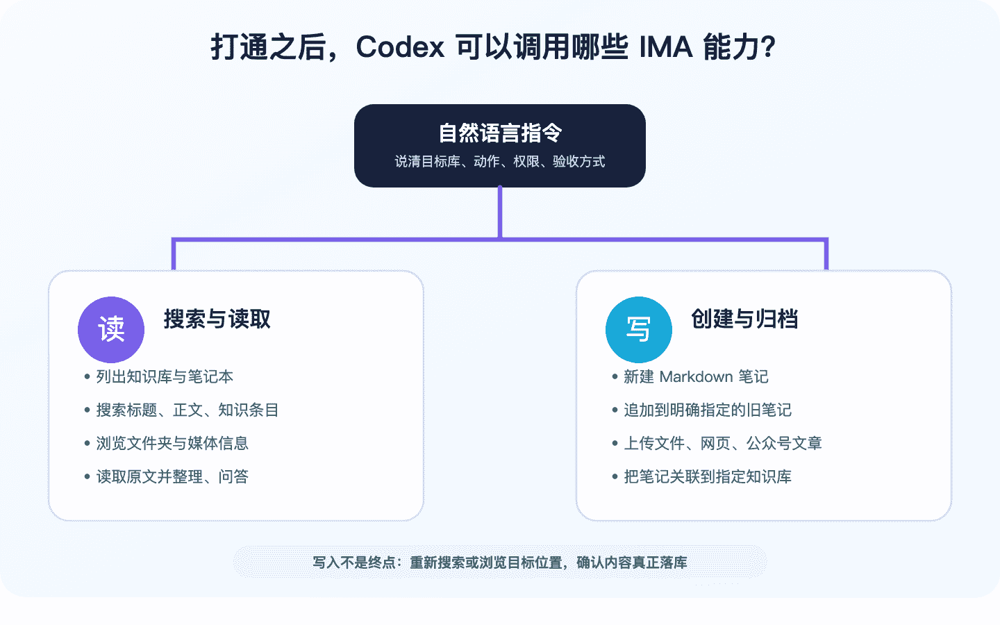

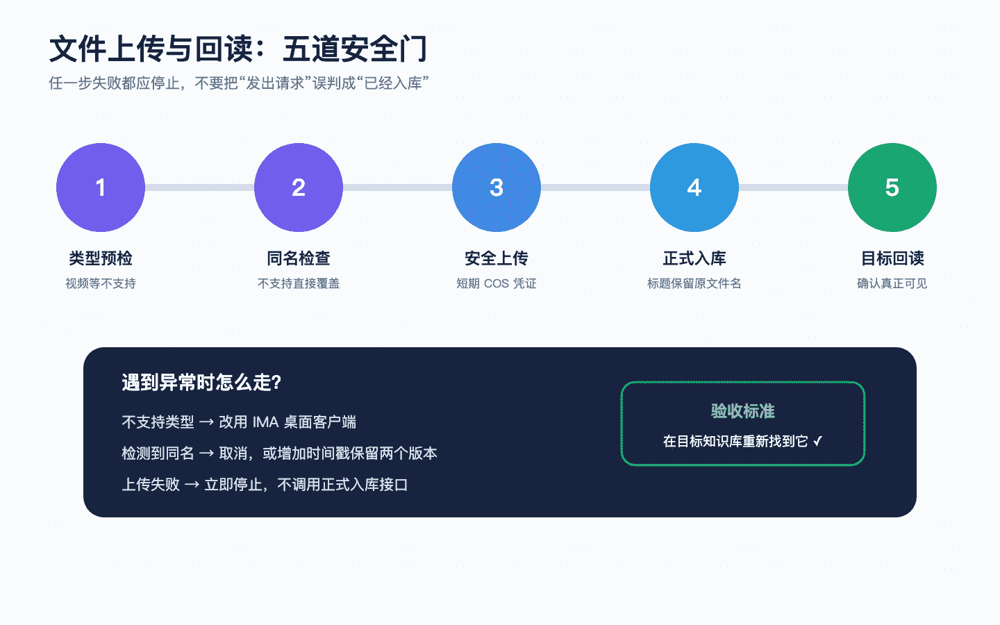

走完这七步，我才算确认这条链路通了。

过去我容易把“接口返回成功”当成完成。后来发现，创建成功可能只是云文档生成了；同步成功也可能只是一个登录后才显示的空链接；文件在 Obsidian 里，也可能正文缺了一半。

我的验收标准很笨但有效：在目标端重新搜索、打开、从头读到尾。写进去不等于能用，能找到、能打开、内容完整才算数。

不要追求全自动。

## 四、不同来源的内容分别怎么接

| 来源 | 首入口 | 加工仓 | 常见出口 |
|---|---|---|---|
| 手机文章、临时灵感 | IMA | Codex 拉到 Obsidian Inbox | 朋友圈、短视频、文章 |
| 电脑网页、👸号 | Web Clipper、飞书剪藏或 IMA | 完整度检查后进 Obsidian | 选题、文章、项目资料 |
| 🛰️历史记录 | yichen-wechat-local-vault | Codex 按对象、时间、关键词整理 | 复盘、案例、客户问题、选题 |
| 过往文档 | 直接放入 Obsidian | 统一格式、拆分归类 | 飞书交付、IMA 检索 |

### 1. 手机内容：先到 IMA

【视频演示】手机浏览器内容如何保存到 IMA（25 秒）

手机场景要快。想着回电脑再整理，大概率就没了。

我直接点分享选 IMA，丢进叫“待整理”的知识库。保存后在 IMA 打开验证，能打开才算收下。

IMA 是第一站，后续手动或用 Codex 批量拉到 Obsidian，原文和加工结果分开放。

### 2. 电脑网页和👸号：按完整度选工具

网页我先用 Obsidian Web Clipper。它是官方浏览器扩展，能把内容存本地 Vault。

但“生成 Markdown”不等于完整。懒加载图片、表格、轮播常丢失。我会滚到底再剪藏，然后检查首尾、图片、链接。仍有丢失情况。

👸号长文若 Web Clipper 不完整，我会删掉改用飞书剪存。飞书更注重排版和协作。

选择依据不是工具高级与否，而是能否完整保存。

长期使用后我发现 IMA 存得更稳，因为它存链接而非剪藏，不会丢内容。

若要长期监控固定👸号更新，才上自动化：WeRSS 供源，本地脚本去重检查，飞书提醒记录，Obsidian 存正文并留日志与授权提醒。起步不要追几十个号，先测一到三个。

详细操作见：【取👸号】👸号文章监控工作流教程：可复刻执行版

### 3. 历史🛰️记录：读本地 Vault

这是刚需。

【视频演示】在手机🛰️发指令，Hermes 调用本机 Vault，再由 Codex 整理结果。

电脑端读 Mac 4.x 🛰️历史，我用 yichen-wechat-local-vault。它维护本机已解密 Vault，Codex 再按群聊、联系人、关键词、时间范围查询。

比旧版 wechat-cli 支持语音、朋友圈读取，不需降版🛰️也不用重签名。

电脑链路：🛰️本地数据 → yichen-wechat-local-vault → Codex → Obsidian 或飞书

想在手机🛰️远程下指令时才加 Hermes：手机🛰️指令 → Hermes → 本地 Vault → Codex → 返回结果

Hermes 是入口调度，不是数据库。Codex 是执行大脑，不自带🛰️记录。层级分清后排错更容易。

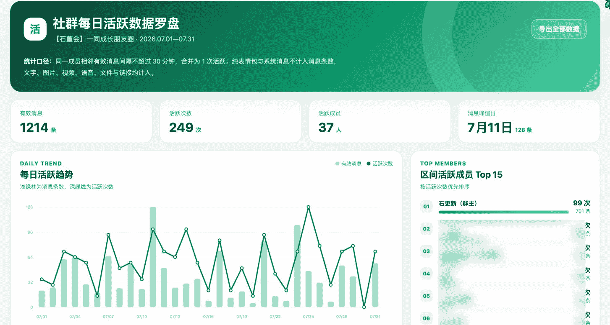

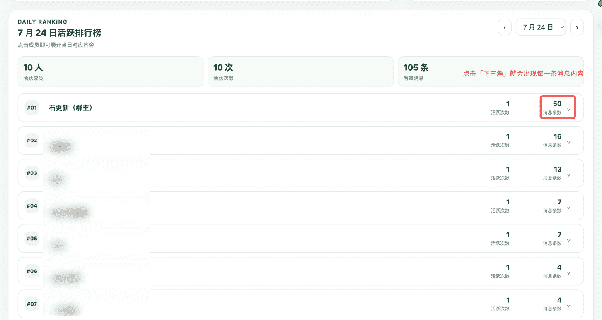

基于本机🛰️聊天记录生成「社群活跃统计罗盘」

手机端如何跟🛰️机器人对话读取🛰️聊天记录，下面有实操环节，详细讲解安装配置。

### 4. 自己写过的文档：直进 Obsidian 再分发

Word、Markdown、旧飞书文档、过去文章，无需再收藏一遍。

我先确定原稿，放入 Obsidian 对应目录，保留来源和日期，再让 Codex 统一格式、拆分、归类。Codex 能理解 Obsidian 的 Markdown、双链、标签、frontmatter。

## 实操手册｜在自己的电脑上跑起来

这一节不是一次装齐。先选一条路线，把一篇真实内容从源头送到目标端；电脑端🛰️可查后，再加 Hermes。每步完成后都回到目标端搜一遍读一遍。

### 1. 先收好官方入口表

工具迭代快，第三方教程里的包和命令易过期。下面尽量用官网、官方仓库或我实际验证过的 Skill 页面。

| 工具 | 入口 | 何时需要 |
|---|---|---|
| ChatGPT 桌面端（含 Codex） | OpenAI 官方桌面端下载 | Codex 在本机读写、整理的调度中枢 |
| Codex CLI（可选） | OpenAI Codex 官方仓库 | 习惯终端或脚本化时安装 |
| Obsidian | Obsidian 官方下载 | 本地加工仓 |
| Obsidian Web Clipper | Chrome 官方扩展页 | 网页直进 Obsidian |
| IMA | IMA 官网 · IMA OpenAPI 凭证页 | 手机网页入口，需 Codex 读写时申请凭证 |
| IMA 浏览器扩展 | Chrome 官方扩展页 | 网页图文复杂、保留到 IMA 并 AI 检索 |
| 飞书与飞书剪存 | 飞书客户端下载 · 飞书剪存官方说明 | 协作、排版、交付 |
| 飞书开放平台与 lark-cli | 飞书开放平台 · lark-cli 官方仓库 | 让 Codex 搜索、读写飞书文档知识库 |
| yichen-wechat-local-vault | 一尘 Skill 项目页 | macOS 上读取🛰️ Mac 4.x 本地历史 |
| Hermes（进阶） | Hermes 官方 Quickstart · Hermes Weixin 配置 | 仅手机🛰️远程下指令时需要 |
| Node.js | Node.js 官方下载 | 安装 IMA Skill、lark-cli 等 |
| Obsidian MCP（可选） | 知识库安装说明 | 高频检索批量维护增强体验 |

### 2. 安装顺序：先基础链路，再加入口

1. 先装 Codex 和 Obsidian。让 Codex 能看到 Vault 路径，写入并读回测试笔记。
2. 再选内容入口。手机用 IMA；电脑网页用 Web Clipper、IMA、飞书剪存并存对比。
3. 需要电脑🛰️历史时装一尘 Skill。先验证本地 Vault，再做范围查询。
4. 需要手机🛰️远程指挥时才加 Hermes。先确认 Hermes 普通对话和 PONG，再调一尘 Skill。

### 3. 第一步：让 Codex 连接 Obsidian

Codex 不必靠 Obsidian MCP 也能读 Obsidian。Vault 就是本地文件夹。

先在 Codex 把该文件夹加入工作目录，再复制提示词：

这是我的 Obsidian Vault 路径：【粘贴绝对路径】。请先只读检查路径正确，不扫描其他目录。确认后：

1. 保留现有结构，不覆盖；
2. 缺少时创建 Inbox、Notes、Archive、Outputs；
3. 在 Inbox 新建“工作流验收测试”Markdown；
4. 写入标题、创建时间、来源、测试正文；
5. 重新读取，告诉我标题、路径、正文首尾；
6. 不装 Obsidian MCP，不删移批量改写旧笔记。只有写入后重新读取完整才算成功。

验收要点：文件在正确 Vault，Obsidian 可打开，Codex 读回一致。详细安装见：《如何创建 Obsidian：从安装到第一个知识库》。

# 4. 手机内容进 IMA，再让 Codex 读取

先到 IMA Agent Interface 手动申请 Client ID 和 API Key。

提示词发给 Codex：

请安装并检查最新版 ima-skill，先确认 Node.js 版本。我会在本机按提示输入 IMA Client ID 和 API Key。请把凭证安全保存在本机私有配置目录：

- 目录权限 700；
- 凭证文件权限 600；
- 不在输出、日志、截图或 Git 中显示密钥。

配置后调用 IMA OpenAPI 的 `list_note` 做一次 `limit=1` 只读鉴权验证。列出可访问的 IMA 知识库名称，不写入。最后告诉我：Skill 是否安装成功、鉴权是否成功、能否列出知识库、失败在哪个步骤。

能列出知识库后再测一篇真实内容：

请在 IMA 按完整标题搜索【笔记标题】，只处理这一篇。读取正文后：

1. 保存原文到 Obsidian Inbox；
2. 保留原标题、来源链接、IMA 笔记 ID、同步时间；
3. 检查正文首尾、链接、图片说明；
4. 写入后重新读取 Obsidian 文件；
5. 告诉我 IMA 命中数、Obsidian 文件路径和读回结果。

不要批量同步，不覆盖同名文件；同名先停并告知我。

完整版参考：《IMA 知识库与 Codex 打通教程》。

# 5. 把飞书接到 Codex

先在飞书开放平台创建企业自建应用，开通云文档和知识库权限并发布。拿到 App ID 和 App Secret 后，不要把 Secret 写进公共提示词：

请按 lark-cli 当前版本的内置 Skill 和 `--help` 完成飞书接入，不要照抄旧版命令。要求：

1. 从官方仓库安装或更新 lark-cli；
2. 引导我在本机完成应用配置，不在输出中显示 App Secret 或 token；

3. 对 docs、drive、wiki 实施用户层面的授权发起；

4. `auth login` 不要携带 `--as user`，只有在后续的实际读取或写入调用时才加上 `--as user`；

5. 检查用户授权是否已生效；

6. 只读形式列出当前身份可达的飞书知识空间；

7. 读取我指定的某篇飞书文档；

8. 该阶段禁止新建、迁移或删除任何资料。

请最终告知：lark-cli 具体版本、用户身份是否有效、知识库清单是否可见、指定文档是否完整读回。

只读验收通过后再单独做写入验证：

请把【本地 Markdown 路径】生成为一篇新的飞书云文档，并归入知识库【知识库名称】的【目标节点】。要求：

1. 先确认目标知识库与节点唯一；
2. 创建前检索同名文档，若已存在则中止；
3. 保留标题、正文层级、列表、表格与超链接；
4. 创建后确保文档落在知识库内，而非仅停留在云盘；
5. 返回知识库重新检索并读取新文档；
6. 回报文档链接、目标节点及读回结果。

禁止覆盖、删除或挪动其他文档。

完整版参考：《飞书知识库与 Codex 打通教程》。

# 6. 电脑端读取🛰️：部署一尘 Skill

本方案仅适用于 **macOS + 🛰️ Mac 4.x**。

先确认本机已保存所需的🛰️本地数据。新机器若无历史档案，需先使用🛰️官方迁移功能同步；Codex 与一尘 Skill 无法凭空恢复本机不存在的信息。

电脑链路：🛰️本地数据 → yichen-wechat-local-vault → Codex → Obsidian 或飞书。

请在我的 Mac 上安装并校验 yichen-wechat-local-vault。

项目地址：https://github.com/mcncarl/yichen-skills/tree/main/yichen-wechat-local-vault

目标：

1. 安装到 Codex Skills 目录，并使用 Skill 自带的隔离环境，避免污染系统 Python；

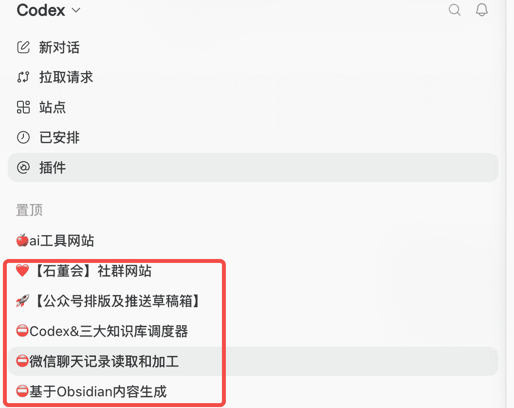

2. 盘点当前安装与 Vault 状态，已有可用组件直接复用；
3. 如已有可用 Vault，先执行只读 status；无则按 Skill 说明初始化；
4. 首次全量解密、需要 macOS 授权或需我手动操作🛰️时，暂停并明确告知；
5. 完成后只读列出最近会话；
6. 由我指定联系人或群聊、关键词及时间区间，再读取少量记录做验收；
7. 告知查询覆盖区间、记录数及缺失点。

安全边界：

- 不发送、修改或删除任何🛰️消息；
- 不上传、搬移或复制明文 Vault；
- 不输出 key、salt、token、wxid、数据库路径或整库原文；
- 不进行无边界的大量导出；
- 不承诺零风险。

安装后，Codex 应先做只读状态检查，再视情况进行日常增量刷新。下方第一条为只读检查，第二条会写入本地私密 Vault；若实际路径不同，请让 Codex 自动定位 Skill 目录：

```bash
~/.codex/skills/yichen-wechat-local-vault/.venv/bin/python \
~/.codex/skills/yichen-wechat-local-vault/scripts/vault_cli.py status --format text
```

```bash
~/.codex/skills/yichen-wechat-local-vault/.venv/bin/python \
~/.codex/skills/yichen-wechat-local-vault/scripts/decrypt_all_dbs.py --mode incremental
```

状态就绪后，再发起范围明确的查询：

请先增量刷新本地🛰️ Vault；此操作会写入本地私密 Vault，但不会改动🛰️源库或发送消息。查找【联系人或群名】最近【7 天】提及【关键词】的记录，最多【20 条】。先确认目标会话唯一，再开始查询。

输出要求：

1. 先给结论；
2. 只引用必要短句；
3. 标注时间范围、命中数量及可能缺失项；
4. 不展示路径、wxid、密钥或完整聊天原文；
5. 不发送、修改或删除🛰️消息。

完整版参考：《用 yichen-wechat-local-vault + Codex 读取🛰️数据》。

# 7. 手机🛰️远程下指令：引入 Hermes

前提：上一节的本地 Vault 已能在电脑上查询。Hermes 仅作为🛰️内的指令入口与调度层，不负责解密历史数据库。

手机链路：🛰️新指令 → Hermes → 同一 yichen-wechat-local-vault → Codex → 🛰️回复。

请在我的 Mac 上搭建并验收：🛰️ → Hermes → yichen-wechat-local-vault → OpenAI Codex。

要求：

1. 复用已有组件，缺失时再安装；Hermes 按官方方式部署；
2. 先验证 yichen-wechat-local-vault 的只读 status，为 Hermes 构建可调用的兼容层，不复制明文 Vault；
3. 通过 `hermes model` 选择当前账号可用的 OpenAI Codex 模型，并完成一次常规对话；
4. 配置 Hermes 原生 Weixin：私聊仅限本人，群聊关闭，不允许其他用户访问；
5. 🛰️消息不得触发密钥提取、全量解密或无范围导出；
6. 不得输出密钥、salt、wxid、数据库路径及整库原文；
7. 关闭工具进度与中间回复，仅发送最终结果；
8. 依次验收：Skill status、网关在线、🛰️ PONG、终端重启网关、重启后再次 PONG、一次限定范围的历史查询。

任一环节失败均不得宣布安装完成，需明确失败步骤。需我登录、扫码或批准系统权限时暂停。

验收顺序不可颠倒：先 `hermes doctor`，再确认 `hermes gateway status`；🛰️发送“只回复 PONG”收到回复后，在电脑执行 `hermes gateway restart`，恢复后再次测试 PONG。两次均成功后，才测试历史查询。

请使用 yichen-wechat-local-vault，只读查询【联系人或群名】最近 7 天提到【关键词】的记录，最多 20 条。先给结论，只引用必要短句，不显示路径、wxid、密钥或完整原文。若本地 Vault 未更新，请提示我在电脑端增量刷新，不要通过🛰️触发首次全量解密。

完整版参考：《🛰️ + Hermes + Codex：在手机上查询本机🛰️记录》。

# 8. 最后用一篇真实内容跑完整条链路

工具各自验收成功后，再用下方任务把“取料、入库、加工、分发”串起来。首次仅处理一篇，不开启定时任务。

请协助我手动跑通一条内容工作流，只处理一篇，不设定时任务。

来源：

- 平台：【IMA / 🛰️本地 Vault / 网页】
- 内容标题或对象：【填写】
- 时间范围或来源链接：【填写】

目标：

1. 将原始内容保存到 Obsidian 的 Inbox，保留来源、日期和源 ID；
2. 检查正文开头、结尾、链接、图片或附件说明；
3. 从原文拆出 3 条候选语料，每条仅保留一个观点、案例或数据；
4. 由我确认后，仅将选中的 1 条写入 Notes；
5. 基于该笔记生成一个【朋友圈 / 短视频开头 / 👸号段落】草稿，保存到 Outputs；
6. 如需分享，再创建飞书云文档并放入【知识库名称 / 目标节点】；
7. 分别在源端、Obsidian 和飞书重新搜索、打开并读回。

安全和版本规则：

- 发现同名内容先停止，不覆盖；
- 不删除、不批量移动、不自动发布；
- API 返回成功不等于完成；
- 最后给我一张验收表：来源、目标、路径或链接、读回结果、缺失项。

# 9. 怎样才算真的打通

| 检查点 | 必须看到的结果 | 不能当成成功的情况 |
|---|---|---|
| Obsidian | 目标文件在正确 Vault 和目录，标题、正文首尾、来源能读回。 | 只看到生成了文件名。 |
| IMA | 按标题重新搜索，能打开正文；关联知识库和目标位置正确。 | 只看到接口返回成功。 |
| 飞书 | 目标知识库里能搜到文档，打开后层级、列表、表格和链接完整。 | 只在云盘创建文档，未进入知识库。 |
| 🛰️本地 Vault | 目标会话唯一，时间范围和命中数明确，抽查结果可对应原记录。 | 用旧快照或同名群聊结果冒充最新答案。 |
| Hermes | 普通对话、首次 PONG、重启后第二次 PONG、限定历史查询依次成功。 | 网关进程启动了，但🛰️收不到回复。 |

## 五、内容进库以后，怎么避免变成电子仓库

| 目录 / 状态 | 里面放什么 | 下一步动作 |
|---|---|---|
| Inbox | 刚进入、未判断的原料 | 删除、提炼或转入 Archive |
| Notes | 已提炼、可复用的观点、案例和数据 | 建立关联，等待真实调用 |
| Archive | 已处理但暂时不用的原文 | 保留来源，不反复进入 Inbox |
| Outputs | 准备发布或交付的最终成品 | 发布、协作并记录最终版本 |

收藏不是知识库。收藏只是把“以后可能有用”换个地方堆放。

我在 Obsidian 里把内容至少分成四种状态：

- Inbox：刚进来的原料，还未判断。
- Notes：已提炼过、可复用的笔记。
- Archive：处理过但暂不用的原文。
- Outputs：准备发布或交付的成品。

真正决定知识库价值的，是 **Inbox** 能否持续流向 **Notes** 和 **Outputs**。

我的基本加工单位不是“一篇收藏”，而是一条语料块。一条语料块只保留一个可独立使用的观点、案例或数据，并写清来源、适用场景和个人判断。

比如一篇文章有八个观点，我不会把整篇原文直接当知识。

我会让 Codex 先拆出候选块，再由我确认哪些值得保留。最后可能只留下三条：

- 一个可放入👸号正文的观点；
- 一个可讲给客户听的案例；
- 一组需保留出处的数据。

清洗完成后，我会立刻选一条去使用。它可以是朋友圈、短视频开头、👸号段落，或方案的一页。只有内容真正进入作品或工作，我才认为完成了一次流转。

## 实战案例｜一篇 IMA 原文如何经过清洗、调用和成材

前面是方法，这里补一段真实跑通的过程。它不是流程图，而是一篇真实 IMA 原文经 Codex 与 Obsidian 处理后，最终变成👸号草稿和朋友圈文案的完整记录。

这次验证的不是“AI 能否写文章”，而是原料能否被清洗、按目标调用，并在不同平台长成不同成品。

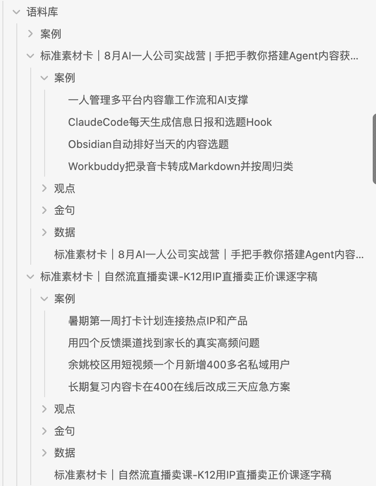


一条文章生成「语料块」

反向链接 关联

内容工作流设计流程

内容工作流实际测试

### 1. 原料：从 IMA 精确同步一篇真实文章

本次原文为《8 月 AI 一人公司实战营｜手把手教你搭建 Agent 内容获客系统，从流量到变现（陪跑 2 个月）》。Codex 通过 IMA API 在“石更新的知识库”中精确定位同名内容，再同步到 Obsidian。同步后重读目标文件，确认标题、元信息和正文完整。

到此仅完成取料和入库。文档虽已进入 Obsidian，仍不能直接写作。

### 2. 清洗：把一篇招生文章变成 15 个可追溯语料块

原文混杂观点、工具案例、课程安排、销售话术和作者自报成绩。若只做摘要，仍是缩短后的招生文。真正的清洗，是先完整保存标准素材卡，再只拆出未来可能使用的内容。

| 类型 | 数量 | 保留内容 |
|---|---|---|
| 观点 | 6 | AI 产出与商业价值、工具能力与商业系统、Agent 工作流等 |
| 案例 | 4 | 信息日报、选题安排、录音转存和多平台内容管理 |
| 数据 | 2 | 仅保留能说明当期产品交付设计的信息 |
| 金句 | 3 | 一人公司、商业系统和持续经营相关表达 |

每个语料块都双链回标准素材卡。原文无独立证据的收入、销量、学员数和效果数字，未被包装成可信数据；需保留的课程信息也增加了使用边界。

清洗不是全部留下，而是决定什么值得留下、归哪类、如何在何种边界下使用。

### 3. 调用：先生成选题，再由人决定写什么

语料准备好后，Codex 未直接写正文，而是先读取账号定位卡、目标用户痛点库、发布目的清单，以及👸号和朋友圈的平台规则。

当系统发现账号定位卡和痛点库仍是空模板时，未假装个性化完成，而是明确标注限制。随后基于现有语料生成 5 个候选选题，每个均含核心观点、支撑语料双链、适用用户和推荐理由。

我最终选择：《会用 AI 为什么还赚不到钱？问题不在工具，在商业系统》。

选题确认后，案例、数据和金句才围绕同一核心重组。与主题无关的课程价格、报名方式和成绩数字全部不用。

### 4. 成材：同一个选题，分别长成👸号和朋友圈

👸号版本负责讲透问题：AI 生产能力增强不等于自动获得流量和收入；从“我是谁”到“怎么持续做下去”，中间还缺哪些商业问题。文末列出实际调用的 7 个语料块，便于回查。

朋友圈版本未机械缩短👸号长文，而是从刚发生的真实过程切入，只保留一个判断、一项支撑和一个提问。核心表达是：

会用 AI 写文章，不等于有内容获客能力；会用 AI 做产品，也不等于知道怎么定价、怎么卖。中间缺的不是工具，是商业系统。

这次后，我对“成材”的理解更清晰：不是把 Markdown 复制到发布平台，而是根据平台、用户和发布目的，让同一组原料长成不同形态。

完整实战复盘：《一次真实的五环实战：从 IMA 原文到👸号与朋友圈》

IMA 原文 → Obsidian 标准素材卡 → 15 个可追溯语料块 → 5 个候选选题 → 人工选择 → 👸号草稿＋朋友圈文案

## 六、第一次建知识库，小白可以怎么做

若从零开始，我不会先研究标签体系，也不会先装一堆插件。

第一步，只选一个真实问题。如：“我想把每天看到的👸号文章保存下来，并在写朋友圈时找得到。”问题越具体，第一套

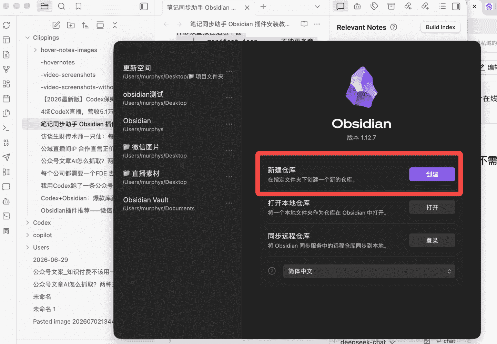

目录越简单。

第二步，只选第一批会马上用的内容。不要一次导入几千篇历史收藏。先放十篇以内，最好是未来两周准备写、讲或交付的材料。

第三步，只建四个目录：Inbox、Notes、Archive、Outputs。主题标签等内容多起来再加。

第四步，手动跑一条。收一篇、读回一篇、拆一条、写一个成品。此过程能暴露权限、路径、格式和账号问题，也能让你知道真正需要哪个工具。

第五步，删掉暂时不需要的安装项。初期可不装 Obsidian MCP、不装 Hermes、不做定时任务，也不用同时打通三个知识库。手机先用 IMA，电脑加工用 Obsidian，需要分享时再用飞书，已足够。

新手最易卡住的，往往不是写代码，而是没说清“从哪里来、到哪里去、成功是什么”。

给 Codex 下任务时，把源头、目标库、目标路径和验收方式说清，问题会少很多。

## 七、内容多起来以后，怎样升级成大型知识库

| 机制 | 解决什么问题 | 最低验收标准 |
|---|---|---|
| 去重 | 避免同一内容反复入库 | 重复执行一次，不新增副本 |
| 日志 | 知道每次同步做了什么 | 能看到来源、目标、时间、状态和错误 |
| 失败重试 | 处理临时网络或接口异常 | 有限次重试，连续失败时提醒人工 |
| 定时检测 | 减少重复手工检查 | 先手动跑通，再从低频开始 |
| 写后验收 | 避免只看接口成功 | 目标端能搜索、打开并读到完整内容 |

当 Inbox 长期积压、同类内容频频重复、一个目录难找东西，或同一份内容开始服务不同项目时，就该升级。

我会从三方向加结构。

第一是分层。原始素材、精炼笔记和最终成品必须分开。原文保留出处，Notes 写自己的判断，Outputs 记录最终发布版本，三者不互相覆盖。

第二是加状态，而非狂加主题标签。除 Inbox、Notes、Archive、Outputs 外，还可增加“待核实”“待发布”“已发布”。状态回答“下一步做什么”，比几十个模糊标签更有用。

第三是确定主仓。哪端保存原始来源，哪端负责加工，哪端负责交付，要提前定。我的默认是：IMA 和网页剪藏负责进料，Obsidian 是加工主仓，飞书是协作和交付端。若某篇内容原本就在飞书完成，它也可以从飞书出发，但加工后的主版本仍要明确，目前明确终点是 Obsidian。

分库也不要只看文件数量。当不同内容的使用人群、权限范围或生命周期明显不同，如个人素材、团队项目和对外付费交付需不同成员访问时，再拆成独立知识库。

标签适合处理跨目录、反复出现的主题；一个主题连续出现、确实需要横向检索时再加，不必第一天就设计庞大标签树。

## 八、我实际踩过的几个坑

### 坑一：工具升级了，教程还停在旧版本

当时我以为，只要一条旧命令曾经跑通，就可长期写进教程。后来🛰️读取方案、飞书 CLI 参数都升级了，知识库不同页面却还保留旧说法，读者照着做自然会卡。

后来我把电脑端🛰️方案统一成 yichen-wechat-local-vault，并重新核对 lark-cli 当前帮助。给新手的建议是：教程里的命令只代表当时版本，真正执行前先让 Agent 检查本机版本和官方说明。

### 坑二：没有先定主仓，内容在多个平台重复

一开始我觉得，多存一份总归更方便、更踏实。等 IMA、Obsidian、飞书里都出现同名内容后，反而不知道哪份最新，也不敢改。

很多朋友在搭建个人知识库时，都会踩进同一个坑：工具越买越多，流程越搞越复杂，最后真正用起来的却没几个。

今天想跟你聊聊我亲身趟过的几条弯路，以及最后沉淀下来的一套“内容流转”打法。

---

先说第一个误区：认为所有工具都得各管一摊，互不相干。

我现在的分工是这样的：

- Obsidian 负责沉淀主版本，也就是我精修后的内容；
- 飞书承载协作场景和交付物；
- IMA 则偏向于素材入口、碎片捕捉和 AI 对话。

同步的时候，我会带上内容来源和当前状态。给新手的建议很简单：**备份可以有好几份，但主版本只能有一个。**

---

第二个坑，是当初恨不得把所有环节全部自动化。

那时候我的想法很天真：最好每隔半小时，系统就自动抓取、清洗、分发。可真出了错，你压根不知道问题出在取料、权限、去重还是写入环节。

后来我换成了三级递进的方式：先手动触发，再增量同步，最后才上定时任务。

给你一句掏心窝的建议：**自动化不是起点，它只是把已经跑通的手工流程放大而已。**

---

第三个坑，是我曾经误以为，必须给 Codex 装 MCP 才能读 Obsidian。

我还写过一篇教程，说直接读文件“不懂双链、标签和 frontmatter”。后来发现这话并不准确——Codex 本来就能理解这些 Markdown 结构，MCP 只是把高频动作打包得更顺手。

于是我把 MCP 降级成了“选装项”。建议是：**先用最短路径把事办成，只有当频繁检索和批量维护成为刚需时，再考虑安装。**

---

第四个坑，是忽略了会员、权限和账号范围。

接口通了、工具装了，不代表你就有资格调用。比如得到大脑的官方 MCP 和 OpenAPI，目前明确要求会员账号；飞书那边，应用权限、文档权限、知识库成员范围也得逐一确认。

官方文档里其实都写得很清楚。所以每次开工之前，建议先列一份前置条件清单，尤其是会员状态、授权范围、目标空间权限，一个都不能漏。

---

第五个坑，是同名目录不等于同一个知识库。

我有一次遇到两个同名的 Obsidian 库，躺在不同路径里：一个只显示部分目录，另一个才是完整内容。如果只看文件夹名字，Agent 很容易被指到错误的地方。

后来我每次都会先核对绝对路径和完整目录，再统一修改相关的 Skill、Agent 和自动化配置，最后再搜一遍旧路径有没有残留。

记住这句话：**路径一旦变了，不只是搬文件那么简单，所有依赖这条路径的流程，都得重新验收。**

---

那到底哪些事适合交给自动化？

我的判断标准是：规则清楚、可以重复、出错后能回滚。比如检查新内容、按固定路径写入、生成初步摘要、拆出候选语料块、维护索引、记录日志、发送失败提醒，这些通通可以交给机器。

但有些事必须留给人来确认：这条内容到底值不值得留？AI 的总结有没有歪曲原意？聊天记录适不适合引用？哪一版可以发布？还有删除、覆盖、批量移动、对外发送——这些涉及判断或高风险的动作，一定要有人工把关。

用一句话总结就是：**AI 擅长“搬、拆、找、对、记”，但内容立场、隐私边界和最终发布，应该始终握在人手里。**

---

最后，给你一份今天就能上手的最小行动清单：

1. 别等工具全配齐，直接拿手头一篇文章开练。
2. 选一个入口：手机电脑都用 IMA。
3. 新建一个 Obsidian Vault，只放 Inbox、Notes、Archive、Outputs 四个目录。
4. 让 Codex 调用 IMA skill，把文章放进 Obsidian 的 Inbox。
5. 让 Codex 拆出 3 条“候选语料块”，你只保留最有用的一条。
6. 把这条内容改写成一条朋友圈、一条短视频文案或一篇👸号文章。
7. 完成后让 Codex 回传给 IMA 和飞书（如果是存档用途，可以不回传；但想在 IMA 或飞书里继续用，务必回传）。

---

这套系统搭到最后，我越来越确定一件事：

**工具只是起点，真正的关键在于把工具的特性，和你自己的业务需求结合起来，让内容流动起来。**

如果内容只是被收藏，那它永远是原料；只有当它变成你的观点、作品、方案，甚至帮你解决了一个真实问题，它才真正成为你的知识。

我现在做的，不只是一套高效的内容系统，更是一套贯穿产品和变现的业务系统。以产品和变现为终点，倒推设计内容系统。

希望这篇文章能给你一点启发。哪怕只有一点点，也足够了。

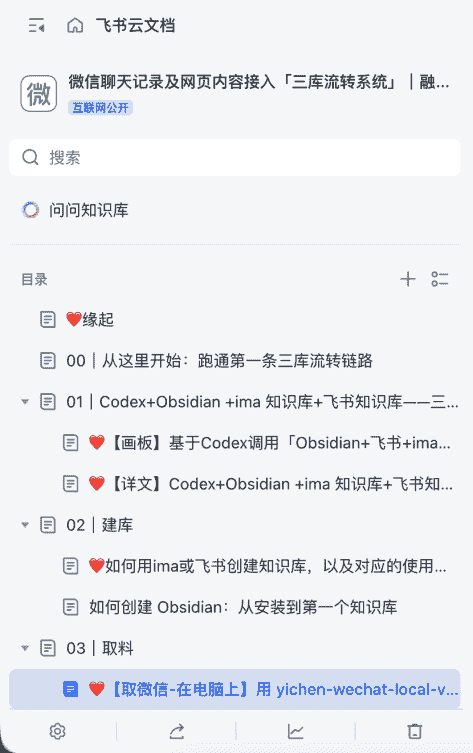

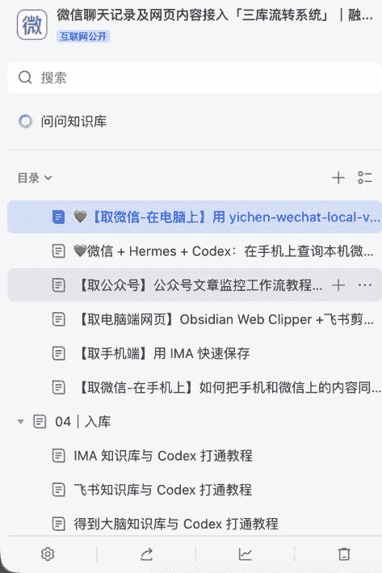

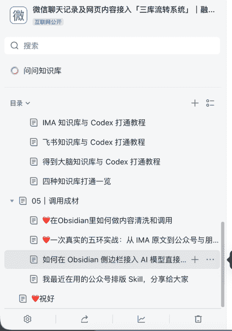

