# 心力即Token：我把创业者的迷茫做成了一个开源AI心力教练Skill，从个人痛点 到开源github的完整复盘

## 心力即带宽：把创业者的内耗做成开源 AI 心力教练 Skill，从个人困境到 GitHub 开源的完整复盘

260729 副业SC 精华

整理：👸号懒人搜索，懒人专属群精选

懒人微信：lazyhelper1

大家好，我是七天，相信不少赚钱的朋友都认识我了，目前在赚钱负责线下聚会。发起近三百场线下交流后，我发现大家遇到的卡点不仅在业务打法，更在心力层面。所以我用一周时间做出了第一版 AI 心力教练 Skill，已放到 GitHub，大家下载后可以接入自己的 Codex 或 Hemers 使用。

这篇文章给两类人看：正被项目挑选、自我怀疑、机会泛滥或持续透支困扰的，一段即可体验；想把个人经验沉淀为可复用 Skill 的，后半部分会完整拆解我如何从自身痛点出发，经状态测评、模式路由、真实使用与迭代，把一段私人工作方式做成公共工具。

内测用户的回馈主要集中在：

- 映照出自己之前没察觉到的特质
- 把模糊的感觉转译成清晰的文字

- 情绪被层层拆解后出现了可落地的思路，有一种被看见、被承接的安稳感。

目前仍在早期试用阶段，反馈来自少量真实体验者，还不算严谨的效果验证。我更在意三件事：用完后是否能更准确地描述卡点、是否能锁定一个更精准的问题、是否产生一个真实可执行的微行动。

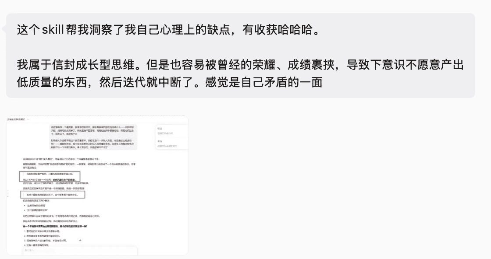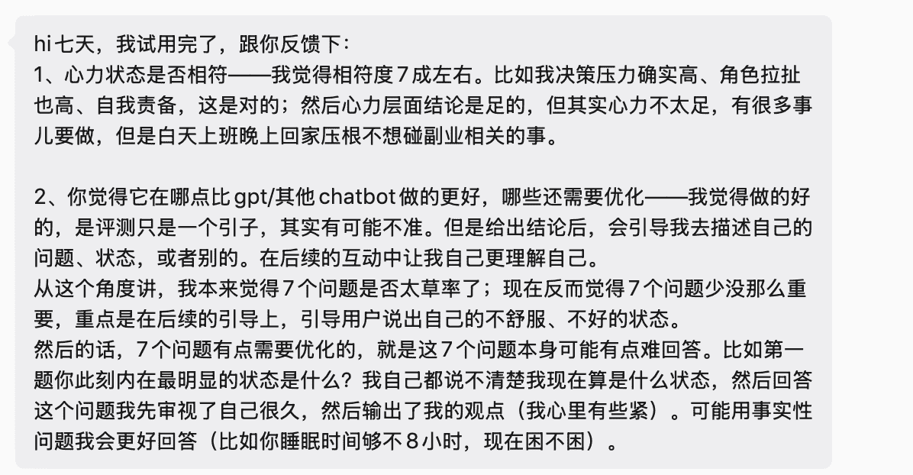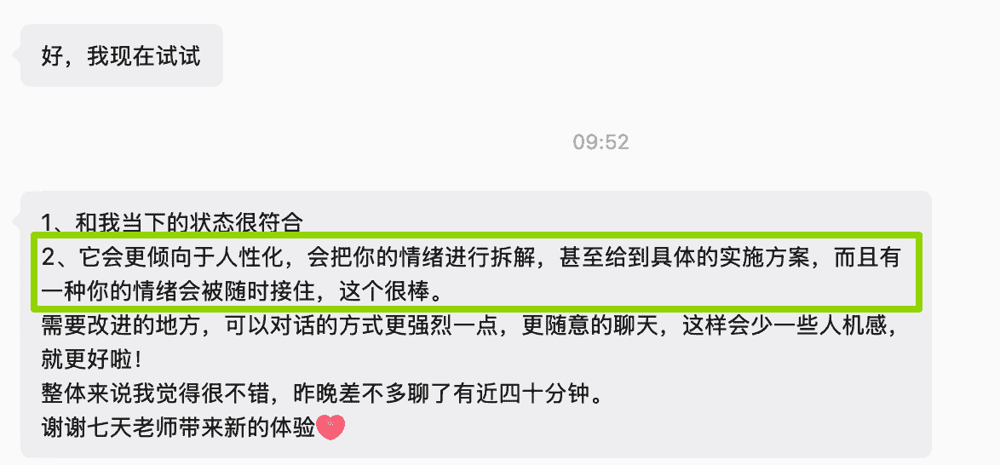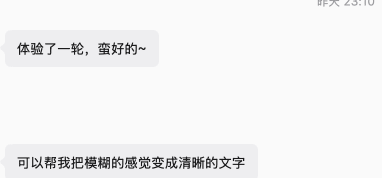

后续我会围绕这三点持续收案例做迭代。

大家好，我是七天，目前在赚钱负责线下聚会。过去一个月赚钱已发起330场线下活动，我和很多创业者、个体创作者深入聊过。聊得越多越发现，路上走不顺不全是方法问题。

有人手上握着多个可行方向却不知收敛；有人项目已跑起来，遇到限流、增长停滞、收入波动就陷入否定自己；有人不是缺下一步，而是累到不敢松手。表象不同，根源相近：在不确定、复杂抉择、长期压力与强烈情绪面前，很难独自完成结构化自省。为此我用一周做出首版 AI 心力教练 Skill，并开源到 GitHub。

GitHub 地址：GitHub - zhaocathy1221-hash/ai-heartpower-coach: A...（欢迎点亮 star）

它不替你拍板，也不只是情绪安抚。基于“充分表达 + 结构化聆听 + 模式路由”的对话机制，帮你从“很乱、说不清、不知道怎么办”走到“我看清此刻真正卡住的地方，并能先迈一步小事”。

**1、本篇适合谁**：正处项目选择、自我怀疑、机会过载或长期疲惫的人，可直接试用。

**2、为何关注心力**：我本身是 ENFP 高敏感，脑中想法常年像歌单。2023 年我在专业机构系统学习一年教练，接触 GROW、教练式提问、NLP 逻辑层级。长期处于典型创业者状态：点子不断、机会持续涌现；待办堆积却说不清消耗点；想行动时身体与情绪在抗拒；表面在选项目，深层担心的是做不成或商业化失败。

**3、通用 AI 为何不够**：我也试过通用模型。它们习惯立刻分析、列优劣、给行动清单，像个高效顾问，却未必触到当下最需要处理的层面。有时我需要的不是建议，而是先把混乱倒出来；有时不是不会决策，是选项太多；有时话题是商业方向，真正的卡点是自我怀疑；有时心力见底，不适合立刻立计划。不同卡点需要不同处理路径，而非统一给方案。所以我希望做一个先识别状态再决定入口的 Skill。

**4、Skill 如何运作**：进入后先用 7 个问题识别心力状态：情绪是否混乱、需求是否模糊、心力是否透支、是否过度自责、是否有决策压力、是否过度在意外界评价、机会是否过载、角色是否冲突。识别后不急于给建议，而是进入匹配的教练模式。能量透支时先做心力整理；方向太多时先处理机会过载；反复“我是不是不行”时先拆分事实与自我攻击；担心产品无人买时回到真实需求与最小验证；脑子乱时先区分事实、感受、需要、担心。最后帮你落到一个足够小、当下可执行、不至于再次压垮自己的动作。

**5、可获得什么**：完成测评后，可获得一张专属“七维心力画像”，看清当前最该优先处理的议题。感谢【@易仁永澄】老师去年的 AI 心力教练小航海，让我明白可用的 AI 教练流程需包含充分表达、结构化聆听、状态识别、模式匹配与行动承接。

# 1、为何做这个 AI 心力教练

很多人会有“快要 burn out”的感觉。对赚钱创业者而言，往往不是项目跑不通，而是不确定性叠加导致无法取舍或厘清优先级。比如项目爆单却被限流如何调整心态，比如不好意思收钱怎么办。理不清，有时并不是想得不够多，而是大脑在面对未知、复杂选择、强情绪与长期压力时难以自发结构化思考。

这时需要一个外部支点。它未必帮你做决定，却能把混乱的表达接住，把说不清的感觉梳理出来，把杂乱的念头放进结构里。

传统 chatbot 更像梳理、执行助手。GPT 更像助理、顾问、执行员。但很多时候，我们连自己的心力卡点都描述不清。

适配使用场景包括：

- 我很烦，但说不清原因
- 我不想上班/不想做这件事
- 我很累，但停不下来
- 我不知道自己想要什么
- 我有多条方向，不知道选哪个
- 我感觉项目不对劲，但说不清
- 我想做产品，但怕自嗨

总体来说，这个 Skill 基于“充分表达 + 结构化聆听 + 模式路由”。它不替人决策，也不只是安慰，而是助你在压力、迷茫、内耗、自我怀疑、机会太多或行动卡住时，把混乱表达整理成可看见、可理解、可行动的结构。用产品化的话说：从“我很乱、说不清、卡住了”到“我知道卡在哪里，下一步能先做什么”。

当事实、感受、需要、卡点、资源被重新看见，行动不再模糊。把这些要素梳理出来，人能重新夺回一点主动权。而这份主动权，就是我理解的心力。

关键点在于：

1、用一个外部支点理清思绪
2、把混乱感受在事实与情绪层面做结构化聆听
3、不同卡点走不同模式，不统一给建议

我的 Skill 先用 7 个快速问题厘清你当前最想聊的情绪，再通过结构化聆听与教练澄清、反问等技术，把混乱想法理清，帮助看清卡点。

# 2、下载后如何使用

github 地址：https://github.com/zhaocathy1221-hash/ai-heartpower-coach

我希望它是一个可理解、可交付的流程，而非即兴聊天。整理成 5 步：

**第一步：先做心力测评**

进入后不是直接聊，而是先测评。围绕能量状态、脑中反复问题、身体信号、当下最卡之事、是否自我怀疑、是否在多个机会间摇摆、是否正在验证需求等提问。目的不是打分，而是把你从“我说不清”带到“我大概知道自己处在什么状态”。

**第二步：生成结构化反馈**

测评后 AI 会输出画像：

- 当前主要状态：如能量透支、决策迷雾、自我怀疑、机会过载、真实需求验证等
- 核心卡点：表面问什么，真正卡在哪
- 隐性需要：没明说但反复出现的需要
- 适合进入的模式：该先释放、先决策澄清、先处理自我怀疑还是先验证需求
- 当前不适合做什么：状态乱时别急着重决策；能量低时别堆行动计划

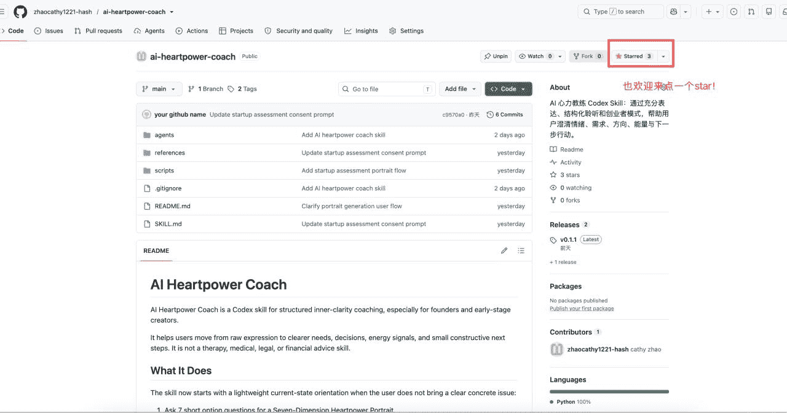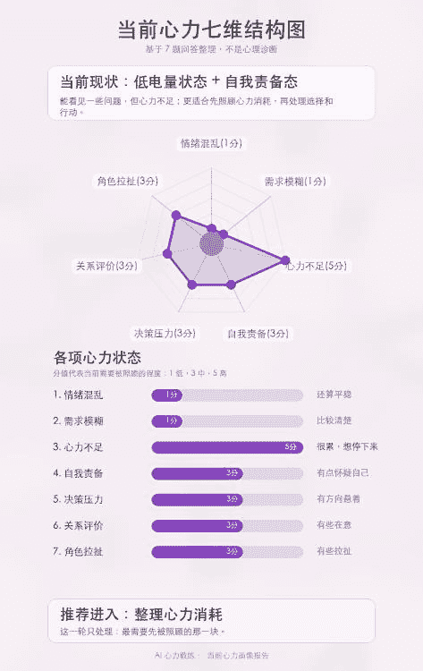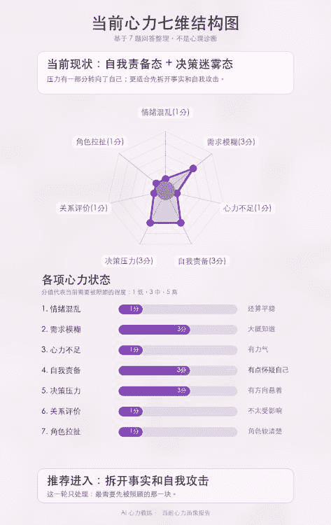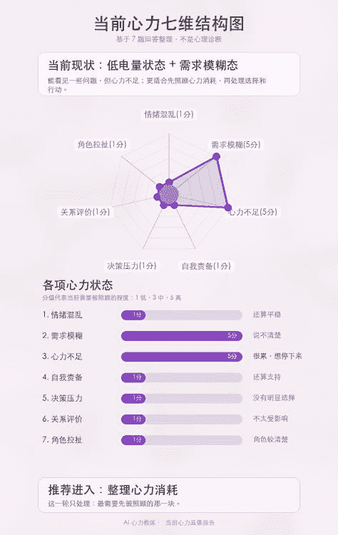

**第三步：进入对应教练模式**

有了画像后，AI 会带你进入匹配模式。能量透支就先做能量账户或释放清空；方向太多进机会过载；反复“我是不是不行”进自我怀疑；纠结“用户会不会买”进真实需求模式。因为很多人卡住不是缺方法，而是用错了处理模式。需要被接住时却被要求立刻行动；需要验证需求时却在自我攻击；只是机会太多却以为是自己不够坚定。

**第四步：充分表达 + 结构化聆听**

进入模式后，你先充分表达，不必完整、不必理性、不必好看。AI 先聆听再整理结构：

- 事实：发生了什么
- 感受：情绪与身体反应
- 需要：显性与隐性需要
- 卡点：信息不足、能量不足、关系压力、能力缺口还是身份冲突
- 资源：已有的经验、优势、支持
- 下一步：可小到什么程度，不把你压垮

**第五步：输出小行动或下一阶段路径**

最后不给一堆宏大建议，而是帮你找到最小行动。可能是沟通草稿、复盘结论、需求验证动作、能量恢复安排，或一个更准确的问题定义。

# 3、两段真实对话场景

**案例一：从“创业方向太多”到“产品结构变清楚”**

我最初问的是健康睡眠、AI 心力教练、创业者陪伴、内容产品哪个更合适。表面是方向选择。Skill 先识别出“机会过载模式”。

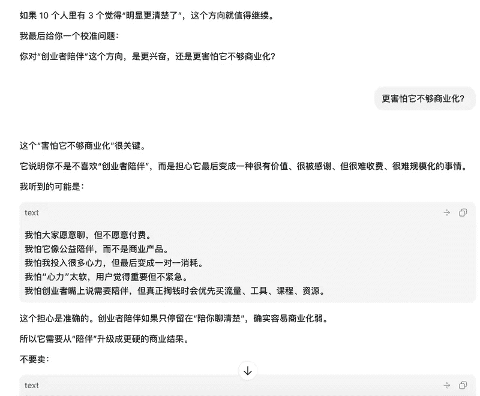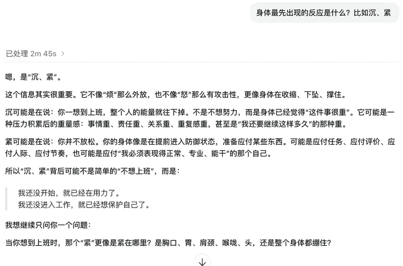

它帮我看到，这几个方向不是并列，而是链条：AI 心力教练是核心能力，创业者陪伴是人群，健康睡眠是切口，内容产品是获客交付形态。从“我要选哪个”的焦虑，转向更准确的问题：用什么切口验证核心能力。随后我表达对“创业者陪伴不够商业化”的担忧，Skill 把问题切到用户真实需求与商业化验证：不是不喜欢陪伴，是担心它有价值却难收费、难规模化。于是产品被拆出：低价诊断作筛选器；中价 7 天陪跑负责收入；高价 30 天创始人心力陪跑负责利润与案例。

这个案例的价值在于：不是给出方向答案，而是看清我真正卡在机会过载、商业化担忧、定价焦虑还是产品形态不清。

**案例二：从“线香带货能不能做”到“我是否适合这个场景”**

我家属在做📕赛道，我问线香带货的机会是否可做。普通分析会直接进市场趋势、选品、打法。Skill 先识别出三层问题：决策迷雾、自我怀疑、用户真实需求。

它帮我分清：线香/香氛有内容机会，但纯带货需拼选品、审美、供应链、爆款笔记和佣金，未必是当前强项。若把线香放进“睡前心力恢复”场景，它就成为场景道具。真正要验证的是用户是否愿意为“睡前 10 分钟把今天的累放下”这一心力恢复场景停留、收藏、评论、购买。

最终问题不再是“线香能不能卖”，而是“我是否愿意连续 7 天用线香这个载体，讲清一种睡前心力恢复生活方式”。

这说明它会把泛机会判断拉回我的长期主线：AI 心力教练、健康睡眠、情绪安顿、生活仪式。

# 4、产品迭代经历

起初我设想用户直接进入咨询提问。但真实教练一次不会解决所有问题，需要先澄清本次要解决的问题。因此我调整为先用 7 个问题梳理状态，再聚焦方向。

先测评识别状态，再匹配模式，再教练，再输出行动。测评从获客工具变成产品一环。

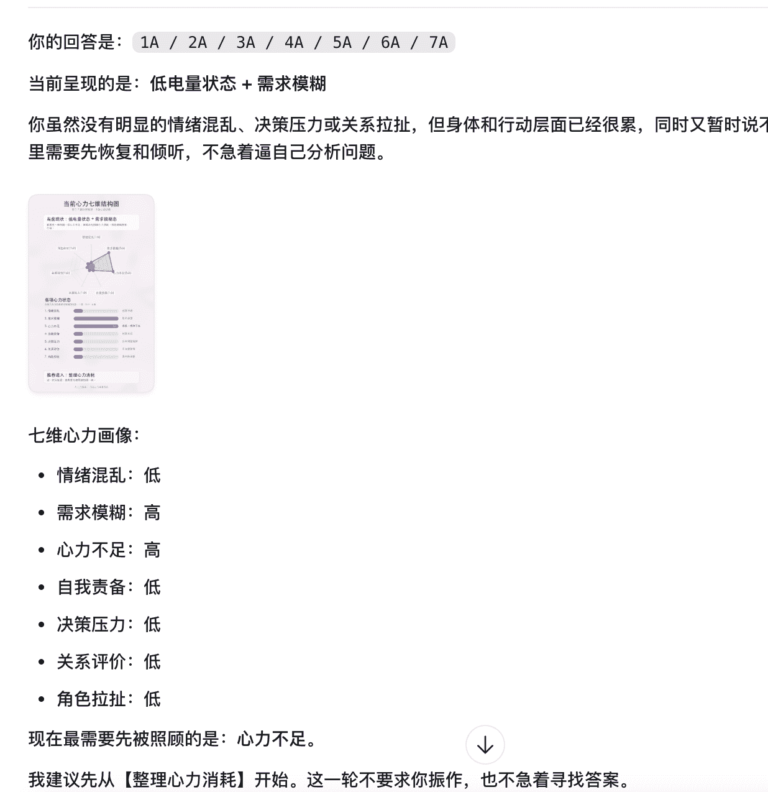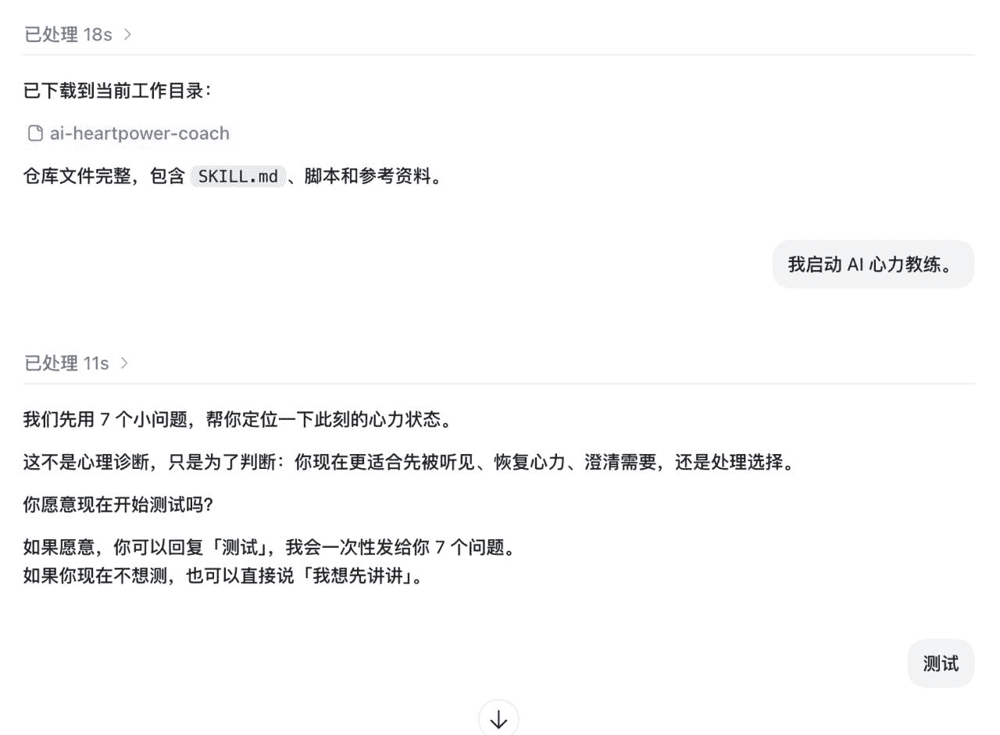

后来我加了模式切换机制。因为表达过程中问题会变。开始可能是“方向太多不知道选哪个”，像是机会过载。聊着可能变成“怕不够商业化”，转向用户真实需求。再聊下去可能变成“我怕做不起来”，转向自我怀疑。

好教练不能死守一个模式，也不能乱跳。需要在每轮对话识别重心是否迁移。我感觉我们已从“机会过载”走到“用户真实需求”，因为问题不再是“选哪个”，而是“用户会不会买”。要不要切过去专门处理？

这个设计让用户在对话中逐渐学会：我现在正在处理什么。这也是心力教练想培养的能力：少依赖 AI，越能听清自己。

# 5、参考的文档与经验

- 易仁永澄老师关于 AI 心力教练的手册：最大启发是“感觉充分表达 + AI 结构化聆听”。原始表达不是低质量材料，重要信息常藏在混乱、重复、啰嗦里。

航海手册链接：https://scys.com/docx/ZfOddx57WoTz4Ix2aUQclyTGn3b

手册核心方法：先让用户把真实混乱表达说出来，AI 再整理事实、感受、需要、意图、挑战、洞察、行动。这让我意识到，原始表达里藏着关键信息。

- 我 23 年在创问学习一年 life coach，并持续接触专业教练。长期处于念头多、事情多、累却说不清原因的状态，让我带着真实需求设计，融入 GROW、提问模型、NLP 六层理论。

- 创业者场景的真实卡点：方向选择、商业化验证、自我怀疑、机会过载、能量透支、角色冲突。这些不是单纯靠方法论解决，需要同时处理事与人。我知道那种“脑子里很多念头却不知从何开始”的感觉。所以我做这个 Skill，是带着自己的真实需要，寻找一个能帮我把自己听清楚的外部支点。

- 真实对话案例：创业方向、线香带货、测评入口调整。不断校准它的真正价值：不是替人变聪明，而是帮人更诚实、更结构化地看见自己当前的问题。

我觉得我们正进入“心力即 Token”的时代。

心力可视为个体的认知能量与信息带宽，像 AI 中的 Token 与上下文窗口，也像物理学中的可用能量。Token 消耗像是把人类神经活动数字化呈现。我们可能是第一次意识到，脑力、心力、精力比想象中更值钱。

我做 AI 心力教练，是因为我相信：人的混乱往往不是缺答案，而是缺被听见、被整理、被澄清的过程。AI 不需要替我们成为更懂人生的人。

# 6、如何从自身需求长出一个 Skill

做完这个 Skill 后，我觉得可复制的经验是：

一个人不必先成为领域专家，也不必先想出一个完整产品才有资格开始。更自然的起点，是回看自己身上长期痛苦、消耗、反复卡住的问题，以及自己何时最需要 AI 的帮助。

很多人以为卡点是自己的独角戏，其实一旦把某个困境讲清楚，会发现背后是一整群人都在经历类似的模糊疼痛，只是没人把它翻译成可被解决的需求。我的痛苦从来不是私事，它更像一颗未被收纳的公共种子。

1. 别先去扫货市场缺什么，先把自己身上反复发作的问题捡回来

我开始做的是回溯。回溯那些一次次出现的瞬间：当时现场发生了什么，为什么会感到耗竭或想逃，身体给出了什么信号，脑子里循环的是哪句台词，我当时以为我在求解什么，后来才明白真正的卡点藏在哪儿。

我本身是 ENFP 高敏感的人，对感受很敏锐，却常拆不清它到底指向一个怎样的具体困扰。接触 life coach 后，第一次把那种飘着的模糊感，压成了一个可以上手处理的问题框架。这也让我明白，真正缺的往往不是更多技巧，而是学会把机会判断、自我怀疑、能量枯竭和真实需求区分开来。

2. 混乱需要被摆到台面上看

陷入问题时，事实、情绪、身体反应、焦虑、需求和可能的选项全都挤一起，光靠想会原地打转。可视化不是为了做得好看，而是把看不见的东西拿出来摊平，让人先找到一个能下手的入口。

形式可以很随意：情绪地图、问题发展的时间线、需求树、能量收支表，或者像 AI 心力教练里那套七维心力结构图，把当下状态映射出来。重点不是一次解决全部，而是让用户从图里认出“此刻最该被照顾的那一块”。只要聚焦发生了，后面的一切才有抓手。

这批我做的可视化尝试，后续都会陆续沉淀成不同的 Skill。

3. 别等想透彻了再动，先允许自己做一个能用的粗糙版

第一版不需要理论完整，也不需要设计十几种模式。只挑一个对自己最痛、最常掉进去的场景，让它完成一次最基础的帮助就够了。

起初我只解决“脑子很乱”这个状态：先让用户说出发生了什么，再一起把事实、感受、担心拆开，最后锁定当下最需要处理的一件事。版本很糙，甚至只够自用，但它启动了真实使用。没有这个雏形，就没有真实反馈；没有反馈，后续所有对功能、流程和形态的优化都只是在脑内模拟。

做出来后，我不会急着发布，而是先把它放回自己的日常里反复摩擦。我会留意什么情境下我会主动打开它，哪些问题我答不上来，它是否过早给建议，哪一句回应真的让我看见了新角度，用完之后我描述问题的方式有没有变化。

每次使用我都留档，这些案例不是用来证明厉害，而是帮我搞清楚：我真正需要的帮助到底以什么样的方式发生。当它稳定地帮到自己几次，再交给处境相似的人试用，看是否能在相似场景里产生相似价值。

如果要提炼成一句话：真实的痛点提供种子，可视化提供聚焦点，粗糙的第一版启动真实使用，而一次次真实案例让结构慢慢长稳。

可以复制的不是我那套心力教练模型，而是这条从自己的需求出发，把私人经验一点点加工成公共工具的路径。

# 7、我还没解决的问题

1）Skill 的稳定性和迭代节奏。每次改动都可能带走反馈风格，导致用户体验波动很大，如何既迭代又保持稳定，还在摸索。

2）商业化的下一步。初步想法是 Skill 开源，配合社群做心力训练营，或者做心力主题的真人咨询。具体的形态还没定，先把内测群养好再说。

3）如何把用户的记录沉淀下来并可视化，让人真切感受到自己心境和状态的变化轨迹。

❤❤ 最后，邀请你一起验证。如果你正卡在一个真实却说不清的创业节点，可以下载 Skill 做一次测评和对话。

体验后，麻烦只回答三件事：

1. 使用前，你以为自己卡在哪里？
2. 使用后，你发现真正的问题是什么？
3. 你因此做了什么具体的小行动？

GitHub：https://github.com/zhaocathy1221-hash/ai-heartpower-coach

我收集反馈不是为了让 AI 说的话更温暖，而是看它是否能真正帮一个人更清晰地看见自己。

————分割线————

看完这篇 SOP，你可能觉得懂了，可真正上手时，90%的人会死在第一步。

工具和教程是最不值钱的护城河，真正的壁垒是立刻开干，以及圈层里的信息差。

想看全网最新的变现打法，和一群执行力在线的极客一起落地拿结果，可以围观我的核心私域：【懒人专属群】。

我们只拆商业闭环，只榨 AI 效率。系统里已经沉淀了 1000+ 跑通的套利实战。

❤ 查阅圈子数字资产与入场门槛：

https://lazyso.com/insider/

认可价值、准备动手的，扫码加我微信（lazyhelper1）。

备注：【实操上车】，不闲聊。

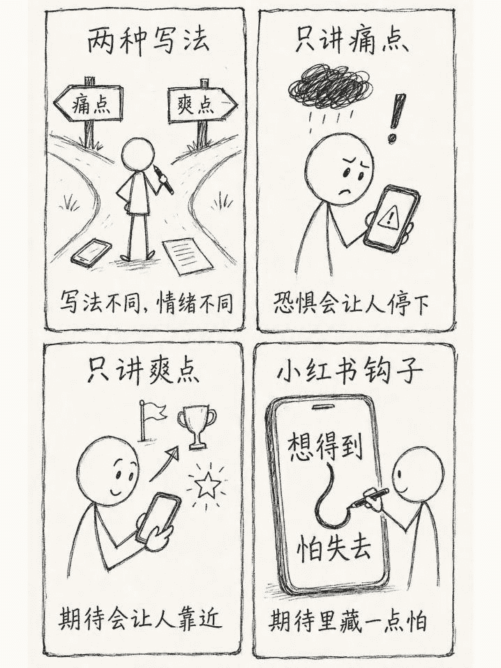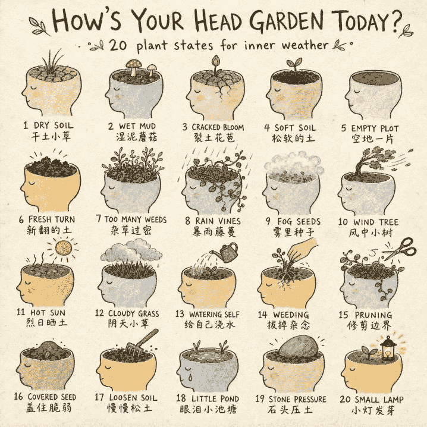

