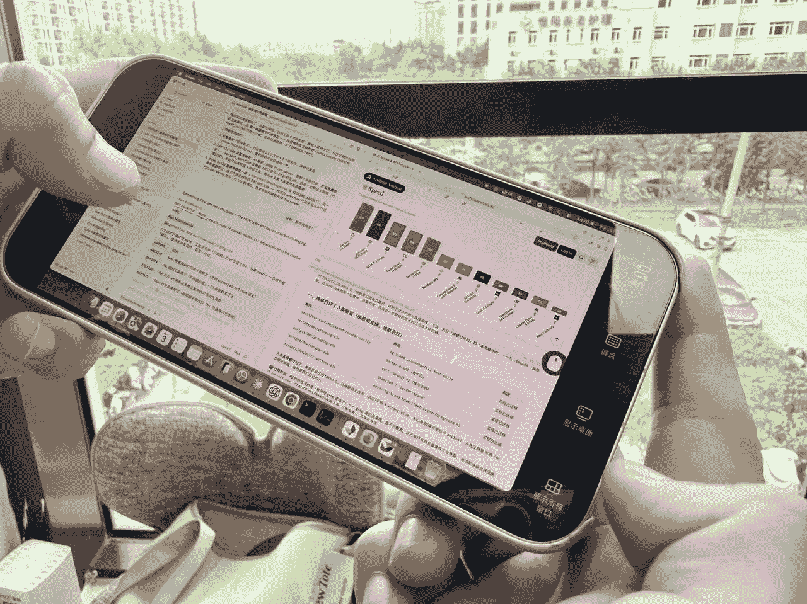
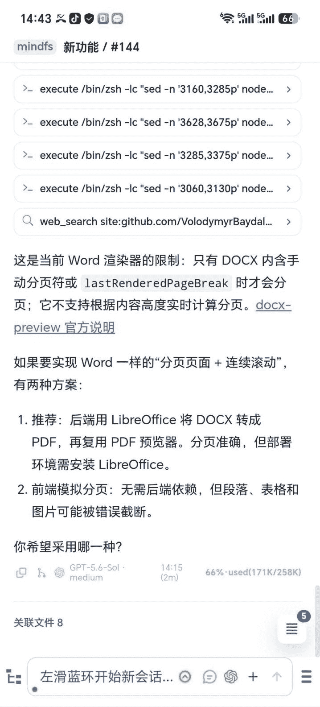
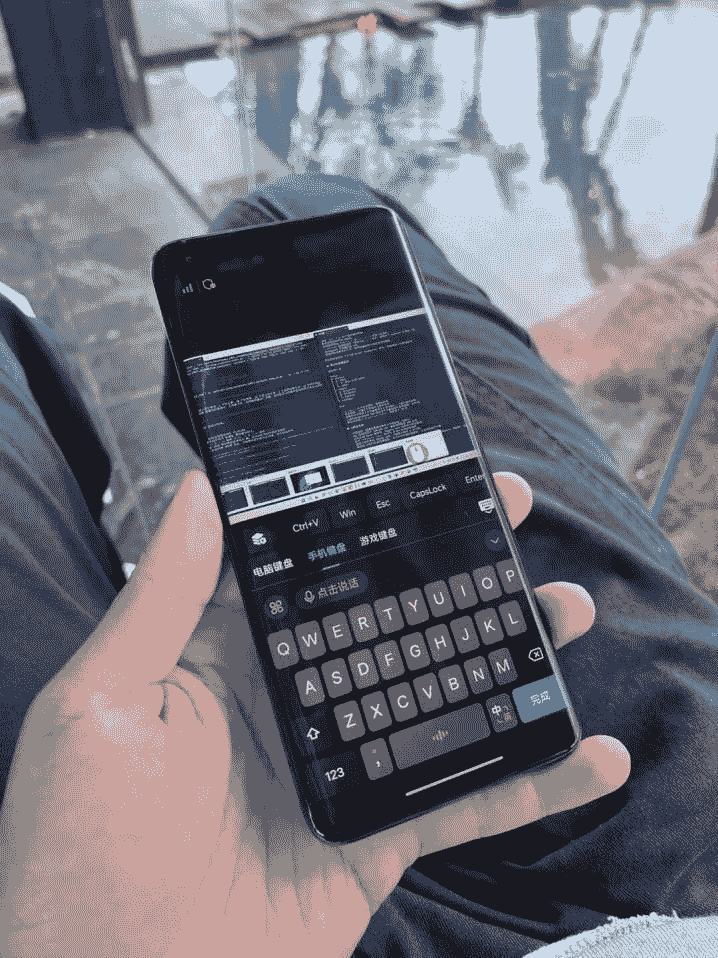

# 敢脱离电脑的老板，才是好老板

放得下电脑的老板，才是AI时代的聪明老板

各位朋友，我是刘小排。今天聊一个反直觉的话题：当你好不容易攒下一支“AI员工军团”，最该戒掉的动作，反而是死盯电脑屏幕。

真正的老板，日常几乎不需要碰电脑，他有手机就够了。遇到事情，用手机发一条语音，交给某个同事去落地。既然你把自己定位成一支AI团队的老板，就该学会放手：别守着屏幕盯执行，把目光移开。

一边刷手机，你依然可以开“小窗”观察AI员工干活。

下面讲几个实操细节。

先说软件：我用的是UU远程，完全免费，但体验不输付费的ToDesk，甚至更顺手。

打字怎么解决？思路很简单：用语音输入。我一直用🛰️输入法，它的语音识别很准，还能自动整理标点和分段，有点像Typeless那种输入习惯；而且剪贴板跨设备同步，任何一台设备复制，另一台设备直接粘贴。

接着是个高频问题：机器留在国内不行吗？为什么要放海外？

我有几台机器就在国内。放海外的核心好处有两点：第一，硬件有唯一ID（尤其Mac系列），国内渠道买的Mac很容易被Claude Code识别并封号；海外买的硬件，再配合海外网络，封号概率小很多。第二，海外网络环境普遍更好——运营商靠市场竞争吃饭，随便一间海外住宅或办公室，上传下载跑满1Gbps很常见。

那如果我没有海外硬件，去云厂商租一台VPS行不行？

我的建议是别碰。VPS普遍性能拉胯，体验很难受。你可以问AI：在AWS租一台性能对标Mac Mini M4（12核、48G内存）的VPS，一个月多少钱？大概率一个月没有大几千下不来。有这钱，不如添置真硬件。

再补一刀：哪怕你的机器就在国内，我也强烈建议你用手机操作。现在的AI干活太凶猛了，根本不需要你全程盯盘。你越是盯着，越容易胡思乱想、自我内耗、白白浪费时间。不如强制自己把电脑屏幕关掉，只留手机，把时间还给生活，真正享受当老板的感觉。

所以，控制端选手机还是iPad？手机。

原因也很简单：手机最顺手，尽量不给生活添负担。按奥卡姆剃刀原则，没必要添的东西就不添。有人在我👸号评论区说iPad更好，我可以肯定地说，那是没实际用过的人随便YY。你去看那些真正在跑这套玩法的人晒出的截图，清一色是手机，连折叠屏都很少有。

我挑几张评论区的真实截图放在下面。你看，是不是根本没有折叠屏和iPad的影子？

接着聊一个很多人没想明白的问题：为什么要堆好几台电脑？

因为电脑不在自己手边，你要像管理团队一样，给不同AI员工分配权限和分工。比如管理知识库的那台，最好就是放在自己办公室、每天能亲手摸到的机器；其余机器再分别挂不同项目、给不同上下文、配不同权限。这里有个核心心法：控制上下文，比控制权限更有用。张一鸣那句关于上下文的断言，放到AI员工身上依然成立：多给上下文，少搞控制。

至于OpenClaw/Hermes，现在还值得用吗？

不值得继续折腾了，太麻烦。现在的Codex、Claude Code已经足够好用，和半年前完全是两个世界。如果你实在习惯Hermes的操作逻辑，我更推荐用WorkBuddy，它比Hermes顺手得多。WorkBuddy里用hy3模型免费，也可以配置你自己Codex的包月套餐，通过CLI Proxy API接入就行。

MacBook合上盖子能远程吗？当然能。UU远程里有相关开关，我的MacBook常年盖着盖子跑。

最后，说说“Token太贵”这件事。

这可能是最大的误区。Token真的不贵，请务必Token Maxxing——把Token用满、用透。凡是跟你说Token太贵的自媒体，建议直接取关，他们根本不是真正下场干活的人。我也不建议你把每月一两千的Token费用省下来。算笔最实在的账：OpenAI和Anthropic最大号的包月账号，一个才200美元，买5个也就1000美元每月，不到7000元人民币。你要是雇真人，7000元工资再算上社保、办公室摊分，可能只能招到一个普通员工。同样的钱，“一个普通员工每周工作40小时”和“五个天才程序员每周工作144小时”，你选哪个？这就不用我多说了吧。

有什么问题，欢迎随时交流。

————分割线————

看到这里，你可能觉得已经懂了。但残酷的是，90%的人一进入实操就会卡在第一步。工具和教程从来都是最低级的壁垒，真正的壁垒只有两个：立刻动手，以及圈层信息差。

想第一时间看到全网最新的变现玩法？想和一群执行力拉满的极客一起下场拿结果？可以来我的核心私域【懒人专属群】围观。这里不整虚的，专注两件事：商业闭环拆解、AI效率压榨。社群里已经沉淀了1000多个跑通的套利实战局。

👉 查阅圈子完整数字资产与上车门槛：
https://lazyso.com/insider/

认可价值、准备下场干活的，可以加我🛰️：lazyhelper1。备注【实操上车】，不闲聊。
