# 12万外包踩坑后反向自研AI ERP：一个家具老板的完整复盘

260803 副业SC 精华

整理：👸号懒人搜索，懒人专属群精选

懒人微信：lazyhelper1

大家好，我是富二蛋，家具建材行业，团队29人，22年加入赚钱。

先抛三组数字，这就是全文的骨架：

- **12万**——外包定制ERP的投入。开发耗时一年，上线一个月后我亲手终结
- **1个月**——我自己上手自研的周期。零代码背景，5月启动，6月上线
- 每月**2000多**——当前AI服务的总花费。系统已稳定运行并持续迭代

我并非技术出身。动手前，我不了解数据库、不清楚接口，也分不清前端后端。我只清楚一件事：公司需要一套真正适配自己的系统，市场上找不到现成的。

### 写在前面：我不经意间成了自家公司的FDE

前不久龙哥在直播里讲到FDE这个岗位，我听着后背发凉——他描述的画像，跟过去几个月的我几乎重合，只是当时我还不知道这个词。

标准FDE的剧本是：有平台能力的公司把工程师派到客户现场，边理解业务边做落地。之所以值钱，是因为补上了软件行业最难的那段——懂技术的看不懂业务，懂业务的玩不转技术。

我的路径恰好相反。不是技术人员进入业务，而是业务负责人自己长出了工程能力。

我称之为反向FDE。做下来才发现，逆向其实更省钱。常规FDE最大的成本是行业理解，需要数月浸泡在陌生领域，还不一定吃透；而我在家具建材做了十几年，业务几乎是母语，唯一缺的只是工具能力，AI把这部分门槛砍掉了九成以上。

简言之，让业务内的人用AI来造系统，比让AI工程师去啃一家公司快很多。

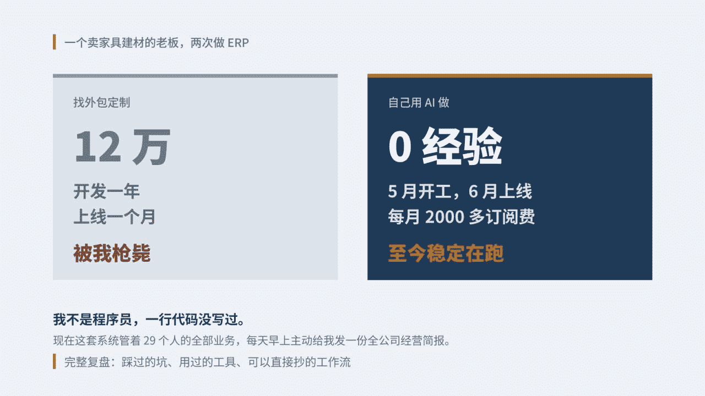

龙哥还说，老板必须亲自上场，否则结局不会好。他也认为，未来各行各业最顶尖的FDE，很可能就是该行业的一线经营者。因为企业改造不是堆工具，而是要真懂上下游、真懂流程、真懂只有亲历者才清楚的例外。

这篇文章就是对这个判断的一个实物证明：一个做家具建材的，把自己变成了公司内部的FDE。

本文写给两类读者：

一类是想给自己公司做系统的老板——我把踩过的坑、花掉的冤枉钱、可复用的工作流全摊开，可直接照搬。

另一类想入行FDE的技术人——先说结论：这个岗位的稀缺点不在写代码，而在于愿不愿意深度浸泡在一个行业里。我用一年时间和12万验证过，业务理解是护城河，技术是可以被AI补齐的一半。文末我单独留了一节给你们。

全文会讲清：通用软件为何不合适、外包12万如何打水漂、我从零摸索的工具演进、零基础可复制的开发方法、系统模块如何从痛点长出、AI如何嵌入系统替我管公司、团队推行的心法，以及一份行动清单。

⚡ 适合阅读：

- 用钉钉、纷享销客等通用SaaS，感觉哪里不对又说不清的老板
- 正在考虑或已找外包做定制系统的老板——第三节后再签合同
- 听说AI编程心动却担心没技术基础的普通人
- 想成为FDE、正在找首个落地行业的技术人
- 想了解AI在企业管理里的真实落地，而非仅做AI客服的管理者

全文目录：

1. 写在前面：我好像不小心成了自己公司的FDE
2. 背景：一家29人公司的管理困局
3. 第一次尝试：通用SaaS为什么不合身
4. 第二次尝试：12万外包一年的完整复盘
5. 觉悟时刻：最懂系统该长什么样的人是我自己
6. 工具进化线：五个阶段，学费全替你交了
7. 我的开发工作流：零基础也能高质量交付的方法论
8. 五个模块的诞生：从痛点到功能
9. 进阶：我把AI装进了系统，它现在替我管公司
10. 推行心法：为什么员工愿意用
11. 一笔总账
12. 高频问题：被问了无数遍的10个问题
13. 给想做FDE的人：一个甲方视角的建议
14. 行动清单：你的第一步

## 一、背景：一家29人公司的管理困局

业务是家具建材，29人，链路是“获客—跟进—成交—项目交付”：线上线下进来线索，销售跟进转化商机，签约后进入项目执行，最后交付结算。

链路清晰，但每环都在漏水。我梳理出五个明显漏洞：

第一漏：线上线索无法自动进入系统。线上渠道的线索是命脉，却要靠人工复制粘贴录入。搬运必有损耗：丢失、错误、遗漏、跟进遗忘。每条丢失的线索背后都是真实的推广成本。

第二漏：商机SOP执行不可追踪。我给团队制定过标准动作：客户进入后第几天做什么、到哪个阶段推什么。制度写得完整，培训也做了，但系统里看不到执行情况——谁做了、谁没做、进度如何，一概不知。SOP成了墙面装饰。

第三漏：绩效考核沦为印象分。数据不沉淀，月底只能凭感觉打分。表现好的觉得吃亏，表现差的无所谓，我自己打分时也不踏实。公信力丧失，激励也就失效。

第四漏：项目管理依赖人盯。一个项目从签约到交付有几十个节点，全靠大脑记忆和微信追问。我每天大量时间被“XX项目到哪了”占据。人忙则节点遗漏，节点遗漏客户就投诉。

第五漏，也是最痛的：在途项目利润不可见。等到做完、结算、对完账才知道赚没赚。人工、辅料、返工、杂费摊开后，有的单子是白干。等发现亏损时钱已经亏完。这是经营的盲飞。

人、事、物，都没有系统化管理。29个人的公司，全靠我一个脑袋当服务器。

我知道必须上系统了。随后就是连续踩坑。

### 二、第一次尝试：通用SaaS为什么不合身

最早用的是纷享销客。

先说公平话：产品不错，大厂出品，功能齐全。问题不在产品差，而在不适合我。用了一段时间，前面五个漏洞一个没补上。线索照样进不来，SOP照样无法追踪，绩效照样靠拍脑袋。

后来想通了，这是通用SaaS的固有矛盾：要服务上万家企业，就不可能只为你一家定制。你的业务必须迁就流程，而不是流程迁就业务。家具建材有自己的特殊性：线索来源杂、跟进周期长、交付环节多、成本结构复杂。通用软件覆盖的是最大公约数，而竞争力恰恰藏在公约数之外。

于是我当时做了个看似合理的决定：既然通用不合身，那就定制。

### 三、第二次尝试：12万外包一年的完整复盘

我找了外包，谈需求、签合同、开工。共花12万，耗时一年。

这一年学到的东西，比12万值钱——当时却完全不觉得。

### 3.1 最折磨的不是等待，而是说不清

开发里最痛苦的是沟通。

我脑中的业务流程很清晰，讲给程序员听，理解总差一截。他不了解家具建材的生意，不知道为什么线索要这样分、商机要那样推、成本要如何归集。对我而言是常识，对他是需要从头解释的术语。

说不清怎么办？我被迫养成习惯：自己先画原型。界面长什么样、按钮放哪、点击后跳转、数据进出——一页页画给对方看，后来用AI生成原型。

记住这个细节。当时我以为是无奈，后来才明白，这一年画原型的痛苦，是整个故事里最值钱的投资。

### 3.2 上线当天

一年后系统上线。我满怀期待点开——主流程无法运行。不是小Bug，是主链路走不通。界面丑到不敢给员工用。谈好的很多功能根本没有。

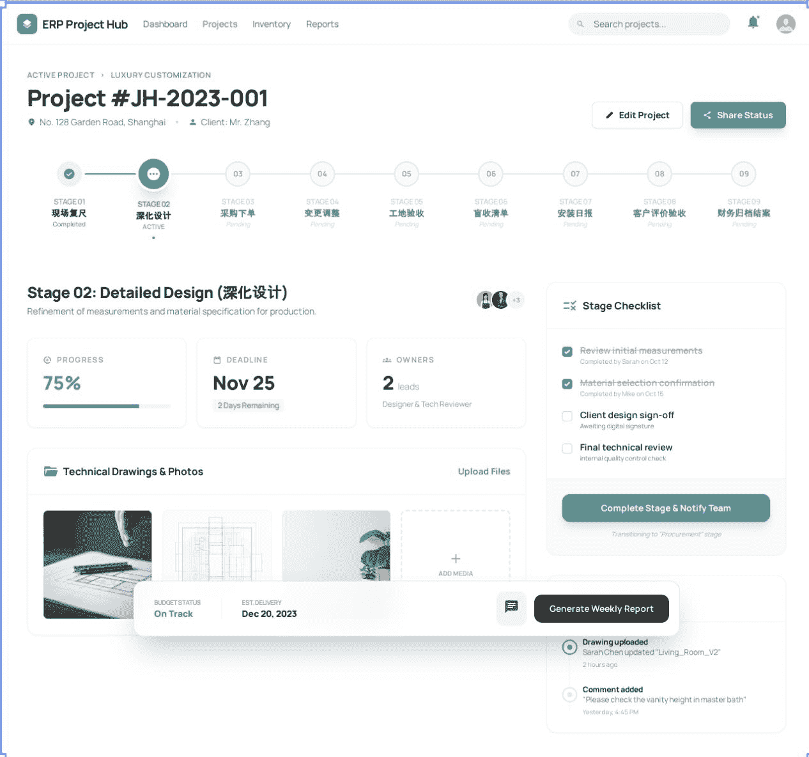

想改？排期。想加功能？排期。我脑中还有大量待实现点，一想到每个都要经历“沟通→误解→返工→排期”循环，光是排期就让人绝望。

### 3.3 终结

上线一个月，我亲手砍掉了。

不心疼12万——钱已沉没。我算的是另一笔账：按这个质量和速度，还要再赔一年，大概率仍是这个结果。及时止损是老板的基本功。

给正在考虑外包定制系统的老板几句实话：

外包最贵的不是开发费，而是沟通损耗。你花出去的钱里，绝大部分是在为“对方不懂业务、你不懂技术”这条鸿沟买单。花更多钱也填不平。

如果你仍决定外包——至少先用AI把原型做出来再谈。拿着可点可操作的原型谈需求，和拿着Word文档谈需求，是两个世界。这一条就能省掉我12万里大半。下面对比，左边是外包做的，右边是我自己做的。

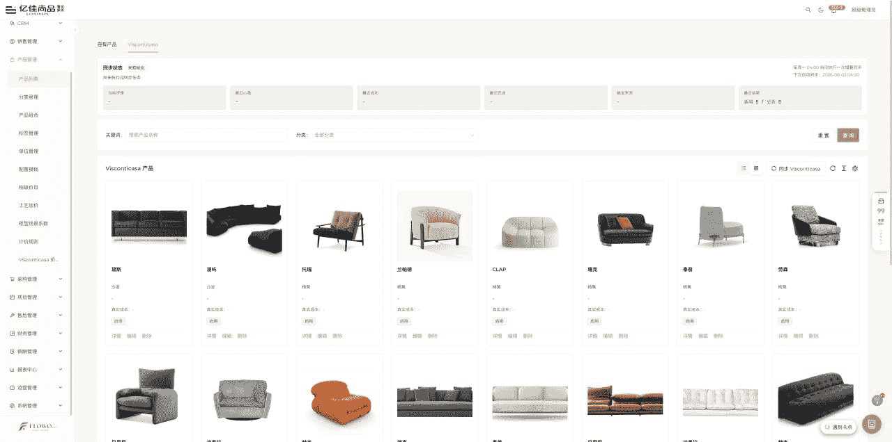

### 3.4 若仍要外包，签约前自问四个问题

用12万的学费提炼四个问题，签约前把答案写下来：

第一问：需求经过几手翻译？你说的业务需求要经过销售、产品、程序员多少转手？每转一次失真加一层。若对方没有真正泡进你业务的人，失真是必然。

第二问：多久能看到可交互版本？不是效果图，是能点、能操作、能走流程的版本。若第一个可用版本要等三个月，等发现方向错了，纠错成本已不可回退。

第三问：改一个小需求的闭环多久？提需求→评估→排期→交付，一圈下来多长时间？这个数字决定系统上线后能否跟上业务变化。我的旧系统就死在这里——业务在跑，系统在排期。

第四问：验收标准是否清晰？“完成XX模块”不是标准，“XX流程从头到尾走通、我本人操作确认”才是。我的12万教训之一：没有我亲手操作确认的验收，都不算验收。

这四个问题自研时同样适用——只不过自研时回答者都是你自己，而你不会骗自己。

### 四、觉悟时刻：最懂系统该长什么样的人是我自己

终结外包系统后，我盯着一年画的原型图发呆。

突然明白：这一年我给程序员画原型、讲流程、抠细节——系统该是什么样，其实全在我脑子里。我缺的不是想法，缺的是把想法变成软件的手。

而2025年的AI恰好补上了这双手。

还有一层更深的领悟：给程序员画了一年原型，等于提前训练了“把业务需求说明白”的能力。而AI开发的核心能力不是写代码，恰恰是把业务说明白。这件事天天泡在业务里的老板比谁都擅长，只是大多数老板没意识到自己有这个能力。

说句公道话，外包那一年并非毫无收获。我从程序员那里学到了开发、测试、工程思维，只不过现在这些能力更容易获得——改变思路即可：动手前先把想法和场景描述清楚，让AI做架构、想实现路径、抠细节。

5月，我正式开工。

### 五、工具进化线：五个阶段，学费我替你交了

我一路换了五拨工具，每拨都交了学费。下面路线可直接抄，至少省掉一半弯路。

### 5.0 国产AI设计工具乱撞期

起初我不知道从哪开始。把市面上各种国产AI前端设计工具试了一遍——效果糟糕。生成的东西不好看也不能用，几轮后差点认定AI编程是噱头。

那时我连vibe coding都没听说。但我做对一件事：疯狂追资讯。每天看AI编程动态，看别人用什么、聊什么、踩什么坑。慢慢才知道谁是真能用的。

信息差本身就是门槛。这一阶段难跳过，但你看完这篇可直接从下一阶段起步。

我如何补信息差，后来很多人问。方法笨但有效，三条：

带着问题看，不刷着玩。同样两小时，“随便刷”和“带着项目看”效率完全不同。我看教程都在问：解决什么问题？我的系统用得上吗？我会踩这个坑吗？

只看实干派，不看概念派。判断标准：作者有没有拿出自己做的东西。只谈趋势不见产出的内容，看多了只会焦虑。真正有用的信息都在别人的实战复盘里。

学到就当天用。看到新概念新技巧，当天就在自己的项目里试。试过的知识才是你的，收藏夹里的知识是平台的。

这三条没天赋要求，纯粹是纪律。信息差的本质是动手的人和观望的人的差距。

### 5.1 Gemini / AI Studio做原型

第一次用Google AI Studio，我被震到——描述需求后界面唰地出来，样子像那么回事。

很快发现问题：好看，跑不起来。它给的是“长什么样”，不是“能干活”。数据存不住，逻辑走不通，点两下就露馅。

但这个阶段有价值：它让我确认路径可行，并把脑中的界面想法快速可视化。用它做原型，别用它做系统。当时我还以为原型就是可运行系统。

### 5.2 IDE工具摸索期

有了原型，如何变成真系统？我开始研究Cursor、Trae这类AI编程工具。

好笑的是：当时在Cursor里看到模型列表——Opus、Sonnet——我完全懵，不知道该选哪个。那正是Anthropic起势的时候，我就这么懵懂撞了进来。

如果你现在也对模型名一头雾水，别慌，你正站在我几个月前的位子。

### 5.3 Claude Code搭框架

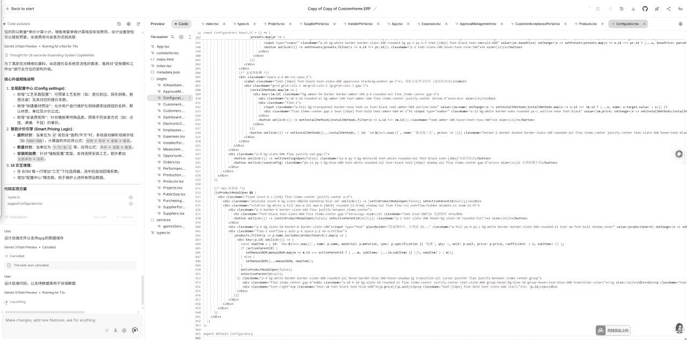

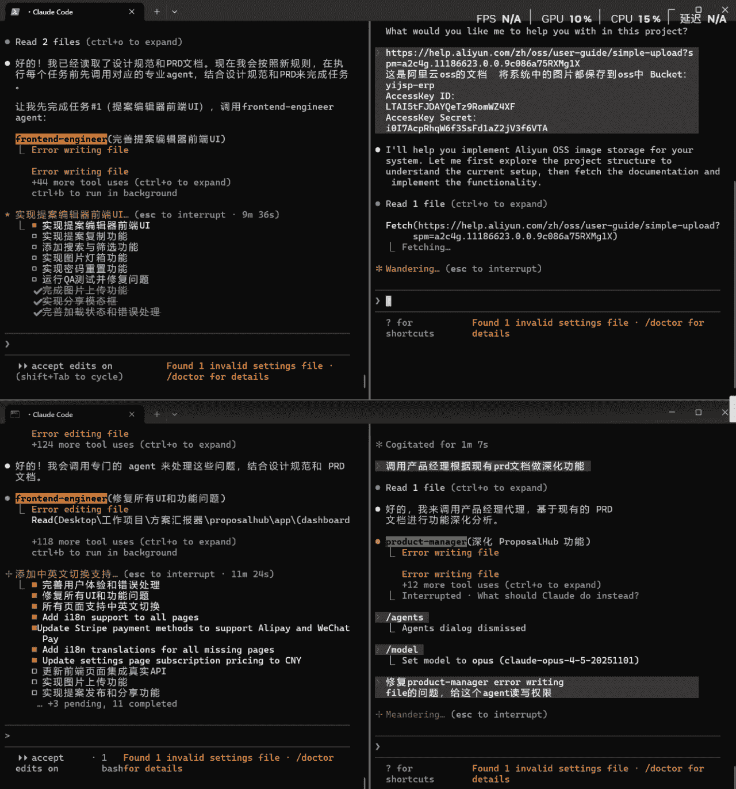

后来我试了Claude Code，一个CLI命令行工具。

说实话，第一次打开心虚。黑乎乎终端，我Linux基础几乎为零，不知道怎么用。那窗口散发着“这不是给普通人用的”气质。

上手后发现——和普通AI工具一样，直接说人话就行。那一刻门槛在我心里降了90%。但我要诚实：剩下10%是真功夫。

当时Skill、MCP、claude.md、hooks、脚手架等概念刚出来，市面刚有科普。我给自己定规矩：每天至少看两小时相关内容。不是刷，是带着问题看——概念解决什么问题？我的项目用得上吗？别人怎么组合？就这样把逻辑和工程思维一点点摸透。

降门槛不等于零门槛。AI把编程门槛降了，但把“学会与AI协作”的门槛立起来了。好消息是后者比前者容易百倍，且不吃天赋，吃投入。

### 5.4 Codex + Claude双工具开发

摸清门道后进入正经开发节奏，Codex和Claude配合使用，5月开工，6月上线。

### 5.5 一个花钱买来的教训——中转API

单独说一个坑，因为很多人还在坑里。

起初图便宜用中转API。体验糟糕——答非所问、代码错漏百出，我一度以为AI就这个水平，差点再次放弃。

换成官方订阅和官方API后，同一个问题判若两人。聪明得让我怀疑之前用的是山寨货——事实上就是。

在AI工具上省小钱，赔的是返工时间。如果你还在用各种中转、拼车、破解：那不是省钱，是买了降智版，还把数据安全押上。

### 六、我的开发工作流：零基础也能高质量交付的方法论

工具是手，成败在工作流。这一节干货密度最高。

### 6.1 军规一：先有骨架，再填功能

别指望AI一次吐出完整系统。像盖房子：先立柱，再砌墙，最后装修。

我的做法：先让AI搭出系统骨架——有哪些模块、模块关系、数据流转。骨架跑通、我亲手点过，再一个模块一个模块填功能。

贪多是新手最大死因。你让AI“给我做一套ERP”，它会生成一大坨东西，看起来都有，实际上都不能用，你也不知道从哪修。

### 6.2 军规二：警惕“前端幻觉”——每一步都亲手测

这是我踩最深的坑。

AI生成的前端第一眼很完善：按钮、表格、流程、弹窗全有，像成熟产品。但真正操作，到处是断点——点这个没反应，提交那个报错，数据存了不显示。

表面完整度会骗人，断点藏在操作里。

所以我的铁律：每做完一步，我亲手把所有操作从头到尾点一遍。每个按钮都按，每个表单都提交，每条数据都核对。跑通了，才进下一步。嫌麻烦？现在省的每一次测试，后面会变成十倍返工。

### 6.3 小步走：一次只做一个小功能

需求再多，一次只喂一个。做完、测完、稳了，再下一个。

好处有三：出问题知道在哪引入；AI处理小任务质量远高于大任务；信心是一步步攒起来的，不会被一次大崩溃击垮。

### 6.4 留存档：给自己留后悔药

每到一个稳定版本，存档。改崩了随时回退。

这个习惯救过我很多次。没有存档的开发，就像没有撤销键的PS——不敢动，动了就是赌。

### 6.5 让AI自查

每个功能做完，我会让AI自己复查逻辑：“检查一下这个功能有没有遗漏场景、有没有逻辑漏洞。”经常能揪出它自己埋的雷。

AI有个特点：写时易犯错，让它检查时往往能发现自己的错。别把AI当人用，把它当团队用——让写代码的AI和审代码的AI互相制衡。

### 6.6 需求怎么说：说人话，说透，说例子

很多人问需求如何描述？三要点：

说人话。不用术语。“我的线索长这样，从这几个渠道来，我要它们自动进系统，重复的识别出来，缺信息的标出来”——这就是合格描述。

说透。别怕啰嗦。业务里的例外情况、特殊规则，都说给它。你漏说的每条规则，都会变成上线后的坑。

说例子。给它看真实样例数据（脱敏后），比十句抽象描述都管用。

这三条能力，本质上就是老板给员工交代工作的能力。你早就会了。

再分享一个我自己一直在用的需求拆解法。以后每次让 AI 干活之前，先把下面六个问题想清楚：

**1. 背景：**  
为什么要做这件事？它解决的是哪一个具体业务问题？  
比如：客户资料现在靠员工手动搬运，既容易漏，也容易错。

**2. 输入：**  
系统会接收到什么？数据从哪里来？长什么样？最好附上一两份真实但脱敏的样例。

**3. 输出：**  
最终希望得到什么结果？  
比如：资料清洗、去重之后进入客户池，再根据规则自动分配给销售。

**4. 规则：**  
系统中间要怎么判断？  
比如：手机号相同视为同一客户；缺少关键字段的记录，需要单独标记。

**5. 例外：**  
遇到特殊情况时，应该如何处理？  
比如：老客户再次联系，不应该被认定为新客资，而是归回原销售名下。

**6. 验收：**  
什么结果才算完成？  
比如：拿一批真实数据跑一遍，系统结果要和人工核对结果一致。

这六个部分越完整，AI 一次交付正确结果的可能性就越高。

反过来也一样：如果其中某一格你完全写不出来，通常不是 AI 能力不够，而是你的业务判断还没想明白。这个时候不要急着开发，先和 AI 对话，把模糊的地方一步步问清楚。

很多时候，AI 最重要的作用并不是替你完成任务，而是逼着你把问题真正想透。

**6.7 本节总结**

真正成熟的工作方式，往往比模型本身有多聪明更重要。

模型再强，如果没有一套可靠的流程承接，最后交付出来的也可能只是一个外表漂亮、内部混乱的东西。流程这件事不要求多高的技术天赋，要求的是持续执行和严格遵守，而这正是经营者最应该具备的能力。

### 七、五个模块是怎么做出来的：从业务漏洞到系统能力

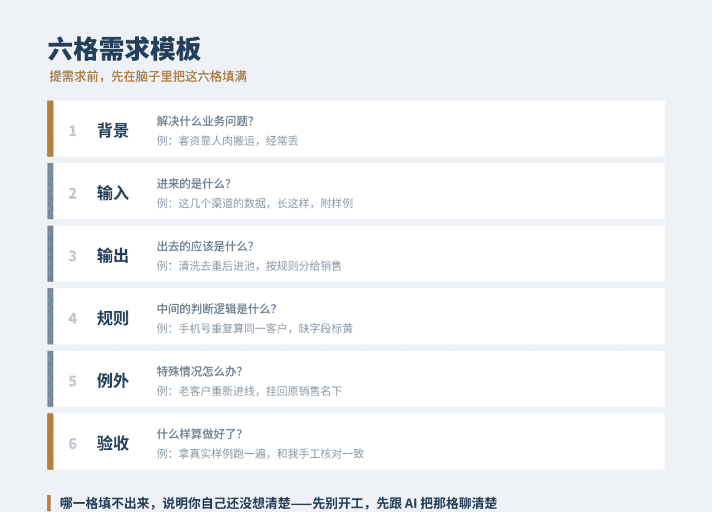

回头看最开始发现的那五个问题，现在分别说说它们是如何被解决的。每个模块都讲三点：过去的问题是什么、我是怎样向 AI 描述的、最后系统变成了什么样。

**7.1 客资自动进入系统**

以前，客户资料需要员工一个个复制、粘贴、整理，过程中经常出现遗漏和错误。

我把不同渠道的真实数据样例做了脱敏处理，交给 AI，同时说明每个渠道的数据格式、去重要求、缺失字段的处理方式，以及销售分配规则。

现在，客资可以自动进入客户池，自动完成清洗、去重和分配。过去需要按月推进的事情，现在几天内就能跑起来。

**7.2 商机 SOP 全程追踪**

以前，销售 SOP 写在文档甚至纸上，执行完全取决于个人状态。做没做、什么时候做、有没有超期，很难留下清晰记录。

我把商机推进过程拆成一个个标准动作，明确每个阶段该完成什么、在多长时间内完成，然后让 AI 把这些要求转化为系统中的强制流程，并为每一步保留操作记录。

现在，商机按照阶段推进，执行人、执行时间以及是否逾期，都能在系统里直接看到。

这件事让我真正意识到：

> 定制系统的核心优势，并不是比通用 SaaS 多几个功能，而是能把经营者的管理逻辑直接写进系统，让它强制落地。

过去需要老板天天盯的 SOP，现在由系统自动监督。

**7.3 让绩效从感觉变成数据**

过去到了月底，绩效往往靠主管印象和主观判断，员工自然很难心服口服。

我先把“什么行为算有效工作”拆开定义：完成一次有效跟进得多少分，按时完成节点得多少分，逾期之后扣多少分。接着让 AI 把这套规则做成自动评分机制。

现在，员工在系统里的每一个动作都会留下数据。月底的绩效，不再是“评估出来的”，而是“计算出来的”。至于这些分数如何与实际利益连接，后面会详细说明。

**7.4 把项目拆成可追踪节点**

过去，几十个项目节点全靠人脑记、靠微信问。只要漏掉一个环节，后面就可能出现连锁问题。

现在，每个项目节点都明确责任人和截止时间，临近超期或已经超期时，系统会主动提醒。我打开手机，就能知道每个项目当前推进到了哪一步。

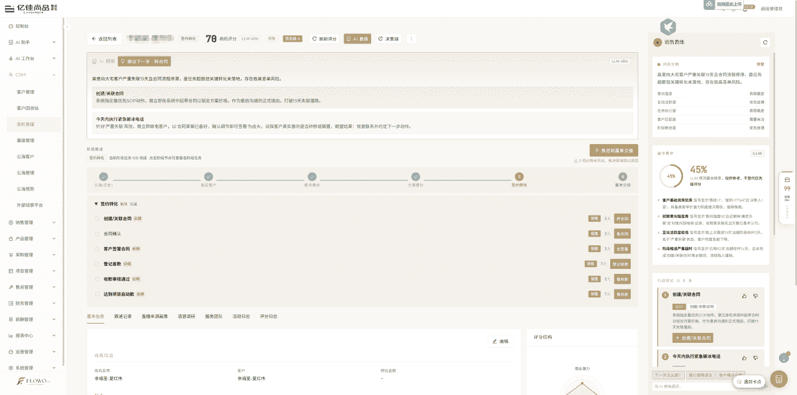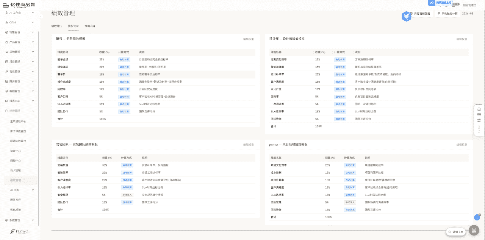

**7.5 项目执行中的实时利润**

以前，项目结束之后才知道到底赚没赚钱，整个过程基本是在盲目推进。

我把项目的成本结构拆开告诉 AI：材料成本、人工费用、辅料支出和其他杂费分别如何产生、如何记录，再让系统随着实际发生的费用自动归集，并持续计算当前毛利。

现在，项目还没有结束，我就能看到它目前的利润情况。如果利润曲线开始异常，可以马上干预，而不是等项目结束后才复盘一堆无法挽回的问题。

这是我认为最直接影响经营决策的模块之一。因为它深度依赖你的成本结构和行业特点，通用软件很难真正做到贴合。

### 八、进一步升级：AI 不只帮我造系统，还开始在系统里工作

前面的部分，是 AI 帮我把系统搭出来。接下来，则是让 AI 真正参与公司的日常管理。

传统管理的方式是“人去找事”：员工每天自己判断要做什么，老板还要不断追问进度。

现在变成“事情主动找人”：今天要做什么，系统自动推送；任务没有完成，系统自动提醒和升级。

这套机制一共分成七层，下面从基础开始说。

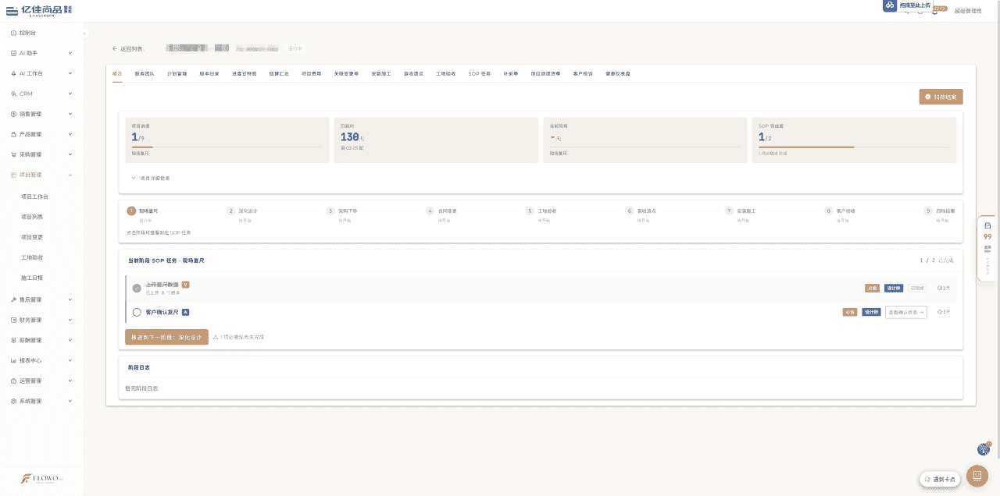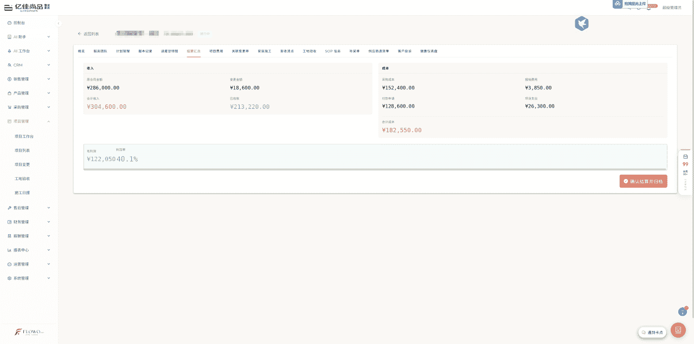

**8.1 第一层：企业专属知识库**

通用 AI 可能了解很多行业常识，但它不知道我的产品细节、报价方式和销售经验。

所以我先把公司的内部资料整理给它，包括产品信息、报价规则、优秀销售的跟进方法，以及客户常见问题的处理方式。

从那以后，系统里的 AI 回答问题时，依据的是公司自己的知识，而不是网络上泛泛而谈的答案。

技术上，这类方式通常被称为 RAG，但名称并不重要。简单理解，就是给 AI 配了一套只属于企业自己的知识库。

> AI 到底有没有价值，很大程度上取决于你提供给它的内容。

**8.2 AI 销售教练：让普通员工也能获得销冠式支持**

一个团队里，最强销售和普通销售之间的业绩差距，可能达到十倍。真正拉开差距的，很多时候不是勤奋程度，而是面对不同客户时，能不能判断出下一步该怎么做。

我的 AI 销售教练主要承担三项工作。

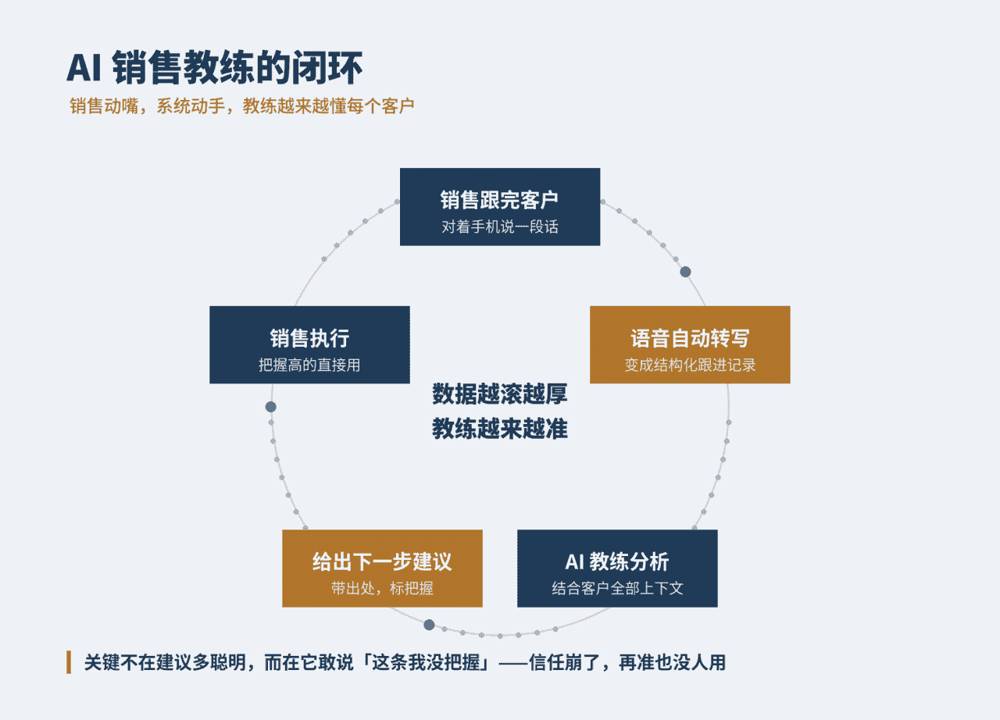

第一，针对每个商机给出下一步建议。

销售打开一个客户，系统会结合完整上下文进行分析：之前沟通过什么、客户处于哪个阶段、当前卡在哪里，然后直接生成下一步动作和参考话术。

换句话说，客户当前应该采取什么策略，AI 会先帮销售梳理一遍。每个销售身后，都像多了一个随时在线的资深教练。

第二，用语音完成跟进记录。

我知道销售最讨厌的事情之一，就是跟完客户还要坐下来填表。所以我接入了语音识别功能。销售只需要在 APP 里讲一段跟进情况，系统就会自动将语音转换成结构化记录并保存。

员工负责说，系统负责整理。

这就形成了一个完整循环：

销售口头汇报 → 系统自动归档 → AI 根据最新信息生成下一步建议 → 销售继续执行 → 再次汇报。

数据不断积累，AI 对每个客户的理解也会越来越完整。

第三，也是我认为最关键的一点：所有建议都必须说明依据和可信程度。

AI 给出建议时，要同时告诉销售：

- 这条结论来自哪里，是知识库中的哪条经验，还是客户过去的哪次沟通；
- AI 对这条建议有多大把握。

为什么必须这样做？

因为员工很快就能判断 AI 是否在胡说。一个永远表现得胸有成竹、从不承认不确定性的 AI，一旦被发现错误，后面所有建议都会失去可信度。

**AI 产品最容易失败的地方，不一定是能力不够，而是信任一旦崩塌，就很难恢复。**

当建议带有来源和置信程度之后，销售就可以区别对待：把握较高的内容，可以直接参考；把握较低的内容，需要自己再判断，或者进一步向主管确认。

最终的决策权仍然在人手里，AI 只是把相关依据和可能性整理出来。

这也解释了为什么员工愿意接受它：它没有把自己包装成无所不知的神，而是明确告诉你哪些地方确定，哪些地方不确定。

信任不是通过假装全知全能获得的，而是通过坦诚边界建立的。

**8.3 AI 自动安排每天的工作**

有一个很现实的问题：不少销售每天到公司后，并不清楚当天最重要的事情是什么。看看手机、等客户回复，一天很快就过去了。

现在，系统每天会扫描每位销售名下的客户和商机，识别哪些客户到了跟进时间，再结合里程碑和 SOP 判断当前阶段应该执行的动作，最后自动生成当天的工作安排。

项目管理也是同样的逻辑：项目节点会自动转化成责任人当天的待办任务。

员工不必完全依赖个人自律，系统会先替他把事情排出来。

**8.4 AI 自动督办：三级升级**

任务排好了，如果员工仍然不执行，怎么办？

过去只能由我不断追问，或者让主管反复催促。现在改成三级机制：

1. 系统每天汇总重点任务，并统计各项任务的完成情况；
2. 员工未完成时，系统自动通知主管跟进；
3. 主管已经提醒但仍没有进展，任务自动升级到我这里。

这里的关键是，升级到我手上的事情，必须同时满足两个条件：员工没有完成，主管也没有解决。

我不再处理所有日常事务，只处理经过系统筛选后的异常情况。管理精力被过滤了一遍，真正需要我介入的问题才会到我面前。

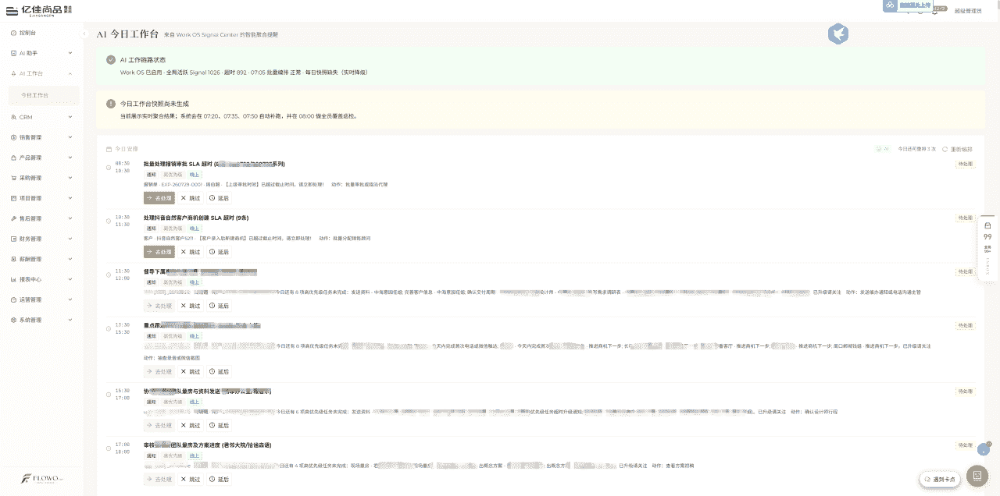

**8.5 每天早晨，系统主动向我汇报**

我用规则引擎把 ERP 和微信连接起来。每天早上，系统会把全公司的运行情况整理成一份简报，自动发送到我的微信，包括：

- 公司整体经营状态；
- 每位员工当前的工作卡点；
- 客户跟进停滞的位置；
- 当天的任务安排；
- 销售业绩表现。

我起床之后，用两分钟就能知道昨天发生了什么、今天需要关注什么。

> 不再是我主动打开系统找信息，而是系统主动把信息送到我面前。

**8.6 让制度通过数据持续调整**

每个 SOP 节点都有 SLA 时限，但这些时限最初毕竟是人工设定的，未必完全合理。

系统采用事件驱动的规则引擎，会记录员工每一次操作和每一个结果。运行一段时间后，如果某个节点长期出现大面积超时，系统就会提示：问题可能不在人，而在规则本身。

我确认建议之后，就可以调整对应的 SLA，系统再继续观察调整后的效果。

制度不应该被当成一块固定不动的石头，而应该形成这样的循环：

执行产生数据，数据检验制度，制度根据结果优化。

管理中的 PDCA，在这里被做成了自动运行的版本。

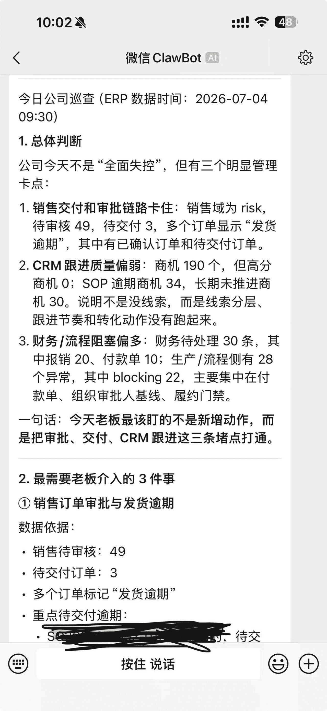

**8.7 公司每个人都可以成为产品经理**

系统要如何持续改进？难道每次都要靠我猜员工哪里不舒服？

不需要。

我在系统中设置了全局反馈入口。任何员工在任何页面遇到问题，都可以点击按钮提交反馈。系统会自动截图，并识别当时所在的页面和具体单据；员工只需要在截图上标出问题位置，再补充一句说明，整个过程十几秒就能完成。

接下来由 AI 做第二轮筛选。

它每天会读取这些反馈，结合系统的真实运行数据，判断哪些问题确实影响工作效率，哪些只是个别人的使用习惯，然后生成一份优化建议给我。

我只处理真正影响工作流程的问题，所以迭代速度快，方向也更准确。

传统软件公司要完成同样的事情，可能需要产品经理、用户调研、需求评审和开发排期，一个问题从提出到上线，往往要几个月。

而我这里，员工点一下按钮，AI 帮我分类排序，我当天晚上就可能完成调整。

软件行业最昂贵的环节，很多时候不是写代码，而是弄清楚“究竟该改什么”。这部分成本降下来之后，系统上线几个月仍然可以持续变好，而不是从发布那一天开始逐渐过时。

### 九、如何让员工愿意使用：推行系统的两个原则

系统开发完成，只意味着完成了一半。真正决定成败的，是员工愿不愿意在日常工作中使用它。

任何新系统都会遇到阻力。我之所以能够推进下去，是因为在开发之前，先确定了两条底层原则。

**9.1 第一条：系统必须帮员工减负**

每个功能上线之前，我都会先问一句：

它是让员工少做一点事，还是让员工多填几张表？

如果新系统只是不断增加录入工作，员工一定会想办法绕开它，最后变成摆设。

客资自动导入，替代的是复制和粘贴；语音记录，把十分钟的表格填写压缩成几十秒的口述；智能日程，则减少了员工靠脑子记任务的负担。

使用起来更轻松，推行就成功了一半。

**9.2 第二条：让系统与实际利益发生联系**

剩下的一半，需要靠利益机制推动。我做了两项设计。

第一，绩效和 SLA 挂钩。

每一个 SOP 节点都设置了完成时限，超过规定时间未完成，系统自动扣除相应绩效分，并在月底核算中体现。

这里提醒想参考的老板：相关规则必须提前公开，并经过员工确认；具体制度设计，也建议结合专业人力顾问的意见。系统执行的是已经明确的绩效规则，而不是临时处罚。

关键在于，执行过程由系统完成，不需要老板亲自追责。制度落地的成本降下来了，人情因素也少了。

第二，系统评分影响资源分配。

每位员工都会有系统评分和排名。评分越高，每个月能够领取的客户资源越多；评分较低，能够获得的客资就相对少一些。

表现好的人拿到更多优质机会，进而获得更好结果，形成正向循环。

这两个设计说明了一件事：

这不只是购买或开发了一套软件，而是把公司的管理制度直接嵌入了系统。

按照自己的规则分配客资，依据自己的 SLA 计算绩效，这类深度定制是通用软件很难提供的。它也正是自研系统真正的竞争壁垒。

### 十、一笔整体账

我不回避时间投入。最忙的时候，几乎醒着就在做，一天工作十几个小时是常态。

但这并不代表所有人都要复制这样的强度。如果只是从一个小工具入手，完全可以每天投入一两个小时，逐步推进。

而且与最后得到的结果相比，这些投入并不算什么。

最大的收获甚至不是这套系统本身，而是我因此获得了持续解决问题的能力。过去只能提出需求、等待别人开发，现在很多想法都可以自己动手实现。

### 十一、被问得最多的十个问题

**Q1：你是不是本来就懂技术？**

不是。我以前没有写过代码，数据库、接口这些概念，都是在开发过程中逐渐接触到的。

我唯一算得上相关的经历，是曾经花一年时间给外包团队画原型。那并不是技术基础，而是被现实逼出来的经验。

不过，平时需要给员工讲流程、定规则、画制度的人，实际上已经拥有很重要的业务基础。

**Q2：AI 生成的代码看不懂，遇到问题怎么办？**

大部分代码我确实看不懂，但我并不需要成为程序员。我需要判断的是：系统的结果是否正确，而这件事我比程序员更清楚。

出现问题时，我会把具体现象告诉 AI，让它定位和修改。

这就像你不懂汽车发动机，但你知道车辆开起来不正常，会把它送去维修。区别在于，我这里的“维修店”全天在线，也不收工时费。

**Q3：一个月做出来的系统，会不会只是玩具？**

它目前已经在真实运行，支撑着一家 29 人公司的完整业务，从 6 月稳定使用到现在。

但我也不夸大它的适用范围：这是一套为我自己的业务和规模定制的系统，并不是拿出去就能卖给所有公司的商业软件。

而“先解决自己的问题”，本来就是这条路径最合理的起点。

**Q4：数据放在哪里？安全吗？**

代码保存在我自己的环境里，数据也放在自己掌控的服务器上，并没有交给第三方 SaaS 托管，反而更容易控制。

开发时提供给 AI 的是需求说明和脱敏后的数据结构，而不是客户名单。

同时，使用官方付费服务本身也是数据保护的一部分。那些来源不明的中转服务，很难知道你的对话究竟经过了谁的手。

**Q5：系统突然出故障怎么办？**

定期备份数据，保存稳定版本，并确保出现问题时可以回滚。

说实话，过去依靠人工 Excel 管理时，风险反而更大。那种情况下，往往连系统具体坏在哪里都不清楚。

**Q6：我没有这么多时间怎么办？**

不需要复制我的投入强度。

你可以先从一个小工具开始，每天投入一两个小时，通常两三周就能看到效果。

换个角度计算：你现在每天花多少时间在手动搬数据、追进度、整理表格上？我的投入主要是一次性的，而传统管理方式会每天持续消耗你的时间。

**Q7：什么规模的公司适合这样做？**

我的实际样本是 29 人，所以我只能对这个规模负责。

我的判断是：几十人的企业，业务流程已经相对明确，同时老板愿意亲自参与，这条路径最容易跑通。

规模更大的公司，也可以先用 AI 做一个可运行的原型，把需求验证清楚，再决定是自己深入，还是交给技术团队。拿着已经能运行的原型去谈开发，至少能避免掉我当初那 12 万的坑。

**Q8：AI 更新这么快，系统会不会很快过时？**

恰恰相反，AI 越强，我的改造能力越强。

系统属于我，AI 只是我的工具。工具升级之后，我反而能更快地优化系统。

真正容易被淘汰的，不是使用 AI 搭出来的系统，而是完全不会使用 AI 的管理方式。

**Q9：为什么不用钉钉、飞书的低代码平台？**

低代码平台适合快速搭建基础表单和审批流程，但它也有明显边界。

第一，复杂的业务逻辑很难实现。比如实时利润归集、SLA 自动计算、员工评分排序后分配客资，这些不是简单拖拽就能完成的。

第二，你仍然是在别人的框架里实现，本质上依旧受制于平台能力，和购买 SaaS 有相似问题。

低代码更像是“可调整的成品”，而 AI 辅助开发更接近“真正按业务定制”。

当然，如果你的需求只是简单审批和表单，低代码完全够用。工具没有绝对高低，关键是和需求是否匹配。

**Q10：员工抵触，或者老员工不会用怎么办？**

前面提到的两条原则就是基础：先减负，再绑定利益。

另外，系统上线不要一开始就要求全员一次性切换。可以先挑最容易让员工感受到便利的功能，比如语音记录，让大家先体验到它比手填表格更省事，然后再逐步扩展。

推行顺序应该从员工最容易接受的功能开始，而不是从老板最引以为傲的功能开始。

至于“不会用”，我更倾向于说实话：如果一个功能必须靠大量培训才能使用，通常说明设计还不够自然，需要重新优化。

### 十二、给想做 FDE 的人：来自甲方的建议

前面更多是在写给企业老板，接下来想说说另一类读者：那些 AI 能力不错，希望帮助企业完成实际落地的技术人员。

我的视角比较特殊。我既是自己公司的 FDE，也曾经作为甲方，被外包团队坑过 12 万。

所以以下建议，不是从服务方角度出发，而是从一个真正付款、真正被交付结果影响的甲方角度出发。市面上很多关于 FDE 的内容，讲的都是服务者怎么做，下面这些经验可能更接近你的客户真实在意的事情。

### 12.1 你真正面对的竞争者，是亲自下场的老板

先接受一个现实：越来越多老板，已经可以自己完成一部分过去必须交给技术人员的工作了，我就是一个例子。

这并不意味着 FDE 没机会，而是说明机会正在转移。

老板自己能完成的部分，不值得你继续竞争；老板做不了、不愿意做，或者没有时间持续投入的部分，才是你的真正市场。

我认为主要有三类：

第一，需要真正工程经验的领域，比如性能优化、安全、复杂系统集成和系统重构；

第二，需要长期投入时间的工作。为了自己的系统，我在高峰期一天投入十几个小时，但大多数老板没有这样的时间条件；

第三，跨企业经验带来的判断力。你如果服务过十家同类型企业，就能提前知道哪些坑可以避免，这种横向视角是单个老板很难获得的。

### 12.2 行业理解，才是最难复制的壁垒

我非常认同一个判断：未来最优秀的 FDE，很可能来自各个行业真正的一线经营者。

如果你是技术出身，最应该担心的未必是模型和框架变化太快，而是自己是否真正深入过某个行业。

技术能力正在被 AI 快速普及，未来会越来越不稀缺。但行业经验不同。AI 不知道某个行业的客户为什么第三次上门时最容易产生变化，也不知道哪一类项目最容易因为辅料成本失控而吞掉利润。

这些知识很少写在公开文档里，更多存在于一线从业者的长期经验中。

所以我的具体建议是：不要什么行业都接，先找一个行业深入研究和服务。

可以用两个标准筛选：

- 行业内有足够多的中小企业，代表市场有规模；
- 企业流程普遍混乱，代表真实需求强。

家具建材就是典型案例：客资来源复杂、成交周期长、项目成本结构多变，很多老板仍然依靠 Excel 和微信管理业务。

### 12.3 用一个能运行的 Demo 去敲门

我被外包坑得最严重的一点，是长期沟通都停留在 PPT、Word 和口头描述上。

直到一年之后，我第一次看到真正运行的系统，才发现之前的方向从根上就错了。

所以，如果你现在想找我合作，最有效的方式不是先拿一份方案来，而是花两天时间，用 AI 把我最痛的某个流程做成一个可以点击、可以运行的小工具，然后拿着它来见我。

我可能不会再被 PPT 打动，但一定会认真看那个能运行的 Demo。

AI 时代，做出一个小型 Demo 的成本已经足够低，它完全可以成为你的业务名片。

### 12.4 甲方最担心的三件事，你解决其中一件就有机会

从一个曾经被坑过的甲方角度，老板不愿意把系统交给外部人员，通常最怕以下三件事。

**第一，担心你不了解业务，最后交付一个四不像。**

解决方式不是多开几次会，而是进入现场。去他的门店、车间、仓库真正观察两天，不要只坐在会议室里听他讲流程。

**第二，担心项目结束后你离开，系统没人维护。**

这是我当年放弃外包团队的核心顾虑之一。

所以你应该把“教会甲方自己修改和维护”写进交付内容。能够让客户自己继续迭代的 FDE，才更有机会拿到第二单和第三单。

**第三，担心每次改需求都要等待排期。**

很多老系统就是被这种低响应速度拖垮的。

因此，你的核心卖点不应该只是功能多，而应该是反应快、修改快、能够持续陪客户把系统跑起来。

### 12.5 最后想说

做完这整套系统之后，我对 FDE 最深的感受是：

这个角色的门槛，一半是技术能力，另一半是愿不愿意真正进入一个不够性感、却充满真实问题的行业。

家具建材不性感，客户表格不性感，成本归集也不性感。但恰恰是在这些不起眼的地方，藏着大量没有被解决的问题，也藏着真正愿意付费的老板。

### 十三、行动清单：从哪里开始

如果你已经开始心动，不妨先按下面的方式行动：

做老板别急着砸钱上系统，先学会用 AI 把自己的问题讲清楚。

我把自己这段自研的经历，拆成了三段可以照抄的节奏。

第一个阶段，7 天闭嘴不动手。去官方渠道把 AI 工具注册好，别走各种中转站，之前说过原因。每天固定抽出半小时，把公司里最让你头疼的一个管理环节，跟 AI 一遍遍描述清楚。把“把需求讲明白”当成体能训练，AI 不会嫌你烦、不会收加班费、改十遍都行。这一步就是在练肌肉记忆。

第二个阶段，14 天做出第一个能用的小东西。选题就一条原则：口子小、痛得真、两三周能看见效果。比如把客户资料自动导入、一个报价计算器、一个审批小程序、或者一张自动生成的报表。千万别上来就想造一套 ERP。两条铁律要守：先搭骨架再长肉；每一步都自己上手跑一遍。

一个月后，再判断要不要继续。先回头算笔账，这个小工具帮你省下了多少人工重复时间。然后认清自己是什么类型的掌舵人：愿意继续深挖的，就顺着做下去；只想把事甩出去的也赚了，至少你手里已经有能跑的原型，直接拿去跟外包谈，议价权都在你手里。

真要推系统上线，前置两道自检题。第一，这个功能是让员工少干活，还是变相多填表？第二，员工认真用系统，他能得到什么实际好处？答不上来，就先别发版。

回顾下来，这次最值钱的收获，不是省了多少钱，也不是系统本身。是我拿到了一种体感：有想法就能立刻动手把它变成现实。系统迟早会迭代，但这个能力不会。去年的我，面对花了 12 万买回来的烂系统束手无策；现在的我，每天早上在微信里就能收到公司的经营简报。隔开我们的不是天赋也不是技术，是连续几个月的每天两小时投入。

写到这里不是炫耀，我现在也看不懂大部分代码，Linux 命令还是现查现用。我想说清楚的是，这条路已经实打实通了，而且通到了普通企业主面前。三年前，一个 29 人的传统行业公司谈自研 ERP 基本等于做梦；今天它就是一个选择题，你愿不愿意每天投入两小时。

跟外包打交道当然也有收获，程序员身上学到的开发经验、测试经验、工程思维，都是一次次沟通里攒下来的。现在不一样了，同样这些能力，换一种思路就能自己先拿到：先把想法和使用场景描述清楚，让 AI 来帮你搭架构、拆实现路径，把细节先跑通。

工具已经摆在每个人手边了。同样是 AI，有人只用它写周报，有人借它把自己的公司重做了一遍。工具本身没有差别，差别在于你有没有把真正的业务痛点带进去。普通人跟 AI 之间，从来不是技术差距，是谁先开始。🎁 感恩龙哥盟这个场域，有在自研路上探索的老板，评论区或者鱼丸里随时交流，我踩过的坑都可以分享。

——分割线——

SOP 看完觉得懂了的人很多，但真到动手那一步，90% 都会卡壳。

工具和教程是最不值钱的门槛，真正值钱的是立刻开干，和圈层里的信息差。

想看全网最新能落地的变现打法，并和一批执行力很强的极客一起把想法做出来，欢迎来看看我的核心私域：【懒人专属群】。

我们只拆商业闭环，只讲 AI 效率的极限压榨。群里已经沉淀了 1000+ 跑通的套利实战案例。

🎁 查看圈子的数字资产全貌和加入门槛：

https://lazyso.com/insider/

如果你认同这个价值，并且准备好下场干了，扫码加我微信 lazyhelper1

备注：【实操上车】，不闲聊

