# AI 实战复盘：我如何跑通“🛰️小店＋知识库”自动交付，单周消耗 18 亿 Token

大家好，我是 bug，一名有 12 年开发经验的全栈程序员。

过去做过直播带货、海外开店、跨境电商，目前主业是真人搭子英语口语练习产品，副业则主要帮助中小企业和自媒体完成 AI 化改造。

从 GPT 上线开始，我就一直在使用 Plus 会员，Claude Max 5x 也持续订阅了 12 个月。除此之外，还长期使用 Cursor、Copilot、IDE AI 插件、CCSwitch 和中转站等工具辅助开发，AI Token 累计投入已经超过 1 万元。

过去几年，我的 AI 编程方式经历了几次变化：

- IDE 自动补全代码；
- 复制代码片段到 AI 对话框，再粘贴回编辑器；
- 使用 Cursor Agent 开发；
- 使用 Claude Code、Codex CLI 直接操作本地项目。

接入赚钱 Token 统计插件后，截至 7 月 29 日，我累计消耗 112.19 亿 Token，共有 101 个活跃日，平均每天约 1.11 亿 Token。

最近 30 天消耗 61.82 亿，日均约 2.06 亿，排名 **#362**。

前段时间，我参加了赚钱成都线下 Codex 编程实战，也协助一些没有编程经验的圈友用 Codex 从零做产品。过程中我发现，很多人并不是不会提需求，而是不清楚 AI 编程应该如何推进，更不知道 AI 到底应该放在哪个工作环节里。

最近，我又帮朋友开发了一套“🛰️小店＋个人知识库”的自动化交付系统。

这个项目已经卖出 600 多份，GMV 1.2 万＋，稳定交付 500 份报告。开发和交付期间，Token 消耗达到 9.96 亿；某一周的消耗更是达到 18 亿 Token。

这次正好借赚钱约稿，复盘一下我的 AI 使用过程：Token 为什么会越用越多，普通对话、本地项目和业务自动化之间到底有什么区别，以及没有编程经验的人，如何避免让 AI 陷入反复返工。

## 一、AI 的价值，取决于它站在工作流的哪一层

很多人理解的“使用 AI”，就是打开 ChatGPT 或 Claude，输入一段问题，等待答案。

但实际上，AI 可以处于完全不同的工作位置：

- 作为老师，回答你的问题；
- 作为助手，参与一个完整项目；
- 作为服务，持续处理真实业务。

这三种方式都叫使用 AI，可背后的 Token 消耗规模完全不同。

### 1. 把 AI 当作老师

这是最常见的方式。

以前遇到问题，我们会去搜索引擎找资料。现在更多时候，是把问题直接交给 ChatGPT 或 Claude。

搜索引擎返回大量网页，需要自己筛选、归纳和判断。AI 则会先理解你的问题，再把资料整理成相对完整的解释。

它当然不是绝对可靠，但在解释概念、整理资料、梳理思路和提供解决方向方面，确实能节约大量时间。

这个阶段，AI 的工作方式很简单：

你提问，它回答；你继续追问，它再继续处理；你停止输入，它也就停在那里。

输入通常是一段文字，复杂时也可能附带图片、文档以及前面的聊天记录。随着对话变长，历史上下文会越来越多，但整个过程依然由人控制节奏。

因此，普通问答的 Token 消耗通常有限。

一份长文档或一张图片，可能让某次请求的输入增加，但只要仍然是一问一答，就很难持续产生非常大的总消耗。

### 2. 把 AI 当作开发助手

当 AI 进入本地项目以后，消耗方式就发生了变化。

这时，它接收的不是一个孤立问题，而是：

- 项目需求；
- 源代码；
- 配置文件；
- 数据库结构；
- 运行日志；
- 测试结果；
- 报错信息。

AI 修改代码后，还需要运行项目、查看结果、分析错误，再根据新情况继续修改。

也就是说，任务从“问一次、答一次”，变成了一个持续循环：

读取项目 → 修改代码 → 执行测试 → 查看报错 → 再次修改。

以前用云端聊天写代码，通常是我复制一段代码过去，AI 给出建议后，我再手动粘贴回编辑器。

现在使用 Codex 或 Claude Code，只要指定本地项目目录，AI 就能够直接读取文件、调整代码、运行命令和检查结果。

一句“帮我把这个问题修好”，背后可能已经执行了十几轮操作。

而且，每一轮都会产生新的上下文：

- AI 输出的代码和命令，会影响下一步；
- 测试结果会成为新的输入；
- 报错日志会被再次分析；
- 已经修改过的文件可能被重复读取。

项目越复杂，参与处理的文件越多；问题越棘手，循环次数越高。

所以，这个阶段真正拉高 Token 消耗的，不是某一轮生成了多少代码，而是项目上下文被不断读取、处理和验证。

### 3. 把 AI 做成业务服务

再往前走一步，就是把 AI 直接接入产品或业务流程。

知识库产品就是一个典型例子。

可以把一个人的文章、课程、历史分享和问答整理进知识库，再封装成一个可交互的 AI 服务。比如，将龙哥过去公开发布的内容整理出来，做成“AI 龙哥”，让其他人直接向它提问。

这时，模型处理的不再只是用户当前输入，还可能包括：

- 用户历史对话；
- 知识库检索内容；
- 订单与客户信息；
- 业务系统中的其他数据。

它的输出也不只是聊天文字，还可能是：

- 一份咨询方案；
- 一张数据报表；
- 一份交付报告；
- 一个后续业务动作。

触发 AI 的人，也从“操作者”变成了用户和系统：

- 用户提问，会触发 AI 接口；
- 订单状态变化，会触发 AI 接口；
- 到了定时任务时间，系统会自动调用 AI；
- 客服、销售、内容生产流程，也都可能持续调用模型。

这时，我不需要一直坐在电脑前按回车。

业务量越大，调用次数越多；流程越复杂，单次任务运行得越久；历史记录、知识库和系统提示词被重复读取的次数也越高。

即使单次任务的 Token 并不算多，只要持续运行、并发增加，总量很快就会被推上去。

这就是三个阶段的本质区别：

- 老师：等你提问；
- 助手：围绕项目持续工作；
- 服务：被用户和业务系统不断调用。

AI 从聊天框进入本地项目，再接入真实业务，Token 消耗自然会出现数量级变化。

想靠“让 AI 多写几段回答”达到每天十几亿 Token，基本不现实。真正决定消耗的，是 AI 是否被放进了持续运行的工作流程。

## 二、第一个门槛：从聊天窗口进入本地项目

在成都的 Codex 编程实战中，有位圈友做了一个网页视频自动剪辑工具。

他先让 GPT 根据需求写代码，并部署到了 GPT 站点。页面可以选择素材，也可以配置背景音乐，看起来功能都已经完成。

但点击运行之后，视频始终无法生成。

问题并不在代码逻辑，而在运行环境：

- 视频素材保存在 Mac 本地相册；
- 网页没有读取本地文件的权限；
- GPT 站点和自建服务器的运行条件不同；
- 音视频处理需要 FFmpeg，但当前环境无法安装或调用。

换句话说，页面虽然做出来了，但真正执行视频处理的条件并不具备。

后来，我们让 GPT 继续协助，把项目迁移到 Mac 本地运行，并处理文件权限和 FFmpeg 依赖问题。

最终，两段视频成功拼接，背景音乐顺利加入，视频也能够正常导出。

这个案例特别典型。

很多人可以准确描述自己想要什么，却没有理解三个东西之间的区别：

- 对话窗口；
- 项目文件夹；
- 实际运行环境。

对话窗口只是沟通入口。真正的代码、素材、配置和运行结果，都在项目目录和运行环境里。

而项目究竟运行在哪里，决定了 AI 能否读取文件、安装依赖、调用系统能力。

对于这类工具，通常有两种更合适的方式：

第一，部署到自己的服务器，安装所需工具包，通过网页访问；

第二，把依赖集成到传统软件中，直接安装到电脑本地运行。

另外，项目不能只存在聊天记录里。

如果原来的对话丢失，AI 就不知道之前采用了什么方案、装过哪些依赖、修改过哪些文件。后续想继续开发，只能重新解释，严重时甚至需要从头再做。

但只要项目完整保存在本地，情况就完全不同。

你可以更换对话窗口，也可以更换模型和开发工具。新的 AI 只要读取项目目录，就能继续理解并推进工作。

这正是 Token 消耗第一次明显增加的地方。

云端聊天通常是一问一答；本地项目则会持续经历读取、修改、运行、报错和修复。

一个需求的背后，可能已经发生十几轮甚至几十轮交互。

此时，Token 不再跟着“按了几次回车”增长，而是跟着项目需求、测试结果和 bug 迭代不断增加。

## 三、不要一拿到需求就让 AI 写代码

视频剪辑工具的问题，本质上不是 AI 不会开发，而是开发动作发生得太早。

在正式写代码之前，本来应该先确认：

- 项目到底运行在网页还是本地；
- 网页能否访问 Mac 相册；
- 音视频处理需要哪些依赖；
- 当前平台能否安装和调用 FFmpeg；
- 最终文件应该保存在哪里。

如果这些前提提前确认清楚，后续返工完全可以避免。

AI 的优势是执行速度快，但如果方向错了，它也会用极快的速度把错误方案做出来。

我现在开发一个功能，基本会拆成四个阶段：

1. 技术调研；
2. 方案确认；
3. 分步实现；
4. 测试交付。

### 1. 先做技术调研

第一阶段只让 AI 阅读项目和资料，不要马上修改代码。

它需要先回答：

- 项目使用了哪些技术；
- 代码和资源分别在哪里；
- 当前运行环境是什么；
- 是否依赖外部工具；
- 目标功能是否具备实现条件。

以视频工具为例，需要先弄清：

- 应用是运行在浏览器还是 Mac 本地；
- 浏览器能否访问本地视频；
- 当前环境能否安装 FFmpeg；
- 生成文件最终存放在什么位置。

调研完成后，让 AI 给出判断和理由。

如果现有环境无法满足要求，就先改方案，而不是在原方向上继续堆代码。

### 2. 再确认实施方案

确认技术条件可行后，再确定具体路径。

比如迁移到本地运行时，需要提前定义：

- 如何选择视频素材；
- FFmpeg 如何安装；
- 两段视频如何传入处理流程；
- 背景音乐如何合成；
- 文件导出到哪里。

同时，验收标准也要提前说清楚：

选择两段本地视频和一段音乐，点击运行后，能够生成一个可以正常播放的视频文件。

方案不需要写成几十页文档，但技术路径、修改边界和最终结果必须明确。

确认无误后，再让 AI 开始开发。

### 3. 把功能拆开完成

不要一上来要求 AI 一次性完成所有功能。

更稳妥的方式是：

第一步，先解决本地素材读取；

第二步，完成两段视频拼接并成功导出；

第三步，再加入背景音乐；

第四步，补齐异常处理和提示。

每完成一个小步骤，就实际运行验证。

这样做看起来节奏慢一些，实际上更容易定位问题。

如果最终失败，可以迅速判断是文件权限、视频拼接还是音频合成出了问题。

如果所有功能一次写完，出现错误后，AI 需要同时排查多个环节，返工成本会高很多。

### 4. 真实测试后再交付

AI 说“已经完成”，并不等于产品真的可用。

最后必须使用真实素材完整跑一遍，检查：

- 文件是否成功生成；
- 视频能否正常播放；
- 画面是否完整；
- 音乐是否存在；
- 输出时长是否合理。

还要覆盖一些容易被忽视的情况：

- 文件路径中包含中文；
- 用户拒绝文件访问权限；
- FFmpeg 未安装；
- 两段视频编码或格式不同。

这些问题处理完，再让 AI 补充安装步骤和运行说明。

以后即使切换到另一个对话窗口，甚至更换 AI 工具，也能通过重新读取项目继续维护。

整个过程中，人负责方向判断和最终验收，AI 负责资料阅读、代码修改、命令执行和问题排查。

Token 的增长，也正是发生在这些真实环节里：读取项目、查找资料、调整实现、分析日志、重复测试。

如果只是对 AI 说一句“帮我做一个视频剪辑网页工具”，它可能确实会把所有代码都写出来，但整个过程很容易失控。

测试出了问题，你不知道根因在哪里，只能不断让 AI 返工。改动越多，项目越偏离原本目标。

很多人觉得自己的 AI “变笨了”，其实并不一定是模型能力下降，而是缺少清晰的开发节奏和任务边界。

## 四、项目上下文，决定了 AI 能不能长期稳定工作

当 AI 参与开发后，它实际上会承担很多角色：

- 需求分析；
- 产品设计；
- 交互设计；
- 编码实现；
- 测试排错；
- 部署上线。

但 AI 并不会天然记住项目发生过什么。

对话过长后，会触发上下文压缩；换一个窗口、账号或模型，也可能丢失之前确定的方案。

一个看似简单的需求：

> 帮我做一个自动剪辑视频的网页工具。

真正落地时，至少涉及需求、产品、设计、开发、测试和部署六个阶段。

所以，项目管理的核心，本质上也是项目上下文管理。

很多人使用 OpenClaw 一类 Agent 工具后，会更容易理解这一点：模型并不是凭空拥有记忆，而是工具在新任务开始时，把之前保存的信息重新注入上下文。

因此，关键内容不能只放在聊天记录中。

### 1. 全局规则

全局规则，是所有项目都适用的工作习惯。

例如：

- 修改代码前先阅读相关文件；
- 遇到不确定的地方先询问；
- 完成修改后必须运行测试；
- 不要触碰需求范围外的代码。

Codex 可以将这些规则写入：

`~/.codex/AGENTS.md`

Claude Code 对应的文件是：

`~/.claude/CLAUDE.md`

配置一次后，后续打开其他项目也能自动生效。

### 2. 项目级规则

项目规则只针对当前项目，应该明确写出：

- 项目是做什么的；
- 技术栈是什么；
- 目录如何组织；
- 启动和测试命令是什么；
- 哪些业务约束不能破坏。

比如视频剪辑工具至少要说明：

- 当前运行环境是 Mac 本地；
- 视频处理依赖 FFmpeg；
- 素材来自用户选择的本地文件；
- 导出文件要保存到指定目录；
- 修改完成后必须使用真实素材验证完整流程。

Codex 会读取项目目录中的 `AGENTS.md`。

Claude Code 则使用项目根目录下的 `CLAUDE.md`，也可以放在 `.claude/CLAUDE.md`。

如果两种工具都要使用，可以将通用规则写进 `AGENTS.md`，然后让 `CLAUDE.md` 引用它：

```text
@AGENTS.md
```

这样只维护一份内容即可，不需要为不同工具重复整理。

### 3. 本次任务文档

项目规则告诉 AI“这个项目是什么”，但还不足以说明“这一次具体要改什么”。

因此，每次开始开发前，我会先和 AI 确定需求和实现方案，再把结果保存到项目目录中。

例如：

```text
docs/tasks/add-bgm.md
```

这份文件不必过于复杂，至少包含以下内容：

- 本次要解决的问题；
- 计划采用的技术方案；
- 允许修改的文件和功能；
- 明确禁止改动的部分；
- 什么条件下算完成；
- 当前已经完成到哪一步。

新对话开始时，先让 AI 读取项目规则，再读取任务文档，最后才进入代码修改。

这样即便切换模型或聊天窗口，AI 也能快速获得类似“新成员接手项目”所需要的背景信息，而不是从零开始追问。

这些文档本身确实会消耗输入 Token，但它们节省了更大的成本：

- 反复解释相同需求；
- 让 AI 无目的读取整个项目；
- 方向判断错误后的多轮返工。

上下文并不是越多越好。

应该把不同性质的信息放到不同位置：

- 长期有效的工作习惯，放在全局规则；
- 项目背景和固定约束，放在项目规则；
- 当前开发任务，放在任务文档。

这样 AI 每次只读取当前工作真正需要的内容，Token 才会更多地消耗在推进项目，而不是重新理解项目。

## 五、借助项目工具，把 AI 接入真实协作流程

除了代码目录，真实项目中还有大量信息存在于其他工具里。

一个完整的产品团队，通常会包含项目经理、产品经理、设计师、前端、后端、移动端、测试和运维等角色。

为了让大家协作顺畅，团队会使用不同工具承载不同信息：

- Linear：管理 Issue 和任务卡；
- Figma：记录页面原型和交互设计；
- GitHub、GitLab：保存代码并进行评审、合并；
- Sentry：收集线上错误和运行日志；
- PostHog：分析用户行为和功能使用情况。

Issue 里写清楚问题、修改范围和验收条件；Figma 告诉开发页面应该长什么样；Git 记录代码变化；GitHub 或 GitLab 负责托管、评审和合并；Sentry 反馈线上异常；PostHog 则帮助判断用户是否真的使用了某项功能，以及在哪一步流失。

这些工具并不是为了增加流程负担，而是让每类信息都有固定位置。

但当 AI 变成一个全栈开发助手后，新的问题出现了：

需求在 Linear，设计稿在 Figma，代码在 GitLab，错误日志在 Sentry。若这些系统彼此割裂，每次让 AI 工作前，人都必须把信息手动搬运出来，再重新讲一遍背景。

这不仅麻烦，还特别容易出现信息不同步。

例如：

- Linear 中的验收标准已经更新，但你给 AI 的还是旧版本；
- Sentry 里有完整错误堆栈，你却只告诉 AI“线上报错了”；
- Figma 已经改了交互，代码却仍然按照旧设计实现。

AI 获取的信息不完整，判断自然就可能偏离。

下一步真正需要解决的，不只是“让 AI 会写代码”，而是让 AI 能够读取和理解项目协作工具中的信息。

当需求、设计、代码、测试、线上日志能够被 AI 统一接入，AI 才真正从一个代码生成器，变成可以参与完整业务流程的开发成员。

而这，也正是 Token 消耗继续增长的原因：AI 不再只处理一段代码，而是在持续读取项目、理解上下文、执行任务、验证结果，并随着真实业务不断运行。

想让 AI 在真实工作中发挥价值，第一步就是让它能顺畅地 “伸手” 够到各类外部工具。模型与工具之间如果只有一段对话，那它只是个聊天玩具；一旦数据通道打通，它就能自己取数据、改文件、跑命令，再把结果放回去。这条通道通常有三条：MCP、API 和 CLI。MCP 像一套通用插线板，给 AI 一个标准接口连接不同软件；API 是平台方开放的编程入口，供程序调用；CLI 就是能直接在终端敲执行的命令。至于选哪条，完全取决于场景，只要最终能实现“自取输入、自写输出”，人就算解放了。

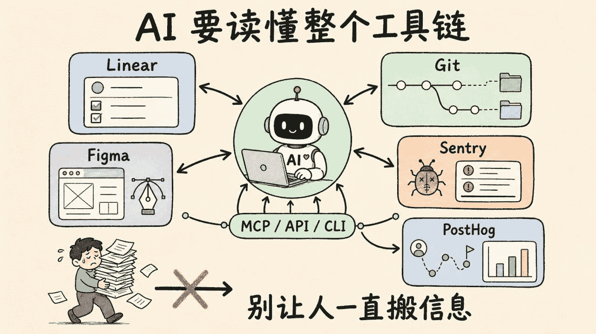

多智能体写代码，最好用 Git 做底座。Git 的三个核心工具能组合出一套不错的协作方式。Commit 是存档点：智能体每完成一小段修改、并通过验证，就打一个包。日后要排查问题，能看清这个包里动了什么，也能一键退回。Branch 是独立工作区：一个任务派一条分支，智能体在分支上折腾，绝不会碰坏主版本。Worktree 再给不同分支各开一个本地目录。这样两个智能体可以同时在两个目录里各忙各的，一个做视频导出，一个修登录 bug，读文件、装依赖、跑测试都互不干扰。诚然，Git 并不能包治百病，两边如果动了同一个模块，合并时照样可能干架。所以多智能体协作的第一要义，永远是先把任务切到互不相干的程度。

工具全打通之后，并不是每个动作都需要人亲自点击。一个标准的闭环是这样的：先和 AI 口头对齐需求，让它自己整理成 Issue；你点头后，它自己去读 Issue 和设计文档，拉起分支、建好目录，然后写下代码、跑通验证、生成 Commit，最后创建 PR/MR。开发中它能随时把进度同步回 Issue；上线后如果 Sentry 报错，它能自己拉日志、定位代码、提修复；PostHog 里的用户行为，也会成为它拟定下一版功能的依据。人在其中只留三件事：定目标、定方案、做验收。至于建任务、维护状态、打理分支、执行测试、整理日志，放开手让 AI 做就好。

国内也有对应的平替：Linear 可以用 PingCode、TAPD 或禅道，Figma 可以用即时设计或 MasterGo，代码托管放到 Gitee 或 CODING，错误监控用 Fundebug，用户分析用神策或 GrowingIO。工具叫什么不重要，重要的是它们都能承载“事实记录”，让人和 AI 均可随时读取。

轮到自己干开发，我不太照搬团队的完整流程，而是做减法。需求直接落在 GitHub Issue 或工程目录中的任务文档里；一个需求开一条分支；只有真需要多智能体并行时，才多开几个 Worktree。页面不复杂时，不专门做设计稿，给张参考图和几行文字说明就够；产品没上线，也不急着上监控和埋点，先把主功能跑通。简化归简化，三条记录永远保留：这轮要做什么、代码改了什么、最终验收结果如何。剩下那些能自动化的琐事，我都推给 AI 去做。连上工具后，AI 会持续消费 Issue、设计稿、代码和日志，令牌使用量自然会变大。但这些令牌花在了真实推进上，而不是浪费在每次换窗口后重新交代背景。

## 实战：销售报告脚本

理论讲了不少，下面结合一个真实小脚本，把刚才的几条方法串起来。这个需求其实很简单：各个供货商或采购平台导出的采购数据，多为 Excel 或 CSV，内容包括商品名称、商品编号、规格属性和采购成本。而独立站后台的销售订单，用的却是另一套 SKU。供货侧编号跟销售 SKU 之间没有任何直接对应关系，必须先从名称、颜色、尺寸这些属性入手，把两边商品“对上暗号”，然后才能把采购成本和销售流水合到一起。如果坚持手工做，那就得不停地在几份表格间查找、复制、粘贴、核对。数据量小还能咬牙扛住，订单一多、商品一杂，眼睛就花了。

### 第一步：把脚本请进本地目录

这种固定流程的批处理任务，泡在聊天窗口里做非常别扭。采购数据、销售数据和最终报告都只在本地电脑上。把脚本放进一个工程目录，AI 才能直接看样本、调整代码、运行程序、检查输出结果。以后再来新数据，不用重写算法，把文件丢进指定文件夹，跑一次脚本就得到新报告。有必要提一句：并不是每个工具都要穿件网页或 GUI 外衣，像这种轻量脚本，安安静静在本地处理数据，反而最高效。

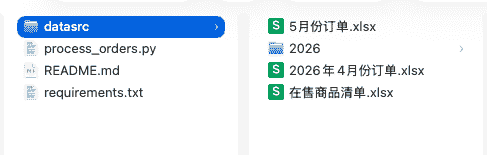

### 第二步：先弄清数据，再敲定方案

写脚本之前，得先让 AI 读懂两边的数据长什么样。独立站给每个商品标了明确的 SKU，而供货商或采购平台也会提供商品编号，但这些编号只在他们自己系统里通用，和销售 SKU 毫无瓜葛。所以第一步绝不是急着算成本，而是要先把映射关系搭起来。AI 会读两边的商品清单，整理出名称与规格，再推测哪些能对上。能拍板的直接录进表里；拿不准的（比如名称相似、属性缺失、或者同时有几个候选），单独列个名单交给人定夺。人确认过的映射关系，会存成一张映射表。以后脚本就跑这张表，找到对应的销售 SKU、挂上采购成本，再合并进销售数据。处理逻辑一旦固化成代码，只要各表字段不变化，直接手动执行脚本就能出结果，AI 根本不用在场。

### 第三步：切碎成四小步

开发过程拆成四段：第一段，把几份表格读进来，统一商品名、颜色、尺寸等表达；第二段，生成供货商品与销售 SKU 的候选映射，不确定的单独列出来；第三段，顺着映射表，把采购成本充到每一笔销售订单上；最后，合计成交额、采购成本，跑出 Excel 报表。每一段做完，都要抓一批真实商品来验证。先确认匹配关系，再核对成本和销量。映射表错了，后头的账全得崩。

### 第四步：真实的业务会逼着它不断更新

第一版脚本能跑通，只代表“能用”，不代表“永远能用”。后面接入新供货商，表格格式和字段可能变；冒出新商品，映射表要补充；同一个 SKU 采购过好几次，到底取最近价、平均价还是别的口径，还要业务上重新拍板。报表说不定还要把退款、广告费、物流费用等项目也纳入进来。每来一个新变化，AI 都得重新读样本数据、改脚本、跑一遍真实验证。那些令牌全部烧在了这种地方：翻表格、调映射、修逻辑、查脏数据、再产出报告。虽然它只是个本地脚本，但数据规则一直在长，令牌花费也自然跟着涨。

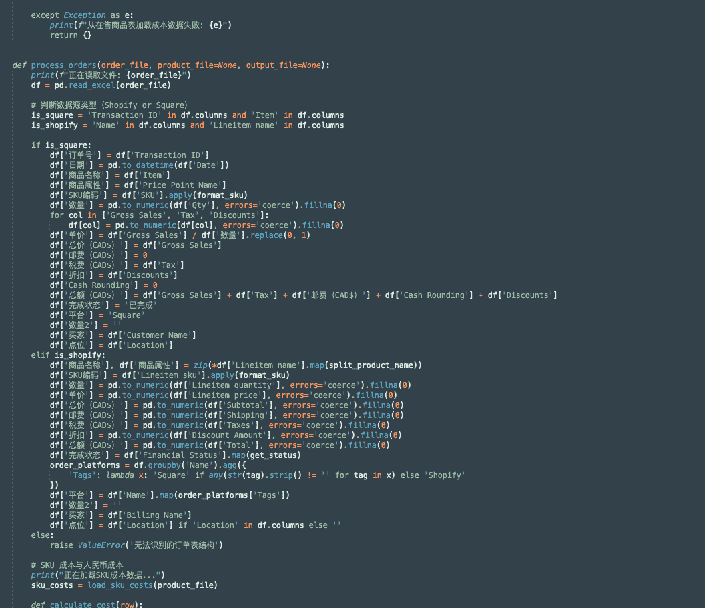

## 第二道坎：业务变多，令牌哗哗流

前面几节都在讲“怎么用 AI 把项目做完”。但项目做完不等于有产出，还得有真正的生意供养它，否则做几个 Demo、改改页面就完了。拿视频剪辑举例：一个直播团队，每次两个小时的直播结束，要快速切出十几条竖直短视频，还要自动拼段、配字幕、铺 BGM、按固定尺寸导出。

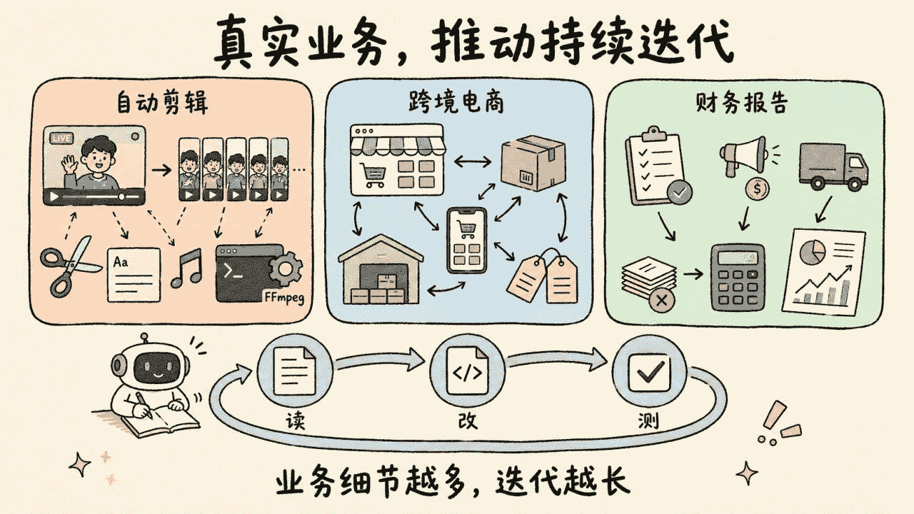

听起来只是几个按钮的事，真做起来会撞见一堆幺蛾子：有的视频没有音轨，有的编码不认，有的字幕时间对不上，还有的素材路径带着中文。每撞见一种新情况，AI 就要重新翻代码、看 FFmpeg 日志、动手术、再跑验证。消耗就这样一点一滴地攒起来。跨境卖家也类似——同时用着 Shopify、Amazon、TikTok Shop，仓库和供应商还是另外两套系统。要搭一个后台，把订单、商品、库存、售后全部同步起来。麻烦在哪儿？各家接口和字段格式各不相同，同一款商品，几套系统里的 SKU 可能都不一样；取消订单、部分退回、锁定库存的规则也各有脾性。AI 得啃几套接口说明，写对接代码，盯返回数据，还要处理限流、授权到期、资料不全。多接一个平台，就得重新做一套转接。财务周报也一样：老板要每天看到成交额、投放开支、快递费用、退款和实际利润，这些数字散在 Shopify、Stripe、PayPal、Meta 广告和物流商的系统中。AI 得先弄清每个指标的口径，再写脚本抓取、梳理、汇总。最终账目只要差一分钱，就得顺着订单、支付和退款记录往上溯。这些场景烧令牌，不是代码算法有多难，而是生意里的细节和意外实在太多。AI 必须不断翻文档、翻代码、翻测试数据、翻报错记录，然后进入新一轮调整。真正的业务场景不会在收货后停止，新需求、新资料、新问题会陆续找上门来，AI 也就得一直读、一直改、一直验。令牌开销的第二次数量级增长，就来源于老工程的维护迭代和新工程的滚动开发。

## 第三道坎：让交付自己跑起来

到这一步，AI 的角色彻底变了。前面是我在“用”AI——我想做一个功能，就打开 Codex 或 Claude Code，把任务丢给它。而自动化业务，是让公司后端系统自己学会“调”AI。API 并不玄幻，它就是程序呼唤模型的入口。用户在前端按下提交键，后端自动聚拢相关数据，发给模型，再把模型吐出来的结果放回原先的业务环节。前后台全部自动流转，不需要任何人打开对话框。现在市面上很多所谓 AI 工具，只是给网页塞了一个对话输入框，用户还是得自己组织语言、贴资料、复制答案。这在我看来，不过是换了个入口，远谈不上自动化。我判断一个功能是否真的接进生产流程，只看一条：它的输出能不能直接推动下一个动作？比如把任务状态推进一档、产出一份待确认草案、或者唤起另一套系统继续处理。单独调一次模型 API，难度不高；真正麻烦的是喂给它的背景资料。大模型无从知晓你的客户是谁，也看不到订单数据躺在哪个数据库，更不懂公司内部默认的玩法。这些背景，必须由调用方主动塞过来。想查订单，后端就给它一个查询工具；模型发出请求，程序查数据库，把结果交还给模型，模型接着判断，直到任务收工。我也并非所有事都甩给模型。花销核算、货存增减、权限验证这种硬规则，程序处理更可靠；模型的任务在于听懂用户意图、识别问题类型、组织信息、生成内容。一旦涉及退款、付款、删除数据或对外发布，程序校验和人工审批也不能省。自动化不是把钥匙交给 AI 乱开，而是把以前那些来回倒腾、费神判断的活交给流水线。一次完整的事务办理，往往要调用许多次模型；每次调用，都要带上系统规则、业务相关信息、历史记录和工具回传的结果。个人用 AI，一天能提交几百个任务就顶天了；一旦接进生产系统，每一个顾客点击、每一次数据变动，都可能自动触发模型。令牌开销从此由生意规模决定。所以我说，未来所有 AI 商品，明面上卖的是功能和服务，本质上卖的都是“用业务打包好的令牌”。量级第三次起飞，就这么发生了：以前是我调用 AI，现在是系统调用 AI。

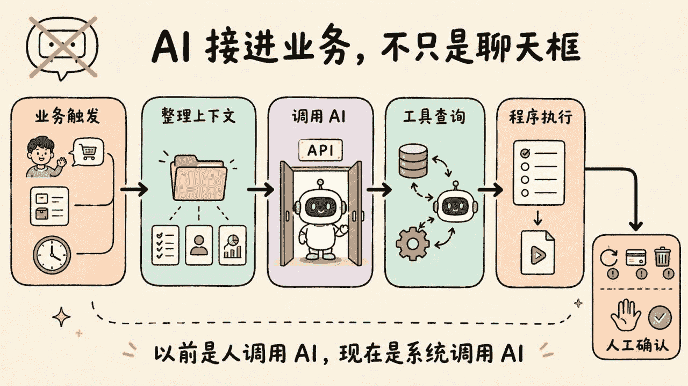

## 第二个实战：🛰️小店 + 知识库自动交付

直接上一个刚上线的实例，里面 AI 能力已经是整个生意的发动机。下面的数据是上线后的真实令牌开销，用来给用户出分析报告。这个小程序卖的是“知识服务”：用户在🛰️小店下单付款，然后填写业务问卷；系统结合问卷和知识库，生成一份个性化报告，最后以 PDF 形式交付。全链路长这样：🛰️小店下单 → 系统发货 → 小程序填问卷 → 飞书建任务 → Hermes 调用国产大模型 → 生成报告 → 送达用户。用户付完款，系统即刻发货。

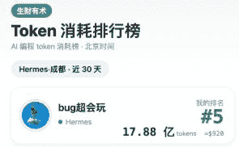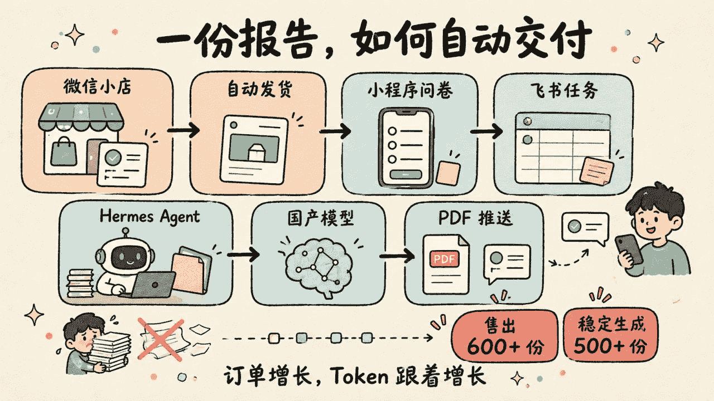

请注意，它发的不是固定资料，而是一个小程序入口。用户从订单里进入小程序，系统先校验订单是否有效；有效才开放问卷。问卷一提交，程序自动建报告任务。用户不用加客服🛰️，也不用截图订单发给运营。这套系统的技术栈是：🛰️小程序、🛰️云开发、飞书、Hermes、国产大模型。小程序管前端交互；云开发管核单、问卷存储、文件归档、消息提醒；飞书多维表格管任务——运营能一眼看到哪些报告在排队、哪些已完成，还能手动补信息和处理异常。Hermes Agent 跑在本地电脑上，通过 CLI 定期拉取飞书任务；拿到问卷后，先去知识库里精配对应方法，再调用国产大模型生成结构化报告。报告好了，程序自动检查内容与格式，生成 PDF 传到云端，再用🛰️消息把入口推给用户。用户点开消息，回到小程序就能看或下载。这一连串动作里，运营不用手传任何一个文件。

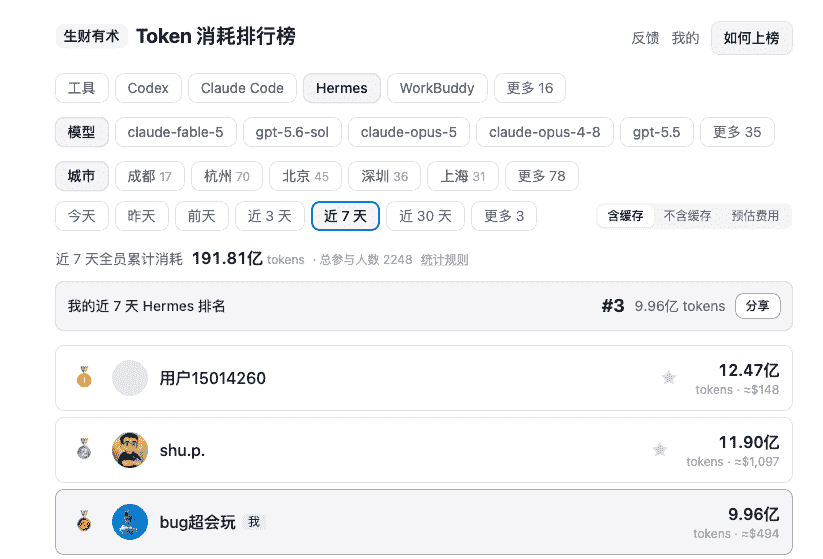

在这套系统里，AI 负责三件事：理解用户描述、匹配知识库内容、撰写报告。订单、身份、流程进度、版式、消息提醒，全都由程序接手。模型层也可以随时替换：哪天想换便宜的或效果更好的国内大模型，不用重写小程序和整套交付机制。正式上线前，还有一堆不写代码也必须完成的事：小程序备案、按照实际收集的信息配置隐私保护指引。用户的姓名、联系方式、经营资料，哪些要存、哪些要喂给模型，都要提前界定清楚。另外，报告由 AI 生成，页面和导出的 PDF 上也要保留相应说明。技术链路能走通只是第一步，备案、隐私、完整交付，一样都不能少。目前这个产品已经卖出 600 多份，系统顺利产出了 500 多份报告，整条链路承载过真实订单。每新进来一个有效订单，系统就自动去读问卷、翻知识库、出报告。此刻，令牌用量不再取决于我今天向 AI 提交了多少任务，而是完全跟随成交量而变化。

前面说过的本地工程、方案调研、背景持久化、自动落地，在这个小程序里全都能找到影子。

比如“把工作放进本地工程”：小程序代码、云函数、配置、运行日志，全都在本地目录里。AI 进到这个目录，就能直接看代码、调整云函数、执行自测、查看运行记录。哪怕换一个对话窗口，甚至换一个模型，只要让它重新读一遍目录，它就能无缝续接。

动手前先做技术验证：把用户完整路径画清楚——小店下单、系统发货、进入小程序、核单、填问卷、生成报告、🛰️通知。下单要自动推入口；报告完成要推服务消息，点开就能看；小程序要把部分信息同步到飞书；电脑上的 Hermes 拉走飞书数据，处理完再写回；小程序再回头拉飞书里的报表记录。这些容易卡壳的节点，都要在开发前做技术验证。只要有一段阻塞，要么调整方案，要么整个换思路。验证时有个小诀窍：像🛰️开放平台这种体量的大平台，一定要盯住官方文档，让 AI 严格按文档来，能省去很多坑。

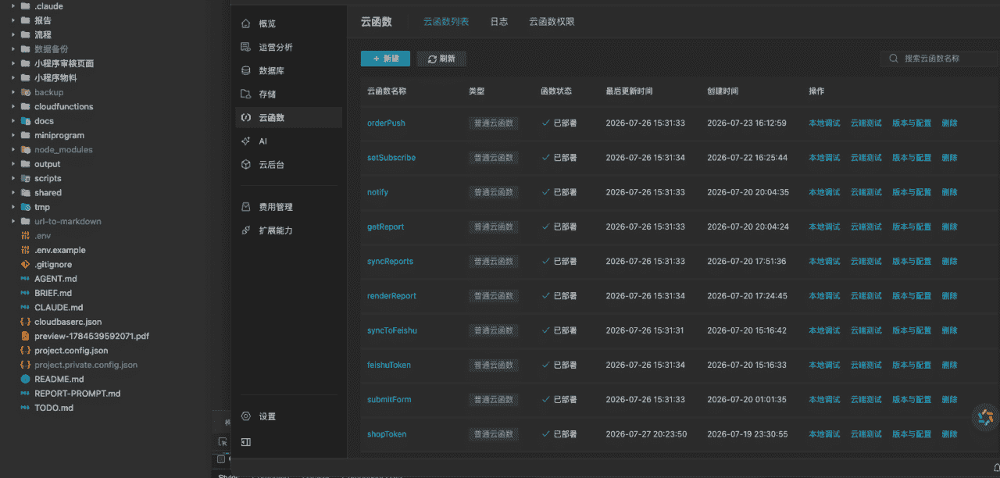

部署方案上也仔细比过：小程序有三条路可选——云开发、云托管、自己买台服务器。自建服务器要备案服务器和域名，等太久，直接放弃。云开发和云托管都能走小程序的 ICP 备案，审核速度快得多。而且云开发还能把小程序和小店绑在同一套身份验证下，开发量减少，稳定性更佳。最终选型：小程序 + 云开发 + Agent 主机（服务器或本地电脑）。

保存长期背景：多系统联动的项目，光靠聊天记录撑不了长期维护。订单怎么验、问卷有哪些字段、任务有几种状态、报告按什么结构生成——这些都得写进工程文档。以后换窗口、换模型，AI 不必再把整套流程问一遍。

灰度开发：没必要一口气跑通全部链路。先打通小店订单和小程序身份校验；然后加问卷提交与任务创建；前面稳了再接入知识库和国产大模型；最后搞 PDF 生成与🛰️推送。每一段都用真实数据验证。这样真出问题，能快速判断是订单环节、问卷环节、报告环节还是通知环节。全部验证完，先真实下一单走一遍，然后拉核心用户小量测试。万一有毛病，好收拾，也不至于消耗顾客信任。

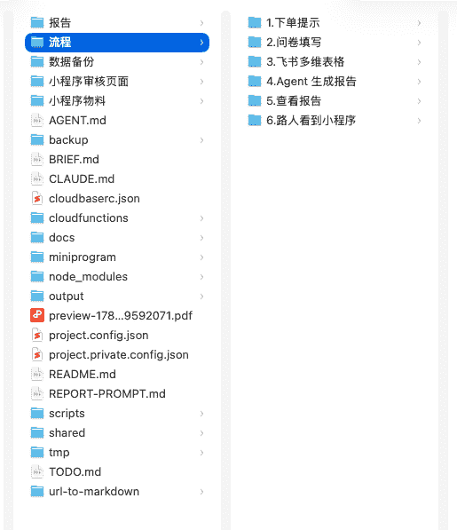

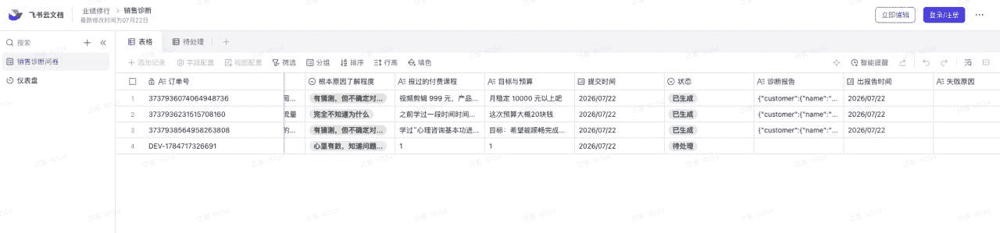

系统稳定后再全量放量。用户量大了，直播卖货这类场景，则要提前想好订单瞬间暴涨的对策。

工具间的连接：这套系统绝不只是一个小程序。云开发存订单、问卷、报告；飞书管任务；Hermes 抓任务、查知识库、调模型。工具打通后，数据在各环节间自动游走，没有人需要反复复制问卷、下载报告、再手动发给用户。

真实交易驱动一切：系统开始接真实订单后，还要面对“问卷没填完”“报告生成失败”“任务要重试”“运营怎么介入异常”这类问题。这些问题在开发前很难一次想全。用户多了，情况就多，项目也会跟着继续长。当链路稳定成型，每一笔真实成交，都会让系统自动完成“读问卷、捞知识、写报告、做 PDF、发通知”这一整套动作。

## 关于未来

令牌排行榜看看就好，不必太上头。每个人的工作性质和生意体量都不一样，用量本来就没有统一标尺。刚开始接触这些工具，多问、多试，先把它的长处和短板摸清楚，再给自己的使用定一个务实的目标。接下来，把它放进日常工作和实际业务里，让它接手更多杂活。等到找到合适的场景，再把它打磨成一个自动交付的产品，或者帮身边的朋友做智能化改造。排行榜上的数字只是结果。真正值得盯着看的，是这些令牌有没有帮你省下时间、做出产品、赚到真金白银。

————分割线————

看完那份 SOP，你是不是觉得自己已经会了？真到上手那一刻，九成的人连第一步都迈不出去。

工具、教程，说白了是最不值钱的关卡。真正把你挡在门外的，只有两样东西：一是不肯立刻动手，二是拿不到一手圈子里的信息差。

想看到市面上最新、最野的变现套路，还想和一群动手能力极强的人一起下场跑结果？欢迎来我的核心圈子：【懒人专属群】。

这里不灌鸡汤，也不搞虚的，只做两件事：拆商业闭环，榨AI效率。群里已经沉淀了 1000+ 条跑通验证过的套利实战玩法。

👉 想完整看圈子的数字资产和上车门槛，点这里：
https://lazyso.com/insider/

觉得价值对得上、也准备好真干一场的，直接加我🛰️：lazyhelper1
备注【实操上车】，非诚勿扰，不闲聊。

