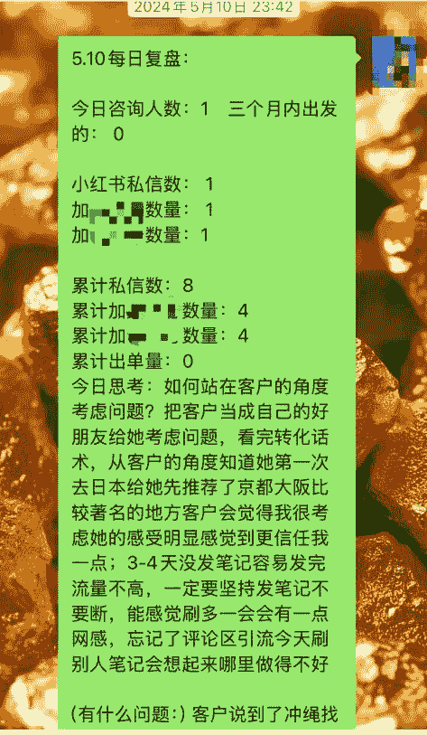
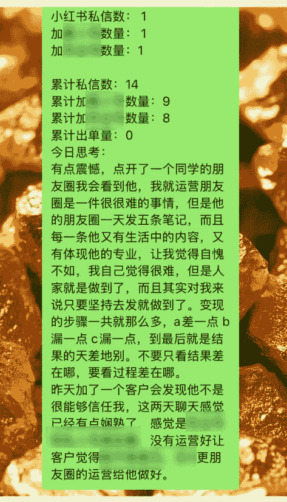
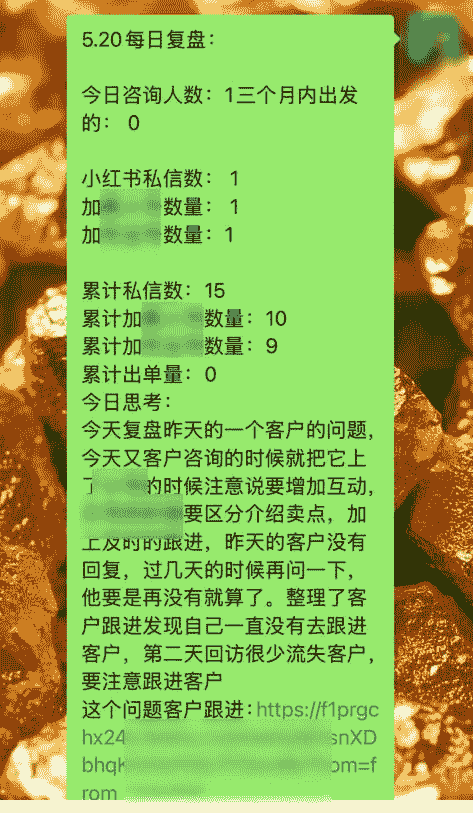
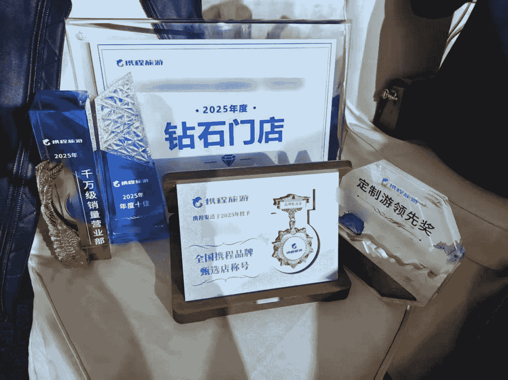
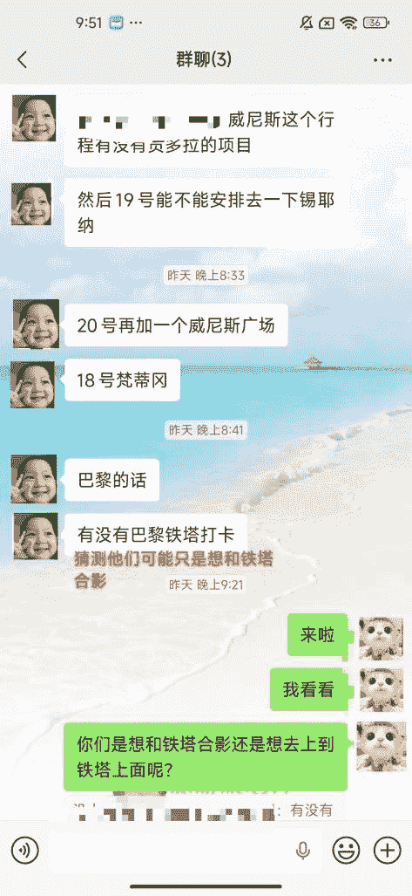
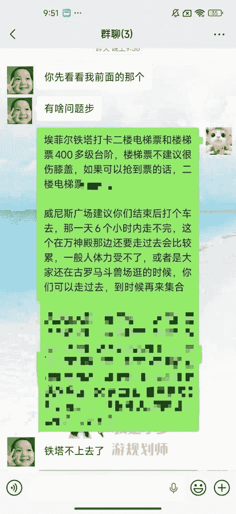
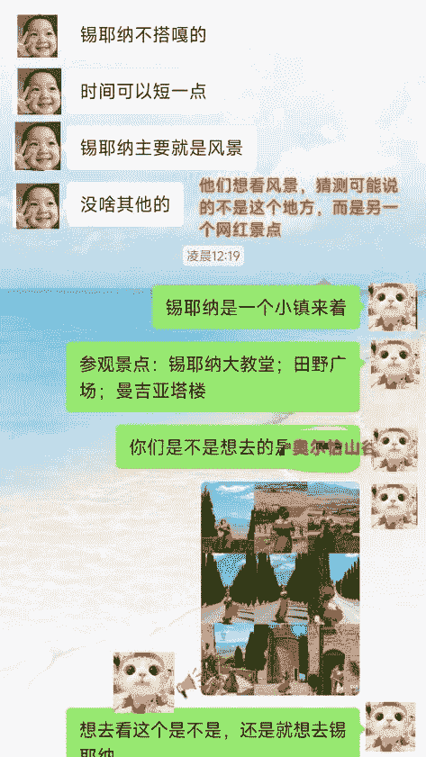

“我想去欧洲看看”这句话，要怎么聊成一张三万块的单？

两年前的我，大概会秒回一份标准行程，然后等客户拿完三份报价，挑个最便宜的走人。

现在的我，却能从这句话里，一点点摸清对方几个人、带不带老人孩子、起床习惯、预算边界、喜欢什么、不能接受什么，最后交给他的，不是一张通用行程，而是一份为他量身设计的路线方案。

我是蛙嘟嘟，在小红书和抖音做了两年多旅游。去年，我们团队做到了携程定制游板块的第一名，营业额排到浙江第六。

但回看这条路，踩过的坑其实比拿到的成绩更多。

**选择旅游，是因为我看重“能力迁移”**

2024年4月，为了找副业，我加入了生财。当时面前有两个选择：一个是小红书旅游，另一个是无货源电商。

很多人会挑选看起来更热的那个，但我的判断标准不同——我的现有能力，放到哪个方向上更容易继续用？

我帮朋友运营过小红书考研账号，对内容规则和流量分发有实感。转去做旅游，只需把内容方向从考研换成旅游，再补上产品、目的地以及销售模块；可如果去做电商，从选品、内容到供应链，几乎等于全部归零。

所以我选了旅游。

事后看，这个决定是当时最值得庆幸的：普通人挑方向时，除了问“能不能赚”，更要问“我得额外补多少技能”。需要改变的地方越少，从0到1跑起来就越快。

**新人期没有技巧，我用30天把主干流程走了一遍**

刚开店时，我完全不懂旅游产品，也不清楚目的地，客户抛个问题过来都会发懵。

我的方法很土：每天做了什么、学了什么、碰到什么问题，全部记录，然后倒推成一份30天的学习清单。

那一个月里，我反复做四类事：了解行业惯例，搞懂一个旅行产品从咨询到成行要经历哪些环节；研究目的地和团型，弄明白不同线路的差异在哪里；继续练笔记引流，摸清旅游用户真正关注的内容；找资深同行聊天，看他们是怎样接待咨询、讲解产品、推动成交的。

目标并不是30天后成为行家，而是至少能接住客户的基础疑问。

**流量来了却谈不拢，关键差在“聊需求”**

一开始，我天真地以为有流量就等于有生意。可咨询量上来之后，我却接不住。

客户问“欧洲有什么线”，我直接甩行程和报价。结果呢？客户拿着好几家的价格来回比，最后谁便宜就选谁。

后来我才跨过那道坎：客户第一次开口时，诉求往往是模糊的。“想去欧洲看看”“一家人出行”“不想太累”——这些说法的背后，藏着很多没讲出的真实想法。

我不再急着推销产品，而是顺着对方的话一层层深挖：

计划几号出发？总共几个人？同行的是长辈还是孩子？过去有没有去过欧洲？每天能几点起？步行距离能接受多少？最想去的地方是哪里？最接受不了什么？

每句话里都有线索。比如对方说“不想太累”，那要分清楚：他是不想起早，还是怕长时间坐车？如果陪父母出行，得问老人家的腿脚状况和作息节奏；如果是亲子游，得问孩子多大、有什么兴趣；而蜜月型客户，关心的或许不是打卡了多少个景点，而是住宿的私密感和整段行程的步调。

当你把问题挖到这一步，那些普通线路满足不了的点，恰恰是客户愿意买单的原因。

接下来我要做的，是把了解到的信息分成三个层次：一定要满足的、可以有弹性调整的、绝对不能接受的。再结合目的地和产品知识，去设计对应的方案。

这份方案里的每一个细节，都要让客户明白“你是在替我考虑”：为什么这样走最顺、为什么某一晚需要停留、为什么某个网红打卡点不适合他的情况、预算花在哪里。

客户之所以接受定制，从来不是因为你行程表做得花哨，而是因为他能够感受到：你确实听懂了他的话，并且给出了一套他搞不定的解决方式。

因此，我的转化路径总结成一句话：先用内容找到对的人，再靠提问把模糊需求问清晰，最后用专业方案把需求接住。

把完整商业模式压缩成一个链条就是：

内容带来流量 → 咨询进来 → 梳理需求 → 定制方案 → 确认成交 → 后端交付。

初入行时，我以为流量是最高门槛。流量稳定后，才体会到转化才是真正的坑。等转化磨出来了，又发现最容易出事的是交付环节。

**产品方向，是靠试错一点点校正的**

我最早切入的是日本线。客单价低、售后负担轻，可缺点也扎眼：决策周期拖得很长，客服对接与后续交付都不成熟。

为了追求更快的成交速度，我转回国内游。单量确实猛增，有时一天能搞定好几单，但利润非常小。

挣扎了大约两个月，我又看上了欧洲市场。

欧洲线路报价高、利润空间大，但涌入的玩家也多。当产品同质化严重，最后就只能拼价格。价格战是没有底的，于是我刻意往定制游领域深入。

定制游难在什么地方？要对目的地研究得透，产品吃得很深，客户的问题千奇百怪，必须每天持续充电。但正因为门槛复杂，长期愿意沉下心做的人并不多。这份复杂度，反倒变成了我的护城河。

**出发前10天被供应商放鸽子，我遭到网暴**

这行里我栽过最大的跟头，就是太放心供应商。

有客人提前三个月定了团，出发时间早都确定好了。结果出发前十天，供应商毫无征兆地取消行程。客人假请好了，行李准备好了，却被打了个措手不及。

最后，我被客人指名挂到网络上，遭遇了一场公开讨伐。

那次经历让我彻底清醒：哪怕真正违约的人不是我，客户面前必须给出交代的仍然是我。前端费尽力气把单子谈下来，后端却交不出去，损失和影响比没有单子更严重。

所以判断供应商眼光要毒辣：不要只听对方怎么吹，而要看他能否持续稳定地完成交付；中途有变动，能不能第一时间同步；出现投诉，会不会躲闪；出了状况，有没有备选方案并有人站出来负责。

前面靠流量和转化把人带进来，后面靠优质产品和可靠供应链把人接住。两边缺任何一个环节，这门生意都撑不长久。

**让我重来一遍，我会把流程分成六步**

第一步，收敛领域，选定一个聚焦的产品方向。新手千万别贪多，恨不得全世界的线路都上架。盘子撑得越大，要学的知识越多，客户反而拿不准你是否专业。

第二步，花一个月打牢基础行业常识。目的不是成为专家，而是客户问出基本问题的时候，你大致能判断信息该去哪里查。

第三步，持续产出内容，获取稳定流量。别把目光凝在点赞收藏上，要盯有没有带来真实问询。

第四步，练好咨询到成交的转化。客户敲过来以后，不要在第一时间丢报价单。学会用连续提问，把模糊想法梳理成明确要求，再给出一套可信方案。

第五步，严选供应商。价格和线路只是起点，交付能力、沟通反应、退改机制和突发情况的应对手段，全都必须考察。

第六步，跟着数据反馈调整路径。若成单快但毛利低，就考虑产品升级；若流量多但成交少，就补转化短板；若单量没问题但投诉不断，就要回查供应链。

我之所以从日本转到国内、又从国内切入欧洲定制，本质上也是连续根据结果做修正。没有谁一开始就命中标准答案，不过是每一阶段主攻一个最棘手的难题。

**普通人有没有机会？先学会搞流量**

每次有人问这条路能不能复制，我的回答是：可以试，但别想着买套课程、发几篇帖子就能出结果。

如果只挑一项最优先的能力来练，我仍然会选内容获客。因为只有持续有流量，你才有机会碰见真实的客户，才能听见他们在问什么、怕什么，才有素材去磨练转化。流量为零的话，后续一切能力都无法验证。

而且流量本身就具备价值。哪怕你暂时还不懂产品和成交，也可以把咨询对接给成熟团队；等自己对业务熟悉起来，再试着独立承接转化。

不过要是想做长期生意，光靠流量远远不够。你得补产品与目的地认知、销售沟通话术，还要具备供应链判断力与风险意识。客户是冲着专业度付费的；高客单的项目只要交付环节出事，损失的不只是这一单，还有自己的信誉。

那这个方向现在还有空间吗？我认为有。但机会不在“竞争少”，而在于“整条链路足够长”。

内容、转化、专业、交付，每一项都能做好的选手本就稀缺。许多人也许擅长其中一块，肯把每一环都耐心打磨到位的人却不多。这本身就是一种壁垒：复杂会挡住大多数人，也会庇护坚持下来的人。

**淡季转了一圈，最后还是回归旅游**

旅游天然分淡旺季。淡季收入不好看时，我也容易心慌，尝试了不少旁门左道。

我玩过抖音CPS，也做过公众号爆文。当时的想法很直接：也许换一个项目，眼下问题就能消失。

但转了一圈后，我发现这些尝试提供的正反馈，都没法和旅游比。

旅游这条路，我已经沉淀了流量打法、销售方法、产品和目的地积累，还吃过了供应商的亏。换到生疏项目，基本意味着清零重来。今年再把全部心力放回老本行，我慢慢感觉到，当内容、沟通、产品、交付这些环节慢慢变好，成交反而走向了自然。

接下来，我依然会继续深耕欧洲定制游。一边补充目的地与产品知识，让自己能迎接更复杂的诉求；另一边加强对供货方的筛选，把获客、转化、交付这条链条拧得更紧。

我从没觉得能拍着胸脯说，这行我已经彻底弄通了。目的地会变、产品会变、客户也会变，每天仍旧有新问题冒出来。但对比两年前，现在至少懂了一个逻辑：流量带来问询，转化带来订单，好产品和牢靠的供应商，才决定这门生意能持续多久。

最后，把这两年最深的体会送给仍在找方向的同行：

直接跳进一个陌生行业，向来是最难的。可如果肯站在已有能力的肩膀上往外挪一步，每次只变一点点，得到正反馈的概率就会高出许多。

这个世界本来就是二八分化。与其在焦虑中反复换赛道，不如选准一条路狠狠挖下去。缺流量就想办法搞流量，转化弱就专攻成交能力，产品不给力就换产品，供应商不省心就再找真正能一起承担责任的人。

一个个问题拆开解决，时间一长，你克服过的麻烦就会沉淀成别人拿不走的护城河。

——
想了解更多经过验证的变现玩法，欢迎来我的私域看看：
https://lazyso.com/insider/

别光看热闹，真觉得这套东西靠谱、也准备好了亲自上手的朋友，直接扫码来找我。

我的微信是：lazyhelper1

添加时记得备注【实操上车】。只聊实际动手的事，闲聊就不占用彼此时间了。

