# 军工程序媛宝妈：通过垂直小号+AI 航海家大课的方法实现工作流重塑，拿到正反馈和效率翻倍的实操复盘

大家好呀，我是杜稀饭。在西安，白天我是军工领域的一名程序媛，主要和计算机视觉、图像处理打交道；晚上回到家，我又变回一个爱折腾的内容博主，还是一个一岁两个月小朋友的妈妈。这种“双面生活”听起来挺酷，但背后也有不少狼狈：比如主业单位不能上外网，我只能等孩子睡了以后才写东西、发内容，再定时到第二天晚上发布。

在赚钱潜水整整两年，看着身边圈友一个接一个做出成绩，自己却总不知道第一步该踩在哪里。帖子追了不少、航海也参加了几期、线下聚会更没落下，可每次想动笔写点东西，又觉得自己拿不出手，页面开了又关。后来我终于想明白一件事：做内容和写程序不一样，你没法等一个“编译通过”的瞬间来确认自己准备好了。你只能先把东西发出去，数据和市场才会把反馈日志丢给你。

想明白之后，我开始认真琢磨定位。七天老师在垂直小号的高手领航里讲过一句话，我记到现在：定位不是一开始想出来的，是在不断尝试中试出来的。那从哪里试起？一来看你过去把时间和精力花在了哪里，二来看看手边有什么能立刻开干的事。人总会本能地把精力留给那些喜欢又没那么费劲的事情。

回头整理自己的经历时，我发现从学生时代起，我就爱折腾各种兼职，总想着把身边的资源盘活变现。另外，我有个坚持很久的习惯：凡是自己解决过的问题，都会用大白话记录下来，再配点生活里的例子，下次遇到就能立刻想起当时的解法。既然这些问题我常碰到，别人八成也会碰到，那我为什么不发到公共平台上呢？所以刚毕业那阵，我顺手就注册了👸号，只是更新全凭心情。后来我还做过盖洛普测评，也试过把经历梳理好发给 AI 分析，聊着聊着，有些答案自己就浮出来了。

转到手边事上，那会儿我正在学机器视觉和嵌入式相关的网课，一边学一边沉淀笔记。老师讲得实在好，又因为我自己也在写👸号，就动了帮他推荐课程的念头。可又怕推荐不出去丢人，于是先把课程内容学扎实。接着我泡在赚钱里，把垂直小号相关的帖子和航海内容都翻了个遍，从手边这件事开始用起来。读者慢慢给我贴上一个标签：“有趣有料”。我一直记得一句话：“出来混，最重要的是出来。下场干活，把手弄脏。”当你真的动起来，前辈们的方法就会自己跑到你面前。

现在我的工具流已经做到：在飞书里发一个触发词，Obsidian 知识库就能自动生成👸号文章初稿、贴图正文和朋友圈文案，全程不过几分钟。以前我每个月要花 500 块钱请助理帮忙归档整理飞书知识库，现在这笔开销也省了，正好可以重新想想哪些活儿才值得外包。

真正让我在垂直方向上开窍的，是贝拉老师的线下分享。那是我第一次意识到：获客不是靠撞大运，而是可以搭一套系统来实现。我给自己定了一个特别细的定位——服务机器视觉和图像处理方向的同行，帮他们看懂晦涩的学术资料，也替他们避掉我踩过的坑。说实话，刚定下这个方向时，我自己也嫌它太窄。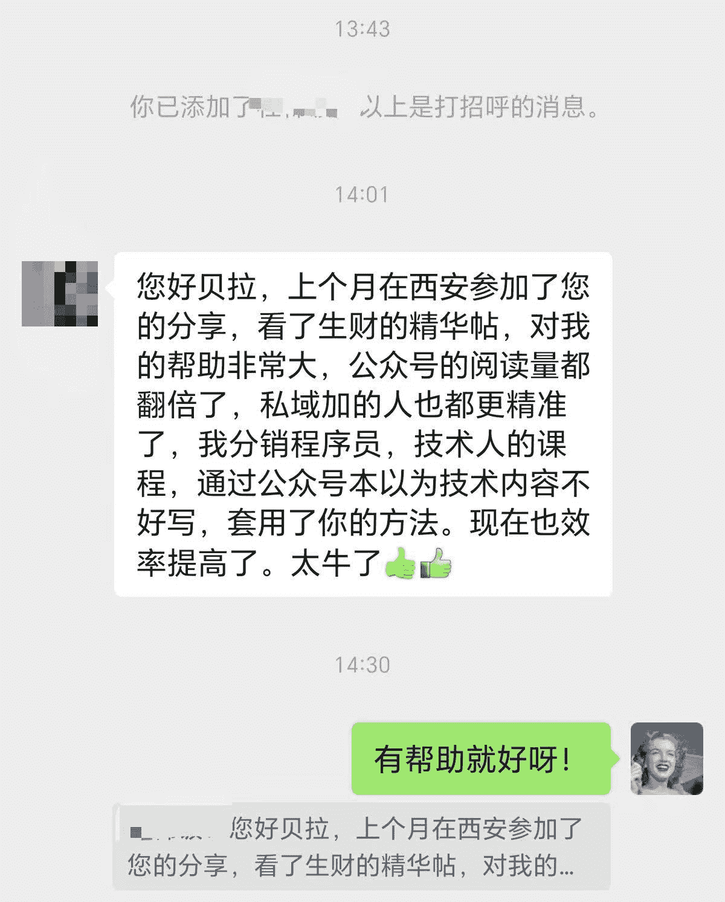机器视觉的同行能有多少人？再细分到做 ISP 调试、调画质、做视频流软件开发的人，又有多少？不是同行的，可能一辈子都不会有这个需求。

但在贝拉老师的线下分享和她那篇《👸号 75% 爆款率，23 倍单季度流量增长，三年实战方法论全拆解｜垂直小号深耕》里，看到一个“专注教小学某年级女生数学”的例子，我一下子被点醒了：小众从来不等于没有市场。用户少，不代表需求少。核心要看这群人有没有真实问题，愿不愿意为解决问题付费，以及能不能从你这里得到比搜索引擎更省时间的答案。

于是我开始稳定更新，不再想着把内容写给所有程序员，只认真服务机器视觉这一小撮人。效果反而比我预想的好。因为精准的人一旦觉得你说中了他的处境，绝不会只点个赞就走——他会加你、会追着问、会进群，还会把难题带给你。

去年 11 月刚开始时，我还在手写经验笔记，眼睛盯着单篇阅读量，看着点赞和关注数慢慢爬。今年 3、4 月参加完线下聚会和航海后，私域直接拉满 4 个群，累计 2100 多人，还做了自己的陪伴群。之前我是和不同平台的博主合作课程、做知识星球分销，像海思、瑞芯微、FPGA、高通、MTK 这些圈子都有涉及；3 个月下来，累计成交 700+ 人，GMV 做到 6 万多，现在也在筹备自己独立的产品。

更妙的是，5 月 21 号我的哺乳假刚好结束。交流群里有个老板来问能不能发招聘信息，我一看，岗位和我的专业正好对上了——结果我连 BOSS 直聘都没下载，就直接找到了主业新平台。除了嵌入式软件开发岗，我还能给老板对接外协、采购等其他群友资源。这段经历还影响了两个工程师朋友，让他们也开始把经验沉淀下来；另一位本来就有账号、有专业的朋友，也放弃了“佛系纯发”和“只要内容够干就会涨粉”的念头，因为真正能支撑持续增长的，是一套跑通的闭环系统。

这套闭环具体长什么样？一句话：行业认知 → 知识库 → SOP + AI 生产内容 → 发布看数据 → 数据反哺知识库。行业认知就是你真的懂什么、客户到底焦虑什么；知识库负责把经验、案例、素材和方法统统沉淀下来；SOP 规定内容怎么生产、怎么审核、怎么发布；数据用来判断流量质量和获客效果；最后把有效经验写回知识库，让下一轮内容再上一个台阶。

在这个系统里，AI 不是替代你写文章的工具，而是整条生产链条的一环。如果生成的内容不满意，先别笼统说“写得不好”，要具体定位：开头平、没钩子，就去优化框架库；内容泛、没细节，就补客户原话、案例和数据；语气不对、风格不稳，就把提示词写得更具体；内容一眼像 AI 写的，就加入自己的表达、经历和判断。

做知识卡片也是我后来发现的新机会。贴图形式在🛰️生态里正当红利期，尤其适合我这种知识付费内容。用 AI 生成清晰好看的可视化卡片，还能强化视觉锤和个人固定角色，形成稳定风格。比如：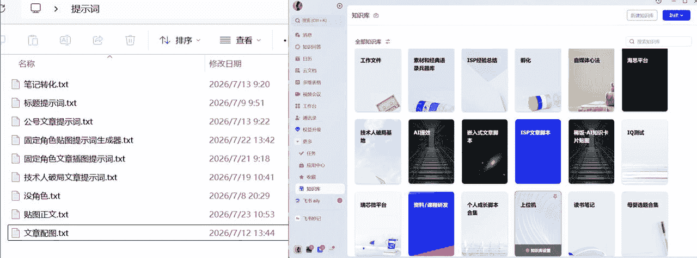在人工梳理阶段，我已经把关键动作提炼成了 SOP，但维护方式还是很原始：👸号一套提示词、知识卡片一套、朋友圈一套、插图卡片又一套。每次有新想法，都要打开文件夹，复制、粘贴、改改、再分发。

素材更是乱得可以：
- 课程里学到的方法，全靠手动整理。
- 刷到的好案例、金句、段子，也是手动收藏。
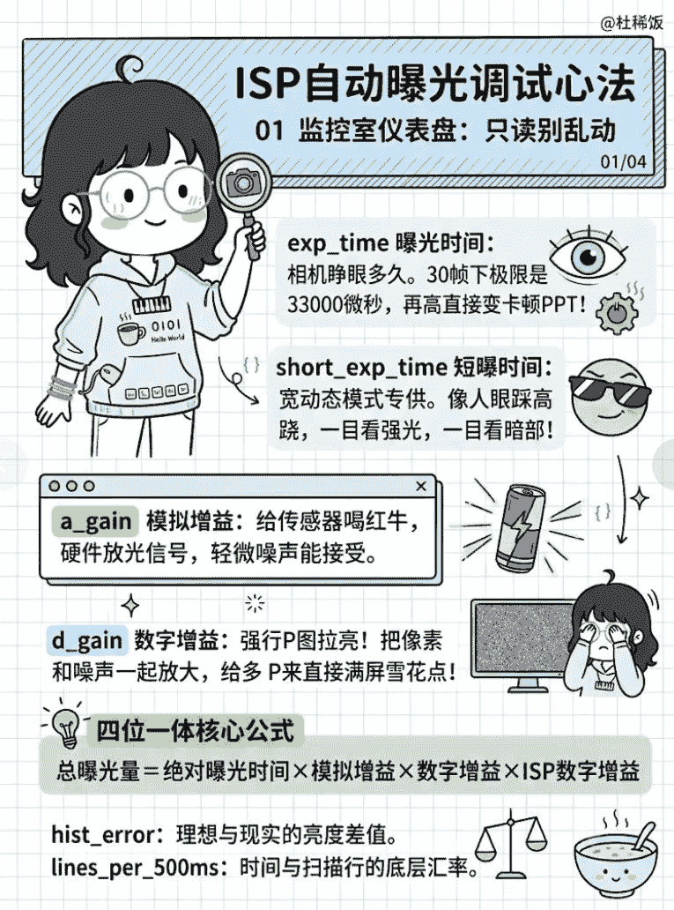
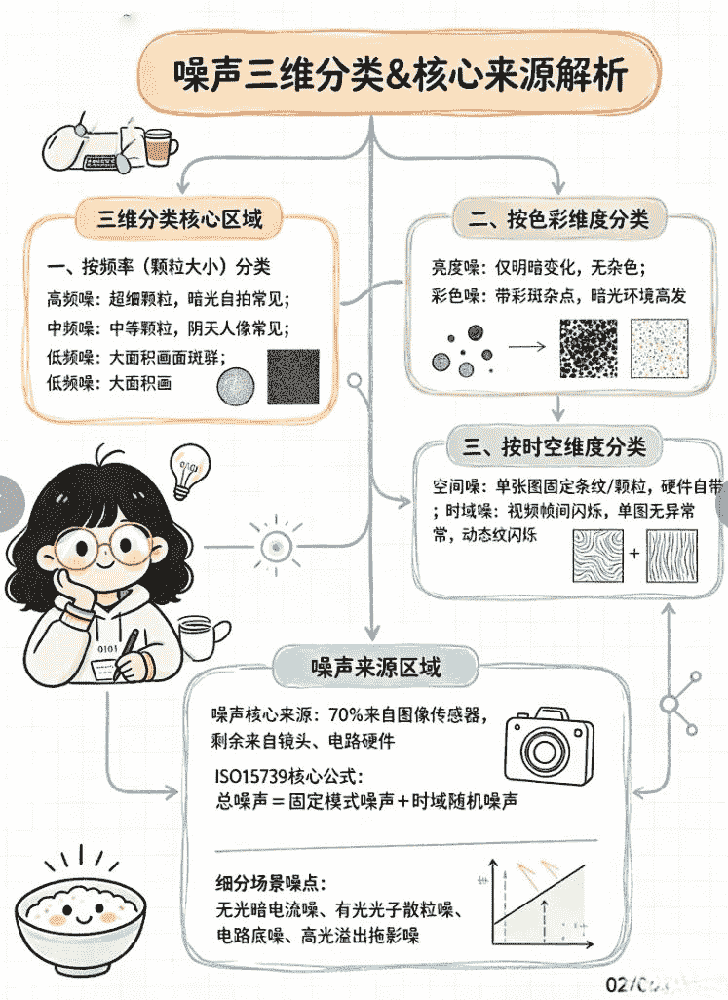
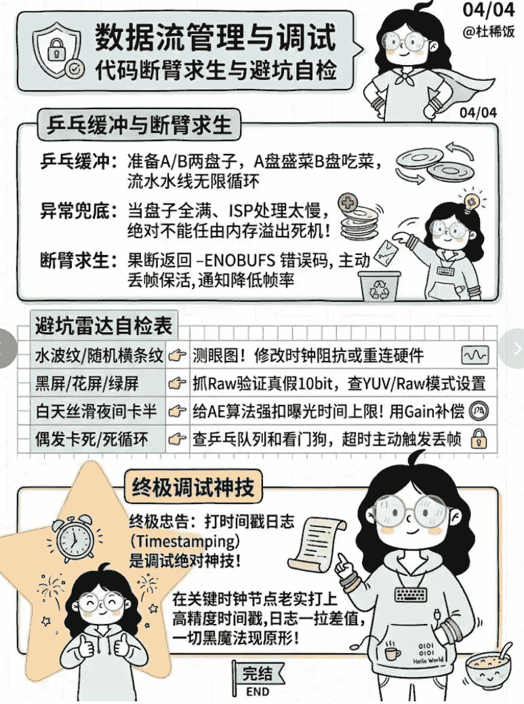
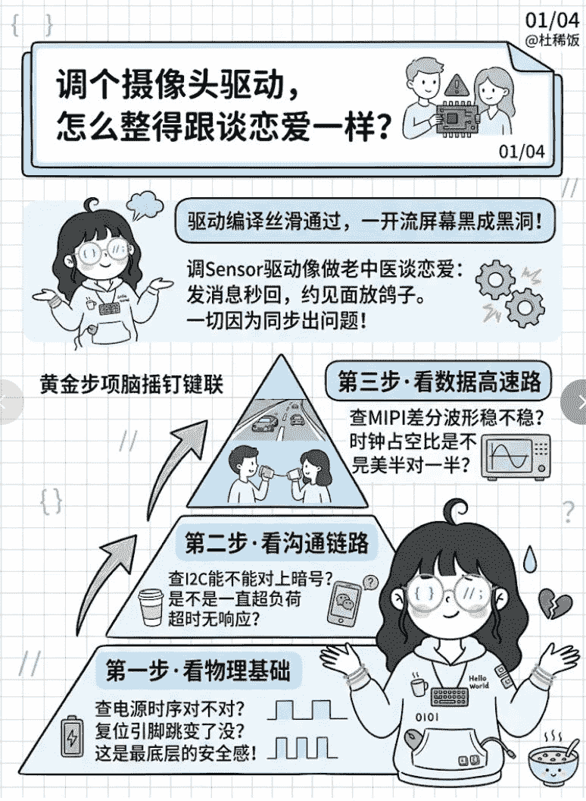
- 陪伴群里的高频问题，我找大学生整理，每月付 500 元。
- 走路、吃饭时冒出的灵感，随手发给自己的另一个🛰️号存着，省得再打开别的工具。

内容流程则是：👸号文章 → 贴图正文 → 朋友圈文案，再同步到📕和社群分享。上一步的输出，正好是下一步的输入。我早想开📕，但实在没精力研究，就把👸号和贴图的内容原样搬过去，也不管什么平台规则。先发了再说，有总比没有强，后面再按真实反馈慢慢调。

这个“从长往短”的顺序还有个隐性好处：长文转短文时，AI 不容易出现幻觉；如果反过来从小扩写到大，幻觉就会铺天盖地。

不过麻烦并没有消失。AI 还是不够懂我，每次生成完我都要手动修改，补上自己的经历和判断；量一上来，手动操作就成了负担，不同的产品线之间还会互相干扰。正当我打算找前辈梳理卡点的时候，AI 航海家大课出现了，直接解决了我的问题。

课程里讲的数据四象限也特别有价值。贝拉老师强调：内容发布后 48 小时内就要记录数据，至少包括阅读量、点赞量、转发量、加粉率和后续付费转化率。再按“流量”和“获客”两个维度，把内容分成四类：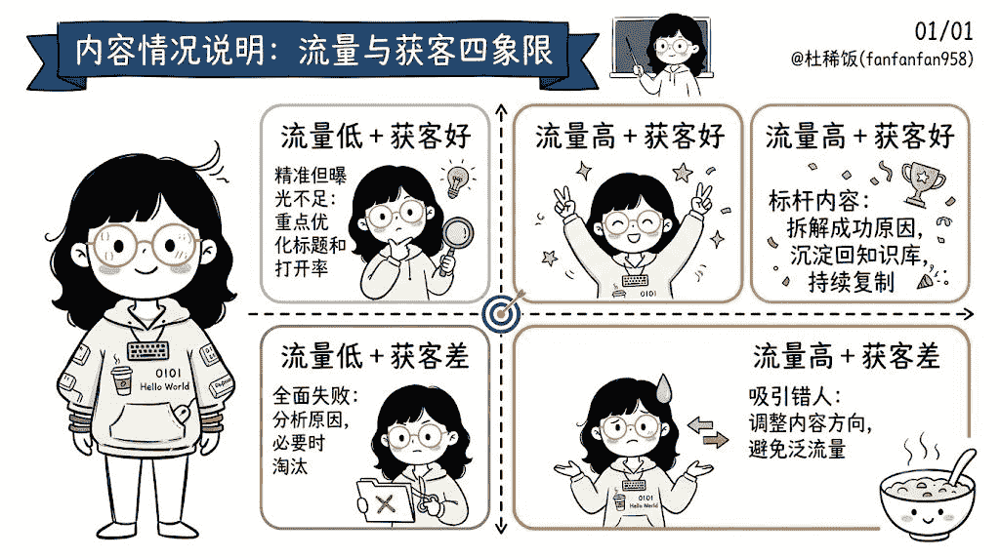绝不能只看单一指标。打开率高，不一定代表内容好，也许只是标题够夸张；停留时间长，也不一定代表内容好，可能是信息密度太低。必须把打开率、完读率、互动质量和加粉率放在一起判断。

做数据分析时，我拿到了两个实实在在的好处。

第一个是更懂用户。先理解目标人群的痛点，再按贝拉老师教的分级方法拆解：生存画像 → 核心焦虑 → 痛点分级 → 切入点。具体怎么做？一方面，我会和已添加的用户一对一聊，看看他们第一句话是“想进交流群”，还是“有没有课程”，又或是聊求职规划，再顺着话题深挖，找到背后的动机和情绪。另一方面，我可以让 AI 帮忙分析目标群体的画像：这个年龄、性别、专业的人群，在职场、生活、技能提升上分别是什么状态，有哪些数据、卡点和变化？比如是技术骨干还是求职中，是想技术交流还是想链接资源；市面上已有的课程、论文、资料是怎么分布的；这个群体会在什么时段点击哪类内容？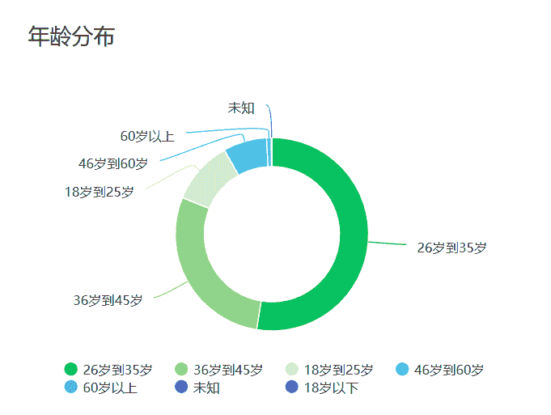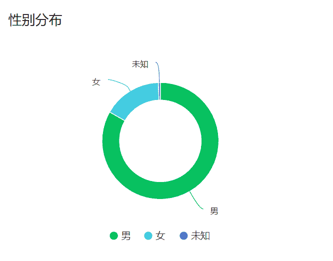

第二个好处，是去调整可植入的钩子。目标锚定的是获客，而不是盲目涨粉。所以我开始站在阅读者视角，替用户说出他的处境，把用户经常出现的场景、物品、人物关系和相关词条统统放进去，而不是只从发送者视角自说自话。先定位问题，再理解人，最后替对方解决顾虑、给到具体指引，然后再谈关注或转化。

选题方面，我也有几条实用心得。一是从已经爆过的标题里找灵感，结合自身情况重新创作——别人爆过的能写，自己爆过的也能接着写。常见的有三类：紧跟热点，比如“程序媛牛马”这类天然带讨论度的；加上专属地域、身份和场景词，天然自带共鸣；还有实战实操型，把遇到问题的排查思路、解决方法和心得完整呈现出来。标题切记不要高高在上，要突出陪伴感，再用数字、冲突、悬念和情绪加分。二是用好🛰️搜一搜，用“关键词+字母”的组合，能快速挖到相关爆款内容。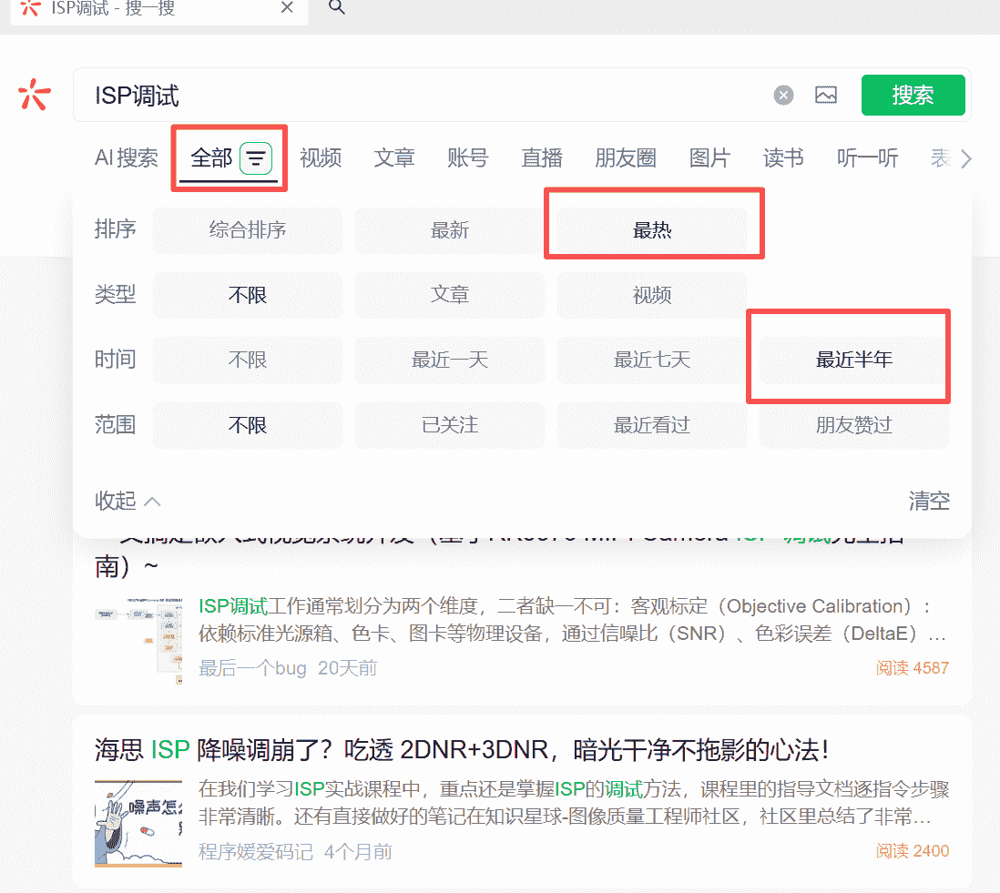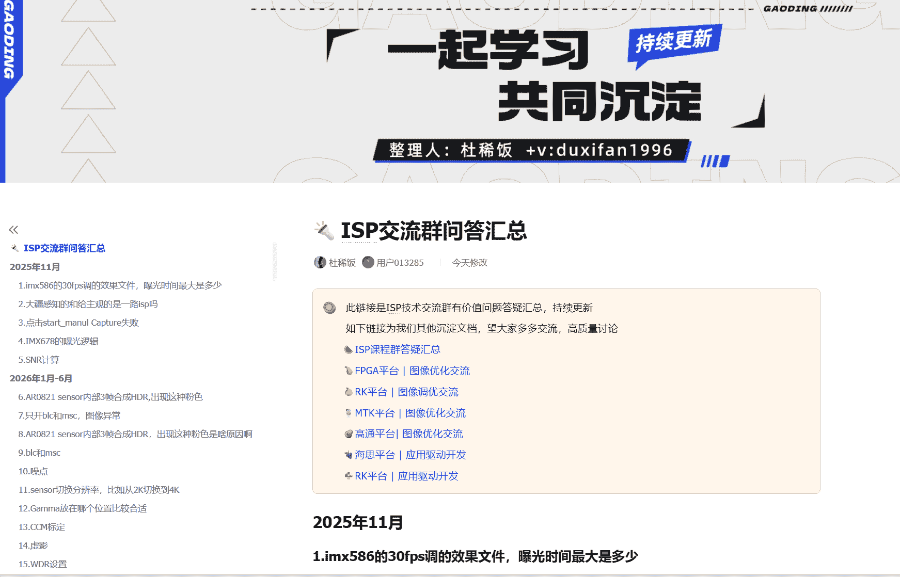三是从自己的交流陪伴群里找选题，大家平时讨论的问题、真实的困惑，攒一攒都是好素材。

走到这里，我的闭环系统算是初步跑通了，正反馈也肉眼可见：从原来一个月个位数的加好友量，到如今每天都有精准获客，高峰期连续保持每天 40—60 人；后端也稳定下来，每个月都有知识星球和付费课程成交。

但量一大，我又开始忙不过来。主业单位是军工性质，没有外网，我只能每天下班后、孩子入睡后写内容，再定时到第二天 18:00—22:00 发布。不然一个不留神，手机电脑就会被小孩抢走。所以 AI Agent 对我来说，早就不只是“提效工具”，而是副业还能不能继续做下去的命门。

所以当我看到 AI 航海家大课的推送，海报上写着“从知识库到 Skill，搭建出内容 Agent”的那一刻，我几乎没有犹豫就报名了。上课前，我每天要花 2—3 小时手动整理文档库，把提示词一条条复制到豆包或 Gemini，再维护飞书文档；上完课以后，我只需要在飞书里发一个触发词，Obsidian 知识库就会自动把活儿干完。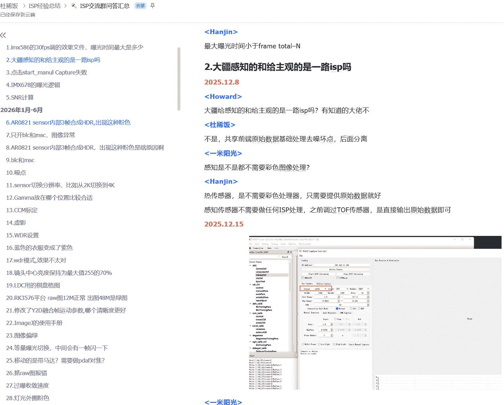

听完叁斤老师的讲解，我彻底重构了自己和 AI 的互动方式——它从一个“用完即走的单点工具”，升级成了一个“有记忆、懂上下文的协作伙伴”。现在的流程是这样的：飞书定时触发 → Hermes 或飞书消息调用 Codex 长连接服务 → CodeX-Obsidian 自动化生成👸号文章初稿、贴图正文初稿、朋友圈文案，并保存为 Word 或 .md 文件。长文输出后，再通过固定角色的知识卡片提示词生成器，转成绘制提示词，最后生成知识卡片贴图。

我的体感特别深：效率不是挤出来的，而是被工具升级释放出来的。你要把 AI 当成人，然后和它形影不离。那之后，我还带着这套心得，参加了林幻雨细致组织的西安线下聚会，和叶贤弟一起，与同城圈友做了分享。

最后聊聊知识库。它就是 AI 的专属上下文，也是我的“第二大脑”。用叁斤老师的话说，知识库其实就是一些文件夹，相当于外挂大脑，里面装着你的产品手册、客户案例、行业经验和内部规则。知识库最大的难点不在“建”，而在“整理和使用”。所以选对顺手工具，比什么都重要。

我认真体验过几款主流的知识库产品，说说真实感受。

先说飞书知识库。它像团队的“高速公路”，文档协作能力极强，权限管理完善，适合当交付型资料库。但对个人创作者来说，它又重又慢，打开要登录、进组织、等加载，多少有点“大炮打蚊子”。适合团队协作、社群交付；不适合追求快速记录和随时调用的个人用户。

然后是 Notion，像一把功能强大的“瑞士军刀”。数据库能力在线，表格、看板、日历一应俱全；模板生态丰富，页面嵌套可以无限延伸。理念确实很先进，但问题在于国内使用体验实在一言难尽：加载转圈的时间够我喝完一杯水，还时不时断连。适合国外用户、团队协作和强数据库需求的项目管理；不适合国内的个人创作者和求稳的写作者。

Get 笔记算是个优秀的“输入前端”，语音转写能力一流，口语能自动润色成书面语，手机内录功能也很方便。我现在也用它作为 Obsidian 工作流的语音输入入口，但它本质上不适合当知识库：功能相对基础，更像一个“可以问问题的文件夹”，没有文件夹体系、没有双链，也谈不上结构化沉淀。适合当采集器，不适合长期沉淀。

ima 知识库胜在轻便，🛰️小程序打开就能用，支持文件上传、AI 问答、智能写作和思维导图，还有知识库广场可以看别人的分享。但深入用下来，它更适合做轻量资料查询，不适合深度内容创作和知识沉淀：没有文件夹层级、双链和标签体系，数据都存在腾讯云端，也没有本地备份。🛰️生态用户临时用用可以，对想长期打造个人 IP 的人来说就远远不够了。

折腾了一圈，我最终选定了 Obsidian + Codex。数据完全自控，所有笔记以 Markdown 格式存在本地电脑，不会锁在某个平台里。这才是真正属于自己的、可以长期复利的资产。

从潜水两年到跑通闭环，我最想分享的一句话是：机会不会等你准备好才出现，你先上场，把手弄脏，路才会慢慢展开。最后也很感谢小武老师、吴泽承的指导与鼓励，还有林幻雨帮我细致修改初稿。上周我也正式加入了航海家，希望能带着方向继续和大家一起深耕。愿我的这段复盘，也能给你带来一点灵感和勇气。

AI 真正好用，从你把“判断权”留在自己手里开始

我一度以为，搭个人资料库等于给 AI 造一个更聪明的“记忆宫”。后来真正用顺了才意识到，它的意义不是让 AI 记得更多，而是让 AI 在你需要时精准递上对的资料，同时绝不去抢那支定调子的笔。

Markdown 为什么适合干这件事？因为它是纯文本，任何工具、任何设备都能打开，不怕某个平台哪天关门，你的内容永远长在自己身上。双链又给了笔记一层“关系网”：一条笔记通过链接指向另一条，几十条、几百条连起来，就成了一张可来回追溯的知识网——而不是一批互不相干的孤立文件。

Codex 在这里扮演的角色，更像一个听话的执行助理。它的能力边界很清晰：

- 能直接打开 Obsidian 本地文件夹，读取里面的文件，省掉复制粘贴的中间步骤。
- 会先看文件、想清楚步骤、再调用合适的工具，最后把结果写回本地。
- 可以通过 AGENTS.md、Skills 等规则文件，学到你希望它遵守的做事方式，而且用得越久越懂你。

这套方案和那些“一键生成”类工具最大的差异在于：它把人的思考和判断放在最中央，AI 只是辅助完成，而不是跳出来替你决定。

那资料库里到底放什么？

关于目录设计，很多人的第一反应是想把分类规划得极其精致。叁斤老师和我都有一个共同结论：别这么做。结构不是提前画出来的，而是在一次次使用里自己长出来的。先用碎片化记录把底子铺厚，等用得足够久了，骨架自然浮现。先把内容的地基垫起来，框架随后自己成形——这才是效率最高的路径。

所以，我从一个最小的容器开始，它只有六个格子。

格子一：我是谁。这个地方放信念、价值观、自己的故事与经历——它决定了未来的每一段表达从哪里出发。

格子二：我在卖什么。正在出售的产品、价格、权益、差异点、为什么客户要选我、我能解决什么问题。

格子三：客户长什么样。这里放客户画像、分层痛点、客户原话，以及他们搜索时常用的词。特别是客户吐槽过的细节，要原样记下。想站在读者视角写东西，这些洞察是不可或缺的原料。

格子四：备料仓。放案例、故事、常见问题、基础知识，以及买来的电子书、上过的课程、做过的复盘、曾经出过圈的内容，还要给它们打上明确的标注。也可以在备料仓里分出两块：行业动态和关键词更新。写作时有意识地把关键词铺进去，能换到更多搜索流量。段子、金句、生活化的说法，也全部收进来。

格子五：方法库。包括自己的判断依据、学过的技能与课程总结、爆款文章的做法、起题技巧、文章框架的搭建方式……这些都能直接变成下一次创作的武器。

格子六：生产池。区分“已发布”与“待发布”，把选题持续沉淀在这里。还可以再设一个缓冲角，存放那些暂时用不上但舍不得丢的边角料。

这六个格子其实构成了一个完整闭环：收集、创作、储备、规划、沉淀、成果、复盘、缓冲。Codex 想要什么，就像从专用柜子里抽档案一样方便。它不是一动不动的资料堆，而是随时可以调用的资产。先放真实内容进去，再在反复使用中补充、归类、调整。

你喂给它的自己越真实，它写出来的东西就越像你。甚至录音里的口头禅、停顿、没说完的半截话，都可以保留——那些看起来不够规范的地方，恰恰是个人风格的来源。

这套最小架子，我差不多两天就搭完了。

信息如何进到库里去？

叁斤老师的一句话我印象很深：让干活本身，同时就是入库。

- 录音输入。日常见客户、聊需求、做复盘的时候，把录音转成文字，交给 Codex 按资料库结构归档。说得越全，它归得越准。
- 既有的内容。那些学过的课程、积累的业务经验、做过的课件，让 Codex 直接写进 Obsidian。
- 刷到的好内容。总有一些内容散落在各个 App 里，用一个 Obsidian 插件或 Get 笔记把它们集中收进来。浏览网页时，点一下插件图标、指定路径、添加，就自动落到资料库里。

和 Codex 协作，最好有一份“工作章程”

要想配合不出乱子，就得让模型明白四件事：你在帮谁干活、怎么干、哪些可以自己决定、做完后把东西放到哪里并继续成长。

我按下面的框架来立规矩：

- 服务对象：我是谁，我不希望自己变成什么样。
- 业务与客群：我的产品、客户、差异化是什么。
- 办事原则：先说结论再展开；多引用真实经历和客户原话。
- 授权边界：哪些绝对不能碰；哪些直接执行；哪些要先出草稿再确认；哪些必须停下来问。
- 文件夹地图：项目里的目录索引。
- 归档规约：原料如何归类存放。
- 标签体系：统一的打标签方式。
- 各类型任务的执行链路：从收到请求到交付的完整路径。
- 标准交稿格式：固定输出样式。
- 回写机制：哪个判断被验证了；有没有新客户原话；能不能提炼成新的方法。
- 周期性维护：清除重复素材；把反复被调用却还没整理成方法的内容固化下来。

跑通这套，Codex 就不只是搜索工具，而是与你共事的搭档。

别把全部动作塞进一条指令，拆成小技能

从前，我总幻想有一条万能 Prompt：输入一个选题，订阅号文章、知识图卡、社交动态、配图描述一次全出来。结果总会在某个环节崩掉，很难微调。

叁斤老师讲课时，我在台下拿了张酒店的稿纸，开始一条一条写自己每天都在重复的动作。那张纸，被我一路带回了西安。

现在我的做法是：把重复动作拆开，让每个环节独立成一个小技能。

比如我每天的流程是这样的：

- 先从选题池里挑出合用的选题
- 写一篇订阅号的完整文章
- 从文章里提炼知识图卡正文
- 再提炼一段社交动态文案
- 用知识图卡 Prompt 生成器产出内容
- 给每张图生成绘制描述
- 上线前做一次检查

拆开的好处是：哪里不舒服就只改哪里。比如知识图卡原来要求 1000 字，发布时总是超字数，那单独把这个技能改成 600 字；如果 AI 写出来的东西总带着焦虑感，就再加一条规定：不制造焦虑，改用陪伴式表达。

技能包怎么来？可以下载社区里开放的 Skill，让 Codex 读一遍再按需求微调；也可以直接把自己的流程描述给它，比如“帮我把 XX 流程做成一个 Skill，资料库地址是：XXXX，按这些要求执行，给出什么格式”。

我目前最常用的是两份最小初版，差不多直接能开工：

```yaml
name: wechat-article-writing
description: 根据已提供的选题与知识库素材，撰写面向计算机视觉、ISP、图像处理、视频流和嵌入式软件从业者的微信👸号技术长文正文。
```

# 👸号文章写作

###### 输入

- 接收一个已确定的选题及相关知识库素材。

- 只使用已提供或已读取的素材；缺少技术事实、案例、数据或来源时标记为“待确认”，不得补造。

- 原始素材含代码示例时，除非明确要求改写，否则保留原样。

###### 写作要求

- 围绕一个能站得住脚的观点展开，优先交付可执行的方法、清单或认知收获。

- 面向 26 至 45 岁的计算机视觉与嵌入式软件从业者，以平等、同行陪伴式口吻解释技术概念。

- 从具体项目痛点、好奇点或风险切入，依次推进为有用解释和示例、可记住的洞见、后续讨论邀请。

- 长短句交替；每段不超过五行；每三到四段切换一个自然子话题。

- 仅在帮助说明观点时使用克制的生活例子、轻度幽默或工程观察。

- 不使用夸张比喻、虚假权威、空洞口号、无依据的效果承诺、泛化的 AI 套话或标题党表达。

###### 输出

- 只输出长文正文，不生成标题、贴图正文、朋友圈文案、前言或写作说明。

- 使用清晰的 Markdown 小标题组织正文。

- 不沿用来源材料的数字编号。

```yaml
name: wechat-title-writing
description: 根据已完成的技术👸号正文及其素材，生成一个可信、有具体工作处境感、不过度承诺的微信👸号标题。用户需要给嵌入式、ISP、计算机视觉或工程师成长文章起标题时使用。
```

# 👸号标题生成

###### 输入

- 接收👸号长文正文，以及需要时使用的原始选题和素材摘要。

- 标题必须与正文可以兑现的内容一致；信息不足时标记“待确认”，不虚构事实。

###### 生成要求

- 输出一个标题，落在工程师具体的工作处境、压力或发现上。

- 语气平等、有陪伴感，让有经验的工程师感到被理解。

- 优先表达真实矛盾、工程判断或可复用的发现，而不是泛泛承诺。

- 禁止制造恐慌、许诺结果、夸张好奇、诱导点击和居高临下的说教语气。

###### 输出

只输出最终标题，不附解释、候选标题、编号、引号或 Markdown 标记。

有了这两个打底，后面还可以继续拆：贴图正文一个技能、社交动态一个技能，再把知识图卡生成器单独封装——先运行生成器，再喂入刚写好的文章，为每张图产出绘制指令。

把这一切放在一起看：用 Markdown 在 Obsidian 里积累可迁移的个人内容，用双链把它们织成网，让 Codex 做那个执行的人，再用技能把重复流程固化下来。人的判断始终在前，AI 越用越像那个懂你的副手。

# 我给自己造了一个“数字分身”：从固定IP到飞书自动出稿

做内容的人，最怕的往往不是没灵感，而是每天都在同一件重复的事情上耗掉大把时间。为了把自己从这些机械环节里解放出来，我给自己造了一个数字分身，名字叫“杜稀饭”。它不仅是我知识卡片上的固定主角，背后还连着一条从👸号长文到朋友圈文案的自动化流水线。

## 一、先来看看“杜稀饭”长什么样

这个角色是一个二头身的Q版女孩，头几乎占掉半个身高，方圆脸，眼睛是实心小黑点，腮红是两团椭圆，嘴角一道上扬弧线，看起来机灵又俏皮。黑色及肩长发带一点微卷，八字刘海，右侧有一缕头发俏皮地翘起来，发丝只用几根波浪线带过。

她戴着玫瑰金边框的大圆眼镜，镜片是半透明的，里面隐约映着 `{ } // ;` 这一串极简代码符号。身上是一件宽松连帽卫衣，浅色平涂，衣角处画着咖啡杯、二进制 `0101`、`Hello World` 小字和键盘按键一类的小印花。脖子上挂着迷你键盘造型的项链，手腕上用三根短线分别涂出紫、橙、绿三色，权当手环；口袋里还探出一小截鼠标线。

线条的规矩也很明确：四肢只用极简线条概括，不画手指细节；外轮廓的黑线画得粗一点，内部结构的线要细；除了衣服，其它区域一律留白，不添加多余纹理。整体是手绘涂鸦笔记（Sketchnote）的感觉，所有线条带着轻微手绘抖动，不会显得过于僵硬和完美。

人物不是摆一个姿势用到底。根据内容可以换成五种状态：讲解时一手自然下垂、另一手抬起来比划，身体微倾，嘴像是正在说话；思考时单手托腮、另一只手捏着一支笔，头顶冒出一枚灯泡；吐槽时单手叉腰、另一手无奈摊开，头顶画一滴汗或黑线；庆祝时双手比耶，眼睛弯成月牙，旁边撒上星星和礼花；引导时侧身站着，一手叉腰，另一手指向画面里的空白处。动作和表情可以变，但五官、发型、卫衣这些基础特征永远不换。

为了让人记住名字，画面角落还会放一碗卡通稀饭，碗上画一个笑脸，正好呼应“杜稀饭”的谐音梗。配色方面，统一用浅蓝（`#E3F2FD`）、浅橙（`#FFE0B2`）、浅绿（`#C8E6C9`）三色，和知识卡片整体调性协调。规则只有一条：只要卡片里出现人物，就必须是“杜稀饭”本饭，大小和位置可以按构图调整，既能当讲解者，也能当装饰元素。

## 二、知识卡片是怎么批量产出的

有了固定人物，还需要一套稳定出图流程。我把整个流程拆成了几步：

一开始，AI会先返回一段固定使用建议，内容包括：如果图的效果不满意可以随时提修改意见，也可以直接晒图让AI综合分析；有对标图就发过来，说清楚要参考的是配色、结构还是插画；嫌知识密度低就提醒AI重新完整分析；绘画AI有字数限制就让AI帮忙压缩。然后用户把内容以文字、文件或图片形式发过来，AI提取主标题、统计要点数和总字数，先给出“根据内容量分析，建议拆分为X张图”的判断，再把每张图的绘画指令单独写出来，方便逐张复制。

每张图的指令都是一个独立代码块，统一3:4竖版画布。每个代码块开头都会先放一段文字渲染规则和整体风格说明，再进入具体画面。最严格的是文字规则：只渲染提示词里用反引号明确标注出来的文字，其它地方一个多余的字都不许出现。标题区放在画面顶部15%—20%的位置，首图标题必须最醒目，直接取用户发来内容的第一行作为主标题；内容区域按逻辑拆分，每块控制在20—80字，插画必须和对应的文字绑定描述，并且每个元素都要说清它在构图的什么位置。每张图的右上角标序号和“@杜稀饭”（fanfanfan958），右下角也有页码。所有指令都强调：每张图必须是完整独立的一张，单独占满画布，不能合并拼接。只有最后一张，底部会加“完结”或“END”标记，配上庆祝插画。

整套指令发完之后，AI还会再补一段使用建议，告诉你如何逐张发给绘图AI、不满意怎么反馈、有对标图怎么发，以及提示词超字数时如何处理。这些动作虽然琐碎，但全部写死在流程里，我只需要复制粘贴，节省了大量来回沟通的成本。

## 三、真正省时间的，是那个Agent

但出图流程只是表面，真正让我解脱的是后面的Agent。

我习惯把Skill理解成工具箱，Agent则是那个提着工具箱、把任务从头到尾“闭环落地”的执行者——相当于我的全天候数字分身和专业助理。我给自己的内容生产做了一个入口：只要发一句“主页内容创作”，它就会自动开工。我能做的，反而是审核和修改。

这套流程现在还谈不上完美，但已经帮我省下了不少重复劳动，效率翻倍。更重要的是，它让我在主业之外，依然有条件稳定地做内容。

当然，这里有一条边界必须说清楚：Agent不是替我思考，而是替我执行那些我已经想清楚、而且反复发生的步骤。

我的内容生产顺序也定死了：先写👸号长文，再从长文里提炼知识卡片和朋友圈文案。这个顺序不能反，因为AI从短内容扩写成大长文时，很容易自行补充细节、产生幻觉；反过来，先把长文写出来并审核定稿，再去拆成短内容，事实边界就稳很多。

## 四、Agent.md 的最初版本

然后我写了最小一版的 Agent.md，核心内容大概是：

触发方式很简单，仅限手动触发，只有听到“主业内容创作”这句话才会响应。输入范围固定在知识库目录里，选题从指定文件夹读取，产品、客户需求、案例、方法论也优先从本库调取；它不会借助外部资料去补造事实，原始素材不足时，全部列入待确认项。``

执行流程上，它会先扫描未处理的选题文件，忽略“已处理”子目录；每次只挑一个最适合产出的选题，如果拿不准，就把候选列出来等我人工确认。根据选题决定内容形态，可能是👸号文章、贴图正文、朋友圈，或者组合。👸号文章会依次调用写正文、起标题、排版这三个Skill，最后生成可用的HTML稿。贴图正文则控制在600字以内，独立成篇。朋友圈文案分两种：需要深度稿时，先给出候选框架让我选；快速稿就直接输出100到800字的正文。两种都要读取知识库素材，保留真实案例和原话，客户或学员信息必须脱敏，不编造、不承诺效果。

产物分别保存到对应的“待发布”目录里，文件名以“日期+类型+关键词”命名，每篇末尾保留来源与应用双标签。原始选题文件保持不动，只在处理结果里标记“已使用”。最后通过飞书发送通知，告诉我是哪个选题、各文件放在哪、调用了哪些Skill、原始路径在哪、需要人工确认哪些内容。拿不准的，一律标为“待确认”，绝不自作主张。

还有几条硬性保护规则：禁止删除、移动、重命名任何文件或文件夹；已有素材和文章不改写，需要新版本就新建文件；如果没有待处理选题，绝不生造空文章，只是通知一句“暂无待处理选题”。

## 五、飞书和Codex联动时踩过的坑

在飞书和Codex的对接过程中，最难的部分其实是“看懂这三样东西的关系”。我给自己打了一个比方：

飞书机器人就是前台接待员，Hermes是店长/调度员，Codex是真正坐在工位上干活的技术员，飞书CLI则是技术员手里的门禁卡加工具箱。你在群里说一句“帮我处理今天的录音”，本质上就是给这个小团队下了一张工单。前台接单，店长派活，技术员翻资料、找录音、生成Markdown，最后再按对的身份把结果传回群里。任何一环掉链子，最终表现都是“机器人没回我”——这就像外卖没有送到，可能是门卫拦着、调度没派单、骑手没电，或者地址写错了，不一定就是厨师没做。

下载飞书CLI时，官方便提供了两种方式；我都是直接复制，丢给Codex去安装。

踩坑是从“指令超时没有响应”开始的。当时把截图发给Codex，它修复之后，竟然把之前超时的任务全都执行了一遍——原以为它只会处理最后一条。

后来遇到的几道坎，逐个说一下：

① 收不到回复。原因通常是飞书机器人服务根本没启动，相当于前台没坐到工位上，或者它认不出你是谁。解决方式是：在PowerShell的同一个窗口里先设置运行时变量，再启动服务。````powershell
cd D:\DSF\嵌入式软件获客\7.飞书自动化
$env:FEISHU_APP_ID = "你的应用 ID"
$env:FEISHU_APP_SECRET = "你的应用密钥"
$env:FEISHU_BOT_OPEN_ID = "机器人的 ou_ 标识"
$env:FEISHU_ALLOWED_CHAT_IDS = "允许触发的 oc_ 群 ID"
$env:HERMES_URL = "Hermes 的任务接口地址"
$env:HERMES_TOKEN = "Hermes 令牌"
$env:CODEX_WORKSPACE = "D:\DSF\嵌入式软件获客"
npm start
```` 如果你不知道变量在哪，直接问Codex。`` 等到终端输出 `ws client ready`，就说明服务已经启动成功，飞书的长连接正常，相当于到岗了，电话线也通了。

② 任务无法转发。原因是我之前把Hermes按HTTP服务接入，和当前安装形态不匹配；后来改成由机器人服务直接调用本机Hermes命令，再由Hermes调度Codex，不再需要 `HERMES_URL` 这个环境变量。最初我把Hermes当成了“在线客服系统”，以为要填网址，其实它是装在电脑里的本地店长。``

③ 没有“用户身份”登录。机器人身份只能收发消息，不能读取飞书消息里的妙记、会议纪要、会议搜索和文档。扫码授权，就是“亲自把钥匙交给指定的技术员”——让Codex帮我把飞书用户身份登录授权完成，承诺不修改知识库文件。``

④ 界面看不懂。之前自动修复时，我特意用了飞书消息直接调用Codex的长连接服务，就是方便随时喊它“说人话”。比如直接对它说：“我看不懂，用大白话给我说，这又是怎么回事？”``

⑤ 机器人服务连不上飞书。``

⑥ 不知道Hermes是什么、在哪里输入指令。其实那个黑色界面就是Hermes，它就是调度器，负责监听飞书消息、把任务派给Agent，再用正确的身份回消息。有任何看不懂的地方，继续问Codex就好。

⑦ 命令的白话解释。不用逼自己记住那一堆术语，遇到不懂的，让Codex逐条翻译成日常语言就可以了。

## 六、写在最后

这套系统还远没到完美的程度，但已经足够让我从重复劳动里抽身。它帮我盯住那些固定的动作和流程，把我省下来的时间还给真正需要判断的事情。内容创作这件事，也许不是每根线都要自己画，但每条线背后，最好都站着一个记得住方向和边界的人。

| 命令 / 名称 | 通俗说法 |

|---|---|

| `npm start` | 把前台叫起来，让飞书机器人开始干活 |

| `FEISHU_ALLOWED_CHAT_IDS` | 这是白名单名单，相当于告诉机器人：只听这些群的指令 |

| `--skip-git-repo-check` | 告诉 Codex：这里就是个普通工作区，别去找 Git 仓库 |

| `lark-cli` | 身份授权环节，等于把自己的私人钥匙交到技术员手上 |

| `user-default` | 允许 Agent 替你调取个人资源，权限更开，所以使用范围一定要卡住 |

## 四、想和大家聊聊的感触

### 4.1 线下大课和聚会，感染力往往来自身边的人

周五下班我就冲去咸阳机场，结果航班一直拖。自己倒无所谓，最怕耽误拼房的北极光休息。拖到凌晨三点多才落地浦东，她还发消息问我到没到，怪不好意思的。四点回酒店打语音没人接，就没敢敲门，想着她可能也在等我，也没睡安稳。

- 凡事皆有利于我

等飞机、等前台的空档，我把剩下的预习作业做完了。以前的我会急，现在倒觉得这些空出来的时间是送给我的。

- 关于北极光和贝妈

北极光回电后我才进房休息。早上她跟我说，贝妈昨晚临时果断报名，结果房间满了，能不能搭个伴，还没带电脑，贝妈老公一大早坐首班高铁从常州给送过来。

北极光完全没有觉得我折腾她一宿，反而一直照顾我没休息好。整整两天都很暖，她叫我一起吃饭，分给我从稻城带回来的葡萄和她心水的吹风机。我说要下去便利店买支笔，她直接递给我一支当纪念。哈哈哈。

大课信息量爆炸，晚上躺下只想放空，大脑直接宕机。贝妈却掏出录音豆复盘白天的内容，还和北极光用手机录了段视频留念。我惊呆了。

贝妈自己也说电脑不算熟练，但她那种极度认真、满电的积极状态太有感染力了。反观我还要回去给西安的圈友做分享，我到底吸收了多少呢。

真幸运，能和两位高能量的圈友同住。

- **15 组的伙伴们**

组长 Lance 前后都在牵线搭桥、扛事，把黑客松作业带起来。Steven、陈艳、白龙都非常给力。两天相处最难忘的不是二狗面馆的面，而是学习卡壳时喊一声，大家立刻补位，效率直接拉满。

- 关于叶贤弟

黑客松作品一个比一个强，最让我记住的是叶贤弟。线下魅力拉满，上台连设备还在调试，她就已经牢牢抓住全场，介绍条理清晰、节奏感强，太有气场了。队友还以为她是专业主持人或主播。结果是我的老乡。

这种气质，正是我最缺的。

- 关于吴泽承

有句话说，你在路上才会遇见贵人。我要不是报了这次大课，可能就认识不了种草榜一。他主动牵线、真诚帮扶，遇到困惑就尽量解答，还会把对口的群友拉来帮忙。实打实的可遇不可求的贵人。

主动一点，机会自然多。

- 关于林幻雨

西安这边最懂组局的，就是她。最有经验、最周到的组局官。知道我报了航海大课后，主动给我机会回西安做分享心得。考虑到我第一次不熟流程，她默默把幕后全安排好，让嘉宾能专注内容，还全程跟进进度。

每个人付出的心意，旁人都看得见。我想把这份能量接力下去，以后也多组织线下聚会，让大家互通有无。

### 4.2 先把锚抛出去，再慢慢划过去

没报线上大课，以上这些事都不会发生，也遇不到这么多优秀的人，更发现不了好人就在身边。

正是先决定报名 AI 航海家大课，海报上的飞书 CLI + Hermes + Codex + Obsidian，才从名词变成了我的能力。

### 4.3 先找准卡点，再懂人，最后做选择

我们折腾这么多，最终目的是成交，是把解决方案送到目标人群手里。工具怎么用、发什么内容，并不是第一优先级。要按顺序问自己三层问题：

1. 先定位问题：业务到底卡在哪

先判断断点在哪一环：

- 没流量：选题、分发或平台选错了。
- 有流量没咨询：内容没打中真实需求。
- 有咨询不成交：信任、产品或销售环节出问题。

老师们说得很直白，AI 能提效，但判断“问题出在哪”是人要做的。定位错了，内容越多越浪费。

2. 再理解人：看懂用户真实处境

不是只看画像比如“30 岁男工程师做软件开发”，而是要想到：

- 他现在在经历什么？想跳槽还是想扩技术栈？
- 他最怕什么？驱动他的是什么情绪？
- 他想要什么结果？
- 他喜欢宏大叙事还是干脆的逻辑结论？是工程直男风格还是其他？

3. 最后给出关键决策：下一步做什么

关键决策是：

- 下一波内容为谁说话、解决什么痛点。
- 用什么语境切入。
- 进私域后往哪个方向引导。
- 当下最该优化哪一环。

不是做更多内容，而是判断：现在最关键的一步是什么。

比如我是要先批量出内容，还是我现在的文章还不够像我？时间花在刀刃上才有意义。

### 4.4 出来混，最重要的是先出来

这句话来自赚钱，也是我做主业副业时的底线思维。先破破烂烂上线，再慢慢缝补完善。就算不完美，也坦然呈现真实状态，反而不会紧张别扭。

这次西安线下分享上海学习心得，也是我第一次做线下分享。准备时的忐忑完成了，下一次就更顺。晚饭时有句话印象很深：先完成一次，后面就会被正反馈推着变丝滑。听大家讲来时路，都赢在迈出了第一步。

在赚钱，这些卡点不再是单打独斗，而是大家一起扛。

冲冲冲~

---

看完这篇 SOP，你可能觉得懂了。可 90% 的人一实操就卡在第一步。

工具和教程只是入门门槛，真正拉开差距的是“立刻开干”和“圈层信息差”。

如果你想看全网最新的变现打法，和一群执行力爆表的极客一起下场拿结果，欢迎来围观我的核心私域：【懒人专属群】。

我们不聊虚的，只拆商业闭环，只压 AI 效率。系统里已经沉淀 1000+ 跑通的套利实战局。

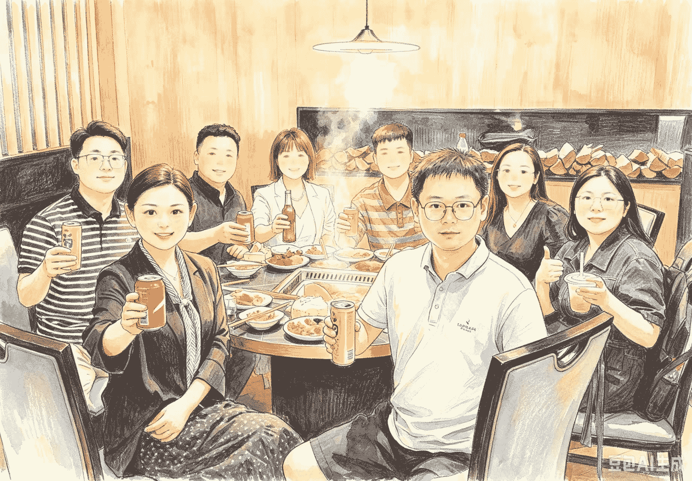

👉 查阅圈子完整数字资产与上车门槛：

https://lazyso.com/insider/

认同价值、准备好下场干活的，扫码加我🛰️（lazyhelper1）

备注：【实操上车】，不闲聊

