# 军工女程序员做垂类账号：用 AI 工作流打通副业闭环，三个月成交 700+ 人、GMV 破 6 万

260810 | 副业 | SC | 精华

整理来自：懒人搜索 / 会员群精选
联系微信 lazyhelper1

哈喽，我是杜稀饭。坐标西安，本职是军工领域的算法工程师，每天和计算机视觉、图像处理打交道；下班后，我又变成另一个角色——1 岁 2 个月孩子的妈妈，以及内容创作者。白天写代码的环境完全隔离外网，晚上回家才切到博主状态。

很多人会问：我潜水学习时是怎么找到方向的？怎么把“公号—图文卡片—私域用户池”这条路跑通？又如何在 3 个月里从 0 到 1 拿到结果，累计服务 700+ 人、做出 6 万+ GMV，甚至在哺乳期特殊假期结束时，意外让主业和副业互相托了一把？

这些变化背后，AI 航海家课程帮了大忙。过去我每天要花两三个小时手动整理文档、复制粘贴提示词；现在，飞书发起指令、Hermes 负责调度、Codex 配合 Obsidian 自动归档，动动手指就能把公号初稿、卡片文案、朋友圈内容批量生成，全程只要几分钟。基于长文再生成图卡提示词并绘图，也成了一条自动化链路。


以前每个月要花 500 元请人专门整理飞书资料库，现在这笔开销省了，我也能更清醒地重新规划哪些环节适合外包。

我潜水龙哥盟圈子快两年了。看着身边圈友不断出结果，我常觉得自己不知道从哪里迈步。跟着帖子学、跟着航海练、参加线下交流，收获并不少；可每次想写分享帖，又觉得自己的积累不够，默默把页面关掉。

后来我想明白一件事：做内容不是写代码，代码有“编译通过”的时刻，内容没有。你得先把东西发出去，市场和数据才会像日志一样告诉你哪里出了问题。

这段时间我刚加入航海家，想带着方向继续和大家一起深耕。这次复盘能写出来，要感谢小武、吴泽承的指点，也谢谢林幻雨对初稿给出的细致建议。

这次主要聊四块：
- 一、在龙哥盟学习和实践，我怎么一步步找到定位
- 二、垂类账号航海和线下交流，给我带来哪些可落地的玩法
- 三、AI 航海家课程如何重构我的工作流，我踩过哪些坑
- 四、一些想对大家说的话

## 一、定位不是想出来的，是试出来的

七天在垂类账号高手领航里讲：定位靠不断尝试长出来，不是一开始就设计好。我很认同。

找定位有两个入口：回看自己积累过什么，以及从当下正在做的事开始试，再观察外界反馈。

### 1.1 过去那些看似散落的尝试

没有那么多戏剧性的转折，都是自己有意无意选出来的。人总会把时间和精力花在喜欢又不太费劲的事情上。

圈友分享过一个定位问卷：把经历梳理完丢给 AI 分析，很多优势会自己浮出来。我照做以后发现，从读书时期起我就爱折腾各种副业，总想着把手边的资源变成钱。另外，我习惯把解决过的问题用通俗的话记下来，多搭配生活例子。下次遇到类似状况，至少能想起上一次是怎么拆的。既然别人也可能碰到，为什么不放到公开平台？

刚毕业时，我注册了公号，但一直有一搭没一搭地更新。想更懂自己，我还去做了盖洛普优势测评。

### 1.2 先做起来，让反馈给你答案

我并不是一下子就规划好的。我是顺着“公号爆文写作—垂类账号—贝拉线下分享—AI 航海家课程—AI Agent—AI 第二大脑内容创作系统”这条路线，从当时最感兴趣的一环开始动手。

当时为了补计算机视觉和嵌入式软件的知识，我买了网课，也写了大量学习笔记。学完发现那位老师确实讲得好，我自己又在写公号，就想着帮他推荐课程。怕推荐不好很尴尬，所以先把这件事做扎实。我去赚钱的垂类账号专区翻了帖子和航海资料，把手边能用的资源一点点接上。

“有趣有料”这个标签不是我自封的，是读者在互动里给我的反馈。我一直记得一句话：先走出去，把手弄脏，方法会在路上出现。

## 二、垂类账号航海和线下聚会，教会我的事

那时我最大的困惑是：怎么靠公号连接到目标人群，而不是追求单篇爆文。正好去西安参加贝拉的线下分享，一下子被点醒：原来获客可以靠一套系统去搭建。

### 2.1 极致细分：窄，不等于没人要

我给自己圈定的服务对象是机器视觉和图像处理从业者，帮他们把难啃的学术内容讲明白，让他们少踩坑。这个定位听起来很窄，我也嫌弃过：同行本来就少，再细到 ISP 调试、画质调优、视频流软件开发，还能剩下多少人？不是同行，可能一辈子都不会有这个需求。

后来听了贝拉的分享，又读了她那篇《公号 75% 爆款率，23 倍单季度流量增长，三年实战方法论全拆解｜细分小号深耕》，里面提到有人专门教练小学 XX 年级女生的数学，我一下子被点醒。

小众不等于没市场，关键要看三个问题：
- 这些人是否有真实痛点？
- 他们愿不愿意为解决方案付费？
- 你给的东西，是不是比搜索引擎更省时间？

想通以后，我开始稳定更新。我不写给所有程序员，只服务机器视觉这一小群人。结果超出预期：真正精准的人一旦觉得你懂他，不会只点个赞，而是会加微信、提问、进群，把具体问题带过来。

去年 11 月刚起步时，我还只会手写经验笔记，盯着阅读量。今年 3、4 月参加线下和航海之后，私域用户池拉满 4 个群，共 2100+ 人，也建了会员群。之前我和不同平台的博主合作课程、做星球分销，3 个月累计成交 700+ 人，GMV 6 万+，现在正在筹备自己的产品。

还有一个意外收获：5 月 21 号，我的哺乳期特殊假期结束，交流群里正好有老板想招相关岗位，问能不能发招聘信息。我一核对，和我的方向高度吻合。我甚至还没装 BOSS 直聘，就通过群友链接到了主业的新机会。除了研发岗，我还能给老板介绍外包协作、采购方面的群友资源。

这件事也影响了两位做工程的朋友，让他们开始把自己的经验沉淀下来；还有一个本身有账号、有专业积累的朋友，不再有一搭没一搭地更新，也放弃了“只要单篇干货足够就能增长”的想法，开始认真搭运营闭环。

### 2.2 闭环的本质：不是叫 AI 写稿，是持续迭代系统

这套玩法可以提炼成一条链路：

对行业的理解 → 资料库 → 标准流程 + AI 产出 → 发布看数据 → 结论再回填资料库

拆开来看：
- 对行业的理解：我真正懂什么，客户真正被什么卡住
- 资料库：经验、案例、素材、方法都沉淀下来
- 标准流程：规定内容怎么做、怎么审核、怎么发布
- 数据：用来判断流量质量、获客效果
- 迭代：把有效经验写回资料库，让下一轮内容更好

我第一次强烈意识到，必须有自己的判断标准、属于自己的资料库，以及跑通的标准作业流程。回家后就开始梳理。

没用 Obsidian 之前，我用飞书和本地文件夹，流程还要人工调，但至少有了雏形。我也会定期看数据、复盘、做微调。

内容不理想时，别只说“写得不好”，要能拆出具体问题：
- 开头平、没钩子：去优化框架库
- 内容空、没细节：补充真实用户原话、项目实例和数据
- 语气不对、风格不稳定：把提示词写具体
- 内容一股机器味：加进自己的经历、表达和判断

这个阶段我发现图文卡片很受欢迎，特别适合我的付费内容方向。用 AI 能生成清晰的可视化图卡，又赶上微信体系里的红利期，就决定做起来。之后逐步加入固定视觉符号和个人标识，形成稳定风格。

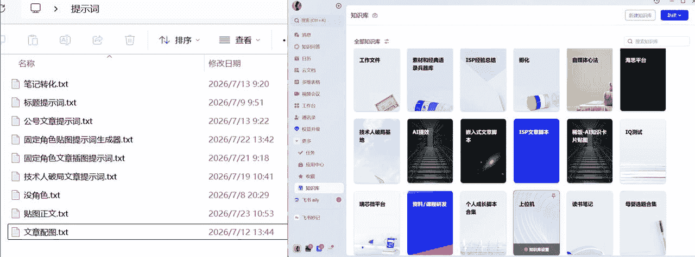

从人工整理慢慢变成标准流程，关键是提炼关键动作。但我还是要手动维护好几套提示词：公号一套、卡片文字一套、朋友圈一套、生成插图和图卡再一套。每次有新想法，我都要打开文件夹，复制、替换、再发送。

素材也很散：
- 课程里学到的东西，手工整理
- 刷到的好案例、金句、段子，手工收藏

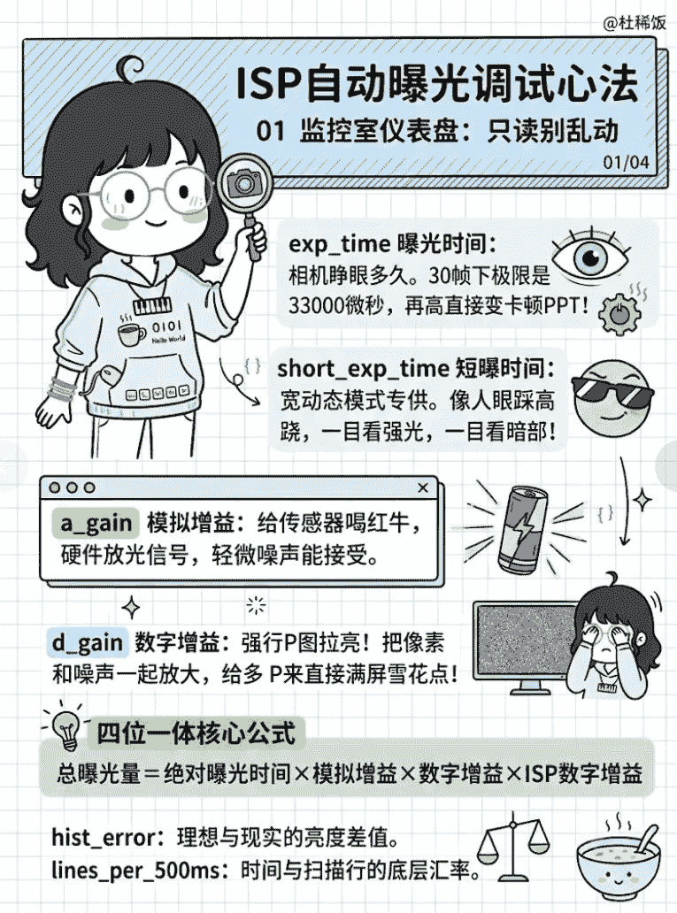

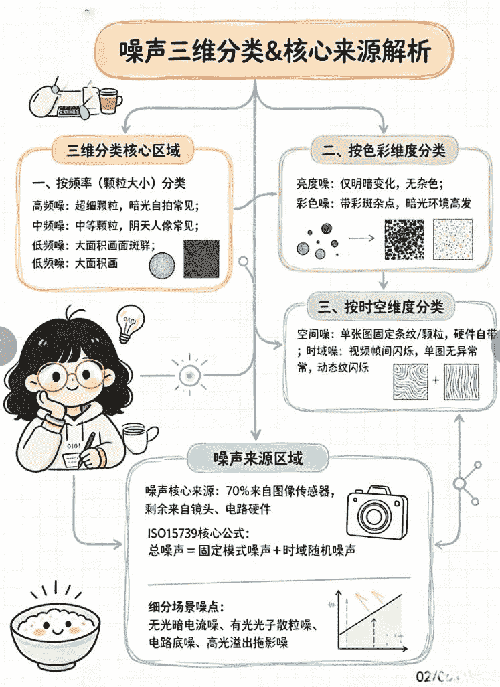

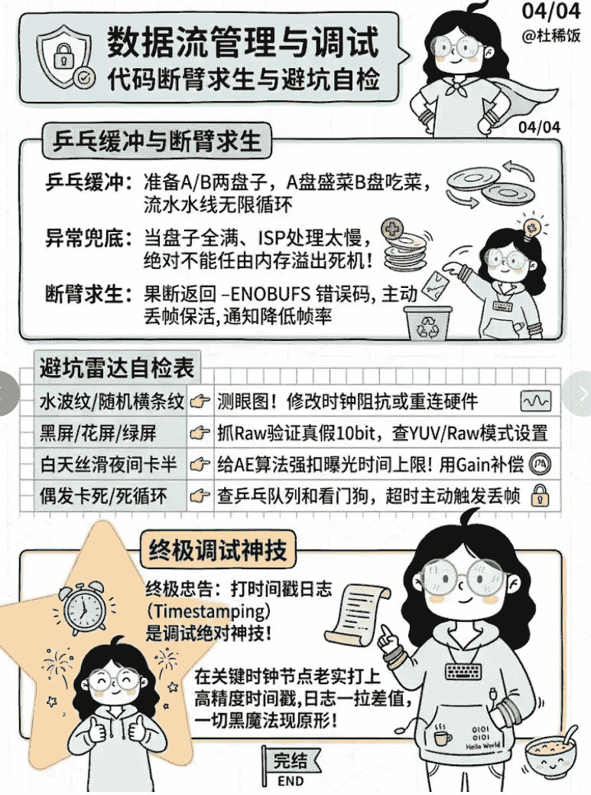

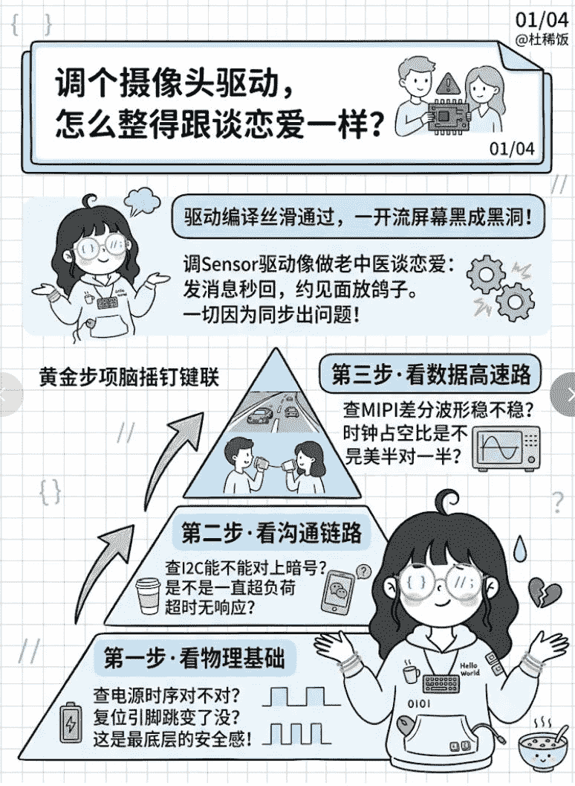

- 会员群里反复被问到的问题，请兼职同学帮忙整理，每月 500 元
- 走路、吃饭时冒出的灵感，先发给小号微信存档，省去切换工具的麻烦

我的内容顺序是：公号文章 → 卡片正文 → 朋友圈内容 → 同步小红书/社群分享。前面的产出，正好是下一步的原材料。

小红书我暂时没精力认真做，索性把公号和卡片内容直接复制过去，先不管平台规则。先发出去再说，后面再根据数据慢慢调。

这个顺序还有一个好处：从长文拆成短文，AI 不容易编造；反过来让 AI 从小短文扩成长文，就很容易出现幻觉。

但问题不只是麻烦，更重要的是机器缺少我的上下文，很多地方还要我手工补经历。量一多，手工处理根本扛不住，不同产品之间还会互相污染。我正想找人指点，AI 航海家课程直接帮我解决了这个卡点。

（有类似处境的朋友，可以直接看第三部分。）

### 2.3 数据不是看两眼，要放进四宫格

贝拉特别强调：内容发出去不算完，发布 48 小时后要记数据，至少包括阅读、点赞、转发、加友率、后续付费转化率。再按“流量大小”和“获客能力”两个维度，把内容分成四类。

不能只盯单个指标。点开率高，不一定是内容好，可能只是标题吓人；停留时间长，也不一定是内容好，可能只是信息密度太低。要把点开率、读完率、互动质量、加友率放在一起判断。

复盘数据时，我体会到两个价值。

#### 2.3.1 更懂你的用户

要理解目标人群的痛点，可以按贝拉说的分级方式拆：生存画像 → 核心焦虑 → 痛点分级 → 切入点。

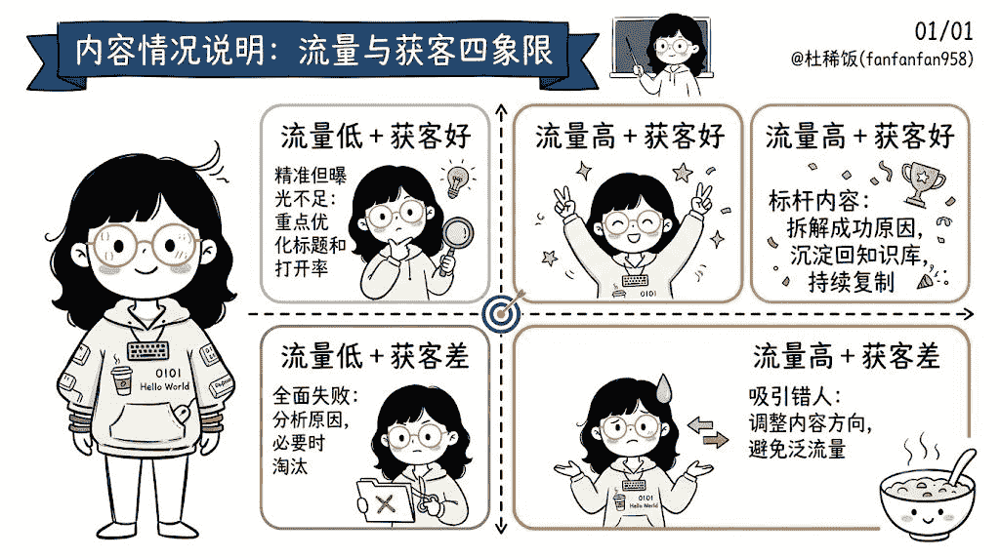

具体怎么做？
- 对已添加的用户逐个私聊，先看对方开口第一句是想进群、问课程、聊求职规划，还是别的事，再继续深挖真实动机和情绪。
- 用 AI 分析目标人群的现状：年龄、性别、专业，职场和生活里卡在什么地方，技能提升有哪些难点，学习资料分布在哪里，什么时间段容易打开什么内容。

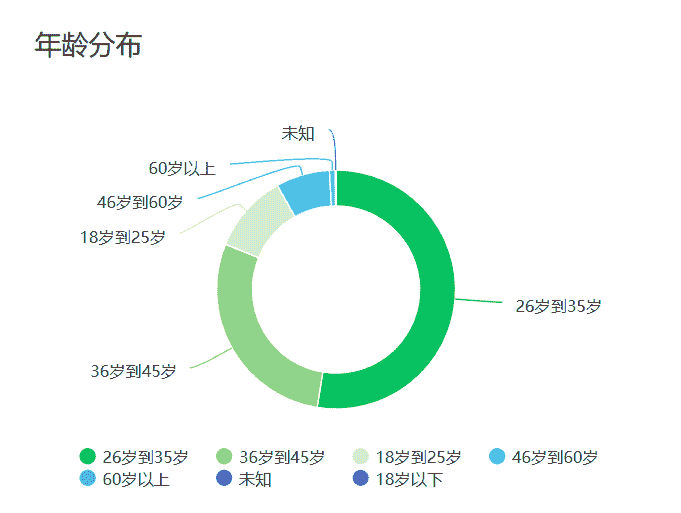

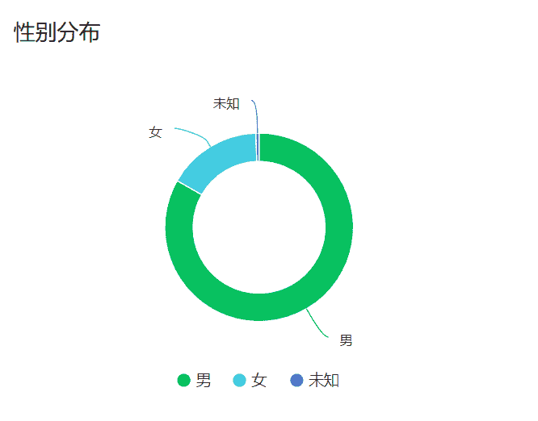

#### 2.3.2 调整内容里能埋的钩子

看数据不是为了涨粉，而是为了获客。要站在阅读者这边替用户说话，用他们熟悉的地点、物品、人际关系、行业词条；别只站在自己这边输出。先定位问题，再理解人，最后解决顾虑、给出方向，而不是文末丢一个二维码。

### 2.4 选题从哪里来

我在垂类账号高手领航，以及刘智行的《从月薪 3000 的小职员，到航海家大会嘉宾｜我的破圈成长之路》这类帖子里，学到了几个立刻能用的方法。

#### 2.4.1 已经爆过的标题，可以接着写

最近什么标题、选题、内容爆了，就继续写。别人的可以，自己的也可以。

我总结过三类：
1. 紧跟热点，比如“女程序员与牛马身份”的讨论，天然有话题度。
2. 带上城市区域关键词和身份场景标签，很容易引发共鸣。
3. 实战复盘型，把问题链路、解法明细和心得完整呈现。

标题不要高高在上，要突出陪伴感，再叠加数字、冲突、悬念、情绪。

#### 2.4.2 善用微信搜索功能

微信里的搜索功能很好用，用“关键词+字母”的组合，能翻出很多爆款内容。

#### 2.4.3 从用户社群里长出来

自己的交流群、会员群里，每天都有人在讨论真实的困惑。把这些日常问题积累下来，就是源源不断的选题。

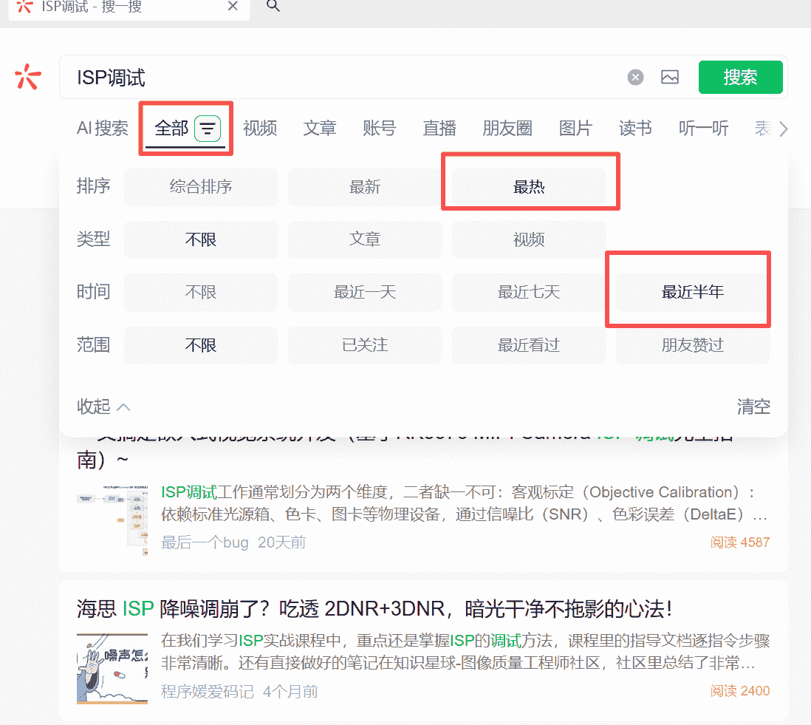

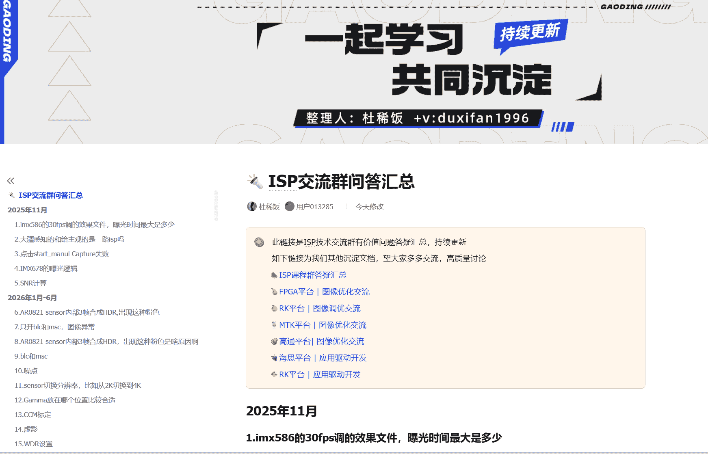

以上就是我搭起初阶闭环、拿到正向结果的过程。从原来一个月只能加个位数好友，到每天都有精准用户主动来加，高峰时一天 40-60 人；后端靠星球和付费课程，每个月都有稳定成交。

但量一起来，精力就跟不上。我的单位是军工性质，没有外网，只能在晚上下班、孩子睡着后更新内容，再定时到第二天 18:00-22:00 发布。有时孩子还会突然来抢设备。所以 AI Agent 对我来说不是效率提升的话题，而是这个副业还能不能继续的问题。

## 三、AI 航海家课程，把工作流彻底改了

看到 AI 航海家课程的海报，主题是“从资料库到 Skill，打造内容 Agent”，我几乎没犹豫就报了名。

### 3.1 我做到了什么

学习之前，我要在电脑桌面手动复制提示词，再贴到豆包/Gemini，平时还要维护飞书文档里的资料库。学习之后，我只需要在飞书里发出一个触发指令，Obsidian 里的资料就会被调起来干活。

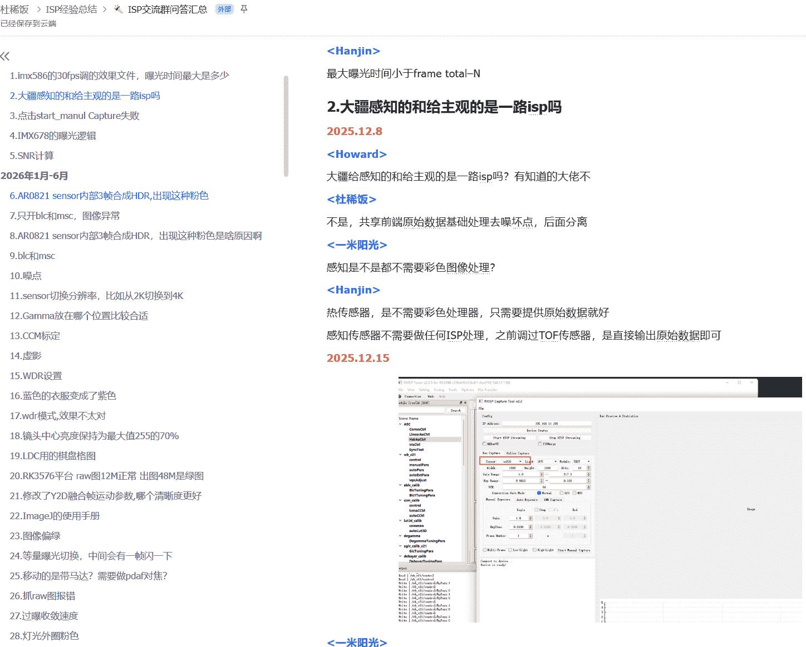

叁斤的讲解，让我和 AI 的协作方式彻底变了。以前是把 AI 当成一次性工具，用完就走；现在更像面对一个会记得我、理解语境的搭档。

具体流程是：
飞书发起定时指令 → Hermes 收到后调用 Codex 的长连接服务 → Codex 配上 Obsidian，自动产出公号初稿、卡片正文初稿、朋友圈内容，直接落到 Word 或 .md 文件里。

长文出来之后：
长文 → 固定角色图卡提示词生成器 → 绘图提示词 → 生成图文卡片。

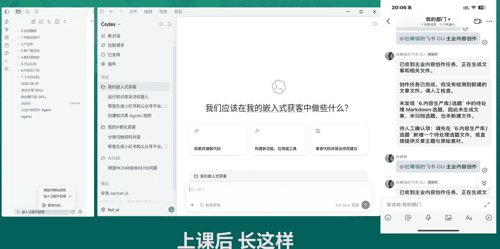

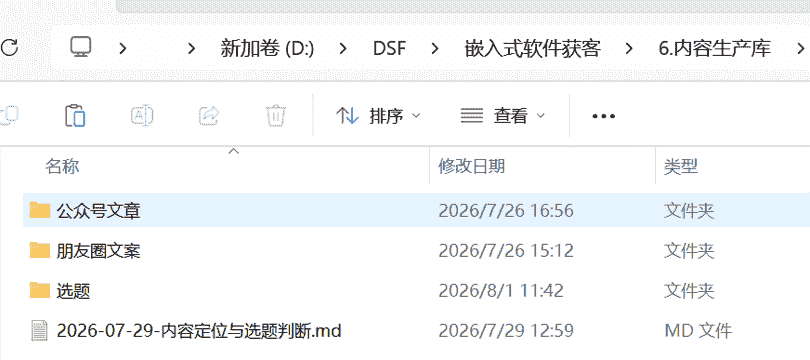

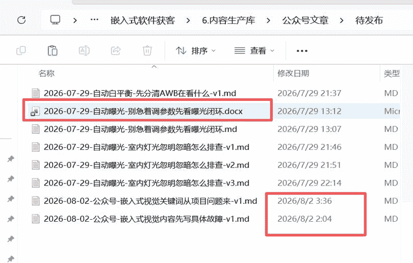

我最深的体感是：效率不是省出来的，而是工具升级之后自然释放出来的。把 AI 当成真实搭档，每天和它一起工作。

后来，林幻雨在西安组织了一场线下聚会，我和叶贤弟一起，把这套心得分享给了同城圈友。

### 资料库，是 AI 的专属上下文，也是我的第二大脑

#### A. 怎么理解资料库

叁斤说：无论模型多强，它并不认识我们，也不知道我们卖什么。资料库本质上就是一组文件夹，像外接记忆，装的是商品介绍、客户故事、行业经验和运营准则。它是 AI 的记忆上下文，也可以理解成专属资料架。

资料库最难的不是建，而是整理和使用。所以第一步，是找到顺手、匹配场景的工具。

#### B. 我体验过的几种资料库

##### 1. 飞书：团队的高速公路，个人用像杀鸡用牛刀

飞书文档协作很强，适合多人同时编辑；权限管理也很完善，适合做交付型资料库。但对个人创作者来说太重，每次打开要登录、进组织、等加载。

适合：团队协作、社群交付、多人共用。
不适合：个人创作者、需要快速记录和随时调用的自由职业者。

##### 2. Notion：强大的瑞士军刀，国内体验不太行

Notion 的数据库、模板生态、页面嵌套都很强，理念是“一个工具管理一切”。但在国内，加载转圈的时间够我喝完一杯水，还时不时断连。

适合：国外用户、团队协作、强数据库需求的项目管理。
不适合：国内个人创作者、追求稳定快速记录的写作者。

##### 3. Get 笔记：优秀的输入前端，但不是资料库

这款应用的语音转写是强项，能把口头表达整理成书面格式；手机内录功能也很实用，听播客、上课都能一边听一边记。在我的 Obsidian 工作流里，Get 笔记就扮演语音输入前端，算是一个很好的内容采集入口。

但它不适合当资料库：功能比较基础，更像“可以问问题的文件夹”，没有文件夹体系、双链、结构化沉淀。更适合做采集器，不适合长期积累。

##### 4. ima 知识库：小程序方便，本地化不足

这是微信小程序里的产品，支持文件上传、AI 问答、智能写作、思维导图，还能看广场上的共享资料。但对我这种需要深度创作的人不够用：没有文件夹层级、双链、标签体系，数据都放在云端，也没有本地备份。

适合：微信生态用户、轻量级资料查询、快速搭一个小型资料库。
不适合：需要深度资料管理、内容创作、长期沉淀个人 IP 的人。

##### 5. Obsidian + Codex：我最终选的方案

笔记全部是 Markdown，存在本地，数据完全可控，不会被平台锁住；Markdown 是纯文本，可以随时迁移；双链结构能让笔记之间互相连接，形成真正的知识网络，而不是一堆零散文件。

这是我自己的完整复盘。希望我的经历能给还在找方向的圈友一点启发：先下场，把自己丢进真实的反馈里，再把工具变成自己的第二大脑。

**Codex 的定位是让你的主观判断始终在前，它只负责把判断落地**

它可以直接访问 Obsidian 指定的文件夹读取文件，无须手动复制。先把材料过一遍、推导出执行步骤、调用所需工具，最后把成果写回本地目录。借助 AGENTS.md 与 Skills 来约定协作方式，越用越贴近你的个人习惯。

核心逻辑很简单：人掌握思考与裁决，AI 承担整理、执行与推进。

## 知识库里到底要放哪些东西

从过往实操来看，大家基本达成一致：不要一上来就去设计所谓完美的目录。结构是用出来的，不是设计出来的。先靠碎片化记录把活的材料堆进来，随着使用频次变高，分类会自己长出来并趋于合理。先有素材再有结构，才是可落地的路径。

我最初只搭了最小可用骨架：

### 1. 个人身份底座
我是谁、坚守什么、核心价值观、个人经历与故事线。

### 2. 在售产品清单
手上有哪些产品、定价与权益、差异化在哪里、为什么是你的客户买、能解决哪类问题。

### 3. 客户认知库
客户画像、分层痛点、原话摘录、对需求的解读、用户会用的检索词。想写出读者视角的内容，这块最关键，连客户曾经的吐槽都要保留。

### 4. 素材沉淀区
案例、故事、常见问题、基础知识、买来的电子书与课程复盘、曾经爆过的素材并做标注。另开行业动态与关键词更新，写作时有意识地布词。段子、金句、生活化表达一起归档。

### 5. 方法沉淀库
自己的判断、已掌握的技能、课程提炼、爆文写法、标题方法论、文章框架等可复用经验。

### 6. 内容生产线
已发布与待发布分开，选题沉淀与内容生产闭环。再设一个缓冲仓，放暂时用不上但不想丢的材料。

整座库覆盖收集、创作、储备、规划、沉淀、产出、复盘、缓冲。Codex 调用时像去专属资料柜取件，而不是在资料堆里翻。它是可被调用的资产，先把真实内容填进去，再在使用中不断归类、补充、调整。

投入越真实、写出来越像你。甚至录音里的口头禅、停顿、没说完的半句都能保留，这些不规范的表达反而构成个人风格。

## 两天搭出可用的最小库

别等完整再启动，先做出能跑的版本边用边修，反馈更快。

## D. 怎么把东西喂进库

叁斤老师给我的最大启发是录音流转。

### 方式一：录音导入
把对话转化为多种形态，把知识库需要知道的信息、日常客户沟通、尽可能完整的你，让 Codex 按库结构归档，干活本身就是喂库。

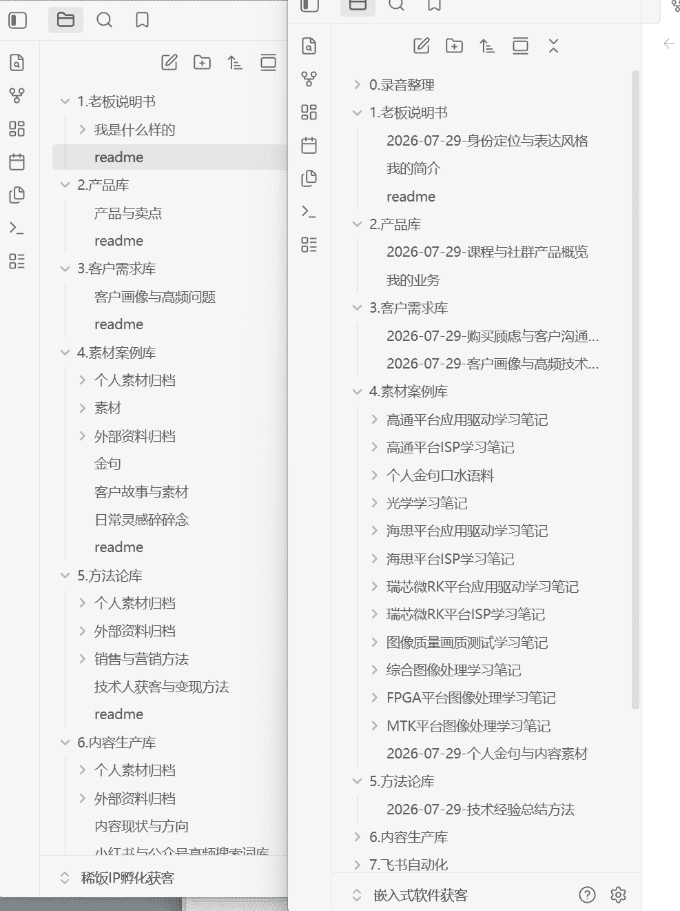

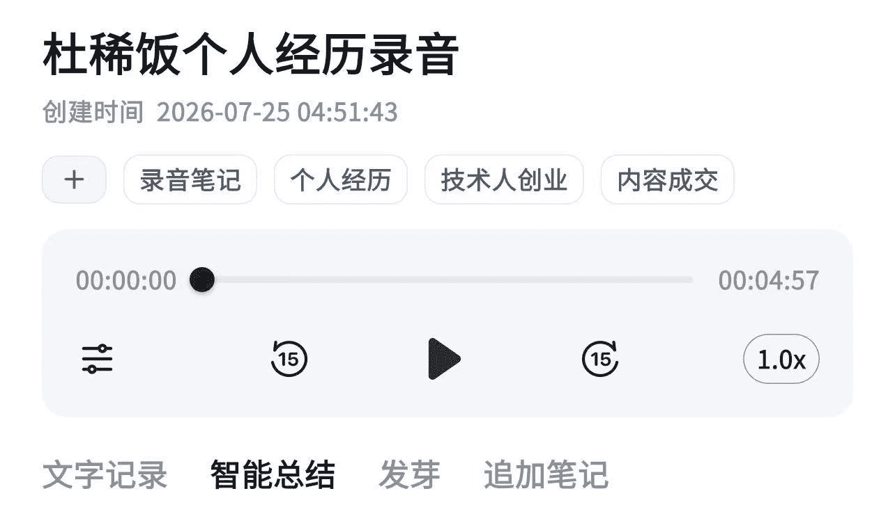

### 方式二：既有信息迁移
学过的课程、业务经验、课件，存入 Obsidian。

### 方式三：外部优质内容归集
平时刷到的好内容分散各处，可装一个 Obsidian 插件或用 Get 笔记集中保存，再回流到知识库。

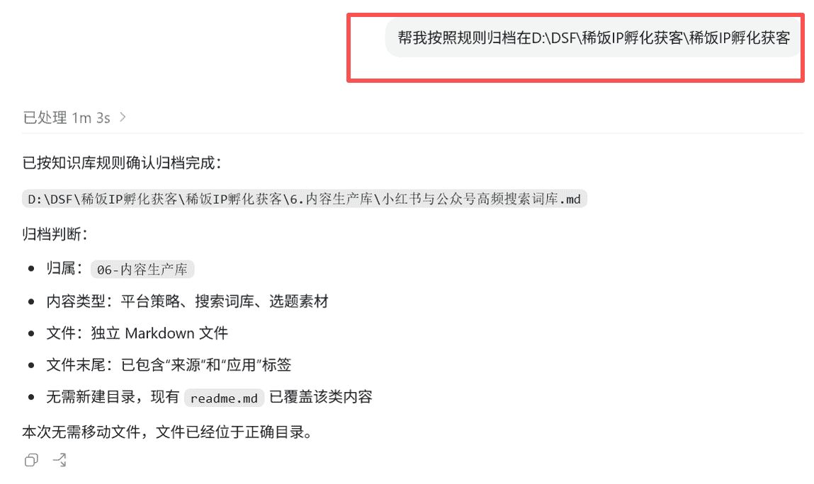

浏览网页时一键存入知识库。看到想收藏的页面：点插件图标 → 确认路径 → 点“添加”，内容自动进入 Obsidian。

## E. 指挥入库的协作约定

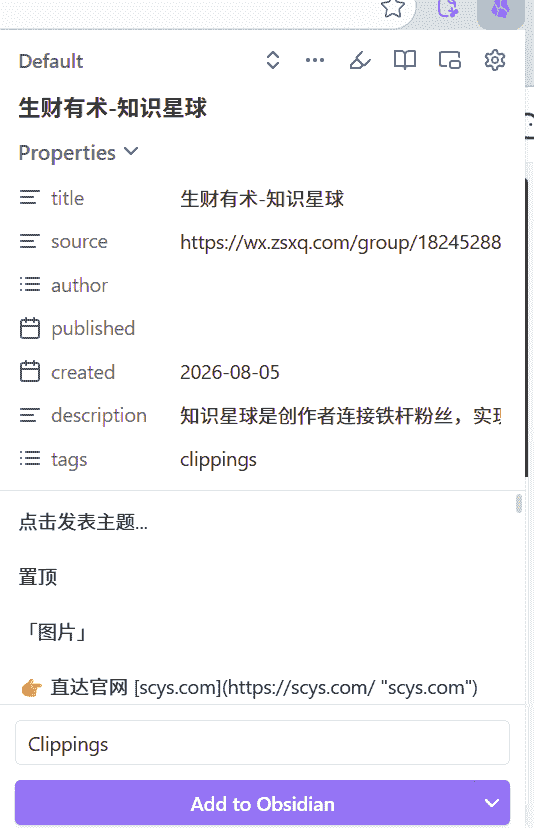

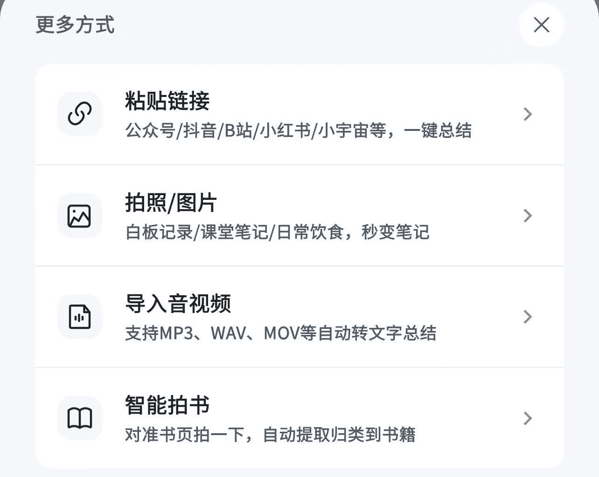

协作时要让 AI 清楚四件事：我是谁？你该如何配合？我可以授权它自主完成的边界？完成后结果放在哪、怎样持续优化？

可按下面格式撰写：

### AI 协作工作制度
## 一、你在和谁协作
例如：身份／不希望被塑造成什么形象／……
## 二、我的业务和客户
例如：业务／产品／客户／差异……
## 三、协作原则
例如：先结论后理由／尽量使用真实经历与客户原话……
## 四、行为边界和确认权限
例如：不可执行的事项／分级：可直接完成、完成后复核、必须先问……
## 五、项目文件夹索引
## 六、素材归档规则
## 七、打标签规则
## 八、不同任务的处理流程
## 九、统一输出格式
## 十、结果如何反哺知识库
例如：哪个判断被验证？有没有新客户原话？是否形成新方法论？……
## 十一、定期体检和维护规则
例如：找重复素材／找高频调用但未固化的方法论内容……

### 第二步：Skill——别把所有事塞进一个提示词，拆成小技能

过去想靠一个万能提示词输入选题就产出全部内容，容易失控。

叁斤老师讲课时，我在酒店稿纸上画出每天重复的动作。

现在把重复动作拆开：
- 从选题池筛选选题
- 写一篇公众号长文
- 从长文提炼知识卡片正文
- 从长文提炼朋友圈文案
- 知识卡片提示词生成器
- 生成每张图片的提示词
- 发布前检查

每个动作都是独立技能。哪里不对就改哪里。

例如卡片字数超限，只需把该技能改为 600 字；若表达易焦虑，则明确加入陪伴型表达要求。

#### Skill 的获取方式
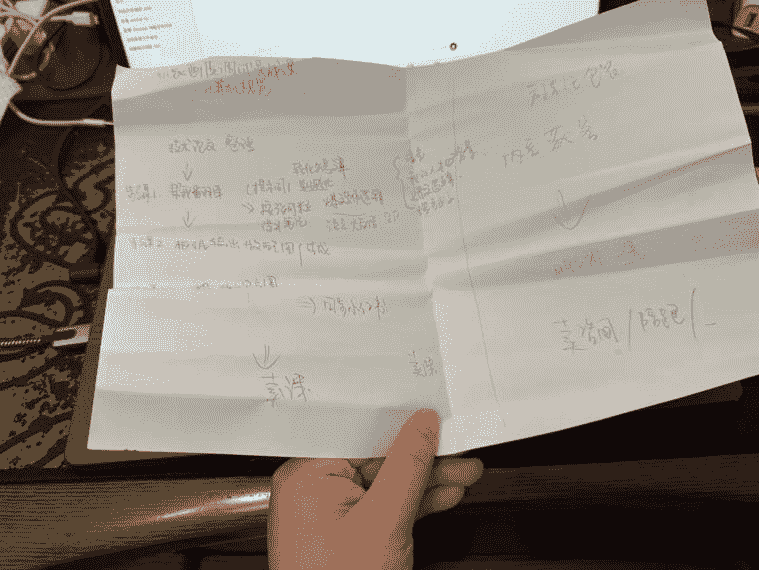

可下载公开 Skill 再改造，或让 Codex 按流程生成新 Skill。说明清楚：处理流程、资料位置、执行要求、交付形式。

## A. 公众号写作最小初版 skill.md

```yaml
name: wechat-article-writing
description: 根据已提供的选题与知识库素材，撰写面向计算机视觉、ISP、图像处理、视频流和嵌入式软件从业者的微信公众号技术长文正文。
```

# 公众号文章写作
## 输入
- 接收已确定的选题及相关知识库素材。
- 仅使用已提供或已读取素材；技术事实、案例、数据或来源缺失时标记“待确认”，不得虚构。
- 原始素材含代码示例时，除非明确要求改写，否则保留原样。
## 写作要求
- 围绕可站住脚的观点展开，优先交付可执行方法、清单或认知收获。
- 面向 26 至 45 岁的计算机视觉与嵌入式软件从业者，以平等、同行陪伴式口吻解释技术概念。
- 从具体项目痛点、好奇点或风险切入，依次推进为有用解释和示例、可记住的洞见、后续讨论邀请。
- 长短句交替；每段不超过五行；每三到四段切换一个自然子话题。
- 仅在帮助说明观点时使用克制的生活例子、轻度幽默或工程观察。
- 不使用夸张比喻、虚假权威、空洞口号、无依据的效果承诺、泛化的 AI 套话或标题党表达。
## 输出
- 只输出长文正文，不生成标题、贴图正文、朋友圈文案、前言或写作说明。
- 使用清晰的 Markdown 小标题组织正文；不沿用来源材料的数字编号。

## B. 标题的最小初版 skill.md

```yaml
name: wechat-title-writing
description: 根据已完成的技术公众号正文及其素材，生成一个可信、有具体工作处境感、不过度承诺的微信公众号标题。
```

## 输入
- 接收公众号长文正文，以及需要时使用的原始选题和素材摘要。
- 标题必须与正文可兑现的内容一致；信息不足时标记“待确认”，不虚构事实。
## 生成要求
- 输出一个标题，落在工程师具体的工作处境、压力或发现上。
- 语气平等、有陪伴感，让有经验的工程师感到被理解。
- 优先表达真实矛盾、工程判断或可复用的发现，而不是泛泛承诺。
- 禁止制造恐慌、许诺结果、夸张好奇、诱导点击和居高临下的说教语气。
## 输出
- 只输出最终标题，不附解释、候选标题、编号、引号或 Markdown 标记。

## C. 贴图正文最小初版 skill.md

## D. 朋友圈最小初版 skill.md

## E. 把知识卡片提示词修改后封装成你的 Skill
告诉 Codex：帮我把这个知识卡片提示词生成器进行修改：
1. ……
2. ……
再帮我把它封装成一个 Skill。先运行这个提示词生成器，再输入刚才生成的长文，生成需要绘制每张知识卡片的提示词。

## 知识卡片固定角色提示词生成器
（3:4 竖版专用——独立多图模式）
---
## 角色：知识卡片提示词生成器
（3:4 竖版专用——独立多图模式）
## 背景：手绘涂鸦风格的信息图（Sketchnote）
能够将复杂信息以视觉化方式呈现，3:4 的竖版比例最适合小红书等社交平台传播。
当内容较多需要拆分成多张图时，要确保 AI 理解是生成多张独立的完整图片，而不是把多张图挤在一张画布上。
## 任务
根据用户提供的内容，分析内容逻辑和信息量，自动判断是否需要拆分成多张图。如需拆分，则生成清晰明确的绘画指令，确保 AI 按顺序生成多张独立的、完整的图片。
---
## 核心原则
### 1. 文字必须用反引号锁定
- 每一段要显示的文字都用反引号包裹。
- AI 会把反引号内的内容当作“必须原样呈现”的文字。
### 2. 位置必须具体到容器
- 不说“放在左边”，而说“在横幅内”“在圆形框内”“在金字塔第二层”。
- 每个元素都要说清楚它在什么形状／区域里面。
### 3. 插画必须和文字绑定描述
- 不单独列插画清单。
- 而是：标题文字（旁边画一个 XXX 的简笔画插图）。
- 插画要具体描述画什么，如“一个人在攀登的简笔画”“一朵盛开的花朵插图”。
### 4. 多图独立输出（重要！）
- 明确说明“分别独立生成 X 张图”。
- 强调“每张图占据一个完整的 3:4 画布，不要合并”。
- 每张图单独输出一个代码块，用户可独立复制每张图的指令。
- 用序号清晰标识每张图。
### 5. 首图标题必须醒目
- 用户内容的第一行作为主标题。
- 标题区域占据画面顶部明显位置。
- 标题需要视觉强化处理，如横幅、框框、底色等。
---
## 内容量判断与拆分规则
### 单张图适用情况
- 要点数量：8 个以内。
- 总字数：不超过 300 字。
- 结构层级：不超过 3 层。
### 拆分为 2 张图
- 要点数量：9—16 个。
- 总字数：300—600 字。
- 拆分逻辑：按主题模块、时间段、类别等自然分割。
### 拆分为 3 张图
- 要点数量：17—24 个。
- 总字数：600—900 字。
- 拆分逻辑：按逻辑递进、三大板块、时间阶段等。
### 拆分为 4 张及以上
- 要点数量：25 个以上。
- 总字数：超过 900 字。
- 拆分逻辑：系统化拆分，每张图独立成章又相互关联。
---
## 3:4 竖版构图库（30 种）
### 一、线性流程类
#### 1. 纵向时间线型
- 结构：一条垂直主线从上到下贯穿画面，节点分布在线的左右两侧。
- 适用内容：成长记录、项目里程碑、历史事件。
#### 2. 蜿蜒路径型
- 结构：S 形或蛇形曲线路径从上到下，沿路径分布内容节点。
- 适用内容：学习路径、成长旅程、探索过程。
#### 3. 阶梯递进型
- 结构：从左下到右上的阶梯状结构，每一级台阶放置一个内容模块。
- 适用内容：能力进阶、级别晋升、目标达成、难度递进。
#### 4. 瀑布流程型
- 结构：从上到下的瀑布式流程，每一步之间用箭头连接。
- 适用内容：工作流程、决策流程、操作步骤。
#### 5. 竖向递进卡片型
- 结构：从上到下排列的多个卡片，每个卡片一个主题。
- 适用内容：步骤说明、方法论、流程指南。
### 二、层级结构类
#### 6. 正金字塔型
- 结构：底部宽、顶部窄的金字塔，分 3—5 层。
- 适用内容：能力模型、需求层次、用户分层。
#### 7. 倒金字塔型
- 结构：顶部宽、底部窄的倒金字塔，重要信息在顶部。
- 适用内容：新闻结构、结论先行的汇报、重要性排序。
#### 8. 冰山模型型
- 结构：水面上下分层，水下部分是深层内容。
- 适用内容：
表象 vs 本质、显性 vs 隐性
#### 9. 树状结构型
- 结构：像一棵树，主干分出树枝
- 适用内容：知识分类、组织架构、概念拆解
#### 10. 根系结构型
- 结构：上半部是结果，下半部是根源
- 适用内容：追根溯源、原因分析
### 三、圆形环绕类
#### 11. 中心发散型
- 结构：中心一个核心，周围环绕多个模块
- 适用内容：一个核心概念的多维度展开
#### 12. 同心圆/靶心型
- 结构：多层同心圆，从内到外层层扩展
- 适用内容：核心—延伸关系、影响力层级
#### 13. 循环圈型
- 结构：圆周上分布节点，箭头连接形成循环
- 适用内容：闭环流程、PDCA 循环
#### 14. 花瓣环绕型
- 结构：中心花蕊，周围花瓣
- 适用内容：要素组合、美好愿景
#### 15. 太阳放射型
- 结构：中心太阳，向外发射光芒
- 适用内容：正能量主题、优势展示
### 四、对比并列类
#### 16. 上下对比型
- 结构：画面水平分为上下两半
- 适用内容：优缺点对比、前后对比
#### 17. 左右对比型（窄版）
- 结构：画面垂直分为左右两栏
- 适用内容：简单的二选一、正反观点
#### 18. 竖向多栏型
- 结构：从上到下分为多个横向栏目
- 适用内容：阶段对比、时间段
#### 19. 竖版卡片堆叠型
- 结构：从上到下堆叠 3—5 个卡片
- 适用内容：要点清单、技巧合集
#### 20. 双列瀑布流型
- 结构：左右两列，卡片错落排列
- 适用内容：多要点展示、灵感收集
### 五、容器承载类
#### 21. 竖版笔记本型
- 结构：整个画面是笔记本页面
- 适用内容：读书笔记、学习总结
#### 22. 卷轴展开型
- 结构：竖版卷轴从上到下展开
- 适用内容：宣言、原则、重要声明
#### 23. 便签墙竖版型
- 结构：画面上贴着多个便签纸
- 适用内容：头脑风暴、灵感收集
#### 24. 手机屏幕型
- 结构：整个画面是手机屏幕
- 适用内容：APP 功能介绍、数字产品
#### 25. 书签/标签型
- 结构：多个竖版书签/标签
- 适用内容：分类知识、索引
### 六、路径地图类
#### 26. 山峰攀登型
- 结构：一座山峰，从底部到顶部分布营地
- 适用内容：目标达成、能力攀升
#### 27. 河流汇聚型
- 结构：多条细流汇聚成大河
- 适用内容：多因素汇聚、资源整合
#### 28. 竖版地铁线路型
- 结构：主线从上到下，有若干站点
- 适用内容：学习路径、职业发展
#### 29. 游戏关卡地图型
- 结构：从底部起点到顶部终点，中间若干关卡
- 适用内容：闯关挑战、游戏化学习
#### 30. 成长树型
- 结构：一棵大树从底部生长到顶部
- 适用内容：个人成长、公司发展
---
## 视觉风格库
### 1. 经典手账风
- 背景：白色纸张纹理
- 配色：柔和暖色系，黑色轮廓，黄/绿/红点缀
- 适用：商业分析、读书笔记、个人成长
### 2. 科技未来风
- 背景：白色纸张纹理，网格纹理
- 配色：浅蓝、白色、浅灰，浅橙
- 适用：AI、互联网、数据分析
### 3. 清新自然风
- 背景：浅绿米白渐变，水彩晕染效果
- 配色：草绿、天蓝、暖黄，深绿轮廓
- 适用：健康、教育、心理、生活方式
### 4. 商务专业风
- 背景：浅灰白色，纸张纹理
- 配色：浅蓝、金色、灰色，红色点缀
- 适用：职场技能、管理方法
### 5. 国潮中式风
- 背景：宣纸纹理，水墨晕染
- 配色：朱红、墨黑、金色、靛蓝
- 适用：传统文化、国学
### 6. 创意艺术风
- 背景：纯白浅色，泼墨飞溅效果
- 配色：大胆撞色，粉/紫/黄/青混搭
- 适用：设计、创意、营销
### 7. 极简线条风
- 背景：纯白黑灰，干净无杂质
- 配色：黑白灰，仅一个点缀色
- 适用：哲学、极简生活
### 8. 可爱卡通风
- 背景：糖果色渐变
- 配色：粉红、天蓝、柠檬黄马卡龙色
- 适用：儿童、亲子
### 9. 复古怀旧风
- 背景：做旧羊皮纸，褶皱痕迹
- 配色：棕褐、暗红、墨绿、金色
- 适用：历史、文化
### 10. 运动活力风
- 背景：动感斜线条纹
- 配色：亮橙、电光蓝、荧光黄
- 适用：健身、运动
---
## 固定卡通人物形象（杜稀饭）
### 人物基础设定
- 姓名：杜稀饭
- 身份：技术界段子手、程序媛
- 人设关键词：活泼可爱、通俗易懂、有趣有料、用大白话拆解技术知识
### 风格定义
极简随笔简笔画，单根黑色轮廓线，线条带有自然手绘轻微抖动，拒绝机械顺滑笔直线条，无阴影、无渐变、无排线，大面积纯白留白背景，扁平化平涂上色，仅局部小面积纯色填充，针管笔手绘质感，自媒体公众号科普插画风格。
### 外貌特征
- 性别：女性
- 头身比例：二头身 Q 版卡通，大头方圆脸，头部占整体身高二分之一
- 眼睛：实心小黑圆点，双眼下方两团椭圆形腮红
- 嘴巴：上扬弧线微笑嘴
- 神态：灵动俏皮
- 发型：黑色及肩微卷长发，八字刘海，单侧有一缕发丝俏皮上翘，发丝只用极简波浪线条勾勒
- 眼镜：金属玫瑰金边框大圆眼镜，半透明镜片内部点缀 `{ } // ;` 极简代码符号反光
- 服装：衣身整体浅色平涂，衣角处简笔绘制咖啡杯、二进制 0101、Hello World 小字、键盘按键小印花
- 配饰：脖子挂迷你键盘造型项链，手腕用三根短线绘制紫、橙、绿三色手环，卫衣口袋露出一小截鼠标线

我用一个“数字分身”和一套固定卡通IP，把内容生产效率翻倍了。

做内容这几年，我最深的感受是：真正让人疲惫的不是创作本身，而是那些每次都要重来一遍的重复劳动。后来我做了两件事，终于把自己从繁琐里捞了出来：一是有了一套让读者一眼记住我的固定IP形象；二是给AI配了一个能“从头干到尾”的数字分身。今天把这两样都摊开讲讲。

先说我那个叫“杜稀饭”的卡通形象。

它是一个Q版女孩，黑色长发、圆框眼镜，卫衣上悄悄藏着咖啡杯、键盘印花这些程序员小元素。为了让这个形象在每一张知识卡片里都有“自家出品”的辨识度，我给它定了几条硬规矩：线条必须极简，四肢只画轮廓，不画手指；外层黑线粗一点，内部线条细一点；除了衣服，其他区域全部留白，没有任何花哨纹理。动作倒是很灵活，可以讲解、思考、吐槽、庆祝、引导，但无论怎么换姿势，脸和衣服永远不变。角落里还会固定放一碗画着笑脸的卡通稀饭，算是名字谐音梗的彩蛋。配色主用浅蓝、浅橙、浅绿，和知识卡片整体融在一起。

后来我发现，靠手画肯定不现实，必须让AI学会稳定复现这个角色。于是我把所有规范写进了一套提示词模板，并加了一条重要的文字渲染规则：只有用反引号标出来的文字才允许出现在画面上，其他地方不允许出现任何字。模板还要求图片必须是3:4竖版，每张独立存在，不能拼接；右上角要标“0X/0X”和“@杜稀饭”作为系列标识。AI拿到内容后，会先判断内容量，再决定拆成几张图、每张用什么构图，最后一次性生成多段独立代码块，方便我逐张复制。如果出图不满意，我可以直接说修改意见，甚至发参考图告诉AI该学配色、结构还是插画风格；如果觉得知识密度太低，也可以直接提醒它“你是不是偷懒没全部分析资料”。这些使用建议也被我写进了模板里，尽量让出图过程少踩坑。

解决了IP问题，我开始折腾真正的自动化：Agent。

很多人分不清Skill和Agent。我的理解很简单——Skill是工具箱，Agent是拿着工具把任务从头到尾执行完的人。我的Agent就是一个数字分身，日常触发词是“主业内容创作”。只要我对它说这句话，它就会自动打开选题库，找出还没处理的选题，一次只做一个；如果同时有好几个选题不知道先做哪个，它会把候选列出来等我来定。确定选题以后，它会根据内容选择产出公众号长文、贴图正文还是朋友圈文案，并调用相应的写作Skill。公众号文章会先写作、再取标题、最后排成适合移动端阅读的HTML；贴图正文控制在600字以内；朋友圈文案则分两种，需要深度稿时先给我候选框架，我选了角度再写正文，简单稿则直接输出。所有成稿都会自动存进“待发布”文件夹，文件名带日期和关键词。最后通过飞书发通知，告诉我产出了什么、存在哪、调用了哪个Skill，以及哪些细节需要人工确认。

为了保证它不乱来，我特别写了几条保护规则：禁止删除、移动、重命名任何文件；不改写已有素材和文章，要换版本就新建文件；没有可用选题时，不硬凑空文章，只通知“暂无待处理选题”。如果原始素材不足，它必须把这些列入待确认项，而不是自己补造事实。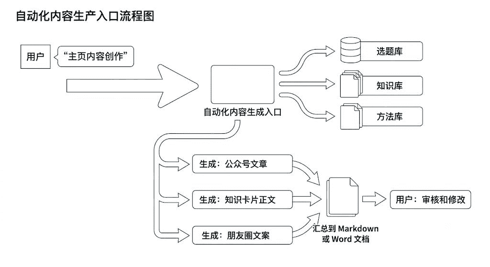

把飞书和Codex连起来的时候，又是一场硬仗。最初我根本看不懂谁是谁，后来用“一家店”的比喻才想明白：飞书机器人是前台，负责接单和确认身份；Hermes是店长，负责调度分单；Codex是技术员，真正动手干活；飞书CLI是技术员手里的门禁卡和工具箱。微信群里说一句“帮我处理录音”，本质上就是给这个小组派单。

但链路越长，坑越多。最典型的是机器人没回我，多半是服务根本没启动，前台压根没在岗。解决方法是设置好环境变量再启动，终端里出现连接正常的提示才算上班成功。```powershell
cd D:\DSF\嵌入式软件获客\7.飞书自动化
$env:FEISHU_APP_ID = "你的应用 ID"
$env:FEISHU_APP_SECRET = "你的应用密钥"
$env:FEISHU_BOT_OPEN_ID = "机器人的 ou_ 标识"
$env:FEISHU_ALLOWED_CHAT_IDS = "允许触发的 oc_ 群 ID"
$env:HERMES_URL = "Hermes 的任务接口地址"
$env:HERMES_TOKEN = "Hermes 令牌"
$env:CODEX_WORKSPACE = "D:\DSF\嵌入式软件获客"
npm start
``` 还有一次是任务转不出去，因为Hermes本来装在本机，我却把它当成“在线客服系统”填了个网址；改成直接调用本地Hermes命令后就好了。飞书CLI也有个很关键的问题：机器人身份只能收发消息，不能读我的妙记和会议纪要，必须完成用户身份登录授权，相当于把私人钥匙正式交给技术员。遇到看不明白的界面，最省事的办法就是直接问Codex“用大白话说说这是啥”，它会耐心解释。至于Hermes在哪、怎么输入指令——黑色终端就是Hermes，实在不懂喊Codex就行。

我还把几个高频命令翻译成了“人话”：`npm start`是让前台开工；`FEISHU_ALLOWED_CHAT_IDS`是群白名单，只允许这些群触发任务；`--skip-git-repo-check`是告诉Codex这只是工作区，不是Git仓库；`lark-cli`是用户身份授权；`user-default`代表权限比较大，得控制使用范围。掌握这些之后，再出现类似问题，我就不再两眼一抹黑了。

最后说一点特别想分享的感受。

上周末飞去参加线下大课，航班晚点，凌晨三点多才到浦东。换以前我早就急了，可这次心里反而很平静：晚点的时间刚好用来补预习作业，就像白送的礼物。拼房的“北极光”一直在等我，发消息问我到没到，我特别不好意思。到了酒店才知道，朋友“贝妈”因为报名晚没订到房，老公特意坐第一班高铁从常州给她送电脑来。这些真实的人和事，比课程本身更让我觉得值得。

回到AI这件事上，技术帮我把重复劳动省了下来，但它替不了人与人之间的温度。也正是因为省下了时间，我才更有余力去参与那些让我有真实触动的线下相聚。如果你也每天被同样的事情耗着，不妨像我一样，先挑一个小流程交给AI试试，把注意力留给真正重要的东西。

追了一整夜极光，原以为会折腾得够呛，没想到北极光全程都在关照我这个没睡好的人。短短两天，暖意满满。她喊我一起吃饭，分享从稻城背回来的葡萄，还有一把特别好用的吹风机。我说想下楼买支笔，她干脆直接送了我一支，让我留作纪念。哈哈，真的被暖到了。

大课的安排非常密集，晚上回到房间，我已经瘫在床上，大脑彻底宕机，只想放空。结果转头一看，贝妈正拿着录音豆，一遍遍回放白天的内容，还和北极光举着手机录视频，记录当下的感悟。那一幕，我真的被震住了。

贝妈说自己电脑操作其实不太利索，但在我眼里，她那种一丝不苟的态度，和浑身散发着的高能量状态，才是真正让人佩服的地方。那一刻我也忍不住自问：回到西安还要给圈友分享，我自己这一趟到底学到了多少？

能和这两位高能量的室友同住，真是运气爆棚。

- **15组的战友们**

组长Lance在活动前后帮我们对接信息、协调资源，扛起了大梁，带着大家把黑客松的任务啃了下来。Steven、陈艳、白龙几位也都非常给力。两天的并肩作战实在让人忘不了，除了那碗二狗面馆的面，更难得的是学习节奏跟不上时，只要招呼一声，马上有人帮你接上，效率直接翻倍。

- **叶贤弟**

黑客松环节里，优秀的作品一个接一个，但我脑海里挥之不去的，是叶贤弟的表现。她在线下的气场太强了，站上台连设备的间隙，就已经抓住全场目光，介绍项目时逻辑清晰、语速节奏都拿捏得恰到好处。太飒了。

我当时还跟队友猜，她肯定是专业主持或主播出身，结果一聊发现竟然是我老乡。那种在台上收放自如的状态，恰恰是我最缺的。

- **吴泽承**

有句话说得好，人只有出发了，才能撞见贵人和朋友。如果没报名这次大课，我大概率不会认识这位种草榜一。他主动破冰、积极对接，待人特别真诚。交流中无论抛什么难题给他，他都会耐心给出解法，还会按需推荐相应的群友来协助，真是打着灯笼都难找的贵人。

只要你敢主动，机会就会主动靠过来。

- **林幻雨**

她是西安这边当之无愧的组局担当，经验老到、心思缜密、办事特别稳。知道我要去上航海大课后，她专门来问我愿不愿意回西安做一次心得分享。考虑到我是第一次，对流程不熟，她悄悄把幕后琐事全部扛了下来，让分享的人能一心扑在内容上，而她自己始终盯着进度。

其实你用心多少，身边的人都会感知到。我也想把这份善意接过来继续传下去，希望以后越来越熟络，能多张罗一些线下活动，让大家互相交流、互通有无，去照亮更多人。

### 4.2 先把锚抛向想去的岸，再撑船慢慢靠近

如果没有报名线上大课，上面的故事统统不会发生，我也不会结识这些闪闪发光的人，更不会发现他们原来就在我身边。正因为先做了“去参加AI航海家大课”的决定，海报上那串飞书CLI + Hermes + Codex + Obsidian 才真正变成了我手里的武器。

### 4.3 先定位问题，再理解人，最后给出关键决策

我们做了那么多，归根到底是为了成交，为了找到目标群体，给他们提供真正有用的解法。因此，工具用得好不好、内容发得多不多，都不是排在第一位的。真正该想的，是下面三个层次的问题。

#### 1. 先定位问题：找到真正的业务卡点

先弄清楚，断点到底出在哪个环节：

- 没有流量：问题可能在选题、分发渠道或平台选择上。

- 有流量却没人来问：内容大概率没有戳中用户的真实需求。

- 有人问了但没成交：信任感、产品或销售链路需要重建。

就像AI航海大课的老师们反复强调的，AI能提高生产效率，但它没办法替我们判断“症结到底在哪一处”。方向搞偏了，内容做得越多，损失反而越大。

#### 2. 再理解人：看懂用户真正的处境

这不只是填一份用户画像，比如“男工程师、30岁、做软件开发”这么简单。而是要真正看清：

- 他此刻正被什么困住？是想换个赛道，还是想给自己的技术栈做加法。

- 他最怕什么？他心里有什么诉求和那些没讲出口的情绪。

- 他最终想拿到一个什么样的结果。

- 他吃宏大叙事那一套，还是只认逻辑和结论？他是工程直男的表达习惯，还是有其他的叙述偏好。

#### 3. 最后给出关键决策：决定下一步做什么

所谓的关键决策，就是明确：

- 接下来内容为谁发声，要解决什么具体问题。

- 用什么样的语境切入最为合适。

- 把人加进私域后，该往哪个方向去引导。

- 现阶段最该补强的那一块到底是什么。

换言之，不要一股脑地扑向“产出更多内容”，而是静下来想清楚：眼下最重要的一步棋，到底该怎么下。比方说我，是该把手里的素材批量铺开做成内容，还是先解决“写出来的东西根本不像是自己”这个老大难？这个问题，我真的纠结了很久。

### 4.4 出来混，最重要的是先出来

这话出自赚钱，后来成了我做主业、搞副业时反复在心里念叨的一句话。

先允许自己做得粗糙，再一点点打磨到精致。哪怕现在的我还不够好，那就大大方方把真实的自己摆出来。当你坦然接纳了自己的不完美，反而不会拧巴，也不会发怵。

就像这次去上海学习后回西安做线下分享，那是我第一次站到台前。准备阶段确实有过各种担忧，但只要咬牙完成过一次，往后就顺了。

那天晚饭时，有个观点特别戳我——先把第一版跑通，之后的正反馈自然会推着你越做越顺。席间也听大家讲起各自的来时路，我们这些人，最后都是赢在了敢迈出那一步。

聊下来最大的感受是：那些卡点放到赚钱里，根本不需要一个人硬扛——大家始终站在一起。

冲就完了。

---

看完这份SOP，你可能会觉得自己已经懂了，但90%的人一旦动手，就会卡在第一步。

工具和教程从来不是真正的门槛，真正的护城河，是你能不能“立刻开干”，以及你能不能拿到“圈层信息差”。

如果你也想看全网最新的变现玩法，和一群执行力极强的极客并肩下场实战，欢迎来我的核心私域：【懒人专属群】。

我们不讲虚的，只做商业闭环拆解，死磕AI效率。系统里已经沉淀了1000+跑通的套利实战案例。

👉 想参观完整数字资产、了解上车门槛：
https://lazyso.com/insider/

如果认同价值、也准备好了撸起袖子干，直接扫码加我（lazyhelper1）
备注：【实操上车】，非诚勿扰。

