# 如何用工作流做出 4000w 播放的海外短剧——TikTok 短剧复盘

5天冲到3800万播放！我把AI漫剧出海TikTok的底牌，全亮出来了

我是老朱，这半年All in在AI漫剧赛道上。从五月底TikTok开放漫剧入驻到现在，除了入场那一步还得靠人工，后面整套流程几乎全跑了自动化。

先晒一波战绩——有爬坡期的几十万，也有过山车式的几百万，再往上冲到了几千万。最新的《Hungry for More》上线五天，单账号直接干到38.4M播放，还没算矩阵号。

今天这篇复盘，主要聊四件事：入场成本、收益模型、剧本怎么写、工作流怎么搭。尽量不拽术语，用大白话把思路掰开揉碎，大家照着做就行。

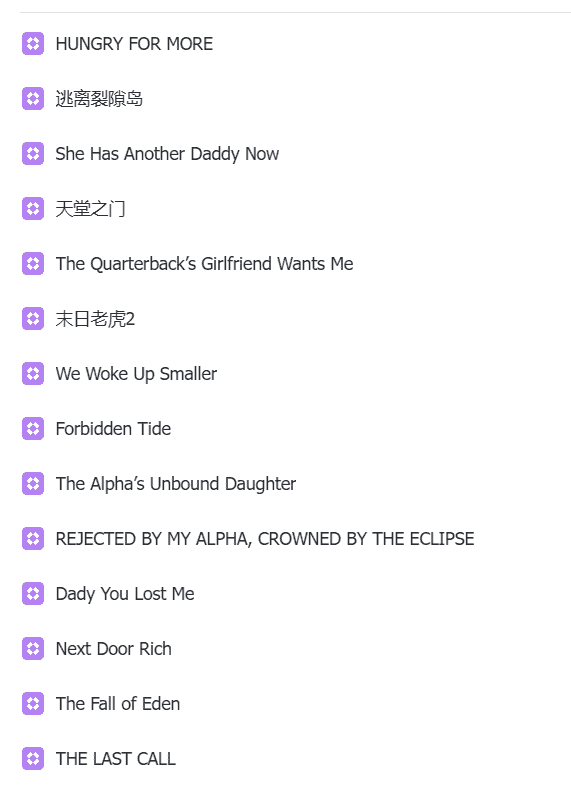
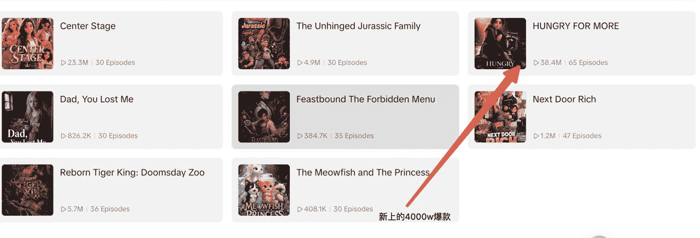
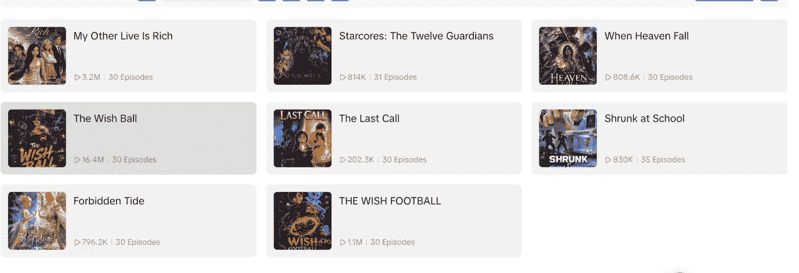

之前也写过几篇漫剧相关的帖子，感兴趣的朋友可以往回翻：一月份的复盘、AI漫剧的学习与尝试、三月份的复盘，还有一篇行业现状与避坑指南。

## 一、先算账：入场和成本

第一步，定平台。海外漫剧目前能上的地方不少，ReelShort、DramaWave、PineDrama（TikTok）都在收剧，国内也有不少平台推出了海外版。新人入场我更推荐TikTok，操作门槛低，而且能顺手同步到YouTube。

但同步YouTube有个坑：儿童内容、血腥暴力的题材别碰，一个不留神就违规，不是所有剧都能搬过去。

为什么是TikTok？简单二字，就图它省事。

### 入驻TikTok漫剧，花不到100块

这个玩法已经公开了，快速过一遍：

1. 科学上网。别问是什么，懂的都懂。用干净的家宽IP最好，一个月20多块。
2. 国内要有公司主体。营业执照翻译成英文，有没有三证无所谓。两种路子：去政府公证，微信搜“地区+公证”，约300块；或者去海鲜市场找有资质的翻译公司，60块左右能搞定。初期没必要花大钱。
3. 准备海外收款账户。思路一：问开户行支不支持海外收款，让银行开个英文账户证明；思路二，快速试错推荐：找第三方收款公司，审核两三天就下号。
4. 正式提交入驻。

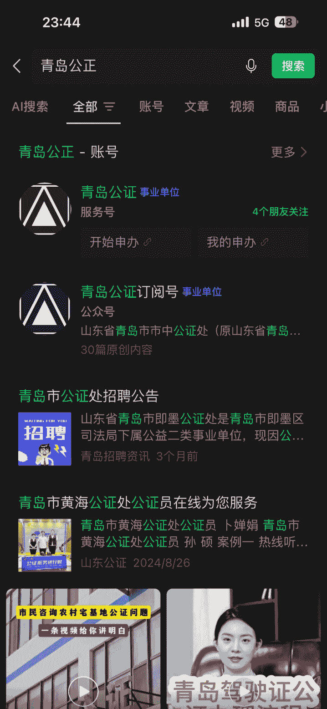
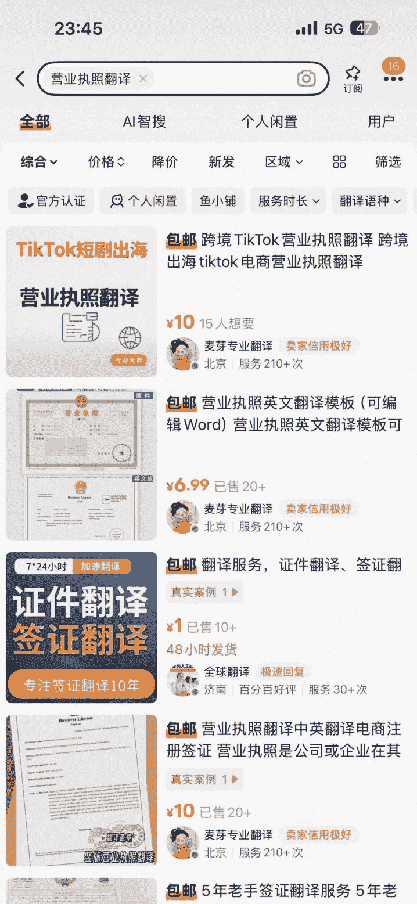

把公司英文名、英文地址、开户行信息整理好，登录tiktokdramacenter.com，照着官方要求填，一般当天或隔日就出结果。官方指南链接也放这儿：https://www.tiktokdramacenter.com/help-center/detail/6a056f8b12f6bd04ef042e4f

算下来，入场费不到100块。

### 收益：评级决定天花板

TikTok的收益分独家和非独家，独家价格直接翻倍。万播收益参考如下——

B级：3–5美金/万次播放
A级：6–10美金
S级：15–30美金
S+：40美金以上

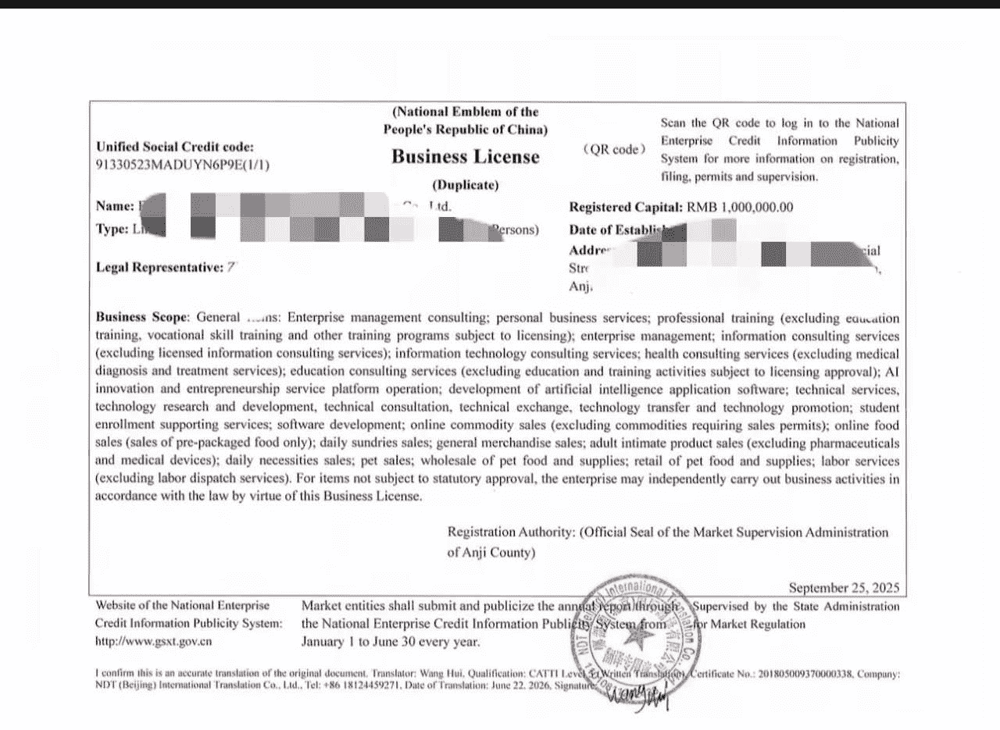

再更新一下最新单价。我们手里跑得最好的是一部美区占比高的剧，结算单价到过6.7；也有跑偏的，最低只有0.9。结合同行的反馈来看，地区和平均播放时长影响很大——美区单价最高，东南亚很低，译制剧基本没戏，可以放弃这条线。

### 单剧成本：1600的算力+人工

我们主力模型是Seedance 2.0，买的是LibTV的季卡账号。一个账号挂一部剧，30集35分钟，算力成本大概1600；50集往上翻一倍。一般用不完。

省钱小妙招：用480p生成，再超分到1080p，算力成本直接省一半。

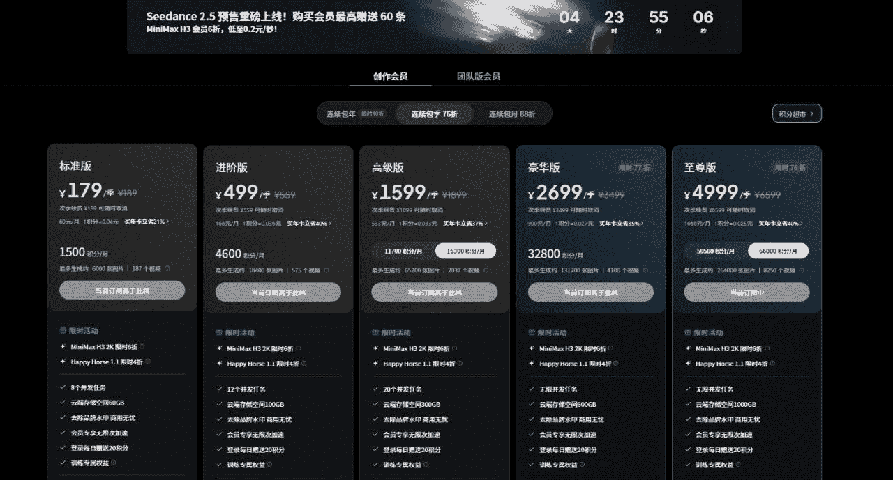

算一笔账：1700元的账号→66000积分→1积分约0.0257元→1秒视频约0.33元。我们抽卡平均1.5到2抽，一部35分钟的剧：35×60×0.33×2=1386，超分费用不到100。

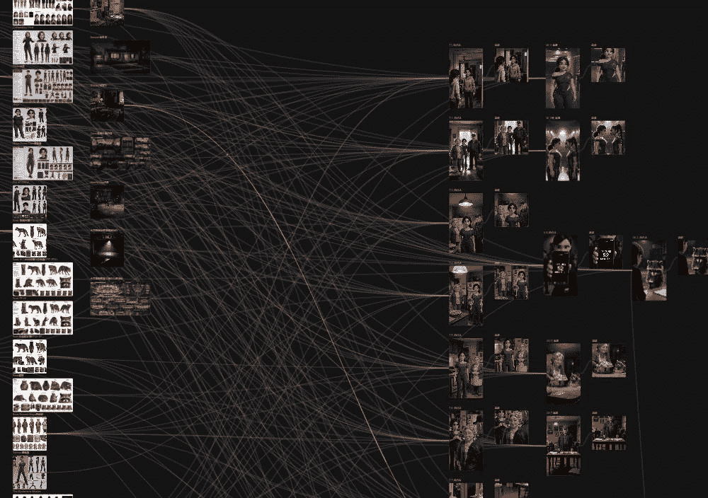
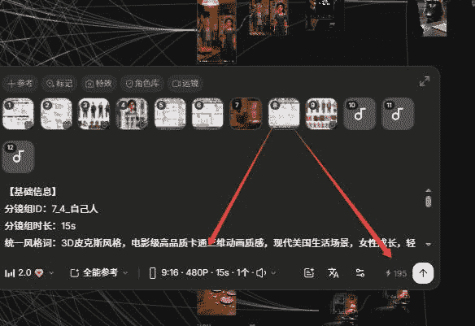

当然字节偶尔抽风，Seedance崩一下成本会高一点，但高不到哪去。所以一部剧通常控制在1600以内，50/60集的控制在3000。质量嘛，不敢跟精品剧比，但绝对能打。

### 人效：一个人，五天

我们用Trae配合Skill和CLI批量上传视频，做到了不用导演、不用抽卡师。从拿剧本到出片，一个人五六天搞定。人工成本主要就是剪辑师一个礼拜的工资。

总成本算下来：一部35分钟的剧，人工+算力约3000–3500。

## 二、剧本：AI写，人把关

剧本也是AI工作流生成的。实战验证，AI写出来的剧本绝对能跑4000w播放——但前提是人工必须介入。

我们跑了多部400w+的剧，同期入场的很多友商却连百万都摸不到。看完他们的剧，我总结了三个共性问题：

1. 国内思维太重。国内短剧那套不是不行，但TikTok以年轻人为主，受美式思潮影响很深。国内内容放东南亚可以跑（红果也出了东南亚平台），但硬搬到TikTok就容易水土不服。
2. 纯翻译剧已经过气。四月份之前老号还能蹭流量，之后TikTok越来越强调本土化，很多账号连50w都跑不过。
3. 情绪表达没接上地气。海外不是不吃强情绪，而是吃法不同。比如婆媳关系，老外的婆媳相处逻辑跟国内完全不一样，做成“媳妇当保姆后逆袭”根本没人买账。再比如霸凌，不是骂两句、扇一耳光就叫霸凌。美式霸凌是什么？是公开处刑式的名誉摧毁+集体孤立——小A组织全班聚会唯独不叫小B，小B送披萨时撞见现场，穿着破烂被嘲笑，还被拍下来传遍全校。这套，美国人才吃。

所以我们做剧本的第一步从来不是直接写，而是先调研。找同类型的爆款剧、爆款博主，一部部看过去，拆解它为什么火、外国人在讨论什么，再拉上AI一起分析创作思路和本土化方案，最后做世界观设定。

### 创意方法论：融梗

不用非得从零原创。对标爆款，两三部糅在一起，就是最快的方法。比如想做普通人逆袭，就去扒近两三个月火过的同类题材——太早的剧没参考价值。把A的剧情和B的剧情交给AI分析，提炼各自的核心梗。

核心梗是什么？举个例子：《瞬息全宇宙》=多元宇宙跳转+家庭和解+荒诞黑色喜剧；《少年派》=海上绝境+多宗教思辨+人性隐喻。

不会拆？让AI拆。说白了就是提取【A主角核心目标】+【B叙事过程/世界观机制】+【C故事情绪基调】，以B为底层规则，A为主线目标，全程笼罩C的氛围——一条全新故事线就出来了。

所以总结成公式：对标爆款+本土化因子+融核心梗=爆款。

剧本写作本身很简单，难的是找对标和分析。前面这几步做扎实了，剧本不会差到哪去。

## 三、工作流：不懂代码也能搭

先回答最多人关心的问题：不懂代码能搭工作流吗？能。老朱本科学的环境科学，跟代码八竿子打不着。但AI懂啊——用好Codex，没有就用Trae或WorkBuddy，都有免费额度。现在DeepSeek V4、GLM 5.1都很强，够用。

第一步，下载Claude开源的Skill创作规范，直接发给Codex或Trae，让它按规范干活。仓库地址：github.com/anthropics/skills

### 原子级操作拆解

这是整个工作流的核心思维。别想着做一个全能的AI，而是把人的业务经验拆成一个个原子步骤。

什么叫原子级？拆到没有任何思维跳步，每个节点只解决一个问题，输入、判断规则、输出格式、验收标准都定义清楚。出错了就只改那一步，每个节点都能单独测试、单独替换。

关键动作是：把隐性思维显性化。老手看到A直接得出C，中间好像没有过程——但一定存在一个被经验内化到几乎察觉不到的步骤B。AI没有这种经验，它会去猜B，猜错就全跑偏。所以梳理工作流时，不光要记“做了什么”，还要问自己“为什么这么判断”“我下意识发现了什么”“什么条件触发下一步”。把被省略的判断和条件全部摊开，个人经验才能变成AI稳定复现的流水线。

### 漫剧工作流长什么样

我们实际跑通的流程：

0. AI读剧本。
1. 创建资产（人物、场景、道具）：AI辅助分析，人工大量介入，因为它直接决定剧的美学。
2. 拆分布卷：30集的剧拆成4–6个分卷。
3. AI拆解分镜，或直接用自然语言喂给AI（想做符的可以搜“多参宗”）。
4. 每集转成分镜组：每个分镜组对应5–15s片段（即梦2.0最长15s）。
5. 分镜组转提示词：给AI分卷简介+本集内容+分镜组片段，按预设格式输出。提示词格式要自己设计一套，网上一堆模板，提炼成标准格式就行。
6. 重复上述流程，获得全本提示词。
7. 调用LibTV CLI：不懂CLI没关系，官方文档写得很清楚，让Codex/Trae自己看。

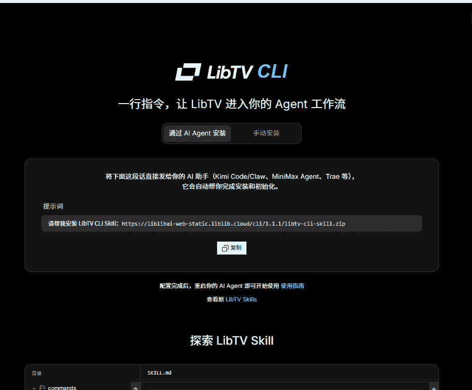

AI连出密密麻麻的线，看着复杂。

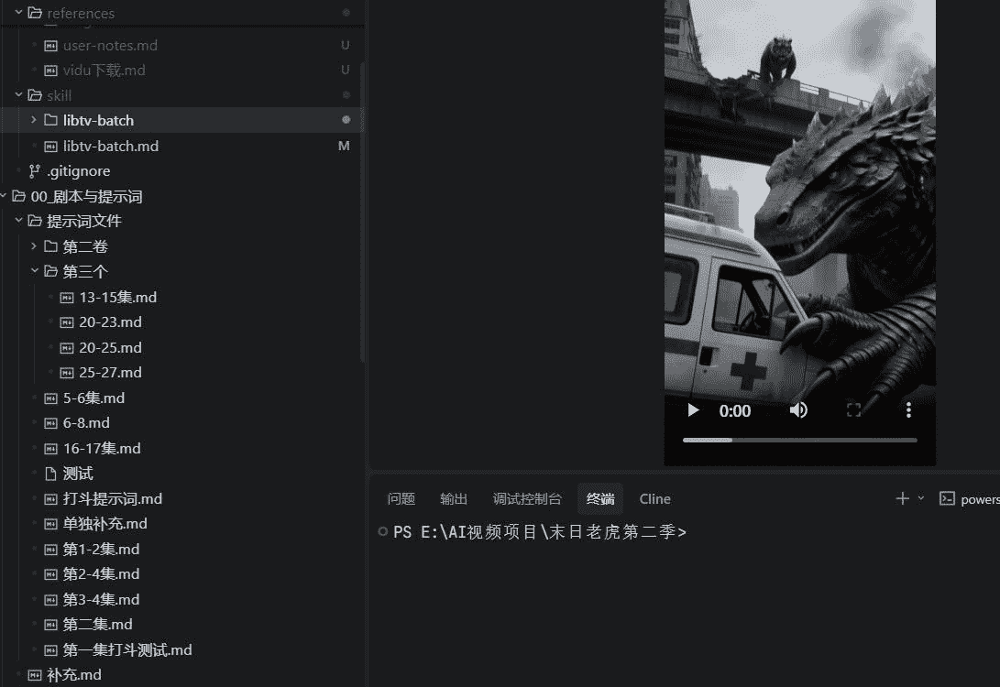
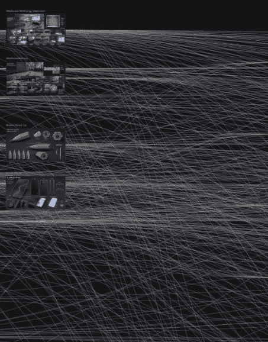

接下来就是CLI批量提交、批量生成。注意每完成一步就实际测一下，及早发现问题，全流程跑通后再做整体测试。

### Trae实操演示

操作演示用Trae，链接放这儿：https://www.trae.cn/work-fission/XUNR2VDRRTLY 每月有免费算力，接DeepSeek V4 Flash也行，现在很强。

第一步，让AI读Skill规范，告诉它我们要做什么，它会帮忙设计后续的Skill思路。

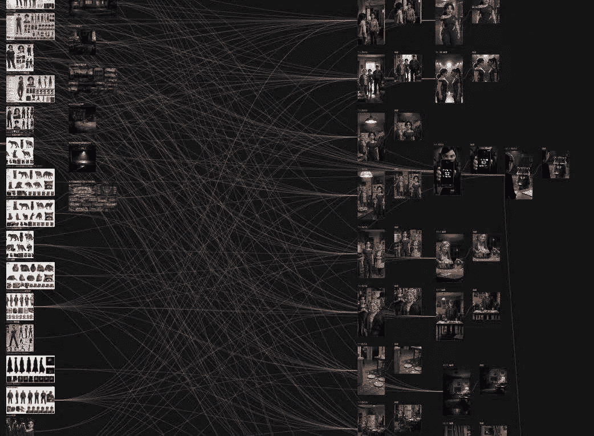

Plain Text：请完整地阅读Skill设计规范，接下来我们要设计一个LibTV批量上传提示词的Skill，LibTV CLI可以通过相关链接下载。LibTV CLI Skill：https://liblibai-web-static.liblib.cloud/cli/1.1.1/libtv-cli-skill.zip 整体了解完成需求后，设计下后续工作规范和思路。

第二步，准备测试内容。把测试提示词和参考图准备好，注意提示词里的资产名称要和文件夹里的图片名称对应——这样AI才知道该上传哪些图。

第三步，等AI消化完。如果AI来确认问题，按它推荐的走就行。

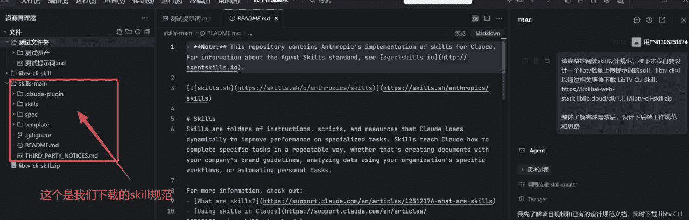
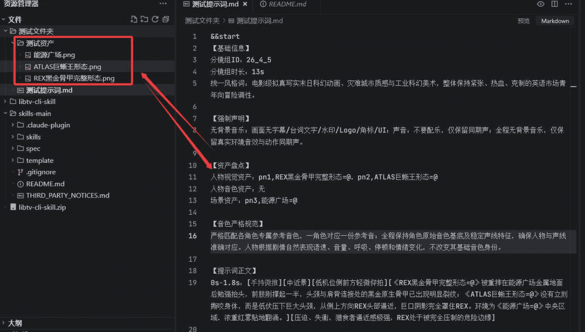
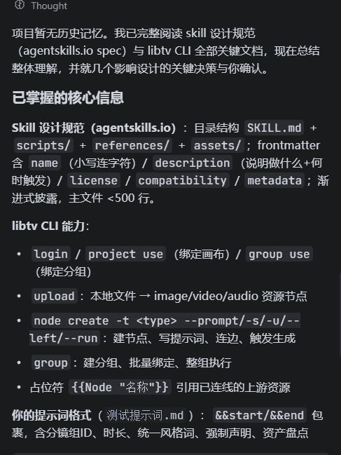
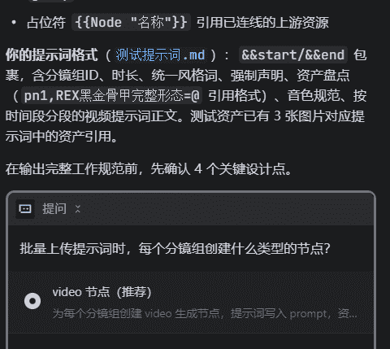

第四步，AI会给出完整方案。看不懂代码怎么办？默认相信AI就行——它读的资料比我们全得多。

第五步，默认执行。

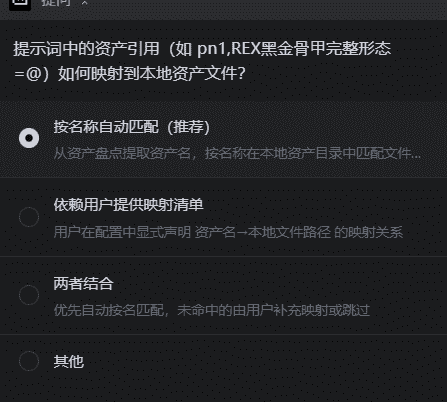
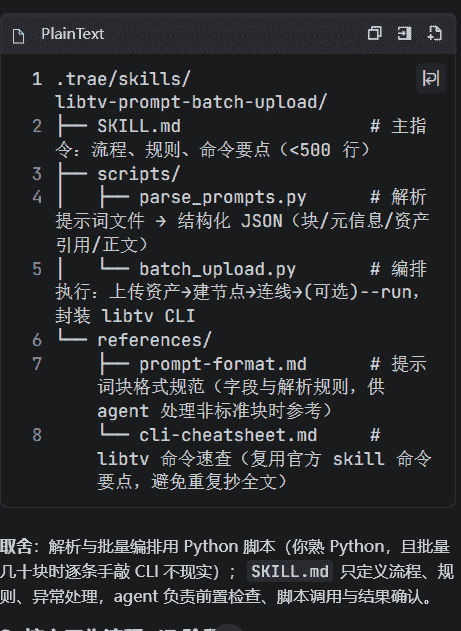
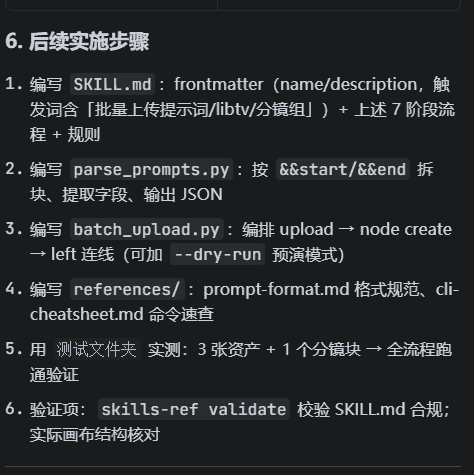

第六步，登录LibTV网页端看结果。AI已经把资产图都绑定好了。

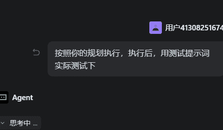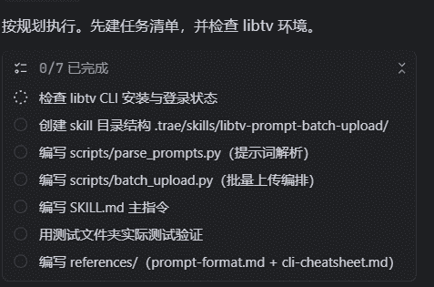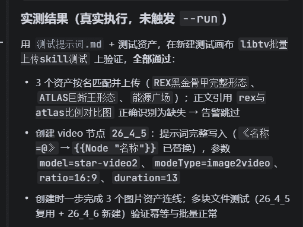

第七步，出错了怎么办？测试阶段AI自己就会发现问题。不满意就把需求描述清楚告诉它，很快就能解决。

一部剧从提交到生成，一上午的事。素材半天到一天就全出来。

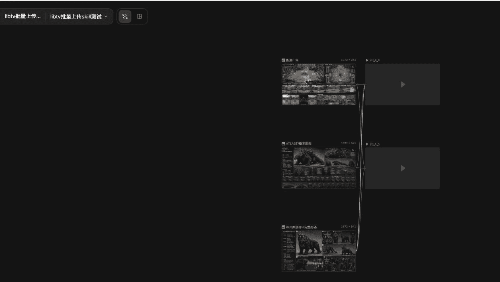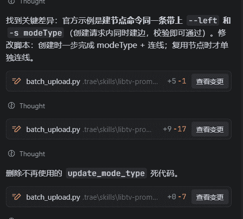

## 四、最终的产出节奏

剧本——2天，人工介入多，要做调研和AI辅助工作流。
资产——1天，靠人工审美。想全自动化也行，GPT Image 2一张几分钱。
素材——1天，AI写提示词、提交LibTV、批量下载、重命名。

剩下的就是剪辑了。

说句实在话，这套玩法的核心不是工具多先进，而是把个人经验拆成了可复用的流程。做到这一点，4000w播放的剧就不再是玄学，而是可以批量化生产的工业品。

漫剧出海这件事，现在入场还有窗口期。别太迷信S级大作——很多大工作室都跑不通，但流量往往不按头衔发牌。真正的变数在于AI视频生成工具，Seedance 2.5出来以后，实拍这条路基本可以画上句号了，直出4K意味着人人都能碰电影级画面。

我们自己的流程已经变成：剧本定稿，角色、场景、道具做成资产，再把剧本批量转化为提示词，AI通过API或CLI自动跑量。中间基本不需要人盯着，偶尔处理下bug就行。最后剪辑，这类内容主打走量，后期上不用抠细节，熟手十分钟就能剪出一条；整个项目剪完也就两三天。

说实话，Seedance 2.0刚上线那会儿，我们就已经有点找不到“创作”的手感了。除了个别创意项目，其余都是流水线。到了2.5，一次能上传50个资产，这工作量根本不是一个人手工能应付的。电商那边逻辑也是，拼的无非是积分消耗和铺量速度。所以AI工作流是躲不掉的方向，把资产定义好，剩下全交给模型。

但想出海冲一波，有四个雷区要避开：

人脸别带IP痕迹。海外版权诉讼不是闹着玩的，AI生成的脸别蹭任何影视或动漫形象。

音乐别用有版权的原唱，CapCut里有大量无版权配乐，直接用就行。

血腥尺度收住，露肉见血的伤口画面不要出现。

儿童题材尤其敏感，海外对儿童保护重拳出击，任何跟儿童伤害沾边的内容都不能碰。

避开这些，审核倒还算宽松。

最后想说，现在是内容驱动的时代，接下来作品数量会爆炸性增长，趁着红利期，抓紧沉淀自己的IP和专属技能，这才是别人拿不走的东西。

我是老朱，依然真诚分享，一起互相成长。

到这里，也许你会觉得这份SOP已经看懂了。但根据我的观察，九成以上的人一实操，第一步就迈不出去。工具和教程从来不是真正的门槛，门槛是“马上就做”和“圈层信息差”。

想看全网最新的变现玩法，还能和一群说干就干的极客并肩下场拿结果？欢迎到我的核心私域【懒人专属群】坐坐。这里只聊商业闭环拆解、AI效率压榨，不做没意义的寒暄。社群内已积累1000+跑通的套利实战局。

圈子完整数字资产和上车门槛：https://lazyso.com/insider/

如果你认可价值，也准备好干活，就扫码加微信（lazyhelper1），备注【实操上车】。不闲聊。