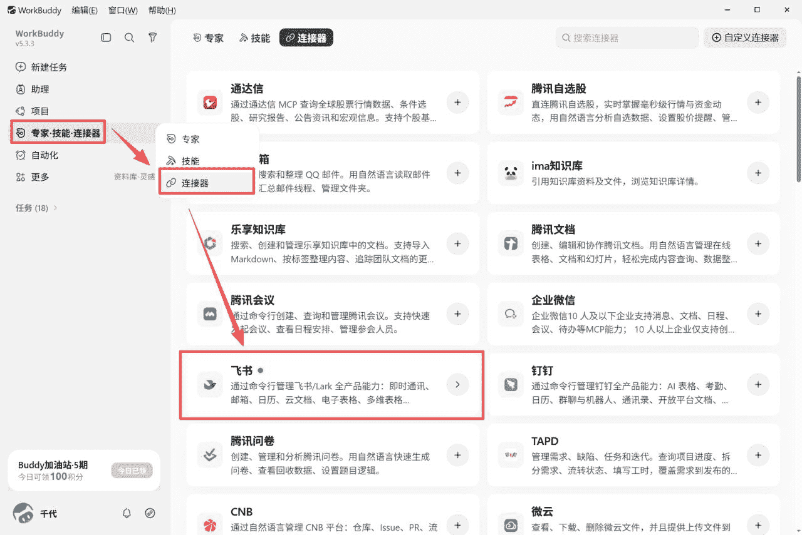
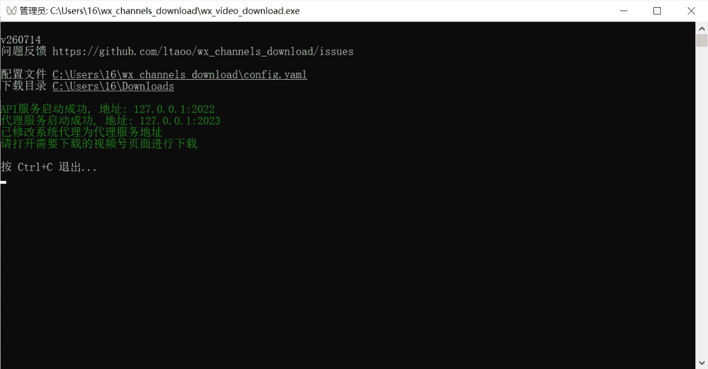
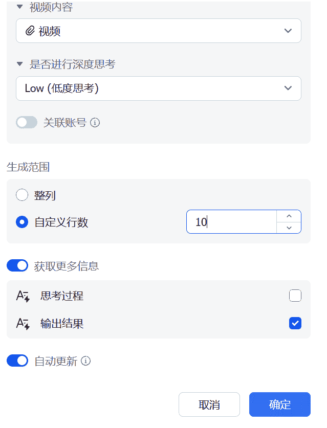
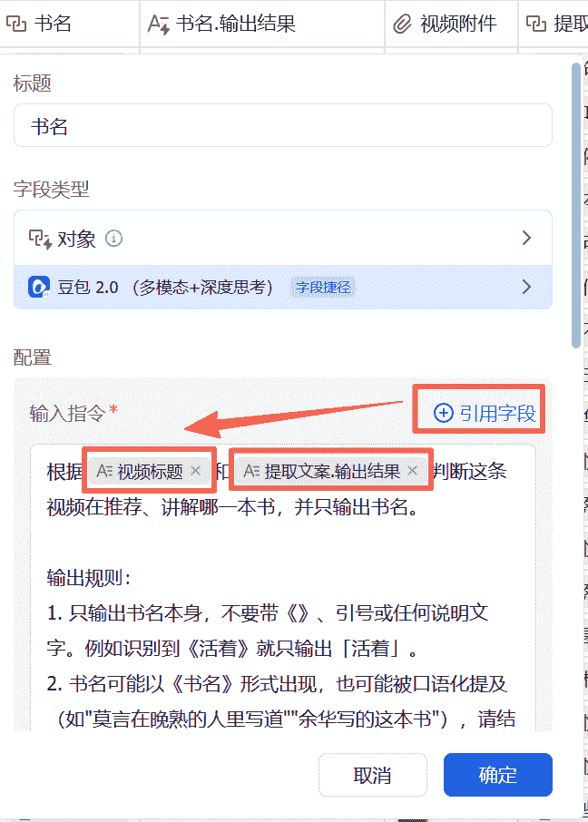
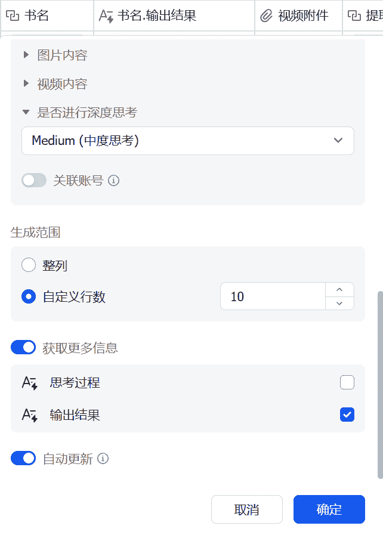
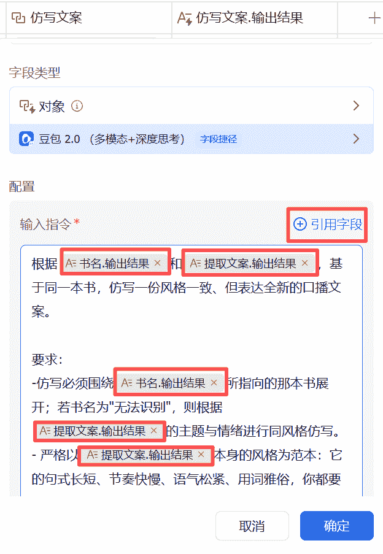
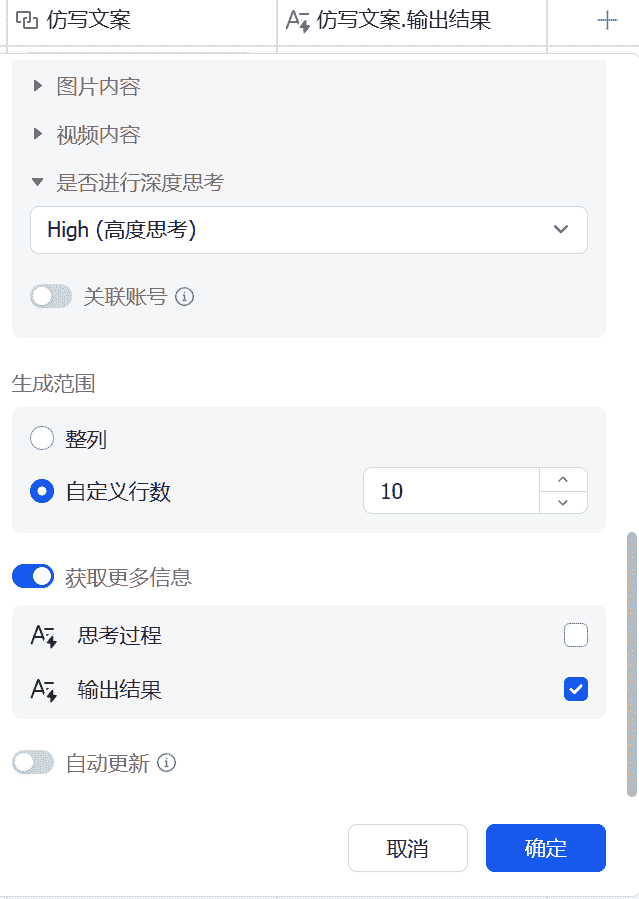
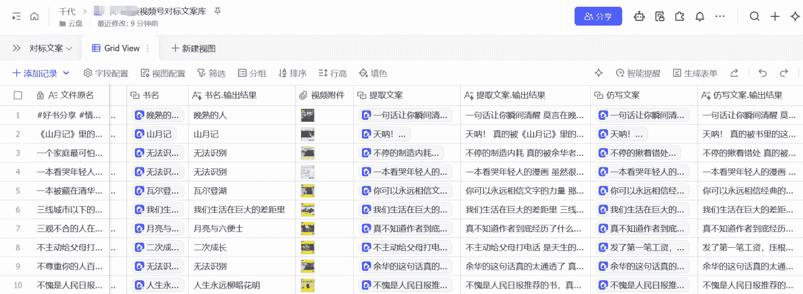
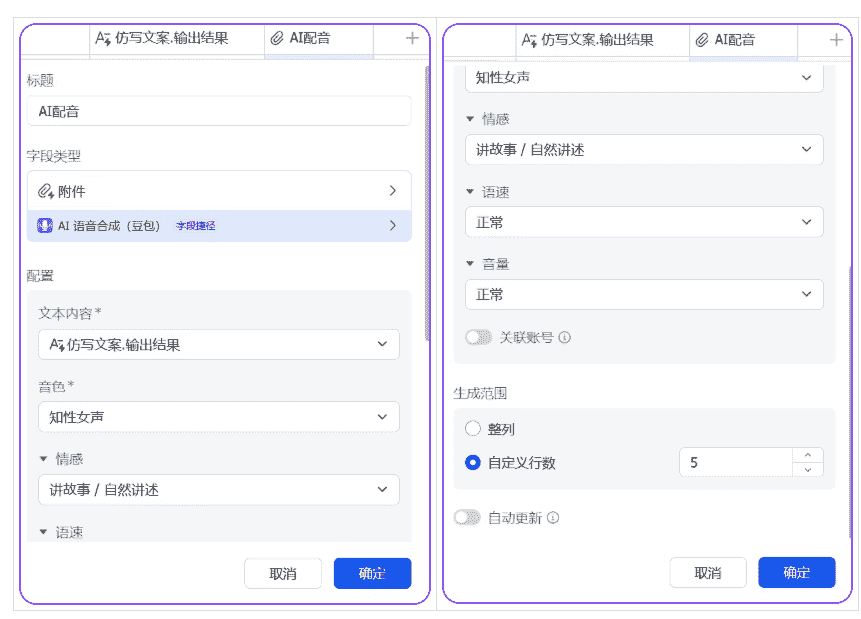
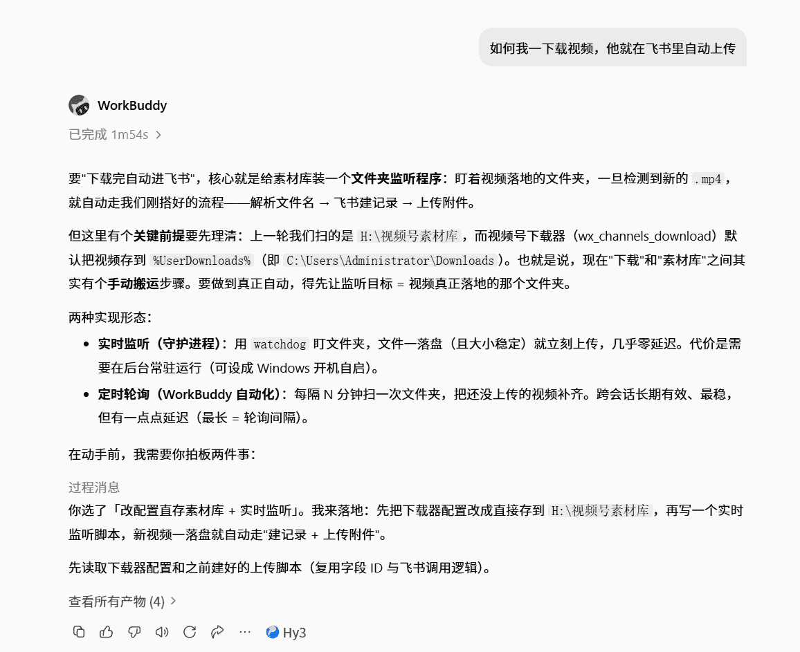

# 一条视频跑出20w播放，我用Codex+飞书把图书带货的文案采集变成自动流水线
作者：龙哥

260807 副业SC 精华

我是龙哥。

最近给自己搭了一条自动产线，专门用来做视频号图书带货的文案采集与重写。整套流程照着走一遍，20分钟左右就能复刻出来。

用上这套东西之后，我的视频号前天刚出了一条观看量超过20w的视频，账号也真正立住了。

把这套方案发到群里那天，晚上就有群友整条跑通，一口气抓了近50个视频的口播内容。

速度比我预想中快太多。

要知道，上星期为了解决同样的问题，我在扣子上耗了一整天搭流程。

功能是实现了，但搭建过程实在太伤人，于是我去问Codex：有没有轻量得多的办法？

最后Codex帮我把这套方案落地了。

这篇文章会完整讲清楚搭建逻辑、实操步骤和所有提示词。

同样在做视频号图书带货的朋友，往下照做就行。

---

图书带货快进方案：Codex+飞书批量抓100+条视频号口播稿，仿写配音一条龙

大家好，我是千代。

这次AI视频带货航海，我报的是图书带货方向。

做图书带货，要做的第一件事，就是去找同行的视频号，把他们口播内容拆下来研究，然后进行仿写。

我用Codex＋飞书这对组合，实现了100多条视频号口播稿的批量抓取，仿写和配音统统自动完成。

今天把整套系统的搭建思路、操作过程和提示词一次性全部公开，分享给航海里同样做图书带货的你。

这篇文章包含五个部分：

- 01 图书带货项目为什么需要这样一套系统
- 02 视频号为什么需要单独设计一套流程
- 03 整套系统里各个模块如何分工
- 04 照着做就能学会的逐步拆解
- 05 几个可以继续优化的方向

## 01 图书带货项目为什么需要这样一套系统

一个新号的起步，通常从找对标账号开始。

找到对标之后，要研究对方的选题习惯、文案写法、剪辑方式。一本书为什么能卖爆，答案大多藏在这几块里。

这里面分量最重的是文案。

同一本书，有人从原生家庭角度切入，有人主打女性成长，也有人死磕职场焦虑。

书还是同一本书，角度换了，视频跑出来的数据可能天差地别。

我平时研究一个对标账号，至少会翻出十几条视频反复看。

只有几条的时候，手工慢慢拆还扛得住；一旦多到几十条，光把口播文字整理出来就够累的。

这套系统就是来干掉这种繁琐劳动的。

## 02 视频号为什么需要单独设计一套流程

抖音那边，语音转文字的工具已经多到数不过来。

但视频号有一大批图书账号根本没有对应的抖音号，特别是图书带货领域。

这意味着所有依赖抖音链接的提取方法在这里都会失效。

我采用的思路是：先把视频下载到本地，再从本地素材中抽取口播文字。

中间我评估过好几条路径。

扣子平台可以胜任批量处理，但整个搭建过程复杂到让人头大。

后来跟群友讨论，发现飞书自带的AI字段能力刚好派得上用场。

于是就有了眼下这套方案。

## 03 整套系统里各个模块如何分工

选定飞书后，整套装置的分工变得很明朗。

Codex或者Workbuddy负责建表和整理信息。

（我更常用Workbuddy，因为最近它家的Hy3模型在限免；就算不限免，每天签到送的额度也够用。）

飞书负责存放视频、从视频中抽取字幕、生成仿写稿。

我负责上传视频、一次性配置好AI字段（只要配一次就行），然后检查最终产出。

操作链路如下：

Plain Text 1. 本地工具批量下载视频
2. Codex/Workbuddy 读取标题与Tag
3. 数据写入飞书多维表格
4. 视频附件上传到对应记录
5. 用AI字段抽取字幕原文
6. 用AI字段一键仿写

跑完全程之后，每个视频都会在表格里变成一条这样的完整记录：

Plain Text 文件原名｜标题｜Tag｜视频附件｜提取文案｜仿写文案｜配音

## 04 照着做就能学会的逐步拆解

找一个你想研究透的对标视频号，照着几步来操作就行，遇到问题欢迎留言问。

### 1. 先把Agent和飞书接通

用Codex还是Workbuddy都行，看你顺手。核心目标就一个：让Agent连上飞书。

#### 1.1 如果你用Codex

把下面这段提示词扔给Agent就好：

Plain Text 安装飞书CLI：

#### 1.2 如果你用Workbuddy

打开Workbuddy，点左上角的连接器按钮，找到飞书，按它的指引完成连接。图标亮起绿色小圆点，就算成功。

（要是还没有飞书账号，先花两分钟注册一个。）

然后点左上角“新建任务”，如果对话框下方能看到飞书图标，同样代表已经接通。

### 2. 安装视频号下载工具

接着需要一个能把视频号视频拉到本地的工具，名字是wx_channels_download。

把以下提示词发给Workbuddy或Codex，让它帮你装：

（下面的提示词，Workbuddy和Codex都能用。）

Plain Text 安装wx_channels_download：

https://github.com/ltaoo/wx_channels_download

搞定后打开工具，界面长这样。

然后在PC端打开对标的视频号主页，会看到页面多了一个按钮。

点一下，博主的所有视频就会被批量下载下来。

我上次一点，自动落了180多个视频在本地。

要是没想下载这么多，就挑几条数据好的视频点进去，再用右下角的按钮下载单独一条。

下载完成后，点右上角的按钮，再点文件夹，就能看到所有视频文件。

这个阶段我会把所有视频收拢进一个文件夹，方便后续操作。

然后把下面这段提示词里的“【填写视频存放路径】”换成真实路径，发给Workbuddy：

Plain Text 检查【填写视频存放路径】文件夹里有没有下载器漏掉扩展名的视频文件（无扩展名的裸标题文件）；通过读取文件头的ftyp标识确认是MP4后，批量补上.mp4后缀；全程不得删除或修改任何原始文件。

这一步是为了给视频补全扩展名，防止文件无法打开的尴尬。

### 3. 搭建飞书多维表格

先找到视频所在目录，然后复制下面这段提示词给Codex/Workbuddy。

字段可以按你的需求增删，比如某些博主的视频没有标题、没有Tag，那对应的字段就不用提。

Plain Text 我需要搭一套视频号口播文案的批量提取与仿写系统。

本地视频所在目录：【填写本地文件夹路径】

请先连接飞书，再按顺序执行以下事项：

1. 扫描“本地视频所在目录”里所有视频文件，告诉我总共发现了多少个视频，让我先确认一遍。

2. 创建一张飞书多维表格，表格命名为“【填写对标视频号名字】视频号对标文案库”。

3. 在表格中建立这些列：文件原名、视频标题、Tag、书名、视频附件、提取文案、仿写文案、配音。

4. 逐个读取视频文件名，从中识别出标题和Tag。

5. 先为前3个视频建立记录，只填文件原名、视频标题、Tag三列，并把视频上传到“视频附件”列，其他列不要写入。

6. 把建好的前3条记录发给我确认。

7. 等我确认后，再为文件夹里的其他所有视频批量建立记录、填写字段、上传附件。

8. 保留所有本地文件，不做任何删改。

9. 全部完成后提醒我去检查。

第5步完成后，先点开AI发来的飞书链接，核对数据对不对。

关键要看两点：一是标题和Tag是否被正确分开，二是视频是否成功挂到附件列。书名、提取文案、仿写文案这些列，要等后面配好字段后才会自动出结果，不用急。

这里有两个提示：博主视频标题过长时，本地文件名会被截断，AI就没法识别Tag；博主本来就不写标题或不打Tag，AI同样无能为力。

前三行没问题了，再让它继续处理剩余视频。

### 4. 把“提取文案”列配出来

视频全部进表以后，开始配置AI列。

双击“提取文案”列头，按下面的方式来：

字段类型：选择“探索字段捷径”→“豆包2.0”。

指令部分填这段：

Plain Text 把视频里出现的字幕内容完整逐字提取出来，不做任何概括、删减，也不要打时间戳。

配置完成后的页面如下：

“自定义行数”不建议填太大，按自己的处理能力来。

点确认后会自动生成，效果见下图。

我抽查了几条，口播内容识别得很准确，断句也非常自然。

注意：如果这一步跑不出来，单元格出现红点，错误代码800004789，代表豆包的免费额度已用完。

### 5. 把“书名”列配出来

双击“书名”列头，同样选择“探索字段捷径”→“豆包2.0”。

指令填这段：

Plain Text 根据【视频标题】和【提取文案】，判断这条视频推荐或讲解了什么书，并只输出书名。

输出要求如下：

1. 只输出书名本身，不加《》、引号或其他说明。例如识别到《活着》，就输出：活着。

2. 书名可能以《书名》形式出现，也可能在口语中被提及（示例：“莫言在《晚熟的人》里写过”“余华写的这本书”），请结合上下文判断出准确书名。

3. 如果视频没有指向具体书籍，也许书名只出现在封面上，那么输出：无法识别。

4. 一切判断严格基于现有信息，禁止猜测、禁止编造没出现过的书。

配置好的页面长这样，注意截图中圈出来的位置需要设置引用字段。

产出结果见下：

有的视频只在封面露书名，标题和口播稿里都没提到，AI便会标记成“无法识别”。

另外，AI对书名的判断也不是百分之百准。比如第10行那个视频，书名实际上是《亲爱的朋友，人生永远柳暗花明》，但因为前半截太口语化，被AI直接忽略了。这类地方需要我们事后简单复查一遍。

### 6. 把“仿写文案”列配出来

配好这一列后，就能一键批量出仿写稿，再也不用开一堆窗口一个个找AI对话了。

双击“仿写文案”列头，按下面的参数配置：

字段类型：选择“探索字段捷径”→“豆包2.0”。

指令填这段：

Plain Text 以【书名】和【提取文案】为输入，基于同一本书写一篇风格一致、但表达全新的口播稿，确保不会被识别为抄袭。

要求：

- 仿写内容必须围绕【书名】对应的那本书；如果【书名】是“无法识别”，就参考【提取文案】的主题和情绪，做同风格仿写。

- 严格以【提取文案】的风格为标杆：句式长短、节奏快慢、语气松紧、用词雅俗都要贴近，不要自带固定腔调。原稿短句就跟着短句，原稿唠家常就唠家常，原稿煽情就跟着煽情。

- 说人话。禁止堆砌形容词，禁止乱造比喻，禁止套路化感慨。类似“顺开了”“拧了好久”“戳得发闷”“缓两秒”“撞过一回墙才知道疼”这种假文艺腔一律不用（这里只是举例，所有不像真人自然说出口的修饰都不行）。

- 不写原稿里没有的场景细节，不硬加开头钩子，结尾也不硬升华。开头直接进正题，像原稿一样第一句就抛观点或引出书。

- 文字的高级感只能来自“自然顺滑”，不来自“华丽辞藻”。

- 仿写不是洗稿搬运，每个句子都必须重新原创。

- 字数要和原文基本持平。

页面配置好是这个样子：

同样注意，引用字段要在这里手动选对。

最终表格长这样：

我随手抽了一条做对比，左栏是原稿，右栏是仿写。

你们感觉怎么样？

### 7. 把“AI配音”列配出来

配音这块可以选择多种语音模型，我这里用的依然是豆包。

双击“AI配音”列头，按下面操作：

字段类型：选择“探索字段捷径”→“AI语音合成”。

豆包的参数设置如下，仅供参考，大家按自己偏好改就行。

点击生成，马上就能听到效果：

## 05 几个可以继续优化的方向

u1s1，这套系统跑起来是真的很舒服。

几十条视频的文案抽取、仿写、配音，以前起码要折腾几个小时，现在一键全出。

因为受限于豆包模型的能力，仿写结果还有不少优化空间。不过我觉得影响不大。

先花半小时把流程跑通，再根据真实使用体验慢慢迭代，远好过一开始就憋大招。我自己想到两个优化方向：

1. 不用“仿写文案”这一列的AI字段，直接安排Codex读取表格来做仿写，产出质量很可能明显更高。

2. 再加一个AI列，直接引用“仿写文案”生成视频号封面图。

大家有更好的脑洞也欢迎冒泡。

本来这篇写到这里就该收尾了，今天恰好收到群友的补充：

他让AI搭了一个自动监听文件夹的小东西，只要视频一下载进来，整套流程就会自动被激活，AI马上开始配合做仿写。各位也可以让你们的AI试试这个方法，大致的思路贴在这里：

## 写在最后

系统搭到这一步，这张表格其实已经悄悄变成了一条内容生产线，AI提效也真正从口号落到了实处。

我会继续跟着航海从0开始运营一个图书带货视频号，把全过程逐步晒出来，感兴趣的可以去👸号【千代今天AI了吗】围观。

我是千代，下一篇见。

————分割线————

你也许读完这套SOP后，觉得自己已经把流程吃透了。但现实中90%的人，第一步就会被卡住。

工具和教程从来不是最牢的护城河，真正的护城河是“立即动手”和“你身边的圈层”。

我们不整虚的，只拆商业闭环、只榨AI效率。社区里已经沉淀了1000+跑通的套利实战案例。

➡ 圈子全部资产清单和加入门槛，看这里：

https://lazyso.com/insider/

注明【实操上车】，闲聊不回。

