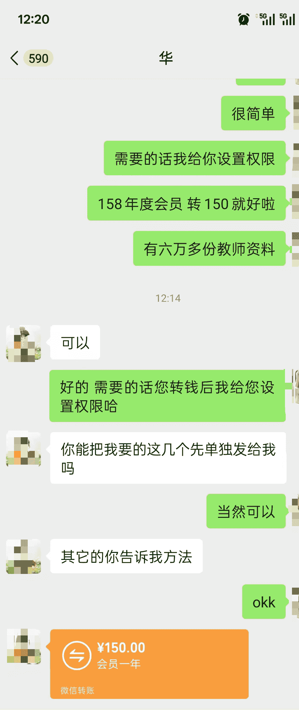
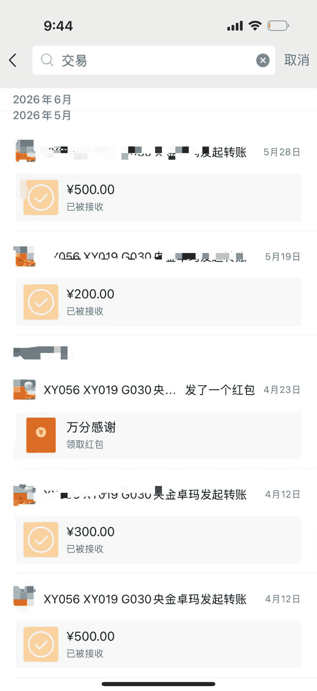
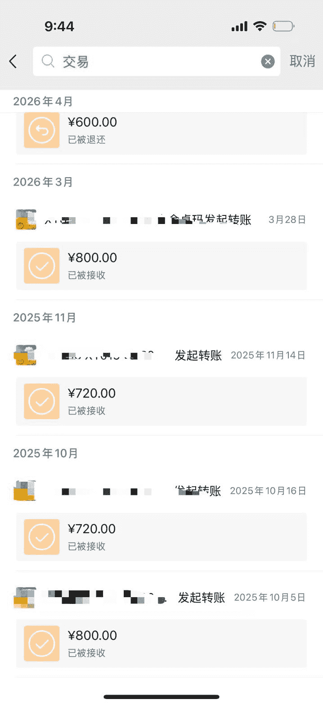
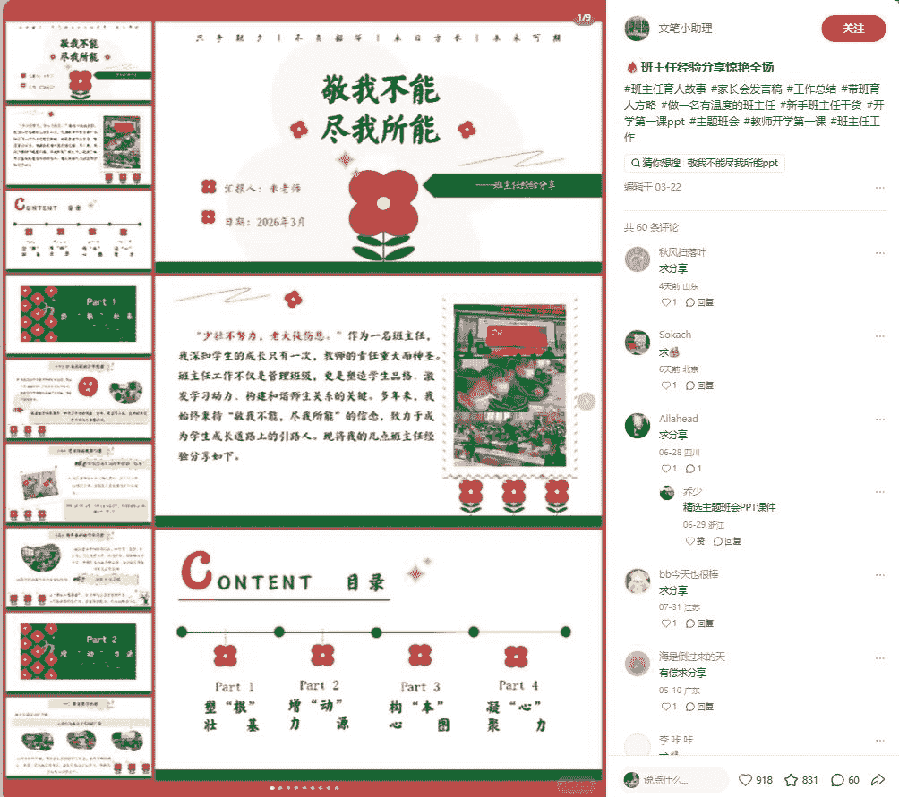
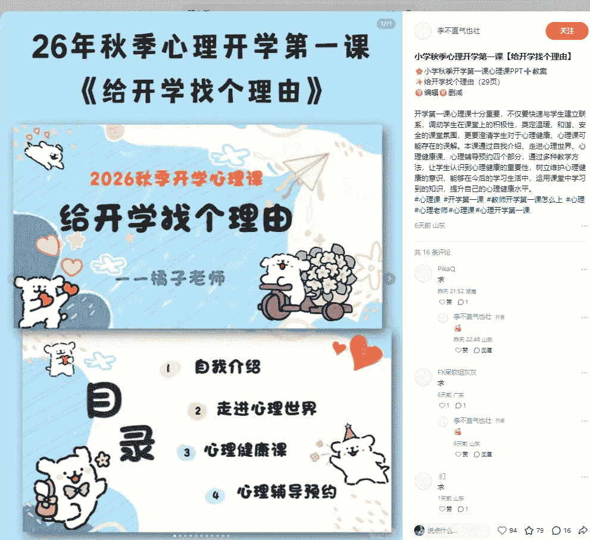
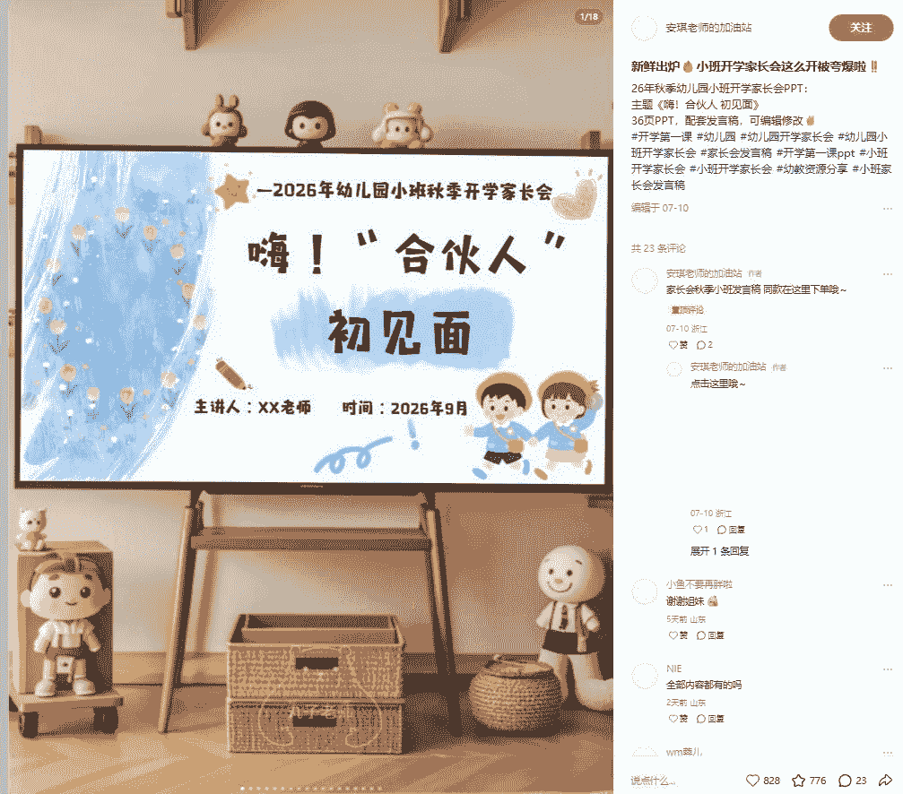

# 开学第一课单个**PPT**变现上万，开学季如何利用**AI**赋能教师（教务）资料

备课焦虑如何变现：AI重新激活教师虚拟教辅市场

八月未央，搜索框已经替老师们先躁起来了。数百万名中小学教师正在寻找一样东西：拿来即用、不用熬夜打磨的课件。这背后是一桩被AI重新激活、又被普通人反复验证过的生意。

有位朋友做教师辅助资源刚满两年，最拿手的一款“新学期首讲”幻灯片，定价9.9元，去年靠一条商品链接就有过万入账；另一个专门处理违纪反思的小工具，推出不到七天就收款两万；还有同行只是死磕“班规解读”一个主题，合计卖出六位数。这些货都没有黑科技，用AI生成，可改可编，拿回去把校名一换就能登上讲台。

买家的心理是什么？大家掏钱买的不是课件，而是“明天要站讲台、今天还毫无头绪”的解药。一线老师的日常几乎是连轴转：白天授课、处理班务、应对检查、回复家长，晚上还要改作业、写教案。新学期的头几天更是兵荒马乱，新学生、新组合、新任务，什么都得从零开始。这时候出现一套9块9的幻灯片，打开就能用，换个姓名就能进教室，基本是秒下单。

这桩生意的底层是情绪经济：谁省下老师的熬夜时间，谁就能赚到他们的钱。

产品大致三类。第一类是人手一份的基础款，比如新学期的头一堂课、家校沟通材料、1530安全记录、德育计划、班务小工具，特点就是搜索量大、目标精准、点击转化快。第二类是学段专属款，解决特定年级的特定难题，比如幼升小的适应训练、初中新生的破冰、高一的选科迷惑。第三类是学科细分款，按“年级×学科”组合，比如三年级语文古诗、初二几何、高中英语读后续写，还有音体美等副科，竞争最小但每个学校都需要。

过去把免费资源打包转卖的老路已经走到尽头，单价压到三五块，利润薄如纸。真正的转折发生在2025年第三季度前后，一批玩家开始用大模型搞原创。AI能写教案、能拆解竞品、能设计版面、能生成可修改的幻灯片。从前做一件像样的课件要耗上好几天，如今让代码型AI帮手代劳，一天能出5到10件。搬运的路越走越窄，原创的隧道刚开始亮起光。

给大家吃一颗定心丸，几个数字都来自我亲身经历：一份面向刚升入高中的孩子的学期首讲，只靠一条商品链接就进账五位数；一个反思类管理小工具，上线没几天就收了小两万；同行靠着一个“班规解读”的原创品，累计卖了六位数；萌宠主题的积分兑换工具每到返校季必爆；国庆主题的师生合影模板每年十月都卖得动；在种草平台上随便搜“学期首讲”，几千单的爆款满屏都是。我自己读研期间入行，毕业那年用这笔收入买了第一辆车。身边和我一起做的人，月入超过一万的比比皆是。这个市场，普通人确实能落袋为安。

返校季不是一天，而是一条从8月中旬延伸到10月上旬的完整热销周期。把它掰开看，有四波行情。头一段，8月中下旬新生提前报到，初一、高一、小学新入学的孩子都有军训或入学适应，搜得最多的是破冰游戏、自我介绍、新生教育、军训清单。第二段，8月底到9月初全校回归，每位带班老师都要准备“新学期的头一堂课”，这是全年流量最猛的节点，连带家校沟通材料、安全记录的话题都热起来。第三段，9月中旬教学走向平稳，如何排座位、规矩怎么定、班委如何产生、积分体系怎么搭建，这类班务管理的诉求集中爆发，各科同步教案也开动。第四段，国庆前后是班级文创档期，合影模板、节日手工、主题板报、文化墙，热度一路燃烧到元旦。

学生群体的痛点也有层次。高一的孩子痛点最密集：彼此不认识，需要破冰；54个人坐哪个位置，需要排座；班规怎么定，班委如何产生，军训要准备什么，新高考选科有哪些门道。这些问题单个拎出来，都能做成可卖的商品。刚进初中的孩子情况类似，但多出“从小学升入初中的过渡”这样一个独有题眼。小学新生则聚焦在行为养成上：如何安静坐住，如何排队打饭，如何听指令，如何做操。这个学段的首图适合用“手写体排版”，因为低龄段学生的家长和老师都偏爱这种手作感。

热点IP是每年暑期的固定红利。前年是唐诗题材的动画，去年是哪吒，今年换成了八仙。老师在看，学生也在刷。如果把电影里的热血台词放进幻灯片第一页，课堂气氛立刻不一样。好IP自带共鸣，能让学生愿意谈、老师接得住。

今年值得用的IP物料不少：八仙系列里关于坚守本心、不慕强、直面人生难题的几个母题，随便一个都够撑起整堂课，甚至能延伸出国风美术鉴赏；数学家王虹和邓玉凭重要成果出圈，适合放进数学课的励志环节，破除关于女生理科能力的刻板印象；《群星闪耀时》是航天主旋律题材，物理、思政、地理都能嫁接；《给阿嬷的情书》以及林觉民那封诀别家书，这学期语文课正好讲到，已有圈友验证过爆款方向；至于人工智能的新闻话题，十七岁高中生参与大模型研发、AI时代为什么还要读书，天然适合做成励志班会。

把IP转化为商品的流程只有四步：先挑出三五个和教育场景贴合的观点；再设计成开放讨论题，比如“你曾因为坚持自我被误会过吗”；然后交给GPT输出一份完整的教学设计；最后让代码AI做幻灯片，用电影海报当首页，经典台词做客页，尾页收一句“新学期别弄丢自己”。去年有人把哪吒元素揉进第一堂课，单人单品赚了数万元。IP的流量窗口很短，热度一过搜索就断崖，所以看到热点要立刻动手，顶多连夜赶工，次日立刻上线；等一周再动手，汤都喝不上。

在种草平台上，首图就是生死线。用户刷到笔记，先看首图，再决定点不点；只有点进来，才可能下单。所以首图要有两个东西同时在线：一是用户真正会搜的字眼，二是让人想点开的好奇感。字眼按三类来选：身份+场景，例如“刚入学的孩子”“新接班的语文老师”；品类词，例如“新学期的头一堂课”“家校沟通材料”；痛点词，例如“如何快速破冰”“选拔班委的头疼事”。好奇感则靠情绪钩子来实现。同样是“新生破冰活动”，可以写成“救命！班主任把孩子全画成了表情包”，想点的人自然变多。

工具上不用纠结，效率优先：想要自由排版，就用幻灯片软件做底稿；想要模板多、上手快，用在线设计平台；手机端有现成的小程序；批量出图则靠AI自动生成。设计上记住几条：背景不要堆色块；标题要比正文大两号；最想突出的那个词用红色或底纹强调；一张图只保留一个视觉主角；段落间距拉开；字体控制在三种以内。另外切记，首图承诺什么，详情页就卖什么。首图写的是一场游戏，详情页就不要挂一堂普通班会，前后对不上，跳单率会高得吓人。

最后聊落地工具。有一类通过日常对话就能指挥的程序，即便你不会编程，也能用大白话让它干活。在教辅赛道上，它可以用来做能随意修改的课件、自动排座表、积分与奖惩小工具、合影头像生成器、成绩分析表，甚至自动发布笔记。真正的用法说白了：你不需要会写代码，只需要有想法。把想法描述清楚，程序帮你落地，一夜之间就能跑通。

实操一，做全班福工具。

一次我在社交平台看到“全班福”“幼教老师必收”“孩子照片抠图”这些词条，发现大量老师还在手动剪照片、贴相框，又慢又累；有人卖电子版，几十块一单，评论里全是“怎么做到的”。于是我截图给代码AI，说：

“我想做一个类似的工具：输入孩子的照片，自动抠图，再排列成一张全体合影。但是我不知道从何入手。”

AI先给我分析：这东西本质上是把人像抠出来、排进模板、再套上卡通外框的组合应用。接着给了三个落地方案：A用Canva人工拼，门槛低但没法批量；B做一个网页版，传照片自动抠图、拖拽排版，性价比最高；C做成小程序，功能天花板高但开发周期长。我选了B，它立刻动工。

第一版出来，人物头像只有半截。我说：“完整显示每个学生的全貌。”它自己改了。第二版好多了。我又提：“图片再大些，司机位留给班主任。”它继续优化。第三版已经具备商用条件：题目可换、班名可换、颜色可调、交通工具可在货车和巴士之间切换。从提出想法到能用，前后不到三十分钟。后续还能升级：保留原图背景、把每个孩子的名字逐一标上、换成国庆和新年主题皮肤。

实操二，用AI生产能改的课件。

先安装一个“幻灯片大师”类的Skill，之后下清晰指令。比如：“给刚入学的小朋友做一份入学班会，包含开场致辞、规则讲解、班级守则说明、班委选拔、破冰环节与互动游戏，总计14页。”指令越细，成品越能打；随口说一句“给我弄个班会课件”，大概率得到一堆废稿。Skill会先列出内容规划让我审。这时候要逐页检查：哪页少了内容，哪页顺序不对。确认无误，再让它生成可编辑版本。整套流程熟了，一天做五到十套新课件不难。而这每一套课件，都是深夜里救急的良药，也是你的现金流来源。

八月的检索量已经开闸。这一次赶上浪头的，不会是手速最快的人，而是看得懂焦虑、用得好AI的人。

很多人做课件，习惯开一个对话框就从头生成到尾。结果往往是前几页还行，越到后面风格越飘。真正跑得通的路子，是先设计一套验收节奏，让每一步都有人盯着。这套方法我用下来，效率比原来高了好几倍。

先对齐需求。你要把课件主题、适用对象、内容清单一次说清，再补一句“有没有漏环节”，它会主动把缺的项列出来。有什么意见直接甩给它改，不用绕弯。

然后让它只产出一页样张。你要确认的是配色对不对、观感对不对。不对，就重来。

样张过了以后，再让它按区段出活，比如 1 到 6 页、7 到 10 页、11 到 14 页。每一批拿到手先过一眼，哪里不对当场打断。

最后拿到的多数是图片文件或 PDF。要变成能改字的 PPT，可以用 WPS 的 PPT 转换，或者独立的转换工具。转完以后再改文字、换年份、补上署名。

### 4.4 几个跑出结果的 Codex 课件样本

下面这些是用 Codex 真正做过、也真正卖出去过的案例。重点看需求怎么描述、结构怎么拆、以及事后怎么复盘。

高一开学第一课，这套卖了一万多。
我当时是这么要求的：做一份约 14 页的高一开学第一课。蓝白做主色，字体用微软雅黑，页面下方留出一条教师备注空间。
复盘下来，这套东西之所以能卖爆，是因为它把高一班主任开学头两周要做的事全包了。很多老师买完直接推荐给同年级的同事，一个人带来好几个人。

一年级立规矩开学第一课。
这次需求是：约 12 页，主题是课堂常规训练。结构从封面“我是小学生啦！”开始，往后依次是老师自我介绍、坐姿儿歌、举手发言的规则、排队歌、课间安全、午餐礼仪、整理书包的口诀、放学流程、奖励贴纸说明、家长联系卡、使用说明。风格要卡通可爱，粉蓝色系，字号放大，适合 6 到 7 岁的孩子看。
这套能成的关键，是把说教换成了儿歌。一年级的孩子理解不了“课堂纪律”，但能跟着念“小眼睛看老师，小耳朵认真听。小嘴巴不说话，小小手放桌上”。后来这段话直接被人搬去做封面文案，怎么用都好使。

新学期家长会课件。
开家长会是每个班主任每个学期的固定任务。做成通用版，改一个年级名就是一款新品，一套模板能吃下六个年级。复购率极高。

军训准备清单课件。
这个品要求约 10 页，包含军训时间安排、衣物药品防晒鞋垫等必备物品、禁止携带的东西、纪律要求、心理准备、家长告知书。军绿色调，整体氛围严肃但有温度。
这个方向的好处在于，准高一家长在 8 月上旬正好集中搜这类词，但做这个细分的人不多。大家都去抢“开学第一课”的大流量，反而没人看得上这块小蛋糕，竞争一下就小了很多。

体育开学第一课。
约 10 页。内容包括体育课的规矩、体能测试的准备、运动安全须知、这学期的教学计划。风格走运动活力路线，配运动场背景。
去年有学员专门盯体育老师这个群体，第一个月就稳定出货。逻辑很简单：体育老师同样需要开学第一课，可就是没人帮他们做。需求是真的，竞争是小的。

通用需求模板，总结成五句话：
先写清楚科目和年级；再把每一页的标题和要点列出来，越具体越好，不要只丢大纲；接着给出页数范围；然后说视觉方向，比如配色、字体、整体感觉；最后列特殊要求，像备注区、二维码位、可编辑性这些。
一句话：你喂给它的细节越密，它还回来的东西就越准。

### 4.5 Hermes Agent 的课件产线

Codex 单兵作战是一把好手。但你要是在一天之内整出三十份不同年级、不同科目的课件，一个个打开对话框去聊，效率根本不够。这种时候就得换 Agent 上场。

Hermes 是一个部署在你自己电脑上的 AI 助手，你可以把它当成一个 24 小时不用休息的数字打工人。跟 Codex 相比，它的核心优势在于能自动串起一整条流程。

我自己搭的产线是这样的：

先在 Obsidian 里把教材内容结构化。拿七年级历史上册举例，整本书按课时拆成独立笔记，课文原文和课后练习题都在里面。这套底稿做一次，后面反复用。

再设三个角色。
第一个叫拆品专员：丢一张📕截图进去，吐出来一份 STAR 报告，把选题、结构、定价、能不能复制全部分析清楚。
第二个叫教案专员：拿课文原文加课程标准，产出一份 40 分钟的教案，教学目标、重难点、教学过程（导入到新授到练习再到总结）、过渡语原文、板书设计全都齐。
第三个叫课件专员：按教案和星荧课件标准，借助 Codex 的接口生成可编辑的 PPTX，排版、配色、字体全自动。

然后把三段流水线接起来：教材原文的 md 文件进，教案专员出教案，课件专员出 PPTX，最后自动落进成品库。整本七上历史最多两天跑完。晚上放进去，第二天早上打开成品库文件夹，几十个课件已经码得整整齐齐。

最后人工收个尾，五分钟就够：快速翻一遍，确认教学逻辑是通的；更新年份、署名、联系方式；再加一页“给老师的使用说明”，写清楚怎么改、哪些能删、建议课上用多少时间。

但说句实话，这个 Agent 不是一次就能装好用的。
我当初搭 Hermes 用了整整三天，从服务器配置到环境部署再到接入 API，中间崩了好几次。环境刚调通，接口又报错；接口通了，几个 Agent 之间又互相不搭理。好不容易整条链路都能跑了，把任务丢进去，几分钟后出来一个结果——打开那一刻，差点没气笑。就这？三天时间，够我亲手做十份课件了，它给我产了个这？

那天晚上躺床上越想越气，又爬起来给一个已经跑出成绩的同行发消息。他说了一句话，直接把我点醒：
“刚搭好的 Agent，就是刚毕业的学生，一张白纸。你要耐心调教它。”

第二天我换了思路，不把它当工具，把它当新人来带。
第一轮，给示范。我会说：“这个好，以后照这个模板来。”
第二轮，纠错误。我会说：“不对，我要的是这种结构。”
一轮一轮反馈、一遍一遍校准标准、优化提示词。改了十几轮之后，终于到能看的程度了。美观、大气、能编辑、完全符合要求。

用 AI 这件事，本质上是带新人。它帮你省时间，同时也在消耗你的沟通成本。第一次不满意，就要反复解释、反复让它改，跟带新同事一样，不可能第一天就把核心业务全交给它。你得把自己的标准、审美、判断逻辑一点点喂进去。
但一旦调教到位，它就是一条全天候生产的流水线。你睡觉、看电影、过周末的时候，它一直在工作。

### 4.6 更多可以做的方向

思路打开了以后，Codex 能做的远不止课件。工具矩阵可以一直往外扩。但有一个提醒要放在前面：测试过程中，不要上传真实人物的肖像到云端平台。要么只在本地测，要么用无版权的替代图。

### 4.7 把固定动作沉淀下来

用久了你会发现，很多指令翻来覆去就那么几句。比如每次做封面都要交代“微软雅黑、背景干净、字要大、关键词标红”。与其每次重新解释，不如把这类固定动作收进可复用的模板。做不同的任务，就开不同的对话窗口，别在一个窗口里聊太多事。就算模型记忆越来越强，同一个窗口堆太多话题，输出质量照样会掉。
你最终要到达的状态是：只说一句“按老规矩做高一开学第一课”，它就知道你的标准、你的风格、你的结构。到那时，不是你在用 AI，是 AI 在用你的经验。

### 4.8 Codex 加 Canva，拼出真正能编辑的 PPT

前面说的 Codex 出图，拿到手是图片，没法直接改字。下面这套流程，能把“只可远观的图”变成“拿来就能改的 PPT”。

先把教材原文喂进去。电子教材不难淘：闲鱼、拼多多、👸号搜“几年级什么科目 百度网盘”基本都有免费资源。把 PDF 丢给 Codex，告诉它：“根据这份初一历史上册教材，生成第一课时的课件。先给我教学设计，再生成 PPT。”

接着，只让它出三页样本。别让它一口气生成全部。先让它出前 3 页给你看，重点检查风格、配色、信息密度合不合适。不满意就提：“这个太丑了，配色换成更简约的”“信息密度太低，每页至少三个知识点”。改到你觉得行，再继续。

样本过关后，再一批一批地出。让它接着出第 4 到 10 页、第 11 到 15 页……一批一批来，一批一批查。万一批次中间哪页风格跑偏，能及时发现。一次性全生成，中间歪了，后面真就全废了。

到最关键的一步了，用 Canva 把图片转成可编辑格式。在 Codex 里搜“Canva”装上插件。装好后，Codex 会把每一页图片传到 Canva，自动生成一个网页链接。你打开链接，在 Canva 里下载成 PPTX，里面的文字、图片、文本框全都可拆可改。

最后，手动把所有页面合成一件完整课件。这一步目前还离不开人工。把每一页下载好的 PPTX 一个个拖进同一个 PPT 文件，拼成完整课件。整条链路里这一步最费时间。不想自己干就找兼职，一份课件几块钱就有人接。

几个常见问题放在这里：
Canva 转换时中文偶尔变繁体，需要手动校对。
单页 PPT 可能到 8MB 那么大，整合完要压缩再交付，因为有些老师不会解压。
不想手动整合的话，可以用 WPS 的“输出 PDF 为 PPT”功能，文字能编辑但排版可能会有偏移；也可以用付费转换工具，大约 0.6 元一页，效果最稳。

这条链路完整跑通之后，用 4.7 的方法存成模板。以后你只需要说一句“做一份初一历史第二课课件”，它自己会把这五步全部走完。

# 第五章 私域引流：把每一单，变成一个人

### 5.1 为什么非做私域不可

📕店铺有一个绕不开的毛病：客户付款完就走，你完全不知道他是谁，也没办法再触达。而教辅资料这个品类，偏偏是买了还想买的典型。一个班主任手头缺的东西太多：开学第一课买了，家长会素材要不要？班会要不要？期末评语要不要？
只要第一单把人带进微信，后面所有生意都不用再赌搜索和推荐，朋友圈和私信就能直接完成。

### 5.2 三种引流姿势

第一种，钩子放在商品页和网盘里：“购买后添加微信 XXXX，免费赠送本学期配套主题班会课件一份。”

已经付过钱的人天然信任你，再加一个“免费送”的诱饵，通过率高得离谱。

第二种，课件里埋微信。每一份课件的最后一页，都做一张使用说明页，其中一行写：“更多教学资源，加微信 XXXX 获取。”

第三种，评论区做引导。有人评论“求课件”或“怎么买”，别在评论区丢链接，先私信他，私信里再给微信号。

### 5.3 开学季微信号怎么养

开学季的加粉量和收款量会比平时猛好几倍。微信对新号的异常行为盯得很紧，突然加一堆好友、突然收一大堆钱，很容易被风控限流。
提前的准备动作：
微信号至少备三四个。
平时带去便利店、早点摊扫码付钱，养使用痕迹。
WiFi 和 4G/5G 交替用，别吊在同一网络。
朋友圈保持正常更新，别搞得像个机器人账号。
收款拆开分批，别一天几十笔堆在一起。

### 5.4 私域怎么卖出高客单

加到微信以后，第一步不是卖，是养。
朋友圈里固定发这几类内容：客户好评截图、新品上架预览、学员出单案例、教育行业资讯。让客户看到一个持续在做事的人，而不是一个做一锤子买卖的贩子。信任积累够了，一个客户能产生的价值就不仅是几十块的事，几千上万都有可能。

开学季最好卖的几类高客单产品：

全学科全学期的课件打包。
班主任全年资料包。
会员制，包一年或包一个学期，新品全部免费。
定制代做，按具体需求做专属课件。
班级文创周边。

# 第六章 📕运营要点

### 6.1 账号矩阵怎么搭

别只守着一个📕号。至少四个号同时养：
一个主号，做普适性爆款，比如开学第一课、家长会，稳定出单；
两三个细分号，试不同学科、不同学段，看哪个方向跑得动。
账号之间别在同一个 WiFi 底下反复切，保持各自独立。

### 6.2 店铺开通

📕对虚拟资料类目的资质审核正在收紧。有电子资源类目的直接开；还没有的，可以在闲鱼找人代办，或者先用个人身份卖。但个人身份不走商品流，订单量会受限。所以趁早把电子资源类目开通，走商品流，一方面用户直接下单转化率高，另一方面订单量涨起来，店铺权重也跟着往上走。

### 6.3 发布节奏

开学季窗口是 8 月 10 日到 9 月 15 日：
每天每号至少发 1 到 3 条笔记。
上午一条、晚上一条，正好卡老师的碎片时间。
笔记类型轮着来：封面展示型、内容预览型、痛点共鸣型、问题求助型。
发完别不管，发布后两小时内把评论回完。活跃度高，系统给的流量才多。

### 6.4 关键词怎么埋

标题、正文、标签三块地方，全都要有用户搜的词。
比如标题：新高一班主任开学第一课PPT｜破冰游戏+班规班级公约
正文第一句：高一新生入学，班主任最头疼的就是破冰和立规矩……
标签：#开学第一课 #新高一班主任 #破冰游戏 #班级管理 #高中班主任

### 6.5 多平台差异和定价

每个平台的用户画像和消费习惯都不同，定价也要分开来定。

📕以图文为主，封面决定一切。笔记类型要轮换着发，商品笔记吃搜索成交，普通笔记吃推荐流量。两份笔记同时发，一个用来接精准搜索，一个用来碰流量运气。还要注意：同一个课件，用不同的拼图版式、不同的背景图、不同的实拍场景分别发，平台不会判重复。

抖音的推流逻辑改了，不像以前只看前半小时，现在观察周期拉长到一周甚至更久。抖音更喜欢真实场景的内容：有教室、有屏幕、有教学氛围的画面，停留率明显更高。做视频时可以用教室背景换图、真实场景实拍，再叠课件内容。图文也能发，但视频权重更大。

👸号和贴吧适合写长文，用来吸引高认知用户。可以把📕的爆款笔记改写成👸号文章，文末放付费链接或微信号。贴吧有一点要特别注意：不要在同一台设备上登录多个号引流，容易被连带封禁。

通用原则：多平台多账号分散流量，不要把销量堆在一个号上。销量太猛容易被同行盯上，搬运、压价、恶意投诉轮番上。打游击，把风险摊薄。

### 6.6 笔记拼图实操

做虚拟资料，八成时间不是花在做课件上，而是花在做笔记图上。一套顺手的拼图工具，能帮你省下一半功夫。
常用工具有：PPT 或 Keynote 自己拼，最灵活；美图秀秀，手机端方便；工具箱类软件，批量处理效率高；也可以让 Codex 帮你生成。

三种最实用的拼图形式：

一、预览拼图，专门展示课件内页。
选 3:4 比例，一行放三张图，18 张图能展示 54 页内容。背景选干净的纯色或教室场景图，导出发就行。

二、网格拼图，上下排图、中间放搜索词。
上面一排截图、下面一排截图，中间留白处放关键字。比如中间用大号加粗红字写“一上开学第一课”。两张图拼一篇笔记，36 页内容，防搬运效果好。你还可以给同一套课件配不同底色，绿色发一次、蓝色发一次、教室实拍背景再发一次，平台不判重复。

三、背景换图，做出真实使用场景。
这是我去年验证过的最强爆款拼图形式。核心做法：找一张有课桌、书本、电子屏的教室实景图，把课件封面 P 到电子屏幕上。用户看到的是“这个老师正在教室里用这套课件”的画面，停留率和点击率明显压过平面拼图。
背景图来源：自己实拍（教室或办公室干净桌面都行）、AI 生成的教室场景、或者📕保存的别人实拍图。教室实拍图建议二次处理后再用。

背景图可以反复用，不同课件搭同一张背景，平台不会判同质化。但如果同一个课件、同一张背景不断重复发，风险就来了。

拼图去重口诀：同一个课件，换拼法发、换背景发、换封面发、加实拍发。一套组合拳下来，一篇笔记变四篇，内容互不相同。

# 第七章 避坑

### 7.1 产品端

坑一：死磕完美，一份课件磨一周。
总觉得“我要做出一份最好的课件”，一页页调字体、调颜色、换图片。一周过去了，同行已经上架十款产品开始收钱了。
正确的顺序是：先上架，再优化。老师买课件看的是内容和结构，不是你选了哪款优雅的字体。让市场给你反馈，再照着反馈改。

坑二：一个产品想解决所有问题。
封面写十个功能，本质是没想清楚这东西到底卖什么。老师一看，需求不明确，也就没有下单的理由。
一个产品只解决一个具体问题。“高一破冰游戏 PPT”就专注破冰，“座位排布表”就只干排座位。切得越细，购买决策越快。

坑三：闭门造车，不看同行。
不看同行爆款，自己拍脑袋做产品，做出来没搜索量、没订单。
动手之前先去📕搜 5 个相关的品。研究标题怎么写、封面怎么设计、评论区在问什么，然后再去干活。

### 7.2 平台端

坑四：封面版权踩雷。
用了别人的图片或有版权的素材，📕审核越来越严，很容易被判违规。
稳妥做法：用 AI 生成图、无版权素材库的图，或者自己用 PPT 做的纯文字封面。

坑五：评论区直接放微信号。
大概率被系统屏蔽，或被判违规。
正确姿势是引导到私信，私信里再给联系方式。

坑六：多账号操作被关联。
同一设备登多个号、同一 WiFi 下操作多个号，容易被认定是营销号群。
按“一号一设备”来，或者至少分时段操作、分开网络。

### 7.3 心态端

坑七：没出单就撤。
教师资料这个类目，平时需求平平，真正的爆发在开学季。你 4 月进场，一个月没几单很正常；但到了 8 月，之前铺的所有产品会同时开始出货。
只要不下牌桌，品都挂着、笔记都发着，流量早晚会来。开学季的窗口不会亏待提前准备的人。

坑八：低价内卷。
看同行卖 9.9，你也卖 9.9；看同行降到 5.9，你也跟着降 5.9。最后所有人都在免费打工。
与其卷价格，不如卷产品、卷服务、卷交付体验。

别急着降价。真正能让你在教师资料赛道里站稳脚跟的，不是跟风打价格战。

你的产品如果是用AI辅助做出来的原创课件，本身就带着别人没有的结构差异。定价拉到19.9甚至更高，完全没问题。你只需要守住一条底线：对自己做出来的东西，有底气。

### 原创被搬运？三招护住你的劳动成果

不少人有过这种糟心经历：课件刚发火，隔天就看到同行截了你的封面、换个标题就上架了。

别慌，三个层级的防守，帮你把损失降到最低。

**第一层，抢首发，留证据。** 发作品时一定勾上“原创”标签。平台会记录发布时间，真被搬运了，你拿着首发时间去投诉就行。但注意，前提是你自己的内容够原创。如果是二创别人的东西，别标原创，容易被平台判违规。

**第二层，藏钩子，反引流。** 在课件的最后一页或某个中间页，偷偷放上你的微信二维码或专属水印。搬运的人很少会翻到最后去检查。结果就是，客户买了搬运版，翻到最后一页反而加上了你——搬运工成了你的免费推广员。

**第三层，做版权登记，硬核维权。** 爆款课件建议去做省级版权登记。下证速度快，成本又低，找代办只要几十块，淘宝闲鱼上一搜一大把。有了版权证书再投诉，成功率直接翻倍。一份二十块的证书，护住的是能卖几千上万的爆品，这笔账怎么算都不亏。

### 长期打法：别只追窗口，要建系统

一到开学季，所有人都在抢普适性模板，什么“开学第一课”“家长会”。可开学季一过，这类需求瞬间暴跌。这时候还能持续出单的，全是手里握着细分标签的账号。

什么叫细分标签？就是别人一说“那个专做小学语文课件的号”，第一反应是你。

选标签有三条参考：
- 选你真正感兴趣的，这样才做得久。
- 选你手上有资源的，比如你认识一线老师，能给你真实的课堂反馈。
- 选竞争相对小的，像体育、美术、音乐这些小众学科，反而少有人抢。

选定之后，至少认认真真做满一个学期。一个学期之后，你的账号在搜索结果里自然就有排名了。

### 从搬运到自动化，一条清晰的进化路线

这个赛道的发展路径，其实非常明确。

- **阶段一：搬运。** 把网上的免费资源分类打包。利润薄、竞争狠，天花板上限一眼看到头。
- **阶段二：原创。** 用AI辅助自己动手做课件。每一款产品都带着你的个人风格和标签。利润中等，竞争可控，还能积累复购。
- **阶段三：工具化。** 用Codex做小工具——积分系统、排座工具、评语生成器。你卖的不再是“一个PPT”，而是“一个能反复使用的系统”。客单价翻倍，售后还变少了。
- **阶段四：自动化。** 用Agent把整条流程串起来：素材采集→爆款分析→GPT写教案→Codex做产品→自动发布→自动回复。你要做的，只剩下选品方向和质量把控。

我现在正处在第三阶段向第四阶段迈进的路上。这条路走了很久，坑也没少踩，才有了你眼前这篇经验帖。

### 写在最后

这篇内容快一万字了。你能读到这里，说明你是真想在这个领域做出点成绩的人。

做教师资料这两年，我看过太多人来了又走。进来时觉得“不就是做个PPT嘛”，出去时感叹“太卷了，根本赚不到钱”。

但留下来的人，都发现了一个朴素的真相：

卷的从来不是赛道，而是方法。搬运确实卷到头了，可原创才刚刚露出机会。手工做PPT确实累死个人，但用AI做，大家才刚摸到门道。一个人单干天花板很低，可当你找到一群信任你的人一起分销，天花板瞬间就被掀开了。

事物的发展从来不是直线。肯定、否定、否定之否定——当你觉得“自己不行了”的那个时刻，可能恰好是旧方法被淘汰、新方法诞生的转机。

瓶颈不是坏事。瓶颈是一把筛子，筛掉那些只走到“肯定”阶段的人。而熬过“否定之否定”的人，面对的是一个更广阔、竞争更小的市场。

八月的窗口已经打开。

你，准备好了吗？

我是星荧。以上实操部分，全部来自我近两年的真实经验。如果你看完之后有具体的操作问题，欢迎在评论区留言。

————分割线————

看完这套SOP，你可能觉得已经懂了。但现实是，90%的人一到实操就卡在第一步。

工具和教程，只是最浅层的壁垒。真正的护城河，是“立刻动手”的魄力，和“圈层信息差”。

如果你想看看全网最新的变现玩法，也想和一群执行力爆表的极客一起下场拿真实结果，欢迎来我的核心私域：【懒人专属群】。

我们只聊商业闭环的拆解和AI效率的极致压榨。系统里已经沉淀了1000+跑通的套利实战局。

👉 查阅完整数字资产与上车门槛：
https://lazyso.com/insider/

确认价值、准备下场干活的，扫码加我微信（lazyhelper1）。
备注：【实操上车】，不闲聊。

