# 没有国际信用卡也能给 ChatGPT 充上钱？这份从建号到续费的实操记录值得收好

在开始阅读前，请先对一下设备清单。你需要持有 iPhone、iPad 或 Mac 中的至少一件。三件都没有的话，下文基于 Apple 礼品卡缴纳会员费的道路并不适合你。

手里只有 Mac 也可以完成部分环节：创建苹果账户、存储礼品卡面额、管理已有的 Apple 扣款订阅。但是，新账户第一次借助 Apple 内购开通 ChatGPT 的 Plus 功能，仍然绕不开一台 iPhone 或 iPad。

另外需要提前知晓：OpenAI 当前规定，免费账户首次升级 Pro 只能在网页端进行，因此 Pro 的首次开通不能照搬这套 Apple 内购流程。下面内容面向 Plus。

这篇文章是我对着手机屏幕一步步拍下来整理的，跟着界面照做即可。

## 为什么想写这篇

最近我加入了 AI Agent 架构师航海计划并担任教练。在和学员、群友交流时，一个障碍被反复提及：许多朋友已经在高频使用 ChatGPT 与 Codex，却始终走不到付费会员那一环。没有 Visa 卡，尝试过的海外付款通道也不顺手，最终只能反复找代充，或者改买 OpenAI API。

这些人转向 API 的真实原因，往往不是 API 更合适，而是 Plus 始终办不下来。API 按照用量单独计费，日常频繁使用时很容易比包月贵。把 ChatGPT 的会员身份正常建立起来，就不必再为同一类日常使用需求负担 API 按量扣费。

这件事让人头疼的地方在于：账号、终端、付款窗口彼此绑定。口头交代几句话很难讲全，别人亲手操作时还是会停在半路。我下定决心，把“创建美国区苹果账号→购卡→存入余额→开通订阅→管理续期”的整个链条，做成一份能跟着操作的图文手册。

尤其是没有国际信用卡、暂时无法独立完成境外付款、又不愿意每个月把登录凭据交给别人代管的群体，这份内容就是写给你们的。

## 这套流程我已经跑过不少次

开始整理之前，我自己手头已经有三个以上的美国区苹果账号。每一个都是从注册开始，完整做完购卡、入账、订阅三步。

当时建这些账号，最开始是为了替不同批次的 Claude 付费。后来那些 Claude 账号接连被封，前后共 8 个，多出来的苹果账号也就闲置了。账号没有用处，但踩过的坑都还在，整理出来可以帮后来人少走弯路。

为了保证内容可靠，我在写稿当天还把往日与 Gemini、GPT 交流的笔记翻了出来，同 Codex 一起梳理步骤。触及关键环节时，我又从新账号注册起步，将 iPhone 上的操作路径完整重跑了一遍。原本以为几小时就能结束，实际一直忙到晚上十点多。

这次复查还撞见一个过去没遇到过的问题。某个注册过大量美区账号的手机号收完验证码后，系统展示“此时无法创建你的账户”。我改用自己的另一个长时间稳定收码的手机号码，才得以继续。这种只有重新执行一次才会现形的细节，我也收进了正文。

## 正文内容覆盖哪些范围

按照新手实际动手的先后顺序，操作共拆成七步：

- 在 App Store 切换购买身份，查看 ChatGPT 方案与实际支出总额；
- 把礼品卡面额存入苹果账户；
- 使用 Apple 内购开启 ChatGPT Plus；
- 检查订阅状态，知道以后到期续订或退订怎么处理。

每一步都写明了该按哪个按钮、预期看到什么画面、如何判断已成功。

除了普通流程，还收录了实操中真实会遇见的状况：

- 弹 Review，或找不到 None；
- 出现 Payment Method Required；
- 同一个号码注册的美区账户过多；
- 礼品卡已入库，扣款时余额不可用；
- Apple 已扣费，ChatGPT 未显示 Plus。

遇到异常可先跳到对应段落解决，再回到原来的节点继续，不必从头看到尾。自己完整走过一次之后，以后一般只需要处理金额核对、买卡、存入、续订四步，顺畅很多，再也不用每个月把账号和验证码交出。

## 关于 Mac 使用者

当前看着截图做的流程以 iPhone 为主线。Mac 具备建号、存卡、查看并管理既有 Apple 订阅的能力，这一结论我已经在 Mac App Store 复核过。新账号第一次通过 Apple 开通 Plus 时，仍必须使用 iPhone 或 iPad 完成。如果 Mac 逐屏版教程呼声较高，我后面可专门再跑一遍。

## 飞书完整文档与交流

本文是边操作边成稿，页面和异常情况想在第一次就覆盖齐全并不现实。施工中遇到阻断，可先把当前界面截图和完整错误文本发送给 ChatGPT，让它只针对眼前这一项给出判断。仍然不行的话，把脱敏后的图片与报错信息发到评论区，我会继续补充进飞书文档。

若这份材料对你有用，欢迎点赞、投币。无论已经完成全程，还是停顿在某一个步骤，都欢迎在评论区说说你的经历。反馈越细致，后续补充 Mac 版与异常场景时我就越有依据。

祝大家龙哥盟！

# 国内用户从建号到开通的完整图文

先将称谓统一：Apple ID 已经更名为 Apple Account。文章中见到的这两种写法，本质上是同一个凭证。

全流程共七步：建号 → 登录美服 App Store 并完成初始设定 → 核算充值总额 → 用支付宝买卡 → 将金额存入余额 → 开通 Plus → 验证结果。

开工前必须明确一条底线：若页面强制索取你无法提供的手机号、付款方式或美国账单信息，就在那一步中止。不要购卡，更不要为了继续而买陌生人的资料。

全文不涉及🪜，也不答复 ChatGPT 服务区域和网络连接问题。文中写明“无需切换节点”的地方，仅表示该项 Apple 或支付宝操作可在国内网络里直接完成。

## 请先选择路线

- 持有 iPhone/iPad，想从零开通：从方案 A 入手。
- 仅持有 Mac：建号、管理已有 Apple 订阅均可；首次开通 Plus 还要 iPhone/iPad。请查阅 Mac 说明。
- 有过操作经历，如今遇到扣款、账号或续期问题：直接前往常见问题。
- 没有任何苹果设备：Apple 礼品卡路线不适用，请先不要买卡。
- ChatGPT 界面早已显示 Plus/Pro：切勿重复购买；仅扣款与续费有疑问时参照上一条。

## 方案 A：iPhone/iPad 从零开通

### 提前备好下列物件

- 从未注册过 Apple 账户的邮箱；
- 归自己长期使用、能正常收取短信验证码的手机号码，不必专程购买美国号码；
- 一个准备升级的 ChatGPT 登录账号；
- 一台 iPhone 或 iPad；
- 支付宝应用。

手机号直接用自己的 +86 号码即可，它只承担接收 Apple 短信验证码这一项任务。同一号码可以出现在多个 Apple 账户中，但不宜反复用于注册美服账号。根据我的亲测，当一个号码的使用次数过多时，系统会提示“此时无法创建你的账户”。遇到该情况，先换上自己的另一个长期使用且收发正常号码再尝试。

Apple 账户和 ChatGPT 账户是两套独立系统。注册邮箱可一致，也可各异。Apple 账户负责 App Store 和付款流程；Plus 权益则附加到支付时登录的 ChatGPT 账号上。还没有 ChatGPT 账号的话，先去 chatgpt.com 注册，并记清此前用邮箱、Google 或 Apple 哪种途径登录。

### 第一步：建立美国区 Apple 账户

1. 浏览器访问 account.apple.com。
2. 按下“创建 Apple Account”。
3. 姓名、出生日期照页面要求填写，并留档备用，往后找回账号时有用。
4. 国家或地区请选 United States。亲测此环节未使用美国节点；能正常勾选即可继续。
5. 填入备好的邮箱，设定密码。
6. 区号中若有 China mainland +86，就输中国大陆手机号。网页入口拒绝该号码时，可转用 App Store 官方入口再试：打开 App Store → 右上角人像 → Create New Apple Account / 创建新 Apple Account。若无此入口或依旧被拒，则暂定此处，不借号不买号。
7. 依次输入邮箱验证码和手机验证码。

走这个浏览器路径时，建号阶段只要求姓名、地区、邮箱、密码、手机号与验证码，不涉及账单地址或收货地址。看到账户首页，或者新邮箱已经能够登入 Apple 账户，即表明建号完成。

建号完成后网页若继续要求绑定银行卡或 PayPal，无需照做。直接关闭网页，下一步进入 App Store 登录新账号。

### 第二步：登录美服 App Store 并完成初始设定

这个环节只切换 App Store 的购买账号，不从整机退出 iCloud。照片、通讯录、备忘录和“查找”均不受影响。

1. 打开系统设置，轻点顶部的姓名栏。
2. 进入“媒体与购买项目”。
3. 点“退出登录”，再确认一次。这一步仅退出购买身份，不退出 iCloud。
4. 再次点击“媒体与购买项目”，选择“不是［你的姓名］？”或“使用其他 Apple Account”。
5. 登录新建立的美服 Apple 账户。需要双重认证时，输入发送到受信任号码的验证码。

#### 遇到 Review 或 None

Review 是新账号首次进入 App Store 时可能出现的检查页面；None / 无表示不添加付款手段。

1. 看到 Review 后继续。
2. 若付款方式列表里存在 None，就选 None。
3. 若没有 None，但页面允许略过银行卡和 PayPal 直接继续，则直接继续。
4. 页面接受后，回到 App Store 账户页或下载页，说明初始设定完成。
5. 页面将付款方式标红，或执意要求绑定你无法拿出的银行卡/PayPal，先停手，按照处理章节处理。

未出现 Review 时，可先尝试下载 ChatGPT 等免费应用。如果下载顺畅，就迈入第三步；下载时才蹦出 Review，就返回本段完成设定。

账单资料不一定在这一步出现。看不到时不必去搜，也不用作提前填写；等到后面 Apple 首次拉起购买动作时若再看到，就按第六步指导处理。

收尾时核对账号地区：设置 → 你的姓名 → 媒体与购买项目 → 查看账户 → 国家或地区。显示为 United States 且能正常下载免费应用，本步即告完成。

### 第三步：确认将要充值的金额

此环节只观察金额，不发生扣款。本文之后按不设消费税的州填写账单地区；最终准备多少钱，一概以自己页面显示的总额为准。

1. 若尚未安装 ChatGPT，在美服 App Store 中查询并下载；若已安装，直接打开。
2. 确认该应用开发者是 OpenAI。
3. 启动 ChatGPT，登入预备升级的账号。
4. 轻点对话页顶部的 Get Plus，或在设置里按 Upgrade。
5. 等到 Apple 订阅确认页弹出。页面上有方案、价格和支付确认方式。
6. 把方案和总额记录下来；若与自己页面不同，以自己页面为准。
7. 点关闭或取消，不做 Face ID、Touch ID、侧键或设备密码确认。

如果没有立即显示价格，而是先冒出付款方式或账单资料，不可凭感觉填写。先按第六步“首次购买出现付款/账单资料”的操作解决，再回头核实金额。

Upgrade 键灰掉时，查看“Upgrade 按钮是灰色的”说明。

先确认总金额再买卡，就不容易发生按固定美元面额购卡、最后余额不足的情况。

### 第四步：用支付宝购买美服 Apple 礼品卡

Apple Gift Card 在国内常写作苹果礼品卡。购买后获得一组兑换代码，把代码输入苹果账户后便会变为余额。

支付宝作为主通道，是因为入口易于寻找、可以直接用人民币完成支付，而且方便按图对照。货源由页面上展示的第三方服务商提供，Apple 本身不直营。下单前请再核查适用地区、到账方式、退换规则与页面风险提示。

在平时使用的手机支付宝里完成全部操作即可，不需要在美服 App Store 重新装支付宝，也不需要切换美国网络节点。我亲测国内正常网络环境下就能打开页面并购买。

1. 在支付宝首页按左上角当前城市。
2. 将城市切换为旧金山 / San Francisco。其他可显示美国本地服务且带“礼品卡”入口的美国城市也一样；页面叫法有概率随版本更新。
3. 按“礼品卡”，进入支付宝内的第三方礼品卡服务界面。
4. 按 Apple 礼品卡入口；入口不在首页时就使用搜索框输入 Apple。必须确认页面写明：仅适用于美国区 Apple 账户或美国 App Store。
5. 在付款页的“税后消费总额”输入想购买的美元金额。金额不得低于第三步看到的总额；第一次操作不建议买得过多。

付款前再核对四项：卡是否为美国区；美元金额是否充足；销售方和到账方式是否清晰；退款或有条件不可退规则自己能否接受。

该环节可在中国内地常规网络下完成，不需要🪜。若页面拦截支付，请勿反复提交。

提示“该品牌正在补仓中，暂时无法支付”说明该卡暂时缺货，而不是支付宝或 Apple 账户出了毛病。先不要反复付款，稍等或第二天再看。

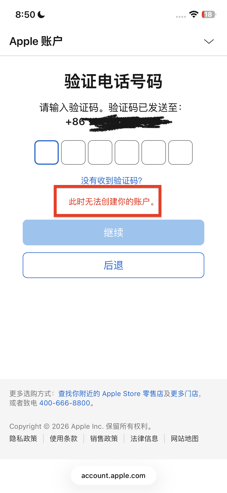
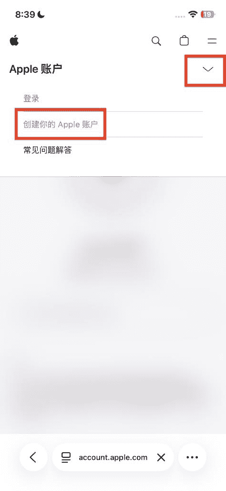
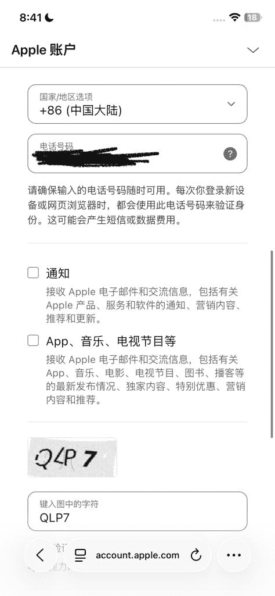
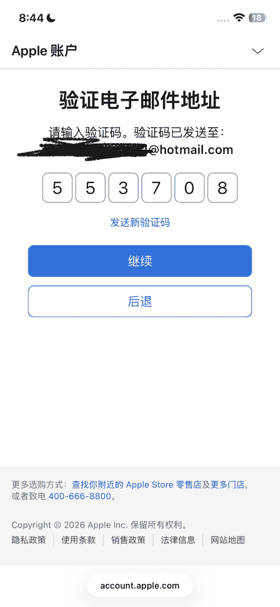
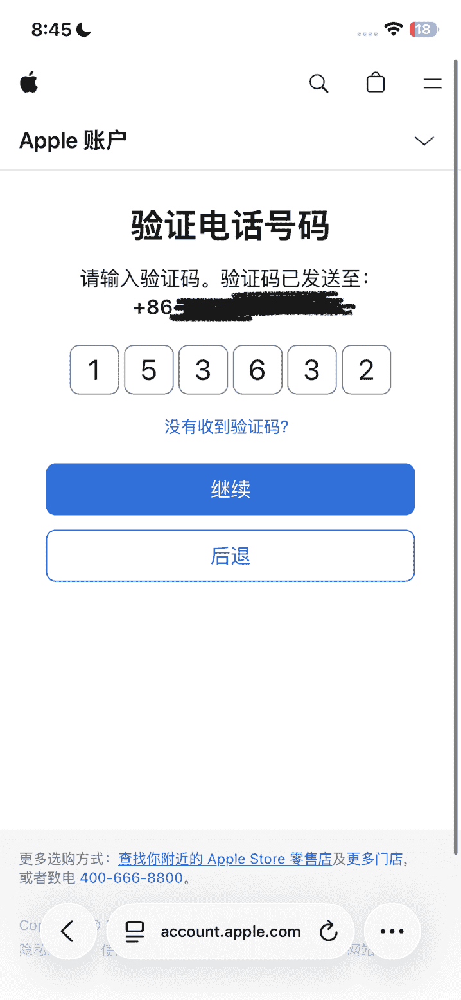
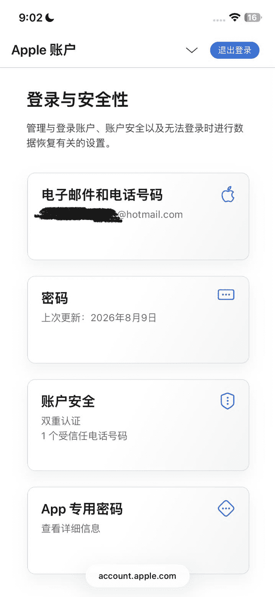
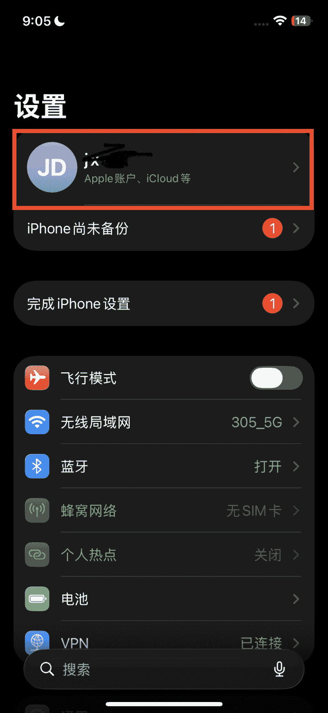
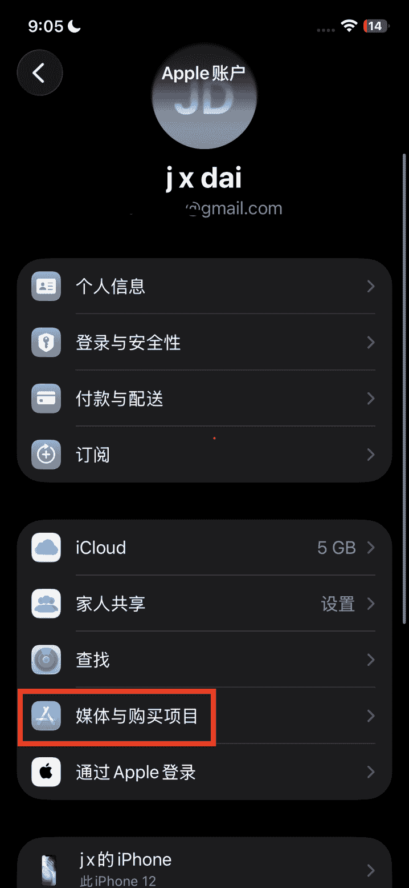
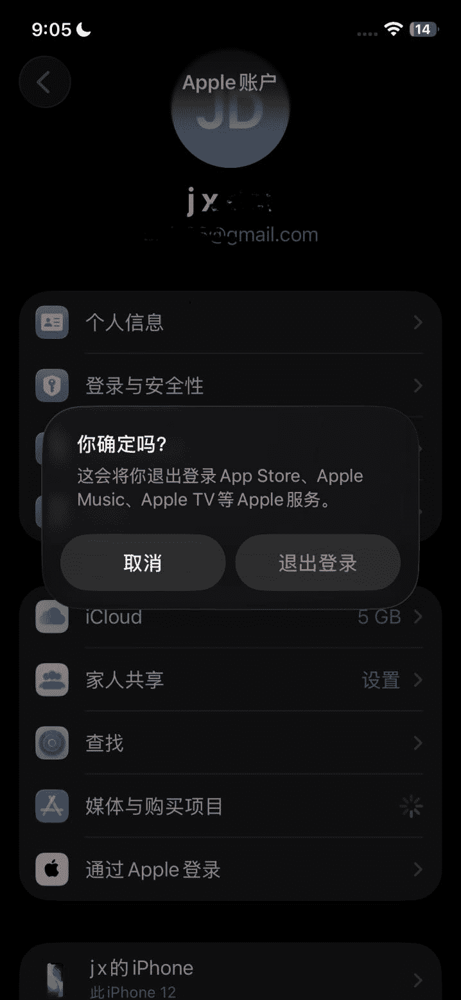
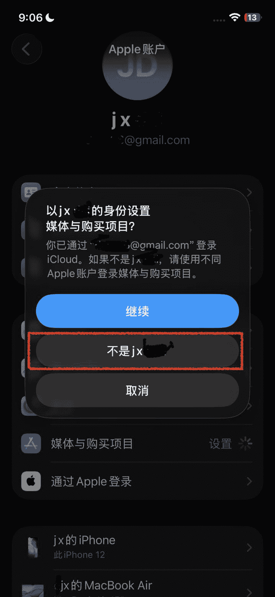
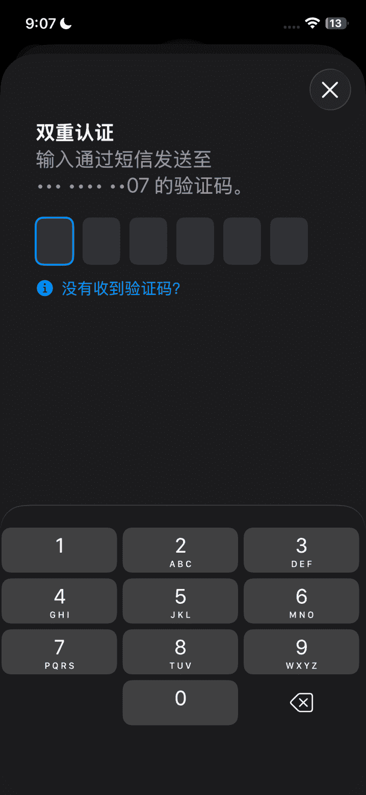
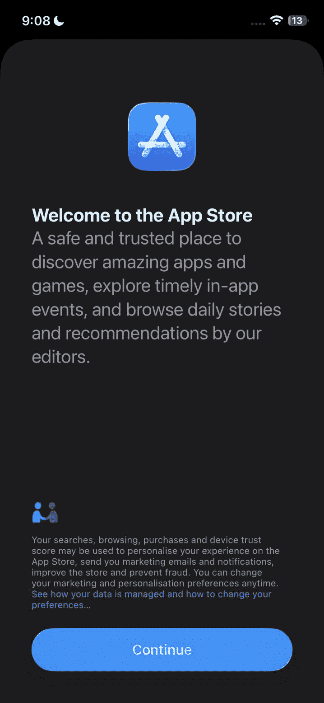
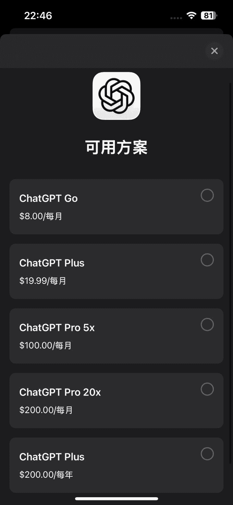
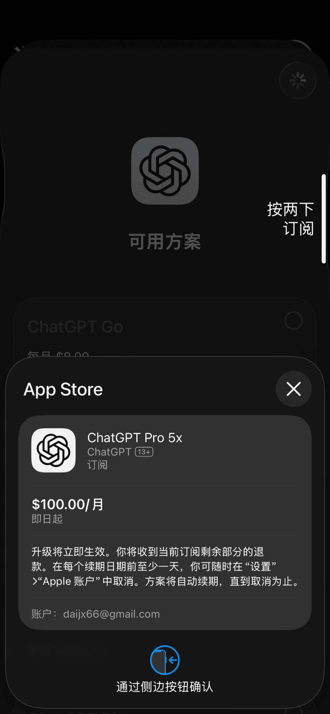
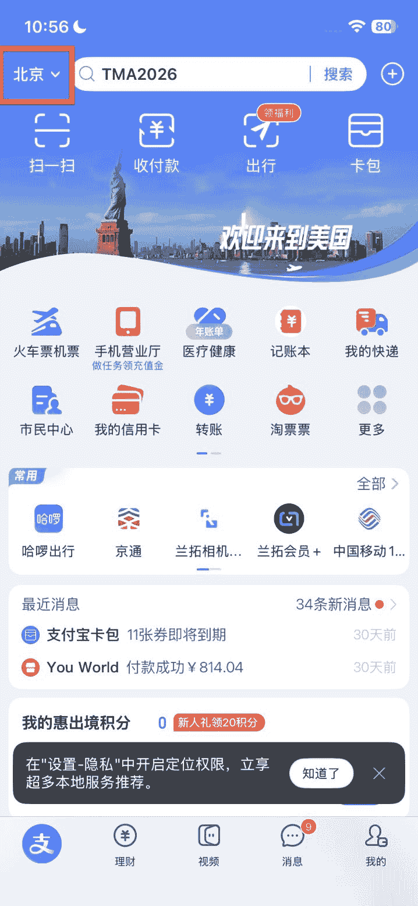
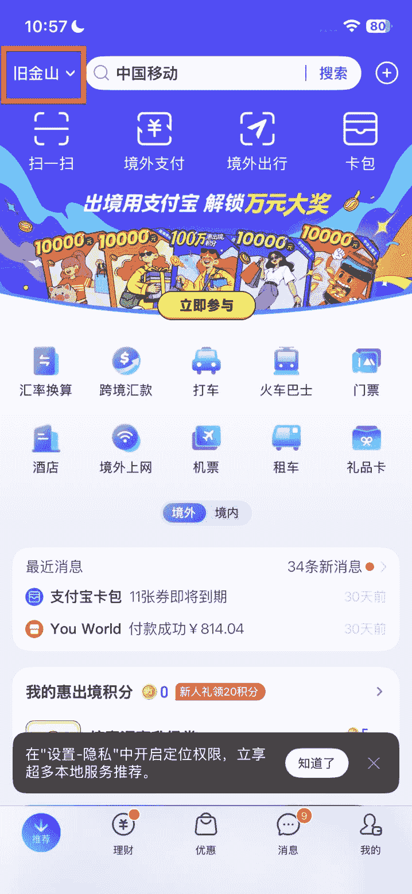
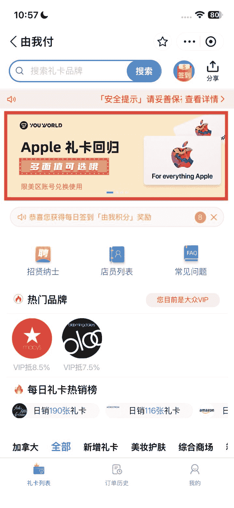
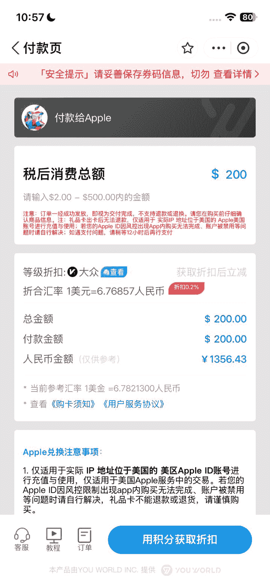

如果单张面额不足，就分几次购买多张美国区礼品卡，逐张放入账户，余额自然相加。

余额提示：正常买入并成功入库的余额不会因为搁置太久而被清零。但余额一旦进入，就绑定在这个美国区 Apple 账户上，不能移给别的账户，也不能换回现金（法律另有规定除外）。美国区礼品卡只能用于美国区账户和美国区消费。以后想变更 Apple 账户的国家或地区，必须先花光账户中的余额；如果余额小于任何一件商品的价格，请联络 Apple 技术支持。正因如此，首次下单只买实际需要的金额就好。详细政策请查 Apple 美国区礼品卡条款和“更改国家或地区”说明。

信息确认无误后，就在支付宝内完成付款。请勿进行私下转账，也不要把 Apple 密码、ChatGPT 密码、短信验证码、远程控制权限交给卖家。

购卡成功之后，到订单页面的“门店及官网结账信息”或兑换码区域找到那一串代码，按复制。兑换码通常会分组排列，由字母和数字组成；截图里的代码已经用过了，不能再存。复制完毕就继续下一步，还未使用的代码不要在群里分享。

其他购买路径也有，有些平台（如闲鱼）的价格也许更低，但这不代表卡源、售后、退款都能放心。若想自行尝试，最好先翻看卖家的过往交易与真实评价，确认这是美国区卡、给的是兑换码，并拒绝对方登录你的 Apple 或 ChatGPT。本文不为这类渠道背书；第一次操作仍建议选择支付宝路径。

### 第五步：把礼品卡金额存入 Apple 余额

存入之前，再看一眼 App Store 当前登录的是不是刚才创建的美服 Apple 账户。

1. 打开 App Store。
2. 点击右上角人像。
3. 点 Redeem Gift Card or Code / 兑换礼品卡或代码。
4. 选择“手动输入”。
5. 在代码输入框粘贴刚复制的完整兑换码。
6. 点击右上角“兑换”，完成整个存入动作。

若兑换过程提示卡无效、已被兑换、尚未激活或地区不符合，直接前往兑换码异常排查。

充值后，页面一般会直接刷新出最新的可用金额。如果想再确认一次，也可以打开应用商店（App Store），点右上角的头像进入账户页面，在名字下方能看到 Apple Account balance 这一项，这串数字就是当前美区账户里的余额。

### 第六步 用苹果余额购买 ChatGPT Plus

正式下单前，先检查两件事：

- 应用商店（App Store）里登着的是不是刚才充值的那个美区 Apple Account；
- ChatGPT 应用里登的是不是你想把这个 Plus 会员挂在名下的那个账号。

如果 ChatGPT 端已经有了付费方案，或者这个账号之前已经通过网页端、Google Play、苹果订阅等方式开过会员，就不要再重复下单。

这里要特别说明两个账号的分工：比如应用商店登的是 Apple Account A，付款时 ChatGPT 里登的是 chat@example.com，那么开通之后，Plus 会员就归 chat@example.com 所有；以后换另一个 ChatGPT 账号登录，这个会员并不会跟着转移，扣款的账单依然由 Apple Account A 负责。

操作流程如下：

1. 打开正版 ChatGPT 应用；
2. 点击「Get Plus」，或者先进入设置再点「Upgrade」；
3. 等待系统弹出苹果的订阅确认窗口；
4. 仔细核对方案、计费周期和总金额；
5. 根据页面提示完成付款。全面屏 iPhone 会显示“双击以订阅”，这时需要快速按两下机身右侧的侧边键，再通过 Face ID 验证；有 Home 键的机型则按屏幕提示用 Touch ID 或设备密码确认；
6. 支付完成后退回 ChatGPT，马上进行第七步的验证，不需要等几分钟再去猜有没有成功。

#### 第一次购买时弹出了付款信息或账单地址

在浏览器里注册账号时没有填写地址，和现在出现账单资料是两回事。如果点「Upgrade」后没有直接进入订阅确认页，而是跳出了 Payment Information（付款资料）或 Billing Address（账单地址），按以下方式处理：

1. 如果付款方式里能选「None」，就直接选 None，不要额外绑定银行卡或 PayPal；
2. 页面可能会让你填 Street、City、State、ZIP Code 和 Phone。这些属于苹果商店的账单资料，既不是礼品卡的信息，也不是 ChatGPT 账号的信息；
3. 这里要求填的是账单资料，不是注册苹果账号时用来收验证码的手机号。各项内容应当填自己有权使用、能正常接收验证、必要时可以完成核验的；
4. 如果看不懂页面上的字段或报错，可以复制文末的提示词发给豆包帮忙解释；但绝对不要把苹果密码、ChatGPT 密码、短信验证码或还没兑换的礼品卡卡密发给任何 AI 工具。如果页面要求你提供无法给出的有效资料，就先停手，联系苹果官方支持；
5. 页面审核通过后，苹果的订阅确认窗口会再次弹出，这时再核对方案和总价。如果页面强制要求提供你没有的有效付款方式，请截图保存完整报错，停止购买，直接去看后面的解决办法。

看不明字段含义或系统提示时，可以把下面这段复制给豆包。注意先把页面上的姓名、完整地址、手机号等个人信息脱掉。

我正在填写美国区 Apple Account 的账单信息。请只解释 Street、City、State、ZIP Code 和 Phone 分别应该填什么、常见格式是什么，并帮我理解下面这段页面提示或报错。不要替我编造地址或电话号码；如果我没有页面要求的可核验资料，请告诉我应该向 Apple 支持询问什么。

余额够用的时候，苹果系统通常优先从账户余额里扣款；但余额充足不等于一定能完全靠余额完成订阅。官方说明里提到，某些交易即使余额够也可能会要求账户里绑定一张信用卡，个别订阅项目也可能不支持余额支付。遇到这种情况，不要反复尝试订阅，更不要转头去其他平台再买一份。

### 第七步 验证是否开通成功

下面两项是最基础的检验标准。

如果苹果已经扣款，但 ChatGPT 里没有出现 Plus，直接去执行「恢复购买」操作。

1. 打开 ChatGPT 的侧栏或头像，进入 Settings → Account，当前方案应该已显示为 Plus；
2. 在苹果的订阅列表里能看到 ChatGPT 这一项，并显示当前方案和下次续费日期。

iPhone 或 iPad 的查看路径是：系统设置 → 你的名字 → 订阅 → ChatGPT。

如果手边还有其他设备，可以登录同一个 ChatGPT 账号，检查 Plus 权益有没有同步过来。

开通成功之后，再看续费、升级和降级的问题。

下面的截图走的是应用商店入口，也可以用前面的“系统设置 → 你的名字 → 订阅 → ChatGPT”，两条路最后都会进入同一个 ChatGPT 订阅管理页。

1. 打开 App Store，点右上角的头像；
2. 点击自己的 Apple Account，进入账户设置；
3. 点击「订阅」，在列表中选中 ChatGPT；
4. 进入后能看到当前方案、到期或续费日期；点「查看所有方案」，能看到当前账户实际能订的档位和价格。

先按图示进入 ChatGPT 的订阅详情页。

先看页面上显示的状态。如果写的是“取消订阅”，说明自动续费还是开启的；如果像截图那样显示“已取消订阅”并标着具体到期日，那说明当前周期还能正常用，到期后不会再自动扣费。想接着用的话，点蓝色“续期”按钮即可。点「查看所有方案」之后，选择页面里实际出现的档位，并确认生效时间和苹果给出的扣款金额。

- 正常续费。苹果的订阅默认是自动续订的。只要没有手动取消过，就不需要每个月重新买一次，只要在续费日前确认美区 Apple Account 的余额足够覆盖页面显示的实际金额即可。苹果官方提到，App Store 可能在本周期结束前的 24 小时内发起扣款。如果已经取消了但还没到期，在详情页点“续期”就能重新打开自动续费。
- 从低价档升到高价档。例如 Plus 升到 Pro，或者从较低的 Pro 档升到 200 美元/20× Pro 档。升级后更高的方案立刻生效，苹果会按照原方案还没用完的时间按比例退款。OpenAI 也说明新方案的额度会马上生效，账单周期重新计算。使用 Codex 的人，升级后会按新方案重新获得额度；建议马上打开 Codex 的 Settings → Usage，检查额度和新周期是否已经更新。
- 从高价档降到低价档。不会马上降级。现在的高价方案会一直用到本周期结束，低价方案从下一个续费周期开始才生效。

举一个例子：一个 30 天的周期里用了大约 10 天后升级，苹果会按剩余的大约 20 天为原方案退款。这个“大约退 2/3”只是用来帮助理解的示意，实际能退多少要以苹果确认页上显示的数字为准，日期计算方式和取整规则都会影响结果。

退款回到哪里。升级时由苹果自动计算出来的按比例退款，会退回原来的付款方式；如果当时用的是 Apple Account balance 付款，获批的退款会回到苹果账户余额，苹果提示最长可能 48 小时后才会显示。普通的退款申请批不批，取决于苹果的审核，并不是说账号出问题了或 ChatGPT 被停用了就一定自动退款。想申请可以登录 reportaproblem.apple.com，或者在同一个页面查状态；如果苹果已经批准但超过 48 小时还没到账，再联系苹果支持去查。

只打算用一个月的朋友。直接走系统设置 → 你的名字 → 订阅 → ChatGPT → 取消订阅。取消成功后，页面上的“下次续费日期”会变成当前权益的到期日期，本周期不会立即失效，Plus 还可以一直用到这一天。

回路线选择 · 看 Mac 路线 · 直接去常见问题

## B 路线｜只有 Mac 电脑能做什么

回路线选择 · 看 iPhone/iPad 主线 · 直接去常见问题

如果手头只有 Mac，没办法独立完成 ChatGPT 第一次苹果内购。Mac 可以拿来创建美区 Apple Account，也可以管理已经出现在苹果订阅列表里的 ChatGPT；但第一次开通 Plus 还是必须用 iPhone 或 iPad。

- 想第一次通过苹果开通 ChatGPT Plus。Mac 这边只能先建号，不要提前买礼品卡或兑换卡券。等拿到 iPhone 或 iPad 后，从主线第二步接着做。
- ChatGPT 已经出现在苹果订阅列表里。先看下面的“B4｜管理以前通过苹果买的 ChatGPT 订阅”，确认状态和金额后再决定要不要充值。

### B1 创建美区 Apple Account

Mac 可以直接用第一步里说的网页入口，也可以从 App Store 里创建。路径是：

App Store → Sign In → Create Apple Account

账号建好后，只退出 Mac App Store 里的购买账号，不要退出系统设置里登录的整机 iCloud。退出入口：

App Store → Store → Sign Out → 左下角 Sign In

### B2 第一次购买 ChatGPT Plus

这条苹果余额开通路线，必须在 iPhone 或 iPad 的 ChatGPT 应用里完成。苹果余额不能用来在 ChatGPT 网页上付款，所以只有 Mac 的新用户没办法通过网页完成第一笔购买。

等以后有了 iPhone 或 iPad，先在设备上登录这个美区 Apple Account，从主线第二步继续。一定要先走到第三步的苹果订阅确认页，看清楚实际要扣的钱，再去买卡。

### B3 什么时候才能在 Mac 上兑换 Apple Gift Card

只有下面两种情况之一，已经真的出现在屏幕上了，才去买卡并兑换：

- iPhone 或 iPad 已经打开了苹果的订阅确认页，上面显示着方案和具体金额；
- Mac 上的 ChatGPT 订阅详情页已经出现了可以点击的续订或方案入口，并且标了金额。

只是“以后可能会借到 iPhone/iPad”，或者只是订阅列表里看到了 ChatGPT，都不代表现在能付钱。没有看到上面说的购买入口，就先不要充值。

Mac 上的兑换路径是：

App Store → 左下角姓名或账户 → Redeem Gift Card

兑换完成之后，去账户页确认 Apple Account balance 有没有增加。

如果这笔余额是用来第一次开通，就回到 A 路线的第六步；如果是为了给已有的订阅续费，就继续看下一节的订阅详情页。

### B4 管理以前通过苹果购买的 ChatGPT 订阅

如果 ChatGPT 已经出现在苹果订阅列表里，可以在 Mac 上打开详情页。

1. 打开 Mac 版 App Store；
2. 点左下角的账户；
3. 点 Account Settings / 账户设置；
4. 找到 Subscriptions / 订阅，点旁边的 Manage / 管理；
5. 找到 ChatGPT 并打开详情页；
6. 查看当前方案、状态和日期，页面有续订或换方案的入口时再操作。

操作完之后同时检查两处。苹果订阅详情页应该显示有效的方案和新的日期；ChatGPT 的 Settings → Account 应该显示 Plus。如果苹果已经扣了钱但 ChatGPT 还是没 Plus，直接去恢复购买，不要再买一份。

回路线选择 · 返回 iPhone/iPad 主线 · 直接去常见问题

## C 路线｜遇到问题直接排查

回路线选择 · 返回 iPhone/iPad 主线 · 返回 Mac 路线

- 礼品卡兑换码报错：看“兑换码无效、已兑换或地区不符”那一节
- 付款方式被强制要求，或余额够还是买不了
- Upgrade 按钮灰色
- 苹果已经扣款但没显示 Plus
- 订阅绑到了另一个账号上
- 续费失败或提示欠款

### 页面强制要付款方式，或余额够还是无法购买

先判断自己卡在哪一步：

- 第一次登录 App Store 时被强制填写付款方式。先停下来，不要买礼品卡，更不要随便编一个银行卡或账单信息。只能填写你本人能正常使用、并且符合页面要求的信息；如果提供不了，就联系苹果官方支持，问问账户是什么状态。
- 礼品卡已经兑换了，但购买还是被拦住。先检查当前 App Store 登的是不是美国区 Apple Account，余额是不是真的到账了，再去购买记录里看有没有 Amount You Owe。保留页面上完整的错误信息，不要反复去点购买。

如果是第一次进 App Store 设置被拦住了，只要美区账户恢复成能正常下载免费 App 的状态，就可以回到第三步。余额够但买不了的话，必须能重新把苹果的订阅确认页调出来并完成付款，才算解决。页面还是要求其他付款方式，或账户状态看不太懂的时候，先联系苹果支持，千万不要再去网页端或 Google Play 再买一份。

首次设置被拦，返回第二步 · 还没付款，继续第六步 · 已经付了，去第七步验证 · 回问题目录

### Upgrade 按钮是灰色的

如果页面提示 In-app purchases are currently unavailable（暂时无法使用 App 内购买），OpenAI 官方的说法是：新订阅的苹果内购功能可能还没有激活，最长可能要 48 小时。先等一等，别急着去其他平台重复下单。只有按钮恢复可点、能打开苹果订阅确认页，才说明问题解决了；48 小时后还是不行，就保留截图和报错原文，直接联系 OpenAI 支持。等它恢复之后，按你自己刚才卡住的位置继续走。

返回第三步看金额 · 返回第六步购买 · 回问题目录

### 苹果已经扣款，但 ChatGPT 还是没有 Plus

在 iPhone 或 iPad 的 ChatGPT 应用里按下面路径操作：

Settings → Account → Restore purchases

Restore purchases（恢复购买）的意思是重新读取你原来在苹果这边的购买记录，不会产生新订单。操作时要使用当时付款的那个 Apple Account，以及原来购买时登录的 ChatGPT 账号。要等 ChatGPT 的 Account 页面显示 Plus，才算恢复成功；如果还是没有，不要再次购买，把苹果收据留下来，用当前这个 ChatGPT 账号联系 OpenAI 支持。

返回第七步检查结果 · 回问题目录

### 页面显示订阅绑到了另一个 ChatGPT 账号

把当前的 ChatGPT 账号先退出，重新登录第一次购买时用的那个账号，再去 Settings → Account 里点 Restore purchases。原来的账号显示 Plus，才算恢复成功。苹果的内购订阅不能转移到另一个 ChatGPT 账号上，卸载重装也不会改变绑定关系；如果原来那个账号登不进去，就保留苹果收据并联系 OpenAI 支持，不要在现在这个账号上重复购买。

返回第七步检查结果 · 回问题目录

### 苹果续费失败或提示欠款

先在苹果的订阅和购买记录里处理。苹果可能在续费失败后继续尝试扣款，在最终结果出来之前，不要同时在网页端或 Google Play 再开一份订阅。

如果购买记录里出现了 Amount You Owe（待支付金额），按苹果页面处理就行。iPhone/iPad 的入口是：

设置 → 你的名字 → 媒体与购买项目 → 查看账户 → 购买记录 → Amount You Owe

欠款处理好之后，苹果订阅页显示有效的方案和新的续期日期，ChatGPT 也显示 Plus，才算恢复完成。状态还是不清楚的话，先找苹果支持，不要同时在别的平台再开一份。

返回第七步检查结果 · 打开 Mac 订阅管理 · 回问题目录

### 礼品卡兑换码无效、已兑换或地区不符

按页面提示判断是哪一种情况。

- 卡无效。先确认输入的是不是以 X 开头的兑换码，换用“手动输入”方式，仔细核对容易看错的字符，比如 B 和 8、O 和 0、S 和 5、Z 和 2。
- 已经兑换过。先退出 App Store 的购买账号再重新登录，刷新一下 Apple Account balance；同时确认自己查看的是不是刚才兑换时用的那个美区账户。
- 还没激活。这种情况一般得找原始销售方处理。保留支付宝订单详情、付款记录和完整报错，联系卖卡的客服。
- 提示必须在其他国家或地区兑换。这说明礼品卡的地区和你 App Store 账户的地区不一致。美区礼品卡只能在美国区账户上兑换，不能跨区使用。

还是解决不了的时候，不要再买新卡。保存订单详情、兑换码和完整的报错信息，先联系苹果支持；如果苹果判断是卡没激活或卡源有问题，再回去找卖家处理。

返回第五步兑换礼品卡 · 回问题目录

## 参考来源

- Apple：创建新 Apple Account
- Apple：受信任手机号说明
- Apple：在 iPhone 或 iPad 退出“媒体与购买项目”
- Apple：在 Mac App Store 创建和切换账户
- Apple：兑换礼品卡
- Apple：Apple 账户余额可以购买哪些项目
- Apple：添加付款方式与账单信息
- Apple：交易税报告中的账单地址字段
- Apple：在 Mac 上管理 App Store 订阅
- Apple：付款问题与未付订单
- Apple：Media Services 条款
- Apple：美区 Gift Card 条款
- OpenAI：在 iOS 应用里升级付费方案
- Apple：自动续订订阅的升级、降级与按比例退款规则
- Apple：申请 App Store 购买退款
- Apple：查看退款状态和到账时间
- OpenAI：Pro 档位、升级生效时间与账单周期说明
- OpenAI：取消 Apple 订阅与续费扣款说明
- OpenAI：恢复 App Store 购买
- OpenAI：避免在多个平台重复订阅
- OpenAI：订阅关联到另一个账号
- OpenAI：ChatGPT 支持的国家和地区
- 赚钱参考帖一
- 赚钱参考帖二

回路线选择 · iPhone/iPad 主线 · Mac 路线 · 常见问题

————分割线————

看完这篇完整的操作指南，你可能觉得自己已经会了。但实际上，90% 的人走到第一步就会卡住。

工具和教程只是最低的门槛，真正的分水岭是“能不能立刻动手”和“有没有掌握信息差”。

想追踪全网最新的变现玩法，并且和一群执行力很强的极客一起下场拿结果，欢迎加入我的核心私域圈子：【懒人专属群】。

这里不聊虚的东西，只拆商业闭环，只聊怎么把 AI 的效率用到极致。社群里已经沉淀了 1000+ 经过验证的套利实战案例。

👉 了解圈子的完整数字资产和上车门槛：

https://lazyso.com/insider/

认同价值、准备好下场干活的，扫码加我🛰️（lazyhelper1）。

备注：【实操上车】，不闲聊。

有时候，最吊人胃口的，不是一句惊天动地的话，而是一个没头没尾的开始。

就像现在，摆在我面前的“素材”，干净得像一张白纸，只留下一个孤零零的记号——。

别小看这个记号，它其实是给文案开了一扇门：门后面，什么都有可能发生。可能是金句，可能是数据，也可能是一段戳心故事。真正聪明的文案，从不急着把话说满，而是先铺好轨道，让情绪顺着一个节点自然生长。

老话说得好，留白才是最高的表达。与其堆砌辞藻，不如用一个抓手，把所有注意力都收拢到一个点上。

现在，这枚钩子已经就位。

它就是：。

接下来要做的，就是接住它，然后，把故事讲下去。