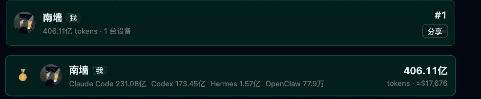
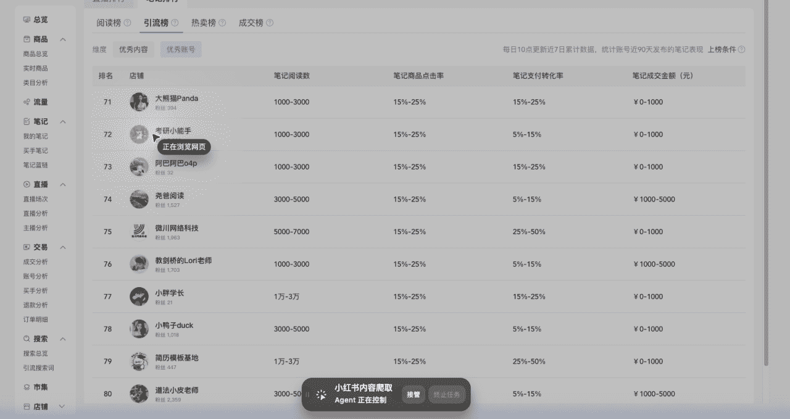
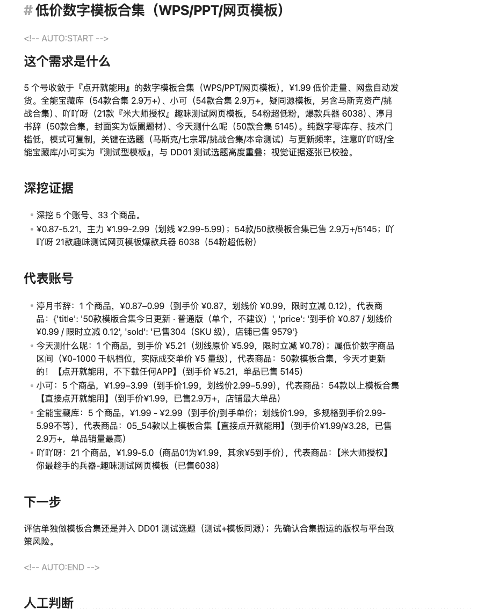
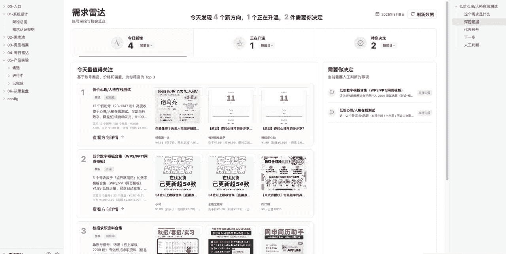
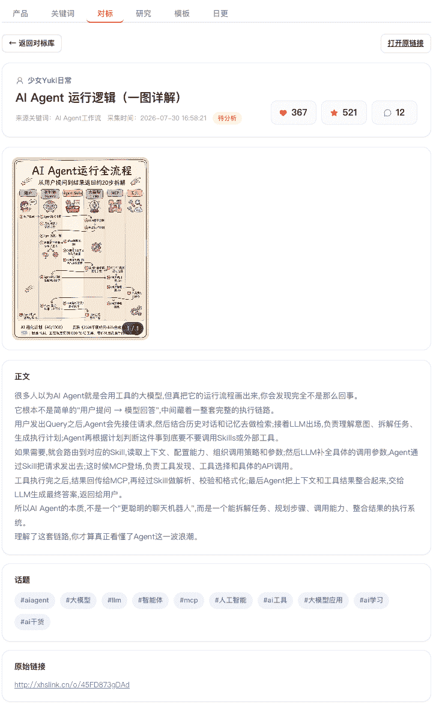
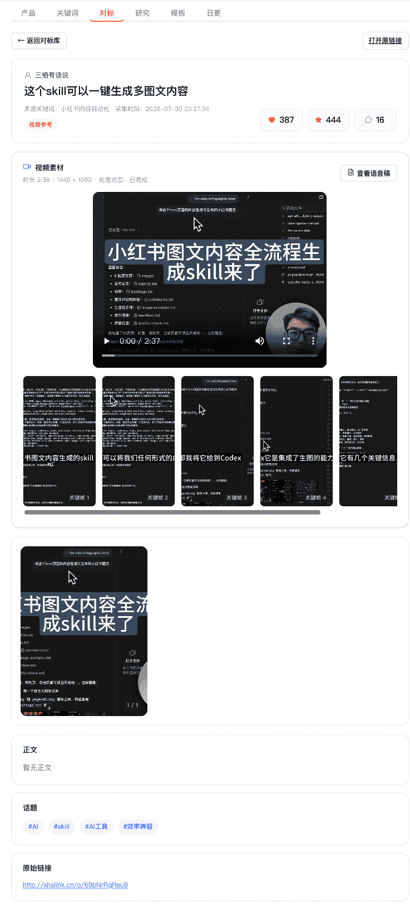
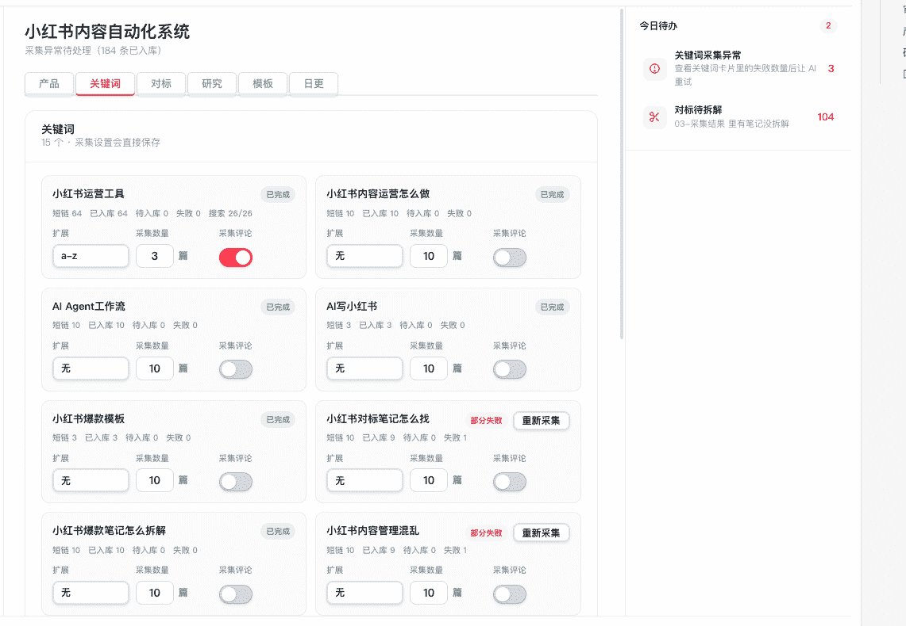
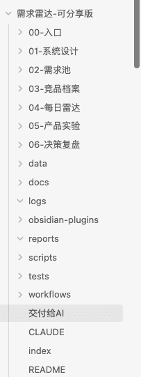

# 大二开公司、从没上过班，我

先做个自我介绍：南墙，2003年出生，2025年毕业离校。大学期间折腾过不少事，大二那年注册了自己的公司，一天班也没上过，目前是自由职业状态。

过去90天，我的本地电脑跑掉了406.11亿Token，位居总榜第73，惠州第一。



眼下我的主业是📕虚拟产品赛道，从挖掘商机、制造商品到内容获客，整套链路已经用AI完整串了起来。那些大批量、重复化的采集、归类、分析和执行工作统统交给AI，我只保留三件事：定方向、选产品、做最终验收。

前后一共做出26款虚拟商品，每个月能带来一万到两万左右的睡后收入。规模谈不上大，部分环节仍需人工介入，但整套机制已经能持续、稳定地运转。

这篇文就当一次系统性复盘，把过去几年的经历和眼下这套工作法摊开讲清楚。核心内容分三块：

1. 找需求：给AI配一台安卓真机，让它稳定操作📕并采集数据，再从数据中锁定已经被市场验证过的需求。
2. 做产品：把确认好的需求交给AI，让它分析对标、梳理结构，产出虚拟资料，或者从图片原型开始做网站、小程序和本地工具。
3. 内容获客：把成型的商品交给AI，让它研究对标、拆解内容，再把拆出的内容结构沉淀成Skill，持续产出图文。

# 一、前期的折腾

第一次尝到赚钱的滋味，是大一升大二那年暑假。当时给学校的校企合作班做招生，活干完，我第一次真切感受到做生意这件事的甜头。

后来在图书馆翻到一本书，讲万科王石早年靠倒卖资源发家的经历。读完当下就觉得：这条路我兴许也能走。资源商那边缺人，我在学校里能召集到学生，把两端接上，中间的差价不就有了？

那时的我既没资源也没背景，能想到的渠道几乎都试了个遍：Boss直聘、智联、猪八戒，还有Soul。思路很直白——找那些手里握着项目、需要大量人手的资源方，先把业务情况聊透，谈得拢就回学校招人干活。

对我影响最大的要数Soul。上面有不少行业聊天房，也常有年入五六十万、甚至上百万的圈内人出没。我当时社会经验浅，性格也不算外向，线下谈合作时总觉得少了点底气，所以有事没事就泡在这些房间里，听别人怎么讲话、怎么处理事情，照着模仿。待久了，也就积攒下一些人脉。

最早做的是组织学生进厂。之后淘宝店铺注册、自媒体代发、视频剪辑、刷单等一系列拉新和校园项目都有涉足。说白了，都是资源商需要人干活，而我恰好能把人凑齐。

业务体量越做越大，个人身份渐渐不够用了。有些订单需要签合同、开发票，回款也得走对公账户，凭个人身份根本接不下来。没办法，只好注册公司。有了公司主体之后，再遇到类似的门槛，至少不会被卡住。

人力业务做着的间隙，我也试过一些互联网、自媒体方向。抖音和快手上运营过一阵鸡汤号，发励志语录、情绪类文案，配上背景视频和BGM。账号并不缺流量，但迟迟找不到变现的办法。当时的我对互联网项目的商业模式认知几乎为零，只知道闷头更新，越更越觉得没盼头，后来就弃了。

中老年情感👸号矩阵算是少数真正赚到钱的互联网项目。可收益刚冒头，平台就开始整治，整个矩阵的账号基本全灭，项目就此终结。

👸号停了之后，又尝试过两性社群和吃瓜社群。两者内容都比较敏感，主要靠📕向🛰️群引流。可引流账号动不动就出问题，🛰️群也反复被封，始终没能做起来。

再往后，我把之前攒下的项目经验和市面上的资料整理成一套自媒体培训课程，在🛰️群内做文字直播。获客依旧依赖📕，找大学生批量发引流帖。流量平平，转化也一般，项目越做越沉重，收入却跟不上，最终只能叫停。

同一时期，我还跟了两个To G招商项目。项目资源来自早年做人力时认识的几位前辈，我这边恰好也接触过一些与政府部门有关联的人，便想着充当中间人。

当时满脑子只有一句话：要么不开单，开单吃十年。两个项目来回跑了将近一年，结局是一个都没能落地。

# 二、低谷期的转变

2023年，我其实没少赚钱。人力加其他零散业务，前前后后进账有几十万。对一个仍在读书的人来说，这个结果已经说得过去了。

但心里始终不踏实。此前的项目陆续停掉，最看重的两个To G项目又迟迟没有结果。我那时是真信它们能成，时间和精力也砸进去不少。

以前做人力，赚的是中间的价差。资源商把单子交给我之后，招人、执行、交付这些环节都能自己往下推，事情的主动权始终握在自己手里。

招商项目就被动了。我能做的只有把项目方和认识的关系搭上线，真正决定项目成败的，还是关系本身。我认识的朋友与体制内真正能拍板的人之间，隔着两三层的距离。像我们这样没有家底、没有在政府端长期经营过的人，单靠牵线搭桥，很难走完最后一程。

项目一天不落地，我心里就一天比一天虚。公司成立后的税务和杂七杂八的事务同样令人烦躁，前两年那股不可一世的劲头，差不多就在这年被彻底磨平。我开始反复问自己：眼光是不是出了问题？真的有能力赚钱吗？

两个项目宣告失败后，我审视事情的底层逻辑变了。以前以为只要能对接资源、把两端连上，项目就有戏；后来我才在意一个事实——真正决定结果的那个变量，究竟握在谁的手里。继续做资源中介，终归只是找资源、搭关系、当二道贩子。做得再久，项目和资源都是别人的，自己能沉淀下来的东西少得可怜。

2024年初，我给自己放空了一阵子，甚至动过找工作的念头。投了几份线上岗位，面试都没下文。退一步讲，就算给我过了，我心里也没真正做好进入职场的准备。最终还是不甘心占了上风，决定继续折腾。人力、资源中介这些旧业务被逐渐放下，精力切换到互联网赛道。

一开始做了📕商单号，顺手也申请了MCN。经营半年多，单个账号的收益上限肉眼可见地低，继续下去也看不到增长空间。眼看同行一个个离场、MCN一家家注销，我也顺势抽身。

当时手里还剩不少📕账号，索性全部转去开店卖虚拟产品。这件事从2024年一直干到现在，中间死过产品、封过店铺、被平台规则来回折腾，也被同行恶意差评、举报过。商品下架了就换方向，店铺没了就重新注册，规则变了就跟随着调整内容和运营。

到2026年，OpenClaw突然走红。我开始琢磨：能不能让AI自己找需求、做产品、发内容，再把东西卖出去？

# 三、需求到获客的全链路AI

## 找需求：AI跑腿，人做决定

想让AI真正把商品卖掉，得先回答一个问题：市场上究竟什么有人买。早先我也只能手动刷📕，刷到数据好的笔记就点开，翻一下对方主页，研究在卖什么、标价多少。一天下来能记下几个方向，但效率上不去——同时盯不了太多账号，今天刷到什么完全随机，漏掉的就再也找不回来。

人工刷存在盲区，但千帆的数据是现成的。作为📕官方的数据中心，它每天10点更新阅读榜、引流榜、热卖榜、成交榜。哪些笔记在拿流量、哪些内容能把人引导至商品页、哪些商品正在迅速起量、哪些账号已经产生了实际成交，一份面板全部呈现。相比之下，点击、转化、支付这类数据，远比点赞收藏更贴近真实购买意愿。

如今AI每天定时自动巡检这些榜单。8个抓取口——阅读榜、引流榜、热卖榜、成交榜，每个榜再拆成优秀内容和优秀账号。一整轮下来覆盖几百条信息，规模远超人工盯守。

榜单数据入库后，AI先给账号做一轮评分。成交金额与支付转化率占的权重最高，阅读量的占比很小；连续多天上榜、同时进入多个榜单，或者粉丝量不高却已有成交的账号，都会被额外加分。这一步的目的是排出看店优先级，具体在卖什么，要进店之后才能看清楚。

筛完账号，AI接管手机，逐个点开目标账号的📕店铺，把商品分享链接抓出来，再送回电脑端采集详情和图片。每个账号采集结束后都要核对数量：手机拿到多少个独立商品链接，本地就必须有多少份对应详情，对不上就先补采，绝不直接进入分析。

数据齐了之后，AI开始逐个拆解账号：属于什么品类、价格如何定、卖得最好的单品是哪一款、粉丝体量多大、是否属于低粉高销。

最后，把品类和产品形态相近的账号归并起来。AI综合账号规模、商品数量、价格区间、最高可见销量与商品图证据，输出当前的市场状态、结论以及建议的下一步动作。交付难易度、版权隐患、平台合规风险，也会根据采集到的真实内容写进结论。



AI把采集、评分、分析、合并全部做完，人类只需要面对结果。看板里，每个方向的状态、账号数、价格带、最高销量以及支撑证据都标注得很清楚；Obsidian中还能直接打开对应账号的店铺页面，观感和网页版完全一致。从此不必亲自动手刷榜单、翻店铺、记数据。至于要不要跟进、做成什么产品，最后依然由人来拍板。



## 做产品：人定方向，AI执行

从看板挑中一个方向时，相关数据早就在本地待命——同行在卖什么、如何定价、主图和详情页如何设计，全都一目了然，不需要从头再搜。

接下来的关键问题是形态。同一类需求，有两条路可以选。

如果做虚拟资料——模板、教程、素材包这类，前面采集到的商品信息和图片足以判断同行在卖什么、如何展示。但商品详情页看不出付款后真正交付的内容，所以还得去闲鱼、淘宝、拼多多分别下单几份同类成品。这一步只能自己掏钱，AI无法代劳。资料到手后，再和AI一起拆解内容、确定结构，按模块逐项做出自己的版本。

涉及的原料包括：
- 对标店铺的商品信息与图片
- 闲鱼上购得的资料
- 淘宝上购得的资料
- 拼多多上购得的资料
- AI负责的内容分析
- 人负责的结构确定
- 按模块逐项产出

这些素材只用来了解同类产品通常包含什么、哪些需求还没有被满足。最终内容仍要重新整理，把几份材料直接拼凑在一起是行不通的。

若目标是APP、网站或小程序，就把需求资料交给Codex。先让它画出图片原型，人确认功能和视觉无误之后，再依照原型还原界面、编写逻辑，并逐步截图验收。

选虚拟资料还是选数字工具，这个判断权必须留在人这边。AI能摆出市场证据和对标数据，但做成何种形态、如何做出差异化、价格怎么定，需要依赖人对市场的理解。

需求和竞品证据已经摆到眼前，做产品时就不必再从猜测用户偏好起步。产品上线后，再根据真实反馈持续微调功能和内容。

## 做内容：AI跑量，人控调性

过去做内容最令人头疼的是不可复制。今天想出一个选题写一篇，明天再想一个，质量时高时低，风格也飘忽不定。做起来的号运气成分居多，没做起来的连问题出在哪都说不清。

现在的路径是，产品成型之后，内容生产走一套标准SOP。

第一步，AI先把产品资料消化干净——卖给谁、解决何种痛点、什么样的使用场景。然后确定核心关键词，之后所有内容都围绕这些词展开布局。

为什么非要关键词切入？用户在推荐流里被动刷到是一种触达方式，但带着明确意图的人一定会主动搜索。找考研资料的人会搜“考研数学真题”，需求简历模板的人会搜“应届生简历模板”。内容只有部署在这些搜索词之下，才能同时接住两种流量。

关键词敲定后，AI去抓取这些词下排名靠前的对标笔记。图文保存正文和全部图片，视频保存原片、关键帧和转写语音稿。这些素材已经足够支撑后续拆解。只不过我目前的获客重点在图文，所以流程里会先把视频筛掉，只让图文笔记进入后面的逐篇拆解和聚类环节。若做视频业务，同样可以复用这些材料，单独拉一条视频拆解和归类的流程。

拆解积累到一定程度，AI把结构相近的笔记归到一起，提炼出模板草案。例如某种开头方式和正文结构在十几篇高互动笔记中反复出现，就把这条规律抽出来。

草案出炉后，必须有人介入。AI归纳出的结构未必全对，哪些套路真正有效、哪些细节还要调整，这些都依赖人的判断。确认无误后，再把草案固化为可直接执行的内容Skill。后续的标题、正文、话题、封面和内页图，AI都会依照这份Skill生成。



Skill落定之后，每天到点，AI照规则生成笔记初稿，再自己审一遍：有没有编造事实、图片排版是否清楚、有没有越出Skill设定的边界。不过关就打回重做。

新Skill刚开始跑时，建议保留一道人工复核：AI审完，人再过目一遍，确认没问题再发布。人审时发现毛病，就回头去修正Skill本身。运转一段时间后，如果AI按这套规则产出的内容基本不用改动，那道人工复核就可以关掉，让AI审完直接放行。

Skill跑顺之后，每天要做的只有：自动出稿、AI自检、人扫一眼、发布。前期把规则打磨到位，后期就是坐收果实。

# 四、整套工作台如何落地

真正要搭起这套东西，所需物料远少于预期。一台电脑、一个Obsidian、一台已登录📕的安卓手机，外加一个能读取本地文件、运行脚本、调用工具的AI，基本就齐了。做需求挖掘的话，还得保证能正常进入千帆数据中心。

我目前使用Mac，浏览器跑的是Ego。Windows没有Ego，可以用Playwright，或者其他任何能被AI操控的浏览器。AI端选型很自由，Claude Code、Codex、Hermes、OpenClaw都行，只要能够对接本地文件、脚本和工具即可。

用下来最顺手的组合，是让Codex调度Claude Code去执行整条流水线，遇到问题由Codex自行处理，人只需要盯住最终产出。

这里只讲整体思路，不讲具体的代码实现。完整脚本、配置、Obsidian面板代码、子Agent提示词，我都会放到文末附件中。下载完把整个文件夹丢给AI，让它依据你的电脑和手机环境完成适配。

## 找需求：从榜单里筛出可做的方向

需求发现这一步，由主Agent和两个子级Agent分工协作。采集子Agent负责拿全当天榜单，分析子Agent负责逐个审视账号中的商品与图片。主Agent则统管账号评分、商品采集、完整性核对和最后的跨账号汇总。多个账号里反复出现的同类产品，最终会被聚合成一个待判断的方向。

整体链路如下：

采集子Agent抓全8个榜单口

↓

主Agent给榜单账号完成评分

↓

主Agent操控手机进入高分账号的店铺

↓

手机取回短链接，电脑采集全部商品

↓

主Agent核对商品与图片是否完整

↓

分析子Agent逐个账号做拆解

↓

主Agent合并多个账号中重复出现的产品方向

↓

同步到Obsidian，交给人类定夺

启动之前，有四件事需要确认到位。



- 📕账号可以正常进入千帆数据中心。
- 浏览器中千帆和📕均已登录。
- 安卓手机端📕处于登录状态，主Agent能正常操作。
- Obsidian工作台能正常打开并保存数据。

浏览器最好单独开一个采集专用空间，名称随意。首次登录完成后，后续所有采集动作都固定沿用这个空间，防止任务运行中途登录状态丢失。

第一次运行，先挑一个商品数量较少的账号做测试，确认主Agent能顺利打开账号主页、进入店铺、复制商品链接并正常返回，再启动全量采集。

### 第一步：抓取千帆的8个榜单口

千帆每日更新笔记排行。这一环节共采集四类榜单：

- 阅读榜：看哪些内容正在获取流量。
- 引流榜：看哪些内容能把人带到商品页。
- 热卖榜：看哪些商品正处于上升期。
- 成交榜：看哪些账号已经产生真实交易。

每类榜单再拆成优秀内容和优秀账号，合计8个口子。优秀内容提供具体笔记样本，优秀账号提供后续进店深挖的目标。两者叠加，既能看清楚内容表现，也能观察到账号成交状况。

主Agent会先调度采集子Agent。它按顺序打开全部8个口子，每个口子最多翻20页。每换一页，随机等待60到90秒，同时校验排名是否连续。首页排名应当是第1到第10名，次页应当从第11名继续往下排。若出现排名缺失、重复，或者榜单与当前页面内容不符，该页就重新抓取。

8个口子必须全部完成，才允许进入账号筛选。哪怕已经累积了几百条数据，只要还有一个口子没收工，就停留在采集阶段。

每条榜单数据会保留以下字段：

- 来自哪个榜单。
- 当前排名位次。
- 笔记标题和账号名称。
- 阅读量区间。
- 商品点击率区间。
- 支付转化率区间。
- 成交金额区间。
- 笔记和账号的唯一标识。

此阶段的目标只是把榜单事实完整取回，不依据标题猜测品类，也不提前断定哪个方向值得投入。

### 第二步：算出哪些账号值得进店深挖

8个口子全部采毕后，主Agent开始给上榜账号评分。一天榜单中的账号量不小，逐一进店浏览耗时过长，所以必须先产出一份候选名单。

总分由三块组成：

账号总分 = 需求证据分 × 可信度加成 × 低粉加成

#### 需求证据分

需求证据分 = 成交分 × 50% + 支付转化分 × 35% + 阅读分 × 15%

成交金额权重定得最高，是因为这里要找的是已经被真金白银验证过的需求；支付转化率用来判断看过商品的人是否真有购买意愿；阅读量只保留15%的权重，把那些叫好不叫座的内容压下去——一切向“钱”看齐。

千帆给出的数据为区间值，因此需要先把每个区间换算成0到1之间的分数。

成交金额换算规则：

| 成交金额区间 | 成交分 |
|---|---:|
| 0～1000元 | 0.10 |
| 1000～5000元 | 0.30 |
| 5000～1万元 | 0.60 |
| 1万～5万元 | 1.00 |

支付转化率换算规则：

| 支付转化率 | 转化分 |
|---|---:|
| 0～5% | 0.10 |
| 5%～15% | 0.30 |
| 15%～25% | 0.55 |
| 25%～50% | 0.80 |
| 50%～70% | 0.95 |
| 70%～90% | 1.00 |

以上就是整条工作流的核心框架。从早年纯靠人力找项目，到如今AI全程接管，踩过的坑确实不少，但最终沉淀出一条当前还算稳定的路线。这套机制仍在不断迭代之中，希望这篇复盘能给你带来一些参考。

在📕做选品，不要靠直觉赌。搭一条能反复跑的打分到落地的链路：榜单里筛号、进店取证、做成产品、做成内容。每一步都要留下可回看的记录。

## 一、先给候选号打分，排好深挖顺序

总分由三层相乘构成：基础需求分、信号置信加成、小体量加成。

基础需求分看三项，权重分别是销售额 50%、支付转化率 35%、阅读量 15%。每项先按区间定档，再取该账号所有记录里的最高档。

阅读量分段为：1000～3000 记 0.10，3000～5000 记 0.20，5000～7000 记 0.30，7000～9000 记 0.40，9000～1 万 记 0.50，1 万～3 万 记 0.60，3 万～5 万 记 0.70，5 万～7 万 记 0.80，7 万～10 万 记 0.90，10 万以上 记 1.00。

同一账号可能在多个日期、多个榜单里出现，计算时只保留它所有记录中的最好档位。

一次上榜可能是单条内容爆了。连续多天在榜、同时覆盖多类榜单，可信度明显更高。所以设计两个系数：

跨天分 = 上榜天数 ÷ 10，上限 1
跨榜分 = 进入的榜单类型数 ÷ 4，上限 1
可信度加成 = 1 + 跨天分 × 25% + 跨榜分 × 25%

连续 10 天、上榜 4 类，可信度加成最高到 1.5。

小粉丝号加成，用来放大素人也能卖的信号。粉丝达到 1000 不加分，低于 1000 按公式：

低粉加成 = 1 +（1000 - 粉丝数）÷ 1000 × 0.6

比如粉丝 300：低粉加成 = 1 +（1000-300）÷1000×0.6 = 1.42。粉丝越少卖得还不错，越说明产品需求硬。

示例演算：
最高成交 5000～1 万元，对应 0.60
最高转化 25%～50%，对应 0.80
最高阅读 1 万～3 万，对应 0.60
上榜 4 天，覆盖 3 类榜单，粉丝 300

需求分 = 0.60×50% + 0.80×35% + 0.60×15% = 0.67
可信度加成 = 1 +（4÷10）×25% +（3÷4）×25% = 1.2875
低粉加成 = 1.42
总分 = 0.67 × 1.2875 × 1.42 ≈ 1.22

所有账号算完后按总分降序排列，默认先取前 20 名进入下一阶段，数量可随当天盘子大小调整。

注意：分数只决定先看谁，不代表卖什么。账号靠哪款商品成交、交付是否复杂，必须进店核实。

## 二、手机进店，把在售商品一件件搬出来

千帆榜单能看到谁有成交，看不到完整商品清单。必须进入📕店铺实地翻。

前半段必须用手机。电脑端无法稳定从主页进店，也翻不完商品。主 Agent 会把目标账号主页链接推送到登录了真实账号的安卓手机，由📕 App 打开，再识别店铺入口进入，逐个打开商品并复制分享短链。电脑拿到具体链接后，才能抓详情与图片。

笔记采集同理。关键词搜索、结果浏览、打开笔记、进入评论区，都在 App 内完成；手机复制出短链，电脑再抓正文、图片与互动数据。

风控上，不让📕 MCP 或采集类 Skill 直接操作搜索与批量采集，而是让 AI 控制真机逐页打开、逐页返回，中间加入随机等待。连续 7 天 24 小时运行，未触发风控。

App 复制的短链利于长期保存。出问题时电脑可直接用短链重采，不用再回 App 寻找。

手机能精准定位到账号主页，是因为千帆返回数据里带有 userId，是平台分配的唯一标识，不随昵称变化。

例如 userId 为：
`65f3eee40000000005008c61`

拼成主页：
`https://www.xiaohongshu.com/user/profile/65f3eee40000000005008c61`

主 Agent 通过 ADB 把链接交给手机：

```bash
adb shell am start -a android.intent.action.VIEW \
  -d "https://www.xiaohongshu.com/user/profile/65f3eee40000000005008c61"
```

手机用已登录的 App 打开链接，直接进入该账号主页。脚本随后识别店铺入口，点击进入，开始遍历商品。流程全自动，不用手动复制 ID，也不易因改名或重名点错。

手机动作序列：
打开主页 → 找到店铺入口 → 逐个打开商品 → 复制分享链接 → 返回店铺继续 → 下滑直至收尾

每一步都会校验页面是否正确：开商品要能看到价格与详情，复制链接要确认已拿到，返回要确认回店。锁屏、App 卡顿、分享面板未弹出、返回跑偏时，主 Agent 会尝试自愈；多次失败则中止当前账号并记录问题，避免后续点击失控。

滑到底部后会再次核查尾部商品。重复商品按标题和链接去重，最终只保留唯一项。

## 三、电脑接力，补全商品信息与配图

手机交出短链后任务结束。电脑通过浏览器打开商品页，抓取标题、价格、可见销量、规格、详情文案、全部图片，按商品归档到本地。缺失任何一项，都可单独用短链补采，无需回手机。

保存字段包括：商品原链接、标题/价格/可见销量、规格与详情文字、页面全部配图。

存储结构为一号一文件夹，一商品一子目录，保证后续分析不串号。

所有商品共用同一浏览器空间，保持一致。登录失效、验证码、页面加载异常时，当前商品暂停，恢复后再继续。

## 四、先对数量，再放行分析

抓取后先核对两组数字：
手机拿到的唯一商品链接数 = 本地成功保存的详情数

例如手机拿到 12 个链接，本地必须有 12 份完整详情，少 1 条先补齐。

数量对齐后，再对图片。页面有多少张图，本地就应保存多少张，且都能打开。

校验必要原因：店铺实际 12 件货只拿到 5 件，分析会把 5 件当全店判断，导致结论错误。商品数与图片数未对齐前不进入分析。

缺一条补一条，缺几张补几张。无法补齐的账号剔除当日汇总，已采内容保留备查。

## 五、逐号画像

通过数量与图片校验后，主 Agent 为每个账号单独调用分析子 Agent。各账号可并行，但每路只能读取本账号的商品资料与图片。

子 Agent 需看完全部商品与配图后输出：
主营品类、在售商品总数、价格集中区间、销量最高款、产品形态为资料/模板/测评/教程/其他、交付物是什么、交付复杂度、是否存在低粉高销特征。

虚拟产品的关键信息多藏在图里：目录、测试结果、使用流程、套餐差异，需逐张看。每张图的结论需标注账号、商品、图序号。未看完不纳入汇总。

## 六、归并方向，贴状态标签

单号只能说明有人做，多号同类卖才形成证据。

主 Agent 读取全部画像，将品类与形态相近的归为同一方向，每个方向记录：
账号数、商品总数、价格区间、最高可见销量、图片展示内容与交付物、结合素人爆单与制作门槛的结论与下一步动作。

评分只决定深挖顺序，这里保留的是证据、结论与行动项。若发现版权、规则、交付问题，需写入结论。

方向状态标记：
观察中：已深挖，证据不足
升温：多账号出现相似形态或价位
已验证：有完整详情、价格、可见销量支撑
降温：本轮未再看到该方向机会
放弃：无法交付或不值得研究

状态仅反映当前证据能支撑的程度，是否投入由人决定。

## 七、Obsidian 收口

分析完成后同步到 Obsidian，可直接看到：
当日完成账号数与商品数、形成产品方向数、各方向支撑账号与商品、价格范围与最高销量、方向状态、下一步人工判断项。

自动采集随新数据更新，人工判断与计划保留不被覆盖。

方向选定后，进入产品化阶段。

## 八、产品化：需求到可交付

选中的方向已沉淀。对标账号卖什么、定价多少、哪些商品有销量、图里怎么讲卖点，都可用于判断需求与形态。虚拟资料与工具类分路处理。

虚拟资料需先去闲鱼、淘宝、拼多多买几份同类成品拆解。将需求资料、对标商品、新买文件交给 AI 逐份读取。

第一轮整理：每份讲了什么、适合谁、怎么交付、重复点、独有价值、未覆盖问题。整理后人工判断：目标人群、解决痛点、形态选模板或教程、交付文件清单。

确认后定目录。AI 先出一版，人反复改：删除无效内容、调整顺序、补充缺口，直至每部分作用清晰。

目录定后按模块制作。AI 逐段产出，人逐段验收：是否照搬、拼接感、事实准确、可直接使用，发现问题即改。

内容确认后统一整理文件、目录、排版。最后实操检查表格错位、链接可用、文件齐全、用户知晓起点。检查通过才交付。

网站/小程序/本地工具走 Codex。先做图片原型，将需求资料交给 Codex 分析目标用户、核心需求、使用场景与所需页面，调用内置图像生成工具产出高保真 UI 原型图，包含布局、颜色、字号、间距、按钮与信息层级。只出图不写代码。

出图后人工逐张确认并反馈修改。原型满意后，按图 1:1 还原 UI，先不接业务逻辑。每完成一页运行并截图，与原型对照，差异则改。

页面还原到位后开发逻辑：交互、数据来源、提交结果、跳转路径逐项实现，视觉与功能分离验收。

逻辑完成后做真实操作演练，每一步截屏检查视觉、内容、状态，问题当场修复再继续。验收标准只有两点：页面与原型一致、功能可正常使用。

## 九、内容获客：从资料到稳定产出

产品成型后，不能让 AI 直接写稿。需先吃透产品，再找对标、拆对标、建模板、量产。

主 Agent 统筹工作台与进度，具体拆给产品分析、关键词布局、单篇拆解、模板聚类、日更生成、内容审查六个子 Agent。结果写入 Obsidian。

流程顺序：
产品资料 → 产品分析子 Agent → 关键词布局子 Agent → 手机采短链 → 电脑入库
图文 → 单篇拆解 → 聚类出模板草案
视频 → 原视频 + 关键帧 + 语音稿 → 保留在对标页
模板草案 → 人机共建内容 Skill → 日更生成子 Agent → 内容审查子 Agent

文件目录示意：
```text
00-基础
01-产品
  演示产品二
    原始资料
    产品总览
  演示产品一
    原始资料
    整理资料
    产品总览
    资料索引
02-关键词
  演示产品一
03-采集结果
  演示产品一
04-生成内容
  演示产品二
工具
面板
  演示产品二
agents
```

第一步，产品分析子 Agent 吃透产品。投喂产品介绍、价格、购买方式、截图、使用说明、客户反馈、常见问题、过往文案。子 Agent 保留原件，按形态重组：课程按结构、软件按功能与场景、虚拟资料按模块。输出产品总览与资料索引，后续内容从此取数。

需人工校验价格、功能、适用范围、效果、购买方式、案例评价。产品定位不清前不往下走。

第二步，关键词布局子 Agent 决定搜索范围。从品类、人群、痛点、场景、卖点、顾虑、替代方案整理出 10-20 个研究关键词，用于找对标，非发布话题。

确定后在 Obsidian 设置每个词采集量、是否做 A 到 Z 扩展、是否采评论。首轮每个词先采 5-10 条，方向对再增量。A 到 Z 会把核心词拆成 26 个搜索词，耗时增加，仅对少量短词开启。

采集仍是手机+电脑配合。手机在📕 App 搜索关键词，图文视频正常打开后复制短链给电脑。

同一产品下所有关键词共用去重记录，重复笔记直接跳过。若之前已采过本次只补评论，则只补评论不重下正文图片。

电脑收到链接后保存标题、正文、话题、作者、互动与实际搜索词。图文下载封面与全部内页图；视频下载原片与封面、抽关键帧、用本地语音模型转写带时间轴的语音稿。

首次处理视频时自动准备转写环境。批量时可先入库再逐条转写，模型单条运行完即退出。

采集数量指每个实际搜索词需达到的达标笔记数。电脑先校验点赞、收藏、评论，低于门槛的过滤，异常取数跳过，直至采够或结果耗尽。

首轮先采 2 条测试。图文核对标题正文完整性、封面与内页顺序；视频核对可播放、封面关键帧、语音稿完整性，互动数据同步核对。正常后再批量。中途手机断开或账号掉线，已采内容保留，恢复后继续。

第三步，单篇拆解后聚类出模板草案，为后续稳定生产提供骨架。

最近我把一套 AI 内容生产链路彻底跑通了：先找参考样本，再逐篇拆开分析，然后把经验固化成技能，最后交给系统每日自动产出并检查。中间踩了不少坑，也反复调了很久，今天把最终版本完整分享出来。

第一阶段：把素材收进来

内容采集完成后，无论图文还是视频，所有原始素材都会自动放进 Obsidian，随时可以打开。视频这一路会自动完成下载、抽帧和语音转写，包里会保留完整的原始视频、口播转录稿和关键画面切片，后续想研究口播脉络、开场怎么抓人、镜头怎么衔接、节奏怎么安排，AI 都不缺依据。

不过素材收进来以后，我会先按内容形态做一次分流。目前我的获客主要依靠图文，后续的模板体系和更新节奏也全部围绕图文搭起来，所以总控程序只会让图文笔记进入拆解和聚类环节；视频则留在参考库里，不继续往后面的生产线传。

如果换作你是靠视频做获客，也没有关系，前面收好的原始视频、关键画面和语音稿可以直接复用。你可以再接一条视频分析线：先对每支视频单独拆出口播脉络、镜头衔接和节奏设计，再把多条拆解结果放到一起归纳，最后沉淀成符合自己业务的视频版式。

第二阶段：逐篇拆解图文参考

图文笔记进入拆解阶段后，总控会按篇派发任务。每个拆解智能体只服务单条笔记，要把标题的固定句式、正文的层次结构、封面与内页各自承担的功能、开场钩子以及用户反馈指标全部抓出来，再回写到对应笔记里。

这里有一条铁律：禁止批量拆。一次性丢入过多样本，最终极有可能把这篇的标题、那篇的正文、另外一篇的配图混成一团，报告是很好看，但放到生产里完全没法用。

标题的拆解也需要拆到能直接换词使用的程度。比如「人群＋具体问题＋结果」「场景＋数量＋解决方案」，下次只要替换对应部分就能生成新标题。如果只标注一句“痛点型标题”或“数字型标题”，信息量几乎为零。

反馈数据必须和内容本身放在一起解读。收藏数特别高，先看看它是不是清单向、教学向或适合二刷的内容；评论数特别高，再去区分大家是因为观点对立、情绪认同、请教方法还是索取链接在讨论。如果各项数据都没有明显波动，不必非给这篇硬编一个“爆款原因”。

第三阶段：将拆解结果归类

所有参考笔记都拆完后，总控会启动聚类智能体。聚类时不重新通读原文，只看前面形成的拆解记录，再拿这些记录做横向比较。切入视角、标题句式和正文框架相近的归为一组；视觉风格相似但内容目标完全不同的，依然各自分开。

同一组别至少要凑齐三份有效参考，才允许生成模板草案。如果目前只有一两个样本，就继续收集，千万不要把一次偶然的选题写法当成长期规则固化下来。

第四阶段：将模板草案做成可执行的技能

聚类智能体最后会产出一份名为“模板说明.md”的文档，重点记录这类内容常用的标题句式、正文框架、选题策略、互动触发点和配图思路。但它到这一步还只是分析结论，无法直接投放到日更流程。

真正要进入生产环境的是同一个目录里的 SKILL.md。后面再提“成品模板”，默认都是指这份技能文件。日更智能体每次拿到的都是新任务，它并没有参与前期的采集、拆解和聚类，所以它能依赖的只有这份技能文档：读什么资料、按什么顺序执行、最后交付什么，都必须写清楚。

产品资料部分是起点，一定要写准确。技能文件应该把允许调用的文档边界划定到单个文件，智能体只能从被点名的文件和产品主档案里提取事实、数据、评价、截图。每个条目都必须指向明确文档，不能给一个宽泛的大文件夹，更不能让它自己在多款产品之间随意寻找。这样就算换新的智能体进来执行，也不会弄混资料。

文案层面的规则同样要落到具体动作。标题用什么句法，正文切成几个部分，每个部分要解决什么问题，选题标准是什么，哪些措辞严禁出现，都要写进技能文档。如果里面只躺着“标题要吸引人”“正文要有干货”这类空话，日更时智能体依然要靠猜，输出质量自然忽高忽低。

配图规则也是一套逻辑。封面呈现什么，内页分别传递什么，直接用产品原图还是重新设计版式，调用哪一段脚本或哪个制图技能，输出格式和排列顺序怎么定，都由技能文档统一规定。最终日更智能体交出的内容不只是一段文字，而是完整成品包：标题、正文、话题、封面和全部内页图都在里面。

这个环节必须由人类与 AI 协同完成。不同品类的展示方式差别很大：课程类适合放操作流程和学员反馈，软件类适合亮出真实界面和操作录屏，虚拟资料类则要斟酌哪些部分适合公开演示。由人来确认内容方向与视觉效果，AI 再把这些确认结果整理成一套可反复执行的技能文档。

技能文档初版完成后，先让日更智能体试产一条成品。看文案和产品是否能自然结合，封面与内页能否稳定输出，产品信息有没有被写错，并且要把每一张图都放大检查。如果多个样本连续出现同类问题，就去改技能文档；如果只是当前这一条有问题，只修正当前内容即可。

第五阶段：生产与审查分开

技能文档跑通后，在工作台里设置每日产量。新技能先按一天一条来跑，暂时不用的技能直接填 0。

总控每次启动都会先盘点当天的剩余缺口。比如每天计划生产三条，现在只完成了一条，那系统只会再补两条。假如上一轮任务停在了生成、审查或者修改阶段，下次启动会接着原来断点继续，不会整批重新生成。

真正执笔的是日更生成智能体。每次任务只绑定一款产品和一套技能文档：先读取产品主档案和素材索引，再读取被点名的产品文件，然后按照步骤输出标题、正文、话题、封面以及全部内页图。如果技能文档中要求调用外部脚本或某个制图智能体，它也会在对应环节完成调用，最后把文字和图片装成一个成品包。

生成结束以后，总控会再拉起一个质检智能体。这个角色要重新查看产品资料和同一份技能文档，然后对文案与每一张配图做逐项核验：产品数据是否准确、标题正文是否符合技能约定、图内文字是否可读、标注箭头和框选区域有没有指错位置，全部在这一步收口。

一旦质检没有通过，修改意见会退回给日更生成智能体，改完以后还要再审。之所以把创作和质检拆成两个角色，主要是为了避免同一个智能体刚写完内容，又顺着自己的写作思路轻松给自己打上“合格”标签。

刚启用新技能时，可以把人工复核打开。AI 审核跑完一轮后，再拿手机快速翻一遍成品包里的封面、内页、正文和话题标签。连续多条验收结果都比较稳定，再逐步减少人工介入。

正式上线以前，建议动手试跑几轮，确认断点续跑能生效、每日篇数不会重复、文字与配图都能顺利进入 Obsidian。等确认所用的 AI 工具支持定时触发后，再设定固定时刻让总控自动开工。每天生产几条、哪些技能暂停，随时都可以在控制台里调整。

写在最后

这条生产链路从搭建到现在已经改过很多版本，后面我还会拿新的品类继续验证，一旦发现问题就把对应的解决办法补进流程。

过程中踩过的那些坑，也都记录在配套资料里。下载好打包文件后，直接把它交给 AI 智能体，让它按照你的设备、手机型号和业务特征完成本地化适配。

附件下载：
https://my.feishu.cn/wiki/TIbuwn1e1ivVvRkuA4xcKHe4nFh?from=from_copylink

————分割线————

看完这份 SOP，你或许觉得已经懂了。但现实是，90% 的人一上手就会卡在第一步。

工具和教程只是最浅层的门槛，真正的分水岭是“立刻开始”和“圈层信息差”。

如果你既想看全网最新的变现玩法，又想跟一群执行力极强的极客一起拿到结果，欢迎到我的私密社群：【懒人专属群】。

我们专注拆真实赚钱模式，同时把 AI 的效率压到极致，不聊虚的。系统里已经沉淀了 1000+ 个真实验证过的套利玩法。

👉 完整的圈子数字资产和加入方式：
https://lazyso.com/insider/

如果认可价值，也准备好了下场干活，就扫码加我🛰️（lazyhelper1）

备注【实操上车】，不闲聊。