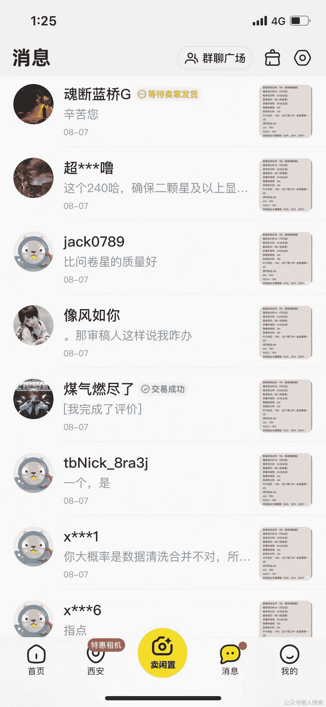
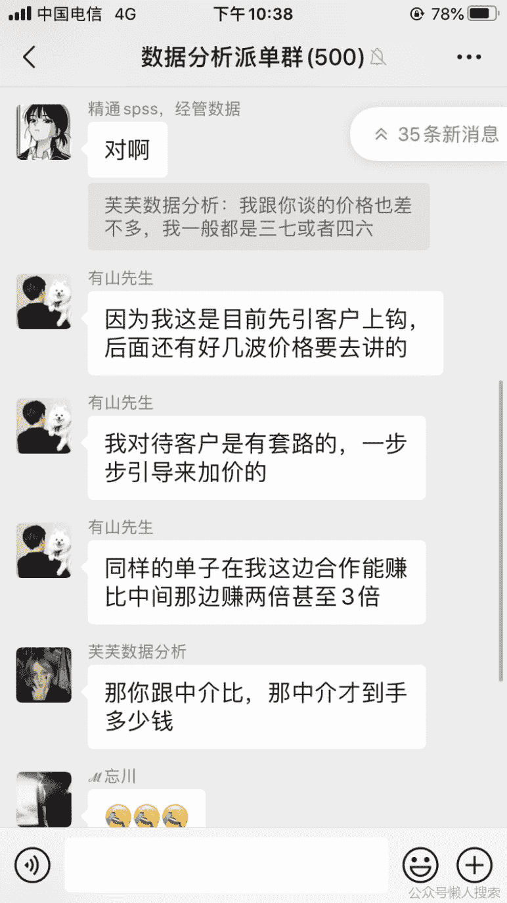
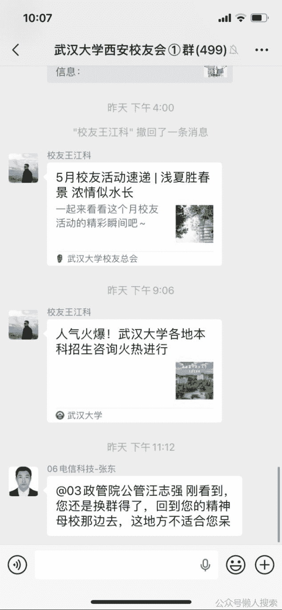
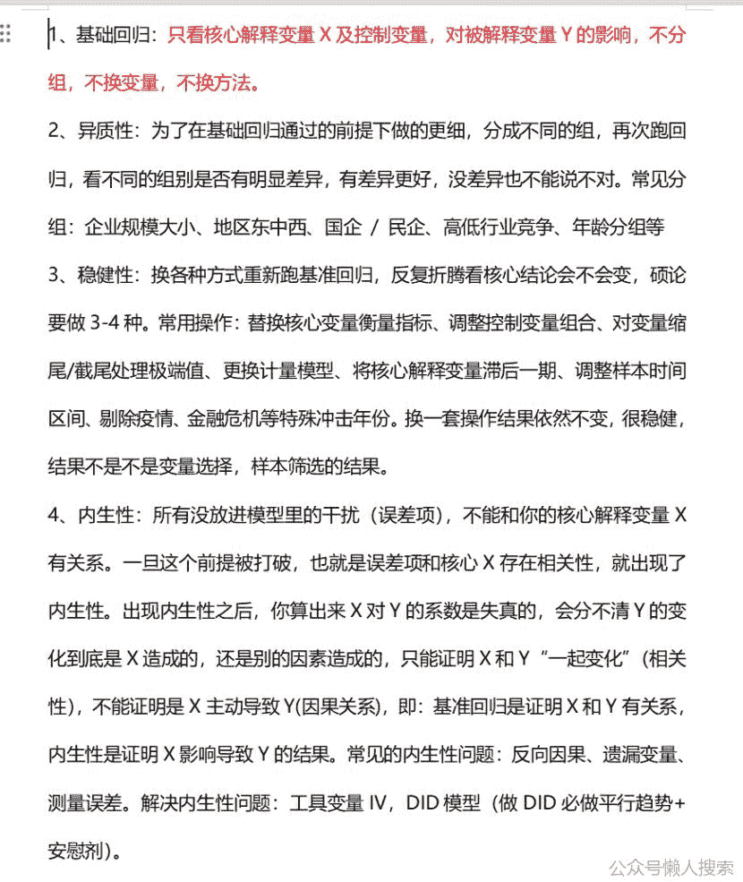

# 副业一年复盘：从不断踩坑到锁定论文+数据分析，我如何赚到近20万

整理：👸号懒人搜索 / 懒人专属群精选  
（懒人🛰️：lazyhelper1）

这是我在赚钱的第二篇复盘，照例不说废话，只讲能直接用的东西。

去年6月，经吴泽承学长推荐，我进了赚钱圈子。这扇门一打开，我这个打工十几年的“老牛马”才发现，原来还有这么多搞钱的可能。6月到11月，我先后试过👸号流量主、📕店铺、虚拟资料，最后都因为各种原因没跑出正反馈。11月参加线下聚会，接触到了论文方向，客单价高、需求又硬，我才决定沉下来认真做。4月那篇《赚钱新人成长记，论文写作——从淘宝低价接单到自己做流量月收入4万》，已经把为什么选这个方向、怎么在淘宝低价接单、怎么进入更高客单价的派单群、再到自己做流量和交付，整个过程都写过了，具体可以翻那篇。  

## 一、这一年收获到的东西

到了暑假，学生陆续毕业，这波需求也算收尾了；6到8月主要是硕博开题，节奏慢下来，正好做个复盘。这一年，我能明显感觉到自己变了。

### 1. 闲鱼流量的三个粗暴打法

先说结论：闲鱼流量是我碰过最好上手的，简单直接、见效快。我的方法就三条。

- 找对标：直接找同行，图片和文案连一个字都不用动，完整复制，关键是还不容易违规。
- 补单：没流量就补两三天，最多第三天基本能起来，一天10个以上咨询不难。
- 投流：花29.9元，既能拉曝光，也算给平台“交保护费”。只要平台赚到了钱，一些敏感词官方就会睁一只眼闭一只眼；想纯靠自然流不花钱，我觉得不现实。

上面那张图就是我用这套方法跑出来的自然流。至于每天签到、做平台任务，我觉得意义不大，把这三件事做好就够了。时间多可以多养几个号。如果是新号，一定先养几天再发，别上来就开干，容易踩违规。  

这套方法不是我一个人运气好。跟着我一起做的朋友，用同样打法，也都差不多3天左右接到咨询。持续投流+补单一周后，曝光基本稳了（淡旺季会有波动），一个号每天5到10个咨询，号多咨询就多。不管哪个行业，闲鱼都值得新手试试。

### 2. 从咨询到成交的卡点，我是这样破的

有了咨询不代表能成交。刚开始我不会聊、不会报价，报高了怕跑掉，报低了又觉得亏。最常遇到的卡点是客户说“你比同行贵”，然后单子就黄了。

我有个习惯：不会的东西，愿意花钱找人请教。这里必须说说“红包大法”——加上大佬后，先发个奶茶钱或华子，请对方多讲几句、多透点信息。这招是从吴泽承学长那里学来的，效果特别好，很多原本觉得距离很远的大佬，瞬间变得耐心又亲切。正是靠一位大佬拉我进的群，我在群里看到一段话术，自己改装后，搞定了好几个嫌价高的客户。做代写类都适用：PPT、招投标、文案脚本、商业分析，都能提升转化。

那段话术的核心逻辑是：一篇能过答辩、5到6万字的硕士论文，有效工作量最低也要260到300小时，这还只是看文献、补充内容、撰写、修改、降重、格式这些环节。按大学生兼职时薪15到20元算，光人力成本就是3900到6000元。肯定会有人报在4000以下，但谁要是报价低于这个数，连最基本的劳动成本都不够。

这世上没人会做亏本生意。低于成本报价，唯一合理的解释就是他的产品成本也极低：要么是全文抄袭或AI拼凑，要么是用完全不相干的旧稿糊弄。如果都不是，那商业模式大概率不是靠服务赚钱，而是靠骗完定金消失，或者拿到个人信息和学术把柄后二次勒索威胁。这些事不是没有。比起损失钱，更怕的是耽误时间，别人都毕业了，你还担心自己能不能过。别为了贪小便宜吃大亏。

时间、单价可以按客户实际情况调，逻辑自洽就行。

### 3. 成交率从10%到30%，我做对了什么

现在我的转化率稳定在30%左右，比最早10%的时候满意多了。除了上面那段话术，还有几个尝试：

**一口价，不套路。** 我白天上班，还要做流量、成交、写论文，真没时间陪人磨价格。我性格也爽快，报价直接一口价，不来回拉扯；也不会写到一半再加钱，既过不去良心坎，也怕被差评。但这个行业太多人喜欢低价引流，先把人吸引过来，再找理由加价，我见过200元慢慢加到1000元的。所以客户嫌贵时，我会发一张图，让对方看看别人是怎么一步步套路的，然后承诺中间绝不多收一分钱。这张图对成交帮助很大。

**真实学历背书。** 我毕业院校不错，对成交也有帮助。闲鱼上清一色自称复旦、交大，90%是包装出来的。而我是真的，会主动亮出校友群和聊天记录，向客户证明信息真实。靠这个搞定了好几个研究生客户。  

**服务案例展示。** 客户聊天记录我都留着。对方担心售后，就挑之前的案例打码发过去。比如有个客户让我做基准回归，后来数据要更新，需要重新清洗、合并数据，因为没做分析，我就没收费。类似的例子都做了标记，随时能找出来；有时还会录屏，截图能造假，视频更有说服力。  

**心态上最大的变化。** 从去年11月到今年7月底，一共赚了接近20万，其中90%是2到6月自己做流量赚的。第一次有了工资以外的收入，整个人的状态都不一样了。以前聊很久没成交会难受，后来成交一个小单子就开心半天；现在没成交不难受，成交了也没那么兴奋。另外我被裁过一次，年龄又没优势，以前花钱总是抠抠搜搜，价格高点的东西还要犹豫半天；现在好了很多，该买就买。最主要的，是看到了副业这条路能走通，对未来有信心了。

## 二、这一年踩到的两个新坑

**平台管控。** 论文类不属于合规项目。3月遇到一波平台管控，我两个闲鱼号都多次违规，闲气值掉到60以下，流量直接清零，整个平台的论文类帖子也基本下架。现在还能玩的，更多是经验分享、避坑内容；像以前直接发毕业论文、论文辅导已经行不通。不过总有人能找到新路子，比如发一本论文写作的书，配一句“懂的都懂”，咨询又慢慢回来了。

**反复修改。** 论文写完通常还要改三四轮，尤其4月后准备答辩，修改集中轰炸，刚处理完一个又来一个。虽然修改步骤和提示词都是现成的，但依然很烦。这是论文项目的通病，哪怕写得再好，导师也得让你改，不然怎么体现水平？

## 三、5月之后的转型思路

那段反复修改的日子让我一度迷茫，专门花了几天想以后的方向：继续深耕论文，还是转身学AI编程和skills？当时skills太火了，到处都是，官方也在力推。但后来想清楚了：学编程是从0开始，什么时候能变现完全没数；论文这条路，我已经从0跑到1，只是还没放大。现在放弃太可惜，就算要转，也要先试完1到10再说。编程以后肯定要学，龙哥说过这是未来最核心的能力之一。

想清楚之后，我给自己定了几个方向：

### 1. 只接研究生论文

研究生论文客单价6000起步，多改几轮也值。本科论文不碰了，修改太耗时间，尤其4到5月高峰期忙不过来，性价比太低。

### 2. 做市场调研分析类比赛

比如正大杯这类，客单价800到1500，内容写法和论文差不多，但要求宽松很多，格式也不严格，一小时能写完一篇。很多时候一次成型，基本不用改，我还拿过好几个省一、省二。这是教育部承认的比赛，不是野鸡赛，拿奖对评奖学金、保研都有用。需求是阶段性的，我已经把国家承认的比赛名称、举办单位、时间都整理好了，后面按时间轴去做。这块真的值得干，客单价1000+，1小时完成，没返工，完美型单子。

我的计划是先写20到30个成品。好处有两个：第一，需求集中爆发时，可以直接推已写好的内容，关键是要选对热点题，往AI、Z世代、高频场景靠，这几个方向我今年写得也最多。第二，有人图省事想买成品，这种客户不纠结选题，给他两三个题目挑就行。成品价会低一些，300到600，反正提前写好的，便宜卖也行；等他毕业时大概率会回来找你写论文，变成复购。

比赛期间还发现一个有意思的现象：一个学生想冲国奖需要做PPT，我不擅长，就介绍给别人。原来高端PPT按页收费，一页50元。我那个比赛才收1300，一个PPT竟然值1000块。当然我不会做PPT，就没研究这个。

### 3. 专注经管类论文实证分析

我写的论文90%是经管类，核心就是实证分析。后面打算专做数据分析，好处也很明显：

- **客单价尚可。** 本科300到800，研究生1300到2500。我也接过期刊实证，因为不太懂行情，1500到1800就做了，现在回头看收低了。
- **效率高。** 交付do代码就算完成，后面基本不改，也没多少售后。

为了做这个，我专门去学了Stata，还必须能写出让客户复现结果的do代码。期间补了很多概念：解释变量、被解释变量、控制变量，异质性、稳健性、内生性都是干什么的，哪些必须成立，哪些可以放宽，都整理成了笔记。

但只懂Stata还不够，就像买彩票，知道31选7，但具体怎么选不会。实证分析最核心的是先把数据清洗、合并处理好，再用不同方法测试。同样一份数据，别人做不出想要的结果，我能做得出来，这才是真正的壁垒。现在学校也聪明了，好一点的学校都会要求学生提供do文件验证是否能复现，就是怕实证结果是拼凑或瞎编的；就算学校不要求，学生自己也会要，他们也担心遇到骗子。

从5月中旬到现在，我基本都在做实证分析，还是老办法：闲鱼补单+投流。目前只跑1个号，平均每天5到10个咨询，转化2到3单，再多真的忙不过来。  

我知道的专业机构都是玩矩阵的，抖音、📕、淘宝、闲鱼全面铺开，几十上百个号一起上。大的有自己的专职写手团，再配兼职；小的主要靠兼职写手在群里接单，五五分。流水从每个月几万到几十万都有。我也想过这种模式，但对我来说不现实：一方面要上班，时间不够；另一方面这种玩法需要公司式运营流程。我现在擅长的是后端交付，整个盘子要我亲自把控，还有欠缺。

### 4. 商业分析/可研报告，先放了放

听人说商业分析起步3000以上，可研报告5000以上，赚的是B端的钱。这点钱对拉投资、搞项目的人来说不算什么，做得好复购和转介绍也很多，只是需求没论文大。做这个最核心的还是数据分析，算是我的舒适区，主要缺的是流程框架、价格行情和谈判策略。我的想法是先做起来，遇到问题再找人解决，能花钱办的事不自己硬琢磨。本来计划8月底前跑通，结果上周参加线下活动，遇到一位做可研报告的大姐，说大环境不好，政府项目锐减，他们公司收入从去年1500万降到今年6月底的200万。旁边一位银行大姐也说了同样的话。商业分析、可研报告都是拉投资、放贷款用的，现在政府没钱，贷款放不出去，需求自然萎缩。她们建议我还是继续做论文或数据分析，学生群体大，毕业是刚需。听完我决定先把可研放下，继续放大数据分析。

### 5. 流量这块，又爱又恨

闲鱼我是又爱又恨。爱的是流量好搞，基本每天都有成交；恨的是客单价低，会来闲鱼的，核心就是图便宜。后面准备往📕、抖音转。前两天花了两天学skills，做出来一个📕自动发布，效果不太满意，发了一个还被平台识别了，这种自动化很容易封号。我的体会是，想提高效率，最好的办法是找现成的东西拿来用，别自己瞎摸索；没人带路时，瞎摸索浪费时间，还会打击自信，搞不好把赚钱机会都错过了。后面的方向肯定是投流，平台也要赚钱，你让平台赚到钱，平台才会让你赚到钱。等我大范围试过之后，再来分享踩过的坑。

## 四、最后说几句

加入赚钱刚好满一年，从最初的迷茫彷徨，到现在跑通一个赛道，酸甜苦辣都尝过了。之前线下聚会聊到，我为什么下定决心一定要把副业跑通？就是因为被裁过，在这个大环境下，真的怕了。

如果你和我当时一样，已经下决心要把副业搞成，那在赚钱这个大平台上，盯住一个方向认真去做，一定也能做成。像我这种纯小白都能跑通，有太多人都做到了，你也没问题。当初我就是这么鼓励自己的。

上周参加一个线下活动，主题是副业怎么从0到100万，正是我现在最需要的。很多人可能还卡在选项目上，这里分享一位大佬给的选项目公式：

好的项目 = 项目成功率 × 正反馈周期 × 账号数量 × 项目周期

我觉得这个公式说得特别好，分享出来和大家共勉。

最后，感谢赚钱这个平台，感谢每一位给过我帮助的人。特别谢谢吴泽承学长，在我摸索项目、遇到困难时帮了特别多。也祝吴泽承学长和龙哥在非洲玩得开心，再次感谢。  

—— 分割线 ——

看完这篇SOP，你可能觉得已经懂了；可一到动手，90%的人会卡在第一步。

工具和教程只是最浅的壁垒，真正的壁垒是“立刻动手”和“圈层信息差”。

如果你也想看最新变现玩法，和一群执行力极强的极客一起下场拿结果，欢迎来我的核心私域【懒人专属群】看看。这里不聊虚的，只做商业闭环拆解和AI效率压榨，里面已经沉淀了1000多个跑通的套利实战案例。

👉 查看圈子完整数字资产与上车门槛：https://lazyso.com/insider/

认同价值、准备好下场干活的，加我🛰️（lazyhelper1），备注【实操上车】，不闲聊。