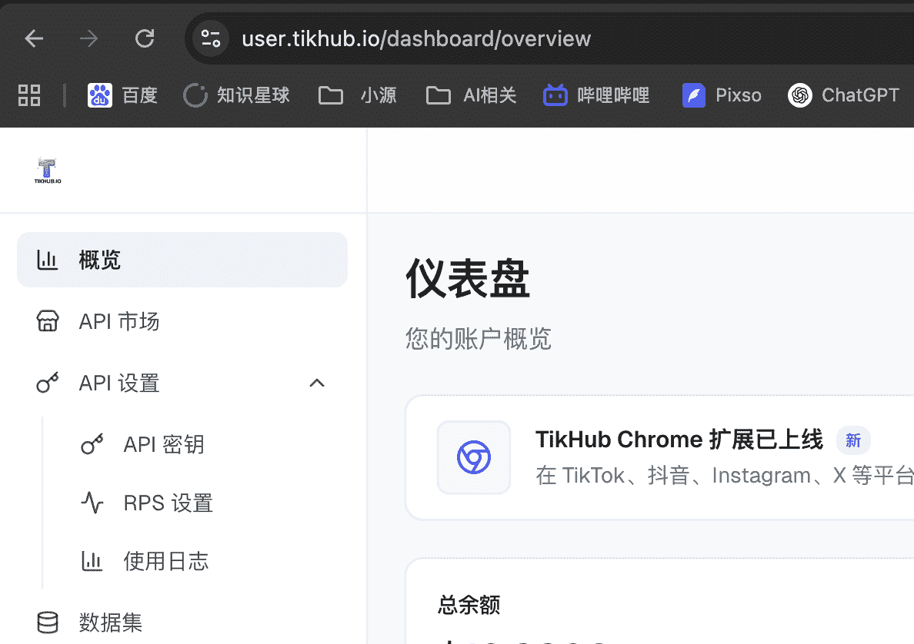
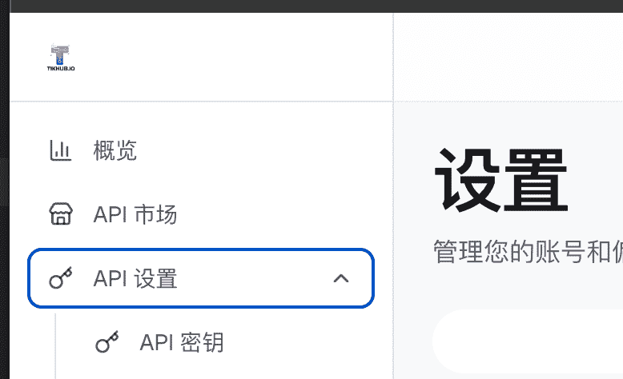
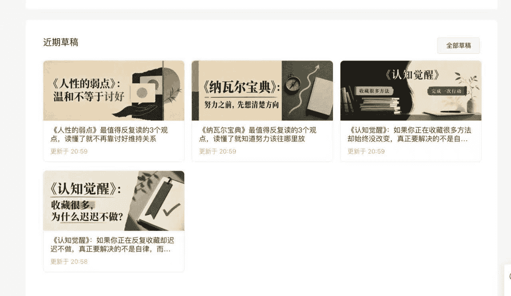

# 从零到一，👸号无人值守流水线终于被我盘活了

今年3月，我开始认真琢磨AI。那阵子刷到很多人说，👸号能做成一条全自动生产线：自己找话题、自己写稿、自己出图、自己排版，最后连草稿箱都帮你填好，你只需拿起手机扫一眼，点个发送完事。

听着很爽，对吧？但这事我整整折腾了好几个月，一直停在“理论上可行”，直到最近才真正跑通。问题出在哪？不是工具不行，而是我一开始根本没把流程拆明白。


## 先把目标拆成七个问号

真正动手以后我才发现，👸号自动化这件事，看着是一句话，做起来是一堆细节。想做完整套，至少要回答这几个问题：

1. 文章由谁执笔？我手动写，还是让AI翻我的素材库，模仿我的语气写？
2. 标题怎么敲定？行文逻辑怎么铺？
3. 封面图从哪来？要不要给正文配图？
4. 排版环节能不能省掉人工？
5. 我的👸号怎么授权给系统？AppID等接口参数放在哪里？
6. 图文、封面、插图最后怎么打包传上去，顺利落到草稿箱？
7. 哪天我没有灵感，怎么去检索别人👸号的文章数据，找到靠谱的对标账号？

这七个问题一旦列全，整套思路就浮出来了。

## 向Codex下需求，千万别只说一句话

如果你也想照着做，我的教训是：不要只丢给Codex一句“帮我搞个👸号自动化工具”。这种模糊需求，最后大概率换来一个徒有其表、点不动的网页壳子。

要像安排一个真人员工那样，把输入、步骤、产出、报错处理和验收标准全交代干净。我当时是这样下指令的：

以技术负责人身份，在当前目录下搭一个能本地运行的“👸号内容工作台”。别停在方案层面，代码、启动、测试、文档必须一步到位。

目标流程是：输入关键词或手动标题；从合规渠道搜候选文章与公开数据；把URL、标题、作者、时间、阅读、点赞、评论等可获得的指标存档；对候选结果去重、排序，生成选题卡；从我本地的素材库做RAG召回，分别提取观点、原句、实例、方法论卡片和文风参数；依据召回内容撰写原创初稿，严禁照搬原文、严禁编造经历数据案例；规划封面与内页配图方案，图片只允许调用当前Codex会话内置的image_gen/Image2能力，若不可用就暂停，绝不外接API Key或付费第三方接口；套用固定👸号模板导出HTML；上传封面和正文图片；调用🛰️官方接口建立草稿；返回media_id、标题、日志与失败原因；各步骤可单独重跑，已跑通的环节不重复计费或重复传图。

工程约束如下：技术栈锁定Node.js 20+、TypeScript、SQLite；密钥只读.env，提交.env.example，.gitignore屏蔽.env、日志、本地语料；数据源、检索器、写作器、图片器、排版器、🛰️上传器各自独立成模块；每次任务生成唯一runId，各阶段状态标记为pending/running/succeeded/failed；外部请求全部配置超时、指数退避重试、结构化日志；每条内容保留sourceIds以便溯源；未经确认不发布，只进草稿箱；先做最小可用版再逐步增强；每个环节必须实际跑测试，不许说“理论上能通”。

目录规划：content-workbench/下分src/adapters（数据搜索、模型、图片、🛰️接口）、src/rag（切片、索引、检索、重排）、src/pipeline（流程编排）、src/templates（HTML模板与提示词）、src/db（SQLite结构与迁移）、data/raw（只读原始语料）、data/index（索引）、output/每runId（产物）、tests、.env.example、README.md。

验收标准：npm install后能启动；演示数据能完整跑到本地HTML；没有🛰️凭证时用mock模式校验上传请求结构；有凭证仅建草稿不发布；页面刷新后历史任务和各步骤状态仍在；README写透安装、配置、运行、重试和常见报错。

这段长指令的目的，不是叫Codex立刻憋出文章，而是先把整个产品的边界和约束钉死。

## 第一步：数据从哪来

如果我有明确想写的内容，直接开干就行。但大部分时候我没选题，或者希望发出去的东西有人看，那就得先去市场上找对标。

最初我用的是免费路子：让Codex靠Computer Use控制浏览器去搜数据。能用，但问题也很明显——数据颗粒度太粗，阅读量、点赞量、评论量经常缺一半。

后来朋友给我提了一个叫TikHub的工具。它不光覆盖👸号，📕、抖音、视频号同样适用。

注册地址我放这儿（带我的邀请码，介意的话可以直接搜TikHub单独注册）：

https://user.tikhub.io/register?ref=DlPNbs6h



阅读量、播放量、点赞数、评论区内容，基本都能捞全。用法也不费劲：注册账号，申请API Key，配进Codex的环境变量，Codex就能通过接口批量抓取和整理数据。用API会花点小钱，但很便宜，我拉20篇👸号文章，消耗还不到1美元。

## 抓回来不算本事，能留证才算数

搜索这层最怕做出“好像有结果”的假象。要做一个经得起用的系统，数据源、原始链接、抓取时间和当时的指标必须一起落库。以后想换一套排序规则，直接用旧数据重算就行，不用再全网爬一遍。

```ts
export type SearchItem = {
  source: string;
  sourceId: string;
  url: string;
  title: string;
  author?: string;
  publishedAt?: string;
  collectedAt: string;
  metrics: {
    views?: number;
    likes?: number;
    comments?: number;
    favorites?: number;
  };
  rawText?: string;
  rawPayloadPath?: string;
};

export interface SearchProvider {
  search(input: {
    keyword: string;
    startAt?: string;
    endAt?: string;
    limit: number;
  }): Promise<SearchItem[]>;
}

export function evidenceLevel(x: SearchItem) {
  const hasUrl = Boolean(x.url);
  const metricCount = Object.values(x.metrics).filter(Number.isFinite).length;
  if (hasUrl && metricCount >= 2) return "可比较真实数据";
  if (hasUrl && metricCount >= 1) return "真实数据候选";
  if (hasUrl) return "已发现·数据待补";
  return "不可入库";
}
```

让Codex对接TikHub这类服务时，最忌讳让它凭空猜接口地址和字段。正确姿势是：把官方接口文档、示例返回体、你的套餐权限全部丢给它，让它封装成一个独立的SearchProvider模块。以后换数据源，只动这一层。我提的要求包括：API Key从环境变量DATA_PROVIDER_KEY读取；原始响应存到output/runId/raw/备查；URL规范化并按sourceId去重；凡是“热门、爆款、值得写”的结论，必须附来源、指标和证据等级；没数据就明说“数据待补”，禁止用AI内容冒充热度；分页、429、超时、5xx都要重试；正常返回、空结果、限流、字段缺失分别写测试。

## 第二步：让AI动笔的三种姿势

数据到位后，接着就是写稿。

第一招，仿写优秀文章。挑几个你真心认可的博主，或者锁定几个对标号，让AI拆解它们为什么受欢迎——标题怎么取、开头怎么抓人、行文骨架怎么搭。注意，学的是方法论，不是复制粘贴。最终产出必须融入你自己的观点、案例和经历。

第二招，建个人素材库。前提是你已经写过大量文章、存了不少文字资产。我自己用的是Obsidian，里面存了原创文章、个人观点、日常说话方式和一套属于我的人格语料。之后只要丢一个标题进来，Codex就能从库里调取资料，按我的表达习惯输出一篇“像是我写的”内容。说起来你们可能不信，Obsidian我压根不太会操作，这个库全是Claude Code或Codex帮我搭的，我只是提需求。

但有个坑必须说：人格语料不是把作文一股脑堆进文件夹，让AI自己摸索“我是谁”。我把它拆成了五级结构。

最底下一级，原始语料层。放我亲手写的文章、课程答疑、咨询记录、访谈实录、聊天片段和口播转写。书面语和口语分开存放，因为我写字时的句子和我在镜头前说话完全不是一回事。

第二级，价值观层。系统从原始素材里抽取我长期坚持的判断，比如我怎么看成长与主控权，怎么看市场与变现，怎么看关系、咨询、内容、销售和合作。每条判断不只留一句话结论，还会绑定对应行动指南，以及我绝不认同的做法。

第三级，原句库与高价值原文。专门收藏最能代表我的原话、案例和整篇成品。AI需要表达一个观点时，优先从我实际说过的话里找素材，而不是现场替我编一句听起来很像我、其实我没说过的话。

第四级，方法卡和主题入口。品牌表达、销售成交、咨询关系、个人成长这类高频主题，各有各的调用口子。系统先判断这篇稿子属于哪个主题，再去对应的人格池取料，避免不同领域的内容搅作一团。

第五级，写作人格层。用我真实的旧文做数据统计，分析句子长短、高频措辞、标题偏好、段落节奏、提问姿势和结尾习惯，再挑一批最有代表性的文章作为参照样本。这样AI拿到标题后，不仅知道“写什么”，还知道“换作我来讲，我会怎么开口”。

## 真正的RAG：一次只取当用的料

RAG，翻译成大白话就是“先检索，再生成”。它每次只从库里捞和当前选题最相关的一小撮素材，连同出处一起交给模型。它奥妙在两个地方：省上下文，每条信息都有据可查。

做法分三步。

第一步，给素材打元数据。至少标清语料类型、所属主题、适用场景、能否公开、时间轴和来源出处。文章、咨询记录、客户档案绝不能放在一个权限级别里。

```yaml
---
id: article-2026-001
kind: original_article
channel: written
subjects: [AI, 内容创作, 个人成长]
visibility: publishable
source: 10_原创文章/👸号自动化.md
created_at: 2026-08-01
---
```

剩下正文……

第二步，做语义切片。不是拿尺子量，每500字割一刀。要顺着标题层级、段落天然边界和语义完整性来切。原话、实例、方法论，尽量不要被拦腰截断。

第三步，混合检索。关键词检索负责精确命中专有名词和原话，向量检索负责捕捉含义相近的表述。两路结果合流后，再按人格层级、主题匹配度、公开权限排一遍序，才交给写作模块调用。

搞完这套，👸号从找数据、定选题、出初稿、做配图、套排版到进草稿箱，才算真真正正闭合。回头看，最难的不是工具参数，而是你愿不愿意把自己的思维框架、观点立场和文字偏好，整理成一套AI听得懂的规则。

最近我把自己的公号创作流程沉淀成了一份可重复执行的规范。它既能用来从零写原创，也能基于本地资料库产出内容，还能把一篇未定稿改成我自己的风格。这份规范已经写进了系统里，具体配置如下。

```ts
export type Chunk = {
  id: string;
  text: string;
  sourcePath: string;
  headingPath: string[];
  kind: "value" | "quote" | "case" | "method" | "style";
  channel: "written" | "spoken";
  subjects: string[];
  visibility: "publishable" | "private";
};

export async function retrieveForWriting(query: string) {
  const [keywordHits, vectorHits] = await Promise.all([
    keywordSearch(query, 30),
    vectorSearch(query, 30),
  ]);

  return reciprocalRankFusion(keywordHits, vectorHits)
    .filter(x => x.visibility ===

`"publishable")`

`.sort((a, b) => layerWeight(b.kind) - layerWeight(a.kind))`

`.slice(0,

12);`

`}`

`function layerWeight(kind: Chunk["kind"]) {`

`return { value: 5, quote: 4, case: 4, method: 3, style: 2 }[kind];`

`}`

4. 第四步，是把证据交给写作器。

提示词里要明确：

只能根据召回资料写；没有资料支持的经历、数字和客户案例必须标为缺失，不能补写。

请为 `data/raw` 目录建立本地 `RAG`：

1. 扫描 `md`、`txt` 和可提取文本的 `docx`；
2. 读取 `YAML` 元数据，没有元数据的文件进入待整理清单，不直接公开使用；
3. 按标题和自然段切片，单片建议 300 到 900 字，并保留 `sourcePath`、`headingPath` 和 `chunkId`；
4. 建立 `SQLite FTS` 关键词索引，并接入可配置的向量嵌入器；
5. 检索时同时执行关键词与向量召回，再用 `RRF` 合并；
6. 支持 `kind`、`channel`、`subjects`、`visibility` 过滤；
7. 返回每个命中的原文片段和来源路径；
8. 写入 `output/<runId>/retrieval.json`；
9. 为“找得到原话、不会召回私密资料、书面与口播分开”写自动测试；
10. 如果向量服务没有配置，系统必须退回 `FTS` 检索，而不是整条流程崩溃。

客户资料、咨询原文和私人聊天默认设为 **private**。只有明确允许公开的片段才能进入写作上下文。

如果你觉得我的整理方式不错，也可以参考我的方法，慢慢建立一套属于自己的知识库。

## 安装写作 Skill

现在网上已经有很多人制作了不同类型的写作 Skill，也就是已经整理好的工作方法。

比如最近卡兹克发布了一套“活人感写作”的 Skill，你可以把这个 Skill 下载下来，安装到 Codex 里面，让 Codex 按照这套写作方法帮你改写文章。

如果你不知道写作 Skill 应该怎么做，也可以先研究一套成熟的公开方法。比如卡兹克公开的写作 Skill，它最值得参考的地方，并不是几个夸张词或者口头禅，而是一整套内容生产流程：

1. 这套方法会先看信息是不是足够新，再判断它和普通读者有没有关系。
2. 选题确定以后，还要找到一个有反差、但又能够被真实证据支持的角度。
3. 接下来不是马上写文章，而是先亲自测试、收集截图、整理数据、记录失败和意外结果。
4. 真正动笔时，再把这些材料写成一个普通人愿意读下去的故事。
5. 文章发出去以后，还会继续看评论和数据，判断读者在哪一段停留、哪一个问题被反复追问，再把有效经验沉淀回 Skill。

它的核心不是“写得像卡兹克”，而是建立一条从信息、验证、写作到复盘的完整链路。公开仓库：

Khazix Skills 公开仓库
khazix-writer 写作规则
卡兹克的公开内容方法论

我自己的 **Codex** 里，还另外安装了“活人感写作”和“去 AI 味”两套 Skill。

- “活人感写作”会先检查材料够不够。真实文章必须有经历、数据、动作、原话、失败过程或者可以核验的资料。材料不够，就缩短文章或者继续找资料，不能临时编一个“我认识的人”来撑篇幅。
- 写作时，它会先确定是谁在说、凭什么知道、现在为什么想讲这件事。每一段都要增加新的事实、动作、区别或后果，不能只是把同一个观点换几种说法。
- “去 AI 味”则负责清理模型常见的写法。比如过多的“首先、其次、最后”，机械的三段式，满篇粗体，空泛的金句，宣传腔，以及为了显得深刻而强行升华。
- 它还会检查句子节奏。短句和长句要交错，复杂的地方可以多说几句，已经讲明白的地方就停下来。允许有第一人称、真实情绪和一点自我修正，但不能靠口头禅、错别字和网络梗假装自己是活人。

我理解的“活人感”，不是故意写得随便，而是让文章里一直站着一个具体的人。他有材料、有判断，也愿意承认自己不知道的地方。Skill 可以理解成一套固定的工作流程。

安装完成以后，Codex 就知道写一篇文章时应该经过哪些步骤，以及怎样让文章的表达更自然、更像真人。

当然，你也可以自己制作一套 Skill：

你可以找五到六篇自己喜欢的文章，全部交给 Codex，然后告诉它：

请帮我分析这些文章的写作逻辑、内容结构、标题方式、开头方法和表达特点。如果我希望参考这些文章进行创作，应该保留哪些结构？怎样才能在学习这些文章优点的同时，写出一篇具有原创性的文章？

Codex 分析完成以后，你还可以继续告诉它：

请把这些写作规律整理成一个固定格式。未来我的所有文章都按照这个格式来写，但观点、案例和具体内容必须重新创作，尽量保留原创性。

这套写作格式做出来以后，还需要测试几次。

看看文章实际写出来是什么样子，再不断调整它的表达、结构和提示词，直到文章越来越接近你想要的感觉。

## 把写作方法做成一个真正能调用的 Skill

一套 Skill 至少要说清楚：什么时候触发、先读什么、按什么步骤执行、哪些事情不能做、最后怎样验收。只有风格形容词，没有操作步骤，AI 依然不知道该怎么稳定复现。

```yaml

---

name: my-wechat-writer

description: 当用户要写🛰️👸号文章、基于本地知识库原创写作、或把初稿改成我的个人风格时使用。

---

# 我的👸号写作 Skill

## 输入

- 文章主题或标题

- 目标读者

- RAG 检索结果（必须带 sourcePath）

- 可选的对标文章，只用于分析结构，不得复制正文

## 流程

1. 检查材料：至少包含观点、一个真实案例或动作、可追溯来源。

2. 输出写作卡：核心判断、读者痛点、证据、结构、不能写的内容。

3. 写初稿：痛点或真实场景开头，短段落，强判断单独成段。

4. 事实检查：数字、经历、案例必须能对应 sourcePath。

5. 去 AI 味：删除机械三段式、空泛金句、重复总结和宣传腔。

6. 输出：标题备选、正文、引用来源、仍需补充的证据。

## 禁止

- 不虚构“我认识的人”、收入、客户结果和使用体验。

- 不把对标文章换词复述。

- 不为了像真人而故意加错别字和网络梗。

- 不调用 visibility=private 的资料写公开文章。

## 验收

- 每一节都有新事实、新动作、新区别或新后果。

- 关键判断能找到来源。

- 手机阅读时没有连续大段文字。

- 结尾是明确判断，不是泛泛总结。

```

请读取我提供的 6 到 10 篇本人原创文章。不要直接模仿句子，先生成 `style-report.md`，统计并举证：

- 标题长度、常见标题结构；
- 开头是场景、痛点、判断还是提问；
- 句长分布和段落长度；
- 常用转折、提问、强调和收尾方式；
- 高频主题下稳定的价值判断；
- 明确不喜欢的 AI 写法。

然后创建 `skills/my-wechat-writer/SKILL.md`，写清触发条件、输入、流程、禁止项和验收标准。再用一个从未见过的新标题做盲测，同时保留：检索证据、第一稿、修订稿和差异说明。不要因为测试不合格就修改原始样文；只迭代 `Skill`。

## 第三步：用 Codex 制作文章图片（提供两种方式）

文章完成以后，下一步就是制作图片。这个部分也可以直接交给 Codex。

如果你过去没有在 Codex 里使用过图片生成功能，这里有一个很容易踩到的坑。

GPT 的图片生成能力，很多人习惯叫它 Image2，也就是 GPT Image 2。

但是在 Codex 里面，你不能只告诉它“使用 Image2 帮我制作图片”。

因为你这样说的时候，它有可能会理解成需要连接某个外部 API，然后告诉你没有相应的 API，所以暂时无法使用这个功能。

你需要直接告诉 Codex：

请使用 ImageGen 图片生成能力，帮我制作这篇文章需要的所有图片。

只要说清楚要使用 ImageGen，它就知道应该调用图片生成能力来完成制作。

这个能力确认以后，未来文章的封面和内页图片，都可以直接通过 Codex 制作。

### 第一种：图片这一步，也要有固定的输入和验收

只说“帮我配几张图”，每次都会重新抽风格，更稳定的做法是：

先让系统输出图片计划，再逐张生成，并记录每张图属于文章哪一段、尺寸是什么、是否需要文字、失败后怎样重做。

```json

{

  "articleId": "run-20260813-001",

  "style": "真实工作台 + 简洁信息图",

  "images": [

    {

      "id": "cover",

      "role": "cover",

      "ratio": "2.35:1",

      "section": "article",

      "mustShow": ["👸号草稿箱", "网页工作台", "AI 流程线"],

      "text": "👸号99%自动化",

      "status": "pending"

    },

    {

      "id": "flow",

      "role": "inline",

      "ratio": "16:9",

      "section": "先把👸号自动化拆成几个步骤",

      "mustShow": ["搜索", "选题", "写作", "图片", "排版", "草稿箱"],

      "text": "",

      "status": "pending"

    }

  ]

}

这份配置分成了两部分：上半部分定义了内容生产的写作规范，下半部分则是配套的配图参数。

先解析上半部分。要启动这套机制，我至少要准备四样东西：一个想写的话题或现成标题；这篇文章是写给谁看的；从本地资料库检索出来的相关材料（注意每一条结果都得带上 sourcePath，方便后面溯源）；以及一篇可以作为参照的同类文章。参照文仅供拆解框架，不允许借用它的文字。

正式开工前，我会先把输入材料过一遍。手头至少要有一条鲜明立场、一段确实发生过的操作或事件，并且这段事件能追到具体出处。确认没有缺口后，我才会列一张创作清单，把这次要表达的关键结论、读者真正焦虑什么、拿什么作为支撑、整篇文章的骨架，以及绝对不能触碰的禁区都写清楚。

接下来进入撰写环节。我用读者最容易感同身受的困境或现实画面开头，尽量用小段落推进，最鲜明的观点单独拎出来占一段。写完草稿后做事实核验：凡涉及数字、亲身经历和事例，都得到 sourcePath 里逐一比对，不能凭印象写。

然后开始去除机器痕迹。我会把模板化的“总—分—总”框架、写了等于没写的漂亮话、翻来覆去重复的总结，以及自卖自夸的语气全部挑出来删掉。最后交给你的是几个备选标题、成品文章、引用来源清单，以及目前还缺哪些证据的提醒。

这套机制还有几条红线：不编造“身边朋友”的故事、不虚构收入数字、不伪造客户反馈和使用感受；不把参照文章用同义词替换来“洗稿”；不为让自己显得更有“人味”而故意写错别字或塞网络梗；更不会把 visibility=private 的私有资料写进对外发布的内容。

质量上也有硬性验收表：每个段落都要给读者带来新信息、新操作、新差异或新影响；任何关键结论都能查到依据；手机屏幕上不能连续出现大段大段的文字；结尾要落在明确的定论上，而不是空泛的收束。

再看下半部分的图片配置。封面图比例 2.35:1，画面上需要出现后台草稿箱、网页工作台和 AI 工作流，文字按 JSON 里的设定来就行。内文图是 16:9，放在“先把公号自动化拆成几个步骤”那一节，画面节点包括搜索、主题判断、内容生成、图片、排版、草稿箱这六项。目前两张图都还标记为 pending，等真正执行时再生成。

这套东西最大的价值，是把“凭感觉写稿”变成了“可检查、可复用”的工程。如果你也在琢磨自己的内容生产机制，不妨照着这个思路搭一套。

有时候，最吊人胃口的，不是一句惊天动地的话，而是一个没头没尾的开始。

就像现在，摆在我面前的“素材”，干净得像一张白纸，只留下一个孤零零的记号——```

先根据文章生成 `image-plan.json`，不要立刻出图。每张图写清 `role`、`ratio`、对应章节、必须出现的元素、禁止出现的元素和验收条件。经我确认后，使用当前 `Codex` 会员登录态可用的内置 `image_gen / Image2` 能力逐张生成。禁止使用 `OPENAI_API_KEY`、`Image API`、`API Mart`、第三方服务、`PIL`、`HTML`、`SVG`、`Canvas` 或本地模板冒充最终图。如果会员生图通道不可用，记录 `failed` 并暂停图片阶段，不得自动切换付费 `API`。生成后逐张检查：文字是否正确、尺寸是否符合、人物和品牌是否一致、手机端是否看得清；不合格的只重做该张。

### 第二种：确定封面的固定风格

图片功能解决以后，下一步就是设计封面的风格。

这里同样有两种方法：

**先让 AI 生成不同方向**

你可以把文章标题发给它，然后告诉它：

请根据这个标题，分别制作大字报风格、漫画风格、水墨画风格、极简风格和图文笔记风格，一共制作五种完全不同的版本，让我从里面选择一张。

等它把不同的方向做出来以后，你再从里面挑选自己最喜欢的一种。

**找到自己喜欢的对标封面**

你也可以把喜欢的封面图片发给 Codex，让它研究这张封面的构图、字体、配色、留白和视觉重点，再根据这些设计特点，重新制作一套属于你的封面格式。

等封面模板确定以后，未来👸号的所有封面就可以按照同一种风格制作。

## 第五步：确定文章内页的图片形式

封面确定以后，接下来是文章的内页图片。

你可能希望把内页做成笔记形式，也可能希望做成知识卡片、漫画、流程图，或者一页一个重点的图文形式。

内页图片的设计方法和封面基本一样。

如果你暂时不知道自己喜欢什么风格，就先让 AI 制作五种不同的版本，再从里面挑选。

如果你已经有喜欢的对标，就把参考图片交给 Codex，让它分析这套图片的设计逻辑，再做成属于你自己的内页模板。

当封面和内页模板全部确定以后，未来每次写完文章，Codex 就可以按照固定的视觉风格继续制作。

## 第六步：解决👸号排版

文章和图片都完成以后，下一步就是排版。

👸号文章如果没有排版，直接发布出去，整体的阅读体验会差很多。

排版也有两种处理方法：

**研究自己原本的排版**

你可以把过去排版好的文章发给 Codex，然后告诉它：

请帮我研究这篇文章的排版。我以后写出来的内容，最终都需要发布到微信👸号，所以文章完成以后，必须按照这套排版方式进行处理，并且让我可以一键复制粘贴到👸号后台。

这里不要只是简单地告诉它“仿照这个排版”。

最好让 Codex 先研究这套排版的标题层级、字体大小、段落间距、重点颜色、图片位置和整体阅读节奏，再根据分析结果制作一套固定模板。

**研究你喜欢的👸号排版**

比如我很喜欢小排老师的👸号排版，我就会先把他的👸号文章截图下来，再交给 Codex 分析。

这里尽量不要只复制文章文字，因为文字复制下来以后，原本的字体、字号、颜色、行距和段落格式可能会失真。

最好的方法是直接截图，然后告诉 Codex：

请帮我研究这个👸号的排版方式。我想参考它的排版逻辑，制作一套属于我自己的👸号排版。以后我把文章发给你，你排版完成以后，我可以直接复制粘贴到👸号后台。

当排版格式确定以后，文章写完就不需要再花很多时间手动调整了。

## 排版后

## 第七步：把所有功能做成一个产品中控台

前面的需求全部讨论完成以后，就可以把整套产品结构发给 Codex。

我习惯告诉 Codex：

我不希望未来每一次都在对话框里操作。我希望这套产品有一个完整的中控台，可以做成网页形式，让我以后直接在网页上完成数据搜索、选题、写文章、制作图片、排版和上传草稿箱。

当这些需求全部交代清楚以后，Codex 就会按照需求，慢慢搭建出一套带有 UI 页面，也就是可视化操作页面的产品系统。

不过，Codex 第一次做出来的页面，不一定是你喜欢的。

如果你有设计背景，可以直接用文字告诉它，页面的颜色、字体、间距和结构应该怎么调整。

如果我们没有设计背景，只告诉它“帮我改得好看一点”，它不一定能够理解我们想要什么，最后改出来的页面也不一定符合我们的审美。

这时候可以使用一个很简单的方法：

先把 Codex 制作出来的第一版页面截图，再把这张图片发给 ChatGPT，然后告诉它：

请根据这个产品目前的功能和页面逻辑，重新设计五到六种完全不同的 UI 方案。我希望页面更简洁、色彩更丰富、操作更直观。

如果你的文字表达比较清楚，就可以继续补充自己想要的风格。

如果不知道应该怎么形容，就直接使用“抽卡”的方式，让 ChatGPT 一次制作五张或者八张完全不同的页面，再从里面挑选一张自己最喜欢的。

选好以后，把这张 UI 设计图重新交给 Codex，让 Codex 按照图片里的结构和风格，把网页页面制作出来。

这是我目前觉得最快的 UI 调整方法。

## 第八步：让文章自动进入👸号草稿箱

产品页面完成以后，接下来就是整套流程里比较麻烦的一步：

怎么让做好的文章自动进入👸号草稿箱？

这里需要准备三个重要信息：

**AppID**

进入微信开发者平台，在账号详情里找到 AppID，然后把它配置到系统里面。

**Secret 密钥**

Secret 需要在👸号后台对应的页面里单独获取，它和 AppID 一样，都是调用👸号接口时需要使用的信息。

**AppID** 和 **Secret** 都属于重要的账号凭证。不要把它们发到公开页面，也不要直接写进公开的代码仓库。最好通过系统的环境变量或者密钥管理功能保存。

**IP 白名单**

在👸号后台的相关页面里，可以找到 IP 白名单的编辑入口。

只有把负责上传文章的服务器 IP 加入白名单，系统才有权限通过接口把文章送进👸号草稿箱。


为什么 **IP** 白名单比较麻烦？

这里会遇到一个问题：

网络 **IP** 是浮动的。（技术细节我其实不太懂。）也就是说，你今天使用的是这个 IP，明天可能就换成另外一个 IP。

**IP** 一旦变化，原本设置的白名单就可能失效，文章也就无法继续自动上传。

解决这个问题，大概有三种方法：

1. 第一种，使用拥有固定公网 IP 的云服务器。

如果你已经有腾讯云或者其他平台的云服务器，就可以把上传👸号文章的程序部署在服务器上，再把服务器的固定 IP 添加到👸号白名单。

这样以后每次上传文章，使用的都是同一个 IP，白名单就不需要经常修改。

2. 第二种，使用自己已经搭建好的云端服务。

如果你原本就有其他云端环境，也可以把自动上传的功能放在云端运行。

具体使用哪一种方式，可以根据自己的情况选择。

3. 第三种，把文章集中处理。

如果你觉得单独购买云服务器，只为了固定👸号白名单不太划算，可以让 Codex 每次集中处理一周到两周的文章。

一次把这一周或者两周需要发布的内容全部写好、完成图片和排版，再统一送进👸号草稿箱。

这样就算 IP 发生变化，需要重新修改白名单，一个月也只需要处理两次。

因为只有这两次，你需要让系统集中连接👸号，把文章上传到草稿箱。

## 这样就能做到 99% 的自动化更新

文章进入👸号草稿箱以后，接下来的操作就简单了。

你可以直接在👸号后台设置定时发布，也可以每天到了固定时间以后，打开手机检查一下文章，再点击发送。

这样，👸号就基本实现了 99% 的自动化更新。

整个流程包括：

搜索数据、确定选题、生成文章、制作封面、制作内页图片、完成排版、上传👸号、进入草稿箱。最后只剩下检查和点击发送这一步。


这个流程听起来简单吗？

其实我自己研究了好几个月。

我一直听别人说，AI 可以把文章自动送进👸号草稿箱，但我始终没有成功。

有时候是不知道网页应该怎么跳转，有时候是不知道某个功能应该在哪里设置……

还有很多非常细小的步骤，不实际操作一次，根本不会知道问题出在哪里。

所以，这篇文章也算是我从接触 **AI** 到现在，完成的一套比较完整的 **AI** 工作流程。

## 使用 AI 最难的，不是操作，而是知道完整路径

最后，我还想分享一个自己在这个过程中的感受。

我发现，使用 AI 最难的地方，其实不是 AI 应该怎么操作。

真正困难的是：我们能不能清楚地知道一件事情的完整路径，以及我们能不能和 **AI** 进行更深入的沟通。**AI** 第一次给出的方法，不一定就是最适合你的方法。如果它提供的方案不适合你，可以继续问它：



- “这个方法我可能用不到，有没有更适合我的方式？”

## 最后，再把这份验收指令交给 Codex

项目能启动，不代表整条路径已经跑通。

最后一定要让 Codex 自己准备一组测试数据，从头跑一遍，并把每一步的真实结果留下来。

请对这个👸号内容工作台做一次端到端验收，不要只检查代码：

1. 用一个新关键词创建 `runId`；
2. 搜索候选内容并核对至少 3 条来源 `URL` 与指标；
3. 展示 `RAG` 召回的观点、原话、案例、方法和风格片段，确认没有 `private` 资料；
4. 生成文章，并列出每个真实案例和数字的 `sourcePath`；
5. 运行事实缺口检查，缺证据的内容不得保留成确定说法；
6. 生成 `image-plan`。只有会员 `image_gen` 可用时才生成最终图片；否则标记暂停，不走任何 API 付费回退；
7. 生成👸号 `HTML`，用手机宽度预览，检查标题、段落、图片和链接；
8. `dry-run` 验证微信上传请求；
9. 如果我已经提供测试账号与明确授权，只创建草稿并返回 `media_id`，不发布；
10. 模拟一次上传失败，确认可以从 `wechat_draft` 单步重试，不会重新搜索、写作或生图；
11. 运行全部测试和构建；
12. 最后输出：成功项、失败项、真实产物路径、测试结果、仍需我提供的凭证或素材。

验收时禁止使用伪造截图、假 `media_id` 或“理论上成功”的描述。没有真实跑通的步骤必须明确写未完成。

做到这一步，拿到的就不再是一个“大概可以这么做”的思路，而是一份可以让 Codex 直接开工、逐步验收的施工说明。当我们学会这样和 AI 沟通以后，就可以一次得到几种不同的方案，再从里面选择最适合自己的一种。

我第一次使用 AI 的时候，也遇到过一个误区。

**AI** 给我什么，我就按照它说的方法去做。

后来我才发现，可能还有更简单、更便宜或者更适合我的方案，只是当时的我不知道应该怎么继续追问，也不知道怎么和 AI 进行更深入的讨论。

所以这篇文章表面上讲的是，怎么让一篇文章自动进入👸号草稿箱，实现接近全自动的更新。

但我真正想分享的是：

怎么把一个自己想要的功能拆成一条完整路径，再让 **AI** 陪着我们逐步完成。如果你也在更新👸号，不管你做的是👸号矩阵、书单号，还是其他和👸号有关的项目，这套 AI 使用方法应该都可以给你一些启发。

最后，祝福各位圈友龙哥盟。

## 尾声的过去历史介绍

我是根源，同时也是第四期的赚钱圈友，一个有 2w+ 实战案例的心理咨询师，13 年线下销售、团队管理经验。

2022 年开始转型线上，做一些知识付费的项目。

过去曾发表过几篇文章。

都能看到这，代表你对文章的喜爱肯定有一定的程度！

————分割线————

看完这篇 SOP，你觉得你懂了。但 90% 的人一到实操就会卡在第一步。

工具和教程只是最低级的壁垒，真正的壁垒是“立刻动手”和“圈层信息差”。


我们不聊虚的，只做商业闭环的拆解与 AI 效率的压榨。系统内已沉淀 1000+ 跑通的套利实战局。

👉 查阅圈子完整数字资产与上车门槛：

https://lazyso.com/insider/


备注：【实操上车】，不闲聊。


```。

别小看这个记号，它其实是给文案开了一扇门：门后面，什么都有可能发生。可能是金句，可能是数据，也可能是一段戳心故事。真正聪明的文案，从不急着把话说满，而是先铺好轨道，让情绪顺着一个节点自然生长。

老话说得好，留白才是最高的表达。与其堆砌辞藻，不如用一个抓手，把所有注意力都收拢到一个点上。

现在，这枚钩子已经就位。

它就是：```

先根据文章生成 `image-plan.json`，不要立刻出图。每张图写清 `role`、`ratio`、对应章节、必须出现的元素、禁止出现的元素和验收条件。经我确认后，使用当前 `Codex` 会员登录态可用的内置 `image_gen / Image2` 能力逐张生成。禁止使用 `OPENAI_API_KEY`、`Image API`、`API Mart`、第三方服务、`PIL`、`HTML`、`SVG`、`Canvas` 或本地模板冒充最终图。如果会员生图通道不可用，记录 `failed` 并暂停图片阶段，不得自动切换付费 `API`。生成后逐张检查：文字是否正确、尺寸是否符合、人物和品牌是否一致、手机端是否看得清；不合格的只重做该张。

### 第二种：确定封面的固定风格

图片功能解决以后，下一步就是设计封面的风格。

这里同样有两种方法：

**先让 AI 生成不同方向**

你可以把文章标题发给它，然后告诉它：

请根据这个标题，分别制作大字报风格、漫画风格、水墨画风格、极简风格和图文笔记风格，一共制作五种完全不同的版本，让我从里面选择一张。

等它把不同的方向做出来以后，你再从里面挑选自己最喜欢的一种。

**找到自己喜欢的对标封面**

你也可以把喜欢的封面图片发给 Codex，让它研究这张封面的构图、字体、配色、留白和视觉重点，再根据这些设计特点，重新制作一套属于你的封面格式。

等封面模板确定以后，未来👸号的所有封面就可以按照同一种风格制作。

## 第五步：确定文章内页的图片形式

封面确定以后，接下来是文章的内页图片。

你可能希望把内页做成笔记形式，也可能希望做成知识卡片、漫画、流程图，或者一页一个重点的图文形式。

内页图片的设计方法和封面基本一样。

如果你暂时不知道自己喜欢什么风格，就先让 AI 制作五种不同的版本，再从里面挑选。

如果你已经有喜欢的对标，就把参考图片交给 Codex，让它分析这套图片的设计逻辑，再做成属于你自己的内页模板。

当封面和内页模板全部确定以后，未来每次写完文章，Codex 就可以按照固定的视觉风格继续制作。

## 第六步：解决👸号排版

文章和图片都完成以后，下一步就是排版。

👸号文章如果没有排版，直接发布出去，整体的阅读体验会差很多。

排版也有两种处理方法：

**研究自己原本的排版**

你可以把过去排版好的文章发给 Codex，然后告诉它：

请帮我研究这篇文章的排版。我以后写出来的内容，最终都需要发布到微信👸号，所以文章完成以后，必须按照这套排版方式进行处理，并且让我可以一键复制粘贴到👸号后台。

这里不要只是简单地告诉它“仿照这个排版”。

最好让 Codex 先研究这套排版的标题层级、字体大小、段落间距、重点颜色、图片位置和整体阅读节奏，再根据分析结果制作一套固定模板。

**研究你喜欢的👸号排版**

比如我很喜欢小排老师的👸号排版，我就会先把他的👸号文章截图下来，再交给 Codex 分析。

这里尽量不要只复制文章文字，因为文字复制下来以后，原本的字体、字号、颜色、行距和段落格式可能会失真。

最好的方法是直接截图，然后告诉 Codex：

请帮我研究这个👸号的排版方式。我想参考它的排版逻辑，制作一套属于我自己的👸号排版。以后我把文章发给你，你排版完成以后，我可以直接复制粘贴到👸号后台。

当排版格式确定以后，文章写完就不需要再花很多时间手动调整了。

## 排版后

## 第七步：把所有功能做成一个产品中控台

前面的需求全部讨论完成以后，就可以把整套产品结构发给 Codex。

我习惯告诉 Codex：

我不希望未来每一次都在对话框里操作。我希望这套产品有一个完整的中控台，可以做成网页形式，让我以后直接在网页上完成数据搜索、选题、写文章、制作图片、排版和上传草稿箱。

当这些需求全部交代清楚以后，Codex 就会按照需求，慢慢搭建出一套带有 UI 页面，也就是可视化操作页面的产品系统。

不过，Codex 第一次做出来的页面，不一定是你喜欢的。

如果你有设计背景，可以直接用文字告诉它，页面的颜色、字体、间距和结构应该怎么调整。

如果我们没有设计背景，只告诉它“帮我改得好看一点”，它不一定能够理解我们想要什么，最后改出来的页面也不一定符合我们的审美。

这时候可以使用一个很简单的方法：

先把 Codex 制作出来的第一版页面截图，再把这张图片发给 ChatGPT，然后告诉它：

请根据这个产品目前的功能和页面逻辑，重新设计五到六种完全不同的 UI 方案。我希望页面更简洁、色彩更丰富、操作更直观。

如果你的文字表达比较清楚，就可以继续补充自己想要的风格。

如果不知道应该怎么形容，就直接使用“抽卡”的方式，让 ChatGPT 一次制作五张或者八张完全不同的页面，再从里面挑选一张自己最喜欢的。

选好以后，把这张 UI 设计图重新交给 Codex，让 Codex 按照图片里的结构和风格，把网页页面制作出来。

这是我目前觉得最快的 UI 调整方法。

## 第八步：让文章自动进入👸号草稿箱

产品页面完成以后，接下来就是整套流程里比较麻烦的一步：

怎么让做好的文章自动进入👸号草稿箱？

这里需要准备三个重要信息：

**AppID**

进入微信开发者平台，在账号详情里找到 AppID，然后把它配置到系统里面。

**Secret 密钥**

Secret 需要在👸号后台对应的页面里单独获取，它和 AppID 一样，都是调用👸号接口时需要使用的信息。

**AppID** 和 **Secret** 都属于重要的账号凭证。不要把它们发到公开页面，也不要直接写进公开的代码仓库。最好通过系统的环境变量或者密钥管理功能保存。

**IP 白名单**

在👸号后台的相关页面里，可以找到 IP 白名单的编辑入口。

只有把负责上传文章的服务器 IP 加入白名单，系统才有权限通过接口把文章送进👸号草稿箱。


为什么 **IP** 白名单比较麻烦？

这里会遇到一个问题：

网络 **IP** 是浮动的。（技术细节我其实不太懂。）也就是说，你今天使用的是这个 IP，明天可能就换成另外一个 IP。

**IP** 一旦变化，原本设置的白名单就可能失效，文章也就无法继续自动上传。

解决这个问题，大概有三种方法：

1. 第一种，使用拥有固定公网 IP 的云服务器。

如果你已经有腾讯云或者其他平台的云服务器，就可以把上传👸号文章的程序部署在服务器上，再把服务器的固定 IP 添加到👸号白名单。

这样以后每次上传文章，使用的都是同一个 IP，白名单就不需要经常修改。

2. 第二种，使用自己已经搭建好的云端服务。

如果你原本就有其他云端环境，也可以把自动上传的功能放在云端运行。

具体使用哪一种方式，可以根据自己的情况选择。

3. 第三种，把文章集中处理。

如果你觉得单独购买云服务器，只为了固定👸号白名单不太划算，可以让 Codex 每次集中处理一周到两周的文章。

一次把这一周或者两周需要发布的内容全部写好、完成图片和排版，再统一送进👸号草稿箱。

这样就算 IP 发生变化，需要重新修改白名单，一个月也只需要处理两次。

因为只有这两次，你需要让系统集中连接👸号，把文章上传到草稿箱。

## 这样就能做到 99% 的自动化更新

文章进入👸号草稿箱以后，接下来的操作就简单了。

你可以直接在👸号后台设置定时发布，也可以每天到了固定时间以后，打开手机检查一下文章，再点击发送。

这样，👸号就基本实现了 99% 的自动化更新。

整个流程包括：

搜索数据、确定选题、生成文章、制作封面、制作内页图片、完成排版、上传👸号、进入草稿箱。最后只剩下检查和点击发送这一步。


这个流程听起来简单吗？

其实我自己研究了好几个月。

我一直听别人说，AI 可以把文章自动送进👸号草稿箱，但我始终没有成功。

有时候是不知道网页应该怎么跳转，有时候是不知道某个功能应该在哪里设置……

还有很多非常细小的步骤，不实际操作一次，根本不会知道问题出在哪里。

所以，这篇文章也算是我从接触 **AI** 到现在，完成的一套比较完整的 **AI** 工作流程。

## 使用 AI 最难的，不是操作，而是知道完整路径

最后，我还想分享一个自己在这个过程中的感受。

我发现，使用 AI 最难的地方，其实不是 AI 应该怎么操作。

真正困难的是：我们能不能清楚地知道一件事情的完整路径，以及我们能不能和 **AI** 进行更深入的沟通。**AI** 第一次给出的方法，不一定就是最适合你的方法。如果它提供的方案不适合你，可以继续问它：


- “这个方法我可能用不到，有没有更适合我的方式？”

## 最后，再把这份验收指令交给 Codex

项目能启动，不代表整条路径已经跑通。

最后一定要让 Codex 自己准备一组测试数据，从头跑一遍，并把每一步的真实结果留下来。

请对这个👸号内容工作台做一次端到端验收，不要只检查代码：

1. 用一个新关键词创建 `runId`；
2. 搜索候选内容并核对至少 3 条来源 `URL` 与指标；
3. 展示 `RAG` 召回的观点、原话、案例、方法和风格片段，确认没有 `private` 资料；
4. 生成文章，并列出每个真实案例和数字的 `sourcePath`；
5. 运行事实缺口检查，缺证据的内容不得保留成确定说法；
6. 生成 `image-plan`。只有会员 `image_gen` 可用时才生成最终图片；否则标记暂停，不走任何 API 付费回退；
7. 生成👸号 `HTML`，用手机宽度预览，检查标题、段落、图片和链接；
8. `dry-run` 验证微信上传请求；
9. 如果我已经提供测试账号与明确授权，只创建草稿并返回 `media_id`，不发布；
10. 模拟一次上传失败，确认可以从 `wechat_draft` 单步重试，不会重新搜索、写作或生图；
11. 运行全部测试和构建；
12. 最后输出：成功项、失败项、真实产物路径、测试结果、仍需我提供的凭证或素材。

验收时禁止使用伪造截图、假 `media_id` 或“理论上成功”的描述。没有真实跑通的步骤必须明确写未完成。

做到这一步，拿到的就不再是一个“大概可以这么做”的思路，而是一份可以让 Codex 直接开工、逐步验收的施工说明。当我们学会这样和 AI 沟通以后，就可以一次得到几种不同的方案，再从里面选择最适合自己的一种。

我第一次使用 AI 的时候，也遇到过一个误区。

**AI** 给我什么，我就按照它说的方法去做。

后来我才发现，可能还有更简单、更便宜或者更适合我的方案，只是当时的我不知道应该怎么继续追问，也不知道怎么和 AI 进行更深入的讨论。

所以这篇文章表面上讲的是，怎么让一篇文章自动进入👸号草稿箱，实现接近全自动的更新。

但我真正想分享的是：

怎么把一个自己想要的功能拆成一条完整路径，再让 **AI** 陪着我们逐步完成。如果你也在更新👸号，不管你做的是👸号矩阵、书单号，还是其他和👸号有关的项目，这套 AI 使用方法应该都可以给你一些启发。

最后，祝福各位圈友龙哥盟。

## 尾声的过去历史介绍

我是根源，同时也是第四期的赚钱圈友，一个有 2w+ 实战案例的心理咨询师，13 年线下销售、团队管理经验。

2022 年开始转型线上，做一些知识付费的项目。

过去曾发表过几篇文章。

都能看到这，代表你对文章的喜爱肯定有一定的程度！

————分割线————

看完这篇 SOP，你觉得你懂了。但 90% 的人一到实操就会卡在第一步。

工具和教程只是最低级的壁垒，真正的壁垒是“立刻动手”和“圈层信息差”。


我们不聊虚的，只做商业闭环的拆解与 AI 效率的压榨。系统内已沉淀 1000+ 跑通的套利实战局。

👉 查阅圈子完整数字资产与上车门槛：

https://lazyso.com/insider/


备注：【实操上车】，不闲聊。


```。

接下来要做的，就是接住它，然后，把故事讲下去。