# 我加入生财 418 后，用 AI 六天做成一个小程序，第四天开流量主，第六天到手第一块钱

260817 副业 SC 精华

整理：公众号懒人搜索，懒人专属群精选

懒人微信：lazyhelper1

大家好，我叫艺文，是一名小学老师，平时也会做一些面向老师和学生的文创周边。今年 4 月 11 日，我正式加入了生财。加入之前，我对 AI 的理解几乎停留在聊天问答层面，而且当时我也觉得这很正常，因为身边大部分人都这样。有人用豆包做教学设计、做 PPT，大家只会感叹一句“好厉害”。在这种平稳的状态里，很容易对外部变化变得迟钝。

我当时怎么也想不到，三个多月后，一个完全不懂编程的我，会亲手上线自己的小程序，而且上线第四天就开通了流量主，第六天就收到了第一笔收益。这段经历让我真切体会到，AI 正在把“有想法”变成“能落地”的关键桥梁。

我做的是一款课程表壁纸助手小程序。上线第四天，就有 500 多位陌生用户从小红书进来；第六天开通流量主，收入第一元。虽然金额很小，但“内容撬动需求，小程序承载需求，最后产生收入”这条闭环，我第一次完整跑通了。下面这份复盘，记录了我从发现问题、动手开发到拿到第一笔收入的全部过程。它并不是什么一夜爆富的案例，只是一个刚入圈的新人下场实操的第一份成绩单。希望对还在犹豫、不知道能否上手做的朋友有一点参考。

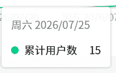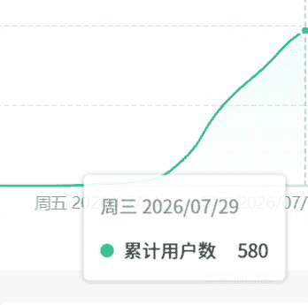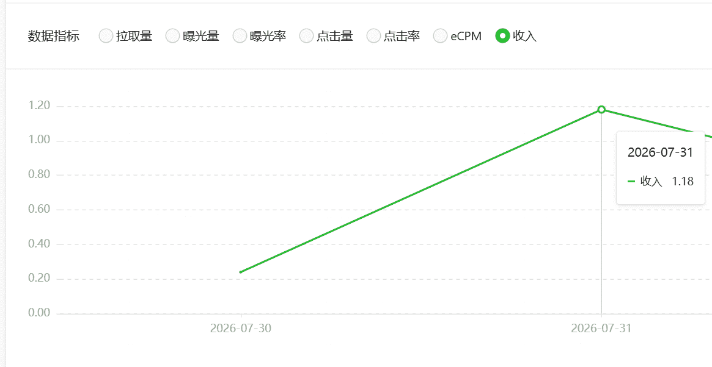

## 一、第一次觉得，我也能做

今年三月，我去参加了 AI 航海家线下活动，本意是追星，想近距离见到老华，结果意外接触到了生财有术。听完刘小排、刘智行、郭东超等人的分享，我对 AI 的认识被彻底刷新。那两天，我最大的感受就是震撼。

四月我正式付费入圈，加入了 AI 大航海。在航海期间，小排老师的分享让我对 AI 编程产生兴趣。以前我总以为做产品是程序员和团队的事，直到看到 AI 编程的演示，我才明白：不写代码的人，也能把脑中的点子变成可用工具。AI 真的存在感极强。

后来我读到 @西昂 的精华帖《不会写代码，用 AI 做 15 个小程序，每月稳定收益 2w+》，第一次知道小程序可以作为一种变现载体。这种先做出实用工具再靠使用变现的模式，比单纯卖货更让我心动，因为它具备复利和被动收入的特质。AI 让技术平权，普通人也能做。这让我第三次感叹：AI 真的太神奇了！

认知被打开后，我立刻用 Trae 做了个点名小程序。从敲代码到上线，真正动手的時間不到半小时，剩下的都是用碎片时间完善。做完那一刻我惊呆了：真的像老师说的那样，简单、无门槛、顺滑。AI 太神奇了！

虽然点名小程序只是我个人使用，没有推广也没有收入，但它在我心里种下了一个念头：小程序并非高不可攀，普通人也能玩。

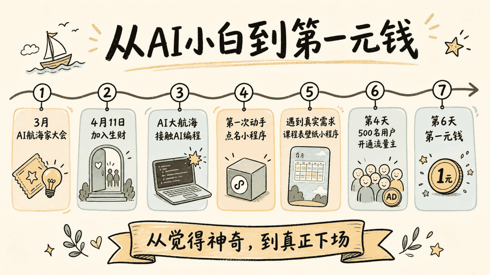

这个念头后来撞上了一个真实的痛点。

## 二、从一个运营痛点长出来的“亲生”小程序

我并不是先想做小程序再找需求，而是需求先出现。

我有一款做了近一年的文创实物，临近开学我打算二次推广，于是给它配了一批电脑桌面壁纸。托 Codex 生成了几张发到小红书，没想到其中一条笔记小爆了，涨了 200 多个粉丝。

粉丝涨了，麻烦也来了：壁纸要一个个私信发，工作量暴增。与此同时，评论区里反复出现一个提问：能不能把自己的课程表嵌入到壁纸上？

我之前的做法是美图秀秀裁剪再粘贴，既费时效果也不统一。后来我观察到身边很多老师的电脑壁纸都特意留了课程表区域，却一直空着。不是不需要，而是操作太麻烦。

于是我冒出一个想法：能不能用小程序，让老师自己把课程信息填进去，快速生成一张好看的壁纸？把这个想法丢给 Codex，课程表壁纸小程序的雏形就出来了。

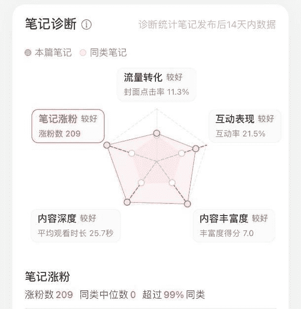

我把这个小程序归结为三个要素的结合：

前期的学习积累 + 真实的运营痛点 + AI 的开发助力 = 一个真正“亲生”的产品

它不是追风口的产物，而是从我的产品和用户反馈里自然长出来的，所以我愿意称它为亲生小程序。

## 三、先上线再完美，别在理想里卡死

拿到想法后，很多人容易想太多功能。

我最初的设想是拍照识别课程表，自动填入壁纸。这个想法很酷，但实操发现格式差异太大，识别成功率很低，花了很多时间调试仍不理想。

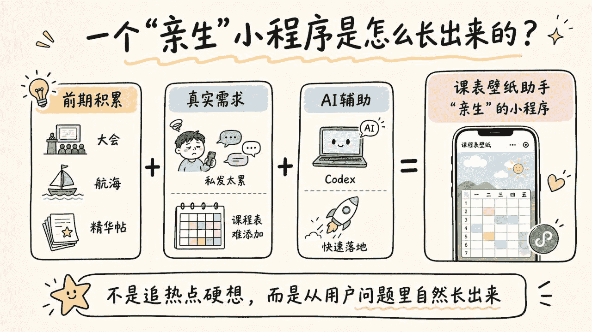

后来我冷静下来，反问自己：核心目标到底是什么？是实现拍照识别，还是让老师方便地拿到一张漂亮的课程表壁纸？

只要核心结果能实现，拍照识别可以先放一边。于是我放弃了自动识别，改为手动输入课程名，虽然多一步操作，但准确率高、开发快。

围绕最小可用，我也主动砍掉了：

- 模板只上小红书笔记里的 3 张，先跑通；
- 不做拍照识别，优先保证准确；
- 不做样式自定义，先用统一默认格式。

唯一必须保证的是：填完课程后能一键保存壁纸，不用再求我私发，也不用打开美图秀秀二次处理。这个核心功能稳定后，小程序就具备了上线测试的条件。

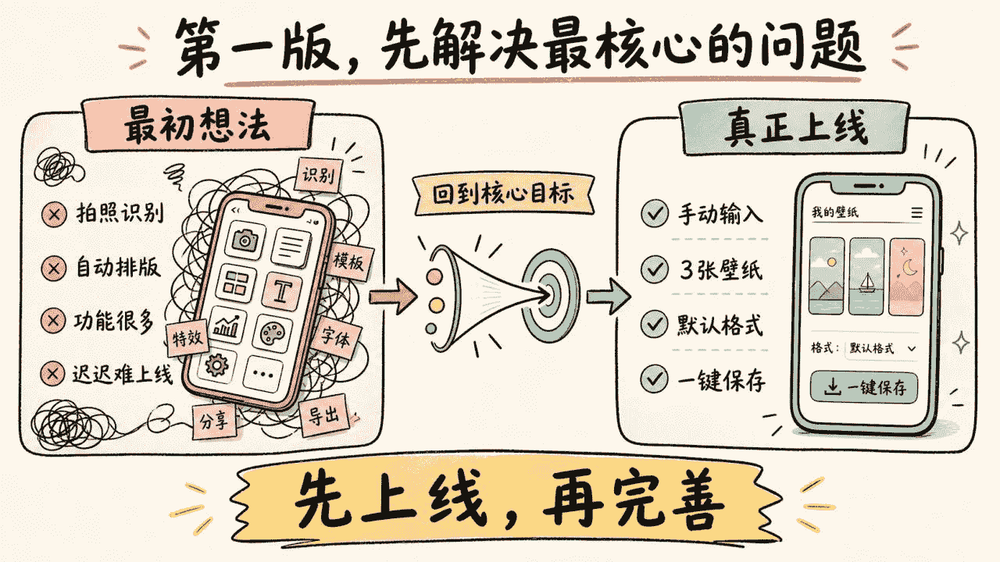

这次让我明白：小程序不必等到所有功能齐备再上线。先围绕真实痛点做核心功能，快速给真实用户用，后续再迭代。否则越想做完美，项目越容易胎死腹中。

## 四、第四天开流量主，第六天收到第一元

小程序上线当天，我发了一条小红书笔记，说“好多老师问课表怎么放，我把它做成了工具”，配上使用场景图。五分钟后笔记被判定违规，引流太明显。

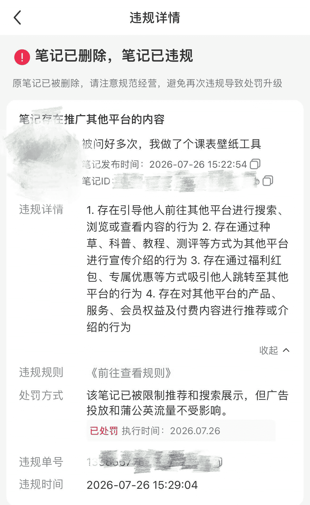

我把文案改成纯体验分享，把“小程序”“怎么进”等敏感词全部去掉，重新过审。发布不到十分钟，评论区就出现“哪个小程序？”“能免费用吗？”的问题。精准得像是我安排的托，需求的真实性由此得到验证。

在之前分享壁纸的那条笔记下，我把询问“课表怎么放”的评论用小程序截图回复并置顶。置顶后私发壁纸的工作量骤降，同时需求也能被产品承接。

推广第四天，用户数突破 500，达到流量主开通门槛，全部来自小红书。第六天，第一笔流量主收入到账。

这一块钱不值钱，值钱的是验证：从内容发现需求，到 AI 快速实现，到用户使用，再到产生收入，链路是通的。

## 五、只看陌生用户的数据，别刷熟人安慰剂

上线后我没有到处发朋友圈。

原因是我想验证：没有熟人背书，陌生用户会不会主动搜进来用？如果一开始就推送给熟人，他们只是碍于情面点一下，数据会失真。

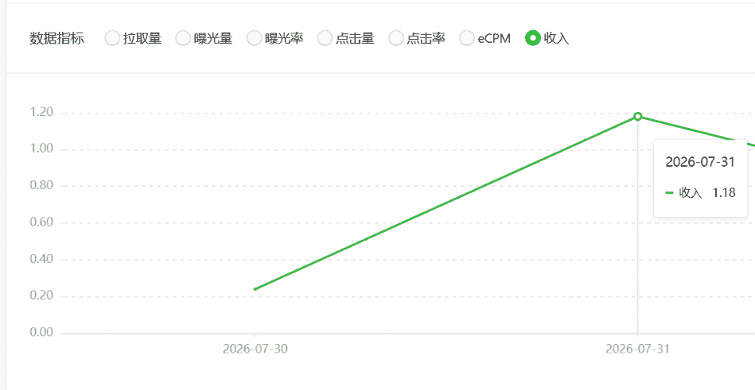

于是我第一阶段只用小红书承接，观察陌生用户的进入和留存。如果他们愿意主动使用，说明需求是真的。验证后再考虑扩模板、优化体验。

刚上线时我犯过一个错：一天刷新后台几十次，看人数跳动。结果啥也没干，节奏全乱。后来我调整策略：固定时段看数据，平时专注做内容和主产品。小程序定位是增值权益和引流入口，不是全部重心。

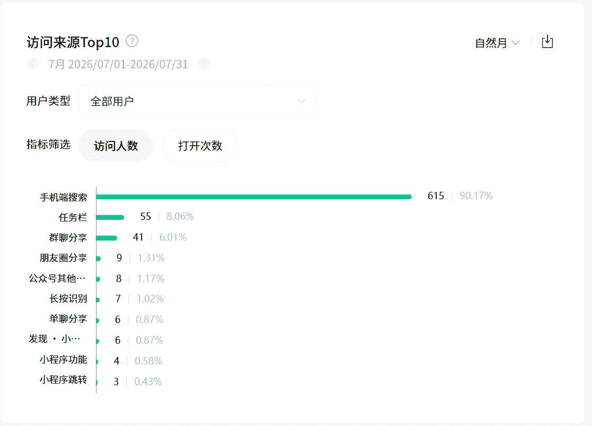

## 六、关于变现的现实看法

靠一个初期的工具赚大钱不现实，短期也就是点零花钱。

但小程序的价值不止于此。

它可以和我的文创产品联动：买产品送壁纸制作权益；用户进来做壁纸时产生广告收益；先被壁纸吸引的用户，也可能顺带了解我的主产品。

因此我更愿意把它看作：

- 给老用户的配套服务；
- 主产品的全新入口；
- 可以沉淀复用的数字资产。

投入产出比很高，门槛又低，普通人很值得尝试。

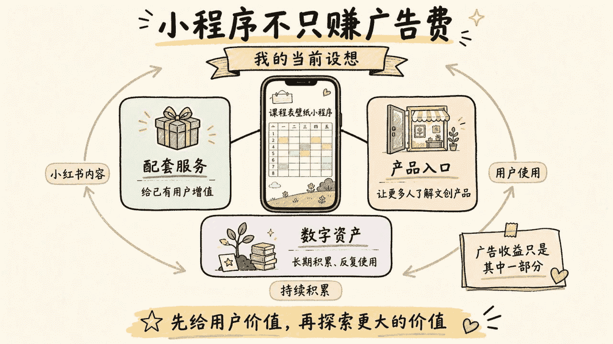

能把想法做成可用的小工具，本身就是能力沉淀。它可能不立刻带来高收入，却会成为服务、个人品牌和未来机会的拼图。做出一个好用的小东西，成就感也很强。

## 七、给还在观望的三个建议

1. 别为了做而做，先找真实痛点
我的需求来自重复的私发壁纸和老师反复提问的课表问题。身处问题中，更容易判断什么是刚需。

2. 第一版只做一件事
拍照识别更高级，但手动输入就能解决核心问题。先上线、再收集反馈，比追求完美更有效。

3. 积累总会用上
之前看直播、读精华帖时没有明确目的，只是好奇。但正是这些碎片知识，让我遇到问题时立刻想到可以用小程序解决。所有学习都在为某个瞬间储备弹药。

我现在仍是生财圈里的小白，这个小程序也谈不上成熟。但从“觉得 AI 神奇”到“亲自下场做出产品并赚到第一元”，这一步我迈了出去。

最后，生财真的很神奇，既有大量干货，也有愿意分享的人。特别感谢师父 @元山 的鼓励，没有他的建议我可能不敢发帖；感谢 @小武 的写作指导，让这篇内容能顺利成形。感恩。

————分割线————

看完这篇 SOP，你觉得你懂了。但 90% 的人一到实操就会卡在第一步。

工具和教程只是最低级的壁垒，真正的壁垒是“立刻动手”和“圈层信息差”。

如果你想看全网最新的变现玩法，并且和一群执行力极强的极客一起下场拿结果，欢迎围观我的核心私域：【懒人专属群】。

我们不聊虚的，只做商业闭环的拆解与 AI 效率的压榨。系统内已沉淀 1000+ 跑通的套利实战局。

👉 查阅圈子完整数字资产与上车门槛：

https://lazyso.com/insider/

认同价值、准备好下场干活的，扫码加我微信（lazyhelper1）

备注：【实操上车】，不闲聊

