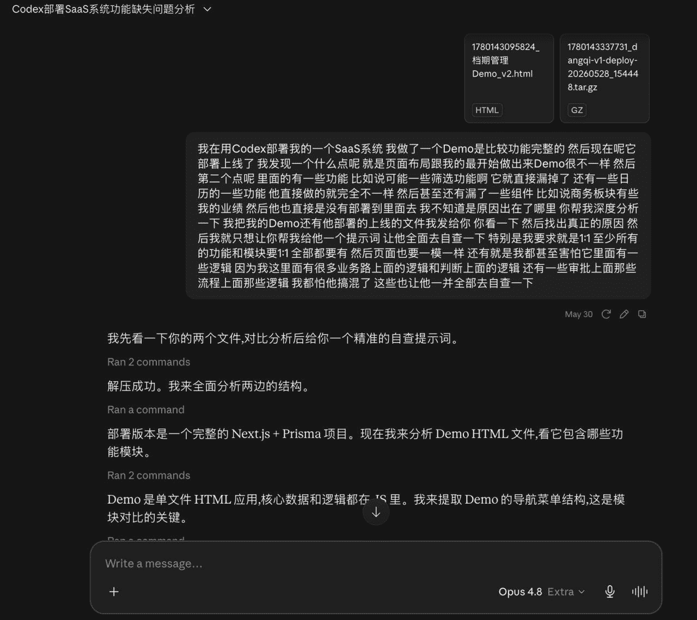

# 零基础、没学过编程，我用AI给公司搭了一套每天在用的业务平台

我叫海印，在直播电商领域做了四年，目前供职于浪莎，负责品牌溯源直播专场。

平日里，我的工作围绕达人筛选、对外洽谈、排期规划、直播执行和复盘展开；业余时间，我一直在琢磨怎么把 AI 与 RPA 真正塞进电商工作流里。

直白点讲，我没有编程背景、没上过一天技术课，但用大约40天，在 Codex 和 Claude 的辅助下，做出了一套公司现在每天在跑的工作平台。

它不是用来演示的壳子，也不是我自己私下把玩的玩具。公司里约40位同事都在用这套东西：28个正式账号，8类角色；里面沉淀了超过1.2万名达人、2100余条排期记录、1600多条客户跟进，还完成了370次智能客户洞察。

商务在平台里登记客户和排期，主管审核，后端照排期干活，老板看大屏数据。之后我又把 CRM 接了进去，再加了智能销售助手，让模型帮忙判断客户顾虑、给出跟进建议和沟通话术。

整个过程没有找外包，也没组开发团队。主要开支是 Codex 和 Claude 两个月的会员费，加起来约560元，再加一台云主机和域名。

看到成果，有人会觉得 AI 已经神到说句话就能生成整个系统。我亲历之后最大的体会恰恰相反：AI 把编程门槛拉低了很多，但从“能运行”到“公司敢用”，中间隔着一大堆流程梳理、测试、纠错和耐心。下面我把这段经历完整讲出来，包括我走过的弯路、总结出的方法和现在仍在用的提示词模板。

如果你是懂业务但不懂技术的老板或骨干，希望这篇对你有点用。

## 一、公司的业务，曾经大半靠我脑子记

我们团队做的是浪莎的品牌溯源直播。每天需要和6到10名主播对接。商务要提前谈合作、敲定播出时间、把主播信息录进表格；主管负责点头；接待、中控、运营等岗位按排期做准备工作；直播结束后还要录入数据、算佣金、做复盘。

这些事不是一张Excel能装下的。

比如，新客和老客的提成算法不一样；哪位达人太久没联系、什么时候该返场，得有人持续盯着；今天定了几场、这周每个商务定了多少场，相比上周涨跌如何；本月播了多少场、GMV是多少，哪个环节掉了链子；商务谈好的时间，还必须及时同步给接待、中控、运营等部门。

以前，这些东西主要靠飞书表格和微信群。飞书能解决不少事，可角色多、流程多、统计口径多以后，表就越来越重。微信群只适合临时说话，不适合留下完整过程，消息一多就被冲走。

更麻烦的是，公司缺少统一的载体。商务在群里喊一遍，后端来问我一遍，老板要数据时我再翻各个表重新算一遍。很多事最后靠我的记忆、靠我催人、靠我在不同群里传话。

人少单少的时候还能撑，人一多客户一多，协同成本蹭蹭涨。我想做系统，不是突然有什么灵感，而是痛了太久：我想让客户留在公司，让过程可见，让不同岗位在同一个地方协作，而不是靠少数人的脑子。

## 二、从把工作讲给模型开始，到一天做出雏形

决定动手时，我对写代码一无所知。前端、后端、数据库、服务器、域名、部署，这些词在我脑子里都是模糊的。我唯一拿得出手的，是清楚自己的业务。

第一次打开Codex对话框时，我没写文档，也没谈架构。我只做了一件事：把每天怎么干活、谁参与、信息怎么走、哪里最卡，用大白话全部讲给模型。

我会说：商务谈好主播后要建档；主管或经理同意后，排期要出现在日历上；不同岗位能看什么、能改什么，要分开；播完后补录数据，老板要看汇总。

讲完之后，我拦住了它：你先不要着急写代码，把你理解的流程、角色、需求原样写出来，我来判断对不对。

哪里理解偏了，我当场纠；漏了人，我补；讲不清，我就举真实例子。来回磨了好多轮后，才让它做一版能点得动的雏形。

从把想法说清楚，到看到能点、能登记、能审批的界面，不过一天。

当时雏形里已有排期登记、排期列表、审批和角色权限。看到它跑起来的一瞬间，我被震住了。以前“做系统”离我特别远，当时我觉得，这事儿说不定真能成。

## 三、雏形只是可能性，不是能上线的系统

但雏形不等于能用。它只说明“想做的事能做出来”，绝不表示公司敢把日常运营托付给它。

我很快发现，很多规则我没提到，有些需求我根本没想到。比如这个字段谁填？谁能改、谁只能看？驳回之后退回哪里？某位达人第二次来合作，算新客还是老客？数据按登记时间算还是按审批通过时间算？一人身兼主管和业务员，权限怎么算？

这些需求不是事先想好再丢给模型的，而是在动手操作后才一点点冒出来。这也让我明白：不会写正规需求文档没关系，真正关键的是你愿不愿意把业务讲透。

雏形和上线之后的版本，完全是两码事。在雏形阶段，页面能打开就算赢；上线后则要接受几十人同时稳定使用。雏形可以用假数据；上线后丢一条真数据就是事故。雏形主流程通了就行；上线后要处理好权限、异常、撤回、驳回。雏形自己觉得顺手就好；上线后要所有人都顺手。雏形出错刷新就行；上线后出错会砸到真实排期。雏形在本地跑；上线后要有云主机、域名、数据库、备份和发布机制。

可以说，雏形证明的是“能不能做出来”，上线后解决的是“敢不敢交给它”。

## 四、我连部署都不懂，靠一张张截图把系统推上线

决定部署时，我连“部署”是什么都不知道。我的办法很土：告诉 Codex，我什么术语都不懂，你每回只告诉我一个动作，且必须用外行能听懂的话解释。每进行一步，我截一张图发过去；它告诉我哪对了、哪错了，下一步点哪里、填什么、怎么验证。看到页面和它描述的不一样，我不自己瞎猜，继续截图追问；遇上报错，把整段报错丢回去，让它重新判断。

这样折腾了两三天，域名终于能打开系统。但打开只是开始，接下来又花了一个多星期修各种环境问题。这时我才体会到：本机跑得好，放到线上照样可能出乱子。上线后有真人、真数据、几十人同时用，很多问题根本在自己电脑上复现不出来。

## 五、让系统变成熟的，是真实用户

第一版上线后，我先把排期登记、审批、列表、日历这几个主流程理清，然后开始在公司推。老板从雏形阶段就支持，看到我演示后很兴奋。不过不少同事心里打鼓：这玩意靠不靠谱？会不会用两天就扔了？

我的做法很简单：相关岗位必须用，我负责培训和演示。之后我天天跑到各部门收反馈。商务、主管、中控、接待、运营，谁提意见我都记下来，整理后交给模型去修。

真实使用中冒出一堆小但又很伤体验的问题：提交排期后草稿没清空；CRM新建或保存偶尔没反应；智能分析耗时太长，看起来像死机；主管审批后，中控看到的人员信息丢了；某个日期格式不对，整页白屏；同一组直播数据，在清单页、详情页和看板上出现三个版本；本周排期数量在不同页面口径不一致。

这些问题靠脑筋想是想不全的，只有让真人真岗位去用才会露出来。于是我的迭代方式变得很朴素：先让一条最小路径跑通；再交给真实岗位日常使用；每天收集毛病；一次只收拾同一类毛病；改完再把整条路径重走一遍。

等商务开始往里录数据、主管开始审批、后端照系统执行、老板打开看板看数，我知道：这东西已经脱离了“AI练手”的范畴，成了公司日常运营的一部分。

## 六、这套系统如今解决了什么

写到这儿，公司大约40人，系统里有28个正式账号、8种角色。不是人人都有账号，有些岗位共用一个工作号，有些岗位只需要看推送，不用登录。对我来说账号多少不重要，关键是业务链条上的人都在用。

现在的完整链路是：电话资源与客户开发 → CRM跟进 → 达人合作与排期登记 → 主管审批 → 日历与后端执行 → 下播数据与GMV → 团队看板与复盘。

里面沉淀了超过1.2万条达人档案、2100多条排期记录、650多张CRM线索、1600多条跟进记录、370次智能客户洞察、1万多条电话资源和2.6万多次外呼记录。

这些数字不是炫耀，只是想说它不是空壳子。

它给我们带来了三个层面的改变。

其一，客户不再躺在个人微信里，而是沉淀为公司资产。以前，客户信息、聊天经过、商务经验大多装在某个人脑子里。现在客户在哪个阶段、多久没联系、上次谈了什么、接下来打算怎么做，系统里都留痕。

其二，跨部门配合更顺。商务确认排期后，主管一审批，后端立刻看到执行信息。微信群依然是主力，尤其是对外沟通和临时喊话，但它不再承担业务档案的角色。

其三，管理不再听员工口头汇报。老板和管理者打开看板就能看见订了多少场、播了多少场、跟进了多少客户。哪个商务跟进不积极、哪个阶段客户压得最多、哪些人最近可能遇到麻烦，一眼看得出来。

## 七、排期只是前菜，CRM和智能销售才是重点

做之前我就想好分两步走：先解决存量客户的排期与协同，跑顺后再做客户开拓和CRM。

销售手里不只有成交客户，还有大量正在接触、没成交、等着返场、需要长期维护的潜在客户。如果头一版就把排期、CRM、电话、AI、看板全塞进去，平台大概率上不了线。所以我先让排期闭环转起来，公司用稳了才加CRM。

CRM不是只记个名字，而是要回答：这个客户在哪个阶段？上次跟进是哪天？他真正的顾虑是什么？商务接下来准备怎么走？管理者要不要介入？

后来，我又把智能客户洞察接进CRM。商务上传聊天截图，系统识别内容后，结合客户资料、过往跟进、业务知识库和提示词，输出客户价值判断、深层顾虑、行动建议、沟通话术和风险点提示。

新人往往直接照抄话术，老手会按自己风格再加工。

文字分析用的DeepSeek，截图识别用的通义千问。这只是我当年按成本和效果做的取舍，并不是说只有这两个模型可用。

## 八、第一版智能销售并不好用，问题出在模型不懂业务

刚接AI时，我也踩过坑：功能有了，结果很鸡肋。话术像客服口吻，分析篇幅长但空泛，意向判断不准，有时根本看不明白达人合作里的真实顾虑。

后来我才反应过来，我拿一个没学过我们业务、没见过真正成交对话的模型，让它像资深商务那样下判断，本就不合理。

于是我开始反过来“训”它。判断错了，我告诉它错在哪；话术不像我们的风格，我就打一段我会怎么写；再把自己的业务模式、优秀销售的聊天记录、高频客户问题、真实案例整理成知识库，反复磨提示词。这套提示词至少大改了10次。

我判断它好不好，不看字数，看三点：第一，能不能看出客户没说出口的顾虑；第二，它给的后续动作在真实场景里能不能落地；第三，前后信息是否一致、能不能照着执行。

后来，它的多数分析已经能提供参考，也有商务借鉴它的建议谈成了客户。但我不会把成交记在AI头上。能不能成，最终还受客户需求、商品、价格、时机、商务水平等多种因素左右。

它真正值钱的地方在于：让新人快速进入状态；让主管少重复回答同一类问题；让高手脑子里的经验变成公司的资料；让管理者看到完整过程，而不是只盯着结果。

这一步对我来说挺特别：最开始，是模型帮我搭起平台；后来，我又把模型请进平台，让它服务业务。

## 九、我现在常用的搭配：Claude做计划，Codex做执行

前期我几乎只用Codex。系统越复杂，我就越怕让它在一次对话里大改特改。后来加入Claude，形成了一套我用着顺手的搭配：我管讲业务、管判断需求；Claude管拆任务、查漏洞、审风险；Codex管读源码、改代码、跑检查、做发布；真实用户管验收。

我不会想到什么就直接让Codex动手。每次改动前，我会先过三道关。

第一关，让模型复述需求。它要写清楚：目标是什么、影响哪些角色、旧流程什么样、新流程什么样。

第二关，让Claude做风险审核。比如多加一个字段，会不会弄坏旧数据？改动审批逻辑，会不会殃及日历与看板？调整统计口径，会不会让不同页面数字打架？

第三关，定验收标准。不是功能做出来就算，而要明确对应角色、操作步骤和预期结果。

三道关过了，才把执行任务交给Codex。它改完后，我再按真实业务走一遍；只有新增模块没问题、原有功能没被破坏，才发布上线。

我现在的完整循环是：业务卡点 → 让模型追问 → 复述 → 我纠偏 → Claude拆解风险 → Codex执行 → 真实场景测试 → 少部分人先试 → 收反馈 → 继续迭代。

这套流程不花哨，但能避免“东补一句西补一句，最后把平台改得越来越乱”。

## 十、我最大的错：一开始想把所有功能全做完

如果让我重来，我绝不在初版塞太多功能。

当时太兴奋，看到模型什么都能做，就想把所有想法一次加进去。结果界面看起来很丰富，一上线却同时爆出无数问题，后面花了大把时间修。

等平台稳定后，我再上新东西就会刻意踩刹车：先加一项小能力，试明白，再加下一项。出错的概率低了很多，出了问题也更容易定位到是哪次改动造成的。

所以，想用AI建系统的朋友，我会劝你：别从“我要做一套完整CRM”开始，要从“先弄出一条能走通的最小闭环”开始。比如：别急着做全量客户管理，先做“新建客户—记录一次跟进—查看跟进记录”；别急着做复杂报表，先把最重要的一个指标算准；别急着服务全公司，先让某一个规模不大的团队用起来；别急着美化界面，先把数据和业务逻辑弄对。

先跑出一条能跑的线，再慢慢加料。这话听着很俗，但在 AI 协作开发这个场景里特别要紧。因为模型让“加功能”看起来特别轻松，真正的成本都藏在功能互相打架之后。

## 十一、零代码的人想建公司系统，我的七条路线

其一，找一个真正困扰你很久的业务痛点。不要为了学AI而硬造项目，选你每天都要碰的、持续吞时间的那个。越熟，越能判断模型做得对不对。

其二，只取一条最小闭环。至少要说清由谁发起、填写什么、谁来处理、到哪查看结果。最初那条闭环是：商务发起排期→主管确认→排期写进日历→后端查看。

其三，别急着写需求，让模型先采访你。把它当成一个不了解你公司的产品经理，让它围绕岗位、流程、规则、异常和统计口径不停发问。你不会描述也没关系，可以直接说：“我是纯外行，请你每次只问一件事，用提问帮我理清需求。”

其四，先做雏形，只验证流程。别抠细节，也别急着买云主机。

其五，部署之前，单独补齐上线需要的能力。至少要确认真实登录、角色权限、数据库、历史数据迁移、备份、异常兜底和发布回滚。如果完全不懂，就告诉模型：“一次只教一步，说明这一步是为了什么、怎么算成功、失败怎么停下。”

其六，先找一个人数不多的团队实际用起来，别直接铺到全公司。

其七，持续迭代，把“完成”放在“完美”前面。

这七条就是我从零到上线的完整路径。希望你能少踩几个坑。

不会写代码，也能做出一套公司里真正在用的系统。我以前不信，现在我信了。

过去一个多月，我从零起步，靠和 AI 一轮轮对话，把一套内部系统从想法推到了生产环境。最难的环节压根不是技术，而是我脑子里那些业务经验，原本像一团雾，要一点一点说清楚、验证对，最后才能变成能跑的流程。

从前，一个懂业务但不会编程的人，想要自己的系统，得同时凑齐产品、设计、开发三类角色，来回沟通很久。现在，你只需要把需求讲明白，AI 能先帮你做出原型，再一步步打磨到正式环境。用日常对话驱动软件，已经不是科幻。

但拿到入场资格不等于能走到终点。真正决定胜负的，是你对业务的理解深度、愿意反复测试的耐心，以及为真实数据承担后果的胆量。

我总结出了三条实战经验。

第一，先找小团队真用。别急着全公司推广，选一个业务真实但范围不大的小组，让他们把日常工作真正操作进新系统。真人录单、真人审批、真人查询，问题才会自己暴露。演示再好，也只是表演。

第二，一次只碰一处。每次调整只改一个点，改完立刻把旧流程重新验证一遍。动工之前，要求 AI 列出它会波及到哪些模块；收工之后，要求 AI 提交自查结论。你本人也得动手走一遍关键流程，因为自动检查通过，跟业务结果正确，是两码事。

第三，有三件事，AI 没法替你扛：理解业务、耐心测试、对系统里的结果负责。写代码的活可以交给 AI，但这三样，你必须亲自做。

如果你也完全不会写程序，恰好手里有个纠结很久的问题，先别问“能不能做出一整套”。把问题缩小：“我能不能先让 AI 把其中最小的一段流程完整跑通？” 第一段循环转起来，后面的路会逐渐清晰。

下面的四段文本，是我目前会直接复制去用的。你不需要编程基础，只需把方括号里的内容换成自己的情况。

【文本一：让 AI 先访谈你，把模糊想法挖成明确需求】

发给 AI 这句话：

“你现在是一位专门面向零基础业务人员的需求访谈顾问。我要解决的问题是：[大白话描述，例如：商务定好达人直播档期后，需要让主管审批，并让后端及时看到]。我不会编程，可能也说不全。先不要给方案，也不要写代码，请你用提问帮我把业务现状挖透。需要弄清楚：参与的角色有哪些？整个过程从哪里开始、在哪里收尾？每个角色分别要填写、查看、修改什么？哪些人有审批权，哪些人只能查看？正常流程之外，会出现哪些特殊情况？目前是怎么处理的，最让人头疼的地方在哪？我最该优先解决的问题是什么？哪些功能可以放到以后再做？系统上线后，我用什么标准判断它是否值得用？提问时，请做到：一次最多问三个；用业务语言，别用技术术语；我答得含糊时，继续追问并举例；不用全盘认同我，发现流程冲突、范围太宽或没必要的地方，直接指出；信息没有收集完整前，不要碰代码。访谈结束后，请输出：A 你理解的业务现状；B 最核心的一段最小闭环；C 首版必须有的功能；D 暂时搁置的功能；E 角色与权限表；F 正常流程和异常流程；G 每个功能可验证的验收标准；H 还需要我确认的问题。最后等我确认，我没回复‘理解一致，可以进入下一步’前，不要设计原型。”

【文本二：让 Claude 在改代码前先做风险拆解】

发给 Claude：

“你现在是这套正式业务系统的方案评审。当前只做分析和任务规划，不修改任何文件，也不写代码。系统现状：[说清现有功能和使用岗位]。业务问题：[说明为什么要改动，而不是只想加一个按钮]。期望结果：[哪种角色在什么场景下，应该得到什么结果]。硬性约束：[不能动历史数据；老板看板口径不能变；旧账号权限保持不变]。请先复述一下你对需求的理解，然后重点检查：1 需求里有没有歧义、冲突或遗漏；2 会波及哪些页面、数据、角色、权限、统计口径、现有流程；3 是否会影响历史数据，需不需要做兼容或迁移；4 哪些旧功能最容易在改动中被误伤；5 有没有更小、更稳妥的替代方案；6 上线出问题时要怎么回退；7 怎么证明新功能没问题，同时旧功能也没失效。请按以下结构输出：A 需求复述；B 需要我拍板的问题；C 本次改动范围；D 明确不动的范围；E 影响清单和风险等级；F 按优先顺序排好的任务；G 每一步的完成标准；H 测试明细；I 发布及回退方案；J 可直接转给 Codex 的执行指令。执行原则：不要让方案看起来完整就扩大需求；优先选择最小改动；凡是没有资料支撑的信息，标成‘待确认’，不要瞎猜；我确认方案之前，不要开始执行。”

【文本三：让 Codex 落实已经批准的改动】

发给 Codex：

“请在当前项目里执行一次批准好的改动。先通读项目文档、编码规范、相关代码和已有测试；不要整体重写，也不要去动与本任务无关的现有内容。业务需求：[粘贴最终版]。任务规划：[粘贴 Claude 的输出]。允许修改：写清楚范围。禁止修改：写清楚旧流程、数据口径和权限。验收标准：按角色和场景列明预期结果。执行规则：1 先检查当前代码和方案是否一致；2 如果发现不一致、需求仍有疑点、或风险很高，立刻停止并向我说明，不要自己猜；3 只做完成本任务所需的最小改动；4 保留现有数据的兼容性，结构有变化时先讲清迁移和回退办法；5 补充或更新相关测试；6 完成后跑一遍测试、构建和代码检查；7 除了自动检查，再按真实角色梳理人工回归步骤；8 未经我明确同意，不部署到正式环境；9 不打印、不记录密码、API Key、数据库连接等敏感信息。正式开始前，只回复：A 你读了哪些文件；B 你对需求的理解；C 预计会改哪里；D 主要风险；E 准备怎么验证。等我回复‘确认执行’再动手。结束后，请输出：1 完成了什么；2 实际改动范围；3 自动检查结果；4 人工验收步骤；5 已知限制或待确认项；6 是否已部署；如果没部署，下一步是什么。”

【文本四：正式上线前的核对表】

真正上线前，以下每一项都应该打勾，而不是“差不多就行”。

范围与需求：
□ 第一版只解决一个明确的小闭环
□ 本期不做的功能白纸黑字列出来
□ 每个功能都有对应的使用岗位和业务价值
□ 需求已经由 AI 转述，并且你亲口确认过

账号与权限：
□ 用正式账号登录，不用演示假号
□ 每种角色能看什么、能改什么，已经确定
□ 普通员工无法进入管理后台
□ 离职、转岗、忘记密码都有对应流程
□ 至少用普通账号和管理员账号各测一次

数据层面：
□ 数据存正式数据库，不依赖浏览器临时缓存
□ 必填项、重复数据、格式异常都有处理规则
□ 历史数据是否导入，已经有明确结论
□ 重要数据的修改和删除要留痕或要权限
□ 统计口径写清楚：按创建时间、审批时间，还是直播时间
□ 不同页面对同一个指标的统计口径一致

异常情况：
□ 审批驳回、撤回、修改、重复提交都验过
□ 断网、刷新、连续点击不会产生坏数据
□ AI 超时或失败，不会堵住整个业务流程
□ 报错提示能告诉用户下一步该怎么办
□ 空数据、异常日期、超长文本都做过测试

部署与安全：
□ 正式域名能稳定打开，HTTPS 已启用
□ 服务器、数据库、域名账号的归属都在公司
□ 密码、API Key、数据库连接串没有出现公开代码或截图
□ 数据库有自动备份，并且你亲眼确认过备份存在
□ 知道如何查看服务是否正常运行
□ 新版本不行时，知道怎么退回去

上线前验证：
□ 自动化测试和构建全部通过
□ 用真实角色把关键业务完整走了一遍
□ 新功能正常，老的重点功能也全部复查
□ 拿少量真实数据试运行过
□ 老板或业务负责人确认统计结果符合实际情况

推广与迭代：
□ 第一批使用者已经定好
□ 有最简单的操作说明或一次现场培训
□ 员工知道在哪里反馈问题
□ 每个反馈都记录复现路径、账号角色、预期结果
□ 每轮只修一类问题，修完立刻回归
□ 上线后第 1、3、7 天都安排复盘

“页面能打开”不等于“已经上线”。真正的上线标准是：真实用户用它把业务办成了，数据值得信赖，出了事能及时发现、处理、回退。

——

读到这里，你可能觉得自己已经会了。但真到实操的一天，大多数人都会卡在第一步。

市面上的工具和教程从来不是真正的门槛，真正的门槛是“现在就去动手”，以及你周围有没有一个已经跑通玩法、愿意分享战果的圈子。

我运营的【懒人专属群】，平时只做两件事：拆解赚钱逻辑，把 AI 用到极致。群里沉淀了 1000+ 跑过的套利项目。

想了解更多的人，可以在浏览器访问 lazyso.com/insider，查看完整资料和上车条件。

觉得值得、准备动手的朋友，可以加我好友 lazyhelper1，验证消息请写“实操上车”，闲聊勿扰。

我是海印，在兴趣电商一线，用 AI 和 RPA 解决真实生意里的问题。之后我想继续拆一拆这套系统的内部细节，包括：
- 怎么让 AI 通过不断追问，把模糊念头逼成明确需求；
- Claude 与 Codex 在工作流里分别担什么角色；
- 我们的销售提示词是怎么一版版迭代出来的；
- 零代码新手把系统推到生产环境时，最容易踩哪些坑。

顺便问一句：如果让你用 AI 解决工作里最烦恼的一件事，你的优先级会是哪一件？评论区聊聊。

