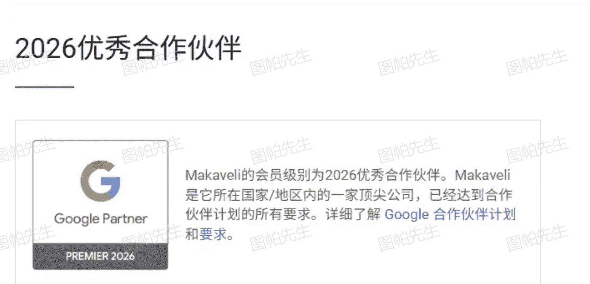
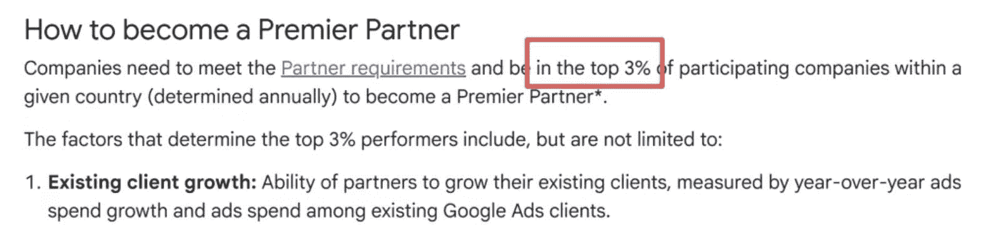
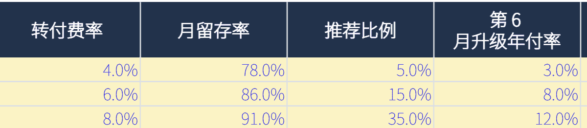
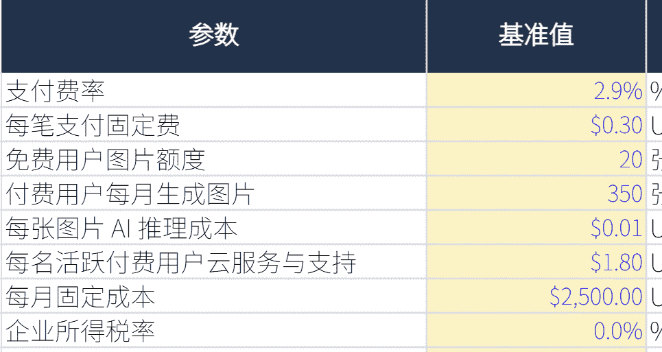
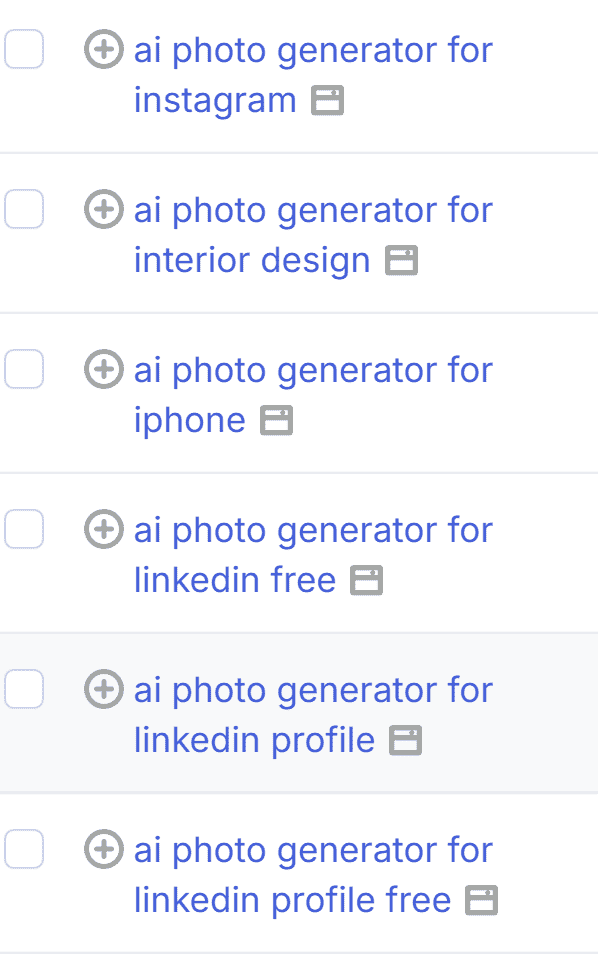
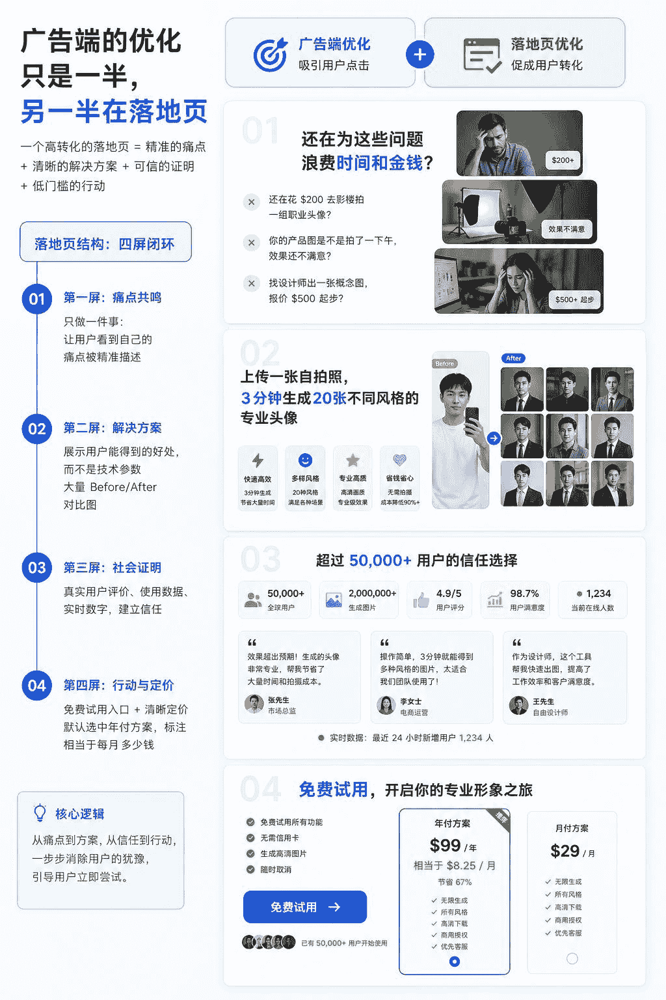
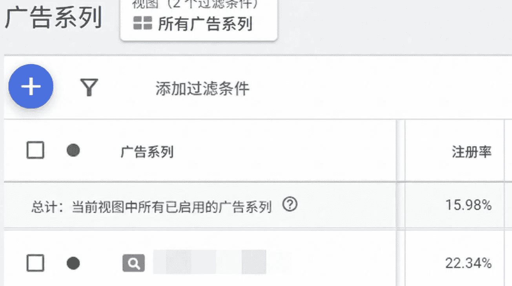
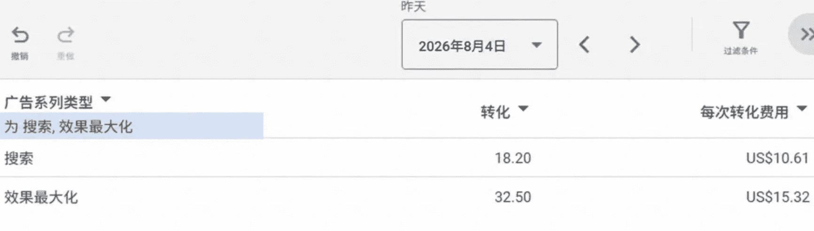

# 万字拆解：我如何把一个AI绘图工具的谷歌广告付费订阅，从每月80个拉到500+

260821 副业SC 精华

整理：公众号懒人搜索，懒人专属群精选

懒人微信：lazyhelper1

大家好，我是图帕先生。

今天跟大家聊一个出海AI工具圈都在问的问题：我帮一位做AI生图工具的圈友，如何用谷歌广告把付费订阅用户从原来每月80个，推升到500个以上，且单客获取成本稳定在10美元左右。

先说下背景。我原本长期做跨境电商的谷歌广告投放和SEO，为不少独立站B2C和B2B批发项目操盘过。去年一位做AI工具的同圈朋友找到我，他的新品面向海外市场，核心玩法很简单：用户上传一张照片或输入文字提示，就能批量生成写真、头像、产品图、艺术画等，按月或按年订阅收费。

他知道我是谷歌官方优秀合作伙伴，也知道我这边的操盘量级和复盘能力，便主动抛出合作的橄榄枝。

（谷歌官方优秀合作伙伴是指在谷歌广告生态中排名前3%的代理商才能拿到的资质）

此前提及社交自然流量和搜索自然流量，他每月能贡献约300个付费用户。谷歌广告这块他自己摸索过，但月付费最多也就80个左右。他想快速做大体量，觉得广告环节不能再拖。于是就问我能不能接手优化。

顺带一提关于AI赛道，我也参与了小排老师的深海圈。用此前积累的SEO思路搭了个小玩意儿，虽说没有大爆发，但赚个车贷的钱是绰绰有余。

过去30天的数据

回归正题，除了SEO，我更拿手的就是谷歌广告了。于是我们一拍即合，我除了负责投放，还兼任SEO顾问。这篇内容我会把重心放在谷歌广告的实操上。

（文中所有截图均经客户本人授权展示）

### 一、客户教会我算账：电商思维转SaaS思维

不过这个项目刚接下时我其实犹豫了很久。

做跨境电商那几年，算账方式很直接：进货8美金，售价25美金，广告花5美金拿一单，物流4美金，净剩8美金。每单赚多少钱一目了然。按ROAS衡量，花5美金带来25美金销售额，ROAS 5，只要不低于3就能活。

拿这套电商的算账方式去做AI生图工具，一开始我完全算不清。

电商卖鞋，用户付60美金，这笔钱当天到账，当天就知道赚亏。但AI工具收的是月订阅29美金，这个钱是首月入账，第二个月他会不会续？续几个月？不确定。

更头疼的是，我花200美金广告费，当天带来50个注册，只有3个人付费，另外47个都在用免费额度。那这200美金到底算赚还是亏？按电商逻辑，3人×29=87，200换87，亏损。

客户给我看了一张内部表。

特别感谢圈友的坦诚！他跨行业分享商业逻辑，让我这个投手学到很多。

他的一位早期付费用户，首月订阅后连续用了11个月，期间还从月付升级成年付。拉新成本约10美金，但11个月累计付费达到215美金。10美金换215美金，账就明白了。

还有一个做LinkedIn职业咨询的用户，自己订阅了8个月，还在她的博客推荐了工具，直接带来12个新付费用户，获客成本为零。

对SaaS而言，获客成本是沉没一次性的，而用户价值是持续滚的。搞清楚这层差别，才能算对账。

这次经历让我意识到，投手不仅要懂广告，更要懂客户的生意模型。用电商ROAS去审视SaaS广告，很容易在第二周就把账户关了。因为按电商标准看数据确实难看。换成SaaS的LTV视角，同一组数据讲的就是另一个故事。

下面是我从这个案例里提炼的一套算账思路，给还在犹豫要不要投广告的AI工具开发者参考。投之前，先把数字盘清楚，再找投手或自己上手，心里才有底。

#### 第一步：算清LTV用户生命周期价值

LTV = 月均付费金额 × 平均付费月数。

如果产品刚上线，没有足够历史数据，可以先保守估。行业经验是月付用户平均留存3-5个月，年付用户基本按12个月起算。

举例：月订阅19美金，按3个月估算，LTV=19×3=57美金。若部分用户选年付99美金/年，则年付用户LTV为99美金。

假设用户构成60%月付、40%年付，加权平均LTV=0.6×57+0.4×99=34.2+39.6=73.8美金。

这73.8美金就是每个付费用户在生命周期内平均能贡献的总收入。

#### 第二步：算清单用户真实成本

不能只看广告费，要算“获客+服务一个付费用户”的全部成本。

获客成本CAC：若CPA目标设为付费事件，则CPA=CAC。若CPA设为注册，比如3美金/注册，注册转付费率10%，则CAC=3÷10%=30美金。

API成本：AI工具每生成一张图都有GPU调用成本。月付29美金的用户，若月均生成200张/张0.01美金，则月API成本2美金，三个月6美金。

支付通道手续费：Stripe约2.9%+0.3美金/笔。29美金订阅约被抽1.14美金，三个月3.42美金。

合起来，服务一个月付用户三个月总成本=CAC10+API6+Stripe3.42=19.42美金。

#### 第三步：算利润与回本周期

单用户利润=LTV-总成本。例：57-19.42=37.58美金。

回本周期：首月获取成本10美金，首月收入29美金减API2美金减Stripe1.14美金，净收入25.86美金，首月即可回本。

这是健康的模型。若首月回不了本，看第二、三月能否回本。若三个月内都回不了本，这条广告投放就需暂缓，先优化付费率或降低CAC。

#### 第四步：算可承受的最高CAC

反推：LTV73.8美金，行业建议CAC不超过LTV的三分之一。73.8÷3=24.6美金。

也就是安全边际，CAC只要低于24.6美金，模型就健康。投放时心态会更稳，偶尔CPA冲到15美金不必恐慌，持续超过25美金才要紧急刹车。

#### 第五步：算最低月度预算

Google智能出价至少需要每月30-50个转化事件才能有效学习。若目标CPA10美金，月最低花费=30×10=300美金。加学习期前两周试错，CPA可能高5-10倍，建议启动预算1500-2000美金跑2-4周。

若预算极紧，比如月仅500美金，不要以“付费”为转化目标，量太少算法学不动。可先以“注册”为目标积累数据，等注册量上去再切回付费。

### 二、交学费的开局

说到具体投放。

启动前两周，数据非常难看。

我接手后犯的典型错误是：广告组开太多，关键词铺太宽，想一次性覆盖所有搜索场景。“AI image generator”“AI art maker”“AI photo tool”“text to image”“AI portrait”“face swap AI”……几十个词全上，日消耗上百美金，注册不少，但付费寥寥。算下来单个付费获客成本一度飙到40美金以上。

这个阶段我做了一件很关键的事：没有急着调广告，先把统计埋点做全。埋了从落地页访问、点击注册、完成注册、首次试用、完成付费全链路事件。

这点必须展开讲，因为SaaS订阅的追踪逻辑和B2C电商完全不同。

### 三、转化追踪的本质差异

电商圈都知道，B2C的追踪很短：点广告→进产品页→加购物车→支付完成。链路在一访问内完成，埋在Thank You Page一个purchase事件就够了。

SaaS用户的路径更长、更分散：点击广告→看落地页→注册→验证邮箱→使用免费额度生成第一张图→额度用完→看定价页→选方案→填支付→付费。这一过程可能跨3-5天。

于是核心问题来了：主要转化目标设哪个？

我起初设“完成付费”，看似合理，但付费周期长、数量少，前期每天1-2单，Google算法根本没有足够信号学习。每周7-8个转化，远低于算法需要的15-30个。

后调整为双层目标：

主要目标设为“完成注册”，量大、稳定，日均20-30个，给算法充足学习信号。

次要目标设为“完成付费”，不参与优化，但在报表里可手动看ROAS。

待付费转化稳定到每周30+，再把主要目标切回“完成付费”。切回后CPA反而更稳。

另外我还让技术同事埋了一批微转化事件，用于行为分析：

- “首次生成图片”——判断是否真正体验产品。没生成过图片的注册用户，付费率基本为零。
- “用完免费额度”——付费意愿最强信号。
- “浏览定价页”——进入付费决策阶段。
- “点击年付方案”——对高客单方案有兴趣。

这些微转化拼成漏斗，能清晰看到流失最严重的一环，针对性优化。

不能衡量就无法管理。追踪就是衡量的前提。

### 四、SaaS投放踩过的坑

#### 坑1：免费用户白嫖消耗预算

电商没有中间态，用户要么买要么走。SaaS有免费试用，广告会吸引大量白嫖党，他们注册、用完额度就跑，一分钱不付，但API成本是实打实的。

前期1000注册仅80付费，付费率8%，在行业内已算不错。但剩下的920个免费用户也在消耗GPU成本。

对策双管齐下：广告端用精准关键词+否定关键词过滤白嫖意图；产品端优化免费额度设计，让用户体验到价值但不满足。

#### 坑2：退订与退款

B2C有退货率预期，SaaS订阅则有特殊节奏：大量用户会在付费后3天内申请退款，另有一批将在首月到期前取消自动续费。

所以不能用“当天付费数”算真实收入。我后来在看板里加了“净新增付费用户=当天新增付费-当天退款/退订”。只有这个值持续为正，广告才算真赚钱。

退订是理性选择，阻止不了，只能让用户在订阅期内充分体验价值，让续费成为自然选择。

另外要拉长观察窗口。SaaS用户从点击到付费平均需3-7天，盯当天ROAS会失真。至少按14天维度评估。

前几周交的学费，换来两点认知：

第一，流量质量取决于关键词精准度。搜“free AI image generator”的和搜“best AI headshot generator for LinkedIn”的，付费意愿差十倍。搜free基本不付费，搜AI art generator的多为学生尝鲜，搜“AI product photo generator for ecommerce”的往往是有明确商业需求、愿为效率买单的人。

第二，落地页说服力决定转化。客户最初的页上来就列功能：支持Stable Diffusion/FLUX、最高4K、20种风格、批量生成……像个自嗨的销售。用户根本不关心模型，他们只关心“上传一张照片，3分钟能否得到专业头像”。

跨境电商落地页有成熟公式：先放大痛点并强调严重性，再给出解决方案并证明优越性，最后用交易刺激+明确行动号召促单。我把这套搬到SaaS页。

### 五、转折：从铺量到精准狙击

在聊操作前，先说关键词和账户结构的整体思路。这套打法是摔坑后总结的，和B2C搜索逻辑差异很大。

#### 关键词选择：围绕用户意图而非产品功能

B2C时关键词围着产品转：“wireless headphones”“running shoes men”。用户搜产品，你卖产品。

SaaS不一样。用户搜的是问题和目标。搜“AI headshot generator”的真实意图是“我要一张好看的职业照”。搜“AI product photography”的真实意图是“我要低成本做出好看产品图”。

思路转变：不问“我产品叫什么”，问“用户有什么痛、想达成什么、会怎么描述”。

以意图为中心，能挖到竞品忽略的长尾词，比如“How to get a professional headshot without a photographer”，搜索量不大但付费转化极高。

#### 广告结构：SKAG是否适用

电商圈爱用SKAG，单关键词单广告组，相关性拉满。

SaaS我不建议纯SKAG，因为转化周期长、转化量少，每个组数据太稀疏，算法学不动。

我最终采用“主题广告组”结构：每个组对应一个清晰的使用场景，放5-10个语义相近的关键词。既保证相关性，又保证组内转化量。

具体操作是做减法，按场景建组：

一组瞄准职场形象：“AI headshot generator”“AI professional photo”“AI LinkedIn photo”。需求明确，比影楼200美金的写真便宜，付费意愿强。

第二组瞄准电商卖家：“AI product photography”“AI model photo for ecommerce”“AI lifestyle product image”。卖家每月需大量产品图，AI生成可省90%拍摄成本，续费率最高。

第三组瞄准创意设计：“AI art generator”“AI illustration tool”“AI concept art”。付费率稍低但基数大、传播性强，常在社媒分享带来自然流量。

做AI生图SaaS的Google Ads投放，最容易踩的坑，就是跟大词拼价格。“AI image generator”这种泛词，单次点击成本动不动就要3到5美元，Midjourney、DALL-E、Adobe Firefly这些巨头还在不断抬价。但如果换一个思路，去抢“AI headshot generator for business”这类长尾词，单次点击可能只要0.5到1美元，而且搜这个词的人，几乎已经是带着明确购买意向来的。

我分享一套自己筛词的具体打法。

先说清理动作。关键词筛选的第一步，不是找新词，而是做减法。我导出Google Ads后台的搜索词报告，逐条判读，看哪些词在持续花钱却始终不转化。结果很扎眼：“free”“open source”“tutorial”“how to use Midjourney”这几类词，烧掉了超过30%的预算，转化的贡献却几乎可以忽略。把这些词全部丢进否定关键词清单，无效支出直接砍掉一半。

再说挖掘。长尾词不能凭感觉，要跨渠道交叉验证。我会在Keyword Planner和Semrush里输入核心词，看它延伸出什么；也会在Google搜索框里敲出“AI photo generator for”，看自动补全给了什么提示；还会跑到竞品的落地页，看他们标题、描述里埋了哪些词；甚至连Reddit对应板块里用户的自然说法也会扫一遍。这几路信息汇到一起，最后整理出大约60个长尾词，再按搜索量和竞争程度分成不同层级。

接下来这一步，很多投放会忽略：一个词，必须对应一个页面。用户搜“AI headshot”，你就要把一个头像生成的实战案例页摆在他面前；用户搜“AI product photo”，你就要展示电商商品图从原图到成品的转变。关键词、页面信息、用户期待三者对齐，Google那边会给更好的质量分，你的单次点击成本也会被打下来。这和SEO里的“一页一主题”是同一套逻辑。

整体打法上，先用长尾词接住精准流量，慢慢积累转化信号，让Google的机器学习越来越清楚“什么样的人会掏钱”。对宽泛市场而言，这相当于先绕开巨头盘踞的主词，去边缘地带建根据地，等数据和权重起来后再逐渐向主词扩展，也就是SEO里常说的“农村包围城市”。效果很快看得见：几周之后，单个付费用户的获取成本从40美元降到20美元。虽然离10美元的终极目标还有距离，但大方向已经被验证。

广告端只是半个局，剩下的一半是在落地页完成的。当时客户原来的页面，更像一个工具介绍页，我得把它改造成能直接成交的页面。

第一屏要解决一件事——让用户觉得“你懂我”。与其写“我们是一款强大的AI图片生成工具”，不如直接问：“还在花200美元去影楼拍一组职业头像？”“产品图拍了一下午，效果依然不满意？”“让设计师出一张概念图，报价500美元起步？”痛点到位的反问，比任何自夸都更能留住人。

第二屏讲的不是技术，而是利益。模型参数对普通人没有感知，你说“采用最新FLUX模型”，用户心里毫无波澜。但如果换成“上传一张自拍照，3分钟就能生成20张不同风格的专业头像，效果可以直接对标影楼”，价值感立刻不同。我们在这屏放了一组接一组的before/after对比图——左边用户原图，右边AI成品，视觉差异本身就在说服人。

第三屏用来承接“从众”。真实用户评价、使用规模数据、“今天已有XX人使用”这类实时数字全部堆上去。人在决定付款前，会下意识找“别人也在用”的信号。

第四屏是免费试用入口和报价。定价上我们用了一个反直觉的设置：默认勾选年付方案，并把价格折算成每月多少钱；用户先看到较高的年付总价，心里形成锚点，再看月付价格就觉得轻松不少。这在海外SaaS定价里已经是公用招数。我顺手做了张示意图，帮大家理解这个心理机制。

落地页改版后，访问到注册的转化率从12%提到了22%，注册到付费的转化率从8%提到了15%，两个环节先后放大，叠加起来非常可观。提醒一句：这里的注册率不是Google后台默认给的数据，需要单独在转化事件里埋点。

聊转化模型，就得看营销漏斗。

B2C电商的漏斗是典型的短漏斗：广告曝光，点击，浏览商品，加购物车，付款，总共四五个环节，快的时候几分钟走完，驱动因素是“我想要”。SaaS订阅则是另一种生物：它的漏斗很长，而且是两段式的。第一段是获客漏斗：广告曝光、点击、浏览落地页、注册、激活（也就是第一次跑到核心功能）、付费。第二段是留存漏斗：第一个月续费、持续使用、升级成年付、推荐给朋友。前一段决定你能否把广告费赚回来，后一段才真正决定利润。

把两段拆开看，每一环对应的优化动作都不同。

从曝光到点击，落点是素材和文案，包括关键词用得多精准、RSA标题怎么写、广告附加信息够不够吸引人；核心指标是CTR。

从点击到注册，落点是落地页，前面写的四屏结构就是在修这一段。

从注册到激活，这一步常被忽略，但杀伤力最大。数据显示，有将近30%的注册用户，从来没有生成过一张图就走了。我们做了一个极简的Onboarding动作：注册成功后直接跳到一个已经预设好提示词的生成页，用户只需点一下按钮，就能看到自己的AI头像效果。就这么一个小改动，注册到激活的转化率从70%升到92%。

从激活到付费，靠的是产品本身与付费体验。用户用掉免费额度后，如果效果确实让人满意，接下来就看价格和流程顺不顺。我们当时把付费流程从5个步骤压缩到3个：选方案 → 填邮箱 → Stripe付款。多一步操作，就可能多流失一批用户。

留存这一段，在B2C电商里几乎不成立，但在SaaS里比获客更重要。

首月续费率是最值得盯的生死线。当时业务的首月续费率大约在65%，相当于100个付费用户里，有35个第二个月就不见了。我们引导用户在第一周完成三个“里程碑”动作——生成第一张AI头像、下载高清版、再换一种风格试一次。结果很分裂：三个动作都完成的用户，续费率能达到82%；一个动作都没完成的，续费率只有38%。

投广告还有一个隐藏价值：账户数据能成为产品迭代的指南针。

一次看搜索词报告时，我注意到一个没预料到的长尾词：“AI yearbook photo”——AI年鉴照片。这个词点击不低，转化也不错。坦白说，我之前从未想过这个需求，但数据告诉我，确实有一大批美国用户想用它生成复古年鉴照。我把发现同步给客户，他在产品中加入“90s Yearbook”风格模板，专门优化了这类成片效果。上线后，这个功能甚至带来了一波自然流量：用户生成复古年鉴照后，很乐于发到社交媒体上，因为效果太有趣，等于自带传播。从“广告数据发现需求”到“产品迭代”，再到“自然增长”，整个闭环我后来又复制了好几次。

另一个例子也很典型。从“AI product photo for Etsy”进来的用户，注册率高得感人，可付费率一直低于大盘。把数据刨开看，原因才浮出来：这些Etsy商家需要的商品图比例是4:3，这是平台的主流展示格式，而产品默认输出是1:1。他们用了免费额度后，发现图片方向不对，体验不好，自然不愿意付钱。我们随后加了“Etsy商家”预设模板，默认输出4:3，还在落地页放了“For Etsy Sellers”专属入口。调整后，这批用户的付费率从6%跳到18%，接近三倍。

产品团队闭门造车，很容易陷入“我猜用户需要这个”的幻觉。真正诚实的信息，就藏在Google Ads的搜索词报告和转化数据里——用户在搜什么、在哪一步离开、对什么功能不买账，全都有记录。与其发一堆问卷，不如先把广告后台的数据报表读懂。

当单个付费用户的获取成本稳定在12美元左右，扩量就被提上日程。

过去做独立站电商时得到过教训：把预算翻倍，销量并不会等比例变高，成本反而可能失控；有人在Facebook广告里采用手动竞价，把好广告复制多个版本、设定不同出价去测试，才找到的量与价的平衡点。Google Ads逻辑相似，不过我们更偏重稳健的节奏：每次只增加20%~30%预算，然后观察3~5天，确认CPA没有恶化再走下一轮；如果CPA涨幅超过15%，就停在原地，回头打磨广告素材或落地页。

当付费转化累计到一定数量，算法就有东西可学了。达到50次以上转化后，我们切换成目标CPA出价，也就是tCPA，把找人的事交给Google的模型去跑。

扩量并不代表词库可以停滞。核心长尾词跑稳后，要继续往上下游铺。上游词，比如“how to take professional headshot at home”“cheap professional photo for resume”，这些用户还不确定用什么方案，但只要方案能满足需求，转化路径反而可能比较顺；下游词，比如“AI image generator pricing”“Midjourney alternative cheaper”，用户已经在比较工具，落地页一旦呈现清楚差异化，就很能打。

我习惯定期把搜索词报告里真正成交的词抽出来，按意图打标签：信息型、对比型、交易型。交易型词的CPA最低，信息型词的短期转化稍弱，但这些用户的续费率往往更好——因为他们是在充分了解后才付费的，决策基础更牢固。

三个月后，数据变成了：每天新增付费用户从三四个涨到十五到十八个，CPA稳定在10到11美元。换算下来，每月新增付费订阅大约500个以上。

再分享五个执行层的实用细节，改动不大，回报不小。

第一，开广告账户时，国家选择要慎重。每个Google Ads账号都需要选定国家，而且选定后无法再修改。如果选择非大陆地区，后面可能会卡在客户认证上；一旦认证不过，浪费的是整段跑量周期。别急着放弃，可以联系Google Ads官方顾问问方案，有时候用国内身份也能把认证提交过去。

第二，新客赠金挑最高档。开户时能领不同额度的赠金，国家不同，发放金额不同；选美国区就拿美元。只要产品本身有付费转化能力，中等档位能完成的花费要求，高档位通常也可以完成。

第三，把免费试用设计成“给量”而不是“给时间”。我们对比过，“每天免费生成3张图片”的转化效果，优于“免费试用7天”。因为限量会让用户认真对待每一次生成；无限期反而让人拖延，到最后什么也没体验就流失。免费额度要卡在一个位置：让用户能做出满意的图、感受到价值，但不至于把所有图都不花钱地生成完。我们最终设置为每天3张免费额度，注册时再送10张。

第四，取消订阅时别急着放人。用户点击取消，可以弹一个挽留弹窗，用限时折扣拉住他。“取消前最后机会：年付再享七折”这类简单话术，实际能救回不少摇摆用户。

第五，邮件召回要分对象、控频次。对注册未付费、付费后未续费、付费最后一步取消这三类人，分别设计不同的召回邮件，配合限时优惠效果更好。但发送频率一定要克制，我曾因为短期内发得太急，直接被邮件服务商冻结了账号。

到了每月500+付费用户这个节点，往后走更不能只靠“继续加预算”。那样大概率会撞上边际收益递减。要往2000走，需要拆成几股力量同时推进。

第一股力量是市场扩散。目前的广告集中在美英，这是付费意愿最硬的两个市场。但英语世界还有加拿大、澳大利亚、德国、北欧这些地方，用户付费能力不差，广告竞争却温和不少。操作上，一个市场一个市场地开：每加一个国家，用两到三周去测试当地的CPA与转化率，数据没过关就暂放。要注意的是，每个国家的搜索表达并不一致。美国用户会直接搜“AI headshot”，澳大利亚用户可能更习惯“AI portrait photo”，德国用户即使使用英文，用词习惯也会不同。所以每进入一个新市场，关键词调研都要重做一遍。

第二股力量是PMax广告。前期案例主要集中在搜索广告上，这也是最容易打出正反馈的起点。搜索广告的优点说到底是精准：用户搜“AI headshot generator”，需求已经非常明确，广告出现在结果里，转化链路极短。它最核心的逻辑是“截取需求”——用户已经决定要什么，你只需要在他寻找的路上接住他。我们搜索广告的CPA最低做到过7.5美元，稳定期也基本在9到10美元之间。

但搜索广告有明显的天花板：搜索量总有上限。当我把日预算加到150美元左右，就发现再加钱已经换不来更多精准流量，反而会激起更多低质量匹配。再加上这两年AI生图赛道涌进大量玩家，核心词CPC普遍上涨，单一依赖搜索，获客成本只会越来越贵。

于是我开始测PMax。它不局限于搜索结果页，而是把广告投放到Google全家桶，包括搜索、YouTube、Gmail、展示网络、Discover等。广告主只需要提供素材，算法自己决定怎么分配。坦白讲，一开始我很不习惯这种“失控感”，不知道预算具体花在哪，也不知道哪些人看到真实转化。但数据替它说话了：独立跑两周，CPA确实比搜索要高，大概15美元左右，可付费用户的数量几乎多了一倍。单用户变贵了一些，总量却得到增量，对想扩量的客户来说很值得。

另一个更有意思的发现是用户结构差异。搜索广告带来的用户，大多是已经知道AI图片生成、正在找工具的人；PMax则捞到大量此前不知道AI能做这件事、看广告之后觉得有意思才来尝试的人。这类用户首单转化率略低，可一旦成交，客单价反而更高——因为他们的心智里没有“AI图片就该很便宜”的预设。

关于PMax，我觉得最重要的是两件事。

一是素材。PMax算法要在各种渠道找场景，素材质量直接影响用户是否愿意停下来。我们当时准备了三类素材：before/after对比图，转化效果最好；用户自己生成的高质量AI图片，传播力最强；3~5秒短视频，用来展示生成过程，在YouTube和Discover上尤其好用。素材总数建议至少20组，给足算法组合测试的空间。

二是受众信号。PMax允许广告主写清楚“目标用户大概是什么样的人”。我把搜索广告中已经转化的用户列表当成种子受众导进去，再叠加自定义意向受众，比如搜索过相关词的人群，以及对photography、graphic design、ecommerce等主题感兴趣的人。信号作用不是把人群锁死，而是给算法一个粗方向，让它更快发现高转化人群。

做 AI 工具出海的这段时间，我在 Google 广告这条线踩了不少坑，也慢慢摸出了一些能落地的节奏。今天把实战感受摊开说，核心就一条：搜索和 PMax 不是谁取代谁，而是分工配合。

先说配合上的坑。PMax 现在很强，但它会自动去抢搜索流量，和你手里在跑的 Search 串台是常态。很多人发现同一个品牌词被两边同时拍价，成本瞬间拉高。其实处理起来很简单：把 Search 正在吃到的品牌词和已经验证过转化的核心词，放到账户层级的否定词表里，直接让 PMax 避开。Search 就去守住这些确定性高的精准词，PMax 则放手去找 Search 触达不到的增量。

节奏感也很重要。Search 大概 4 周左右就能趋于稳定，PMax 的学习期要更久，普遍是 4 到 8 周。学习期 CPA 和 CPC 会剧烈波动，别因为前几周数据难看就急着关掉，要给它跑完。

PMax 虽然被叫做黑盒，但 Google 会给到素材组合的反馈。我习惯每两周翻一次素材效果报告，把点击率拉垮的素材下掉，再往池子里补新东西。素材保持新鲜，PMax 的表现才能一直在线。

跑了三个多月后，我对两者的分工总结成一句话：Search 守，PMax 攻。
Search 守住已验证能付费的关键词，保证每天稳定进一批高质量用户；PMax 负责在更宽的流量池里拓新，带来来源更多元的增量用户。

预算上我目前是 Search 6 成、PMax 4 成。比例会随数据动态调整，不是一成不变。

接下来想重点加码的，是 YouTube。
搜索能收割，YouTube 能种草。AI 头像生成这种产品，用视频表达是最直接的。15 秒的演示：上传一张普通自拍，3 秒后变成专业头像，视觉冲击力远超文字。

我看过同行的投放，YouTube In-Stream 可跳过广告的 CPA 做到和 Search 相当，甚至更低。更关键的是品牌记忆的累积。用户第一次看视频可能没点，但品牌名记住了。几天后搜 "AI headshot" 时，点击你 Search 广告的概率就会提升。YouTube 种草，Search 收割，形成闭环。

我们已经在测几组视频素材了。当前观看成本 CPV 在 0.03 到 0.05 美元左右，50 美元就能让 1000 个精准用户看到演示。即便只有 5% 的人后续通过搜索或直接访问转化，成本也是可控的。

付费模式也要跟上。客户现在只有月度和年付，但很多用户需求是偶发的，比如换工作做一次 LinkedIn 头像。让他们月付，性价比感很差，直接流失。

我建议加一个按量付费的选项：5 美元买 10 张，15 美元买 50 张。这样能接住那些有需求但没订阅意愿的人。广告侧也因此能去投以前不敢投的词，比如 "AI headshot one time"、"AI photo no subscription"。决策门槛更低，转化更快，CPA 往往也更友好。

最后给同样在做 AI 出海的伙伴几条实操提醒：

第一，先把漏斗修好再放大。落地页到注册、注册到试用、试用到付费，任何一步漏水，投再多预算也是亏。先用自然流量把转化率打磨到位，再开广告。

第二，前期手动，后期交给算法。Google 的 AI 优化很强，但需要数据喂饱。前期用手动出价和精准词积累转化样本，数据够了再切智能出价。

第三，算清 LTV 和可承受获客成本。知道用户终身价值和安全边际，你才知道什么时候该加预算，什么时候该收手。最怕盲冲。

第四，别只盯广告。用户留存靠产品。网站做得专业、UI 舒服，用户会本能认为你生成的图片质量也高。付费后的体验决定续费和口碑传播，自传播带来的免费增长才是长期壁垒。

写到这里也有万字了，希望对正在实操的人有点用。

————分割线————

看完了 SOP，你以为懂了，实操第一步 90% 的人就卡住了。

工具和教程是最不值钱的，真正值钱的是立刻开干和圈层里的信息差。

想看全网最新的变现玩法，和一批执行力强的极客一起下场，欢迎来围观我的核心私域：【懒人专属群】。

我们只拆商业闭环，只压 AI 效率。系统里已经沉淀了 1000+ 跑通的套利实战局。

👉 查看圈子数字资产与上车门槛：
https://lazyso.com/insider/

认可价值、准备开干的，扫码加我微信 lazyhelper1
备注：【实操上车】，不闲聊

