# 用智能助手搭建🛰️小程序：从想法验证到上线运行

260824 副业 SC 精华

整理：👸号懒人搜索，懒人专属群精选

懒人🛰️：lazyhelper1

适配环境：腾讯云轻量服务器/CVM、宝塔管理面板、腾讯云域名、腾讯云 COS，以及宝塔提供的 HTTPS 配置。

## 这套方法适合谁？

如果你不会编程，也可以尝试独立完成一款🛰️小程序。

整个过程不要求你从头手写每一行代码，而是把产品构想、页面要求和功能规则讲清楚，再让 Codex、WorkBuddy 等工具协助落地。真正需要掌握的，是两种能力：

1. 能够把需求准确地告诉智能助手；
2. 能够检查页面、功能和交付结果是否符合预期。

## 直播资料

- 🛰️小程序智能开发 Prompt 汇总
- 面向新手的小程序实操流程文档

## 开始之前

大家好，我是安小生，平时从事全栈研发。

工作之余，我也会做一些🛰️小程序和移动端产品，目前已有几款应用处于运行状态。每完成一个产品，我通常会在朋友圈或社群里记录过程、分享经验，也借此为自己的项目积累一些曝光。


以下进入正式教程。

## 一、动手前先完成这些准备

### 1. 根据产品类型准备资源

#### 工具型产品

如果你准备做计算器、图片处理、打卡、查询等轻量工具，首先需要注册一个小程序账号。可以选择个人、个体工商户或企业主体，不同主体对应的认证要求和费用并不相同。

接着可以让智能助手参与完整流程：先根据需求产出界面方案，再依据方案完成页面实现。实际操作中，只要需求描述足够清楚，视觉还原效果可以达到较高水平。

#### 订阅、接口或付费型产品

如果产品需要调用外部 API、提供订阅服务或完成在线交易，则还要准备：

- 可用域名
- 服务器
- ICP 备案
- 🛰️支付能力

🛰️支付通常要求企业或个体工商户主体。涉及接口和交易功能时，建议把这些前置条件放在开发初期确认，避免产品写完后才发现无法上线。

已经有注册账号的读者，可以跳过账号注册相关内容，直接进入后续流程。

## 二、为什么新手更适合先做小程序？

### 1. App 的门槛更高

原生 App 往往需要分别处理 iOS 和 Android 两套环境，还要面对应用商店审核、证书签名、打包发布以及不同设备适配等问题。

常见工作包括：

- 编写 iOS 端
- 编写 Android 端
- 准备应用商店材料
- 处理审核与合规
- 适配不同机型
- 维护签名、证书和安装包

海外 iOS 开发还涉及苹果开发者账户费用，国内安卓应用发布也可能涉及相应资质要求。对第一次做产品的人来说，整体链路较长，试错成本也更高。

### 2. 小程序更适合快速验证

完成认证后，小程序可以借助🛰️开发者工具进行预览和调试，不需要额外安装 Xcode 或 Android Studio，也不用一开始就掌握原生开发。

它的获客入口也更加丰富，例如：

- 🛰️搜索
- 群聊传播
- 好友转发
- 👸号
- 视频号
- 二维码
- 📕等内容平台

因此，小程序更适合用来验证三个问题：

- 用户是否真的需要；
- 产品是否有人使用；
- 这个方向能不能产生收入。

先用轻量版本跑通需求，等用户、数据和商业模式都稳定后，再考虑是否扩展到 App。

### 3. App 仍然有自己的优势

这并不代表 App 没有价值。

对于高频使用、功能复杂、需要长期留存、拥有完整账号体系、依赖消息推送或需要更深系统能力的产品，App 仍然更合适。

短视频平台、重度内容产品，以及部分医疗、金融、玄学等不适合小程序承载的领域，也可能更适合采用 App 形态。

## 三、上线前必须检查类目和合规要求

### 1. 先确认服务分类

在开始做页面之前，先到🛰️官方开放文档查看：

- 当前功能属于哪类服务；
- 个人主体是否可以申请；
- 是否需要行业许可证；
- 是否存在前置审批；
- 是否需要额外备案或证明材料。

类目不是随便填写的。审核时，平台会比对你提交的服务分类与实际功能。如果选择的类目和产品内容不匹配，可能遇到驳回、功能限制，甚至下架处理。

### 2. 留意高敏感功能

下列能力都建议提前查清规则：

- 支付
- 医疗健康
- 教育培训
- 金融理财
- 新闻资讯
- 社交互动
- 定位
- 手机号获取
- 用户内容发布
- 自动生成内容

例如，健康诊断、病情判断、治疗方案、医疗报告等，不是普通工具功能，通常需要对应资质。不要等产品写完以后才核对准入条件。

### 3. 更适合第一次尝试的方向

新手可以优先考虑：

1. **实用工具**：计算器、图片处理、文字处理、翻译、OCR、提醒工具；
2. **个人记录**：打卡、日记、学习记录、健身记录、消费记录；
3. **信息查询**：词典、资料索引、公开信息整理、知识卡片；
4. **轻量服务**：预约登记、活动报名、门店介绍、个人作品展示；
5. **智能辅助**：文案整理、学习辅助、提示词管理等。

涉及医疗、金融或法律判断时，不要让产品直接输出具有专业结论性质的内容。

### 4. 第一个产品要小

初次尝试，建议只设计一个完整的小闭环，例如：

- 录入后可以查询；
- 填写后可以提交；
- 设置后可以提醒；
- 输入参数后可以计算；
- 浏览资料后可以完成一个简单动作。

目标是用一两天完成首个可运行版本，而不是一开始就做社交平台、交易系统或大型内容产品。

判断产品是否适合作为首个练习，可以问自己一句：

> 这个方向是否要求我证明自己拥有特殊资质、行业许可，或者必须为用户发布的内容承担专业责任？

如果答案是“需要”，建议先换一个更轻量的方向。

## 四、想做会员或付费内容，先处理主体问题

如果产品计划提供会员、订阅、虚拟商品或内容付费，必须提前确认支付主体。

个人主体通常无法开通这类🛰️支付能力，企业或个体工商户主体更符合要求。比较实际的路径是：

1. 在线办理个体工商户营业执照；
2. 使用对应主体注册小程序；
3. 申请🛰️支付商户号；
4. 再接入会员或订阅功能。

不要先花大量时间开发收费系统，最后才发现主体条件不满足。

## 五、工具组合怎么选？

比较适合入门者的组合是：

- **🛰️开发者工具**：创建工程、预览页面、调试真机、提交版本；
- **智能编程助手**：生成页面结构、样式、交互示例，协助定位问题；
- **🛰️官方文档**：核对组件、接口、配置及发布要求；
- **HBuilderX / uni-app**：适合希望后续复用到多个平台的人；
- **Stitch**：用于快速产出界面视觉方案；
- **Figma**：适合进一步整理设计稿，并尝试转换为实现方案。

开发助手可以帮你完成大量重复工作，但不能替你理解小程序的配置方式、页面生命周期、域名要求和上线流程。

🛰️开发工具下载地址：

https://developers.weixin.qq.com/miniprogram/dev/devtools/log.html#nightly-2.02.2605262

界面生成工具：

https://stitch.withgoogle.com/

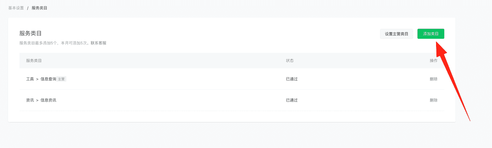

如果希望让 ChatGPT 辅助产出视觉方案，要提前限定颜色、布局、组件风格和使用场景，避免得到过于泛化的结果。

### 配置 Stitch

可以在 Codex 的相关配置目录中接入 Stitch：

```toml
## MCP 的配置
[mcp_servers.stitch]
url = "https://stitch.googleapis.com/mcp"

[mcp_servers.stitch.http_headers]
"X-Goog-Api-Key" = "你刚才提供的 key"
```

## 六、先做界面方案，再进入编码

### 1. 一个页面建议拆成三个阶段

| 阶段 | 核心任务 | 产出 |
|---|---|---|
| 阶段一 | 梳理页面需求 | 页面、字段、动作和状态说明 |
| 阶段二 | 产出视觉方案 | 可查看的界面草图 |
| 阶段三 | 完成页面实现 | 可在开发工具中运行的页面 |

一次处理一个页面，做完就预览，不要把首页、数据库、支付、登录等内容一次性全部交给工具。

零基础用户也不必先学专业设计软件。只要能说明“页面要展示什么、按钮点击后发生什么、哪些信息需要输入”，就能开始。

### 2. 奶茶消费记录页示例

我们用一个非常简单的产品来演示：记录自己每个月花在奶茶上的金额。

#### 页面需要包含

- 顶部显示本月累计支出，并展示本月消费杯数；
- 中间列出每次消费，包含店铺、口味或备注、价格和时间；
- 最近新增的项目排在前面；
- 没有数据时出现引导提示；
- 右下方提供新增入口；
- 新增时填写店名、金额和口味；
- 保存后立即出现在列表中；
- 第一版只保存在手机本地，不连接服务器。

### 3. 可参考的视觉需求描述

将下面的内容交给界面生成工具：

> 请为🛰️小程序制作一张“奶茶消费记录”单页视觉方案，只展示界面效果，不编写代码。
>
> 页面顶部放置本月消费总额信息卡，并在下方显示本月饮用杯数。
>
> 页面主体为消费记录列表，每条记录展示店名、口味或备注、金额和发生时间，最新记录位于上方。没有记录时，显示“还没有记录，点击右下角加号添加”。
>
> 右下方设置一个圆形新增按钮。
>
> 视觉上采用白色背景，大量留白，辅以柔和的奶茶色，例如 #C9A66B 或 #E8B4A0。整体要清楚、轻量、容易操作，信息卡使用适度圆角，文字保持良好可读性。
>
> 输出一张视觉效果图，不要输出程序代码。

界面图的作用是统一视觉方向，不需要放进工程目录。真正进入实现阶段时，再把这张图、页面说明和功能规则一起交给编程助手。

## 七、创建并运行首个工程

官方入口：

https://developers.weixin.qq.com/platform

### 操作顺序

1. 注册🛰️小程序账号，主体可选个人、个体工商户或企业。个人认证通常为 30 元/年，其他主体通常为 300 元/年，具体以平台当前规则为准。
2. 打开🛰️公众平台：
   https://mp.weixin.qq.com/
3. 完成名称、主体资料和认证流程。
4. 根据要求提交备案信息。备案入口：
   https://beian.miit.gov.cn/#/Integrated/index
5. 在小程序后台查看 AppID。
6. 安装🛰️开发者工具并完成扫码登录。
7. 新建小程序工程，填写 AppID，选择一个单独的本地目录。
8. 建议先在电脑上建立清晰的目录，例如：
   `wechat_program/project_1`
9. 再选择工程模板。
10. 如果暂时不想配置服务器，可以尝试🛰️云开发。部分新用户可能享有一段时间的免费额度，具体以当前政策为准。
11. 第一次建议先选择不启用云服务，优先把本地页面跑起来。
12. 点击编译查看模拟器效果，再通过预览功能扫码体验真机版本。

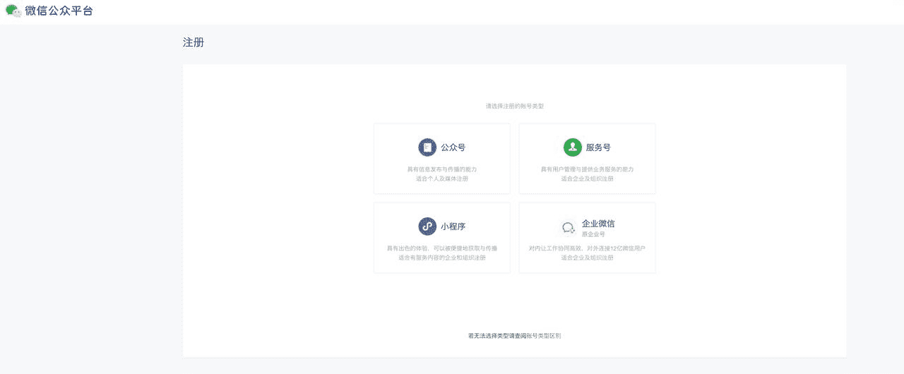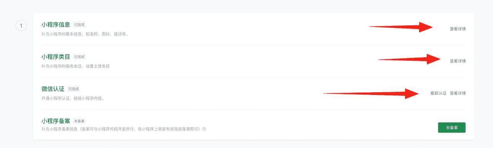

### 两种后端路径

**路径 A：先做本地版本**

适合工具型、记录型、展示型产品。数据保存在本机，不需要域名和服务器，最容易验证想法。

**路径 B：接入云开发或自建服务**

适合需要账号同步、跨设备数据、接口调用、支付或多人协作的产品。

如果选择🛰️云开发，可以先用它完成基础版本，后续再逐步迁移数据和业务逻辑。

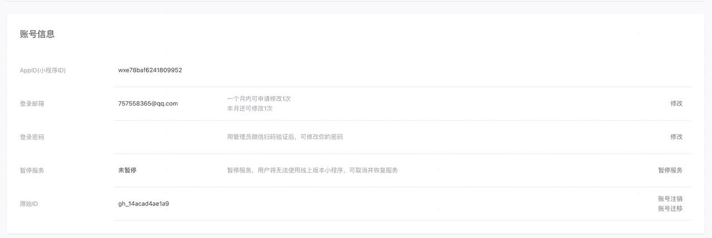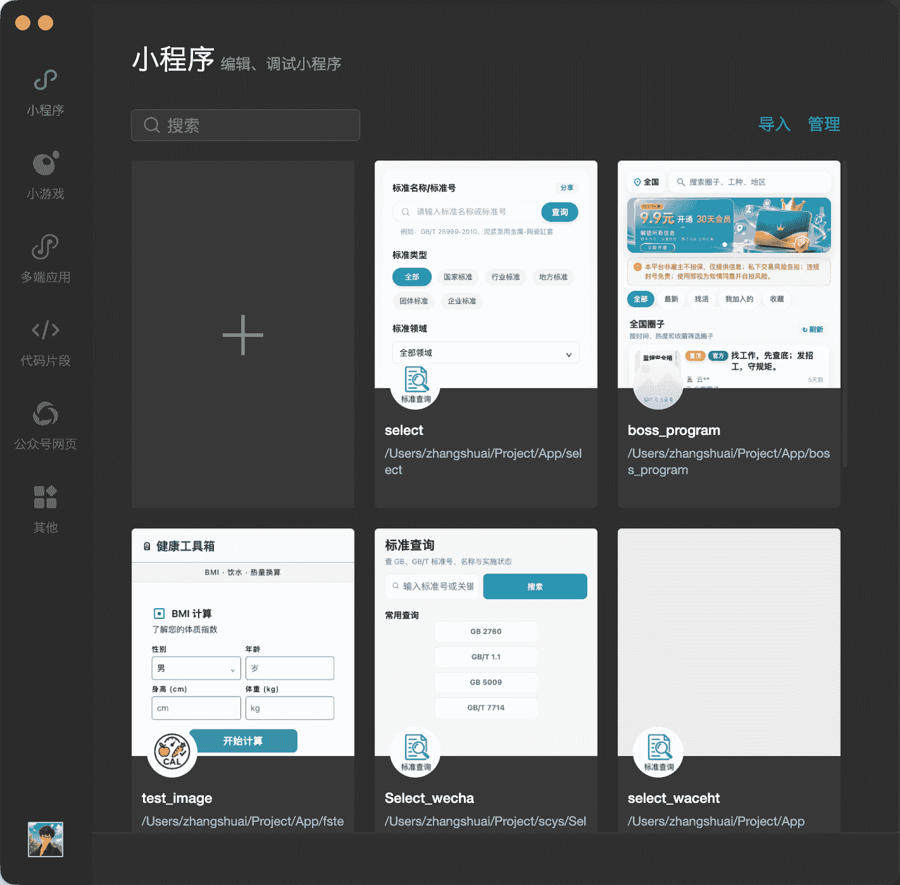

### 运行时要注意

- 不要把小程序 AppID 与👸号 AppID 混为一谈；
- 每个新工程尽量放在独立目录；
- 第一次练习不要叠加太多框架和服务；
- 调用外部接口时，提前配置合法的 HTTPS 域名；
- 备案和域名审核时间可能较长，应预留周期。

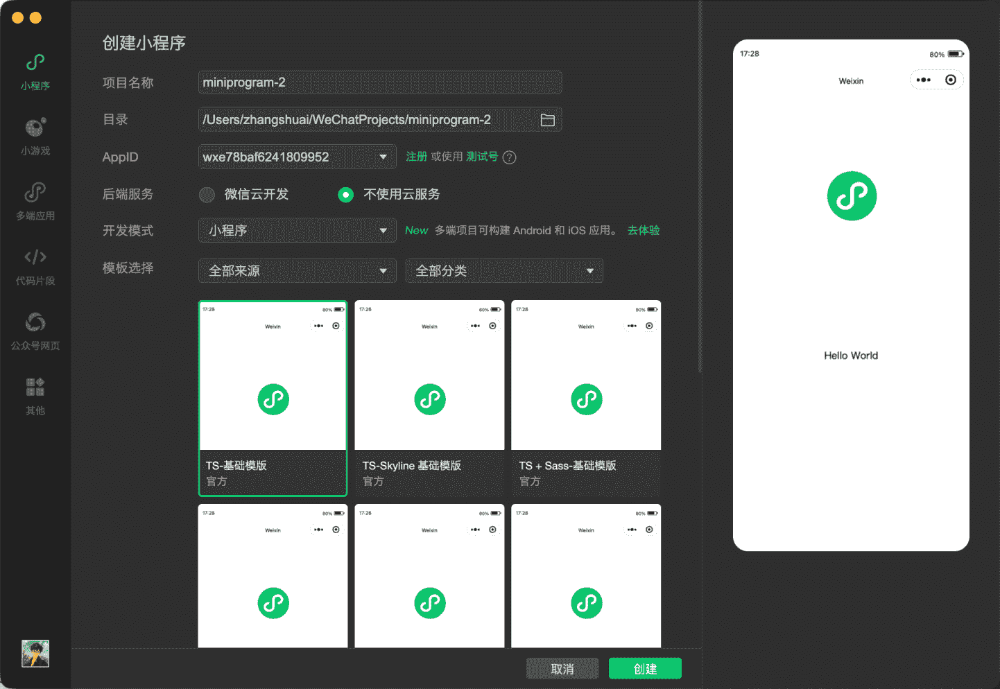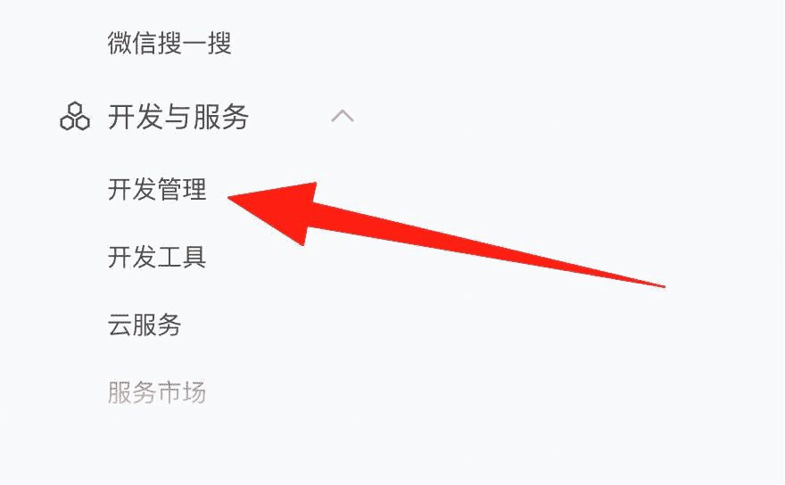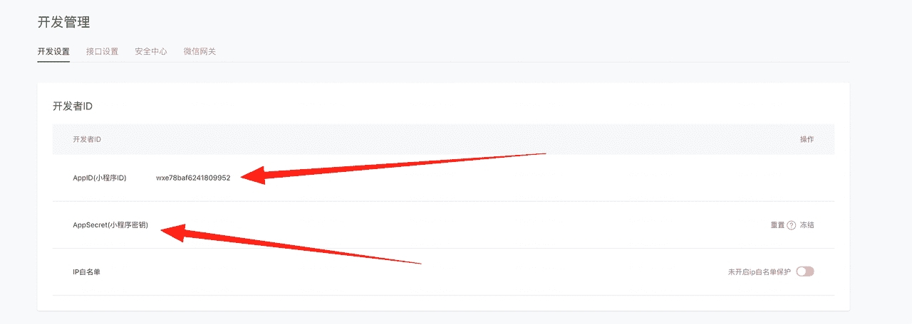

## 八、认识小程序的基本文件

一个基础工程通常会看到以下文件：

- `app.json`：设置全局页面、窗口、底部导航等；
- `app.js`：处理应用级逻辑；
- `app.wxss`：存放全局样式；
- `pages/index/index.wxml`：编写页面结构；
- `pages/index/index.wxss`：编写页面样式；
- `pages/index/index.js`：处理页面数据、事件和接口；
- `pages/index/index.json`：设置当前页面的独立配置。

可以把它们简单理解为：

- WXML：页面骨架；
- WXSS：页面外观；
- JS：交互和数据处理；
- JSON：工程与页面设置。

最容易出错的是配置文件。编写时要注意：

- 属性名使用英文双引号；
- 不要在 JSON 内添加注释；
- 不要出现未定义变量；
- 页面路径和文件夹名称要保持一致。

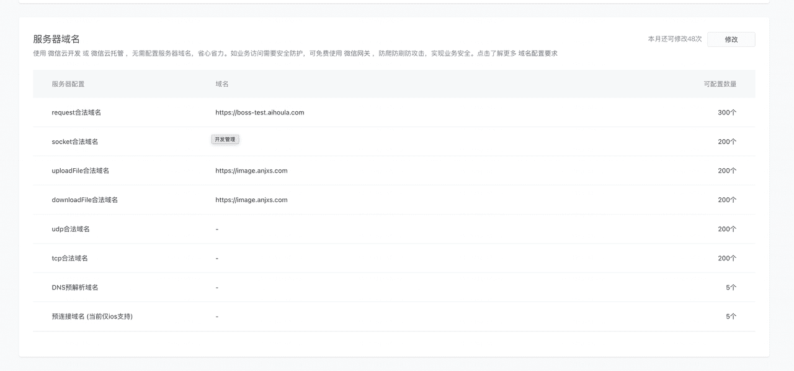

## 九、让智能助手参与实际开发

可选择 Codex、WorkBuddy、Kimi、TRAE 或 Claude Code 等工具。重点不在于工具名称，而在于你是否能把任务拆细，并逐步检查结果。

推荐流程：

1. 先描述产品目标；
2. 再拆出页面和字段；
3. 再说明点击、校验和错误状态；
4. 每完成一页就运行检查；
5. 发现问题时，让工具只修改当前问题；
6. 确认稳定后，再进入下一个功能。

不要只说“帮我做一个完整小程序”。这种描述过于宽泛，容易让输出失控。

## 十、案例：健康计算工具箱

### 10.1 产品拆解任务

可以将下面的需求交给产品规划助手：

> 请把“健康计算工具箱”拆成适合初学者实现的🛰️小程序方案。
>
> 产品包含四项能力：
>
> 1. BMI 指标计算：录入性别、年龄、腰围、身高和体重；
> 2. 每日饮水量估算；
> 3. 千焦与千卡之间的换算；
> 4. 体脂率估算：录入年龄、身高、颈围、腰围和体重。
>
> 产品不设置账号体系，不连接远程接口，不使用数据库。
>
> 计算结果只用于一般参考，不能替代医生诊断或医疗建议。
>
> 请输出：
>
> 1. 首页与各项功能页的组织方式；
> 2. 每项功能需要采集的信息及最终展示结果；
> 3. 对应计算公式；
> 4. 输入为空、格式错误和数值异常时的处理方式；
> 5. 第一版明确不实现哪些内容。

### 10.2 首页视觉方案描述

可以继续向界面生成工具提出以下要求：

> 请设计一个🛰️小程序“健康计算工具箱”的首页界面，面向没有技术基础的普通用户，打开后能快速找到以下四项功能：
>
> - BMI 指标计算；
> - 每日饮水量估算；
> - 热量与千焦换算；
> - 体脂率估算。
>
> 顶部显示主标题“健康工具箱”，并配一行说明文字“BMI · 饮水 · 热量换算”。
>
> 页面中部以信息卡形式呈现各项功能入口。每张卡片包括名称、简短解释、必要的输入提示和结果展示区域。
>
> BMI 卡片需要体现性别、年龄、腰围、身高、体重等输入；
>
> 饮水卡片需要提供体重填写位置以及每日建议饮水结果；
>
> 体脂率模块展示年龄、身高、颈围、腰围和体重等信息；
>
> 换算模块包含数值填写、单位切换以及结果位置；
>
> 页面底部增加“结果仅供参考”的提醒。
>
> 视觉风格要清爽、可信、易读，以绿色作为主要强调色，留白充足，卡片圆角控制在 8px 以内，每项功能都提供明确操作按钮。
>
> 请通过 Stitch 输出界面视觉方案：
> https://stitch.withgoogle.com/

### 10.3 BMI 功能实现要求

页面结构和样式准备好后，再单独让助手补充逻辑：

> 请根据现有 WXML 与 WXSS，为健康计算工具箱补充当前页面的交互逻辑。
>
> BMI 模块需要接收：
>
> - gender：性别；
> - age：年龄；
> - waistCm：腰围，单位厘米；
> - heightCm：身高，单位厘米；
> - weightKg：体重，单位千克。
>
> 身高需要先换算成米，再按以下方式计算：
>
> `BMI = weightKg / (heightM * heightM)`
>
> 其中：
>
> `heightM = heightCm / 100`
>
> 请同时处理以下情况：
>
> - 任一必要字段为空时，提示用户补充；
> - 身高、体重等数值不合法时，阻止计算；
> - 计算完成后展示结果；
> - 结果区域保留明确的“仅供参考”说明；
> - 不修改无关页面和其他模块的代码。

这类任务的关键，不是让工具一次性完成所有内容，而是让它按产品、视觉、页面、交互、校验的顺序逐层推进。你只要持续做好两件事：把需求讲明白，并逐项验证结果，零基础也能逐步搭出自己的🛰️小程序。

很多初次接触🛰️小程序的朋友，常被“从零到上线”的流程吓住。其实只要拆成一个个小闭环，每一步用清晰的思路去做，并不复杂。下面这版梳理，把几个典型场景、常用避坑点和发布前要确认的事项重新归拢了一下，方便你照着推进。

先看几个最常见的练手功能。

第一个是健康信息小工具，比如计算 BMI、饮水建议、热量单位换算、体脂率估算。这里面有几个容易忽略的细节：
- BMI 要保留一位小数，分档标准是：低于 18.5 属偏瘦；18.5 到 23.9 正常；24 到 27.9 超重；28 以上肥胖。输出时要附带一句“结果仅供参考，不能替代专业医疗建议”。
- 腰围风险按性别区分：男性大于等于 90cm、女性大于等于 85cm 算偏高，否则正常。
- 每日饮水按体重估算：体重公斤数乘 35 得到毫升数，再除以 250 换算成杯数。毫升取整数，杯数留一位小数，同时提醒用户根据运动、天气和身体状况调整。
- 热量换算记住 1 kcal = 4.184 kJ，结果保留一位小数，支持两个方向转换。
- 体脂率用简化公式估算：男性 1.20×BMI+0.23×年龄−16.2；女性 1.20×BMI+0.23×年龄−5.4。这里颈围、腰围只做输入校验，不参与计算。结果保留一位小数，并提醒仅为估算值。等级分界方面，男性低于 10 偏低、10-20 正常、20-25 偏高、25 以上肥胖；女性低于 18 偏低、18-28 正常、28-35 偏高、35 以上肥胖。
- 所有数字输入都要判断是否为空、是否非数字、是否小于等于零，出错时用 toast 提示。
- 技术实现上，不引后端、不引数据库，全放在当前页面的 index.js 里，逻辑按功能拆方法，关键处写中文注释，适合原生小程序开发。最终要交付完整 JS、WXML 里绑定的事件名、data 字段建议，以及三组测试数据。

如果开发中报错，排错模板是：先贴控制台第一条红色错误，把相关代码片段和期望效果一并给出，然后请对方按“报错原因、改哪个文件、修改后的代码片段、如何验证”四步来回答。

第二个常用案例是天气查询。一般推荐用高德开放平台的天气接口，先申请 key，再按城市编码请求。产品层面要设计好页面结构、data 字段、请求中/成功/失败/无数据四种状态，以及展示哪些天气字段。上线前记得在后台配置 request 合法域名，用 HTTPS。真实项目里 key 不要直接写在前端，最好由服务端或云函数转发。请求逻辑用 wx.request，参数包括 key、city、extensions、output，注意校验城市非空、请求前后切换 loading、处理非成功状态。如果真机连不上，优先检查域名配置、key 类型、adcode 是否有效、网络和 HTTPS。

第三个有代表性的案例是个人记账本，数据要存自己的服务器。前后端分离，后端用 Laravel + MySQL，前端原生小程序。需要设计用户表和账单表，账单通过 user_id 外键关联用户。登录用 wx.login 拿 code 换 openid，后端返回 token，后续请求在 header 里带 Authorization: Bearer <token>，遇到 401 自动跳登录。接口层面要覆盖登录、记账、列表、删除、汇总。UI 上首页展示本月收支汇总和最近记录，记一笔页面有大金额输入框、收/支切换、分类选择、备注和日期，列表按日期分组支持左滑删除，我的页面展示头像昵称和退出。本地调试可以勾选“不校验合法域名”，上线前必须配置正规的 HTTPS 域名。排错时从域名配置、token 是否带上、路由控制器对应关系、数据库连接、CORS、后端日志这六点依次查。

整个项目开发，建议按顺序走：先写清楚用户、功能和数据；再拆页面和组件；每次只让 AI 生成一个页面或组件；立刻在开发者工具里编译；遇到报错就带着错误信息、相关文件和预期效果一起问；功能通了再统一优化样式。不要一次性生成整个项目然后不看代码，也不要把密钥、AppSecret、支付证书放前端。

发布之前至少做三轮测试：开发者自测、真机预览、体验版邀请测试。体验成员不是开发者也一样能试用，适合让产品、测试或种子用户把关。

正式发布的链路是：预览 → 上传代码 → 后台设体验版/提交审核 → 审核通过 → 发布上线。上传时要填版本号和备注，版本号建议按 0.1.0、0.2.0 这样来，备注里写清本次改动。提交审核前要准备好名称、简介、头像、服务类目，页面不能有测试文字和占位图，涉及用户信息要填隐私保护指引，涉及备案要完成或正在办理。

关于类目与备案，重点看三件事：个人主体是否开放该类目、要不要资质材料、有没有前置或专项审批。备案流程是填写信息、平台初审、工信部短信核验、通管局审核、备案成功。平台初审一般 1-2 个工作日，通管局审核 1-20 个工作日，短信要在 24 小时内完成核验，手机保持畅通。涉及小程序内定位等接口时，要提前单独申请权限。

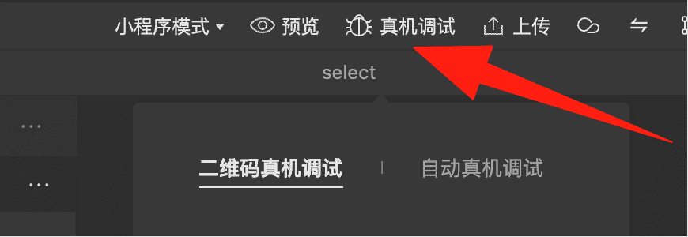

隐私保护方面，如果处理用户个人信息，要在“服务内容声明”或“提交审核”页面补充隐私指引。常见审核问题包括：类目与功能不一致、页面有测试数据或引流信息、授权说明不清楚、隐私接口没在指引里覆盖、功能不可用或空白、个人主体做了不该做的类目。提交前做“五项检查”：功能走得通、类目对得上、隐私指引补齐、备案/资质不缺、页面没有测试痕迹。

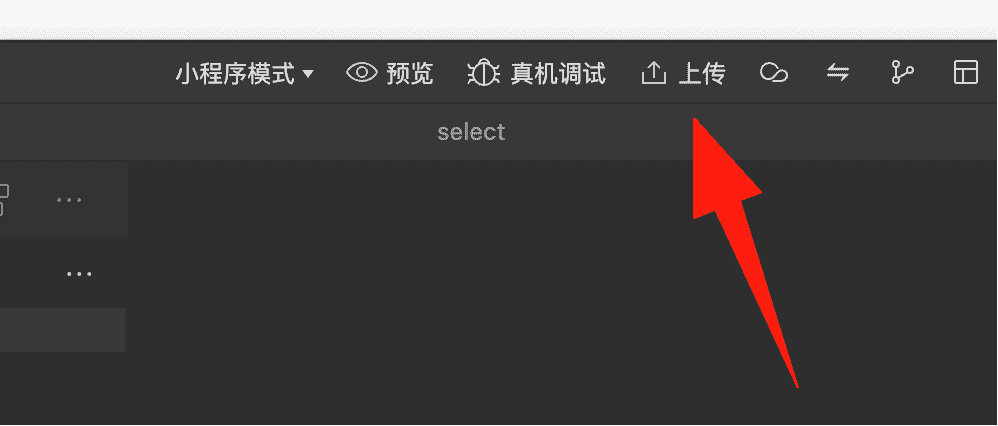

最后是推荐作业。第一个小程序建议做一个小闭环，分三类难度。轻工具类个人主体就能做，比如每日打卡、活动报名、提示词收藏夹、费用 AA 计算器。接口/数据类需要后端，比如天气查询、一言、物流查询、AI 对话、本地黄页。订阅/付费类需要个体工商户和🛰️支付商户号，个人主体开不了🛰️支付，想做必须先办个体工商户执照。第一次建议先完成第一或第二类，跑通全流程再升级。验收标准是：能在开发者工具编译、至少三个页面、有清晰的 app.json、能走通一个完整用户流程、能生成预览二维码真机体验、写出类目/隐私/备案/审核检查表。第三类还要额外写明主体类型和是否已开通商户号。

另外，如果前期不想自己搭服务器，可以先用🛰️开发者工具自带的云开发，后期再迁到云服务器。这样压力小，也能把手链流程先跑熟。祝你顺利上线。

想自己做个网站或小程序，但一听到服务器、域名、备案、数据库这些词就头大？其实现在已经不需要你自己写代码了。把代码交给 Codex 和 WorkBuddy，你只需要按着清单一步步点亮鼠标，就能把项目从零部署上线。这篇文章给你一套最“小白友好”的完整方案，用腾讯云轻量服务器 + 宝塔面板，配合 AI 开发，全程不要求你会写一行代码。

先说清楚这套方案的技术底子：服务器用腾讯云轻量应用服务器或 CVM，面板用宝塔，域名在腾讯云注册，静态资源放腾讯云 COS，SSL 证书用宝塔免费签发。数据库这里特别说明一下：我们用服务器本机装的 MySQL，不碰腾讯云云数据库——理由很简单，省钱，而且新手项目根本用不到那么高级的东西。

整个项目谁是主角？你只负责掏钱、点配置、做验收，写代码的活儿全丢给 Codex 和 WorkBuddy。整体流程大概是这样的：

1. 花 5 分钟看一遍费用预算；
2. 去腾讯云控制台买服务器和域名，约 30 分钟；
3. 用宝塔面板或 SSH 连上服务器，10 分钟；
4. 在宝塔里装好 Nginx、PHP、MySQL，20 到 40 分钟；
5. 配置网站和 Nginx，15 分钟；
6. 创建本机 MySQL 数据库，5 分钟；
7. 域名 DNS 解析 + ICP 备案，提交后等 2 到 3 周；
8. 后端开发交给 Codex/WorkBuddy，1 到 2 天；
9. 前端开发同样交给 AI，1 到 2 天；
10. 如果要接🛰️支付，你自己去开商户号，接口让 Codex 写，半天到一天；
11. 服务器部署，Codex 配合你在宝塔操作，半天；
12. 花 1 小时对着清单做验收检查；
13. 遇到 AI 报错就问 AI，按需排查。

先聊大家最关心的费用问题。以下价格基于 2026 年 8 月腾讯云公开定价，最终以购买页为准。

服务器方面：轻量应用服务器 2 核 2G、4M 带宽、300GB 月流量，月付约 35 到 45 元，新人包年约 109 元，新手用这个就够。CVM 2 核 2G 标准型月付约 45 到 68 元，包年约 540 到 816 元，虽然更灵活，但配置也更麻烦。

域名方面：.com 首年 55 到 75 元，续费 75 到 99 元；.cn 首年 29 到 39 元，续费 39 到 55 元。.cn 更便宜，但一部分用户更信任 .com。

宝塔面板免费版 0 元，完全够用；专业版 625 元一年，可选。SSL 证书用宝塔的 Let’s Encrypt，免费，90 天自动续签。DNS 解析用腾讯云 DNSPod 免费版。ICP 备案和小程序备案都免费，但必须做。腾讯云 COS 自带免费额度：50GB 存储 + 10GB 流量每月。🛰️小程序认证方面，个人主体免费，企业 300 元一年。

至于腾讯云云数据库 MySQL，最低配置一个月也要 50 到 100 多元，一年下来 600 到 1200 多元，太贵了，这套方案不用它，直接改用宝塔本机 MySQL，免费。

所以，个人开发者最小方案的首年总成本大约 300 元：轻量服务器包年 + .com 域名 + 免费宝塔 / SSL / COS / 本机 MySQL。后续每年大约 460 到 540 元，主要是服务器和域名的续费。如果 COS 超额，存储约 0.1 元/GB/月，流量 0.5 元/GB，压力也不大。

为什么不推云数据库？对比一下：云数据库月费至少 50 到 100 元，本机 MySQL 免费；云数据库独立资源、自动备份、高可用，本机 MySQL 共享服务器资源，靠宝塔计划任务备份；云数据库适合大用户量、生产级项目，本机 MySQL 适合日活不到 1000 的新手项目。结论很直接：前期数据量小，本机 MySQL 绰绰有余，等用户量真起来了再迁过去也不迟。

购买策略也给你总结好了：第一，服务器选轻量应用服务器，别选 CVM，便宜还自带宝塔镜像；第二，域名在腾讯云买 .com 或 .cn，免去跨平台转入的麻烦；第三，宝塔用免费版；第四，SSL 用宝塔 Let’s Encrypt，一键申请，自动续期；第五，COS 免费额度基本用不完；第六，数据库用宝塔本机 MySQL，一年能省 600 元以上；第七，能包年就别包月，包年通常比包月便宜 30% 以上。

具体怎么买？打开腾讯云轻量应用服务器控制台，新建实例，地域选离你最近的（华南选广州，华东选上海，华北选北京），镜像一定要选“宝塔 Linux 面板”——这个很关键，选了之后宝塔会自动装好。规格选 2 核 2G 4M，时长选包年，支付后等两三分钟，服务器就创建完成，宝塔面板也就绪了。

如果你执意要用 CVM（新手不推荐），CVM 没有宝塔镜像，需要自己装：控制台新建实例，系统选 Debian 12 64 位或 CentOS 7.9，规格 2 核 2G。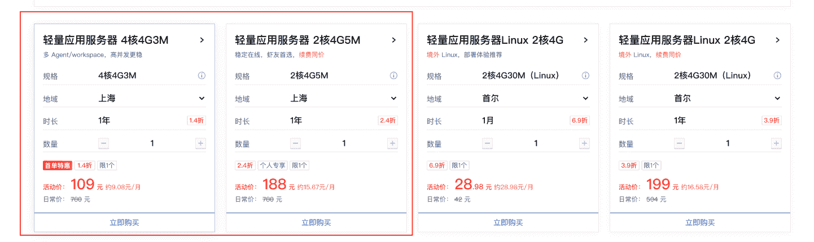 带宽可以按流量计费，或选 1Mbps 固定带宽，购买后用 SSH 连接，执行宝塔安装命令，后面第四步会讲到。

域名怎么买？去腾讯云域名注册页搜索你想要的域名，比如 anxiaosheng.com。.com 首年约 55 到 75 元，.cn 约 29 到 39 元。买完立刻做实名认证，否则不能用，审核一般 1 到 3 个工作日。记得还要做备案。

服务器安全组 / 防火墙也要处理。端口就像门牌号，每个服务有自己的唯一门牌。轻量服务器自带防火墙，要确认放行：22（SSH，开放，建议限制源 IP）、80（HTTP，开放）、443（HTTPS，开放）、8888（宝塔面板，开放，建议改成其他端口）、3306（MySQL，不开放，只允许本机访问）、6379（Redis，不开放）。到“轻量应用服务器 → 防火墙”里添加规则就行。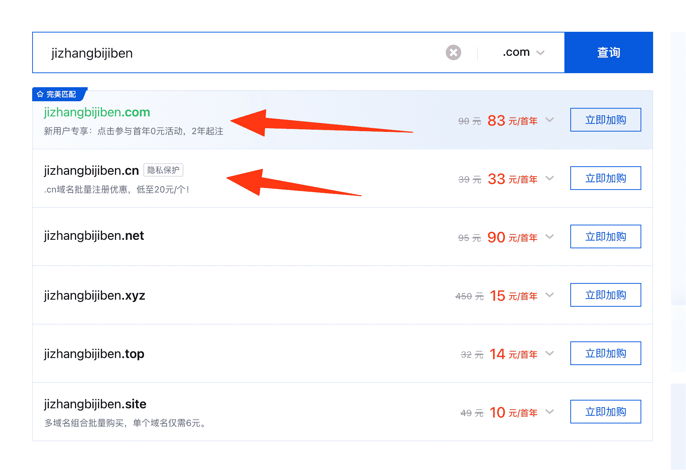

买完之后怎么确认没买错？检查一下：腾讯云控制台实例状态显示“运行中”；终端能 ping 通公网 IP；浏览器访问 http://公网IP:8888 能显示宝塔登录页；域名列表显示已注册；域名详情页显示“已实名”或“审核中”。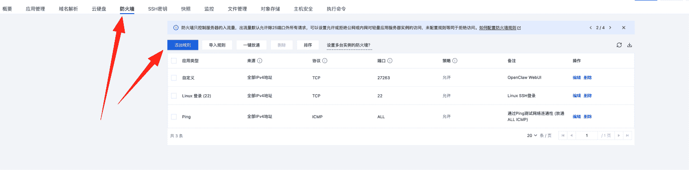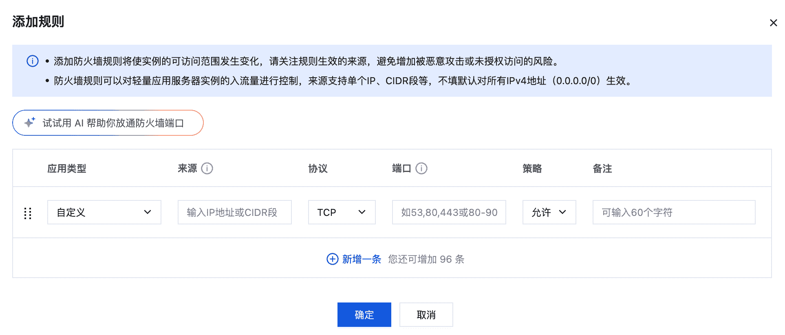

第三步，连接服务器。有两种方式，建议都学会：一是宝塔面板，适合小白；二是 SSH 终端，给 Codex 用。

先看宝塔面板。它是网页版服务器管理工具，不用敲命令，点点鼠标就行。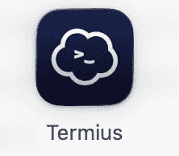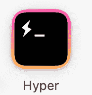具体操作：在腾讯云控制台找到你的轻量服务器，点“应用管理”标签，就能看到宝塔面板的登录地址、账号和密码。用浏览器打开地址（通常是 http://公网IP:8888/随机字符串），输入账号密码登录，首次登录绑定一个免费的宝塔官网账号即可。如果找不到登录信息，用 SSH 连上服务器，执行 bt default，就会显示地址、账号、密码。

再看 SSH 终端。macOS：打开“终端”，输入 ssh root@你的公网IP，然后输密码。Windows：打开 PowerShell 或 Windows Terminal，输入同样的命令，输密码。首次连接会提示信任主机，输入 yes 回车即可。

如果你不知道 root 密码，去腾讯云控制台轻量应用服务器实例，点“更多”→“重置密码”，设置一个至少 12 位、含字母数字和特殊符号的强密码。重置后服务器会重启，等一两分钟。怎么判断连上了？宝塔方式看浏览器能否打开宝塔首页；SSH 方式看终端是否出现 root@xxx:~# 提示符。

另外，你也可以直接在腾讯云控制台登录。步骤 1。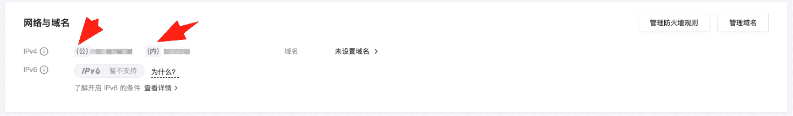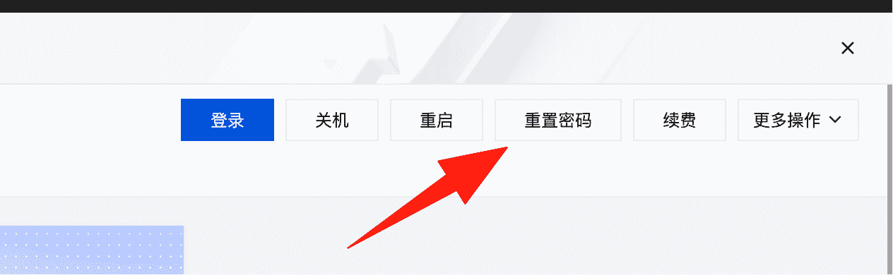 步骤 2：登录后执行命令，输入 bt 并回车，会出现一个界面，选择 14，就能看到宝塔的链接和密码。

第四步，在宝塔里安装环境，全程不用敲命令。划重点：宝塔系统是在购买服务器时就要选的，如果没选或想重装，可以点相应选项重新进入创建选择环节。这几个步骤一定要看清楚，密码按提示来。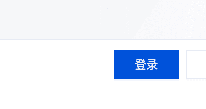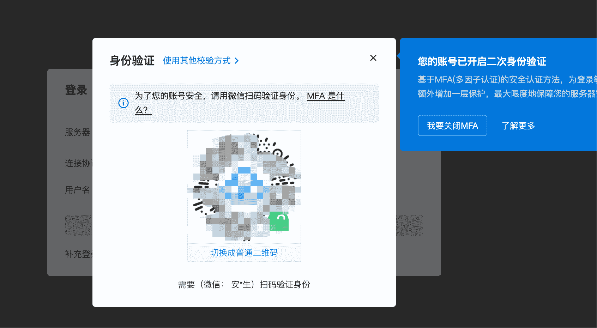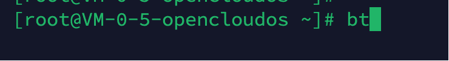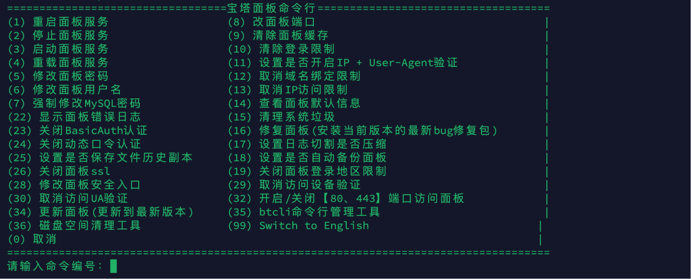另外，安装完成后，需要用第三步里提到的 SSH 方式连接服务器。

第一次登录宝塔面板，完成登录。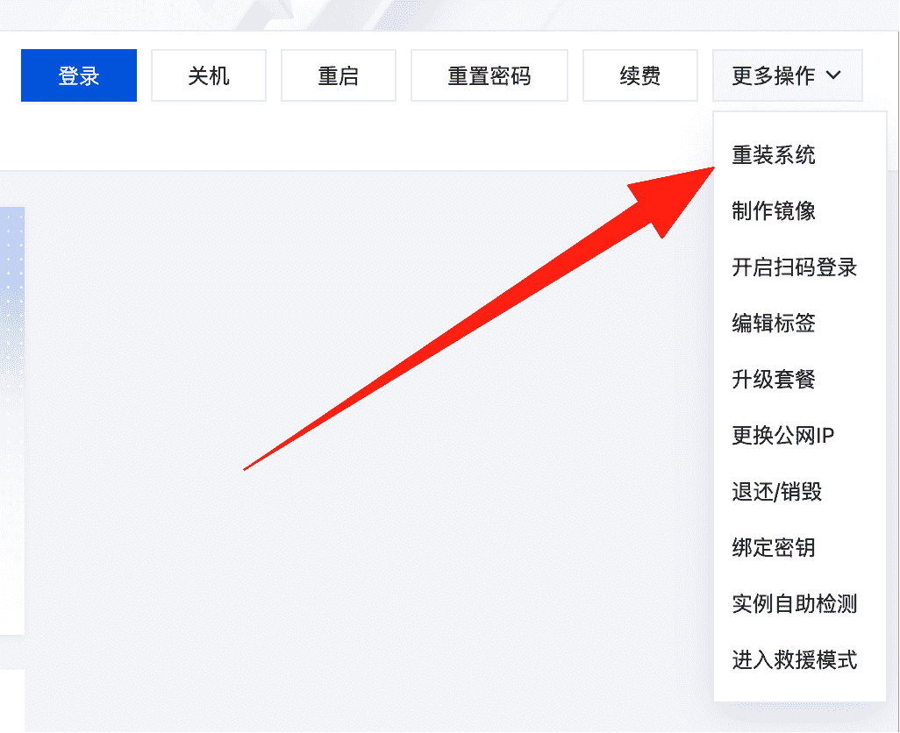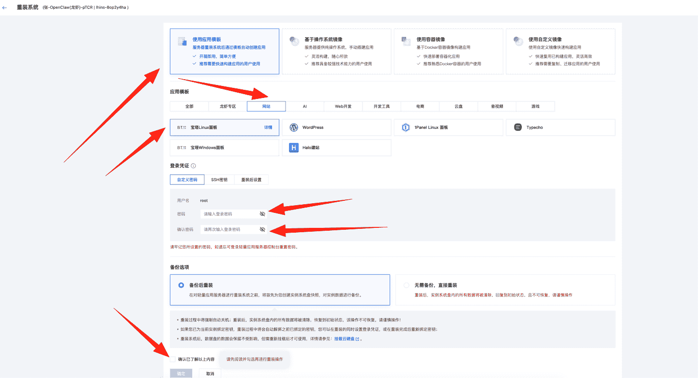接着系统会弹窗让你选择环境，推荐选 LNMP（Nginx + MySQL + PHP），不要选 LAMP，因为 Apache 不适合 Laravel。安装方式有两种：极速安装，10 到 15 分钟，够用；编译安装，30 到 60 分钟，更稳定，推荐但新手选极速即可。软件版本方面：Nginx 选最新稳定版（如 1.24 或更高）；MySQL 选 8.0，如果服务器只有 2G 内存，选 5.7 更稳；PHP 选 8.2 或更高。勾选完点“一键安装”，等待完成，期间别关浏览器。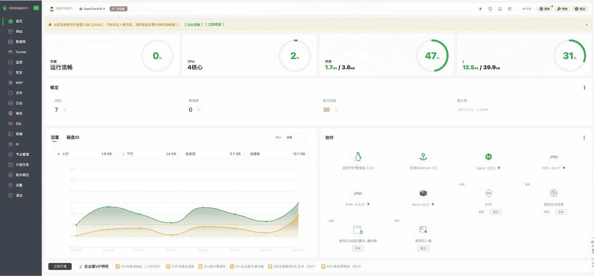

PHP 装完还要装扩展，Laravel 依赖这些。宝塔 → 软件商店 → 找到 PHP 8.2 → 设置 → 安装扩展，确保这些已装：fileinfo（文件上传）、mbstring（多字节字符处理）、openssl（加密）、pdo_mysql（数据库连接）、tokenizer（Laravel 依赖）、curl（请求🛰️接口）。redis 和 gd 或 imagemagick 是可选的，新手先不用管。

如果你用的是 CVM，需要手动装宝塔。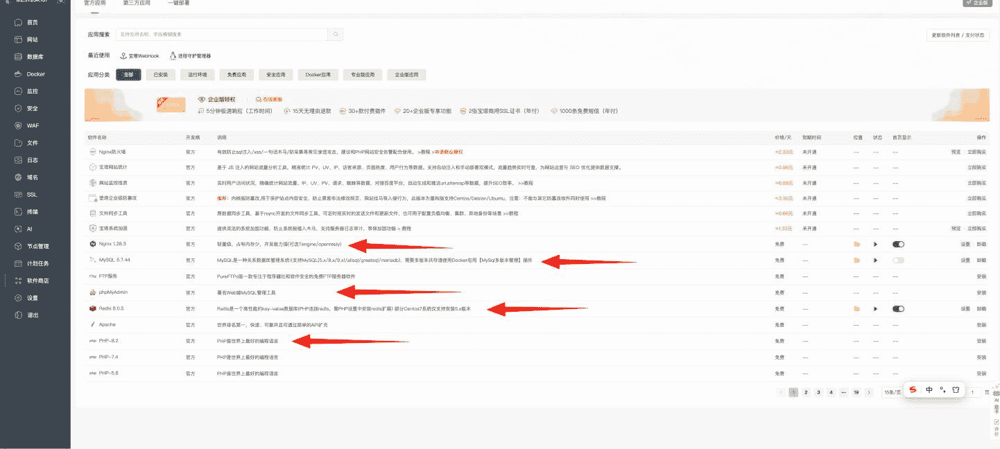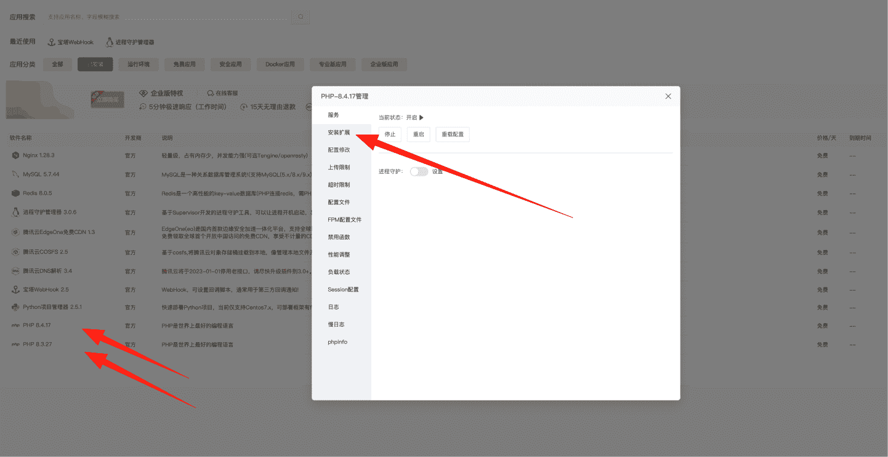用 SSH 连接服务器后，Debian/Ubuntu 执行对应命令 ```
wget -O install.sh https://download.bt.cn/install/install-ubuntu_6.0.sh && bash install.sh ed8484bec
```，CentOS 执行对应命令 ```
wget -O install.sh https://download.bt.cn/install/install_6.0.sh && sh install.sh ed8484bec
```。安装完成后会显示宝塔面板地址、账号、密码，然后再按前面的流程装环境。

装完怎么确认？看宝塔软件商店里 Nginx、PHP、MySQL 是否都显示“运行中”；PHP 扩展里 pdo_mysql、fileinfo 等是否已安装；浏览器访问 http://公网IP 能否看到 Nginx 欢迎页。

最后，如果你连环境都想让 Codex 自动装，也可以。把腾讯云控制台里的服务器连接信息抄下来：公网 IP（实例详情里那串数字）、SSH 端口（默认 22）、登录用户名（腾讯云多为 root，部分镜像是 ubuntu 或 lighthouse，以控制台为准）、登录密码（你重置时设置的）。然后把这段信息直接写进 Prompt 里，Codex 就能通过 SSH 登录服务器，一次性把宝塔和整套环境装好。你不用懂命令，照着填就行。

这套攻略，从花钱到上线，从手动配置到 AI 代写代码，全程都替你考虑好了。代码不懂，交给 Codex 和 WorkBuddy；服务器不懂，宝塔帮你兜底。按着这份清单一步一步走，你的项目很快就能跑起来。

```
我的服务器连接信息如下，请你用 SSH 帮我登录并安装环境：
- 服务器公网 IP：1.2.3.4
- SSH 端口：22
- 登录用户名：root
- 登录密码：你的服务器密码

登录方式：在你的终端执行 ssh root@1.2.3.4 -p 22，提示输入密码时输入上面的密码。如果连接被拒绝、超时、或提示密钥/权限问题，先把报错原样告诉我，不要擅自改服务器配置。

第一步（只读，不要改任何东西）：登录后只做检查——操作系统版本、CPU/内存/磁盘、是否已装 Nginx/PHP/MySQL、是否已装宝塔、当前开放了哪些端口。把结果用中文汇报给我。

第二步：如果还没装宝塔，用官方脚本安装宝塔面板（Debian 用 install-ubuntu_6.0.sh；CentOS 用 install_6.0.sh）。安装完成后，从脚本输出里读取面板访问地址、初始用户名、初始密码，保存到一个本地文件 /root/bt_info.txt，权限设为只有 root 能读。不要把任何密码打印在聊天里。

第三步：安装运行环境 LNMP——Nginx 最新稳定版、MySQL 8.0（如果内存只有 2G 就装 5.7）、PHP 8.2。如果某些组件已经装好就跳过，不要重装。

第四步：给 PHP 8.2 安装这些扩展：fileinfo、mbstring、openssl、pdo_mysql、tokenizer、curl。

第五步：安全设置：
- 确认防火墙只开放 22（SSH）、80、443 端口；3306（MySQL）和 PHP-FPM 端口不对公网开放；
- 不要把 phpMyAdmin 暴露到公网；
- 宝塔面板端口若用默认 8888，确认只允许你的管理 IP 访问。

每做完一步都告诉我结果和下一步做什么。遇到需要确认的高风险操作（删除文件、改 SSH 配置、放行端口等）先停下来等我同意。全部完成后给我一份「环境清单」：每个组件版本、是否运行中、面板地址。
```

**安全提醒：** 上方把密钥直接写进指令里，它会被保存在 Codex 的会话记录中。若你介意泄露风险，可把连接信息写入本机文件 ~/server_info.txt，然后让 Codex「读取 ~/server_info.txt 获取访问信息，但禁止把密钥输出到屏幕上」；或者在 Codex 询问密钥时再口头提供。

**第三步：如何确认 Codex 执行到位**

| 检查点 | 验证方式 | 合格标志 |

|---|---|---|

| 是否连上 | Codex 回报内核版本与内存占用 | 说明 SSH 通路正常，未卡在认证或端口 |

| 宝塔是否就绪 | 浏览器打开控制面板地址 | 可正常进入登录界面 |

| 运行环境 | 宝塔 → 软件商店 | Nginx / MySQL / PHP 8.2 均显示 运行中 |

| PHP 组件 | 宝塔 → PHP 8.2 → 安装扩展 | 6 项必要扩展均已完成安装 |

| 端口策略 | 宝塔 → 安全 | 仅 22/80/443 放通，3306 未对外 |

| 凭证存放 | 查看 /root/bt_info.txt | 面板密码已写入文件，聊天窗口未泄露 |

**提示：** 交给 Codex 部署比人工点击更快，但请全程监督它的授权申请。凡涉及「删除文件」「修改 SSH 配置」「磁盘格式化」等高危动作，务必先暂停确认。

### 第五步：站点与 Nginx 配置

#### 5.1 新增站点

1. 宝塔 → 网站 → 添加站点
   - 域名：填写 api.你的域名.com
   - 备案未完成时，可先用 服务器IP:8080 临时访问
2. 根目录：设定为 /www/wwwroot/api.你的域名.com/backend/public
   - 必须落到 public 目录，这是 Laravel 的入口
3. PHP 版本：选择 8.2
4. 数据库：暂缓创建，先到下一步单独处理
5. 提交后，进入 软件商店 → nginx → 重新加载 → 重启服务

#### 5.2 伪静态设置

Laravel 依赖 URL 重写，否则除首页外其余路由会 404：

1. 宝塔 → 网站 → 选择站点 → 设置
2. 点击 伪静态
3. 下拉挑选 **"Laravel5.x"**，同样兼容 Laravel 10/11
4. 保存

若列表里没有 Laravel 选项，选择 自定义 并粘贴以下内容：

```
location / {
    try_files $uri $uri/ /index.php?$query_string;
}
```

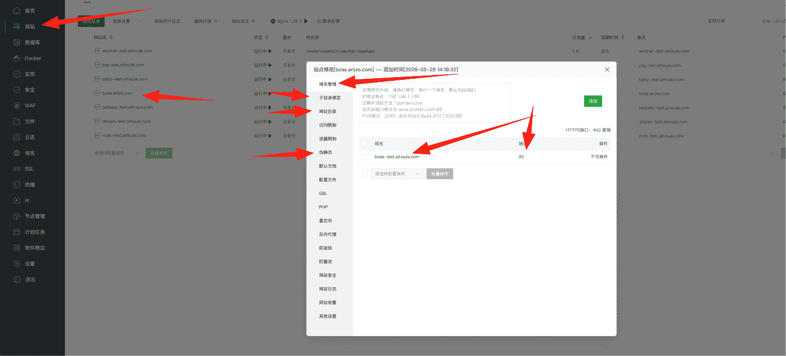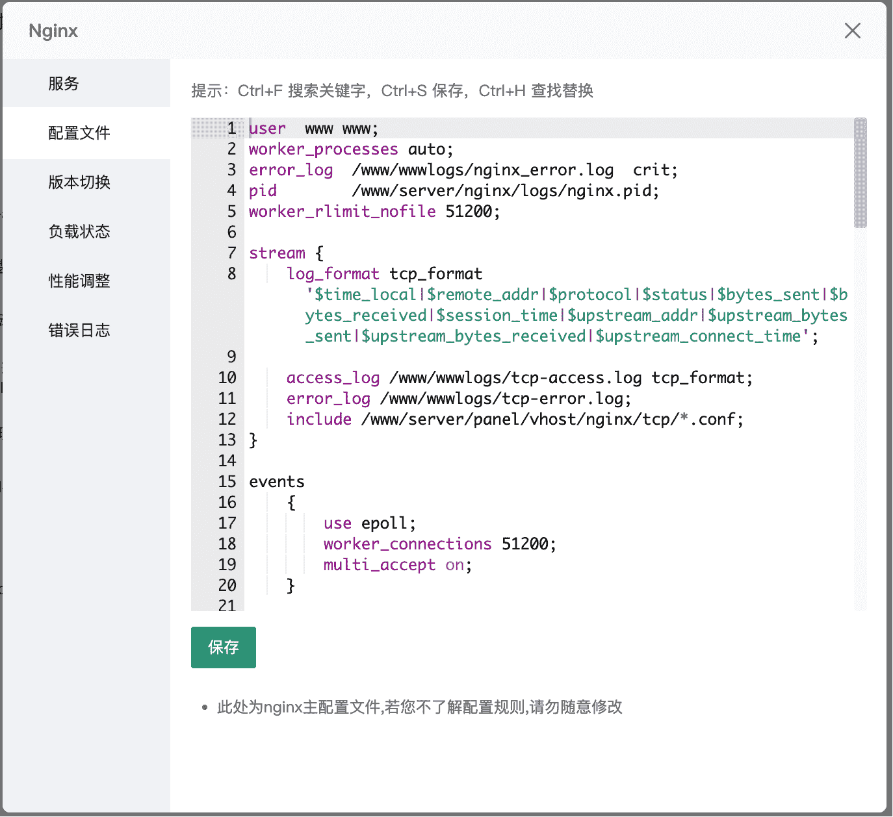

#### 5.3 SSL 配置，仅备案完成后进行

SSL 是 HTTPS 的前提，小程序接口仅允许 HTTPS：

1. 宝塔 → 网站 → 选中站点 → 设置 → SSL
2. 选择 **Let's Encrypt**
3. 点击 申请
4. 勾选对应域名
5. 再次点击 申请
6. 等待成功提示
7. 开启 强制 HTTPS

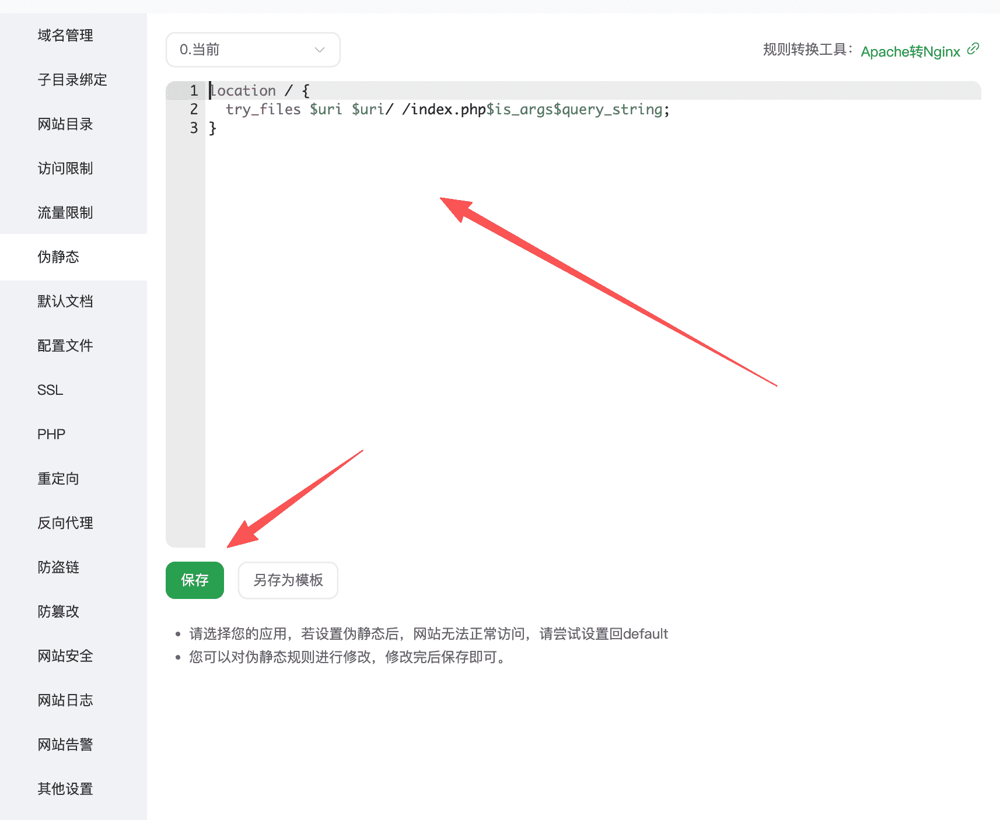

**注意：** 申请 SSL 需要域名已完成备案且解析已生效，否则会失败。备案期间先不配置 SSL，使用本地开发环境即可。

#### 5.4 阻断敏感文件访问

1. 宝塔 → 网站 → 选中站点 → 设置 → 配置文件
2. 在 server 段落内加入：

```
# 禁止访问 .env 文件
location ~ /\.env { deny all; }

# 禁止访问 .git 目录
location ~ /\.git { deny all; }
```

3. 保存

> 大多数环境已默认配置，可沿用或补充，不影响功能

**配置正确性的核验**

| 检查点 | 验证方式 | 正确表现 |

|---|---|---|

| 站点创建 | 宝塔 → 网站 | 能看到新站点 |

| 根目录正确 | 浏览器访问 http://公网IP 或域名 | 出现 Laravel 500 错误为正常，说明 PHP 已工作 |

| 伪静态生效 | 部署代码后访问 /api/health | 正常返回 JSON，而非 404 |

| SSL 生效 | 备案后访问 https://域名 | 地址栏出现绿色锁 |

| .env 被阻断 | 浏览器访问 https://域名/.env | 返回 403 Forbidden |

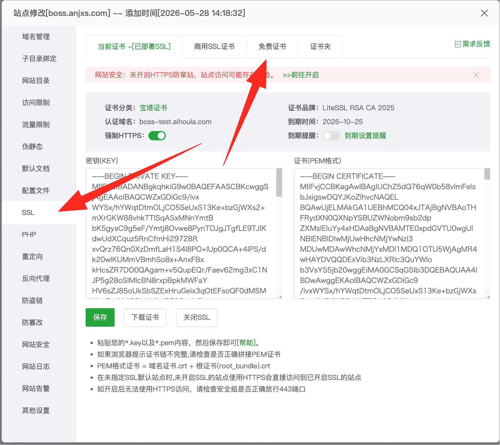

### 第六步：本地数据库创建，不使用云数据库

#### 6.1 使用本机 MySQL 的原因

腾讯云云数据库 MySQL 起步价约 50-100 元/月，年成本 600-1200 元。对新手项目成本偏高。

宝塔自带的 MySQL 安装在同一台服务器，完全免费，日活 <1000 的小程序完全够用。今后用户量增长后再迁移到云数据库也来得及。

#### 6.2 在宝塔创建库

1. 宝塔 → 数据库 → 添加数据库
2. 库名：miniapp_todo
3. 用户名：miniapp_user
4. 密码：点 **随机密码** 生成并妥善保存，勿使用简单密码
5. 访问权限：选 **本地服务器**，仅允许 127.0.0.1 访问
6. 字符集：utf8mb4，支持表情符号
7. 提交

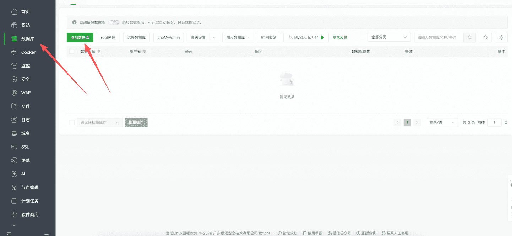

#### 6.3 安全要点

| 规则 | 原因 |

|---|---|

| 3306 不对外开放 | 防止外部扫描爆破 |

| 访问权限仅限本地 | 只允许回环地址连接 |

| 使用随机强密码 | 避免 123456 等弱口令 |

| 开启宝塔数据库备份 | 建议每日 3:00 自动备份 |

#### 6.4 配置自动备份

1. 宝塔 → 计划任务 → 添加任务
2. 任务类型：备份数据库
3. 选择库：miniapp_todo
4. 执行周期：每日凌晨 3:00
5. 保留份数：7 份
6. 提交

#### 6.5 交由 AI 生成表结构

不必手写 SQL，将下面描述复制给 Codex/WorkBuddy，AI 会自动建表。

**复制给 AI 的描述**

```
请帮我设计数据库，要求如下：

1. **users 表**（用户表）：存小程序用户的 openid（唯一，通过 wx.login 静默获取）、昵称（用户通过组件选择填写）、头像（存 COS 的 object_key 而不是完整 URL，因为 URL 会过期）、创建时间和更新时间。不存手机号和邮箱，避免隐私合规问题。

注意：小程序登录是静默的（wx.login → code → 后端换 openid），用户无感知，不需要点"授权"按钮。昵称和头像不能从登录接口获取（2022 年微信已关闭此能力），需要用 <button open-type="chooseAvatar"> 组件让用户选头像、用 <input type="nickname"> 组件让用户填昵称，用户选完后传给后端保存。

2. **todos 表**（待办表）：存待办标题（最多 200 字）、是否完成（默认未完成）、附件（存 COS 的 object_key，可为空）、所属用户 ID、创建时间和更新时间。每条待办必须属于一个用户，用户删除时其待办自动删除（外键级联删除）。给"用户 ID + 是否完成"加联合索引，因为最常见的查询是"某用户的未完成待办列表"。

3. 用 Laravel Sanctum 做 token 认证，不要用 JWT，Sanctum 是 Laravel 官方方案配置更少。

4. 数据库连接信息：数据库名 miniapp_todo、用户名 miniapp_user、密码已安全保存。MySQL 版本 8.0，字符集 utf8mb4。

5. 创建好 Migration 文件后，运行迁移命令，然后把运行结果截图给我看。
```

**AI 是否执行正确的判断**

| 检查点 | 核验方式 | 合格标准 |

|---|---|---|

| 表是否创建 | 让 AI 执行 php artisan migrate:status 并截图 | 所有条目显示 Ran |

| users 表包含 openid | 让 AI 执行 php artisan tinker 输入 Schema::hasColumn('users','openid') | 返回 true |

| todos 表外键 | 询问 AI todos 表的外键定义 | 回答 user_id 关联 users 表，onDelete cascade |

| 索引是否存在 | 询问 AI todos 表的索引 | 包含 (user_id, is_completed) 联合索引 |

| 宝塔是否可见 | 宝塔 → 数据库 → phpMyAdmin → miniapp_todo | 可看到 users 与 todos 两个表 |

#### 6.6 用 Navicat 连接本地 MySQL，由 Codex 协助配置

下载地址：https://www.navicat.com.cn/products/navicat-premium-lite，为基础免费版，足够使用。很多新手习惯用 Navicat / DBeaver / TablePlus 在本地查看库。但第六步已说明 3306 不能公网开放，故不能直接用 公网IP:3306 连接。

推荐做法为以下一种。

**方式一 首选：SSH 隧道连接，最安全**

让 Navicat 先通过 SSH 登录服务器，再连接服务器本地的 127.0.0.1:3306。MySQL 仅监听本机，SSH 隧道相当于在服务器内部自连，无需修改监听地址也不用开放 3306。

简述：SSH 隧道是以服务器 SSH 账号为跳板，Navicat 最终连到的是服务器内部的 127.0.0.1。

**复制给 Codex 的指令**

```
我要用本机电脑上的 Navicat 连接服务器上的 MySQL 数据库。

服务器：腾讯云 Debian 12 + 宝塔，MySQL 8.0，数据库名 miniapp_todo。

请帮我按「SSH 隧道」方案配置，全程用中文汇报。

服务器连接信息：
- 公网 IP：1.2.3.4 （替换成你的真实 IP）
- SSH 端口：22
- SSH 用户名：root （轻量/部分镜像可能是 ubuntu 或 lighthouse）
- SSH 密码：（口头告诉你，或你读取 ~/server_info.txt，不要打印到聊天）

第一步（只读检查，不要改任何东西）：确认 MySQL 正在运行、版本、bind-address（应是 127.0.0.1）、当前有哪些 MySQL 用户及其 host。

第二步：确认有一个能从 localhost 连接的 MySQL 用户。
- 若 root@localhost 已存在且有密码，告诉我这个用户名和密码即可，不新建。
- 若没有合适用户，创建专用用户 navicat_user@'localhost'，设强密码，
  GRANT ALL PRIVILEGES ON miniapp_todo.* TO 'navicat_user'@'localhost';
  FLUSH PRIVILEGES;
- 把 MySQL 用户名和密码保存到 /root/navicat_db.txt（权限 600），不要显示在聊天里。

第三步：确认 22 端口（SSH）开放，且允许我的本机 IP 登录（检查宝塔「安全」和云控制台安全组，22 端口允许我的 IP；如服务器启用了 Fail2ban 或仅密钥登录，告诉我怎么改用密码登录）。

第四步：bind-address 保持 127.0.0.1，不要改成 0.0.0.0（走 SSH 隧道，MySQL 只需监听本机即可，监听公网反而危险）。

第五步：在服务器本地测试连接
mysql -u navicat_user -p -h 127.0.0.1
把结果
```

告诉我，证明本地可连。禁止操作：

- 不要开放 3306 到公网
- 不要把 bind-address 改为 0.0.0.0
- 不要创建 host='%' 的用户

每步完成后通报结果，高风险操作先暂停等确认。最后提供一份「Navicat 连接信息单」：SSH 主机、SSH 端口、SSH 用户名、MySQL 主机、MySQL 端口、MySQL 用户名。

### Navicat 参数填写参考

| 标签页 | 字段 | 填写内容 |

|---|---|---|

| SSH | 使用 SSH 隧道 | ✅ 勾选 |

| SSH | 主机 | 服务器公网 IP |

| SSH | 端口 | 22 |

| SSH | 用户名 | root |

| SSH | 密码/私钥 | 服务器 SSH 密码 |

| 常规 | 主机 | **127.0.0.1**，非服务器公网 IP |

| 常规 | 端口 | 3306 |

| 常规 | 用户名 | navicat_user |

| 常规 | 密码 | /root/navicat_db.txt 中的密码 |

常见错误：常规主机误填成公网 IP。走隧道时 MySQL 主机必须是 127.0.0.1。

### 方式二 不推荐：公网直连 3306，有风险

仅在工具不支持 SSH 隧道且你能接受风险时使用，会将 MySQL 暴露到互联网。

让 Codex 在方式一基础上追加以下操作：

继续配置直连模式，已确认需要且知晓风险：

1. 修改 MySQL 配置 bind-address = 0.0.0.0 并重启
2. 创建用户 navicat_user@'%'，强密码，仅授权 miniapp_todo 库
3. 云安全组 + 宝塔安全放行 3306，但来源 IP 限制为本机公网 IP，禁止 0.0.0.0/0
4. 建议把 MySQL 端口改为非默认如 33060，减少扫描
5. 确保 root 用户仅限 localhost

⚠️ 直连会暴露在公网，可能被扫描爆破。必须做到强密码 + IP 限制 + 改端口，否则切勿开放。

### Navicat 连接失败排查顺序

| 现象 | 可能原因 | 处理方法 |

|---|---|---|

| SSH 阶段报错 | IP/端口/账号密码错误或安全组未放行 22 | 核对 IP、开放 22、确认密码 |

| SSH 成功但 MySQL Access denied | 用户名密码错误或用户 host 非 localhost | 让 Codex 重新确认用户与密码 |

| 报错 Can't connect to MySQL on 127.0.0.1 | 隧道正常但 MySQL 未启动或未监听本机 | 让 Codex 在服务器本地执行 mysql -h 127.0.0.1 测试 |

| 直连报 2003/10060 | 3306 被防火墙拦截或 bind 仍是 127.0.0.1 | 检查安全组放行、bind-address 配置 |

用AI写小程序，听起来很爽吧？但很多人试完发现，AI生成的代码跑不起来，或者跑起来一堆幺蛾子。其实不是AI不行，而是你缺了一张“避坑地图”。我把那些最容易让新手翻车的点整理出来了，看完你至少能少走好几天弯路。

**一、连不上数据库？问题多半出在这两个地方**

很多人在配置数据库时，AI把代码写完了，结果用Navicat一连，表看不到。别急着怪AI，先检查两件事：是不是连错了库，或者用户权限不够。你要确认库名写对了，比如“miniapp_todo”这个库，还要确认你用的那个MySQL用户，确实有这个库的权限。

怎么确认AI没在糊弄你？有几个土办法特别管用。第一，让AI跑一下MySQL连接命令，能顺利进入MySQL命令行、没有任何报错，说明本地连接没问题。第二，查一下用户表，确认你那个用户的host是不是localhost，别给整成别的什么了。第三，查一下bind_address这个变量，值必须是127.0.0.1，不能是0.0.0.0，否则等于把你的数据库暴露在公网上，非常危险。第四，翻一翻对话记录，确认密码只存在服务器上的某个文件里，AI聊天记录里没把密码打印出来，这是基本的安全底线。最后，你自己用Navicat按同样的方式连一次，真正看到那个库和表，才算过关。

**二、域名和备案：急不来，时间线心里要有数**

小程序要用正式域名，必然绕不开备案。很多人不知道备案到底要多久，结果干等着干瞪眼。简单说下流程和时间：

先配DNS解析，你可以在腾讯云控制台添加解析记录，比如把“api”这个子域名指向服务器IP，生效时间大概10分钟到2小时。验证方法就是ping一下你的域名，看它是不是解析到了服务器IP。

接着是ICP备案。提交资料后，腾讯云初审一般1到3个工作日，然后你会收到12381的短信，24小时内要完成核验。之后是管局审核，1到20个工作日，每个地方速度不一样。备案通过后，你才能拿到备案号。

ICP备案通过后，还得在🛰️公众平台提交小程序备案，这个审核大概3到7个工作日。

如果你是个人开发者，实际下来，大约27天能全部搞定。第1天买域名、服务器，实名认证，配DNS，提交ICP备案；第1-3天腾讯初审；第3-5天短信核验；第5-20天管局审核；第20天备案通过；然后当天申请SSL证书，提交小程序备案；第23-27天小程序备案通过；第27天就可以提交小程序审核了。

这里有个特别重要的提醒：备案期间，大概2到3周，你的小程序只能用本地开发环境，不能用正式域名去访问80或443端口。那这段时间能干吗？你可以在本地写代码，可以用“IP+非标准端口”测试，比如8080端口，但不能在🛰️公众平台填正式域名，也不能提交小程序审核。

**三、小程序登录和网页登录，完全是两回事**

很多小白分不清“小程序登录”和“🛰️网页登录”。这是两个完全不同的东西。网页登录，是你在普通网站或H5页面上，让用户扫码授权，用户要点击“同意”，体验很重。而小程序登录是静默的，用户打开小程序时，你的代码会自动调用wx.login()，拿到一个临时code，然后后端用这个code去🛰️那边换openid，整个过程用户一点感觉都没有，根本不需要点“🛰️授权”按钮。

所以，你的欢迎页上那个“开始使用”按钮，不是用来请求授权的，它只是触发一次登录流程而已。按钮上不用写“🛰️授权”，写“开始使用”就够了。

**四、2022年后，头像昵称不能直接拿了**

还有个大坑，2022年之后，🛰️不再允许通过登录接口直接拿到用户的头像和昵称。以前那种wx.getUserProfile的方法已经废了，现在你调用它，返回的是“🛰️用户”和一个灰色头像。正确做法分两步：先静默登录拿到openid和token，然后用户在“我的”页面主动设置资料。头像用`<button open-type="chooseAvatar">`这个组件，昵称用`<input type="nickname">`这个输入框。用户选好、填好之后，再调用接口保存到数据库。这样既保护了用户隐私，又满足了功能需求。

**五、后端开发：你不需要懂PHP，但要把需求说清楚**

你完全不需要自己看PHP代码，你只需要把需求描述给AI，它就能自动把后端接口写好。我建议你把下面这几件事讲清楚：

要有一个健康检查接口，用来确认服务活着；一个小程序登录接口，接收code然后换openid，生成登录凭证；还有获取当前用户信息、退出登录、待办的增删改查、图片上传、更新用户资料这些接口。图片上传要传到云存储，并且返回一个临时链接，方便前端展示。

另外，你要跟AI强调：所有接口统一返回JSON，错误格式要统一；参数校验失败返回422；未登录访问返回401；服务器错误返回500，而且生产环境不要泄露错误细节。还有，像AppSecret、数据库密码、云存储密钥这些敏感信息，不要在对话里显示真实值，让AI直接写“已安全保存”。

更重要的是，AI写完接口后，你得逐个测试。比如健康检查，浏览器直接访问那个地址，能看到`{"status":"ok"}`就对了。小程序登录，你在模拟器里点“开始使用”，如果控制台没报错，本地存储里出现了token，就说明成功了。更新资料，用API工具发一个请求，返回200并且昵称变了，就对了。没带token去访问受保护接口，就应该返回401。

做待办功能时，新增加待办，传个空标题，应该返回422，这是好事，说明校验逻辑生效了。修改别人创建的待办，应该返回403，说明权限控制也到位了。

记住几个关键状态码：200成功，201创建成功，204删除成功，401未登录，403越权了，422参数错了，500服务器崩了，最要命的是502，十有八九是PHP进程没起来。

**六、前端开发：让AI写页面，但你要知道“对”是什么样**

前端也一样，三五个页面，直接甩给AI。整体结构一般就三个页面：欢迎页、待办页、我的页。底部TabBar放待办和我的。全局配色用白色背景加🛰️绿。

欢迎页显示应用名和“开始使用”按钮，点击后触发wx.login、发登录请求、存token、跳转待办页。已经登录的用户，打开小程序应该直接进待办页。按钮点击后要禁用，防止手滑点两次。

待办页要能输入文字添加待办，能按“全部/待完成/已完成”筛选，每条待办可以勾选完成、可以删除，完成的有删除线。下拉要能刷新，空了要显示“暂无待办，添加一个吧”，加载中要有提示，断网了要能显示错误和重试按钮。

我的页，已登录显示头像和昵称，没设置就显示默认头像和“点击设置昵称”。这里特别提醒：千万别用wx.getUserProfile和wx.getUserInfo，这两个接口早就废了。退出登录要弹确认框，然后调用后端接口，清掉本地token，回到欢迎页。

前端还需要封装一个统一的请求工具，自动带上token，遇到401自动跳转登录，遇到422自动显示错误。BASE_URL先用本地开发地址，等备案通过再改成正式域名。

怎么验证前端做对了？就是打开模拟器逐项操作。入口页显示正确、点登录后Storage里有token、重新进入直接跳待办、添加待办、勾选完成、删除、筛选、下拉刷新、断网提示、清理token后自动跳回欢迎页，全部走一遍，基本就稳了。我的页设置昵称、头像，退出登录，也要一一测过。

**七、🛰️支付？先看清自己什么身份**

如果你是想做会员订阅、内容付费这种带钱的功能，那就涉及到🛰️支付了。先泼盆冷水：🛰️支付只对企业、个体工商户开放，个人主体是开不了商户号的。所以，如果你没有营业执照，这部分暂时可以不用想了。AI能帮你写代码，但开通商户号这种硬门槛，只能你自己搞定。

**最后说点实在的**

AI确实能帮你把代码写出来，但过程中这些逻辑、合规和验收的坑，它不会主动帮你避。你只要把上面这些问题先搞清楚，再让AI动手，你会发现整个流程顺畅得多。别再闷头踩坑了，按这份指南走吧。祝你早日上线。

个人项目一旦涉及收费，先别急着搭功能。第一件事，是准备一个合规的经营主体。个人开发者可以在线申请个体工商户，办理成本和门槛相对较低。完成后，再用该主体申请小程序，并开设🛰️支付商户账户。

这里有一条硬性要求：商户账户编号 `mchid` 与小程序的 `AppID`，必须归属于同一个主体，并在小程序管理后台完成关联。

#### 10.1 🛰️支付开户：需要本人完成

以下环节涉及实名资料、账户安全和证书下载，AI 只能提供指引，不能替你提交。

| 顺序 | 操作位置 | 需要完成的事项 |
|---|---|---|
| 1 | `pay.weixin.qq.com` | 使用个体工商户资料申请🛰️支付商户账户 |
| 2 | 商户平台的产品中心 | 启用 JSAPI；小程序支付应选择 JSAPI，不是 Native 或 APP |
| 3 | 小程序管理后台的🛰️支付页面 | 将商户账户与当前小程序进行关联 |
| 4 | 商户平台的 API 安全区域 | 设置一串 32 位的 APIv3 密钥，并妥善备份 |
| 5 | 同一安全区域 | 下载 API 证书：`apiclient_cert.pem` 与 `apiclient_key.pem`；私钥只能保存在服务端，不能放入前端工程 |
| 6 | 自行留档 | 保存 `mchid`、`AppID`、APIv3 密钥，以及证书在服务器中的文件位置 |

可以把 `mchid`、APIv3 密钥和证书理解为支付系统的核心凭证。向 AI 描述需求时，只需提供商户编号和接口用途；密钥、私钥等内容让程序从服务器的受保护文件中读取，切勿复制到聊天记录。

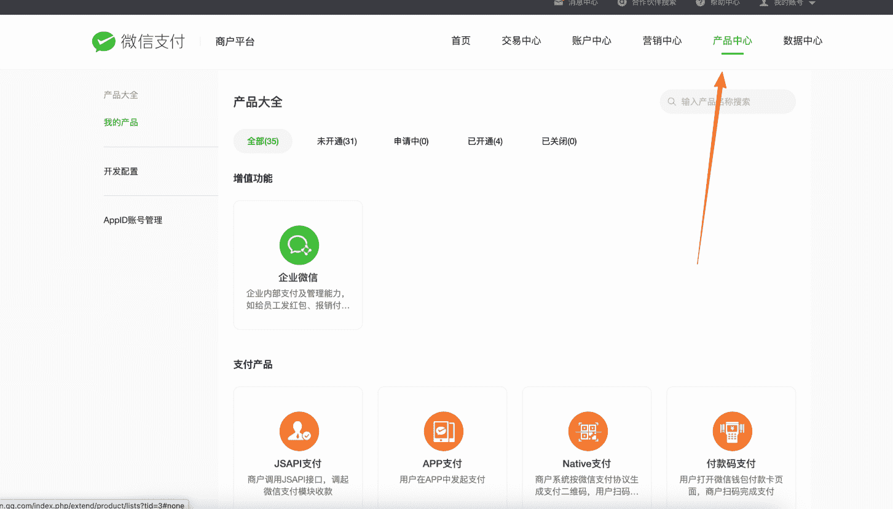

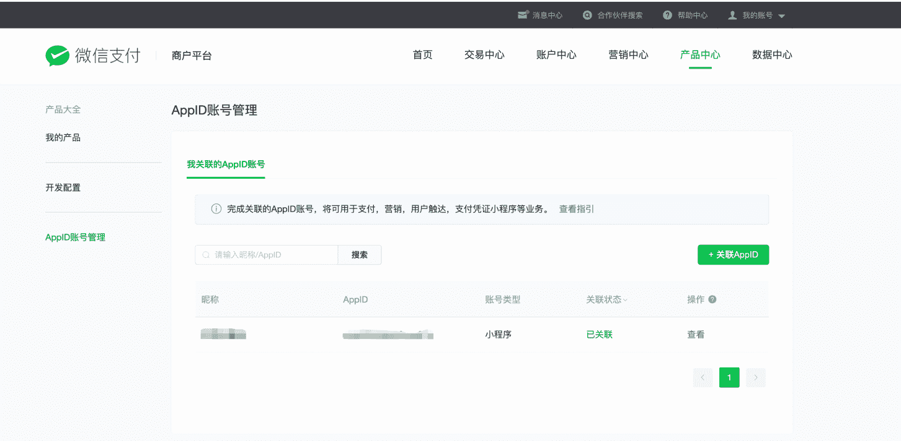

这些属于支付安全配置。找不到时，可以让 AI 根据后台页面为你列出定位步骤，但不要把真实凭证直接发给它。

#### 10.2 后端实现指令：下单、通知与订单查询

下面这段需求可交给 AI，用于在已有 Laravel 服务中实现小程序 JSAPI 收款：

请在现有 Laravel 项目内接入🛰️支付 JSAPI，并用中文解释实现方案，包含以下接口：

1. **生成支付参数**

   - 地址：`POST /api/pay/create`
   - 接口需要登录，通过现有 token 确认操作人。
   - 请求字段：`product_id`（商品或会员方案编号）、`openid`（当前用户在小程序侧的标识）。
   - 处理顺序：读取商品价格 → 调用🛰️ JSAPI 统一下单 → 获取 `prepay_id` → 按🛰️签名规则生成小程序调用所需的 `appId`、`timeStamp`、`nonceStr`、`package`、`paySign`。
   - 成功时返回 HTTP 200 和这五项参数。
   - APIv3 密钥、证书及私钥必须从服务器安全位置加载，不能直接写进源代码。

2. **接收支付通知**

   - 地址：`POST /api/pay/notify`
   - 🛰️会通过异步请求把交易结果推送到这里。
   - 服务端需要完成：验证通知签名、使用 APIv3 凭证解密数据、比对订单金额、把交易改为已付款，并为对应账户发放会员或其他权益。
   - 处理成功后，必须返回🛰️规定的成功响应，否则平台可能再次发送同一通知。

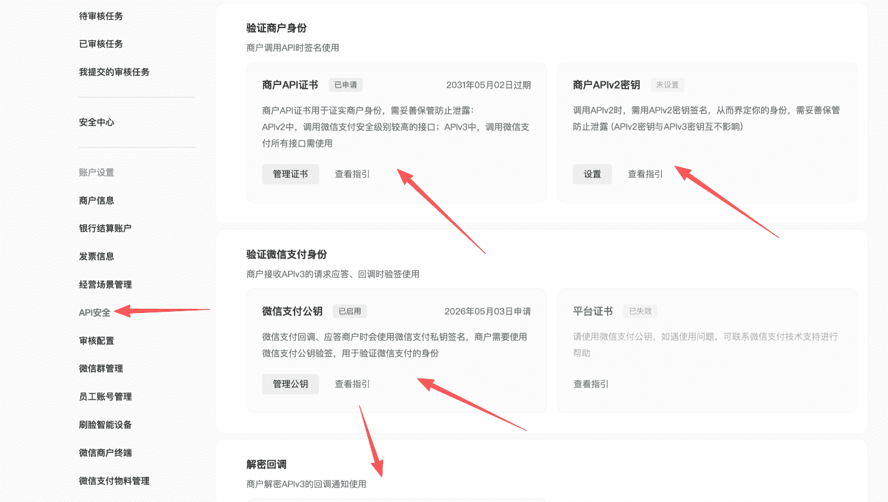

3. **查询交易状态**

   - 地址：`GET /api/pay/order?out_trade_no=xxx`
   - 返回订单当前状态，以及是否已经完成付款。

补充要求：所有金额以“分”为单位；通知接口必须验签；更新订单和发放权益应放在数据库事务中，确保重复通知不会造成重复发货。

#### 10.3 小程序端实现指令：唤起付款与会员状态

请在🛰️小程序的“我的”或会员页面中，使用原生开发方式实现以下内容：

1. 从 `GET /api/membership/plans` 获取会员方案，展示方案名称、价格和权益描述。
2. 用户点击开通时：
   - 先请求 `POST /api/pay/create`；
   - 取得 `appId`、`timeStamp`、`nonceStr`、`package`、`paySign` 后，再调用 `wx.requestPayment`；
   - 完成付款后提示开通成功，并重新读取会员资料；
   - 用户取消或付款失败时，分别显示合适的提示。
3. 页面进入时请求 `GET /api/me`，读取 `is_vip` 与 `vip_expire_at`。已开通显示“会员有效期至 X”，未开通则显示购买入口。
4. 前端工程不得出现密钥、`mchid` 或证书文件，它们全部由服务端管理。

特别注意：`paySign` 必须由后端根据🛰️规则生成，小程序端不能自行计算。

#### 10.4 iPhone 端的审核风险

会员、金币、课程等都属于数字化内容。在 iOS 端，这类商品通常不能直接走🛰️收款，苹果要求使用 IAP；否则可能无法通过审核。

因此可以按平台分别处理：

- Android 以及🛰️环境：继续接入🛰️支付；
- iOS：接 Apple IAP，或暂时关闭购买功能，仅展示“请在安卓端 / 🛰️内完成购买”。

如果售卖的是纸书、周边等实物，则不属于上述限制，🛰️支付可以面向各平台使用。

#### 10.5 小程序与服务器侧的准备

- 付款请求由后端与🛰️服务通信，小程序只负责调用 `wx.requestPayment`，不需要把🛰️支付域名加入小程序的服务器域名列表。
- 服务器必须具备访问 `api.mch.weixin.qq.com` 的公网能力。若使用宝塔，应确认出站连接没有被安全策略阻断。
- 小程序服务类目要与实际业务匹配，例如付费内容、会员服务等；隐私说明中应明确订单及支付相关信息的收集用途。
- 需要的业务权限和相关资质应提前申请。

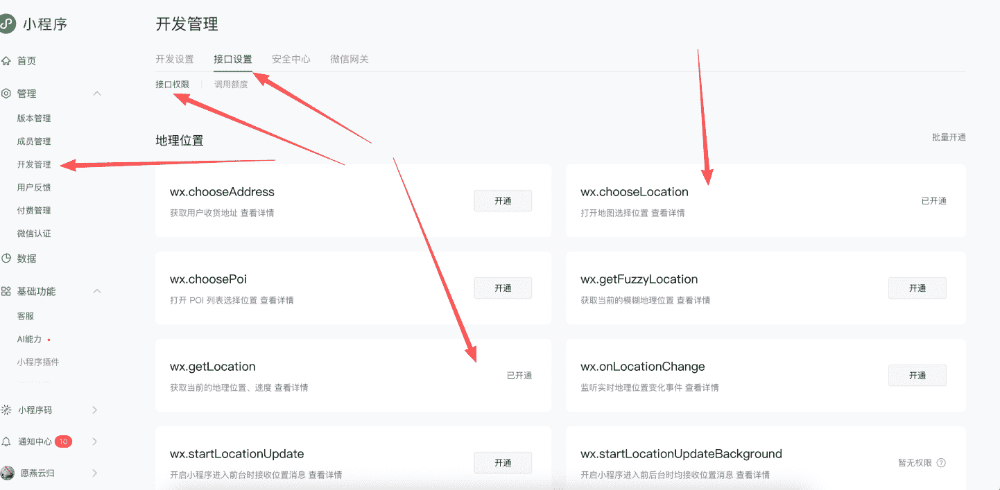

如果项目同时运营🛰️👸号，👸号侧的设置也要一并检查。

#### 10.6 支付链路验收

| 验收内容 | 操作方式 | 通过表现 |
|---|---|---|
| 账户关联 | 打开小程序后台的🛰️支付设置 | 页面显示对应商户账户 |
| 创建交易 | 使用接口调试工具请求 `/api/pay/create` | 返回 200，并得到五项调起参数 |
| 唤起收款页 | 真机点击购买入口 | 出现🛰️收款界面 |
| 完成闭环 | 真机付款后观察服务端 | `/api/pay/notify` 收到通知，订单和会员资料同步更新 |
| 凭证隔离 | 检查项目与服务器目录 | 证书只出现在服务端，前端和聊天记录均无敏感内容 |
| 苹果合规 | 检查 iOS 购买流程 | 数字商品没有被引导使用🛰️支付 |

### 第十一部分：用 Gitee 保存项目并管理版本

项目能运行只是第一步。若源码只存在于个人电脑或线上目录中，一旦硬盘损坏、文件误删或改动出错，恢复会非常麻烦。Gitee 可以作为远程备份，并记录每次修改，必要时还能回到旧版本；服务器部署时也可以直接从远端获取源码。

可以把它理解成“代码云端备份 + 版本回溯工具”。

#### 11.1 创建远程项目

1. 打开 `gitee.com`，注册并登录。
2. 点击右上角的加号，选择新建仓库。
3. 使用项目英文名作为仓库名称，例如 `miniapp-todo`。
4. 个人项目建议设置为私有，防止环境配置被公开。
5. 初始化时只添加 README；`.gitignore` 和许可证后续自行配置。
6. 创建后保存远程地址，例如：`https://gitee.com/你的用户名/miniapp-todo.git`。

初学者可先采用 HTTPS 方式连接远端，熟悉后再切换到 SSH。

#### 11.2 安装 Git 并设置提交信息

Git 负责在本地记录变更，Gitee 负责保存远程副本。先检查电脑是否已有 Git：

```bash
git --version
```

若尚未安装，可从 `git-scm.com` 获取安装包。Windows 按向导安装即可，macOS 通常已经自带。安装完成后，设置一次提交者姓名和邮箱：

```bash
git config --global user.name "你的名字"
git config --global user.email "你的邮箱@example.com"
```

#### 11.3 建立本地版本库并完成第一次提交

进入项目最外层目录，执行初始化、暂存和提交操作：

```bash
cd 你的项目目录
git init
git add .
git commit -m "first commit: 初版小程序待办项目"
```

三条命令分别表示：

| 命令 | 用途 |
|---|---|
| `git init` | 在当前项目建立版本数据库 |
| `git add .` | 将当前变动加入待提交区域 |
| `git commit -m "说明"` | 生成一个带说明文字的历史版本 |

#### 11.4 连接远程地址并上传

将本地项目指向刚创建的 Gitee 仓库，再上传首个版本：

```bash
git remote add origin https://gitee.com/你的用户名/miniapp-todo.git
git branch -M main
git push -u origin main
```

首次连接时，Gitee 要求输入账户名和认证凭证。这里不能使用网页登录密码，而应创建私人令牌：进入头像菜单 → 设置 → 私人令牌 → 新建令牌，并授予项目相关权限。提交时，用户名填写 Gitee 账号，密码位置粘贴令牌。

#### 11.5 平时如何同步

每次完成一小段开发，可以按下面的顺序记录并上传：

```bash
git add .
git commit -m "改了：登录页样式 + 修复待办删除 bug"
git push
```

养成“小改动及时留档”的习惯，比积累大量改动后一次性上传更容易排查问题。

#### 11.6 排除机密和无关目录

`.env`、依赖目录、缓存文件等不应进入远程仓库，否则可能暴露数据库口令或其他凭证。项目根目录创建 `.gitignore`：

```gitignore
.env
node_modules/
vendor/
storage/
*.key
*.log
.DS_Store
```

如果某个敏感文件已经被纳入版本管理，需要先从版本库索引中移除，同时保留电脑上的原文件，再进行一次提交：

```bash
git rm --cached .env
git commit -m "移除敏感配置文件"
git push
```

#### 11.7 使用 SSH 减少重复认证

如果不想反复输入令牌，可以生成 SSH 密钥：

```bash
ssh-keygen -t ed25519 -C "你的邮箱@example.com"
```

随后将 `~/.ssh/id_ed25519.pub` 中的公钥复制到 Gitee 的“设置 → SSH 公钥”，并把远程地址切换为 SSH 格式：

```bash
git remote set-url origin git@gitee.com:你的用户名/miniapp-todo.git
git push -u origin main
```

#### 11.8 在服务器取得项目

远端仓库建立后，服务器可以直接下载完整工程：

```bash
cd /www/wwwroot/api.你的域名.com
git clone https://gitee.com/你的用户名/miniapp-todo.git backend
cd backend
composer install --no-dev --optimize-autoloader
```

以后本地上传新版本，服务器进入项目目录执行 `git pull`，即可取得最新改动，无需再手动压缩和传输文件。

#### 11.9 常用 Git 操作

| 使用场景 | 命令 |
|---|---|
| 查看工作区变更 | `git status` |
| 浏览简短历史 | `git log --oneline` |
| 放弃某文件尚未提交的修改 | `git checkout -- 文件名` |
| 回到前一个提交 | `git reset --hard HEAD~1` |
| 获取远端新内容 | `git pull` |
| 建立并切换新分支 | `git checkout -b 功能名` |

### 如何确认版本管理已经生效

1. 打开 Gitee 项目页，能够看到源码和 README。
2. 在终端查看提交历史，能找到刚才创建的记录。
3. 修改一个文件并再次上传，网页内容随之更新。
4. 在服务器执行仓库拉取操作后，目标目录出现完整项目。

### 第十二部分：将 Laravel 项目部署到服务器

本地开发结束后，还要把程序放到线上环境。宝塔负责基础环境，Codex 负责执行项目部署相关命令，双方分工要清楚。

### 12.1 宝塔场景下的职责划分

| 工作内容 | 负责人 | 当前状态或执行方式 |
|---|---|---|
| 安装 Nginx、PHP、MySQL | 用户 | 前面已处理 |
| 新建站点 | 用户 | 前面已处理 |
| 建立数据库 | 用户 | 前面已处理 |
| 申请 HTTPS 证书 | 用户 | 前面已处理 |
| 设置伪静态规则 | 用户 | 前面已处理 |
| 从远程仓库取得源码 | Codex | 通过终端完成 |
| 安装 Composer 依赖 | Codex | 通过终端完成 |
| 准备线上环境文件 | Codex | 通过终端完成 |
| 执行数据表迁移 | Codex | 通过终端完成 |
| 创建应用密钥 | Codex | 通过终端完成 |
| 生成缓存 | Codex | 通过终端完成 |
| 调整目录权限 | Codex | 通过终端完成 |

### 12.2 提供给 Codex 的服务器部署说明

请注意：服务器由宝塔管理，Nginx、PHP、MySQL 已经安装，站点也已建立。网站目录为：

`/www/wwwroot/api.你的域名.com/backend/public`

SSL 证书由用户在宝塔中申请。数据库 `miniapp_todo` 已存在，账号为 `miniapp_user`，密码已另行保存。

请仅完成以下项目工作：

1. 把远程仓库下载到 `/www/wwwroot/api.你的域名.com/backend`
2. 执行 `composer install --no-dev --optimize-autoloader`
3. 创建线上环境文件，确保 `APP_DEBUG=false`，并填入宝塔数据库连接信息
4. 执行 `php artisan key:generate`
5. 执行 `php artisan migrate --force`
6. 执行 `php artisan config:cache && php artisan route:cache`
7. 将 `storage` 和 `bootstrap/cache` 设置为 775，其他文件按 755/644 处理，禁止使用 777
8. 执行 `chown -R www:www storage bootstrap/cache`，让 PHP 运行账号拥有必要权限

不要重新安装 Web 环境，不要擅自修改 Nginx，不要替用户申请证书。凡是必须由用户在宝塔界面完成的内容，请单独列出“用户待办”。

### 12.3 上线后的检查

| 检查目标 | 执行方式 | 正常结果 |
|---|---|---|
| 入口文件 | SSH 查看 `/www/wwwroot/api.你的域名.com/backend/public/index.php` | 文件能够找到 |
| 框架依赖 | 在项目目录运行 `php artisan --version` | 输出 Laravel 版本 |
| 线上调试开关 | 检查 `.env` 中的 `APP_DEBUG` | 值为 `false` |
| 数据库状态 | 运行 `php artisan migrate:status` | 各迁移项显示 `Ran` |
| 健康接口 | 访问 `https://api.你的域名.com/api/health` | 返回 `{"status":"ok",...}` |
| HTTPS 证书 | 查看浏览器地址栏 | 显示安全锁 |
| 登录保护 | 请求 `GET /api/me` 且不携带 token | 返回 401 |
| 文件上传 | 以 multipart 方式请求 `POST /api/uploads/images` | 返回 201，并包含 `object_key` |

从 0 到 1 把一套 Laravel 后端和🛰️侧应用送上线，并让它被更多人用起来，差不多是每个独立开发者的日常。下面这份实战记录，把上线前的安全底线、定时任务、验收清单、故障处理、服务器选型，以及冷启动推广的玩法都串在了一起，可以直接照着落。

### 上线前必须堵住的两个漏洞
1. **敏感配置不许被公网读走**  
   绝对不能让访问者在浏览器里直接输入 `https://你的域名/.env` 还拿到内容。正确表现是：该地址返回 403 拒绝响应，而不是显示任何配置信息。  
2. **不用的端口别对外开**  
   登录进面板的“安全”页，逐项确认 3306、6379 这两个端口没有被暴露到公网。数据库和缓存只让内部进程访问就好，外网一律挡在门外。

### 定时任务怎么挂
项目跑起来后，在面板的“计划任务”模块里安排三条任务线：
- **Laravel 调度器**：每分钟触发一次。具体 cron 写法不用自己记，直接让 Codex 给你输出 `schedule:run` 对应的定时表达式。
- **数据库备份**：每天凌晨 3 点执行，继续沿用之前已经配好的备份策略。
- **日志清理**：每周跑一次，让 Codex 给一条“删除超过 30 天的日志文件”的脚本即可。

### 权限问题的常见解法
如果 AI 在部署过程中反馈权限错误，你要明确告诉它：这是宝塔环境，PHP 进程以 `www` 用户运行。正确的文件权限规则是：`storage` 和 `bootstrap/cache` 设为 775，其余目录用 755，普通文件用 644，绝对不要使用 777。

### 验收：不看代码也能判断项目是否完整
不需要读懂源码，只需要对照文件清单做存在性检查。

**后端侧必须具备：**
- 控制器目录下要有四个 API 文件：`HealthController.php`（健康探测）、`AuthController.php`（应用登录）、`TodoController.php`（待办增删改查）、`UploadController.php`（图片上传）。
- 模型层要有 `User.php` 和 `Todo.php`。
- `routes/api.php` 承载全部接口路由。
- `.env` 存放真实配置，不进版本库；`.env.example` 提供模板，需要提交 Git。

**前端侧必须具备：**
- `miniprogram/` 根目录下要有 `app.js` 和 `app.json`。
- `utils/` 下必须有 `request.js`（请求封装）和 `auth.js`（登录状态管理）。
- `pages/` 下需要 `welcome`、`todos`、`profile` 三个页面目录。

**常用位置速记：**
- 后端接口路由：`routes/api.php`
- 控制器目录：`app/Http/Controllers/Api/`
- 数据库表结构：`database/migrations/`
- 后端配置：`.env`
- 后端日志：`storage/logs/laravel.log`
- 前端页面：`miniprogram/pages/`
- 请求封装：`miniprogram/utils/request.js`
- 全局配置：`miniprogram/app.json`
- Nginx 配置：面板 → 网站 → 设置 → 配置文件
- 站点根目录：`/www/wwwroot/api.你的域名.com/backend/public`
- 数据库管理：面板 → 数据库 → phpMyAdmin
- 数据库备份：面板 → `/www/backup/database/`

### AI 说“做完了”时，该怎么验证
AI 也会自嗨，所以核心原则是：它说什么都不算，你亲自确认才算。

| AI 的声称 | 你的核实动作 |
|---|---|
| 环境已配好 | 浏览器打开 `/api/health`，应该得到 200 |
| 数据库已建好 | 让它跑 `migrate:status`，看输出结果 |
| 已部署完成 | 直接访问 `https://域名/api/health` |
| SSL 已配好 | 查看地址栏是否有锁形图标 |
| 备份已配好 | 去面板的计划任务列表里找对应记录 |
| 权限已正确 | 让它报出实际权限值，必须是 775 而非 777 |

### 502 Bad Gateway 排查顺序
502 基本等于 PHP 进程没有正常工作。按下面的顺序一步一步来：
1. 请 AI 确认 PHP-FPM 是否处于运行状态。
2. 到面板的软件商店查看 PHP 8.2 是否显示“运行中”。
3. 在网站设置里确认 PHP 版本选的是 8.2。
4. 让 AI 检查 `storage` 和 `bootstrap/cache` 的目录权限。
5. 让 AI 打开最新 Laravel 日志，列出末尾几行错误信息。

### 数据库连不上的处理
先核对 `.env` 里面的数据库参数有没有写错；再去面板的数据库页面看 `miniapp_todo` 库是否存在；接着确认 `miniapp_user` 账号的权限范围；让 AI 执行 `config:clear` 清除缓存；最后检查 `DB_HOST` 是不是 `127.0.0.1`，不要写成 `localhost`。

### 登录接口返回 400
去🛰️公众平台的“开发设置”里核对 AppID 是否和代码一致；然后检查 `.env` 中的 `WECHAT_APP_ID` 与 `WECHAT_APP_SECRET`；问 AI 是否需要刷新 `config:cache`；同时打开模拟器 Console，确认 `wx.login` 能否正常拿到 code。

### COS 上传失败
先进入腾讯云 COS 控制台确认 Bucket 存在；再到 CAM 访问管理里查看子账号是否具备 COS 权限；然后核对 `.env` 中的 COS 配置与所属地域；最后让 AI 执行 `config:clear` 重载配置。

### 真机预览白屏
打开🛰️开发者工具的 Console 看有没有红色报错；切换到 Network 面板检查接口请求状态；到🛰️公众平台的“开发设置”确认服务器域名填的是正式域名；还要检查开发者工具“详情 → 本地设置”里“不校验合法域名”是不是没有勾选（要保持关闭状态，即校验合法域名）。

### 小程序审核被拒
先仔细看驳回邮件里的原因。大多数情况是“隐私保护指引”与实际调用的能力不匹配。解决办法是去🛰️公众平台“开发管理”中，勾选真正用到的权限：如果使用了 `wx.login`，就要声明有权读取用户 OpenID；如果用了 `wx.chooseMedia` 或 `chooseAvatar`，就要声明可选取相册图片或视频；如果用了昵称输入框 `input type="nickname"`，就要声明可获取用户昵称。

### 附录 A：两个 Prompt 的注释速览

**本地环境 Prompt**
1. 查看系统类型和已装软件，避免重复安装。
2. 已有 PHP 8.2 就直接跳过安装步骤。
3. 按系统选择包管理器：macOS 用 brew，Linux 用 apt。
4. 安装 PHP 8.2，确认 `php -v` 输出。
5. 安装 Composer，确认 `composer -V` 输出。
6. 创建新的 Laravel 工程。
7. 增加一个健康检查接口。
8. 创建独立的数据库与专用账号。
9. 自动生成随机密码，并写入 `.env`。
10. 设置 `APP_ENV=local` 便于本地调试。
11. 让 Nginx 监听 8080，避开系统 80 端口。
12. 站点根目录指向 Laravel 的 `public`。
13. 配置 `fastcgi_pass`，确保 Nginx 可执行 PHP。
14. 修改 hosts，让本地域名可以访问。
15. 启动相应服务，三项进程全部跑起来。
16. 执行数据库迁移，`migrate:status` 显示全部 Ran。
17. 最后请求健康接口，确认返回 200 JSON。

**服务器部署 Prompt**
1. 只读检查服务器现状，不擅自改动环境。
2. 发现已有业务运行就先暂停，等待用户确认。
3. 先做备份，方便出问题时回滚。
4. 快照和安全组改动需在云控制台操作，列成用户待办。
5. 检测到宝塔就优先复用，不重复安装软件。
6. 创建生产库，与本地环境隔离。
7. 拉取项目代码到部署目录。
8. 写入生产 `.env`，关闭调试模式（`APP_DEBUG=false`）。
9. Nginx 根目录指向 Laravel public 目录。
10. 禁止外部读取 `.env`，统一返回 403。
11. 用 `nginx -t` 校验配置语法。
12. 使用 `dig +short api.域名` 验证 DNS 解析。
13. 强制 HTTP 跳转到 HTTPS。
14. 把队列和调度器写入 crontab。
15. 配好备份与日志清理任务。
16. 确认 3306/6379 端口未对外开放。
17. 设置开机自启，执行 `systemctl enable`。
18. 验证健康接口返回 200。
19. 验证未登录请求返回 401。
20. 验证文件上传返回 201。
21. 检查日志，确保没有 ERROR 记录。

### 附录 B：轻量应用服务器与 CVM 怎么选
- **价格**：轻量通常便宜 30% 以上，CVM 相对贵。
- **带宽**：轻量是固定带宽 + 流量包；CVM 按带宽或流量计费。
- **宝塔安装**：轻量官方镜像一键装好；CVM 需要自己动手。
- **安全组**：CVM 提供完整的安全组能力，轻量只是简易防火墙。
- **弹性**：CVM 支持灵活的升降配，轻量不支持。
- **快照**：CVM 支持自动快照策略，轻量只能手动快照。

结论很清晰：新手做个人项目可以闭眼选轻量；如果是团队或正经生产环境，直接上 CVM。本教程默认先用轻量服务器，等用户规模起来之后再平滑迁移。

### 轻量云 + 宝塔的一键安装
流程并不复杂：登录云控制台 → 新建轻量应用服务器 → 选择“宝塔 Linux 面板”镜像 → 确认购买 → 等两三分钟自动部署完成 → 在服务器详情页拿到面板访问地址、账号和密码 → 浏览器打开 `http://公网IP:8888` → 登录后去软件商店安装 Nginx、PHP 8.2、MySQL 8.0。手动安装软件的阶段就被彻底跳过了。

### 第三部分：怎样把小程序推出去

#### 一、👸号联动：🛰️生态里的稳定私域闭环
👸号和🛰️应用是原生的搭配，把两者关联起来，就能把内容沉淀、用户访问、商单咨询串成一条线。具体做法：
- 在👸号后台的“小程序管理”里添加应用 AppID，双方管理员扫码授权，关联成功后👸号资料页会出现入口。
- 自定义菜单中增加一个按钮，直达应用首页或案例展示页。
- 每篇干货推文在正文中插入卡片，读者看完直接点击跳转，省去搜索步骤。
- 设置关键词自动回复，用户回复特定词即可收到入口卡片。
- 应用内部再引导用户关注👸号，形成双向导流。

要注意的是：内容必须干货优先，硬广要克制，应用只是顺带出现的配套工具，转化效果反而更好。

#### 二、贴图海报推广：种子用户的第一来源
不依赖外部公域平台，只靠🛰️内的海报和截图传播，可以避开限流和封号风险。准备两张海报：产品推广海报主打价值与痛点，下方放应用码；商单接单海报突出开发者身份、案例截图和可承接业务，并附联系方式。  
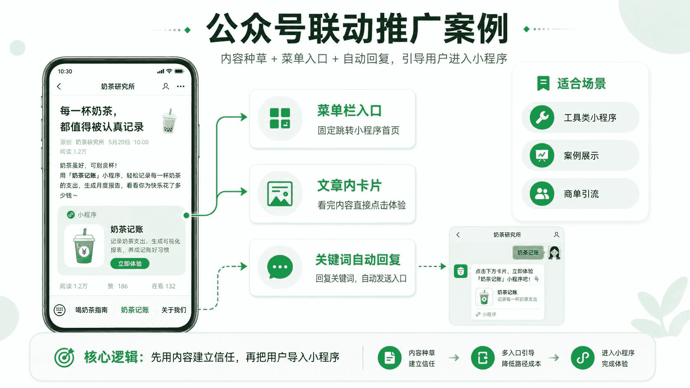
顺便再做一套多图素材包：应用界面截图、功能演示截图、项目案例截图，方便组合转发。

分发时要注意场景感：私聊先发一段价值说明再发海报；朋友圈配一段项目感悟或干货文案，别刷屏；社群先贡献内容，等大家认可后再放图。素材也不是一成不变的，转发少就简化文案、放大痛点；商单咨询少就多放真实案例。为了激励用户转发，工具类应用可以在应用内设置解锁功能或次数奖励，商单老客户则可以用转介绍返利。另外，海报只放应用码，不要放任何外部二维码，所有链路都留在🛰️内，风险最低。

#### 三、📕推广：公域种草，但要谨慎
⚠⚠ 重要提示：📕现在对站外导流查得很严，哪怕只是引导用户去🛰️搜索应用名称，也可能被限流甚至处罚。所以不要把它当主力渠道，最多小批量测试。  
如果要做，就把账号主页简介写清楚：应用叫什么、你是开发者、能承接小程序定制。置顶两至三篇笔记，分别放产品介绍、实战开发复盘和客户案例。  
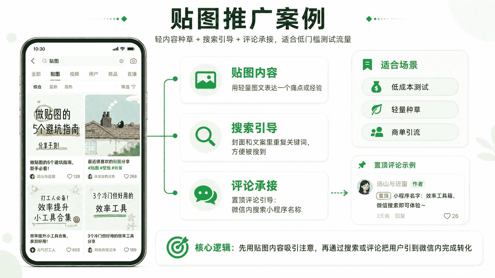
内容方向可以分两类：一类是自有应用的使用教程和痛点解决笔记，结尾引导“🛰️搜索 XXX”即可体验；另一类是开发实战记录与接单复盘，用来吸引有定制需求的商家前来咨询。

做小程序想做成生意，先把流量入口和报价思路理清楚。下面这套方法是我自己实操试出来的，可直接套用。

一、先把获客渠道铺开，别把资源押在单一平台

📕拿商单，核心是专业干货种草，不是硬广。笔记可以围绕一次真实的接单复盘、需求拆解全过程、部署时踩的坑、报价是怎么推算出来的来讲。实战型内容更容易让本地商家或有小程序想法的人主动私信咨询。

封面要突出用户痛点和最终成果，文案用第一人称体验分享的语气。结尾带上 #小程序开发 #🛰️小程序 #独立开发者 #小程序定制 等相关标签。

流量承接靠评论区。笔记发出后，把小程序的搜索关键词置顶，评论有互动就立刻回复。严禁在笔记、评论、私信任何位置引导跳转🛰️，笔记、评论、私信里都不能出现🛰️号、二维码、谐音暗示。哪怕只是提示用户去🛰️搜索小程序名称，也可能被限流或封号，有过违规记录的账号处罚更重。

不建议做矩阵批量发稿，同设备同网络多账号容易连带风控，一个号出问题其他号也会受牵连。📕只适合作为补充引流，最终转化还是要回到🛰️生态内完成。

视频号是🛰️内低成本扩散曝光的渠道。把视频号和👸号、小程序做关联绑定，主页就能展示小程序入口，跳转路径最短。

内容方向可以拍小程序真实操作演示、开发过程片段、商单案例拆解。口播直接告诉观众用🛰️搜索小程序名称体验，或点视频下方的小程序卡片直达。文案和置顶评论里反复出现小程序名称，强化记忆。直播时也能挂载小程序，一边讲开发干货一边让观众实操体验，同时承接商单咨询。

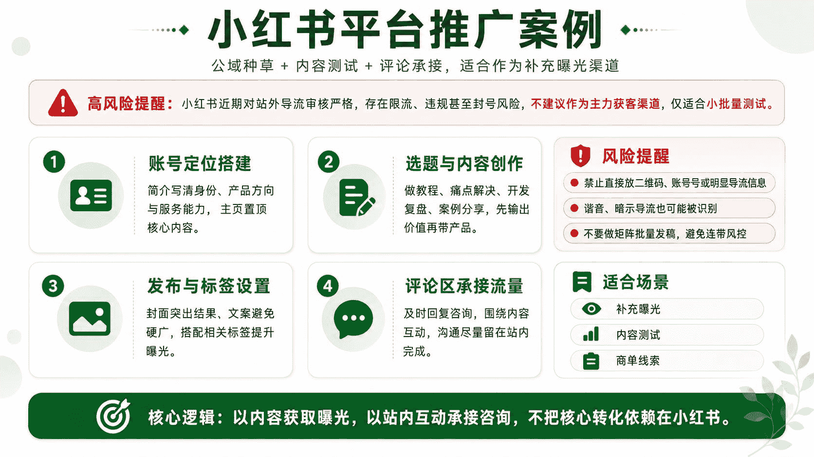

私域和朋友圈是冷启期的种子来源。新上线的小程序，先从身边人获取第一批使用者，这批人也是后续商单的重要来源。

先做一张说明解决什么问题的海报，不要只放一个码。朋友圈分批发布产品使用感受、开发复盘、上线感悟，附上小程序码，避免高频刷屏硬推。进入技术群、创业者群、本地商家群，先输出价值，别刚进群就发广告。先讲小程序能解决哪些痛点，再顺势给出入口，有需求的商家自然会来聊定制。有了用户基础可以做轻激励裂变，鼓励转发分享；接单也能靠老客户转介绍，给新客户适当回馈。

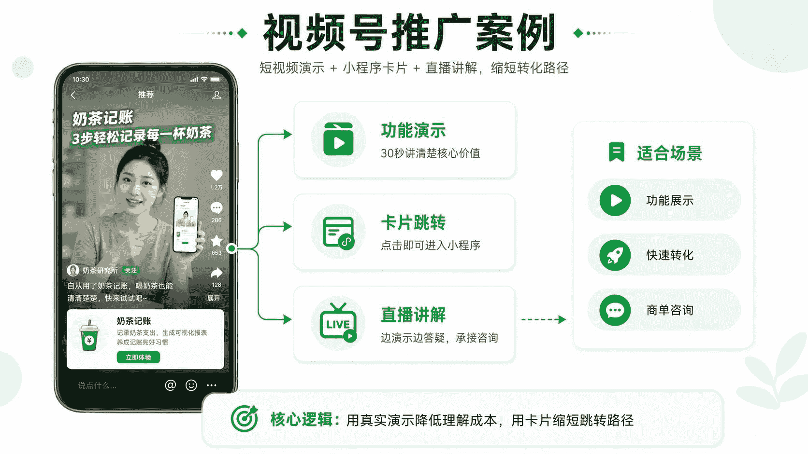

🛰️搜索 SEO 是长期免费的自然流量入口。很多用户习惯直接在🛰️顶部搜索框找小程序，关键词布局做好就能持续进来。

小程序名称最好带上核心业务关键词，名称一旦确定修改次数有限，前期就要规划好。简介要清晰说明功能和解决的问题，埋入用户常搜的词。👸号文章和视频号内容里，标题和正文反复出现小程序名称和业务关键词，🛰️会抓取这些内容提升搜索排名。

推广目的不同侧重点不同。

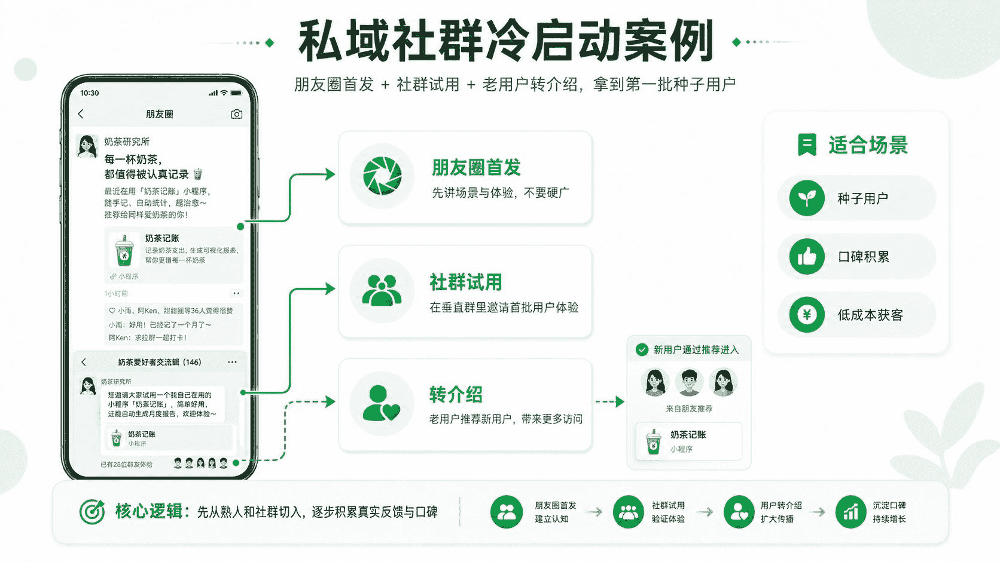

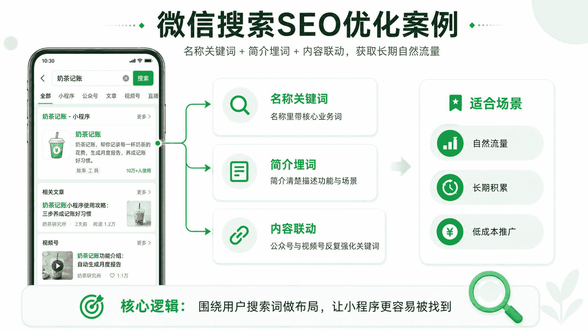

- 推广自己开发的产品：主打🛰️搜索、📕种草、视频号演示、私域冷启动，目标是提升访问量和留存。
- 用来接小程序商单：主打实战案例、开发复盘、踩坑经验，在📕、👸号、社群里建立专业度，吸引需要预约、信息发布、订单系统等功能的商家主动咨询。

推广不是发一次就结束，是长期工作。个人开发者没必要追求铺天盖地，先把内容质量做扎实，小而精准的流量对产品和接单都更有效。

二、商单报价参考

说明：以下报价仅供参考，属于我个人基于实际接单经验整理的拆解方式和价格区间，不代表任何团队、公司或行业统一报价标准。不同项目的需求、复杂度、交付范围不同，实际价格也会有所差异。

很多人在第一次报价时会卡住：客户只说一个想法，我到底该报多少？

我的做法很简单：先判断项目类型 → 再拆功能点 → 估算投入时间 → 最后加上服务器、数据库、存储等成本。

下面按个人开发者兼职接单来估算，仅作参考。

1. 商城类小程序

商城功能相对较多。首页、商品列表/详情、分类、购物车、下单、🛰️支付、订单管理、地址管理、用户中心、管理后台、商品上架编辑、用户管理、权限管理等都是基础配置。

基础版：7000～15000 元左右。若增加优惠券、退款、物流、会员、积分、分销、多商户等，工作量明显上升。复杂商城：15000～30000 元起。

商城贵的不在页面，在订单状态、支付、后台、数据和业务逻辑的复杂度。

2. 订阅/会员类小程序

典型如 AI 工具、内容服务、会员工具。核心展示页、🛰️登录、用户中心、开通会员、🛰️支付、有效期校验、权益判断、次数限制、订单记录、管理后台等。

简易会员/订阅：3000～6000 元左右。若涉及 AI、次数扣减、多套餐、订单管理、后台配置、差异化权益，大概 5000～11000 元左右。页面可能不多，但权限、支付和后端逻辑占比大。

3. 企业展示类小程序

企业介绍、产品展示、服务介绍、新闻动态、联系我们、地图导航、简单表单。

客户已提供完整 UI 和素材：1500～3000 元左右。若还需 UI 设计、内容整理、后台管理、数据维护：2000～5000 元左右。主要工作量在页面、视觉和内容整理。纯展示无后台，成本会很低。

4. 工具类小程序

价格跨度大。如计算器、查询工具、记账、打卡、简单记录等。

纯本地简单工具，无复杂后端：1000～2500 元左右。适合页面少、逻辑简单、无数据、无后台、不涉及支付。

带后端的工具类，涉及用户体系、数据存储、云端同步、文件上传、AI、OCR、第三方 API、会员订阅等，大概 2500～10000 元起。工具不能只看页面数，要看背后业务逻辑是否复杂。有些 3-5 个页面的工具，后端、AI、数据处理很重，价格反而高于十几页的展示站。

人工成本怎么算？

比如月薪 15000 元，按 22 个工作日算：15000 ÷ 22 ≈ 680 元/天。若预计投入 10 个工作日：680 × 10 ≈ 6800 元，仅作人工参考。

实际报价还要结合是否已有现成代码、成熟组件、能用 AI 提效、功能是否重复开发过、客户资料是否完整、后续修改量等。

接单时间不只是写代码，还包括需求沟通、需求整理、UI 调整、前后端联调、测试、部署、上线、Bug 修改、售后沟通。兼职开发最容易低估这些。我第一单白天上班，晚上 9 点到 12 点干，持续 2-3 周，时间累计起来就是成本。报价要算从接需求到交付的全流程耗时。

UI 是否单独算？要。

客户提供完整 UI 稿、页面结构、素材、Logo、文案，你只需还原和开发，价格可低。客户只有一句话“我想做个小程序”，那你还得做需求梳理、页面结构、UI 设计，这都是成本。一般可按页面数增加 500～2000 元左右，页面多或要求高另议。接需求时一定要提前问清楚：UI 由谁提供？避免最后从产品到开发全包了。

服务器成本要提前说明，上线会产生固定费用。

域名：50～100 元/年。云服务器入门：300～1500 元/年左右，按访问量加配。云数据库：300～1500 元/年左右，小项目可和服务器合署。COS/OSS 对象存储，用于图片视频文件上传，前期预留 100～500 元/年起，按用量。短信按量计费，如验证码、订单通知。AI/第三方 API 如 AI 对话、图片识别、OCR、地图、翻译、审核等按调用量计费。

最好明确告知客户：开发费是开发费，服务器、数据库、域名、短信、AI API、对象存储等第三方成本一般单独算，特别是 AI 类产品，切勿长期自担 API 成本。

快速判断价格

前期沟通没细拆时，可按项目类型先做区间判断。正式报价前要完整拆解：需求 → 页面 → 功能 → UI → 后端接口 → 数据库 → 管理后台 → 支付 → 第三方服务 → 服务器部署 → 测试上线。

为什么不能只按页面报价？

客户常说“我就做个商城”“我只要个预约功能”。拆开后，商城可能是十几个页面加几十个接口、商品、订单、支付、用户、后台全套。预约可能是选项目、选日期、选时间、提交、查看、取消、后台管理、状态修改、消息提醒。评估时别问“几个页面”，要问“有多少功能和业务流程”。

总结

评估商单看：项目类型 + 页面 + 功能 + UI + 后端 + 数据库 + 第三方服务 + 部署上线 + 修改成本。最容易被低估的是后端、数据库、支付、管理后台、第三方接口和后续修改。

4K 的项目不一定便宜，1W 的项目也不一定贵。关键是把需求拆清楚，看真正要做多少事，再谈价格更靠谱。

说明：以下报价仅供参考，属于我个人基于实际接单经验整理的拆解方式和价格区间，不代表任何团队、公司或行业统一报价标准。不同项目的需求、复杂度、交付范围不同，实际价格也会有所差异。

————分割线————

看完 SOP 觉得懂了，但实操第一步还是会卡住。工具和教程只是基础壁垒，真正的壁垒是立刻动手和信息差。

如果你想看全网最新的变现玩法，和一群执行力强的极客一起拿结果，可以围观我的核心私域：【懒人专属群】。

我们只拆商业闭环和 AI 效率。系统已沉淀 1000+ 跑通的套利实战局。

⚠ 查阅圈子完整数字资产与上车门槛：

https://lazyso.com/insider/

认同价值、准备好下场干活的，扫码加我🛰️（lazyhelper1）。

备注：【实操上车】，不闲聊。

