# **3 个月 40 万 GMV：视频号 AI 剧情带货实战，与我的 Codex 提效工作流**

**三个月做到四十万 GMV：视频号 AI 剧情带货实战复盘与 Codex 提效工作流**

我是淳于，2025 年 3 月加入赚钱，至今一年有余。这段时间我只聚焦了两条线：上半年的 YouTube 出海，下半年的视频号 AI 剧情带货。YouTube 做了快半年，累计收益在两万到三万美元之间；视频号从五月开始做，三个月下来累计 GMV 接近四十万。

八月份开始，市场上搬运型内容激增，能跑出真实成交的比例明显被拉低，我主动把产出节奏降了下来。趁着这个空档，我把过去一年多的方法论，以及做视频号这三个月的实操和 Codex 搭建过程，整理成一次成体系的复盘。

这篇文章主要分享两件事：

1. 一条可以稳定成交的 AI 剧情带货视频，从选题对标到脚本重写，再到批量生成、剪辑、投放、数据判断，完整是怎么跑通的；
2. 我如何借助 Codex 把整条生产链路自动化，形成可复用的工作台。

如果你已经在做视频号，或对 AI 视频有一定了解，这篇会更对味；如果刚入门，也可以用它来对照真实落地的完整链路。

先做个简单的自我介绍。我是淳于，在赚钱待了一年多。加入前我在抖音做获客，业务起色不大，心态比较迷茫，后来抱着找方向的心态进来。进入赚钱后，我把精力全放在 AI 视频与内容带货上。去年跟着深海圈把 YouTube 起号和变现跑通，拿到了两三万美元的回报；账号因风控停收后，今年五月把重心转回国内，开始做视频号 AI 剧情带货，三个月累计 GMV 约四十万。

八月因搬运内容泛滥，有效成交产出比下滑，我刻意放慢节奏。正好借此机会，把从零起盘带货的一手经验，以及用 Codex 搭建自动化工作台的思路，做一次系统梳理。

**一、从 YouTube 到视频号的转向**

今年年初我正处低谷。抖音获客项目不顺，方向感很弱。看到赚钱长期在知识星球排名靠前，我就进来看看。

进来后我大量阅读圈友分享，也参加了线下活动。相比其他社群，赚钱的差别在于既有教练带航海实战，也有大量圈友把真实项目、踩坑记录和验证方法公开复盘。这种氛围很适合下场实操。

随后龙哥发起了 YouTube 超级标，我本身对海外业务有一定认知，就加入了航海。期间我开了两个 YPP 账号，航海结束后又进入曹教练的深海圈，系统学习平台规则和 AI 视频制作。

YouTube 线前后半年，总收入约两万到三万美元。钱之外，更关键的是我沉淀了视频制作能力，也建立了对内容平台的基础体感。

转折在去年十一月中下旬。一周内，十几个 YPP 账号被官方停止收益，原因涉及儿童合规和内容同质化。申诉基本无效，项目被迫暂停。

项目停掉后，我没有中断 AI 视频的研究。这一年大模型、绘图与成片工具迭代很快，以前难以实现的画面和叙事，现在都能实现。

今年四月，深海圈内测视频号带货，我开始把注意力拉回国内。之前我几乎不刷视频号，决定入局后，我把赚钱里所有相关文章重读一遍，先把平台逻辑和前辈经验补齐。

我的判断很直白：AI 视频是我长期打磨的技术，视频号带货是变现路径清晰、空间大的方向。技术与机会能对上，我就直接开始。五月中旬，AI 剧情带货项目正式启动。

**二、视频号 AI 剧情带货的底层逻辑**

很多人第一反应是 AI 做视频难，其实真正落地会发现，成片只是中间环节。前期要锁定对标脚本和可用的商品，后期要盯账号、链接、开播与数据。播放不见得能卖货，商品再好没流量也白搭。

整条链路概括为：找对标脚本 → 确定商品与承接 → 重写脚本 → 批量生成分镜与素材 → 人工筛选与剪辑 → 发布，短挂或短引 → 根据数据决定放大、换货或停更。

实际变现我主要用两种打法：

短挂即短视频直接挂车。用户被剧情吸引后点左下角商品下单。这里有个致命坑：链接必须在发布前彻底确认稳定性和限单规则。部分链接一天只能卖几百单，或累计到阈值就下架。视频发出后无法改链，爆量时链接失效等于流量浪费。

短引则是短视频负责导流，直播间负责成交。视频跑出播放后及时开播，头像显示直播中，用户点进即进间。直播不是附属，它是核心成交场。短视频拉人，直播间促单。

短挂与短引没有绝对优劣，看市场周期。我起步时短引更顺，七月后短挂效果更好，就切换过去。账号类型同理，跟随市场跑就行。

播放量≠转化≠GMV。内容号看播放，带货号看成交。播放与成交不成正比：两万播放曾卖三四千，二十万播放也只卖几百；百万播放的爆款，推流人群精准时可做十万级 GMV，推泛流量时可能只有三五千。

差距核心在于推流人群的精准度。做了几个月我最大的感受是：流量与推流机制在变，这是不可控的；我们可以做好的只有脚本质量、开头留存、商品匹配、链接稳定性与成本控制。可控的提前做到位，不可控的交给数据说话，跑出来就放大，跑不通就换货换脚本，不赌运气。

**三、复刻一条 AI 剧情带货作品的实操 SOP**

当前生态里，追爆款仍是确定性打法。核心是速度：发现某条作品起量且转化不错，就要尽快做出自己的版本，在内容被大量搬运前发布。

复刻不是搬运加滤镜，而是拆解原作验证过的黄金开头、情绪冲突、核心台词与人物关系，围绕自己的商品重写脚本，用 AI 重新生成画面与剪辑。

路径：找对标 → 确定商品与链接 → 产出脚本 → 生成分镜、图与视频 → 剪辑 → 发布 → 短挂/短引 → 数据反馈放大或迭代。

第一步，找对标与脚本。

初期我靠手动刷广场，每天早中晚各一次。刷到候选内容，不只看播放，而是结合发布时间、互动、挂载商品、账号橱窗综合判断。

先看发布时间判断时效。若作品发布一小时内，点赞收藏评论转发快速上涨，就具有跟进价值。发现越早，留给重写、生片、剪辑、发布的窗口越大。曾刷到一条发布一小时的作品，点赞七百多、转发百次、收藏七百多、评论一百多，属于典型的早期起量信号。看数据不是找死标准，而是看它在同赛道同时间内的增速是否明显高于平均。越早跟进，胜率越高。

再看挂什么商品，如何植入。看评论区置顶或视频内商品卡确认品类，再看产品是否顺应生活场景自然出现，还是硬插。流量好、转化有迹象、植入自然的作品才值得拆。

最后点进作者主页看橱窗。要注意口径差异：主页顶部显示的销量是该账号橱窗累计销量；商品卡上的已售是该链接全平台累计销量，可能多账号共挂，不能算在该视频头上。除非确认是独家专链。做短引时，可进直播间看左下角实时热卖数，那是最直接的成交反馈。

从人工刷到系统监控

人工刷能建立体感，但容易遗忘。后来我用 Codex 做了一个市场监控工具接入工作台。作品刚起量系统就会提醒，哪些商品反复出现、同行主推什么、新起量好品，后台都有记录。判断市场时不用靠记忆翻数据。工具负责早发现和留痕，最终值不值得做、品还能否跟，还要靠网感决策。

第二步，确定商品与承接链接

找到对标后先准备好货和链接。有两种入口：一种是先有货源再找适配脚本；一种是监控捕捉到爆款在涨，手里有现成链接或能快速拿到同款，就立刻跟。

无论哪种，链接稳定性与限单必须在发布前确认。做短挂要和供应链或号商确认日限单与累计上限。剧情带货的利润往往集中在一两条爆款上，前期测试成本靠爆款覆盖。每条作品都要慎重，不能随便上野链。辛苦跑出流量因链接被限或下架而浪费，损失很大。

选品适配原则是保持场景一致，不强行植入。拿不到同款可做同品类替代，例如酸辣汁 A 品牌转 B 品牌，或酱油换成同类复合调料，属于场景内自然轮换，观众无违和感。但原剧情是家庭厨房场景，硬塞毛巾等无关日用品，即使文字能圆，画面也生硬。AI 可完成文字替换，是否自然最终要靠网感把关。

跟品与开新品的选择

我的四十万 GMV 大多来自跟品。跟品优势是商品已获市场验证，变数小，只需验证脚本流量与植入效果。新人试错成本更低。

开新品若成功，首波利润空间大，放量时间长，但要同时验证产品市场与内容流量，对产量、资金、供应链配合要求高。新人建议先把跟品链路跑顺，再尝试新品。

拿链接的小技巧：若爆款挂的是独家链，或在常用选品场找不到，可直接进店铺找客服要商务微信，加过去询挂车链，通常能最快拿到可用链接。但私下对接有赖账风险，需留心。

第三步，围绕目标商品重写脚本

商品与链接确定后进入脚本环节。长剧情、人物、分镜如何高效产出？我早期用现成工作台，后来自己搭建。市面上的 AI 短剧带货工作台原理相近：把验证过的 Prompt 固化在系统里，输入母本与目标商品，自动拆结构、人物关系并生成适配新品的二创脚本。

给新手的建议：起步不要自研，先用成熟工具把闭环跑通。积累足够体感后，再用 Codex 开发专属工作台提升效率。

脚本二创两条核心原则：

前三十秒必须一比一复刻，不要大改。原作冲突爆发节奏、信息顺序、核心台词、镜头推进，都是市场验证过的留人机制，要保留。人物可以做等价替换，如父子换成叔侄或公公儿媳，身份变但功能、冲突、情绪推进不变。

Z 神说过，开头的重要性往往超出你想象。新手常在前三十秒做变化，把钩子改掉。前三十秒要尽量锁死。

三十秒以后围绕商品自然重写。让产品融入故事，动机与情节前后一致，避免广告感。初稿出来后审核逻辑通顺度、植入自然度、对白是否自然，通过后再进入生产。

再次强调，复刻是拆解机制后重写脚本、重新生成画面并剪辑，不是搬运。

第四步，把脚本转化为可生产资料

脚本通过后，工作台会拆成人物、场景、分镜，输出分镜表格，以及每条分镜对应的角色图、场景图、商品参考图。表格会写明提示词与引用图，后续生成可直接读取。

我按日期管理作品，当天脚本、表格、图片与成片放到同一任务文件夹。前端产出什么，后端按同一规则读取，减少整理成本。每条分镜独立文件夹保存素材；表格记录提示词、参考图与任务信息。

到这里，从找对标到可生产资料的闭环已完成。批量成片与人机剪辑分工、以及 Codex 工作台搭建的细节，我会在下一篇继续展开。

以上就是我的复盘，希望对做视频号和 AI 视频的朋友有参考价值。我是淳于，欢迎交流。

做这个项目这段时间，我体会到一件事：如果要稳定产出，就得把每个环节拆得很清楚。这里我先交代一个习惯：所有过程文件，比如文案、图片、分镜表，以及最终渲染出来的画面，我统统按日期归进同一个文件夹。需要查资料或者继续往下处理时，会顺手很多。

【出片：批量跑，也要控成本】

进入出片阶段，我手里会有一张分镜表（通常是Excel）和一个图片包。这两样备齐，就可以开始让AI跑画面了。

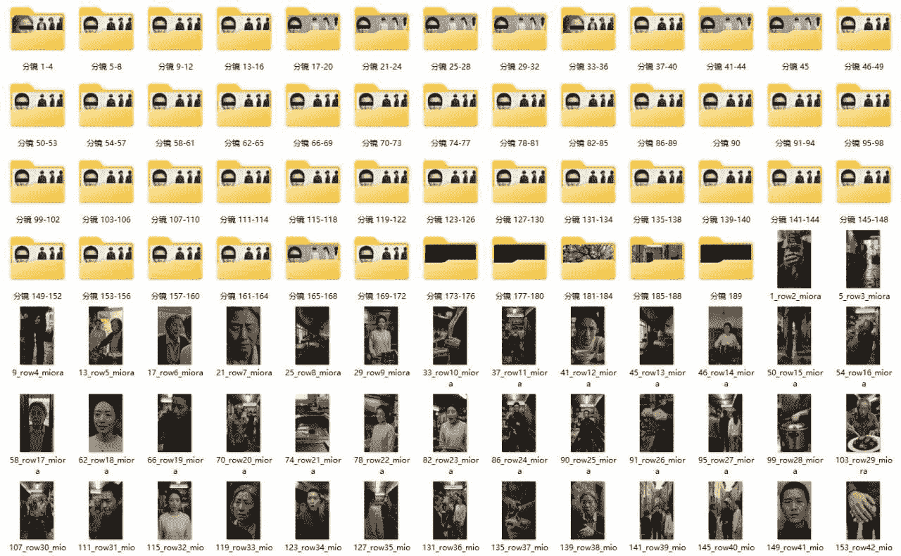

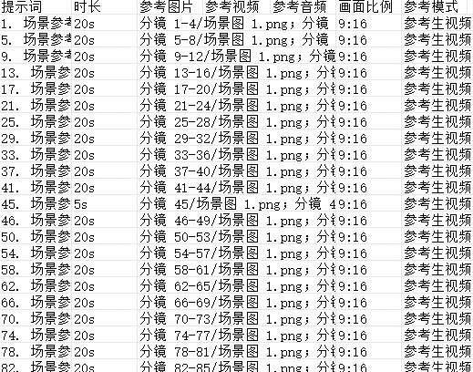

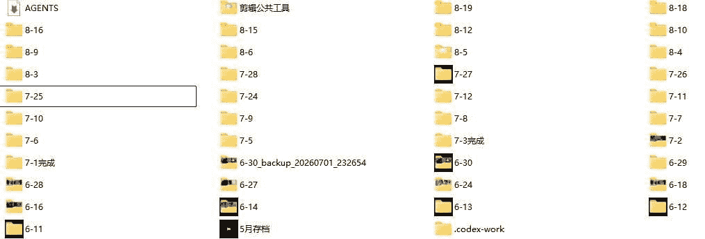

最早我也试过Mini和Fast，效果不够好，后来主力就固定在SD2.0上。

先解释一下我这边常说的“一单”：一次生成请求，大约能出15秒的镜头段，里面通常装4个画面。刚起步时，一条完整内容我会拆成30到50单，换算下来是120到200个分镜。后来内容越做越深，单量就加到70到80单，分镜接近300个。

80单全部跑完，原始素材堆起来大概有20分钟。我会先把废镜头和明显有问题的画面丢掉，留下来的部分剪成10到15分钟的成片。可能有人觉得素材搞这么长没必要，但我的想法是：长一点才有足够空间，既保留已经验证过的爆款开头和核心故事框架，又能塞进新的支线情节，和同类内容产生区分，顺带降低平台对同质化内容的限制。

供片渠道这件事，我经历了一个“从贵到便宜”的过程。早期只敢用官方API，虽然单价高，但稳定，适合把流程跑通。熟门熟路以后，才开始找各种低价口子。不同渠道的价格差距非常夸张：运气好时，一单只要几毛钱，整条片子的开销能压到十几二十块；如果全走官方，一条长片花两三百也不奇怪。

纯靠人工去跑的话，一条内容几十单，要在网页上选图、填提示词、提交、再下载，人根本忙不过来。更麻烦的是，很多便宜渠道的有效期只有一两天。所以后来我搭了一套自动出片系统：表格和图片准备好以后，系统统一读取，批量发出去，生成完的视频再按镜头编号自动存进当天的文件夹。哪一单挂了，或者人物崩了，我在后台只勾选那一单项重跑就行。

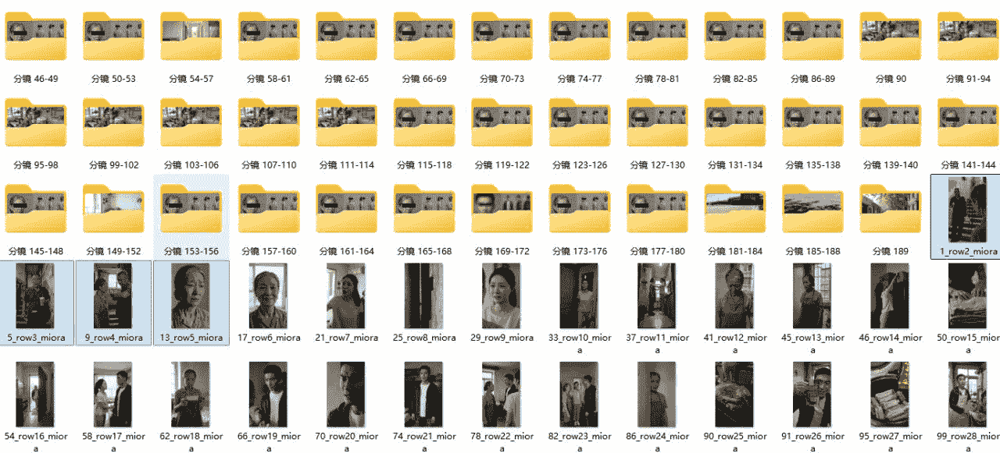

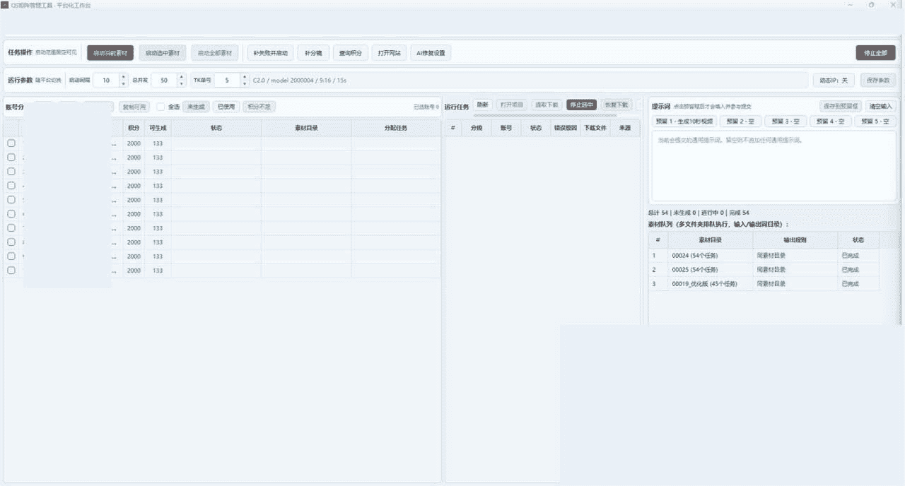

说白了这个系统就是一个调度中心，把生成请求、运行状态、补做记录、结果回收都放到一起管。

关于成本，我想特别提一句：别盲目囤片。单价低确实意味着同样的预算能多试几条，也等于多几次搏爆款的机会。但如果因为某个渠道特别便宜，就在家里一口气生成几十上百条存着，风险其实很大。视频号里的市场风向和热销产品一直在变，你今天做好的东西，过一个礼拜再看，可能已经过了生命周期，或者平台玩法又变了，这些片子就全压箱底了。我的习惯是：片子永远跟着当前要打的产品和市场节奏走。赶上行情好，产品处在爆发期，哪怕用贵一点但稳定的渠道，只要单量能覆盖成本，就立刻投进去。

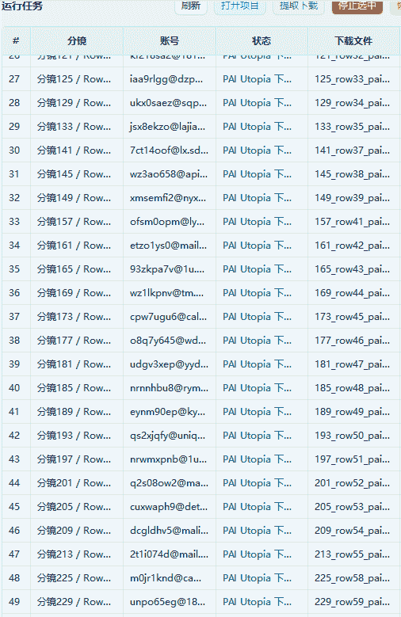

【剪辑：从自己手搓到人机搭配】

素材全部生成完，下到本地以后，就轮到后期处理了。

AI出片最大的问题就是随机性强。哪怕提示词写得很细，画面上还是可能出现动作扭曲、肢体穿帮、表情不对劲。比这更麻烦的是产品对不上版。比如你卖的是甘草金桔，AI给出的金桔时大时小，或者包装和数量跟实物不一致，这种素材我绝对会删掉。因为它不只是画面丑不丑的问题，搞不好会触发平台关于“商品展示与实际不符”的违规处理。

- 产品外观、数量、包装与真实商品不一致时，画面不能使用。
- 商品规格展示不一致可能触发平台违规。

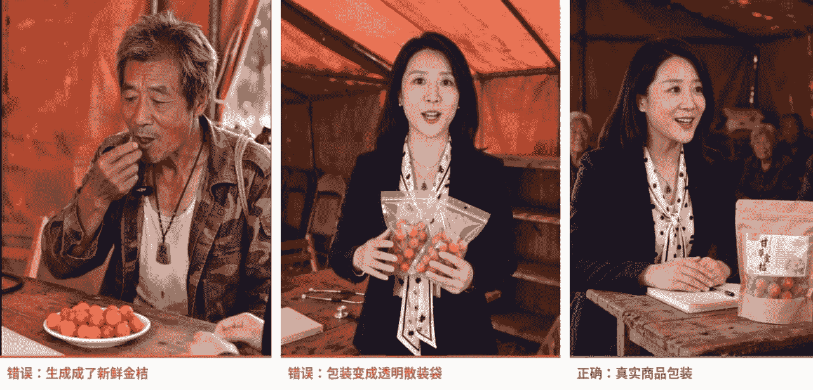

后期这条路，我也不是一开始就会用工具的，是慢慢趟过来的。

最初完全是手动。我会一遍遍看对标账号的内容，一帧一帧地拉片，琢磨别人怎么运镜、怎么卡点、怎么留钩子，然后照着那种感觉自己剪。这个阶段特别耗时间，但对培养网感很有用。你能越来越清楚，什么画面是顺的，什么画面应该立刻扔掉。

后来我一个人实在忙不过来了，供应链、数据、清理文案、出片，全都堆在一起，于是想把剪辑外包。但真的试了以后发现，外包剪辑的人大多不了解带货内容的逻辑，对故事走向和产品卖点没有感觉，也拿不准AI生成的哪些瑕疵必须清掉。他们交回来的成片达不到我的要求，来回沟通反复改，反而更耽误事。想从零带出一个懂行的剪辑师，前面的沟通成本又高得吓人。

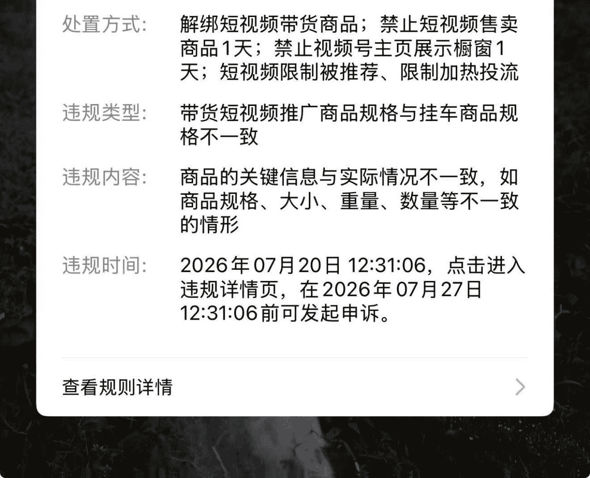

再后来，我改成了“人机搭配”。我先自己做一轮快速预检：把原始素材全部拖进剪映，按剧情大纲扫一遍，把人物崩掉、产品拍歪、动作生硬的镜头全部删掉，只留下最顺畅的画面。做完这一步，剩下的标准动作，比如音频对齐、字幕生成、卡点、片头片尾固定拼接，一律按我写好的SOP交给Codex和自动化脚本来跑。这套SOP也不是天生就有的，我磨了很久才稳定下来。

现在一条10到15分钟的带货长片，我预检时间大概只需要10分钟，之后全部交给工具收尾。如果已经有哪位朋友把AI长视频的自动理解和稳定剪辑做得更好，欢迎在评论区给我支支招。

【发布：短挂、短引和账号安全】

前面讲过短挂和短引的成交思路。真正发布时，我只看三件事：账号能不能正常跑，商品链接是不是健康，以及这条内容用哪种方式发。

发布时间上，我的个人习惯是上午9点到下午5点。这只是我自己跑出来的相对稳定时间段，不代表万金油。晚上和其他时段，一样有人能做出爆款。

如果走短挂，直接挂车发出去就行，不用等流量起来再开直播。前提是商品链接的稳定性和限单情况已经确认过，发完就盯着有没有起量，以及后台有没有真实成交。

如果走短引，就得时刻盯流速。后台发现数据往上冲了，马上开播。开播后重点看两个东西：一个是从短视频点进直播间的人数比例，另一个是直播间商品卡有没有不断弹出来出单信息。

这个进入比例没有标准答案。行情好的时候，我实操下来平均到2%左右就算正常，能超过3%已经是很漂亮的数据。市场比较差的时候，比如七月份某阶段，整体比例会被压得特别低。我遇到过视频端播放一路涨、看着很有希望，结果开播后进入率只有0.3%。最后变成短视频热热闹闹，直播间却没人进来，基本等于一直在给代播团队导流。所以分析数据一定不能死套一个数，要看当时的大盘和具体内容。

账号是我认为最容易被低估的雷。新人刚开始做，最好先用自己或者得到明确授权的家人朋友的号，把流程跑通。后来自以为聪明去租号，结果碰上了号主配合度的问题。租号市场层层转手，价格贵不代表靠谱。最要命的是异地登录扫脸：账号挂在工具上跑，万一有视频突然爆掉，微信大概率会触发风控，要求人脸验证。这个验证窗口只有10到30分钟，如果你联系不上号主，或者号主拖沓，流量就会被官方掐断。我们平时大概10个号里才跑得出1个爆款，这一个爆款要覆盖前面所有测试成本。好不容易冒出个苗子，却因为扫脸不及时被限流，那种损失真的承受不起。我还遇到过号主误删内容、微信被封、号主未成年等一堆意外。

圈子里有句话很真实：做视频号最大的难点，居然在号主身上。普通号和企业号同理，比如七月份企业号挂车更好跑，那就往企业号切。哪个阶段有红利窗口，就及时用哪种方式。

再分享一个蛮实用的小技巧：同一条爆款内容是可以重复发的。第一波流量慢慢掉下来以后，你可以在同一个号上再发一次，过了平台规则甚至能发第三次。我还见过有人一条爆款连发十几次，就为了把流量完全吃透。同样，爆了的号也可以把内容授权给其他号发，最大程度榨干它的价值。但前提是这条片本身就够爆。只有已经证明能吸到大量流量的内容，重发才有意义。原本就跑不动的视频，发再多遍一般也没用。当然也有极少数第一遍没起来、第二遍突然起量的情况，只是很少见。

【看完数据：三种情况三种打法】

内容发出去以后，我会把曝光、转化、GMV分开看。曝光高只代表内容拿到了流量，真正能让卖货成立的是GMV。只有GMV打出来，才能说这套“故事稿+产品”的组合跑通了。

数据回来以后，通常分三种情况处理。

第一种，流量和成交都很好。这说明组合已经验证成功，我会在24小时内迅速复制放大。放大时，原来内容里验证过的开头30秒和整体故事逻辑一个不碰，只替换场景、背景和部分后面的剧情，快速做5到6个微调版本，分到4到5个不同账号去跑。这个机会窗口很短，往往只有几天到一周。如果反应慢了，同行马上开始跟进抄，流量红利很快就没了。

第二种，曝光很高，转化很低。比如一条片子跑了几十万甚至上百万的观看量，后台却只有几百块成交。这时候我不会闷头改内容，而是先去找同行对账。如果发现同一时间段大家都有播放没转化，那可能就是平台在调算法，推来的都是泛流量。这时候不用怀疑自己，照常维持测试就行。如果同行带这个品都在出单，只有你不出了，那就要回头查：是不是产品植入太硬？是不是链接被限单了？还是内容吸引来的人和真正买单的人根本不是同一批？

第三种，发出去就没什么流速。如果好几天都没起色，账号环境也排查过没有问题，那就果断停下来，换个故事、换个产品再试。不要在没有任何正向反馈的内容上死磕。

其实这个项目的内核很简单：用很少的钱不断试错，去博一个更大概率的成功回报。跑出结果就集中资源放大，跑不出来就快速换下一轮。

【把个人判断变成工作流】

流程整体跑顺以后，我开始琢磨怎么把那些重复劳动固定下来。五月份那次深海圈的内测项目里，我借了前辈已经跑通的路径，先把整条链路走了一遍。刚进入一个新方向的时候，对内容、产品和平台都不熟悉，站在前人肩膀上起步，肯定比自己闭门摸索要划算。

内容越做越多，我慢慢形成了一套属于自己的判断：哪些开头坚决不能动，人物关系能做哪些等价替换，产品要在什么位置出现，什么样的故事稿绝对不允许进生产。这些标准，每个创作者的感受都不一样。

过去我总得在聊天框里把背景从头讲一遍，拿到结果以后再手动去改，产量一上去，时间就全被返工吞掉了。后来我开始用Codex搭自己的辅助系统，想把我验证过的那些判断都装进去。

现在整个链路是这样的：当一条内容在市场上起量时，监控模块会留下变化记录；我决定跟进，就开始准备素材，拆解内容结构和产品信息；产品资料确认后，进入故事创作和审核；等到故事稿通过，系统会自动生成带分镜的电子表格和参考图，并按日期打包成一份完整的任务资料。

最直观的变化不是操作界面上多了什么按钮，而是以前每次做内容都要重新解释需求，现在上下游的规则和格式全固定了，任务就像走流水线一样往下传。

真正需要我拍板的，仍然是那几个核心点：这条内容值不值得跟？产品适不适合？故事稿能不能进生产？辅助系统提升的是发现线索和批量执行的效率，但商业判断这一环，它替代不了。

监控模块负责记录内容变化，并提供一键复刻的入口。

素材库集中存着作品结构和后续生产要用的资料。

产品图生成以后，会跟具体的商品资料绑定。

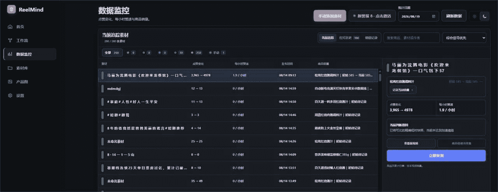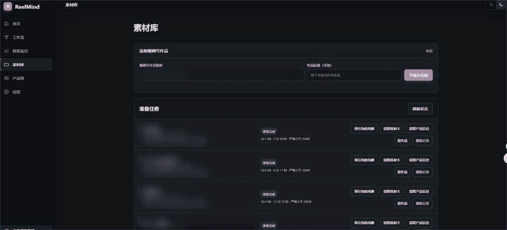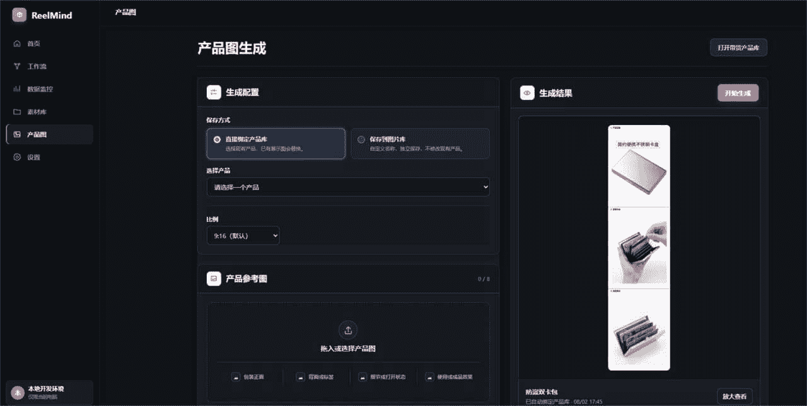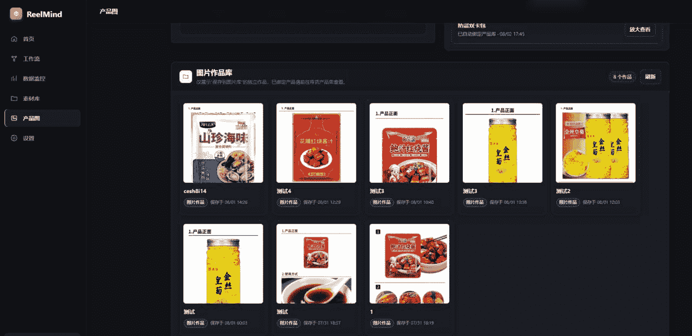

运行记录会把每一步的状态和结果都留档，方便随时查看。

【为什么又做了自动出片系统】

故事稿和制作资料标准化以后，新的瓶颈就卡在“一单一单去提交”上。一条内容几十单，如果靠人工在各个页面里选图、填提示词、提交、等待、下载，再手动整理，效率太低，也很容易错过那些只有一两天窗口期的便宜渠道。

后来我做的这个自动出片系统，会直接识别表格和图片，然后后台统一分配任务。生成完的片段，系统按镜头编号存到当天的文件夹。中间有某一段跑失败了，可以单独重跑；任务断了，也能接着进度继续；个别镜头不满意，随时指定它重来。

这些年来我连接过不下十几个出片服务商。单独接一个平台，解决的只是一次性问题。后来我把“接入新渠道”拆成一套标准化步骤，市面上只要冒出新的低价供给，我只需要处理接口不同的那部分，就能很快把它纳入现有生产线。

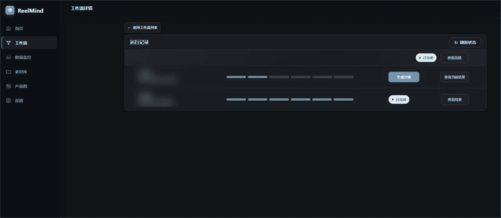

【真实成本账】

在花销里，AI出片占的比例最高。我一开始的算盘就是压缩单段费用，用最少的钱测出正反馈。具体花多少，完全看你走什么渠道。

如果走官方API，不管是哪个型号，单价都不低。15秒的一段，基本要7到10块。一条长内容全程用官方，总成本轻轻松松到两三百。如果是闲鱼或者第三方口子，15秒、720P的一段，通常是1到3块。这个区间现在算常规水平。最夸张的时候，我还见过一单只要一毛钱，不过这种低价口子基本活不了一两天。

按50个15秒片段来估算，成片长度大约8分钟。用1到3块的常规渠道，总费用大概是50到150块；赶上几毛钱一单的超低价，可以压到50以内；混着官方或高价渠道跑，就是150到200块。所以50段这种体量，市面上的实际费用大多落在50到200这个区间。而我更常做的是80段的长内容，成片接近15分钟。用常规低价渠道，一条大约70到80块；渠道稍微贵一点，就要150到250块。

我现在不会只押一个渠道，而是保持两三个不同价位的供应源：贵的用来兜底，便宜的用来冲量，再按当时的单价动态调整单条预算。一次便宜渠道，只能降低那一批片子的成本；真正能长期沉淀下来的，是快速接入新渠道、稳定管理并回收结果的整套流程。

【人和AI怎么分工】

在后期这个环节上，我和Codex纠缠得最久，也吃过最多亏。一开始我很执念“全自动”，希望让Codex按规则把整条片子完整剪完。为了把效果往上拉，后面我又把Gemini也接进来了，让它结合抽帧、音频和上下文去理解内容。确实比硬套规则要强，但零点几秒的画面小变形、穿模、或者一些极细的违规细节，AI还是可能放过去。

后来我改成现在的分工：人先快速判断素材好坏，Codex再做标准化的批量收尾。这个转变让我想得很清楚：自动化不是为了满足“全自动”三个字，能稳定交付、不违规，才是它存在的意义。凡是能讲明白、能验收的重复动作，交给AI；AI拿不准、需要靠网感来判断的部分，老实留给人。

我是压根不会写代码的，跟Codex提需求也从来不说术语，基本都是用大白话讲。不会写代码一样能做工具，前提是你真的在业务里下过场，清楚自己要解决什么问题，也明白什么样的结果才算及格。

我现在和Codex合作的方式通常是：

做工具、搭建流程、操盘短视频带货，这段实战下来我把体会归纳成一句话：能被明确定义的工作交给系统执行，留有模糊空间的判断必须由人来把关。

给 Codex 这类模型定规矩，我一直坚持三条红线。

第一，先把权限和边界说透。让它把现存的资料和业务逻辑全部读进上下文，这次任务到底是只做阅读理解，还是可以直接写入修改，范围一次性封死，后续才不会越线。

第二，用最小颗粒度试跑。目标是什么、哪些核心要素严禁改动、输出的格式长什么样，先用一小段素材跑通一遍，方向确认无误后再放大产能。

第三，把偏差沉淀为规范。产出不达预期时，不会让它简单重来，而是要求具体说明偏差点、产生原因。如果这类问题大概率会复现，就把正确的标准固化进提示指令、SOP 或代码逻辑里。

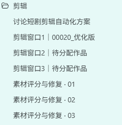

把当下这一次修好，只是止住了眼前的问题；把成因写进工作流，下一次同类坑才会被真正根除。

产品是否跟进、整体盘面怎么走、供应链如何衔接、直播间怎样配合，这些层面模型替代不了人。它真正的价值是把已经可定义的重复任务高效跑完，把我的时间从低价值劳动里解放出来，去聚焦需要商业决断的环节。

我自己也在做企业侧的 AI 落地。给自己建工作台时，痛点、需求、验收标准都存在脑子里，哪里卡立刻改。给企业做则完全不同，第一轮需求往往只是一句口头描述，真正的深水区细节，要等一线业务真实使用、团队持续试用后才会暴露。这件事让我更清楚：能否交付是技术问题，能否吃透业务是另一回事。

### 实操近一季度的真实体感

这段周期有起伏，踩的坑不少，现在尤其认同几条心得。

**1. 平台持续演化，经验只能局部门期使用**
回顾时间线：
- 首月主要是在花钱换经验，用偏贵的 API 渠道把内容、脚本、制作、分发、账号、直播、数据这条主线硬打通，成本高也认。
- 中期每天维持多号稳定更新，靠高频产出慢慢培养出对平台的体感。七月是产出最好的阶段，我也顺势把脚本台和生成平台搭建出来。
- 七月末到八月，市场批量搬运与科技主题泛滥。好素材刚有起量就被大量复制，过去能吃一星期的放量窗口被压到几小时。平台更偏向推泛流量，有播放无转化的情况增多。
当投放量不足时，很容易怀疑脚本本身。那段时间我常和同行横向对账，发现大家都在掉同一个坑，就避免了盲目推翻自己的操作。
市场上一直有人盈利，说明赛道仍有解，但别人的解法不等于你的解法。八月我主动降速，把精力放到复盘与工具优化，并开始测试更大幅度的“大二创”思路：先用多个差异化版本去探测，拿到信号后再精细复刻放大。行情好时冲，投入产出转弱时调系统，这就是节奏感。

**2. 可控项提前做到位**
推流力度、用户购买意愿、是否爆款，这些不可控。但脚本质量、选品匹配度、商品链接的限额与资质、制作成本、号主的应急响应与扫脸配合，都可以提前掌控。
我曾测十个号才出一个大爆。任何一个本可提前规避的小失误，比如链接失效、号主失联扫不上脸，就会让之前的投入付诸东流。原则很简单：能控的提前做实，别存侥幸。

**3. 作品完成即上阵**
刚拿到便宜的生成渠道时，我也想囤一批。后来发现产品与市场风向一直在挪，囤片等于自毁。
而且作品质量是否达标，最终裁判权在市场。我自己觉得很粗糙的片子，发出去也能卖几千。不要用主观审美代替市场反馈，很多自认为一般的素材，反而转化不错。

**4. 算总账要把失败摊销进去**
看账本不能只看一条 15 秒视频花了多少钱。账号成本、工具额度、剪辑耗时、直播运营，以及前面九个没跑通的测试号和废片，都要计入。
低价渠道的意义是拉低试错门槛，让同等资金能测更多组合。但若不顾时效盲目囤片，或作品根本发不出去，再便宜也无商业价值。摊销成本想清楚了，才能理性判断是否继续扩量。

### 若此刻想入场，这些数值与规避点供参考

若你也想尝试 AI 剧情短剧带货，以下是我用真金白银换来的大白话建议。

先说花费，不含生成 API 消耗，只算必要开销：
账号费用：租赁普号市面约 150-250 元/7天；外拓挂车号约 180-300 元/7天，随行情浮动。企业号认证官方 300 元。
脚本工具：市场上二创工具几百到几千不等，按预算选。
数据监控：如微猫这类看大盘流速的工具，月费约 80 元。
直播代播：短引代播约 30-45 元/小时，白天夜间有差。

综合合计，前期准备 5000-10000 元，足够把链路跑几轮。

账号准备，新手别一上来租一堆，先备两个自有或家人的号，做两三条作品留容错即可。
时间投入，别指望当轻量副业。每天看对标、洗脚本、挑素材、剪辑、盯流速、开播，事项极碎。想获正反馈，前期每天 5-8 小时比较现实。

市场环境：八月搬运满天飞，不建议纯新手重仓硬拼数量。好作品上线数小时就被搬运烂。现阶段更稳妥的是先练内功，用现成工具把做片、拆爆款、剪辑的手感练熟，用小成本测不同风格的二创。等看懂出单底层逻辑、摸清推流脾气，再在下一波好窗口放大。

新人易偏方向：
死磕纯原创。在还没摸清有效开头、用户为何停留时，自创剧本基本等于自我感动。先 1:1 复刻已验证的爆款机制，拿到首笔成交最关键。
贪便宜囤片。遇到一两毛一条的渠道就疯狂生成上百条，商品与风向一周即变，囤的片全废。紧跟商品时效，做到即发。
用年轻人审美替市场决策。平台核心买货人群多为中老年，她们的偏好与年轻人不同。无明显违规硬伤就发，市场会给出答案。
账号链接疏忽。好不容易爆了，异地登录需扫脸联系不上号主直接断推；或跑几十万播放发现链接限单严重，流量打水漂。发前务必与号主确认，查清链接限单与资质。
过早追求全自动化。单条视频如何出单都没搞顺就搭自动化，只是在批量制造错误。先用成熟工具跑通闭环，等产量真成瓶颈再考虑用 Codex 定制专属工作台。

### 写在末尾

以上是我从 YouTube 转到国内短视频平台的实操框架与心得，仅为个人路径，不代表唯一答案。细节极多，建议多看资料、带着思考亲自跑一遍。

现在看项目，我会先看它处在什么周期，哪些环节可控，停掉项目后我能沉淀什么能力。

此前我几乎没做内容，经过两段经历后，对爆款开头、人物关系、剧情推进、拆解有了真实体感。思路也更清晰：对标、定品、生产、发布测试、看数据、放大结果，把零散经验整理成可复用路径。

该平台近季度约 40 万 GMV，是产品、内容、账号、直播与市场共同作用的结果。Codex 缩短了发现、准备、生成、剪辑的路径，让重复动作可由一人管理。产品判断、市场变化、脚本体感、是否继续投入，这些仍需自己负责。

这套方法起于赚钱、深海圈等前辈经验，我在实操中不断测试、调整、迭代，才形成现在这套流程。

窗口会换，产品周期会过，平台也会变。但 AI 视频能力、内容判断力、业务理解和工作流，不会因某个短期机会消失。

我若当年没有把 AI 视频制作能力与内容体感磨扎实，后续也难在短剧带货拿到结果。

平台会换，项目会换，但沉淀的底层能力可迁移。只要在某个项目里真正死磕拿到过正反馈，换到新赛道也能快速破局。

接下来我会继续稳固现有打法，同时向大幅度二创乃至高壁垒偏原创方向走，也会尝试更多赛道玩法，比如图书带货等类目。

短视频与 AI 变化极快，共勉。

最后感谢龙哥盟、深海圈以及一路分享信息的圈友。

关于 AI 剧情脚本二创、视频生成工作台、剪辑 SOP 和 Codex＋Gemini 的自动剪辑方案，后续有机会再展开。

谢谢！

————分割线————

看完这份 SOP，你以为懂了，实操第一步就会卡住。工具和教程是最低级壁垒，真正的壁垒是立刻动手和圈层信息差。

如果你想看全网最新的变现玩法，并且和一群执行力极强的极客一起下场拿结果，欢迎围观我的核心私域：【懒人专属群】。

我们不聊虚的，只做商业闭环的拆解与 AI 效率的压榨。系统内已沉淀 1000+ 跑通的套利实战局。

👉 查阅圈子完整数字资产与上车门槛：

https://lazyso.com/insider/

认同价值、准备好下场干活的，扫码加我微信（lazyhelper1）

备注：【实操上车】，不闲聊

