# 38000字长文：三百多人催更之后，我把AI雇员团队的搭建经过摊开来讲

260828 副业SC 精华

整理：公众号懒人搜索，懒人专属群精选

懒人微信：lazyhelper1

## 一、写在前面的几句话

先自我介绍一下：我是枕棠，04年生人，定居杭州，全职从事AI方向的个人创业。

今年6月，我参加了广东航海家大会。从那时起，我在Codex上烧掉了超过260亿Token，花两个多月时间，把自己工作和生活里能想到的一切，全都切换成了AI驱动的模式。今天你看到的这支“AI雇员队伍”，就是这么长出来的。

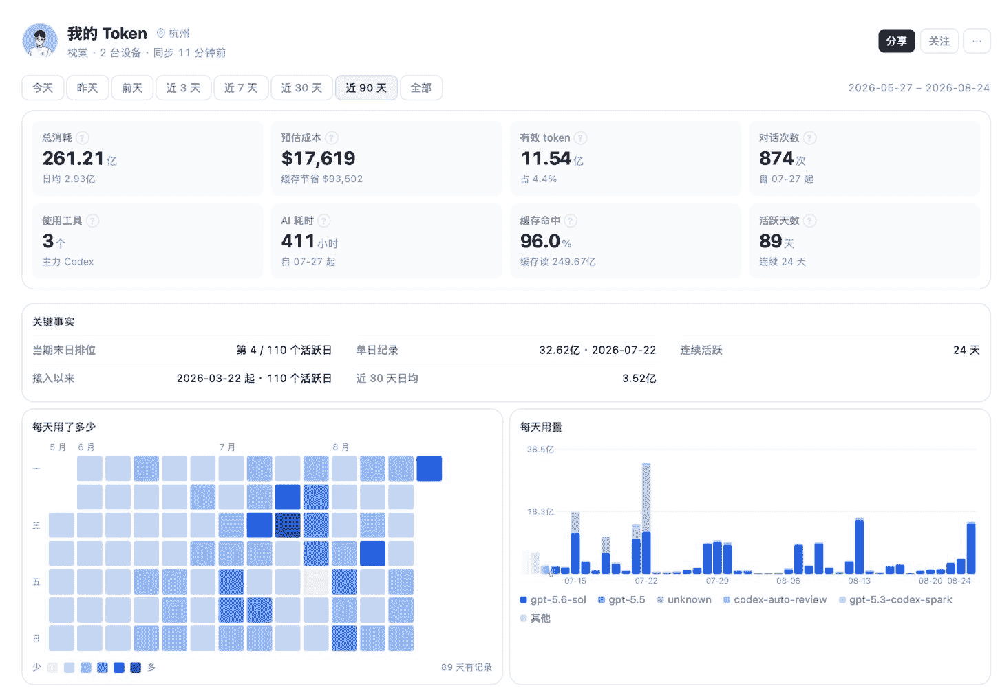

不过，请先别把注意力放在“队伍”这两个字上。这支队伍本身没有任何值得炫耀的地方。真正值得检验的，只有两个问题：它有没有让我的效率发生肉眼可见的变化？它有没有带来真金白银的结果？

生活方面，我的体重管理、差旅安排、目标制定和OKR推进，如今都有独立的操作面板和AI助手在打理。过去那些需要靠记忆、靠反复权衡才能完成的事，现在统统交给AI辅助，我的心力负担明显小了。

事业方面，我的主线一直很清晰：写内容、做流量、导私域、卖知识产品。所以近段时间，我的公号文章、私域动态、发售文案、课程设计、活动物料……凡是能接到AI上的环节，全部接到了AI上。

这期间出了几篇数据不错的爆款，过去三十天的账面收入也稳稳突破了七万。

当然，这不等于说AI包办了一切。准确的说法是：AI让我拿到好结果的确定性大大提高了，同时把内容生产的时间成本，压缩到了原来的1/3到1/2。

大约四星期前，我写过一篇帖子，题目叫《从AI小白到12个Agent员工，我的60天150亿Token系统升级之旅》。当时我在文末说：如果点赞和投票的朋友足够多，我就把全套搭建过程公开写出来。后来，真的有三百多位读者用点赞和投票回应了我。

收到这份热情之后，我又花了整整四个星期，反复打磨今天这篇稿子。

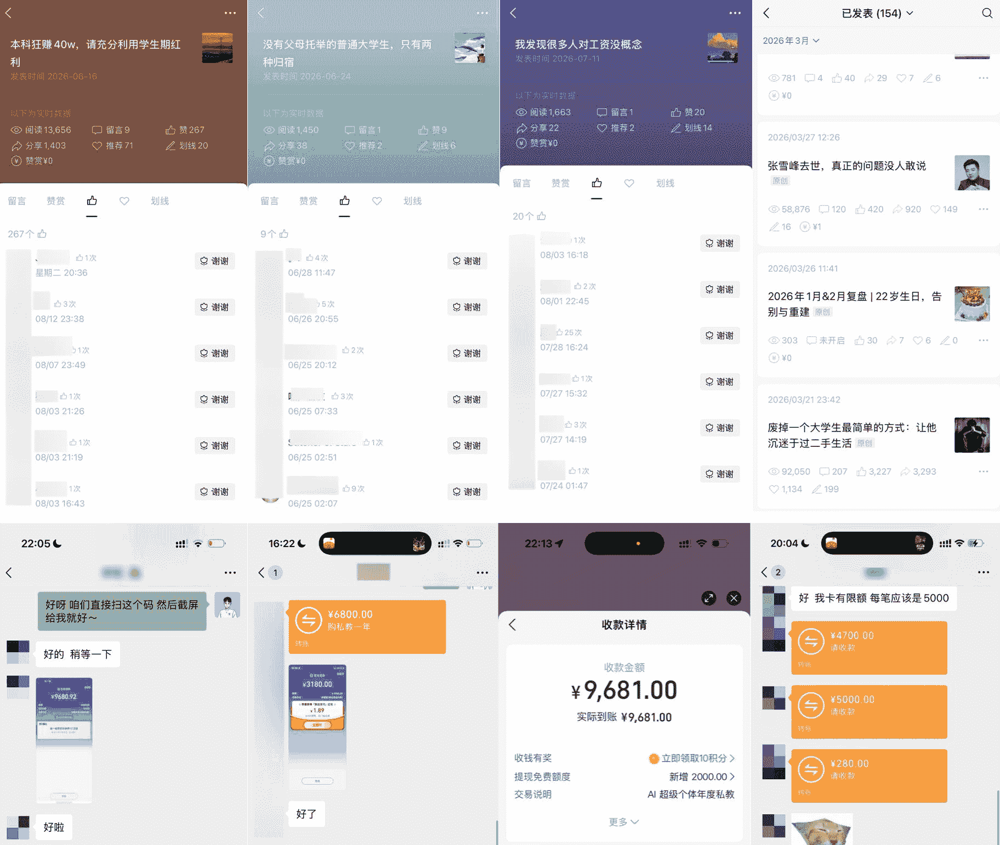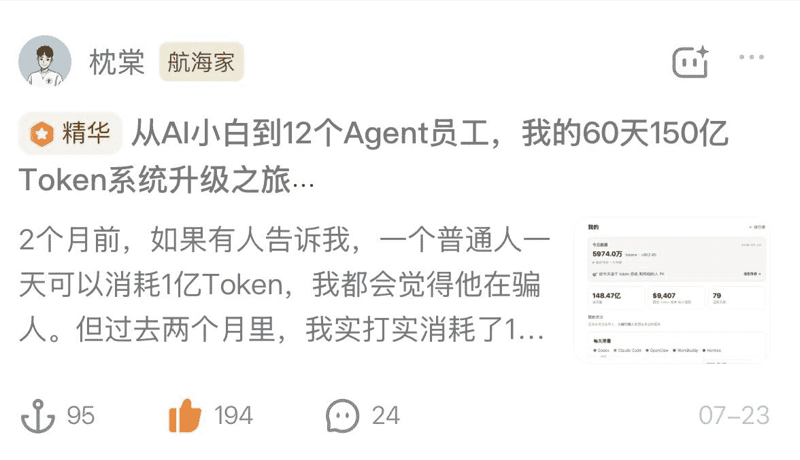

从整体框架，到每一环该怎么讲才不绕，再到所有提示词、案例和操作细节，前前后后推翻重写了无数遍，最后才变成你眼前这38000字。

所以，今天就聊一件事：一个像我这样的普通人，到底按什么路径，才能让AI一步步变成自己手下的雇员？

我得先纠正一个误区。这件事背后的逻辑，不是“多掌握几个AI工具”，更不是“囤一堆现成的Agent”。恰恰相反，我最先做的一件事，是把AI从神坛上请下来，让它回到工具的位置。然后，我把使用现场、专属资料、技能沉淀、人机互动、反馈闭环这五样东西，熔铸成一条闭环作业链。

我希望这篇分享能帮你弄明白三件事：这些东西各自的价值是什么？它们之间如何咬合？你又该按什么顺序去搭建？最终，让它们切实融进你的工作和生活。如果落不到实处，学得再多、装得再满，也只是自我感动。

全文分三大块。第一块，讲清楚搭建这样一支队伍的理由。第二块，拆解五步方法论：梳理业务、沉淀数据、固化技能、设计互动、回收反馈。第三块，把配套的教程、提示词和代码一并交给你。

好，下面正式开始。

## 二、人为什么要组建AI雇员队伍？

### 1. “用上AI”和“靠AI增效”是两件完全不同的事

我拿七年时间研究时间管理，又拿七年琢磨人的目标和动机。这些年的经验浓缩成一句话：想真正做成一件事，你首先要搞清楚自己的靶心在哪，以及这件事对你来说为何非做不可。所以，在你动手搭队伍之前，请先接住我这一个疑问：

你搭这支队伍，到底图什么？

我猜不少人的回答是：AI是这个时代最先进的生产力，我得赶紧用上。可“用上AI”本身，从来不是一个合格的目标。如果你只是想让AI陪你聊聊天、回答几个问题、写点应景的文字，那ChatGPT、豆包这类开箱即用的对话产品，早就够你使了。

那我们还折腾Codex、Hermes、飞书CLI、Obsidian干什么？还要搭资料库、写技能包、设计作业链、把所有部件拼在一起干什么？因为我们真正想要的，从来不是“用过AI”，而是“靠AI增效”。把一段段孤立的问答，连缀成一条完整的输送带，让AI能翻看你的业务档案，沿用你已经跑通的方法，然后稳定地交出你想要的成果。

归根结底一句话：AI的唯一使命，就是用更低的成本，拿到更高的产出。更快、更稳、更省力。这才是我们真正看重的东西。

而这些要求，一个聊天框根本接不住。因为聊天式AI身上，长着三根拔不掉的刺。

### 2. 聊天式AI的三根刺

#### 刺一：它记不住你，还会把记忆搅乱

这是每个人都迟早会撞上的墙。你刚跟它交代完自己的身份、读者画像、产品清单和写作纪律，换一个新的对话窗口，它就又把你当成了初次见面的人。于是，每趟任务开始前，你都得重新自我介绍、重新粘贴旧文、重新补齐产品信息、重新解释一遍哪些能写哪些不能写。

麻烦还远不止“健忘”。它还会“串台”。当你手里同时跑着好几个项目、顶着好几个身份时，它可能把A项目的背景知识搬到B项目的对话里，把两套人设、两套产品、两套上下文搅成一团。这种记忆，既不牢固，也不干净。

#### 刺二：时好时坏，像开盲盒

第二个毛病，是产出质量起伏不定。同样的任务，同样的指令，昨天它给你一篇惊为天人的好文，今天给你的东西可能连基本要求都够不到。同样让它处理一篇文章，它有时能写出一句直击人心的开头，有时却像在誊抄一份行业白皮书，逻辑无懈可击，文字却冷冰冰的，没有半点人味儿。

最让人头疼的是：它并不是完全不会，只是“偶尔很会”。你永远没办法预判下一次开箱的质量，也因此永远不敢把重要的工作真正托付给它。

#### 刺三：推一下动一下，而且只能困在聊天框里

第三个毛病，是你必须追在它后面发号施令。让它找材料，它才去找；让它列提纲，它才去列；让它继续写，它才肯继续。表面上看AI帮你做了很多事，实际上你只是从“亲自干活”换成了“人肉遥控”。

更要命的是，这些能力全部被锁死在聊天框里。你必须主动打开AI产品、翻出对应的对话、告诉它下一步做什么，再把结果逐段复制粘贴到别的地方。它没办法像真正的雇员那样，在既定的时间点或特定事件发生后自动开工，也没办法把成果主动推送到你每天都泡在里面的飞书、钉钉或者微信里。

所以，第三根刺真正扎人的地方在于：AI不仅被动，而且从未真正进入你的日常作业流。

### 3. 从聊天式AI到AI雇员：拆掉三根刺

怎么拆？答案其实就藏在这三根刺里。

记不住你，那就给它造一座专属资料库。把你自己——你的经历、产品、客户、案例、方法、判断标准——统统沉淀进去，让它每次开口干活前，都知道该去哪儿翻档案。

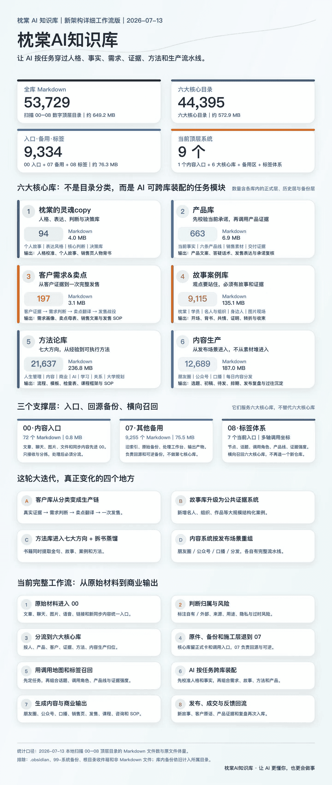

发挥不稳，那是因为你的“手艺”没有被拆细、没有被写成说明书。你要把已经验证有效的做事流程，固化成一个个技能包，把“怎么做”“用什么做”“做到什么程度算好”逐条写清楚，喂给它。

交互太累，那是因为你还没有把它包装成“雇员”。你要把资料库和技能包封装到真实的作业链里，通过飞书、专属面板这类日常入口，让它不再窝在聊天框里，而是直接出现在你的工作和生活现场。

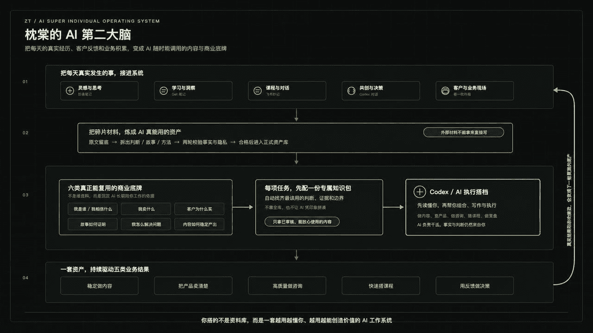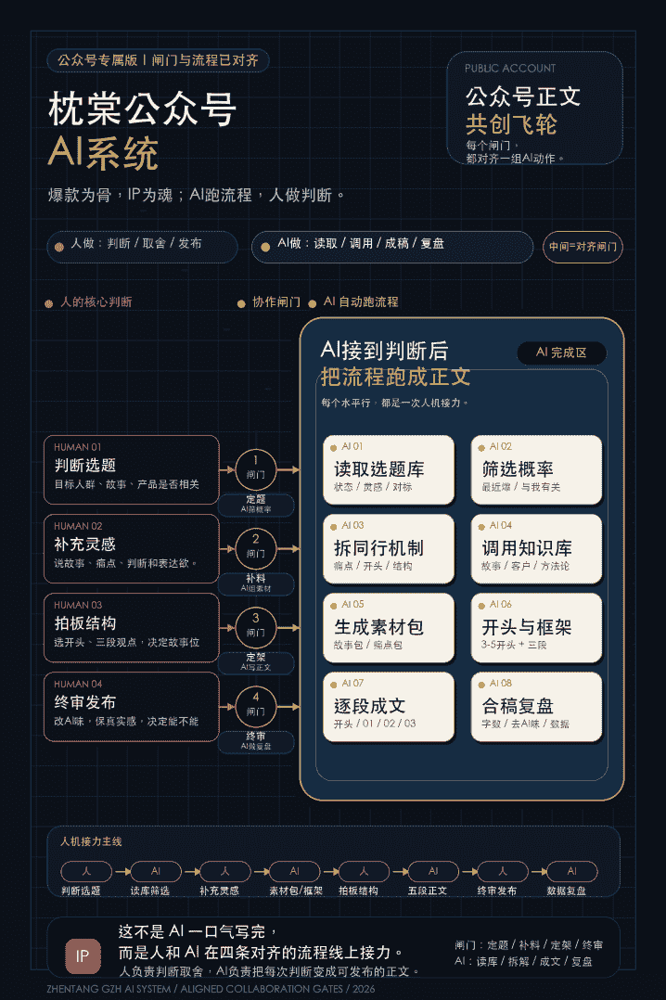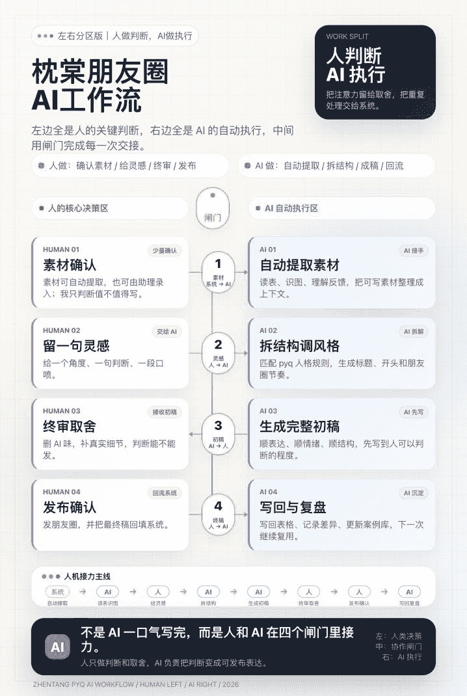

于是，一个清晰的闭环出现了：

资料库，让AI认得你。
技能包，让AI会干活。
互动入口，让AI成为正式雇员。

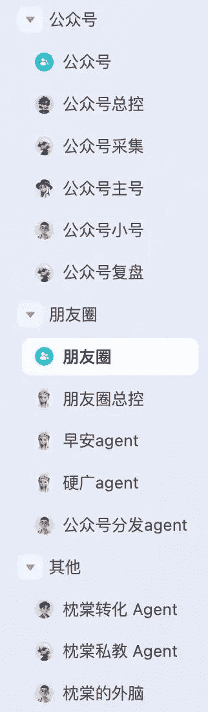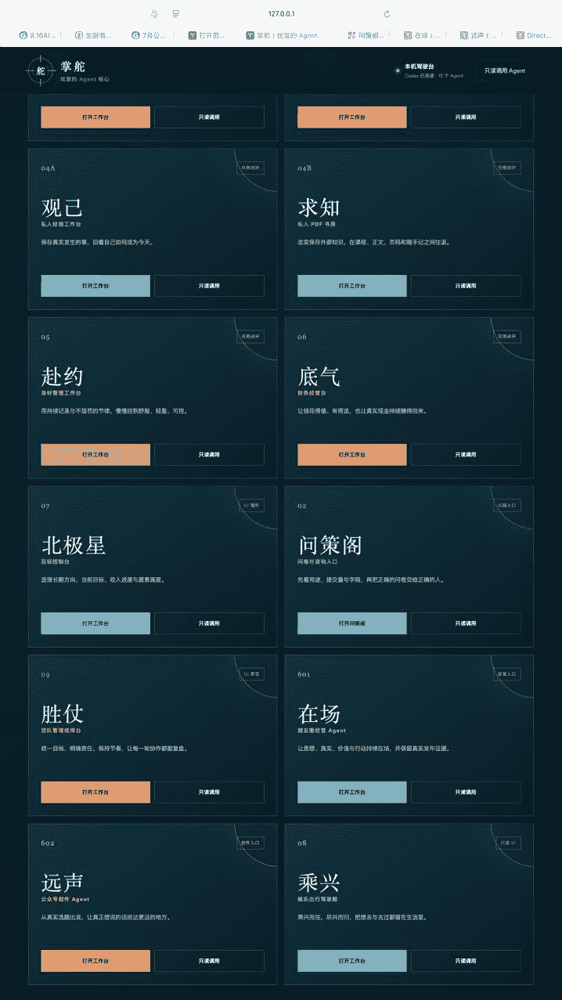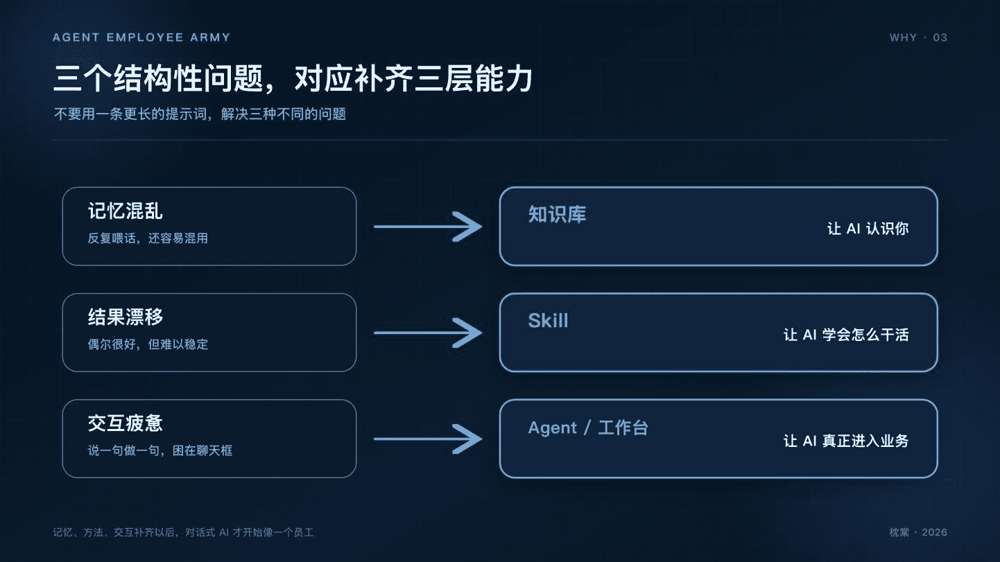

这就是我理解的从“聊天式AI”走向“AI雇员”的完整路径。不需要换一个更聪明的模型，只需要把一个只会陪你聊天的门客，一步一步改造成一个真正了解你、能够独立交付、已经站在业务一线的自己人。

那具体怎么做？我把整个过程折成了五段。

第一段，盘业务，找切口。先想清楚这个AI雇员要为你解决哪个具体的麻烦，避免一上来就掉进“为AI而AI”的陷阱。
第二段，沉淀数据，建私人资料中枢。把任务相关的经历、产品、客户、案例、方法和历史文档全部归档，让AI真正认识你和你的生意。
第三段，固化技能，稳住质量。把已经验证过的做法、标准和流程装进技能包，让AI从“撞大运”变成“稳定发挥”。
第四段，设计互动，发放工牌。用飞书、专属面板等载体，把资料库与技能包打包成随叫随到的AI雇员，让AI从聊天框里走出来，真正进入你的生活与工作。
第五段，回收反馈，持续进化。把每一次真实使用中的操作数据、人工修改痕迹、用户反馈和业务结果，重新回填进资料库与技能包，让这支队伍越用越懂你。

## 三、五步搭建法，每一步都怎么走？

### Step 1：先盘业务，再谈其他

现在你已经知道“为什么”了，但相当多人马上又会卡在“做什么”上：我到底该让AI先帮我干什么？先雇谁？

我观察到一个很普遍的现象：大家学AI时最缺的，从来不是方法和资源，而是方向和靶心。上来就是三板斧：Codex怎么学？Claude Code里有哪些技能包？怎么组建一支AI雇员队伍？

这些疑问当然没错。但你敢不敢再往下追问自己一句：我到底想让它替我解决哪一件事？效率最终要体现在哪个环节？是多交出来一篇文章、一张报表、一份方案，还是多谈下一个客户？

只要多问这一句，很多人就沉默了。

这种沉默，会把人拖进一个典型的“收藏家陷阱”：今天收藏一份教程，明天装上某个插件，后天从GitHub里捡回一个热门技能包。今天想做内容助手，明天琢磨电商自动化，后天看到别人晒出一个炫酷的控制台，又忍不住想拆掉重来。折腾了整整一周，电脑里的存货越来越多，真正干得了活的，一个都拿不出来。

原因何在？因为这一切的起点，都是在网上道听途说，而不是自己手头那个具体的任务和目标。

先有任务，才会有产出；有了产出，时间、数据、用户和收入的反馈才会出现；而缺了反馈，再漂亮的AI系统也只是摆在橱窗里的摆设，永远落不了地。

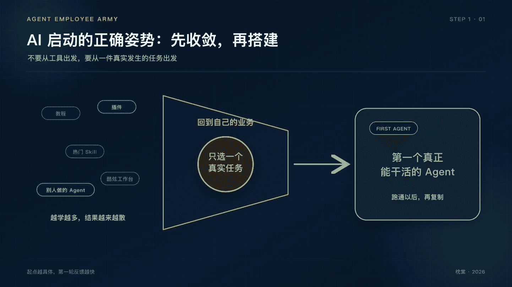

而你也一定会在这个阶段开始怀疑人生：我天天折腾这些，到底图什么？效果怎么这么差？

所以，组建AI雇员队伍，绝不是从启动Codex开始的，也不是急着搭资料库、写技能包。而是先回到你自己的业务现场：找到一个真正值得被AI接管的环节，一头扎进去，做出第一个能扛活的AI雇员。等它在真实跑动中站稳了，再把同样的方法复制到下一个环节，慢慢地，你就拥有一支队伍了。

### Step 2：什么样的环节，适合当第一个AI雇员？

我判断一个环节是否值得被AI接管，通常用四把尺子去量。

第一把尺子：它够不够高频。

优先选那些你反复在做的事，最好每周能见到三次以上；如果任务本身偏低频，至少也要每月出现三次。原因很简单：AI雇员不是搭完就能一劳永逸的固定资产。你需要通过反复使用，不断发现它的毛病、修正它的行为。使用频率越高，反馈回来的速度就越快，系统也越容易在短期内被磨得顺手。

第二把尺子：它有没有一个看得见摸得着的交付物。

文章、PPT、表格、报告、方案、视频脚本、图片、问卷、会议纪要，都是理想的交付物。它们的共同点是：干没干完，拿出来一验便知。“帮我把公司经营得更好”——这种话AI听了也发懵，因为它没有验收标准。但如果你说“每周一读取已经确认的经营数据，输出三页周报，并列出三个需要我拍板的问题”，AI立刻就知道该怎么接单。所以，目标越具体越好，最后必须落在一个可以验收的东西上。

第三把尺子：它够不够重要，而且做完之后能不能收到货真价实的回响。

这个环节最好直接关系到你的收入、时间、精力或交付质量：能带来订单，能省下大把时间，能降低心力消耗，能减少出错，也能让重要交付物变得更好。更重要的是，每次干完活，你要能收到真实的信号——文章有没有阅读量，客户有没有回复，方案有没有通过，图片有没有被真正采用，一趟下来省了几个小时。有了这些信号，你才能判断这个AI雇员到底有没有用，下一步该往哪里改。

第四把尺子：这件事是不是你本来就拿手的。

这条常常被人忽略，但我认为它最要紧。不少人一开始就指望AI帮自己做一件自己根本不会的事，这中间藏着一个逻辑漏洞：如果你自己都不知道“好”字怎么写，你又凭什么断定AI交上来的东西好不好？

搭建AI雇员的过程，本质上就是把你此前积累的经验、方法和判断力，一点一点移植给它。所以，第一个接管对象，最好是你做过无数遍、攒下大量样本、清楚哪里容易翻车、也知道什么算合格、什么必须推翻重来的那个活儿。先让AI继承你现有的本事，再让它帮你把这些本事放大。AI这个东西不偏心：强者用它是如虎添翼，弱者用它是雪上加霜。

把这四把尺子并在一起，最理想的第一位AI雇员应该长这样：高频出现、有明确交付物、能收到真实信号、且你自己就是行家。四个条件全占当然可遇不可求，占得越多，起步越稳。

### Step 3：我为什么把第一个AI雇员，安排在了内容创作上？

讲完标准，拿我自己做个实例。

我最初选定让AI接管的那个环节，就是我写了很久的公号文章。说起来，它几乎是为了上面四把尺子量身定做的。

第一，频率足够高。我每周至少写三篇文章。这让我可以在极短的时间里反复试用、反复挑错、反复调整。反过来看，如果一个流程隔很久才做一次——比如设计一门新课——一开始就没有必要为它造AI雇员，因为问题暴露得太慢，改起来也不划算。但写文章不一样：这周发现的问题，下周就能重新验证。它天然适合用来快速打磨一套AI系统。

第二，交付物极其清晰。最后交给读者的，就是一篇完整的成稿。

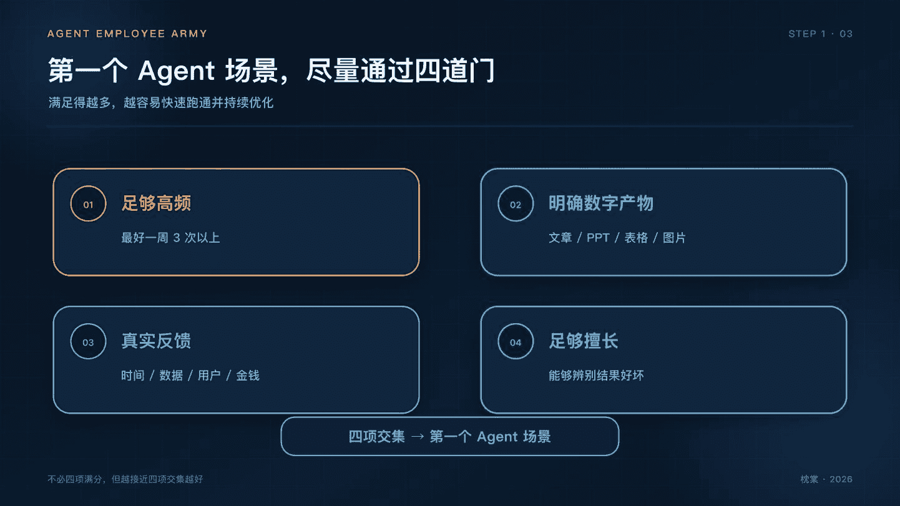

从选题、标题、开头，到结构、正文、配图、排版，每一个环节都能被读取、被改动、被存档、被复盘。而且每一步都有明确的中途产物：选题是一份结果，大纲是一份结果，正文又是一份结果。这样一来，我就能第一时间定位：究竟是哪一环出了问题。

第三，它分量重，而且反馈是实打实的。这个账号不是我拿来练手的玩具，它是我最重要的获客入口。文章一发出去，阅读量、点赞、转发都是透明的，它们还会直接转化为新客户和新收入。所以，AI究竟有没有帮上忙，根本不需要靠感觉评估，数据会告诉我：写稿时间有没有缩短？内容质量有没有变稳？流量有没有涨？客户有没有变多？收入有没有变化？

第四，最重要的一条：这件事我做了很久，足够熟，也完全分得清好坏。

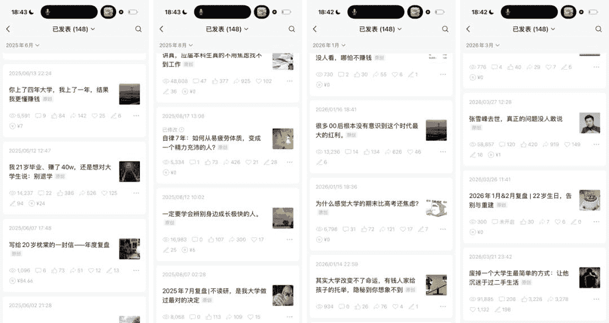

我写过大量文章，也靠它赚到过流量、客户和收入。所以一篇文章摆在我面前，我大致闻得出它哪里香、哪里馊。我知道哪些选题只能骗来阅读量，吸引不来真正愿意掏钱的人；我也知道产品承诺的边界画在哪里，一篇稿子写到什么程度可以交给我精修，什么程度只能毫不留情地丢进废纸篓。

正因为我自己足够懂，我才能一次又一次对AI给出精准的纠正：这里做得不对，为什么不对，下一次应该怎么做。

所以，我没有从一个完全陌生的领域开始，而是让AI先复制、再放大我已经跑通的那套本事。后面你会看到的资料库、技能包、AI雇员和反馈机制，全都是在“写文章”这个小小的起点上，逐步发育而成的。

当然，这不代表你也要去做公号。适合自己的，才是最好的。再讲个例子：前阵子，我帮一位做社群运营的私教学员规划AI方案，最终为她挑选的切口，是制作各类活动主视觉。

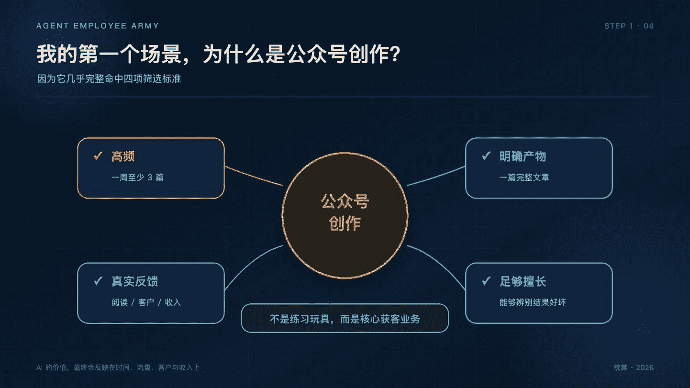

原因是：这类主视觉物料是她每周都要重复的固定动作，完成后会产出一张实实在在的图片可供验收，而且这项工作长期由她本人负责，一张图能不能用，她瞄一眼就心里有数。

所以，我们没有一上来就给她搭一支完整的AI雇员队伍，而是先啃一个问题：如何把一段已经敲定的内容，稳定地变成一张可以对外投放的宣传物料？

你看，她做图，我写字，看起来是八竿子打不着的两件事，但背后的选型逻辑一模一样：高频、有交付物、有反馈、自己懂。

所以，真正值得你反复追问的，从来不是“最近大家都在搭什么AI雇员”，而是回到你自己最擅长、最有发言权的业务现场，问一句：

眼下，我手头反反复复在做的那件事，是不是也该轮到AI上场了？

先锁定一个真正值得提效的入口，后续的资料库搭建、技能包编写、智能体落地才算是有了根。走到这一步，第一个 Agent 的“岗位”其实已经自然浮现。

我的判断一直很笃定：一个具体的交付目标，就配一个专门负责它的Agent。

比如公众号的内容生产，就交给公众号 Agent；活动海报的设计，就交给海报 Agent。先把岗位职责和最终要交出来的东西卡清楚，后面的知识配置、工具调用、交互流程，都围绕这个岗位展开。

到了这里，搭建 Agent 战队这件事才算是真正迈出了第一步。

## Step 2：数据采集，打造第二大脑

### 1. 知识库，就是 AI 的思考底座

前面已经圈定了第一个要提效的战场，也锁定了第一位 Agent 的职责。接下来，最麻烦的问题不是写代码，而是喂知识。

搭建资料库的第一步，不是急着收集文件，而是追问一句：为了把这个任务做好，AI 必须知道哪些信息？

注意，顺序很重要。

不是“先攒一个库，再想它能干什么”，那样大概率是在以收藏的名义制造垃圾。而是先立起任务，再从任务反向推导资料的范围。

因为知识库从来不是为了“存档”而存在。

它是为了“完成”而存在。任务决定了 AI 的情报需求，AI 的情报需求决定了库里该装什么。拿我的公众号写作来说：

目标是让 AI 写出更好的文章。沿着这个目标倒推：它要了解我的身份、我卖什么、读者在意什么；它要接触我的真实故事、我的方法论、我过去的文章，以及我对好稿子的判断尺度。

这些信息原来散落在我的脑子里、聊天记录里、飞书里、微信里、硬盘里。

第二步要做的事，就是把这些跟任务真正有关的信息筛选出来，整理成 AI 能反复查询的知识底座。

我更愿意把这个底座叫作第二大脑。因为它存的，本质上是我关于这件事的全部底牌——

我知道哪些情况、经历过哪些事、积累过哪些素材、总结过哪些打法、用什么标准判断好坏。

对 AI 来说，它靠这套底座来理解任务、检索资料、推进工作。对我而言，它把我脑子里那些说不清、理还乱的经验与品味，变成了看得见、摸得着的结构化文档。

所以，只看公众号写作这一个任务：这个底座既是 AI 的创作大脑，也是我自己的外置记忆。这也是为什么我把这个环节命名为：数据采集，打造第二大脑。

什么是好的知识库？

既然库是为任务而建的，评价标准也只剩一条：它有没有让 AI 把任务完成得更好。不是看存了多少，而是看用得上多少。所以，无脑堆资料是最典型的错误。

我见过太多人的做法是：把硬盘里的 PDF、聊天记录、文章、课程全扔进去，美其名曰“让 AI 自己翻”。这已经不是建库，而是搬家。

任务只需要 100 份材料，你塞给它 10000 份，多出来的 9900 份不是资源，是干扰项。……因此，建库的第一步必须是围绕任务做减法：

这个任务用得上的，就留下；用不上的，再好也别放。

但就算你筛出了 100 份精准资料，如果不梳理，AI 照样傻眼。它会遇到两个麻烦。

第一，资料铺得太开，它不知道该查哪儿，只能从头到尾硬扫，扫不动就开始编。第二，资料归类太乱，它找到了也不知道该信谁，只能强行缝合。最后导致一种诡异结果：

每份资料单看都对，但拼在一起就成了胡说八道。

所以说，知识库的第一要义不是“丰富”，而是“有序”。要让 AI 用起来的时候：找得到、挑得准、用得对。

想做到这一点，只需要搞定一件事：把第一层、第二层的文件夹定义清楚。每个文件夹都要回答几个问题：

这个文件为什么存在？什么东西值得放进来？什么东西不该放进来？AI 在什么场景下才需要打开它？

这些问题如果自己都答不上来，AI 就更答不上来。

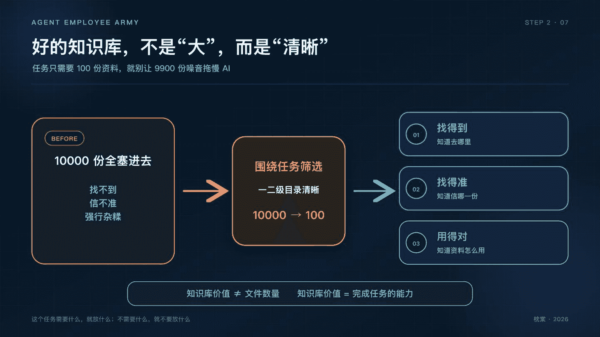

所以一个真正合格的资料库，绝不是把硬盘复制一份丢给 AI。

而是：把你藏在脑子里的业务脉络、真材实料和判断标准，拆成一套层级明确的结构，让 AI 能按图索骥，成为一套可以被持续调用的第二大脑。

接下来，我直接拿我自己的内容知识库做演示，看看里面的文件夹到底怎么排。

### 3. 我的 AI 内容知识库

前面反复强调：知识库不是用来存储的，而是用来完成任务的。于是我顺着公众号写作这条线，把长期要复用的资料分成了五个大类：

- 01｜枕棠的灵魂 Copy
- 02｜产品库
- 03｜客户需求与卖点
- 04｜故事案例库
- 05｜方法论库

然后再单独开一个：

**602｜公众号原创**

用来承载实际的创作过程。

这几个文件夹看着是在给资料做分类，但往深里看，每个都对应公众号写作里的一个具体命题。

**01｜枕棠的灵魂 Copy**：解决“这篇稿子是谁写的？”。这里存放的是与枕棠这个 IP 紧密相关的长期内容。

包括我的过去、我的定位、我的表达习惯、我常挂在嘴边的金句。它们共同回答一个根本问题：

AI 到底在替谁发声？

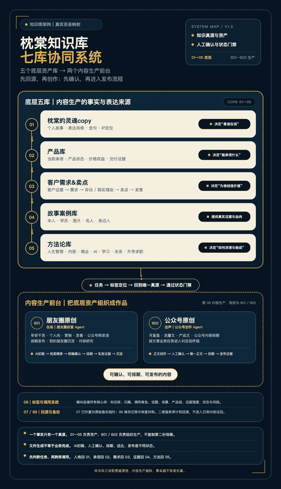

比如文章聊到创业经历，AI 要能分清哪些是我的商业主线；比如结尾需要拔高收束，可以来这里找我真正说过的原话；比如写完后要清除 AI 味，可以来这里对照我的语气。

所以这个库掌管着一篇文章最深层的东西：身份、叙事和表达。

**02｜产品库**：解决“文章最终要卖什么？”。这里收录我全部的产品，有正在卖的、已经停售的、还在酝酿的。

公众号是我的获客和转化出口，所以一旦写到产品，就需要准确调出详情页、价格、交付截图、学员反馈等等。有了这个库，朋友圈和推文随手就能翻出弹药。

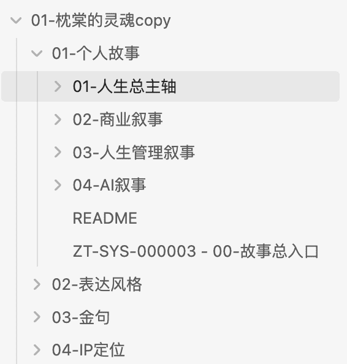

**03｜客户需求与卖点**：解决“这篇文章到底写给谁？”。产品库回答“我手里有什么”，这个库回答另一半：“别人为什么要买。”

这里存的是从真实成交里留下的记录和分析：咨询对话、对方付钱的理由、没成交的原因、反复出现的疑虑、典型客户个案，以及从这些线索里提炼出来的用户画像、需求分层和卖点表述。

以后做选题、取标题、写开头，或者推新品的时候，只要摸不准读者在想什么，我就让 AI 先回这里翻真实证据。

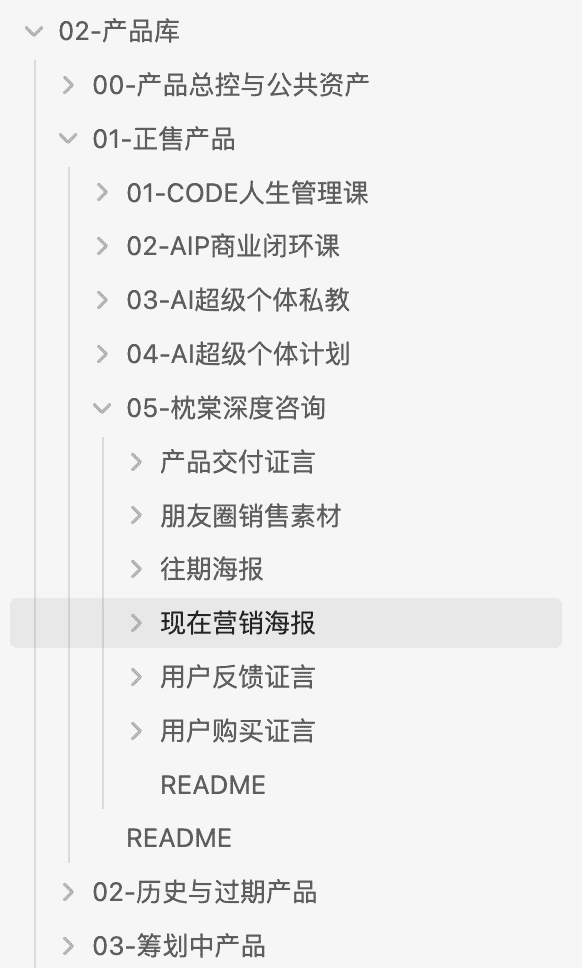

**04｜故事案例库**：解决“这篇文章拿什么来证明？”。如果一篇公众号要撑起高客单转化，光有正确观点不够，还得有强烈的 IP 感。

而 IP 感很大程度上来自真实发生过的故事。

所以我专门建了故事案例库。里面有我的故事、学员的故事、名人的故事（比如纳瓦尔、乔布斯），也有身边朋友的故事。我的个人故事还会继续往下分：

读书学历、上班打拼、创业赚钱、人生管理、AI 生产力、高光时刻、低谷代价……

写文章时，AI 按主题匹配对应故事，让论证更有温度、更有实感。

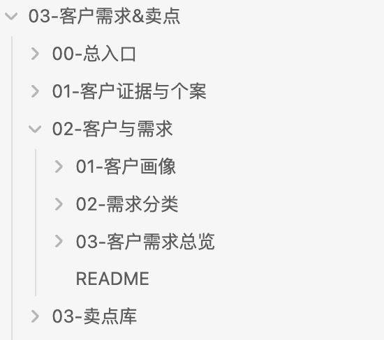

**05｜方法论库**：解决“这篇稿子能教给读者什么？”。写公众号不能只靠共情，也不能只讲故事。

真正读过瘾的文章，结尾总得甩出几个让人眼前一亮的认知，或者一套拿来就能用的方法。

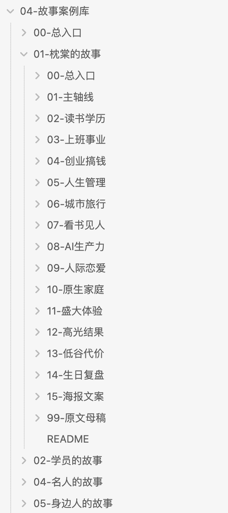

这个库里放的，是我在人生管理、商业、内容创作、AI、学习这些领域的长期沉淀。

每当文章需要方法支撑，AI 就会来这里调取我的原创方法论，再融入稿件。这样它就不会每次从互联网上随机抓一套“看起来正确、但跟我毫无关系”的模板。

**602｜公众号原创**

前面五个文件夹，是公众号写作的长期粮仓。

而 602，才是稿子真正出炉的作坊。

我目前主要的公众号写作方向有三个：

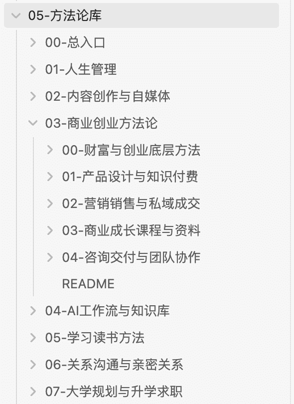

月复盘、产品文、流量文，每一类都有独立的生产文件夹。

里面保存了对应的 SOP，以及一篇文章从：

选题 → AI 初稿 → 人工精修 → 最终发布

的完整轨迹。

真正动笔时，AI 会先进入 602，沿着对应的公众号 Skill，按需打开前面的几个知识库，一步一步把文章组装出来。

所以你会发现：

我的公众号知识库，不是五个孤岛。

它是一套围绕“写好公众号”这一目标倒推出来的知识分工。

- 01｜枕棠的灵魂 Copy，负责回答：这篇文章是谁写的？
- 02｜产品库，负责回答：我到底有什么可以卖？
- 03｜客户需求与卖点，负责回答：这篇文章写给谁？他们真正在乎什么？
- 04｜故事案例库，负责回答：这篇文章拿什么真实经历来证明？
- 05｜方法论库，负责回答：面对这个问题，我有没有独到的认知和打法？
- 602｜公众号原创，负责把上面这些知识串进创作流程，在专属文件夹里一步步拼成最终稿。

所以知识库的目录结构，不是为了“排得好看”。

而是在造一颗好用的第二大脑，让 AI 在干活的时候，每一份所需都有对应的位置；AI 清楚地知道去哪找、以及为什么要去那儿。

这就是我前面讲的六个字：找得到、找得准、用得对。

### 4. 如何搭建你的初版知识库？

前面展示的是我打磨到一定阶段的公众号知识库。但如果你刚开始，我不建议照搬这套结构。

因为任务不同，知识就不同。

我的产品库、客户需求库、故事案例库，是从“公众号写作”这个任务里一点点长出来的。如果你做的是海报、PPT、年报这种，直接把我的文件夹搬过去，等于又绕回了那个错误：

知识库，是为了任务而存在。所以第一版知识库，不要贪大求全。

只围绕 Step 1 找到的那个真实任务，先给 AI 搭一个“最小可用”的大脑。

我总结了一套几乎所有任务都能套用的初始框架：

- 01｜任务 DNA
- 02｜任务标准
- 03｜任务资产
- 04｜任务工作区

我们逐项拆开。

**01｜任务 DNA**：什么东西决定了这是“你的任务”，而不是别人的？

任务 DNA 的关键词只有一个：独特性。把所有只属于你、只属于你的 IP、只属于你们公司的东西放进去。

为什么同样是写公众号，写出来的必须像你的风格，而不是别人的风格？为什么同样是做海报，每一张都要有你们公司的气质，而不是随便哪家公司的风格？

靠的就是任务 DNA。

拿公众号来说，你可以放入个人经历、IP 定位、观点立场、内容边界、往期代表作、表达风格。

拿公司海报来说，你可以放入品牌定位、Logo、品牌色、字体规范、视觉调性，以及历史上最能代表公司的设计稿。

这些信息是你每次布置任务时都要反复交代的，而全世界只有你说得清。

**02｜任务标准**：什么样的结果才算过关？

先搞清楚“像谁”，接下来要搞清楚“多好才算好”。

所以任务标准里，放的是你对最终效果的要求。可以用文字规则写清楚，也可以直接丢真实的正反样例。

比如公众号，你可以写明目标字数、段落节奏、读完后的感受，再附上你最满意的几篇文章、你觉得行业里一等一的好文，以及你一看就皱眉的反面教材。然后告诉 AI：为什么这篇行？为什么那篇不行？哪些标题你会点？哪些表达透着 AI 味？

海报也一样。

你可以放进最得意的几张、行业里叫好的设计，还有你认为翻车的案例。

再加上尺寸、信息层级、字体、交付格式这些硬性规范。

很多时候，我们没法凭空把“好”讲具体，但如果把好的和差的并排放到 AI 眼前，它反而秒懂。

规则是在告诉 AI“好”的定义，正反案例是让 AI 亲眼看到“好”的样子。

**03｜任务资产**：还有哪些好材料，能帮 AI 把任务做得更漂亮？

任务 DNA 回答的是“什么是我的”，任务资产回答的是“还有什么可以拿来用”。

比如写公众号，除了表达风格、IP 定位这些 DNA 信息，你还可以把生财圈里垂直小号的精华帖、跟你定位相关的好书好课、以及纳瓦尔、乔布斯的故事都放进去，只要它有助于表达，就能当资产使。

做海报也一样。

除了 Logo、品牌色这些 DNA 信息，你还可以继续补充优秀设计案例、设计方法、字体包、图标库、图库、行业参考等能直接调用的视觉素材。

它们不一定只属于你，甚至人人都能拿到。

但只要它们能帮助 AI 把任务完成得更好，就可以被纳入任务资产。

**04｜任务工作区**：这件事具体怎么做，以及做到哪一步了？

最后一个文件夹，就叫任务工作区。

我建议把它拆成两块：

## 01｜SOP
## 02｜任务生产记录

SOP 里存的是做这件事的标准流程，也就是下一个模块要讲的 Skill。

任务生产记录，存的是每次真实任务的全程轨迹：原始输入 → AI 初稿 → 人工精修 → 最终成品 → 发布/交付 → 复盘。这样出了问题，一眼就能定位是哪一步干的。

而 AI 初稿跟人工终稿之间的差异，本身就是高价值数据。后面写 Skill、给整个智能体体系做迭代时，都会从这里挖线索。

到这里，你的第一版知识库就可以运转了：

任务 DNA：让 AI 知道哪些要素归你独有。

任务标准：让 AI 知道什么叫达标。

任务资产：让 AI 知道还有哪些好牌可以打。

任务工作区：让 AI 知道流程怎么走，以及每一次任务究竟做成了什么样。

如果还嫌抽象，我们举个轻松的例子。

比如：你负责给公司安排一次重要的客户饭局。

任务 DNA 里，可以放只有你们公司才懂的信息：王总不吃辣，李总不吃海鲜，张总偏爱粤菜；谁跟谁熟，以前招待他们有什么偏好，公司商务宴请有没有必须遵守的规矩。

这些东西都是“别人不知道，但你最清楚”的。

任务标准里，可以写：人均预算多少、选址离公司多远、要不要包间、环境和服务的底线，以及过去几次安排得特别成功或特别狼狈的饭局。

任务资产里，可以放：杭州餐厅名单、食客评价、菜牌、停车指南、商务宴请礼仪、酒水搭配技巧，凡是能让这顿饭更体面的资料都能放进来。

任务工作区里，则正式跑通这次任务：

确认时间和人数 → 筛选餐厅 → 给出方案 → 人工确认 → 落实预订 → 记录反馈。

你会发现：

无论是写公众号、做海报，还是安排客户吃饭，知识库的底层逻辑完全一致。

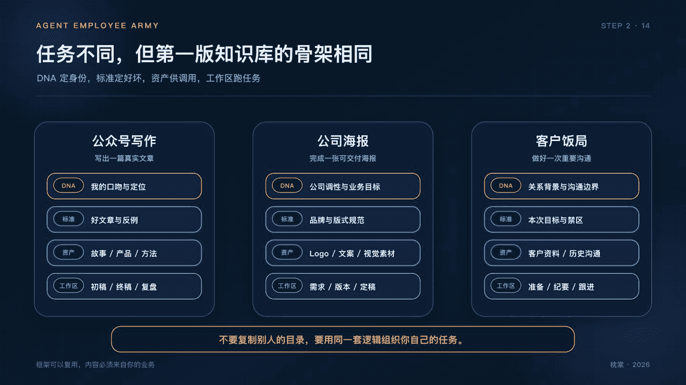

先告诉 AI 什么归你独有；再告诉 AI 好是什么样子；给它充足的可用资源；最后拿真实任务在一套清爽的工作流里反复跑。

至此，你的初版知识库就位了。这已经是 AI 能拥有的第一颗“第二大脑”。

有了这个底座，下一步我们就可以动手写 Skill，让 AI 真正干起来了。

## Step 3：封装 Skill，把结果做稳

### 1. Skill 是给 AI 看的摇奶茶 SOP

知识库就位之后，AI 知道了你是谁、手里有什么料、什么样的活算漂亮。

但这些不等于它就会干活，更不等于它次次都能稳定交付。

想解决稳定性的问题，先看人是怎么做到的。

奶茶店的新手为什么很快就上手，而且做的每一杯都不跑偏？

因为手里有一本极清晰的 SOP。

糖多少、冰多少、第一步做什么、第二步做什么……只要照着走，结果就不会差太多。

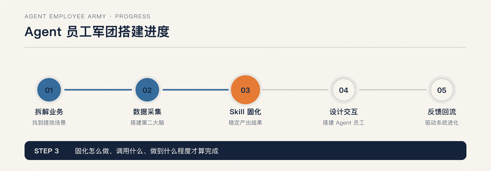

让 AI 稳定交付，思路一模一样：给它写一套属于自己的 SOP。

这套写给 AI 的 SOP，就是 Skill。

它会告诉 AI 先做哪一步、再做哪一步、每一步到什么状态才算完，从而把好结果从“碰运气”变成“走流程”。

### 2. 好的 Skill 有什么标准？

写一份好 Skill，只要盯住三个问题。

第一，怎么做。

也就是任务要拆成哪几步，先后顺序怎么排。

第二，用什么。

每一步执行时需要调哪些资源：可能是知识库里的文档，可能是一个外部工具，也可能是上一步刚产出的结果。

第三，怎样算好。

每一步做到什么标准才算通过，才能放行到下一步。

还是用最简单的例子：番茄炒蛋。

如果你把这道菜写成一份 Skill，绝对不能只甩一句“给我做一份好吃的番茄炒蛋”。

而是要拆解步骤，并且每一步都回答清楚：怎么做、用什么、怎样算好。

第一步，备菜。

怎么做：番茄洗净后切块，鸡蛋磕进碗里打匀。

用什么：番茄、鸡蛋、菜刀、砧板、碗、筷子。

怎样算好：番茄块大小均匀，蛋液里看不到完整蛋清。

第二步，炒蛋。

怎么做：热锅倒油，倒入蛋液，等底部凝固后快速划散。

用什么：蛋液、油、锅、锅铲。

怎样算好：蛋块成型、微微金黄、口感嫩滑，不要炒老，先盛出来。

第三步，炒番茄。

怎么做：锅里补一点油，放番茄进去翻炒。

用什么：番茄、油、锅、锅铲。

怎样算好：番茄微微塌陷、炒出汤汁，但还能看出块状。

第四步，把炒好的鸡蛋倒回锅里一起翻炒。

具体做法：把先前盛起的鸡蛋重新倒入锅中，与番茄同炒，随后依口味添盐等调味料，持续翻动至均匀。

所需物品：已炒熟的鸡蛋、番茄、盐等调味料，以及炒锅与锅铲。

判断标准：鸡蛋裹满番茄汁，咸淡一致；番茄出水但仍保持形体与口感，未被炒成泥，便可关火装盘。

这一步背后其实有一个很关键的认知：

能真正落地的 SOP，不能只有“先做什么、后做什么”的清单。

每一步都必须同时明确三件事：具体动作是什么、需要动用哪些材料信息工具、做到什么程度算结束。

缺少第一点，AI 不知道执行什么；缺少第二点，它不知调用何种资料或工具；缺少第三点，它缺乏停机信号，不知何时进入下一步。

所以为 AI 书写 Skill，本质上就是把原本依赖经验和手感的工作，重塑为机器可以读懂、可以操作、可以验收的流程规范。

但现实中并非所有任务都像番茄炒蛋那样步骤清晰。很多工作尤其是内容创作，并没有天然固定的路径。下面以我的公众号内容生产为例，说明一套可用的 Skill 该如何搭建。

### 3. 我的 Skill：公众号九维创作系统

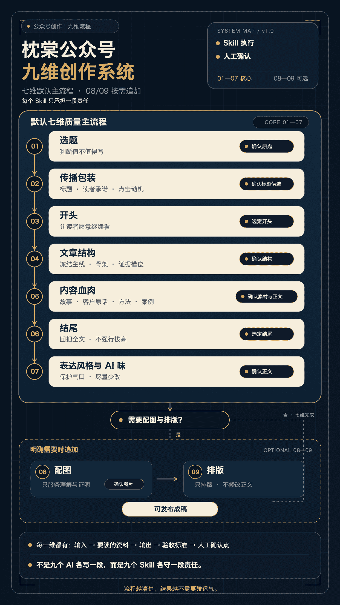

以我最熟悉的公众号为例。

起初，我搭建了知识库后就直接让 AI 阅读资料写作。

很快发现问题：

故事与观点必须由我主动提示它才会去找，而且匹配度不稳定，整体负担并未减轻。

若我不干预，文章往往空洞，缺少我的经历与方法论。

这使我意识到：

知识库只能存信息，还不足以指导创作。我需要把公众号写作拆成一套专属的 Skill。

后来，我把公众号文章生产拆成九个衔接模块，形成现在的「公众号九维创作系统」。

### 01｜选题

解决：这篇文章写什么？

最终要锁定一个面向明确人群、有传播潜力、能承接变现或引流的主题。

### 02｜传播包装

解决：如何让人愿意点进来？

最终产出主标题、副标题与转发语，提升点击与扩散能力。

### 03｜开头

解决：点进来后凭什么继续读？

抓好前百字，让开头承接标题并抓住注意力。

### 04｜文章结构

解决：全文怎样展开？

确定核心主张与板块顺序，保证层层递进，主线统一。

### 05｜内容血肉

解决：具体填充什么？

按场景从知识库调取适配的故事、案例、客户需求、产品与方法论，把骨架填满。

### 06｜结尾

解决：如何收尾？

回扣主线，留下清晰观点或适度升华，顺势承接加微信、点赞、评论等动作。

### 07｜表达风格与 AI 味

解决：为何读起来像机器写？

通过词换、句式调整与风格处理，让成稿更像我亲手写出。

### 08｜配图

解决：长文如何更舒服？

自动识别适合配图的位置，生成金句图、框架图并插入。

文中许多配图即由此 Skill 生成。

### 09｜排版

解决：如何一键得到可发布的 Markdown？

做好标题层级、下划线、加粗处理，复制到后台即可发布，提升阅读体验。

由此可见，这套九维系统把一句模糊指令：

“帮我写一篇好的公众号。”

拆成九项更具体、更易执行的任务。

每项都有明确交付与回溯点：

选题不准就回选题；开头留不住就重做开头；逻辑混乱就回结构；内容单薄就补血肉；表达不像我则回到第七维；标题与正文脱节则重做传播包装。

如此一来，AI 不再是偶尔灵光写出好文，而是稳定产出高质量结果。

为何稳定？

因为创作中可能导致偏离的变量被提前拆解并受控。

每个环节做什么、调用什么资料、何种状态算完成，都写进了 Skill。AI 无需每次重新揣测意图，也无需临场发挥，只需按既定路径推进。

变量越清晰、约束越明确，结果越可控。这才是一份好的 Skill 应该呈现的样子。

### 4. 如何创造属于自己的 Skill？

明白 Skill 的作用后，关键问题是：

怎样获得一套真正属于自己的流程？

#### 第一步：寻找可借鉴的现成方案

我们想解决的多数问题，网上已有前人总结。AI 的价值之一是能快速发现并理解这些成果：

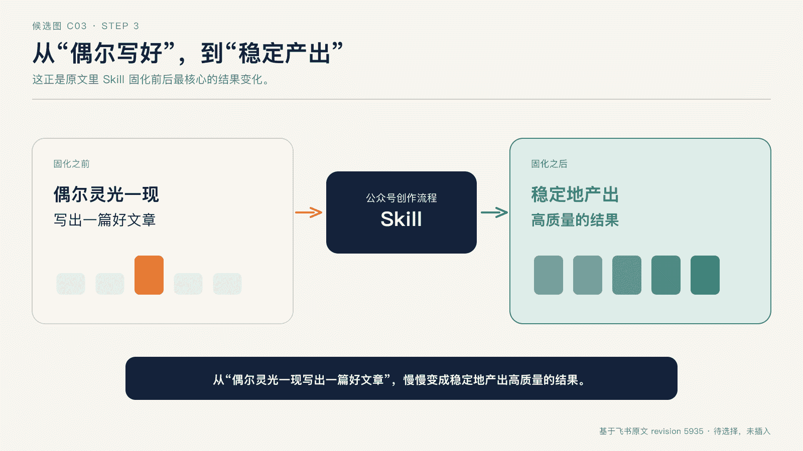

过去我们只能借鉴思路，现在甚至能直接借鉴经过验证的产出方式。成熟的 Skill 无需从零重写，拿来改造更高效。

获取资源通常有两条路。

第一条，去 GitHub 检索现成的 Skill、Prompt 与工作流。比如我的「表达风格与去 AI 味 Skill」，最初参考了大 V 卡兹克关于写作与降低机器感的方法。

我现在用于海报的 Skill 雏形也是在 GitHub 找到后调整而来。

不想自己筛选，也可让 AI 代为搜索整理。

第二条，去找所在领域真正有成果的人，购买其沉淀的 SOP、方法论甚至现成 Skill。

围绕自媒体商业闭环，我曾投入多笔费用学习相关方法与流程。

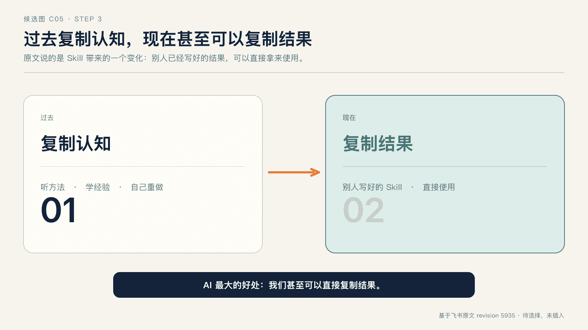

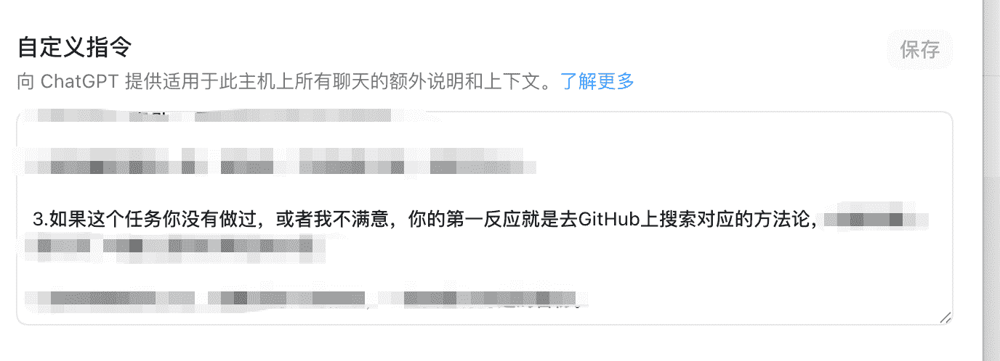

的方法论和 Skill。

我自己的公众号九维创作系统，如今也会提供给私教学员。

核心原则是：

已被验证的路径，无需重复发明。

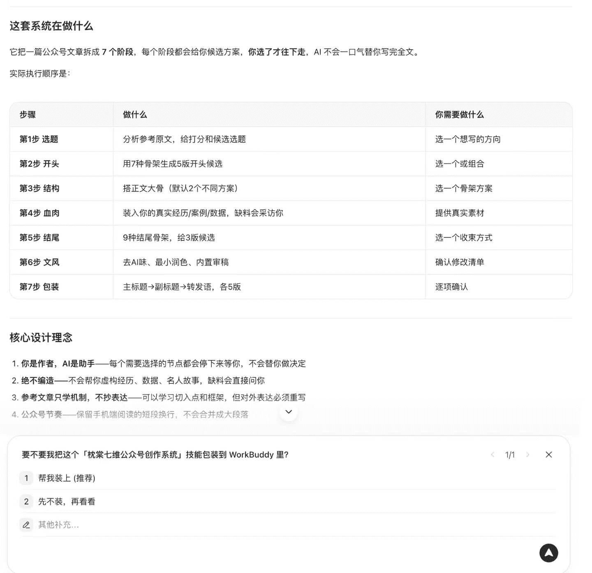

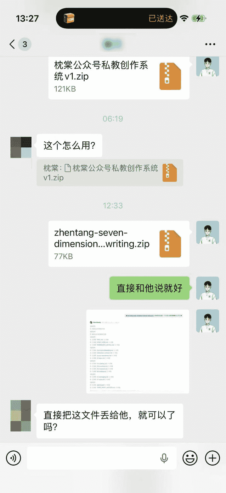

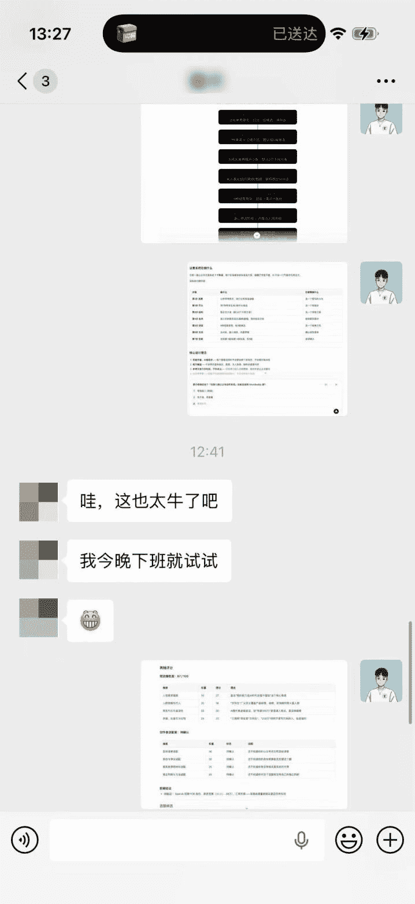

能借鉴就借鉴；能站在肩上就不要从零开始。

#### 第二步：Skill 本土化

拿到现成 Skill 不等于拿到结果。

不同目标、素材、审美、工作习惯与验收标准各不相同，直接照搬会水土不服。

正确做法是，用真实任务跑一次。

跑完后检查有效部分与失真部分，针对性修改。可把个人经验、偏好与判断标准告知 AI，让它参与优化，再次测试迭代。

以我使用卡兹克的去 AI 味 Skill 为例，我不会全盘照抄，而是先用自己的文章实测。

AI 处理后，我逐句审视：哪些改动更自然，哪些改动已不像我。

保留认可部分，删除不符部分，并把判断反馈给 AI，让它更新规则再测。

过程可概括为：执行 → 看结果 → 人工修订 → 更新规则 → 再执行，循环至满意。

#### 第三步：固化 Skill

跑通的 SOP 不应只停留在一次对话里，而要整理成可重复调用的 Skill。

可把下面指令发给 GPT，协助固化：

请根据我们刚才真实完成这项任务的完整过程，帮我梳理并正式固化成一个可重复调用的 Skill。

第一步，请回顾刚才真实完成任务的全过程，按实际发生的步骤拆解，不要凭空增加流程。每一步都必须梳理清楚三个问题：

1. 怎么做：这一环节具体做什么，先做什么、后做什么？
2. 用什么：这一环节需要调用哪些知识库、资料、案例、工具，或上一步产生的什么结果？
3. 怎样算好：这一环节最终要产出什么？做到什么程度才算完成，可进入下一步？

同时结合实际执行过程，补充易错点、必须人工确认的节点，以及明确不能做的事情。

第二步，梳理完成后，请直接调用 Skill Creator，把这套已跑通的 SOP 正式固化成一个 Skill。Skill 的目标不是记录这次任务的答案，而是提炼出以后遇到同类任务时可重复执行的方法。

完成后告诉我：这个 Skill 解决什么问题、什么时候调用，以及最终固化到了哪里。

然后下一次即可直接使用该 Skill。

至此，知识库与 Skill 的分工已清晰：

知识库解决 AI 知道什么；Skill 解决 AI 应该怎么做。

若搭建扎实，AI 已能相对稳定地交付公众号文章、海报、PPT、朋友圈等指定成果。

但仍有一个问题：即便知识与流程就绪，我们仍需打开 Codex 手动下达“开始”“继续”“下一步”等指令。

因此下一步要把已验证的知识库与 Skill 封装成工作台与 AI 员工，让它们承担日常任务。

## step4：设计交互，搭建 Agent 员工军团

### 1. 真正让 AI 接驳生活

前三步后，AI 已具备两项基础能力：

知识库告诉它读什么；Skill 告诉它怎么做。

交给 Codex 后已能稳定处理。

但仍有现实问题：你准备以何种方式使用？

若每次仍需打开 Codex、找到对话、逐句输入“现在开始”“继续下一步”“把结果发我”“再处理一下”，本质上只是把手工劳动换成了指挥 AI 的手工劳动。

真正的落地，不是让人迁就工具，而是让工具融入原有工作节奏。

我们习惯的交互大致两类：一类是 App/网页的点击选择操作，一类是微信/飞书式的消息沟通。

因此我把入口做成两种形态：AI 工作台 与 AI 员工。

## 2. 工作台：言出法随

第一种是 AI 工作台。

它把已跑通的知识库与 Skill 放入更人性化的页面。

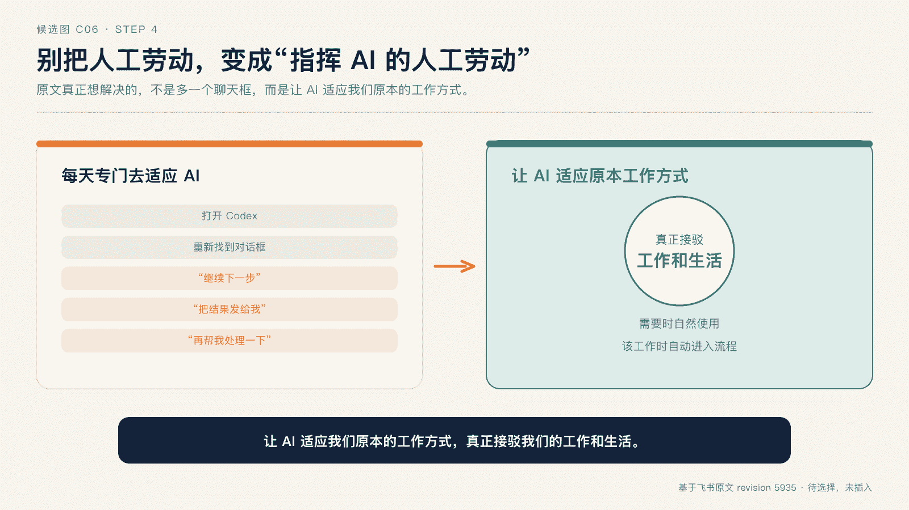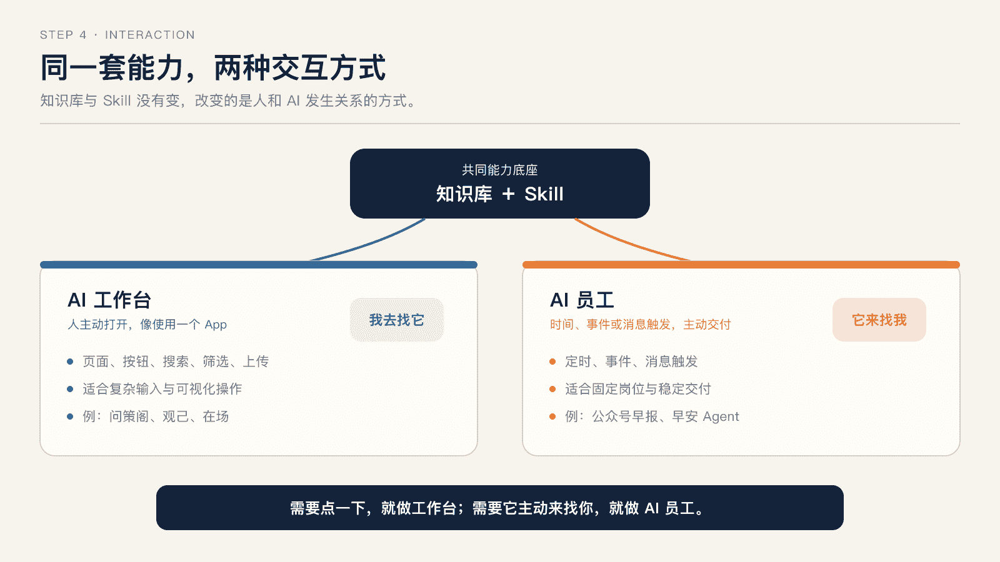

我们使用软件时，不会先开聊天框一条条说“打开功能”“搜索”“下一步”。通常是启动 App，点击、输入关键词、筛选、选择即得结果。

AI 工作台即把复杂后台调用隐藏，只保留适合人操作的前台。

无需记提示词，无需知道背后调用哪套 Skill。需要什么功能，直接点入即可。

我已做十几个工作台，覆盖生活与工作的多个方面。

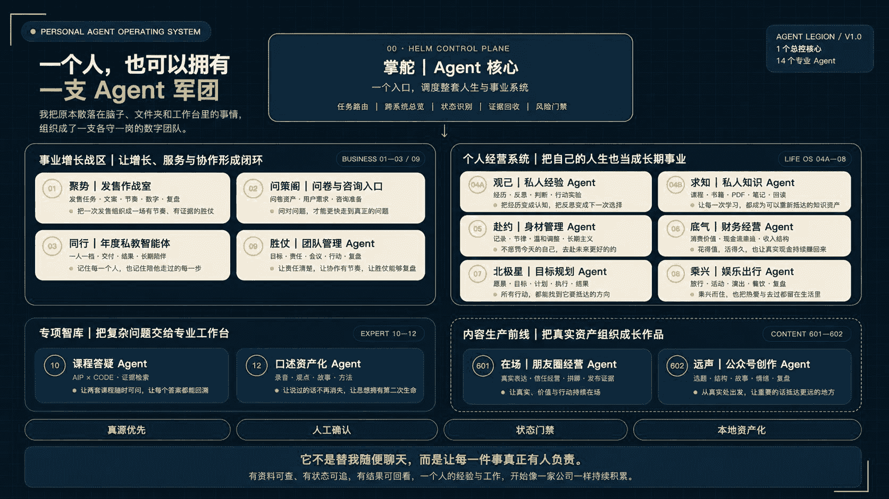

其中两个较典型。

第一个是知识采编台。

我日常产生大量飞书妙记、会议录音与个人口述。过去记录后易沉睡在飞书里。

于是搭建采编台，把原始素材逐层加工：

原始录音 / 逐字稿 → 可读母稿 → 观点 / 方法 / 故事 / 案例 / 选题。

目前已整理 273 份飞书妙记、254 份可读母稿。

进入工作台可搜索某条妙记，查看原文与整理后的母稿，再核对 AI 提取的知识资产。原本散落的口述因此成为可持续调用的资源。

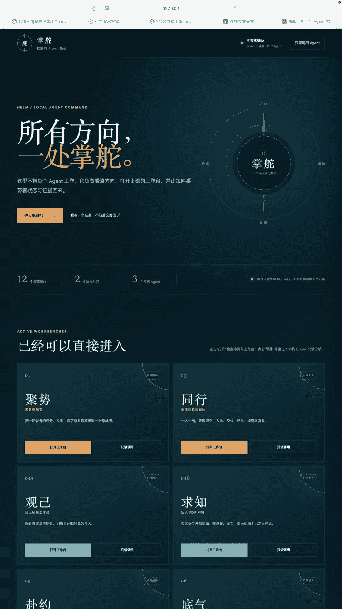

第二个是朋友圈工作台——「在场」。

它负责把已确认的素材、观点与故事加工为可发布内容。

可先选择类型：早安干货、个人向、营销、发售、公众号转发语……再把素材交给系统调用知识库与 Skill 生成初稿。生成后仍可在工作台修改、确认与安排后续处理。

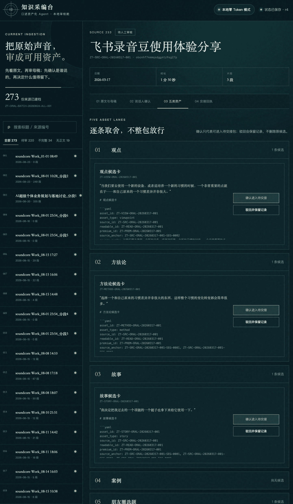

可见工作台并未创造新能力。

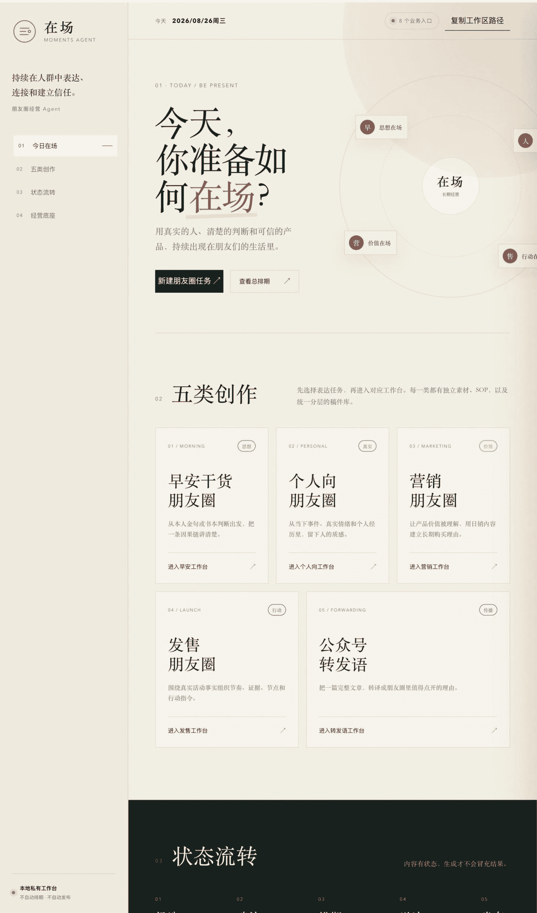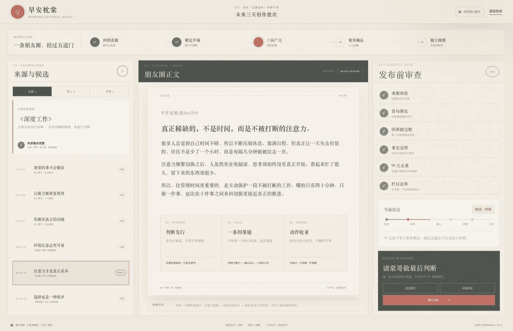

真正决定成败的仍是底层知识库与 Skill。工作台只是为其套上一层更适合人用的界面。

过去需打开 Codex 说明读哪份知识库、用哪套 Skill、执行哪步。现在这些细节被封装进按钮与页面。

不必学习如何指挥 AI，像用普通软件一样直接使用其能力。对工科出身、会写代码的我而言，这仍有震撼感。

过去开发小程序或网页至少需一两周，如今借助 AI，多个工作台在数小时内即可成形。

与以往效率相比，有一种“说出需求，界面即现”的感觉。

## 3. AI 员工：消息来回

第二种是 AI 员工。

工作台需主动打开；AI 员工更像真实岗位，到预设时间或触发条件后自行启动，调用知识库与 Skill 处理完后把结果推送到飞书。

目前在内容生产与咨询相关业务里，我已搭建约 12 个 AI 员工。

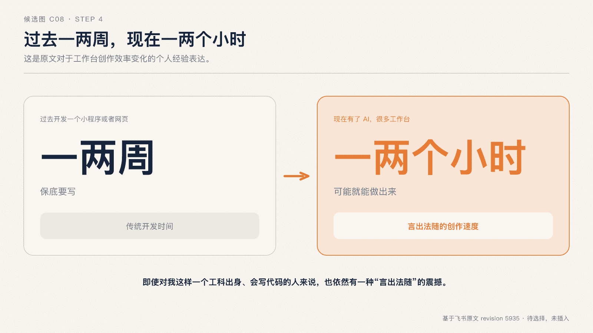

## 公众号

- 公众号
- 公众号总控
- 公众号采集
- 公众号主号
- 公众号小号
- 公众号复盘

## 朋友圈

- 朋友圈
- 朋友圈总控
- 早安 Agent
- 硬广 Agent
- 公众号分发 Agent

## 其他

举两个案例说明。

第一个是公众号助理，负责每日监测外部动态：外界发生了什么？同行写了什么？

每天早晨，它自动采集我关注的对标公众号新增文章，完成整理与分析，把数十篇内容压缩成一份值得阅读的情报日报，发送到飞书。醒来后即可据此思考选题。

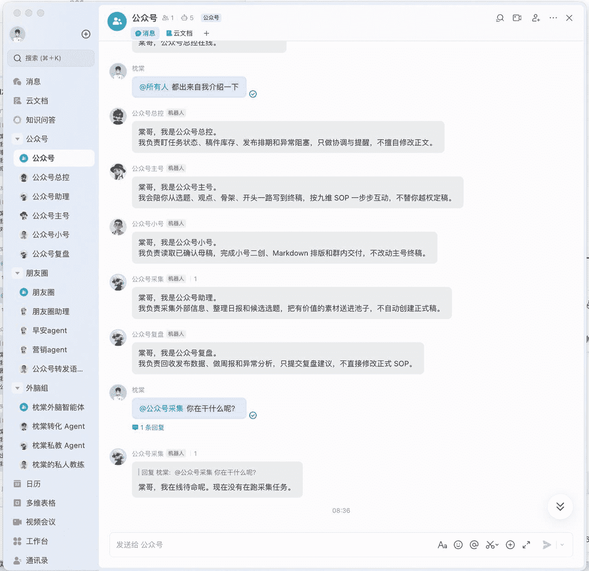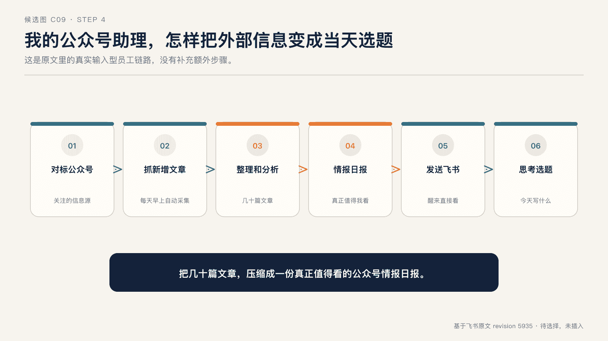

第二个是早安 Agent，负责每日稳定生产早安朋友圈。

它读取过往朋友圈、公众号文章、口述与书籍资料，再调用已搭建的朋友圈 Skill，提前生成候选内容。经确认排期后，到固定时间把最终版本推送到飞书。早上复制发布即可。

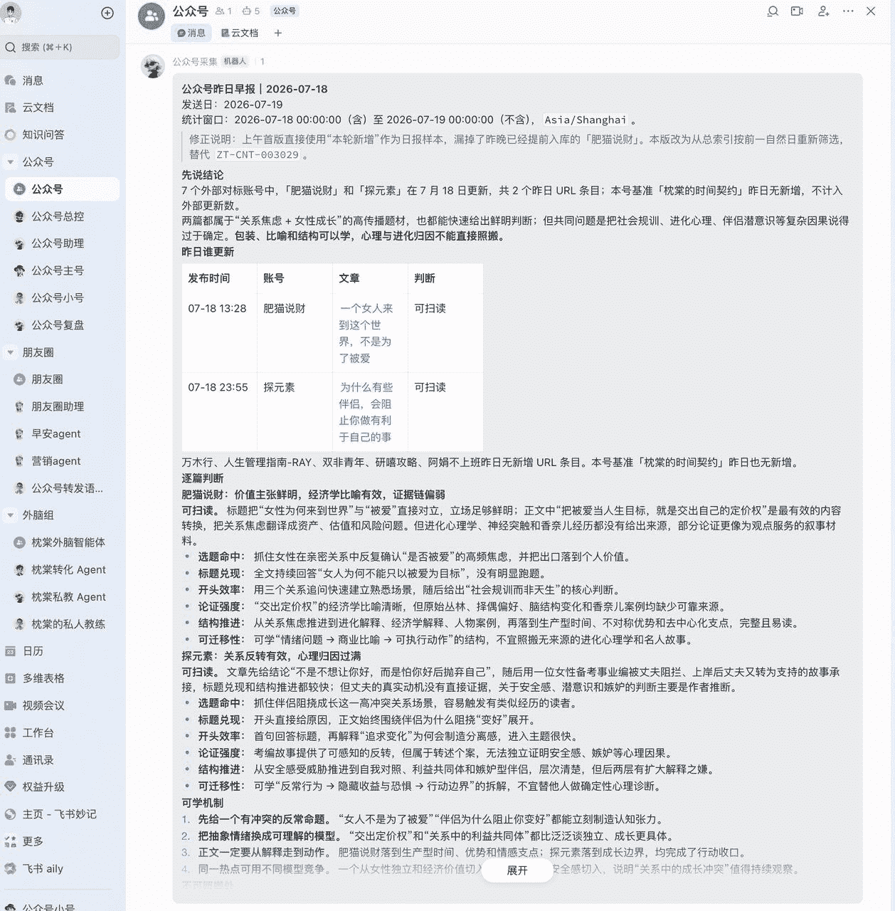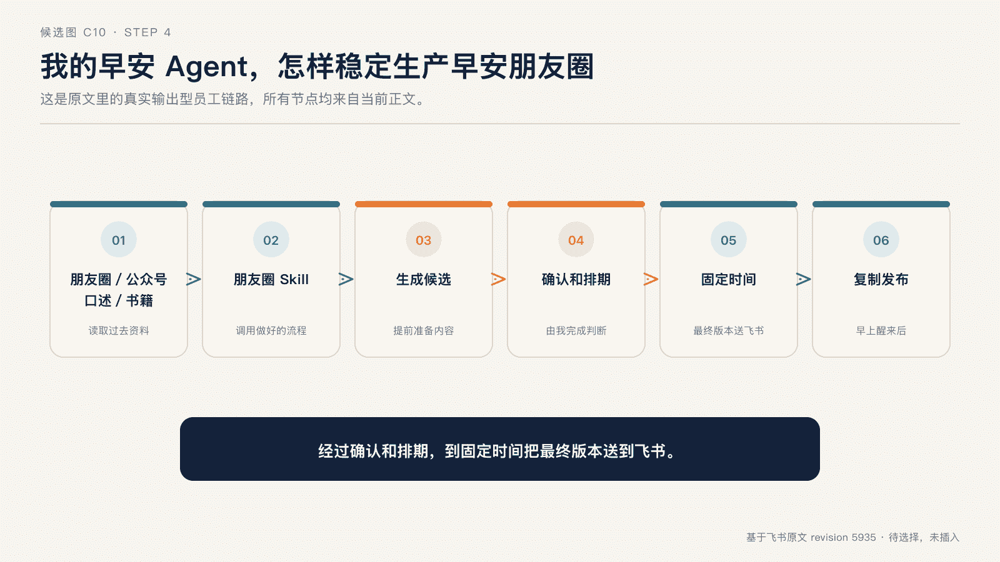

由此可见，AI 员工同样未创造新底层能力。

让它能干活的仍是知识库与 Skill 的组合。区别在于工作台把能力呈现为可操作页面，AI 员工则把能力封装成飞书机器人。

它可按计划自行开始处理，将产出主动推送到聊天窗口；需补充要求时，回复消息即可继续。

把员工放进飞书还有实际好处：无需电脑，也可用手机发消息。

任务发出后后台调用相关知识库与 Skill，处理结束再传回结果。

因此 Step4 的逻辑很清晰：

工作台是需要时主动进入的 AI 应用；AI 员工是到时自启的数字岗位。

外观不同，底层一致：知识库提供大脑，Skill 提供能力，工作台与 AI 员工负责让能力进入工作与生活。至此 AI 不再只是需反复打开、下指令的工具，而是融入原有工作方式。

需要主动操作时，进入工作台；不想盯流程时，交给 AI 员工自动处理。

这就是我理解的让 AI 真正接驳生活。当然，系统搭起不等于完美。

无论知识库、Skill、工作台还是 AI 员工，首次上线都不会无瑕。

让系统越用越顺的关键在最后一步：

## Step5：反馈回流，驱动系统进化

前四步后，我们已拥有一套可投入实操的 Agent 系统：

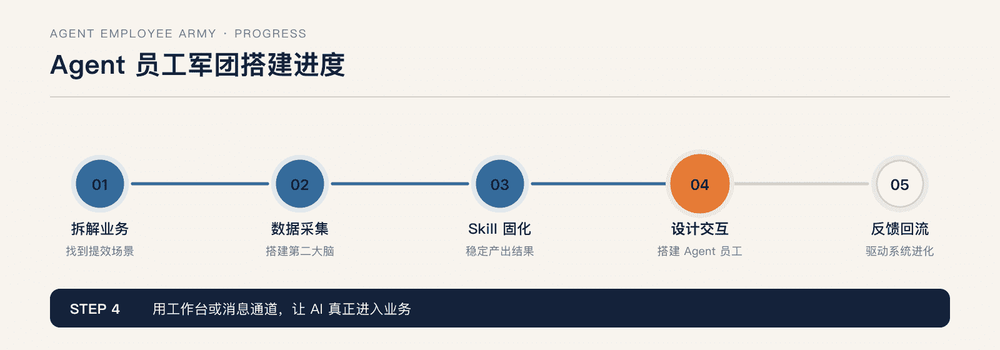

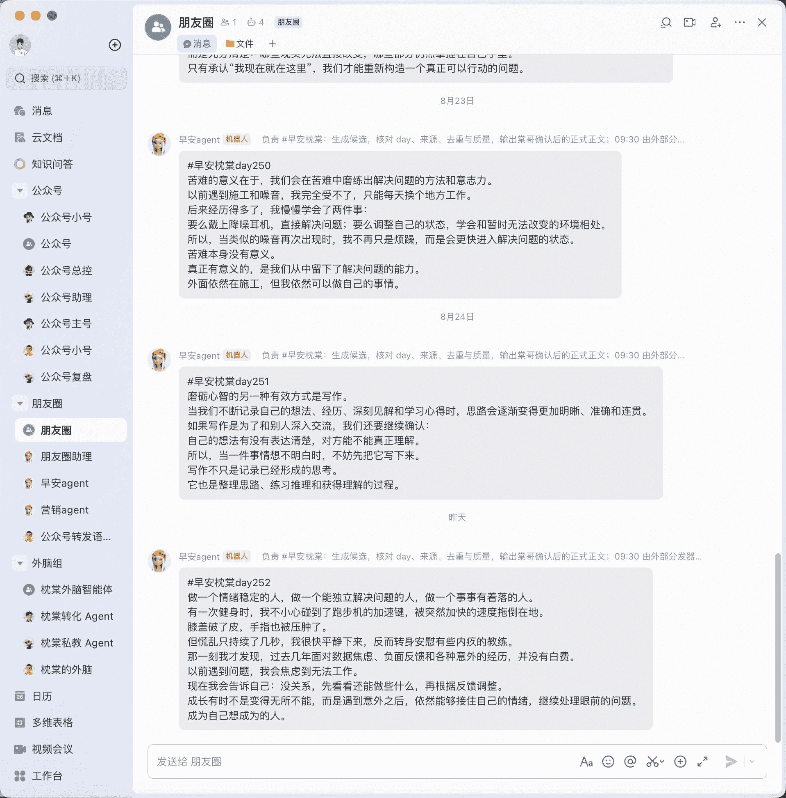

场景、知识库、Skill、Agent与交互，初看走完了。

实际上这只是第一版。

真正会暴露问题的时候，是系统开始实操。用起来才知道哪里卡顿、为什么失准、下一步该动哪块。

所以第五步的核心就一件事：把使用时产生的意见收集回来，再用来修正前面的设计。我目前分两类意见在看：

一类是自己手工改动留下的痕迹；另一类是外部世界用数字回应的结果。

### 1. 第一类：人工校对

这是我们自己对模型产出做的修改。

仍以公众号为例。

模型给出初稿后，我会做手写打磨，然后让模型复盘：本次改了哪些点？修改动机是什么？问题根源落在哪个层面？

若模型把过往经历、产品信息或客户诉求写错了，多半是 Step2 知识库在作怪：资料不全、信息错误或未及时更新。

若资料本身齐全，模型却不知道何时调用，亦或表达、结构、步骤总在反复出错，那 Step3 Skill 还需再打磨。

若产出质量已可接受，但操作体验很差——在飞书里不知何时触发、结果投递错误、需要多次点击——那就是 Step4 Agent 以及交互封装出了偏差。

一次手工修改的价值不在于“稿子变好了”，而在于追问：为何这次仍需我出手？下次该优化系统哪一层，才能让模型自行完成？

把这次结论沉淀回去，才能慢慢培养出一个可靠的智能体同事。

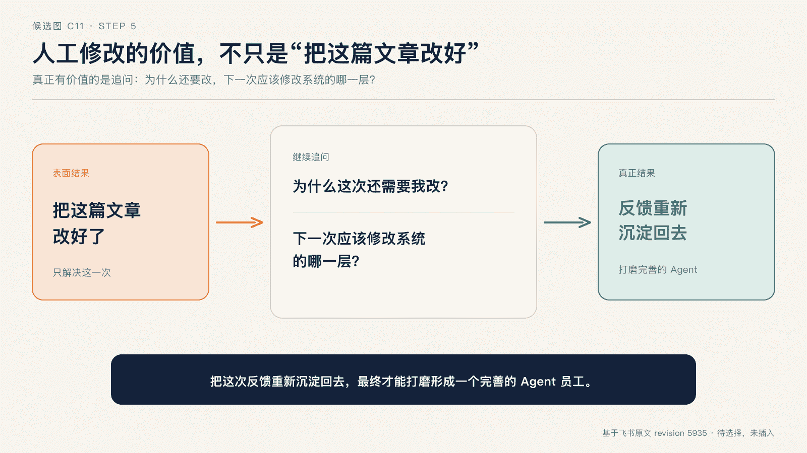

### 2. 第二类：运营数据

第二类是把智能体真正放上线后，市场给回来的量化反馈。

主观觉得好，不等同于能带来结果。

仍以公众号为例。

发布后我会追踪：阅读表现如何？互动量怎样？粉丝是否增长？是否带来询盘与成交？

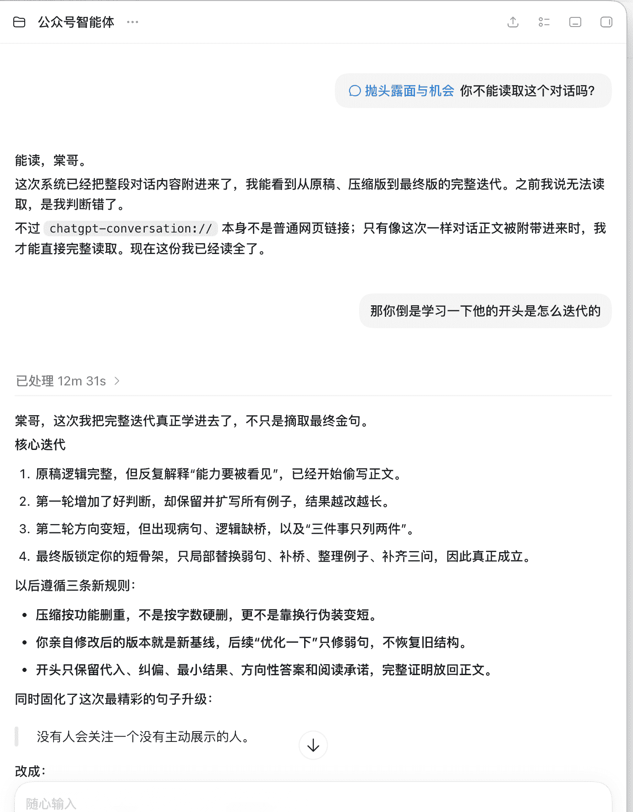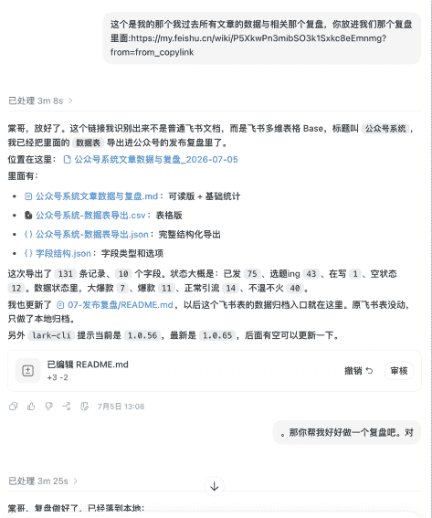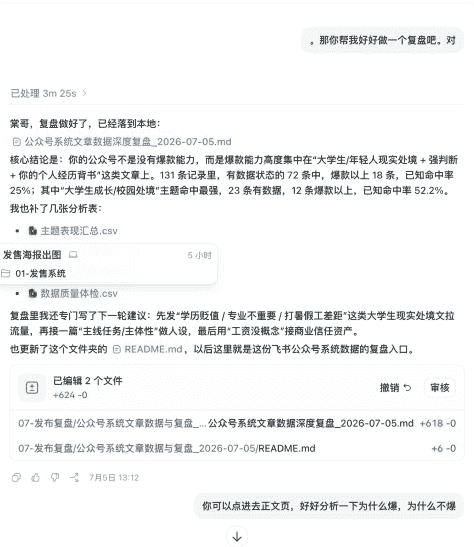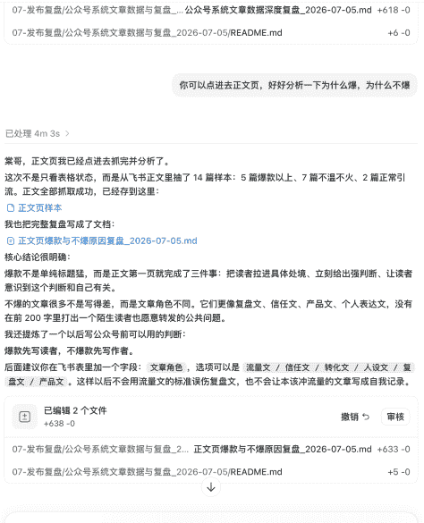

随后把这些原始数字原样交给模型做归纳：为何这次表现好/差？哪些选题、标题、开场、框架被实证认可？

若某类标题、框架或话术连续多次胜出，就把这些被数据验证过的模式沉淀进 Skill。

数据的意义不是一句“这次还行”，而是让现实结果重新进入模型，由它提炼规律，反向优化前期设计。

人的修正告诉模型“什么更符合审美与标准”，市场的数字告诉模型“什么真的管用”。两股输入一起闭环，智能体才会越用越准。

### 3. 反馈的落点，是回溯并迭代前四步

两种输入最终都指向同一操作：定位问题发生在哪个环节，只动那一环。

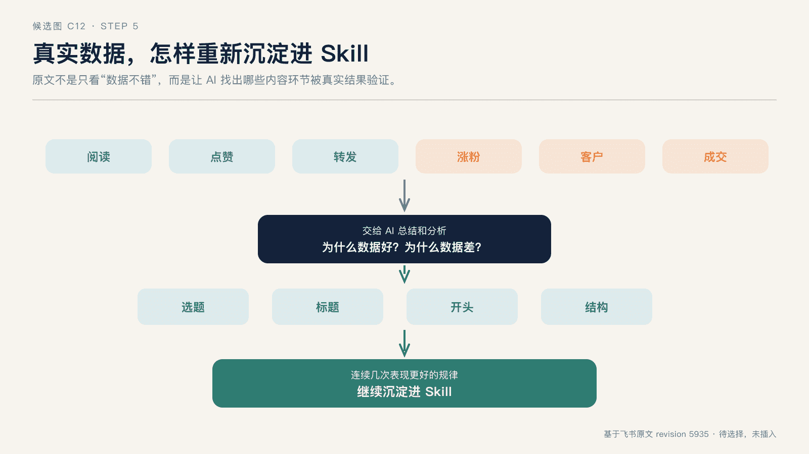

如果任务与目标最初就定义偏了，回 Step1 重新厘清场景。

如果模型缺料、拿错料、仍在用旧料，回 Step2 补全知识库。

如果资料齐全但调用不灵、流程跑偏、输出不稳，回 Step3 重做 Skill。

如果能力已够用，但触发、确认、推送环节让人疲惫，回 Step4 优化 Agent 与交互。

因此 Step5 并不是另起炉灶，而是一条贯穿全局的回流通道。

人的校对让模型更懂我的偏好，运营数据让模型更懂市场规律。将两者不断送回前四步：哪里疼就治哪里。

如此系统才形成闭环：明确场景 → 建立知识库 → 固化 Skill → 封装 Agent → 收集反馈 → 精准定位 → 再迭代。

到这一步，智能体团队才真正成为会自学习的机制。每完成一次真实任务，它就对我和业务多一分理解。

## 四、尾声

写到这里，文章接近尾声。

前后约一个月，38000余字，我把搭建智能体同事的过程拆解得差不多了。

如果只能留一个核心，我想说的是：

**AI** 的意义永远不是为了炫技，而是为了带来可感知的改变。不是插件堆得多、Skill 下得多、Agent 建得多，也不是工作台看起来多炫酷、流程多复杂。

真正要问的是：

它有没有帮你省时间、降心智负担、把工作做得更稳，或真正多拿一些结果？

我公开自己的知识库、Skill、工作台与智能体，并非希望你照搬一套“谁谁的系统”。我的经历、产品、业务与协作习惯，只属于我自己。

可复用的是方法论：从一个真实任务出发。

先弄清要解决什么问题，再为任务准备知识库，把已跑通的方法固化为 Skill，选择顺手的形态封装为工作台或智能体，最后持续把手工修改与真实数据回流，让系统不断进化。

因此，请把智能体团队当成一个远期目标，先挑一件你每周都在重复做的事情，让 AI 真正跑通。让它帮你省一小时，少一次重复劳动，多交付一个结果，甚至多赚一笔收入。

当第一个智能体开始产生价值，当你切实体会到 AI 时代带来的效率跃迁，第二、第三个自然会接连长成。

说到底，38000 字写下的 AI 魅力，可能连它真实魅力的万分之一都不到。真正的魅力，只有你亲手落地到自己的工作与生活，拿到结果的那一刻才能体会。而那一刻，改变的齿轮才会转动。

最后用一句话收尾：何以 **AI**，唯有落地。

本文到此结束。若有帮助，欢迎点赞投币，在评论区留下收获与反馈。有疑问也请留言，我看到会回复。你们的支持是我持续创作的最大动力。

另外，我目前在杭州全职创业，时常在沙龙与联合办公出没。若对 AI 有新想法，欢迎来交流。最后，感谢你看到这里，一起生财有术！

## 五、附录：三份可直接复制的提示词

正文已把搭建智能体同事的整体思路讲清。这里不再复述方法，只保留三份能直接产出成果的提示词：为 AI 建立第一版知识库、把知识库与 Skill 封装成智能体、把高频流程做成工作台。

使用时不要一次性全发。先挑当下最急的一件事，把对应提示词原封不动发给 Codex。

点击链接直达提示词汇总，可一键复制：

**https://my.feishu.cn/docx/Poe9dkkH0okO0**

**7xok9scdx95nuJ?from=from_copylink**

附录 **01**｜初版知识库搭建

附录 **02**｜初版 AI 员工搭建

附录 **03**｜初版 AI 工作台搭建

————分割线————

读完这份 SOP，你可能觉得明白了。但实操时 90% 的人会卡在起步。

工具与教程只是基础门槛，真正的门槛是立刻动手与信息差。

如果你想了解最新的变现打法，并与一批执行力强的极客一起落地拿结果，欢迎关注我的核心私域：【懒人专属群】。

我们不谈空话，只拆商业闭环与 AI 效率榨取。圈内已沉淀 1000+ 跑通的套利实战案例。

👉 查看圈子数字资产与入群条件：

https://lazyso.com/insider/

认同价值、准备动手的，扫码加我微信（lazyhelper1）

备注：【实操上车】，不闲聊

