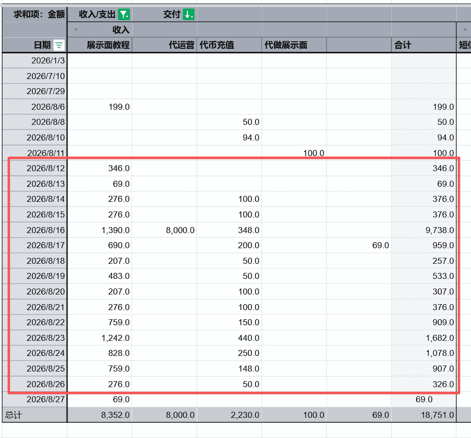
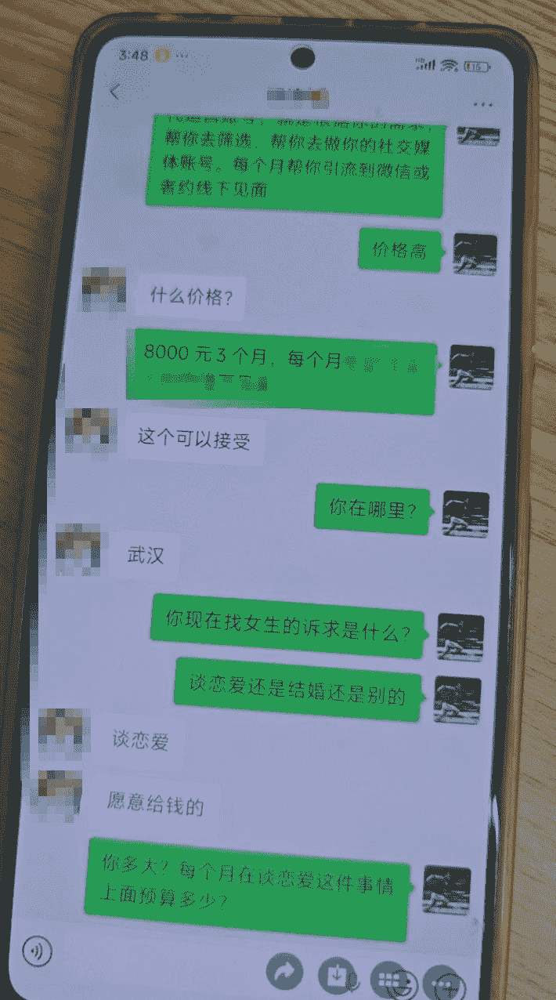
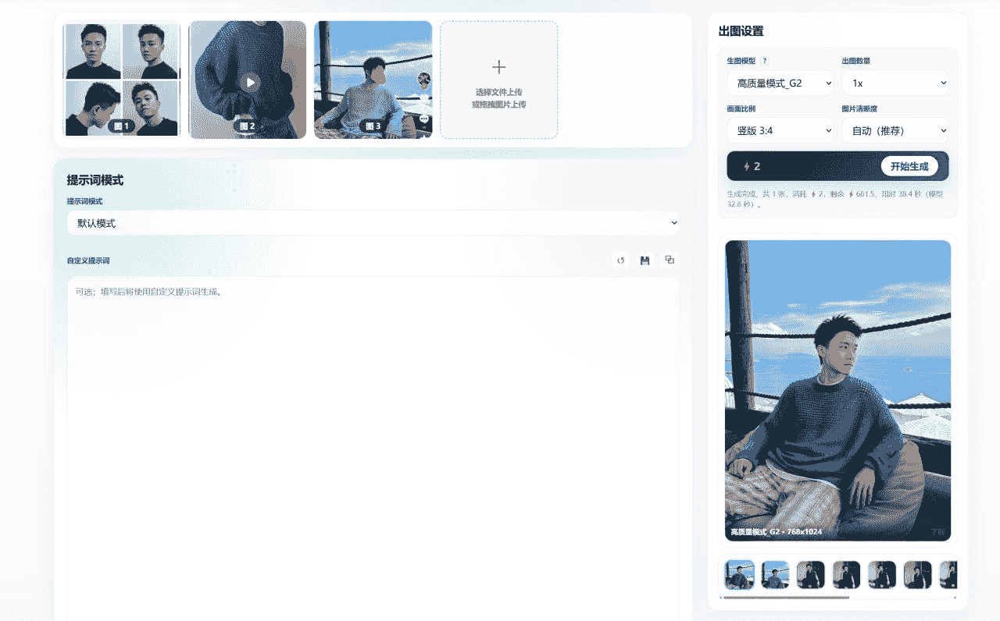
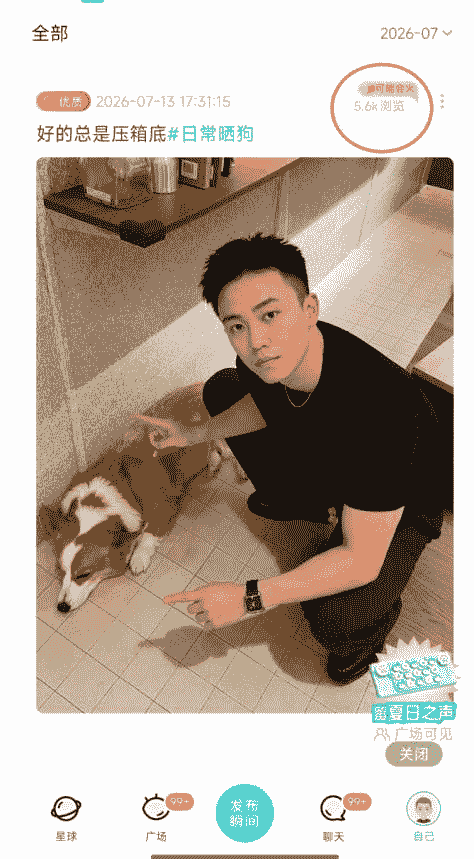
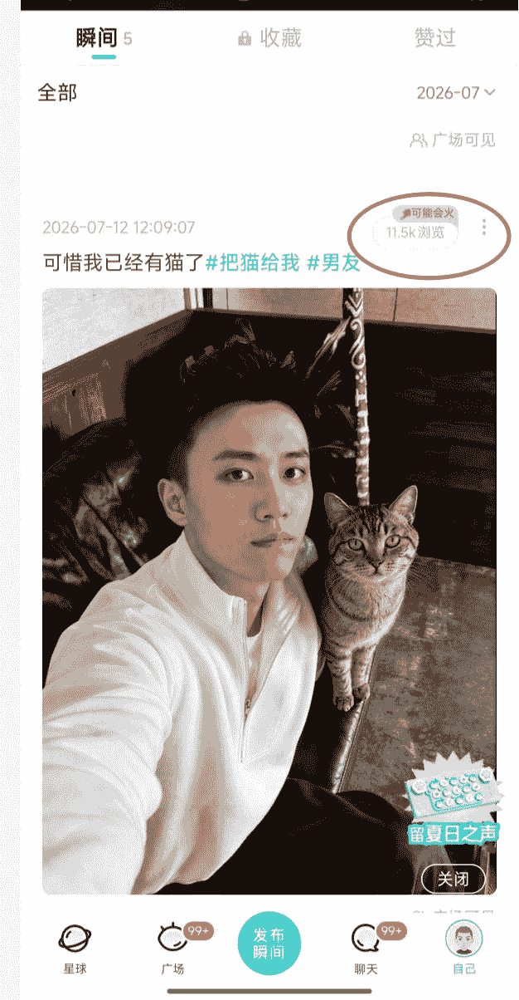
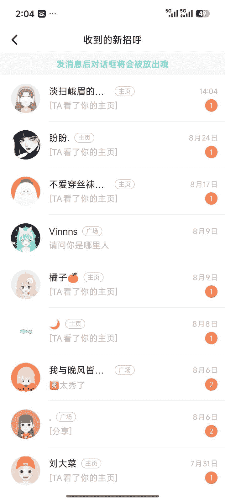
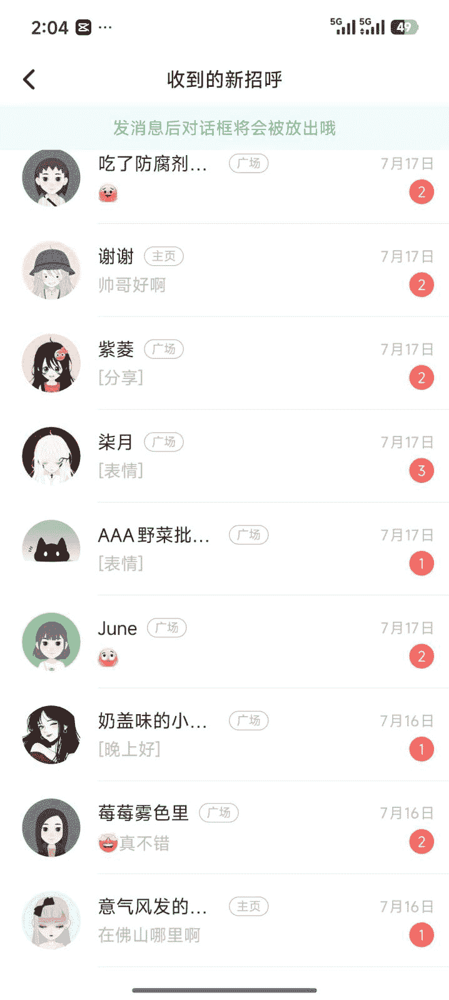

# “2周变现2万”，起因只是为了在交友软件匹配上更多女生，做了个AI展示面工具

## “两周营收近两万”，最初只是想让自己在约会软件上更好看，顺手做了一个AI展示面工具

260827 副业SC精华

整理：👸号懒人搜索，懒人专属群精选

懒人微信：lazyhelper1

大家好，我是Logan。

最近折腾了一个小东西，叫【AI展示面大师】。上线十四天左右，整体流水接近两万块。钱分三块来：69元教程+工具内充值，以及一笔8000元的代运营合作。

为什么我决定把整个过程摊开写？

得从我的背景说起。我是北邮硕士，毕业后在360、百度做了几年产品经理，24岁时年薪到60万，在同龄人里算不错。但我一直有块短板：我完全不会写代码。

以前负责产品，我能做的事是提需求、写PRD、画原型、控进度。产品该怎么想、用户缺什么、流程怎么走，我都门清。可最后把想法变成可用的东西，还是得靠研发来实现。

说到底，我一直差了“一手把产品做出来”这一步。

AI编程的出现，让我绕开了代码这道坎，感觉像回到舒适区，特别顺手。但如果只讲成“我用AI两周赚了两万”，意义不大。

真正有价值的，是我完整走通了一次可复制的AI变现逻辑：从自身真实痛点出发，确认这不是个例；把原本昂贵笨重的服务，用AI压缩成普通人买得起、自己就能用的工具；再在获客与交付中，摸到项目的真实卡点。

# 01 项目叫【AI展示面大师】

它瞄准的是一个很具体的群体：想脱单、身边异性资源有限、不会拍照的男性。在Soul、牵手、青藤、抖音、📕、朋友圈里，他们的头像和主页往往没有一张能让人多看两秒的照片。人没问题，缺的是“展示面”。

一旦换上几张有质感的生活化照片，效果是立竿见影的。下面是我自己在Soul上的实操数据，其他平台也类似。

说实话，有点不好意思。像我们这种普通男生，手机里基本都是工作截图、吃饭照、路边抓拍。等到真要用照片做社交主页，才发现能用的寥寥无几。

现在社交软件是主流交友渠道。第一次接触，别人看的就是头像和九宫格。第一印象决定是否继续聊。

问题在于，很多男生不是不想展示得更好，而是不会拍、不知道怎么拍、没合适的素材。需求真实且痛。

展示面，本质上是你在对方认识你之前，通过照片、主页给出的第一印象。

过去的解决方式很重：线下约拍、租豪车跑车总统套房、请摄影师拍半天，最后从几百张里挑几张可用。需求存在，但成本高、门槛高、交付沉重，而且现在那种暴发户炫富风早过时了。

AI的机会在于把这段重流程轻量化。用户传一张人脸照，再传一张喜欢的穿搭/场景/风格参考，输入提示词，就能生成一张有氛围的社交展示照。它不改变五官，不把你变成吴彦祖，只是优化穿搭、光线、环境，让审美在线。

AI展示面大师做的就是这件事。

# 从个人痛点出发，不等于只能做自己的事

很多人会误解“从自己出发”=“必须解决自己的问题”。

不是的。

自己经历的价值在于体感。你知道场景长什么样，知道用户怎么描述问题，知道哪里最难受，也知道一个看似很牛的功能放到真实使用里可能无人问津。

先做用户的用户，再做解决者，判断会准很多。

但动手前要出去验证：有没有人在讲？有人付钱吗？现有方案贵在哪、慢在哪、麻烦在哪？

个人体验给你方向，市场反馈给你确认。

# 02 上线前，我花399元买了同行的交付

需求确认后，我没直接开干，先花钱买了一门同行课程。399元，交付是一个聊天合集+RunningHub大平台链接，token另付。

模式能卖，说明有用户。

但我立刻知道这不是我要做的路。

对一个只是想要几张好照片的男生来说，教程、复杂平台、token充值、功能入口，信息量爆炸。他不熟悉AI，没耐心研究，只想快点看到效果。照抄这个模式，卖的不过是信息差。

买完之后真正的麻烦还在用户手上：去哪上传、怎么选图、token去哪买、生成失败怎么办、不像怎么办？这不是解决问题，是把问题搬家。

于是我开始给自己的PRD做减法。不做大而全的AIGC平台，只做“展示面”这一个功能，做成网页版，手机电脑都能用。按步骤上传、生成；新用户可先体验一次；想继续用，再付费买次数。

新手用户最怕选择太多。不是来参观你接入了多少模型，是来解决一个具体问题。

我的标准很简单：付完款后，用户能在很短时间内完成第一次生成，并且知道下一步做什么。做不到，产品就不够简单。

# 03 从199到69：降价不是卷，是重塑商业模式

工具成型后，我一开始参考同行卖199元的教程，没明说产品是我自研的。

在抖音发内容，有人咨询，信号是好的。但到付款环节转化极低。几十个咨询，可能一个成交都没有。

我接受现实：199元对目标用户偏高；更重要的是，他买到的是一个需要自己研究、自己操作、自己承担结果的教程。对AI小白来说，买的不是“生成套图”，而是一堆新任务。

用户心里会算：199元，最后能不能拿到想要的照片？还要去别的平台买token，会不会又有坑？算不清就不会买。

于是我砍掉前端教程和工具分离，统一降到69元。

## 69元到底是什么

购买后拿到微信合集+视频教程，教上传什么图、怎么选参考、如何进入工具。平台注册后可免费体验一次，后续想多生成，最低50元起充，约50次生成，平均一次一块钱。

这不是简单的降价换量。

如果用户后续的token消费跟我无关，69元很难成立，因为主要价值都外流了。但工具是我自己的，后续充值留在我的体系里。

69元只是入门门槛，不是全部收入。

收入变成两层：降低启动心理门槛的入门费 + 后续使用充值。

降价后转化明显变化。以前20人咨询无一成交，后面3个咨询能成1单，转化超30%。

定价别只看成本、功能、同行价。关键看用户付完钱后，离想要的结果还有多远。路径越短、第一次成功越快，价格越容易被接受。

当然项目天花板不高。

# 04 两万元怎么来的：先把账算清，别把流水当能力

两周流水主要来自三部分。

第一，69元产品卖了100多单。

第二，约三分之一的购买用户会继续充值，单笔约50元。说明需求真实，但并非所有人都会变成重度使用者。

第三，一位用户提出8000元代运营单：帮他运营抖音，把主动聊天的女生推微信。这已超出工具生意，是更重的脱单服务。

当时我愣了一下，停下来评估能不能交付、愿不愿意交付、会不会把自己困住。最后接了第一单，主要是想把这条流程跑通。8000元做三个月，价格不算高，后续若验证成功，可往高净值、月度服务、模板化、Agent辅助方向发展。

重点是，这笔8000元不是炫耀高客单。

它让我看到低客单与高客单的本质区别。69元工具自助交付，轻。高客单需要结果、沟通、定制、持续服务，心力投入大。

别只看客单价，要把交付成本算进去：时间、注意力、情绪、可复制性。重交付的项目，容易陷入反复沟通、改稿、解释的泥潭，可能不值得赚。

市面上有人做人工代做，单张100-200元，三张600元。单价看似更高，但实操下来并不好做。AIGC像抽卡，需要多次生成挑优。你觉得像，客户未必觉得像；客户预期又高，会要求换场景、换衣服、调表情，反复沟通。

于是我选择自助工具。让用户自己参与生成、挑选、控制次数，从“等你交付”变成“自己获得结果”，项目才有放大可能。

# 05 最痛的不是产品，是承接

两周里最想放弃的时刻，不是写网页、调接口、被骂“不像”，而是第一条视频爆了后，个人微信被加爆，6个号被封掉。

这个坑我之前没想透。

我过去做口播引流，内容不行不怕，怕的是接不住。内容把人吸过来，不代表你能安全稳定承接。

用户大量涌入，我临时研究企业微信、卡片、承接方式，因操作不当导致大面积吞卡。用户看不到回复，前面的流量全白费。

我才明白，项目是完整链路。内容只是入口，承接、支付、交付、复购、售后、风控都要跟上。任一环节断掉，前面的努力都很脆弱。

后来跟一个大佬聊，他说69元这种低客单没必要硬拉私域。

我认同。低客单适合短链路：看内容→进网站/小程序→付款→使用。用户不需要加你微信，你也不用单聊。

私域适合高客单、需深度沟通。把所有低客单用户都导人工，等于把轻交付做成了重人工。

现在我把展示面大师转到小程序，已付69元的用户不再重复收费，后续直接充值；也会补送部分免费生成次数。高客单用户通过站内联系方式单独沟通。

引流要合规可重复，不能靠短期导私域套利。

# 06 这次复盘的四个判断

第一，找已经有人用笨办法在付费解决的问题。从“人现在忍受什么麻烦”出发，而不是从“AI能做什么”出发。

第二，买一次交付比看十篇拆解更有用。能看到用户付款后实际拿到什么、卡在哪里。

第三，AI编程该用来做验证，不是做功能齐全的作品。第一版只保证：有人看见、有人付款、有人完成第一次生成。

第四，获客、承接、交付必须同步设计。内容爆只是开始，低客单走自助，高客单再人工，项目才能在规则内稳定跑。

关于价值，我不只看“无退款”。购买→生成→充值→用于社交展示，这是一条强度递增的验证链。工具只能帮你更好呈现，不能承诺脱单，更不能造假身份。

# 07 给已经会用AI却还没赚到第一笔钱的人

如果你已经会用很多AI工具，看过大量案例，兴奋却不敢动，不会选方向。

正常，你缺的不是工具能力，是一个具体的业务场景。没有场景，AI只会让你更焦虑，收藏一堆提示词，仍无进展。

别先问“现在什么AI项目最赚钱”。先回头看自己生活和身边人：

最近哪件事反复觉得麻烦？哪个行业还在用笨办法重复工作？哪种服务大家明知贵慢麻烦还在付钱？你自己做过且懂痛点的流程？

写下来，找三个人聊，搜同行，买一次现有产品看交付。

确认需求真实后，别在岸上研究半年。用AI做最小可用版本：不需要好看、不需要全功能，只要让真实用户完成一次关键动作，得到可见结果。

再发一条内容，找十个用户聊，看他们在哪一步流失、为何付钱、为何不复用。

在项目里你会自然学会需求表达、AI写码、页面搭建、定价、内容、交付、用户反馈。这些靠看学不会。

我这次两周近两万，不代表项目成熟，也不代表可复制。它只是让我亲手跑完一次：从痛点到市场验证，用AI做工具，调价格拿付款，再被承接教育。

这条路不完美，但真实。

而亲手跑一次，比收藏十个变现清单更有价值。

如果你还没有项目，先找一个能练手的小需求。用户不用多，需求不用大，只要你愿意琢磨、有人愿为结果付费、AI能明显把流程变轻，就去干。

先让AI在具体业务里为你干活，你再在具体业务里学会搞钱。

希望这篇复盘对你有启发，也提醒自己：做项目少迷恋功能，多敬畏用户、链路与交付。

我是 Logan，现在常驻在广州和佛山交界的金沙洲。如果你也在琢磨怎么用 AI 编程把想法落地变现，欢迎来找我喝杯茶，面对面聊聊你的场景和痛点。我想做的事很简单，就是陪更多人拿到用 AI 实现的第一笔收入。

谢谢你的阅读，也感谢赚钱。

——分割线——

看完上面这套 SOP，很多人会觉得自己已经掌握了。但真实情况是，十个人里有九个人在真正动手的那一刻就卡住了。

工具会过时，教程也遍地都是，这都不是真正的护城河。真正拉开差距的，是敢不敢马上开干，以及能不能拿到圈内才有的信息差。

想要第一时间看到全网最新的 AI 变现打法，并想和一批行动力拉满的极客一起直接上手出结果，可以来看看我维护的核心私域【懒人专属群】。

这里不讲概念，只拆可复制的商业闭环，只做 AI 使用效率的极限压榨。群内已经累积了 1000 多个跑通的套利实战案例。

👉 想了解圈内数字资产全貌和加入标准，可以点这里查看：

https://lazyso.com/insider/

如果你认同这个价值取向，并且已经准备好开始实操了，就扫码加我微信：lazyhelper1

备注请写：【实操上车】，不接闲聊。

