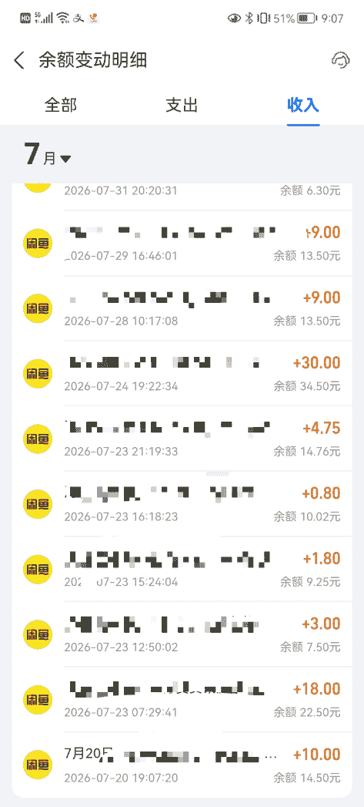
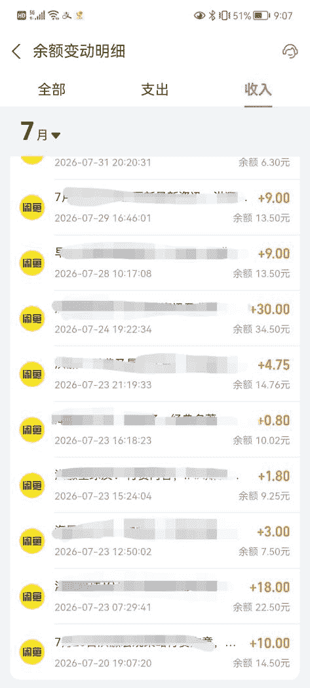
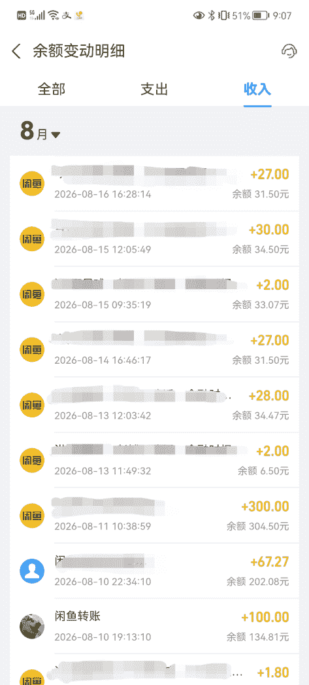
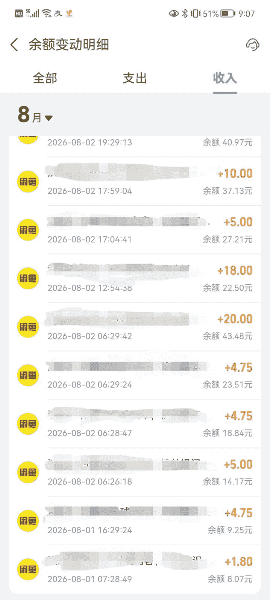
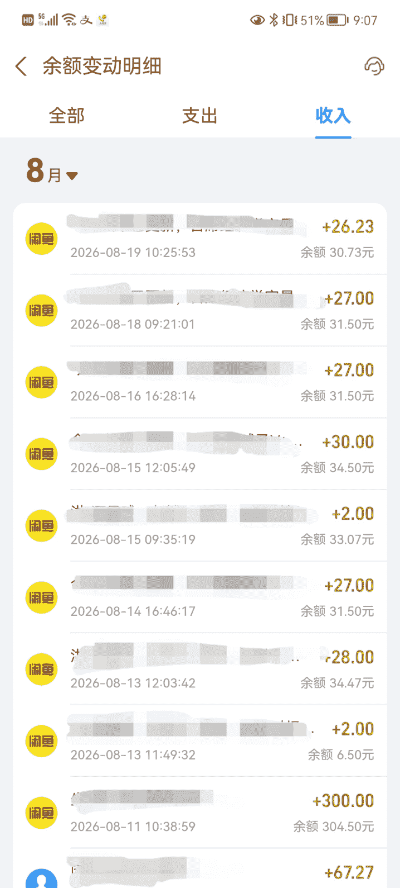
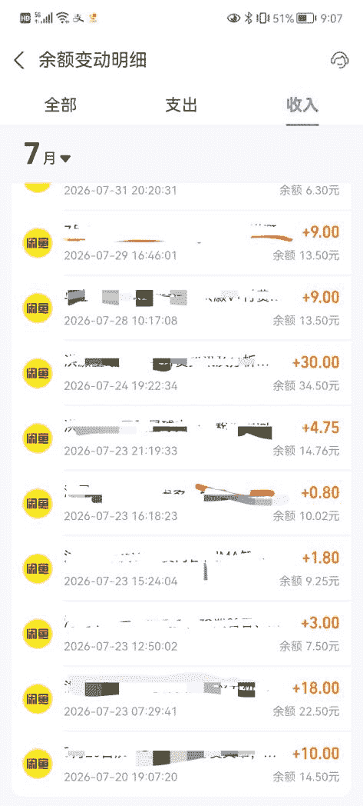
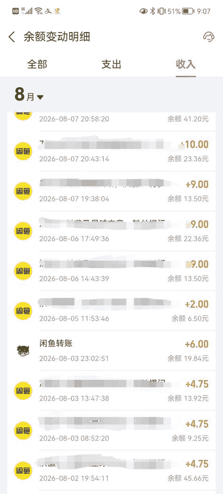
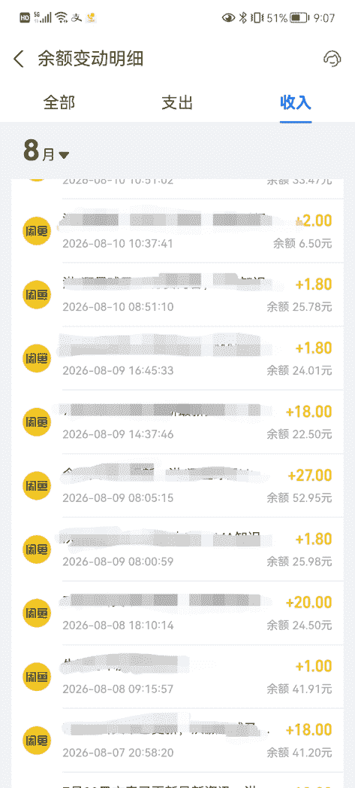

# 从10元首单到月入千元：我在闲鱼卖“整理好的信息”，30天跑通副业0到1

大家好，我是今年4月正式成为SC社群一员的圈友，本职工作在一家国企。这段时间行业整体在走下坡路，加上家里的开支压力一直没减，焦虑感越来越明显。我越来越清楚：如果收入只有工资这一根支柱，一旦它扛不住，我的处境会非常被动。所以我不打算等，决定先试试看——能不能靠自己的能力，再砌出一条收入来源来。

必须说明的是，起初我并不指望副业能赚多少钱，更想验证的是那个根本问题。于是7月20号，我给自己定了一个轻量方案：把分散在网上的资料收集起来，经过去重、分类、结构化，做成一套能快速查询的内容产品，挂上闲鱼试水。

选在闲鱼起步，并不是随意拍脑袋。这个平台本身是二手交易场，用户进来就带着成交意图，对虚拟内容的容忍度也高。相比之下，小红书更偏种草，需要先养内容、再引导成交，而且目前对虚拟内容查得严。闲鱼开通鱼小铺后会有额外流量扶植，新号期间还有保护，这对我这样没有资源的新手非常友好。

这份尝试从7月20日开始，截至8月19日，正好过了30天。首笔订单只卖了10元，但后来单子陆续进来，累计流水做到了千元上下。中间还产生了一笔100元的定制单：有位买家问能否把文件导出到自己的电脑，我按这个需求重新做了版本，他爽快多付了100元。

这个数字不算亮眼，但它让我第一次完整走通了一条链路：找方向→做产品→上架→接单→按反馈迭代。这意味着，副业不再是空想了。

下面我把这段经历尽量真实地拆开，讲清楚我具体做了什么、哪些判断被验证是对的、哪些环节还很毛糙，以及接下来怎么把这个小生意做厚。

先说我卖的是什么。细分领域的内容包——把零散资料重新筛选、梳理，做成可以直接检索和使用的信息产品，然后借助闲鱼去连接那些有明确搜索意图的买家。目前产品分成三档：

第一档，基础款内容包，价格便宜，用来测试需求并沉淀首批用户；
第二档，按资料范围和使用权限区分的进阶款；
第三档，按买家具体使用场景定制的方案，比如提供可导出、可本地保存的版本。

整篇复盘的核心，就是讲我怎么从10元的首单出发，顺着买家的反馈，把“卖文件”逐渐升级为“卖加工过的信息服务”。

先贴结果：

7月20日到8月19日，30天。从10元首单到累计破千，单看金额确实微小，但这件事对我的意义不在钱上，而在于我终于把一个副业从0带到了1。更重要的是，我在这30天里积累了一套可以继续迭代的方法。

为什么最后选了内容整理？原因有三点。

其一是门槛低，不需要囤货，不需要大笔启动资金；
其二是成本可控，即使失败了，损失也就是一些时间精力；
其三是我自己就是目标用户，平时工作里经常接触资料管理、AI工具和信息组织，这些对我来说不算陌生领域。

当然，自己觉得有需求，不代表真实需求存在。入圈后我学到的第一件事，就是找参照系。我专门去研究同行的店铺，看销量、看咨询量，但最看重的一点是：最近两三周他们是否还在持续出单。历史销量再高，只能说明过去有人买；真正有参考价值的是当下是否仍然有人愿意付款。

光看还不够，我又掏钱买了同行的产品回来拆解。买回来之后我发现，他们对标的本质是“卖素材”，只是把文件换了个载体。于是我想到一个不同的切入点：把这些素材重新整理，做成真正可检索、可调用的信息库。我把资料全部打散，按主题重新分类，放进ima这款云端笔记应用里搭建结构。经过这一步，我和同行的区别就出现了——他们在卖内容，我在卖“整理好的信息解决方案”。

看起来只是换了个容器，但后来我才发现，这一步是整个项目的分水岭。

最初动手的时候，我最怕的不是产品不行，而是没人来问。东西做出来之后，最大的疑虑是：到底会不会有人找上门？所以当第一个陌生人主动来咨询时，我高兴得不行。接着首单成交，金额10元。现在回想，10元真的可以忽略不计，但那一刻的我完全不这么觉得。这10元是一个确定性的信号：我的整理成果，确实有人愿意花钱买。

后来有一天流量突然爆发，一连接了好几单。那是我第一次有了“这条路走通了”的真实感受。

真正让思路发生改变的，并不是那10元，而是一个买家提出的需求。他问我，能不能把文件弄到自己电脑里。原版产品并没有这个设计，我没有直接说不行，而是立刻按他的场景重新整理了一份可导出的定制版。他愿意为这个需求额外支付100元。这笔订单给我的触动，比之前许多笔小额单都要大。

因为那一瞬间我意识到：买家愿意加价，并不是因为我给的资料变多了，而是因为他获得了方便、省去了麻烦、解决了自己的具体问题。从这个节点开始，我的视角被彻底调整：不再只想着“我这里有什么”，而是去想“用户买回去之后能解决什么”。这是我30天里最重要的一次认知改变。

还有一个变化也值得记录：分层收费并不是我一开始设计好的，而是被买家一步步推着长出来的。有人想要可导出版，有人只需要其中一部分数据，需求五花八门，我就顺势把产品拆成多个档位，让大家按需选择。

这让我非常认可一句话：好产品不是关起门想出来的，是在真实反馈中一层层长出来的。特别是当用户提出个性化要求、并且愿意为此付更高的价格时，我更确信高客单价的秘密不在于内容本身多不多，而在于定制交付解决的是不是真问题。

做定制也不是做一次就完了。那位买家定制完后，我又想到：这套内容已经被我深度加工过，那它为什么只能卖给一个人？以后碰到类似需求，完全可以继续卖给第二位、第三位买家。我可以把一次性的深度整理，变成反复出售的资产。这个视角一换，整个项目的想象空间就打开了——我不只是在做一单一单的交付，而是在积累一座可以重复变现的资源库。

后来还有一位买家告诉我，他买内容包是用来辅助投资。具体怎么用的他没展开，我也没追问，那是人家的隐私。但他这句话给了我一个很强的信号：很多人买内容产品，不是为了“囤着看”，而是为了两件事——更快地获取有效信息，并且让这些信息帮自己赚到钱。这也是我接下来做产品最想加强的维度。如果我的内容包只是一堆资料的堆叠，那它的价值非常有限；但如果能帮用户更快筛选出关键信息、更快形成判断、更快实践落地，那附加值就完全不同了。

当然，跑了一个月，问题也很明显。眼下最耗时间的是手动上传素材，这个动作没有技术含量，却吃掉了很多本该花在刀刃上的时间。我真正应该投入的地方只有两个：一是继续寻找有需求的选题，二是做好推广。所以接下来要解决的核心问题，不是“怎么卖得更多”，而是“怎么把这些重复的劳动自动化”，让自己从琐事里解放出来，把精力放到选品、产品和流量上。

这30天跑下来，我到底验证了什么？收入端很简单：首单10元，月流水过千。但我更看重的是完整跑通的这条流程链条：研究同行→判断需求→买样拆解→重新加工→搭建信息库→上架闲鱼→承接咨询→成交→反馈迭代→分层收费→定制服务。

从中我也沉淀出了几条自己的判断：

第一，选品时不要被总销量迷惑，要看近期有没有持续出单；
第二，产品起步别做太复杂，让市场先替你反馈；
第三，用户抛出来的问题和要求，就是产品的升级方向；
第四，比低价卖文件更值钱的是帮用户节约时间、解决问题的个性化服务；
第五，一次定制如果能沉淀下来，就有机会变成可反复销售的数字资产。

至于下一步，很多人可能会觉得，既然一个号能月入过千，那就赶紧铺矩阵啊。对此我的想法是：先不急。目前最值得放大的不是账号数量，而是产品本身。我想先把已经验证过的内容产品做得更深，提高附加值、抬高价格带，再围绕用户反馈开发更多可重复销售的定制款。如果还没把单个产品的价值吃透就去铺矩阵，最后可能只是把一个不成熟的模式复制了很多遍。所以我给自己的节奏是：先把“1”做厚，再考虑把“1”复制成“10”。

最后再说几句。

30天，1000元，这样的成绩谈不上成功，但它确确实实告诉我：副业不再只是一个飘在脑子里的想法。我真的收到了钱，真的服务了真实的买家，真的被真实的需求推着往前走，也真的靠解决这些问题获得了回报。从10块钱的起点走到1000块钱的流水，数字很小，但它铺成了一条看得到方向的路。

接下来，我关注的早已不是“还能不能赚到钱”，而是“能不能把这套打法产品化、标准化、自动化，然后逐步放大”。这30天给我最大的收获，就是这份确认感。

感谢社群的@澄心推荐，感谢@吴泽恩的指导，也感谢航海手册编写团队的付出。

————分割线————

补一句：看完这篇复盘，你可能会觉得“我会了”。但实际去做的90%的人，会在第一个环节就卡住。工具和攻略从来都不是真正的护城河，真正的护城河是“马上动手”和“圈子里的信息差”。

如果你也想看最新的变现玩法，和一群执行力极强的行动派一起真打实干，欢迎来我的私域【懒人专属群】。那里不聊空话，只做商业链路拆解和AI效率挖掘，已经沉淀了1000+实操跑通的套利案例。

👉 了解更完整的数字资产与上车门槛：https://lazyso.com/insider/

认同价值、准备好下场的朋友，可以扫码加我微信（lazyhelper1）。备注【实操上车】，不闲聊。

