# ('AI自媒体从0到1速通：抖音1个月跑通2.5w粉，商单+私域+产品+企业服务如何变现五位数', (8, 53))

一个月，零基础切入AI赛道，抖音做到2.5万粉；与此同时，商单、私域、课程、企业定制四条线全部有进账，累计变现五位数。有人把这归功于“AI赛道运气好”，但我想说：流量只是结果，真正让我跑通的，是提前把账算清楚了。

我叫nana，02年，中传本科、港大硕士，毕业第一份工作是深圳京东的流量运营。做了一年，日子不算差，内心却清楚这不是我要的生活。后来靠着B站带货，618单月收入破了六位数、总GMV做到1700多万，我才终于有底气辞职，把副业变成事业。今年，在AI的热浪里，我顺势开了抖音号，主攻AI自媒体方向。前后也就一个来月，粉丝攒到2.5万，微信群建了14个、沉淀2500多人，起号后半程才开始引流，结果5天就有1000多人加了微信。更早的时候，号还在几百粉阶段，就有品牌找上门，第15天接到第一个四位数商单。

但我最想分享的，不是这条流量曲线，而是一个更底层的判断——AI自媒体想赚钱，绝不是“把视频做出来”那么简单。

会写、会拍、会剪，这只是内容能力；真正决定你能不能赚到钱的，是你有没有把“做一个号”变成“跑通一门小生意”的完整链路。这条链路上，哪一环断了，生意就断了：先想清楚服务谁，再去想流量从哪来；靠内容建立信任，用私域把人接住；产品要提前备好，交付要能兑现，最后才能谈到复购和放大。我过去在B站踩过坑，也吃到过甜头，最大的体会就是：单独把某个动作做到极致，不如把整条路径串起来。

所以做号之前，我就没把账号当作终点。它是我未来AI公司获客的起点，是整盘生意里最前面的一块拼图。

落到实操上，我给自己设计了四道变现闸门，一层比一层深。

第一层是商单。它离内容最近，反馈也最快。但不是你粉丝多了就一定有商单，得从品牌视角倒推——数据稳不稳定、画面够不够精致、产品能不能自然植入？想把商单做好，就得把广告位设计得明明白白，把账号包装得像样。不过我不打算做纯商单号，那本质上还是靠卖时间和流量换钱，太单薄，也太容易被卷掉。商单只该是收入的第一层，不是我生意的全部。

第二层是私域和社群。公域的视频，用户刷完就划走，你和他之间没有关系。私域的意义，是把一次偶遇变成长期连接。我用“资料+群”来承接：粉丝看完内容后，如果还想继续学AI、缓解AI焦虑，就进群。这个社群不重，是一个低门槛的持续学习入口——里面有AI基础认知、工具实操、项目机会的资料库，每天还有内容解读和交流，让人一进来就有“学到了”的感觉。

第三层是知识付费。在社群之上，我做了两个陪跑产品：1980元的AI工具号半年陪跑，和4980元的AI真人商业IP全年陪跑。它们真正解决的问题，不是教会你某一个工具，而是帮你顺着AI自媒体这条路赚到钱，并且能持续赚到钱。这两条路我自己都跑通了，也正因此，我才敢把它们做成产品教给别人。

第四层是小B定制和企业服务。当用户认可你的能力后，他可能不再只满足于学，而是希望你直接上手帮他解决问题。我最近成交了一单4000元的视频Agent定制需求，客户认可我视频包装的能力，想把这套能力沉淀成工作流。这个单子不大，但意义很大——普通人进企业服务，不一定非要从几十万的项目做起，先从一个具体、可验收的小场景切进去，你就有了立足点。

这四层合起来，才算把单个账号的价值最大化。很多人说我效率高，其实不是我手速快，而是我提前想明白了：我卖什么，我要吸引谁，我不要做什么。想清楚这些，每天只需做对离变现最近的事就够了。

很多人问我，内容方向怎么定？别急着给自己贴一个“我是谁、我喜欢什么”的窄标签，那是自嗨，不是定位。真正有效的定位，要先回答四个问题：你服务谁？他在什么场景下碰到了什么具体问题？你能给他什么判断？这件事有没有足够的需求？如果只说自己是“AI博主”“职场博主”，用户根本不知道为什么要关注你。

我的推演顺序是：商业目标→产品/服务→目标人群→账号定位→内容方向→选题表达。因为想卖的是AI自媒体陪跑服务，目标人群就是想用AI做内容、做账号、做变现的人，所以我的定位自然不是一个工具测评号，而是一个正在真实跑AI业务、持续分享过程与结果的成长型商业IP。从这个定位出发，选题非常清晰：怎么判断AI自媒体方向、怎么用AI找选题、怎么用AI提效、怎么把小体量内容延伸成企业服务。这些内容既能帮到目标人群，又能展示我的执行力和专业度，最后还能顺理成章地导流到产品上。

找对标时，我不会盯着头部账号抄。头部账号的数据里混杂了历史积累、品牌势能和平台扶持，新人照抄等于刻舟求剑。我更建议看中腰部和那些粉丝不多却能反复出爆款的账号。拆解时抓三件事：这个选题解决的是谁的什么问题？开头为什么能让人停下来？我的表达形式和资源能不能匹配？比如“怎么做AI内容博主”这种题就废了，太空泛，没人有耐心点开。但换成“我用一小时搭出一条AI内容生产流水线”，场景、结果、时间承诺全有了，打开率完全不是一个量级。

还有件事可能反直觉：好选题不需要天天从零发明。如果你挖到一套长期有效的问题框架，完全可以换案例、换开头、换场景、换人群，反复做、迭代做、放大做，直到它真的失效，再换下一个。别把时间耗在前端创意上，多留点精力给私域、产品、交付，那些才是离钱更近的事。

内容本身也有讲究。我习惯把一条视频拆成四种元素：流量、干货、IP、营销。流量元素负责让人点进来，干货元素负责让人留下来，IP元素让人记住你这个人，营销元素负责引导下一步。起号期我主打“流量+干货”，先甩钩子再给方法。比如我那条爆款的开头是“装Codex不知道干什么？当然是拿来做视频搞钱。”一句话点出痛点，紧接着给出“装上这6个Skill就能实现”的懒人解法，就是“流量+干货”的典型用法。账号稳定后再慢慢加入IP故事和商业内容，比如讲AI剪辑，不说“推荐三个工具”，而是说“我把一条口播视频的包装流程做成了Skill，以前反复做的字幕重点、信息卡、章节提示，现在十几分钟搞定。”结果、场景、好奇心全有了。

说到AI，必须澄清一点：AI自媒体不等于全自动做视频。目前AI帮我最大的，是剪辑包装这一环。具体做法是：剪映导出SRT字幕文件→用开源的Skill生成透明底的MOV动效层→再导回剪映叠加。这套操作下来，一条90秒视频的包装，十几分钟就能完成。但选题、内容判断、素材筛选这些环节，很大程度上还是人工主导。

最后说几句掏心窝的话。这篇文章是我在生财两场AI自媒体线下分享后沉淀的复盘，很多观点是跟大家碰撞出来的。如果你已经起号成功但卡在变现上，这篇值得反复读；但如果你是完全零基础的小白、指望看完就能一键复制结果，那得先冷静一下。我手里有京东流量运营的经验，有B站带货赚到5万佣金时打下的转化功底，这些存量能力都在暗处帮我缩短了试错周期。你照抄我的进度表，未必能抄来我的速度和底子。至于文章后面提到的MCN蓝图，那是我的推演方向，不是已经跑通的成绩——想清楚不等于能做到，这一步我不会含糊。

做AI自媒体这一个多月，我最深的体会是：流量从来不是值钱的东西，把流量放进一个完整的商业体系里，它才开始值钱。账号是入口，内容是信任，产品是承接，交付是结果，团队和协作是放大器。想清楚这一整条链，再开始动手做号，你跑起来的速度，反而会比那些只顾埋头做内容的人快得多。

AI 不是拿来炫技的，而是拿来算账的。

很多东西 AI 并不是做不了，只是我会先算一笔投入产出比。拿真人口播来说，气口停顿、口误剪除、面部精修、色彩统一，这些我在剪映里已经熟练到了肌肉记忆，直接上手往往是最快的路径。换成 AI 处理，一旦不够准，我得反复描述哪儿不对、再来一轮返工，反而把时间拉得更长。

所以，我的判断标准从来不是什么“能不能自动化”，而是：交给 AI 之后，是不是真的比自己做更省时、更稳定、更容易验收？

先说结论：我目前最顺手的 AI 真人口播玩法，是一套四步工作流，今天完完整整拆给你。

第一步：真人实拍。

知识类口播，绝大多数不需要复杂场景。固定机位、干净背景、收音清楚，再把人离背景拉开一点，画面层次感立刻就不一样。

我自己感受很深：空间一局促，人物和背景挤在一起，整张画面就显得平。拉开之后，背景本身的细节、纵深、明暗关系都会出来，整个画面立起来了。有一次我对比了不同拍摄效果，明显带有空间距离的版本更有层次感，光影对比也更耐看，而这中间有些画面是用 ChatGPT 生成的。

画面这件事，越简越高级。前景不是必需品，背景里的东西能减去就减去。灯光不用一步到位，先从自然光起步；想再好一点，就上主光加辅光；要让的人物轮廓更立体，再加轮廓光。

我以前做过 B 站拍摄，镜头语言和场景踩过不少坑，所以我不太会为了所谓的“AI 感”把真人优势丢掉。真人 IP 有表达力，这件事本身就应该最大化利用。

第二步：剪映里做基础处理。

我会先把素材扔进剪映，处理掉停顿、口误，把整体节奏捋顺，顺手做完瘦脸美颜和色调统一。这个阶段会导出两样东西：

一是纯口播视频一条；二是带时间轴的 SRT 字幕文件，用记事本就能打开。

第三步：Skill 做语义包装。

Skill 拿到 SRT 之后，会对每句话做语义理解，再跟着时间轴把重点词、信息卡、章节提示、动效模板塞到合适的位置。

我这个公开的真人口播包装 Skill 已经放出来了，地址在这：https://github.com/zhouyuechuan2025-ui/ai-self-media-video-packaging-skill

装起来也简单，直接跟 Codex 说：

“帮我安装这个 Skill，并告诉我使用方法：https://github.com/zhouyuechuan2025-ui/ai-self-media-video-packaging-skill”

这个 Skill 跑完，会输出一条透明底的 MOV 动效层，它的节奏和你原视频是完全对得上的。

第四步：回到剪映叠加精修。

把 MOV 透明层往原视频轨道上一拖，视觉包装的大部分工作就完成了。

但这里我要说点实在的：像复杂录屏、鼠标点击轨迹、局部放大、精细说明这种画面，我到现在还是自己剪。原因很简单，我自己剪视频本身速度不慢，和 AI 来回沟通、校对描述的时间成本，有时候比手工还高。简单的截图素材让 AI 处理没什么问题，复杂场景就不要硬自动化。

效率层面也给你交个底：Skill 模板稳定之后，一条一分半钟左右的视频，包装大概十几分钟能出；但如果整条片子还要放录屏、截图、完整剪辑流程，目前差不多是一个小时。

离“一键生成”显然还有距离，但它足以支撑我当前的内容频率。我真心觉得，为 100% 自动化而牺牲交付质量，不划算。

更务实的路径是：先只把那些能稳定复制的重复劳动交给 AI，之后随着内容量上来、团队变大，再顺着流程去找下一个值得自动化的环节。

做一段时间之后，你会发现，你逐渐形成了自己的手感：什么样的选题值得做，什么样的开头抓人，什么样的表达风格适合你。

到了这个时候再把 AI 放进选题筛选、脚本生成和数据复盘里，效果才会出来。原因就一句话：你自己都不知道“好”长什么样，AI 不可能稳定替你判断。

我现在做 AI 选题自动化，也没有做到多智能。我的方式很质朴：从商业目标和账号定位里倒推关键词，用关键词去搜对标账号，再把内容放到真实发布里去接受反馈，继续清洗筛选。这个办法，要比一开始就让 AI 凭空列 100 个标题靠谱得多。

说完内容生产，再聊聊大家都感兴趣的 AI 企业服务。

不少个人创作者一听到“企业 AI 服务”，第一反应是：这应该只有技术公司、大厂或咨询机构才能干吧？

我做下来的体感是：真正难的是那些复杂大型交付项目，但早期的企业切入，还真没有想象中那么遥远。

内容本身就是非常好的信任入口。当你持续在一个具体问题上输出，客户会顺着你的内容判断：你是不是真的懂这个行业，有没有实战能力，沟通方式是否靠谱。这时第一个单子往往不是什么大项目，而是一个非常具体的小需求。

我自己那个 4000 元的视频 Agent 订单就是这么来的。客户看了我的视频包装效果之后，希望把这套能力沉淀为一个可复用的工具或工作流。那个需求范围很清晰，验收标准也明确，做起来双方都不累。

如果个人想从 AI 企业服务切入，我认为只需要守住三条原则。

第一条，从小场景切，别上来就搞什么“全面 AI 化”。

你完全可以从一个视频包装工作流、一套个人内容工作台、一个内部 FAQ 知识库、一次员工岗位培训，甚至只是把会议纪要做成任务清单开始。问题越小越具体，边界越清楚，验收越简单。

第二条，搞清楚自己到底是讲师、顾问，还是交付方。

这三者的分工差别很大。讲师负责把复杂问题讲清楚，让管理层和员工建立共识；顾问负责需求访谈、业务诊断、方案设计和验收规则；交付方则要对产品、接口、权限、部署、维护和最终结果兜底。

这三种角色可以互相配合，但不能混在一起做含糊承诺。我自己现在想清楚，未来会先从讲师切入。因为对传统企业老板来说，线下的直接接触和面对面分享，永远是建立信任的最好方式，这也是我必须做的线下流量入口。

顾问这一层，则需要切换到老板视角。客户真正想要的从来不是一个看起来先进的技术方案，而是业务问题的解法：能省多少时间、降低多少错误、效率提升在哪、谁去执行、出了问题谁负责。这是老板思维，不是员工思维。

交付方责任最重，尤其是涉及到企业数据、权限、接口和正式业务流程的时候，必须认真审视能力边界。不会的部分，绝不能硬接。

第三条，不要夸大能力。

客户带着问题来，你要先判断这个问题是否被定义清楚了。如果他自己的业务路径都没想明白，却期待 AI 能带来确定性结果，这种需求就需要格外谨慎。

比如有客户想做视频号流量，但业务归哪个部门、内容走什么路线、用什么方式转化，全都还没有答案。这时候我可以告诉他，哪些环节 AI 能做，哪些做不了，但我绝不会在不了解那门生意的情况下，承诺替他做完整套增长。

接得下的就接，接不下的就如实说，或者去找合适的合作伙伴。做企业服务，长期信任比一张不匹配的订单值钱得多。

最后聊聊为什么要长期做这件事。

做 AI 自媒体这一个月，对我来说，只是验证这套 AI 商业框架的第一步。当这条链路真正跑通之后，后面的路就越来越清晰了：账号不是终点，它只是整个商业体系最前端的流量入口。

下一步，我会围着已经验证过的内容方法，批量去孵化更多垂直账号，挖掘更多内容人才，把品牌方的投放需求和合适的创作者匹配起来，慢慢形成 AI 领域的内容矩阵和 MCN 业务。

为什么是这个方向？

因为很少有人在起步的瞬间就去预演终局：AI 工具越普及，内容生产的门槛就降得越低，平台上的内容会越来越同质化。工具红利和流量红利都早晚会衰减。到那时候，一家 AI 内容公司真正值钱的，不是谁的工具更熟练，而是谁能把公域流量沉淀成自己的私域，持续理解用户、经营用户，并且围绕他们的真实需求垒起产品、服务、社群和长期的信任。

这也是我坚持继续往人才培养和企业服务方向延伸的根本原因。

我可以借助培训和真实项目，把一批想做 AI 的人，训练成真正有内容、技术或交付能力的选手，慢慢形成自己的 AI 人才库；再把这些人才组织起来，去对接品牌投放、内容生产、智能体搭建和企业 AI 落地等各种需求。

当大量跨领域能力的人被有效组织在一起，我们能接的就远远不止是一张账号、一条视频、一个品牌商单，而是更复杂的企业定制项目和行业级解决方案。

最终，我想搭的是一套完整的 AI 商业生态：

前端，用个人 IP 和内容矩阵持续拿流量；中端，用培训和项目孵化 AI 人才；后端，用人力的协作去承接品牌投放与企业服务。而项目沉淀下来的案例、收入和行业资源，又会反过来滋养内容和品牌。

我始终认为，AI 时代真正稀缺的机会，从来不是一个 AI 工具让某一个人的效率翻倍，而是借助 AI 重组内容、人才和商业资源：让更多普通人穿上新的职业和创业机会，也让更多企业一步一个脚印地完成 AI 落地。

路我已经选好了，接下来就把它做深、做大。也期待能在生财继续遇到同样在研究 AI 内容、商业化、人才孵化和企业服务的朋友。一起交流合作，去探索 AI 时代更长期、也更有价值的商业可能。

————分割线————

看完这套 SOP，你是不是觉得心里有数了？但 90% 的人实际操作时，第一步就会停下来。

工具和教程从来不是壁垒，真正的壁垒是“马上动手”和“圈层里的信息差”。

想看见全网最新的变现玩法，跟一群执行力拉满的实战派一起真枪实弹地跑，欢迎直接进我的核心私域：【懒人专属群】。

我们不讲虚理论，只做商业闭环拆解和 AI 效率的极致压榨。目前内部已经沉淀了 1000+ 跑通的套利实战局。

👉 完整数字资产和上车门槛可以看这里：https://lazyso.com/insider/

认可价值，也做好了落地执行准备的，直接加我个人微信：lazyhelper1，备注【实操上车】。非诚勿扰。

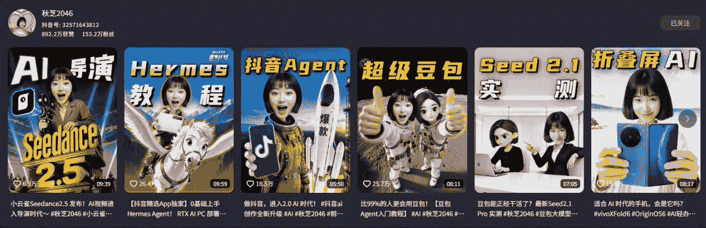
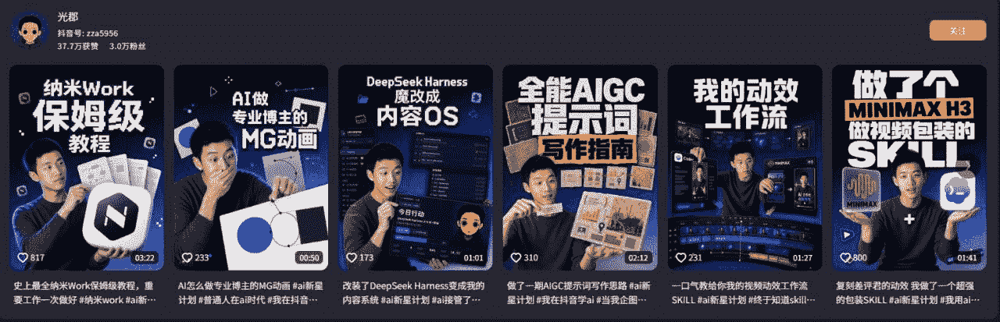
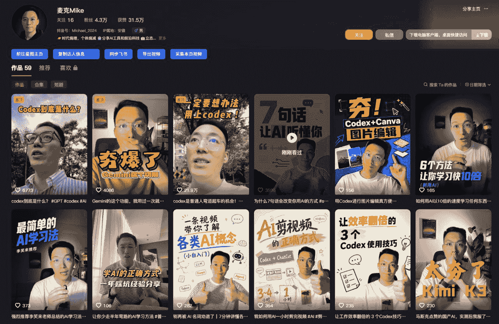
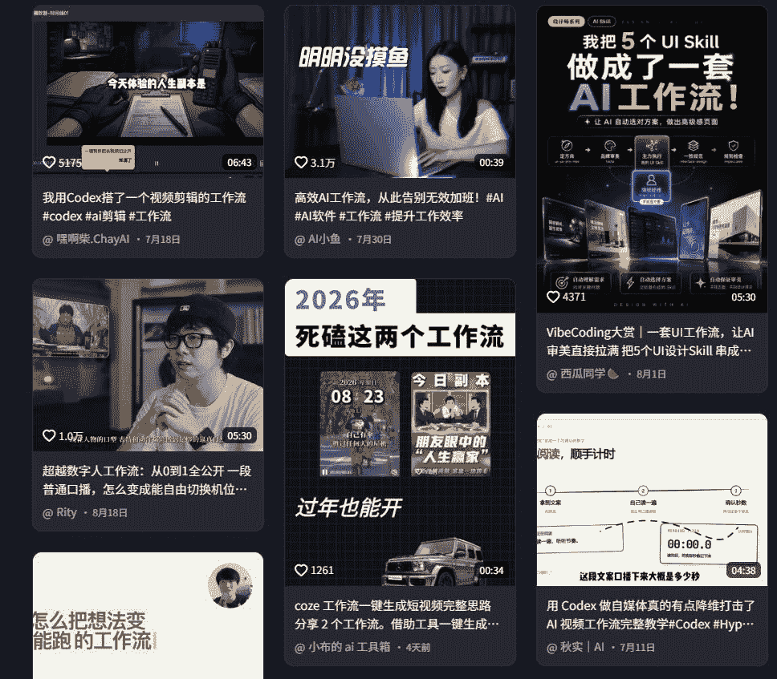

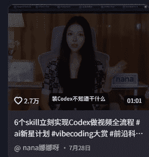
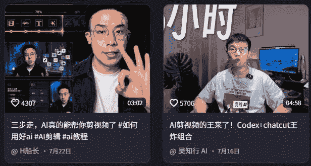

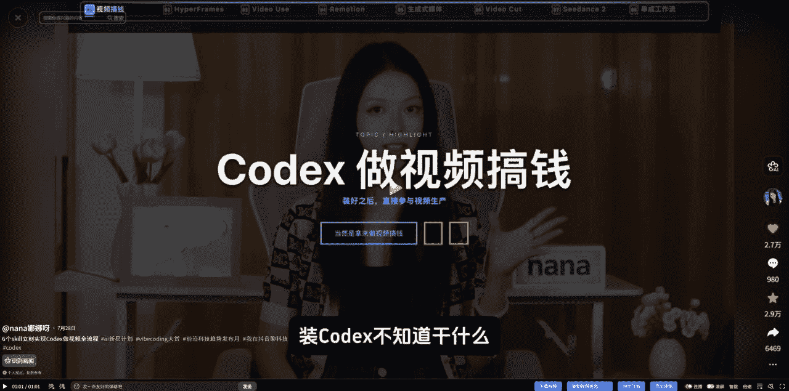
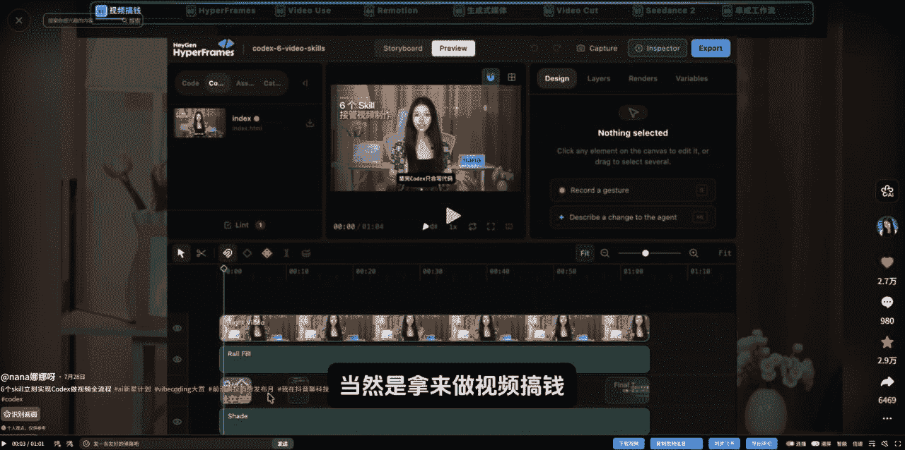
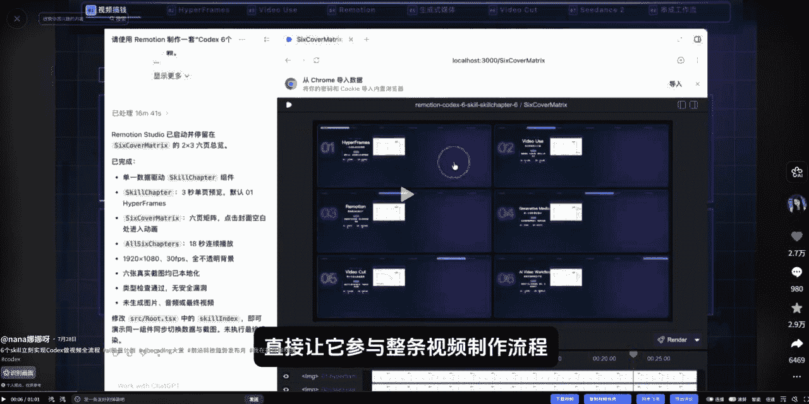
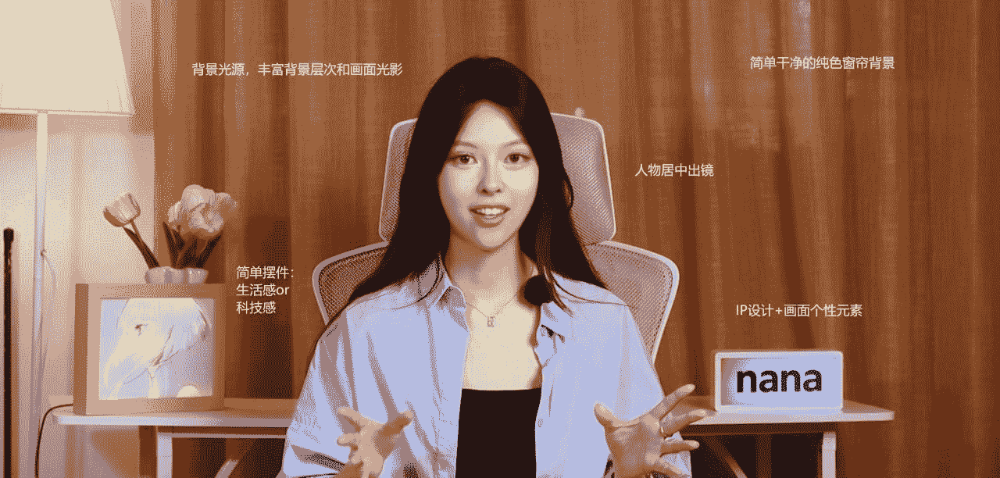

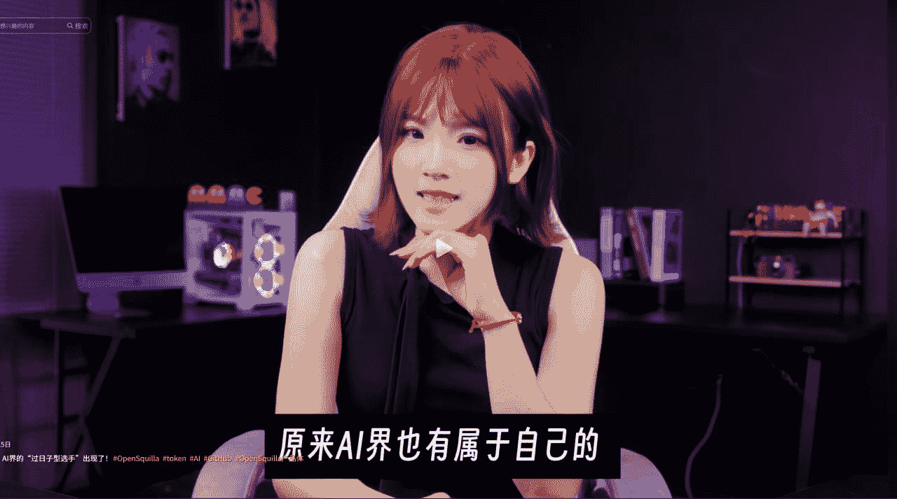

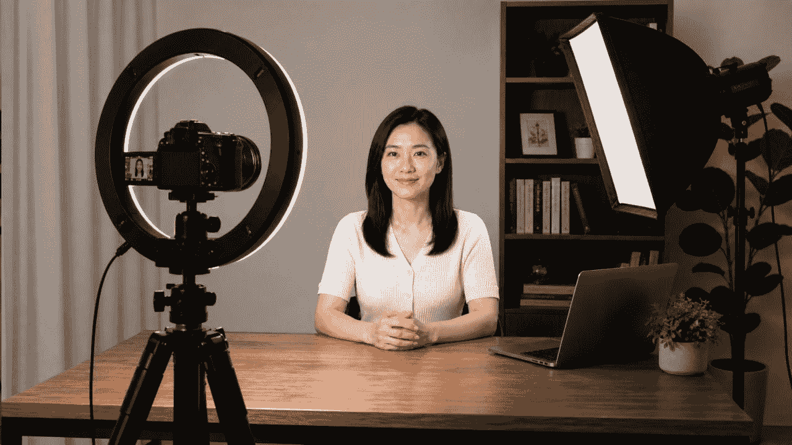
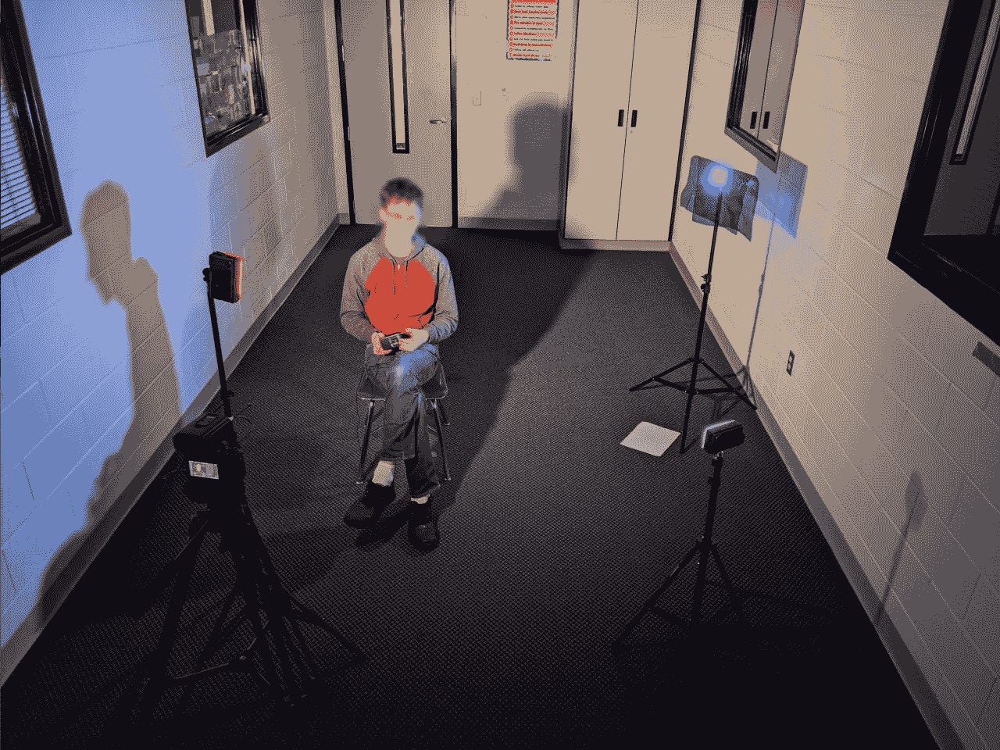
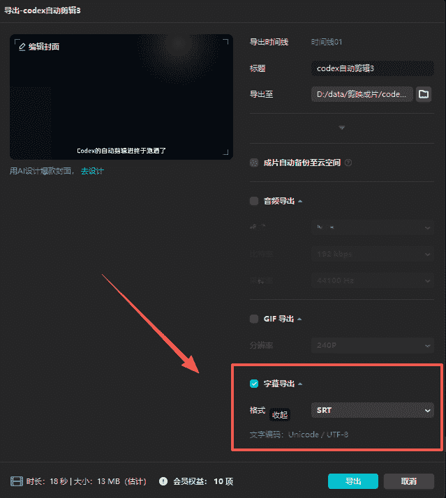
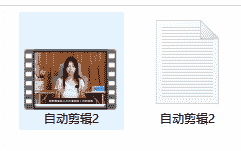
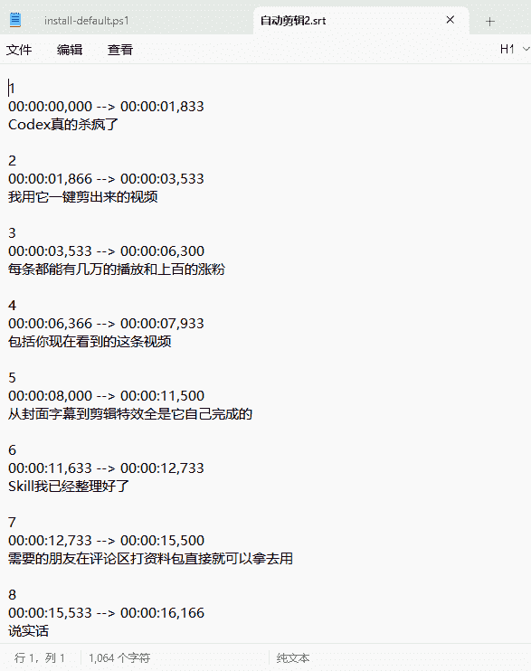
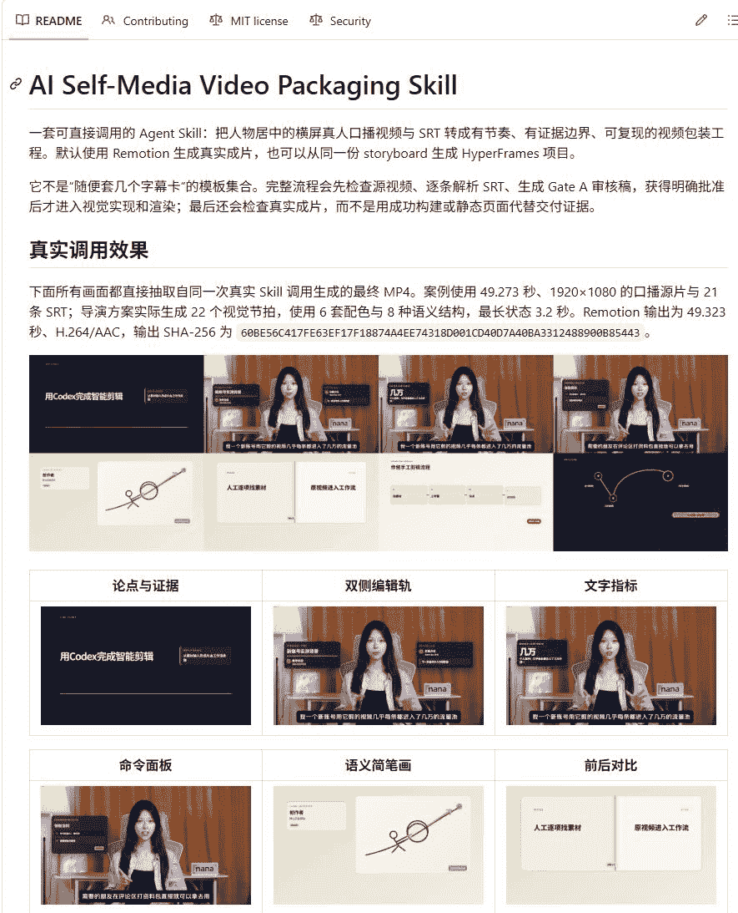
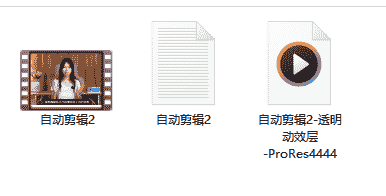
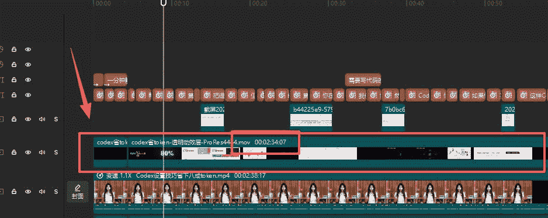
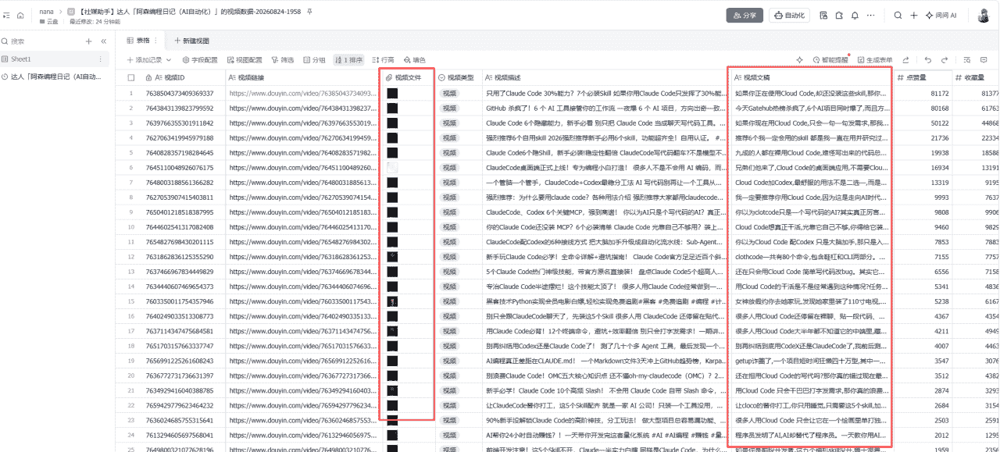
