# AI自媒体从0到1速通：抖音1个月跑通2.5w粉，商单+私域+产品+企业服务如何变现五位数

## 一个月把AI变现体系搭起来：抖音30天2.5万粉，商单+私域+课程+企业服务合计到手五位数

260828 · 副业SC精华

整理：公众号懒人搜索，懒人专属群精选
联系：微信 lazyhelper1

编辑点评：号已起步却卡在变现的AI自媒体人可以细看，纯小白想找一键复制捷径的建议跳过。最有参考价值的是作者的包装流水线：剪映导出SRT字幕 → 开源Skill生成透明背景MOV动效层 → 再回剪映叠加，一条约90秒的视频十多分钟封口。提醒一下，作者本身具备京东运营+B站带货5万佣金的背景，这2.5万粉里有存量能力加成，直接照搬周期只会更长。结尾提到的MCN蓝图目前仍属推演。

大家好，我是nana。

2002年出生，中传本科后赴港大深造。去年我还在深圳前海的写字楼里为京东做流量运营，每天写BRD。那是我第一份正式工作，节奏稳定却让我很早意识到，大厂的按部就班并非我想要的生活方式。即便心里清楚，也找不到出口，只能在焦躁中硬撑。

去年经朋友圈了解到赚钱，这里信息密度和分享氛围让我震动，随后开始大量吸收副业思维与实操方法。同期关注到B站好物，前两个月几乎没收益，我逼自己坚持到双十一，大促一来才迎来突破，拿到第一笔拿得出手的副业成绩。

复盘贴见：【B站好物】从月入200到双十一佣金5W，GMV 637W+，赚钱新手3个月从0开始的复盘分享。

今年12月的一场线下聚会，我第一次公开谈感受，称之为**life change**。因为这是我第一次靠非打工形式自己赚到5万，也清楚这只是起点，后面还有更大台阶。

今年618，好物收入再超预期，单月破**6**位数，618期间GMV做到1700万+。

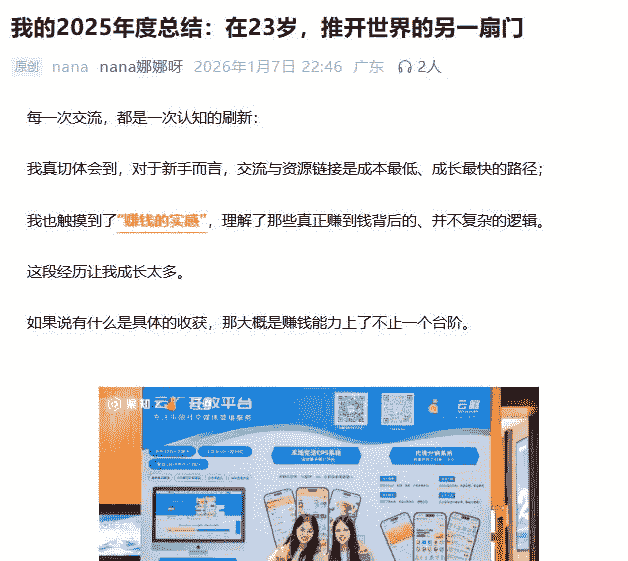

这笔钱给了我离职的底气，开启人生的下一阶段。

非常感谢赚钱，让我有了走出去的勇气，做成以前想都不敢想的事。今年在赚钱浓厚的AI氛围下，我决定把过往的内容经验和流量经验一起押注到AI方向，选择AI自媒体作为切口。

这篇复盘是在两场AI自媒体线下分享后，结合现场反馈整理的。感谢阿杰和丽丽两位组局官，两场交流收获很大。

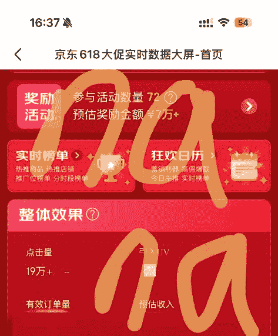

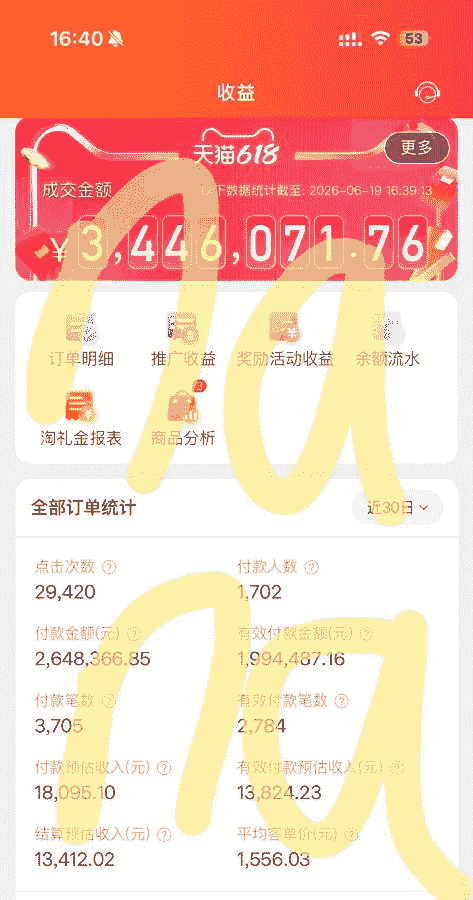

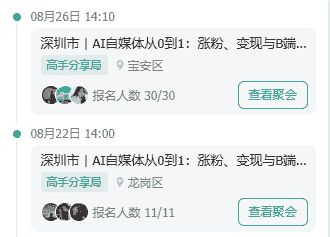

抖音账号【nana娜娜呀】正式运营约一个月。

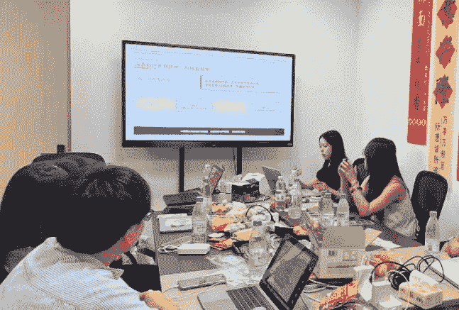

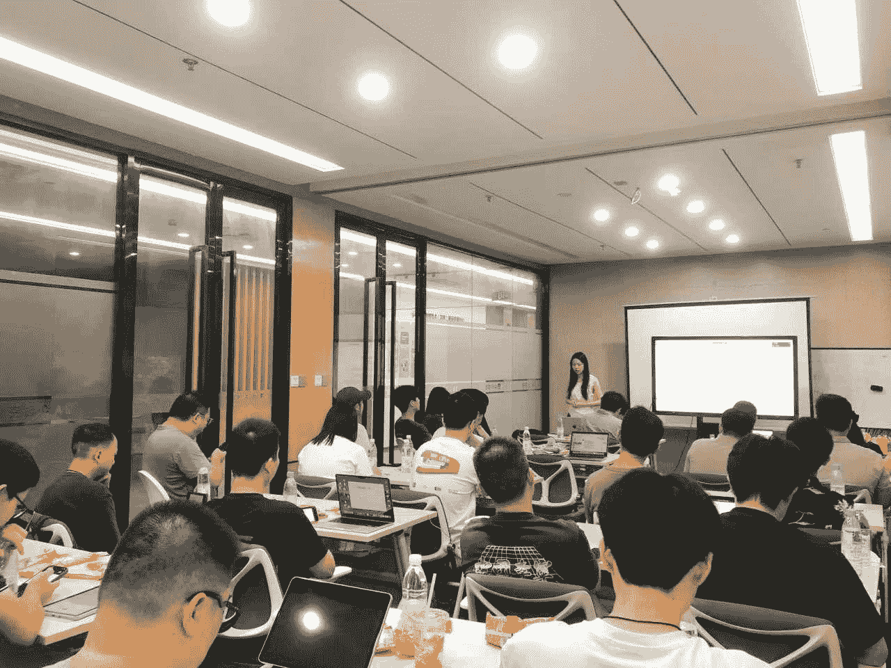

这30天，账号累计2.5万粉丝；抖音粉丝群14个，覆盖2500多人，引流是在起号后半段才启动；开始用资料+社群承接后，5天内1000多人加到微信；起号第7天还在百粉阶段就收到品牌邀约；第15天拿到首个四位数商单；目前对外报价2500元起。

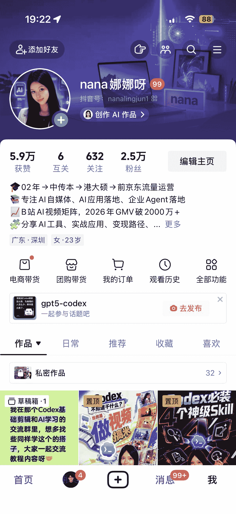

私域产品共三款：199元的AI社群，含资料库+AI主题训练营；1980元的AI工具号半年陪跑；4980元的AI自媒体真人商业IP全年陪跑，均已成交。

另外还成交一笔4000元的视频Agent订单，业务开始从内容向小B定制和企业服务延伸。

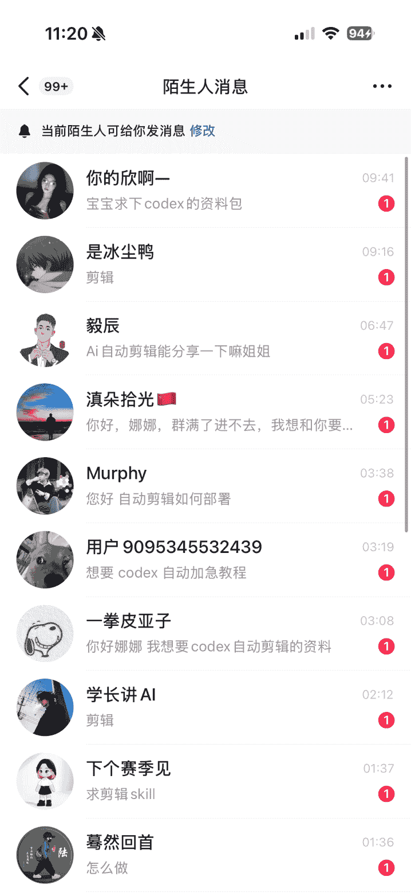

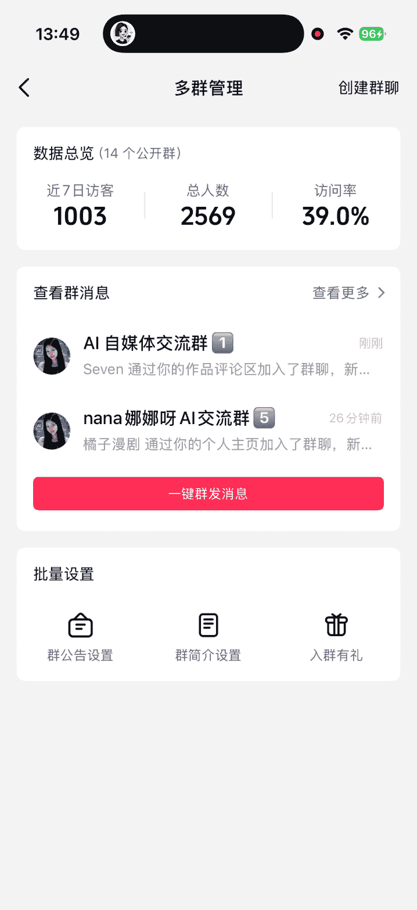

仅看数字，很容易得出结论：AI赛道在红利期，我恰好抓住了流量。

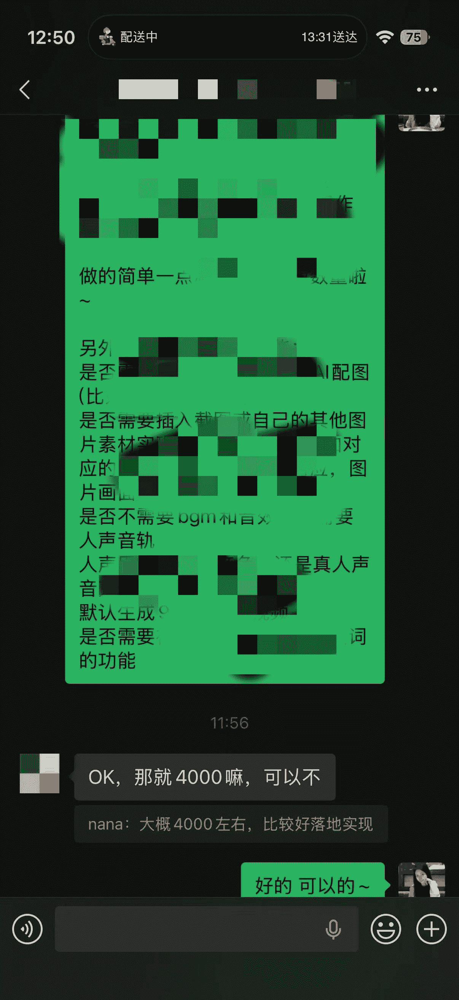

这个判断不算全错。AI相关内容目前确实比很多成熟赛道更容易获得推荐，涨粉更快。

但这一个月让我感触最深的不是“流量来得快”，而是：

**如果做AI自媒体的目的是赚钱，那绝不只是做一个号那么简单。**

商业框架没提前想清，流量起来后变现也接不上。更麻烦的是流量越猛，问题暴露越快：私域接不住、产品没准备好、交付跟不上、团队来不及，最后放大的不是机会而是混乱。

所以本文想分享的不是如何做爆款，而是一条更完整的路径：

从商业结果倒推定位→从定位找有效选题→依托AI搭建稳定的内容生产流水线。

这也是我现在在打磨的AI自媒体商业闭环。

自我介绍：我是nana，02年中传本科、港大硕士，前京东流量运营，现裸辞创业，B站好物深海圈答疑教练。近30天完成AI自媒体从0到1加速：抖音30天2.5万粉，商单+私域+课程+企业服务合计变现五位数。

## 一、为什么重点不在怎么生产内容

大学时我做过传统媒体新闻编辑实习，也在互联网公司做过内容岗，自己试过小红书。找题、写稿、产出我并不陌生。

但越做越清楚，我一直停留在“内容制作能力”层面，并未真正把这项能力变成持续赚钱的生意。

这点很触动我。因为会写、会拍、会剪，和把这些能力变成长期生意，中间隔着很长的距离。

内容能力解决“东西怎么做出”；商业能力解决“为什么做、为谁做、怎么盈利、如何持续、怎么放大”。当时我缺的正是后半部分。

硕士阶段我选择商学院，系统补商业规划、产品、运营与商业模式。毕业后去京东做了一年不到的流量运营，同时从去年加入赚钱，首个项目是B站视频带货。电商带货完整经历了从内容到流量到成交的链路。

这些项目让我明白：赚钱靠的不是某个动作做得漂亮，而是整条链路被串起来。

通常链路包括：目标人群—流量入口—内容信任—承接方式—产品服务—交付结果—复购放大。

因此进入AI自媒体前，我就没把它当单纯内容项目，而是未来AI公司业务里最先伸出去的流量触角。

过往的坑反复告诉我：收益最终来自商业本身。

会做内容不等于会赚钱，会搞流量也不等于会赚钱。要有一套完整商业体系和清晰变现路径，流量才有商业价值，内容才有流量价值。

我的规划很远：终极目标是打造AI时代内容+人才的平台型公司。IP内容在台前持续吸引C端和B端资源，让AI品牌方、需求方、想学AI的人聚拢过来。通过培训产品把“想做AI的人”变成“会做AI的人”，慢慢形成稳定人才池。再把资源实时匹配，把品牌投放需求分发给内容人才，AI MCN形态自然生长。之后聚合强交付能力的人组建企业服务团队，承接更复杂的团队项目和企业需求。

这套还在推演，不是已跑通的成绩。写出来是想展示一种思考方式：不要只看单条视频收入，要看今天沉淀的内容、用户、产品、流程、人才，未来能否组合成更大盘子。

账号是入口，内容是信任，产品是承接，交付是结果，团队合作是放大器。拼起来才更接近长期生意。

## 二、单个账号的变现该怎么搭

落到具体账号，该怎么做？

商单是最直接收入，但只靠商单，账号商业价值很薄。

其一，商单受更新频率、数据表现、品牌预算影响，不稳定；其二，为接广告把号做成万能货架，内容边界模糊，信任会被消耗；其三，靠一条条内容换钱，本质是卖时间与注意力，没有沉淀更深资产。

我从一开始就把账号当成流量入口而非业务终点。用户通过内容认识并判断专业度和信任度，后续怎么赚钱需要我主动设计。

目前跑的变现模型分四层。

### 第一层：商单
离内容最近，反馈最快。品牌看中内容形态、粉丝画像和数据表现，觉得能自然植入就会来谈。

若目标是接单，账号设计要从品牌视角倒推：数据是否稳定？画面质感如何？内容是否常出现工具和使用场景？植入是否突兀？

按此逻辑，纯商单号通常把数据做漂亮、广告位做明显、包装做精致。你在平台上看到画风精致、自带B站气质、数据明显有投流痕迹的号，大概率就是这条路——前期投入数据运营和制作成本，后期拿高价单回收。

我不想走纯商单路线，商单可作第一层收入，不应是唯一收入。

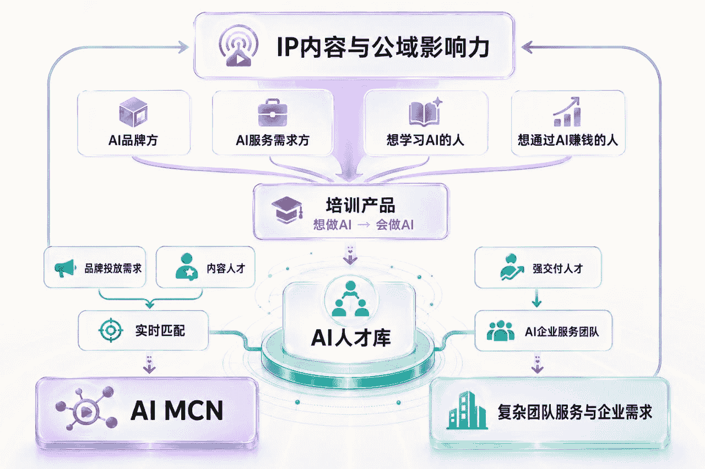

### 第二层：私域与社群
公域内容用户看完就走。私域的意义是把一次性观看变成持续关系。用户可在朋友圈持续看到IP内容和营销信息，我也能在合适时机触达转化。

我用资料和粉丝群承接：看完视频还想了解的人可进群。

群定位面向基数庞大的AI新手和入门者，也是被泛AI工具吸引来的C端用户主体。他们大多在职，被平台焦虑内容带动，想找干货填补AI空白，缓解焦虑。

因此社群内有AI基础认知、工具实操到项目机会的资料库，并每日做资料解读和交流，营造即时学习感。

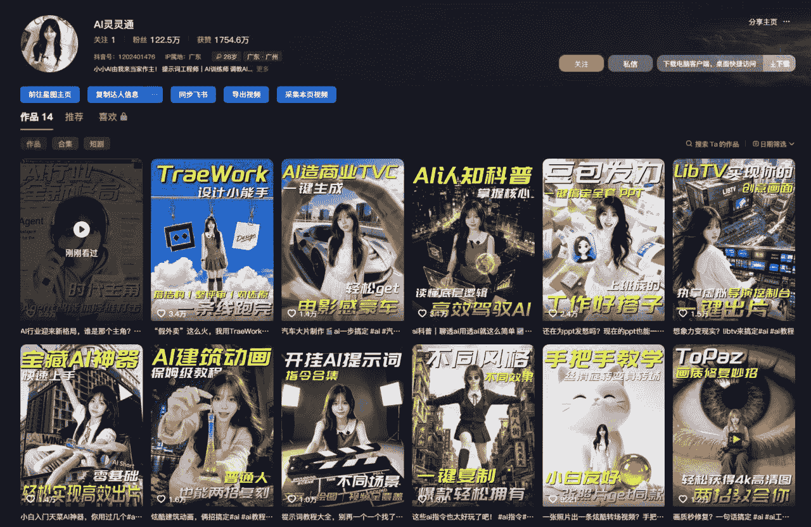

这款产品适合刚接触、没方向的人。它不是重训练营，而是低门槛的长期学习入口。

### 第三层：知识付费
社群之上，我设计了两个更聚焦的陪跑产品。

一个是AI工具号，适合不想真人出镜、用轻量视频起号并接单的人；另一个是真人商业IP陪跑，即我现在在走的方向。

这两个产品核心不是“某个工具怎么用”或“一个号怎么养”，而是：
如何借助AI自媒体形式赚到钱，并持续赚。

两条链路我都已跑通，值得继续放大，学员反馈不错。

### 第四层：定制与企业服务
用户认可能力后，可能不满足于学方法，而是希望直接解决问题。

最近成交的4000元视频Agent单，就是从内容能力延伸出的小B定制需求。

这件事让我确认：进入企业服务不一定要从几十万、上百万的大单开始。可以先找一个具体、范围小、结果可验收的场景。比如客户认可视频包装能力，希望做成稳定工作流或Agent，先把这个小场景做好即可。大服务商不屑做这些零碎需求，对个人或轻量团队来说恰是切入点。

四层叠加，单个账号商业价值才能最大化。很多人说我行动快、效率高、结果来得快，根本因提前想清楚了商业体系、产品形态、流量定位。

同时也明白什么不要做，不该纠结什么。在此前提下，拿结果变得简单：每天只做对变现最有效的事。

各阶段重心不同：

0起号时，首要任务是找到AI圈内被验证的内容，快速对标生产，打好标签，拿到初始流量。第二阶段，把流量到变现跑出MVP，比如建群、导私域、拿到后端首单。第三阶段，基于起号验证的有效动作和内容规律，用AI提效，搭建半自动内容生产体系。第四阶段，用矩阵和自动化放大已跑通成果。

每个阶段初次尝试都需要测试打磨。有过流量与内容经验，阶段推进更快更准；AI能力强，内容生产效率更高。

## 三、如何把内容与AI能力第一天就拉满

路径定好，执行速度要跟上。账号正反馈和流量来得比预期快，这大概是AI时代的推背感。

我用三件事加速：一是让助理尝试AI赛道其他内容形态，二是把主号定位做扎实，三是用AI加速视频包装。

### 工具号与矩阵：账号不是终点
这不是我一个人做，我还有两个助理。他们也参与过B站项目，现在运营AI工具类账号。工具号无需真人出镜，形式简单，生产和商单对接易标准化。有些新号两天就收到合作，有些约七天开始来单。

原因并不神秘：中小品牌预算有限，不只盯大博主，也愿意尝试粉量不高但能出低粉爆款、形式适合植入的账号。

这类型账号也适合矩阵。新手可先做一号，有经验者可开三号。一个号接到需求后，还可告知品牌方手里有匹配账号，提升合作效率。

目前助理一人管多个号。后期工作流稳定后，我想用AI和更细SOP把单人可管理账号数再放大。

但矩阵不是复制十个一模一样的号。真正要复制的是：跑通的选题逻辑、稳定输出的内容框架、清晰素材入库与审核流程、统一的品牌合作与交付标准。

一个号的商业闭环没打通就开十个，等于放大十份低效。所以先做出小闭环，再谈矩阵化。

### 先定位再谈内容
你得先确定目标客户是谁、为何付费、你提供什么、需求是否足够，然后再执行。若只追流量却不知流量上来后卖什么，变现将充满不确定性。

我的倒推顺序：商业目标→产品服务→目标人群→账号定位→内容方向→选题表达。

以我为例，产品是AI方向陪跑服务，目标人群是想用AI做内容、做号、做变现的人。定位不是“AI工具博主”，而是一个真实在跑AI自媒体业务、持续分享方法与变现过程的成长型商业IP。

倒推后内容方向清晰：
- 普通人如何从零判断AI自媒体方向
- 怎么用AI找有效选题
- 怎么用AI提升内容生产效率
- 个人如何从内容延伸到小B定制和企业服务

这些内容既能帮助目标人群，又能展示能力，最后自然承接产品服务。

我不认同先贴一个很窄的“我是谁、我喜欢什么”标签再找选题。个人经历应成为信任状和差异点，而非天花板。

有效定位要回答四个问题：
1. 你服务谁？
2. 他在什么场景遇到什么具体问题？
3. 你凭什么给出判断？
4. 如何持续帮他解决问题？

只写“AI博主”“职场博主”“跨境博主”都不算定位。用户不知道为何关注，也不知道你能持续解决什么。

定位扎实后选题自然来。很多人痛苦在于每天想“发什么”。我不等人灵感，而是先列关键词，再搜索筛选高质量对标。如做AI方向，可从AI工具、副业、变现、视频等词出发，看哪些内容与表达风格接近，哪些账号非超头部却反复做出高于粉丝基数的数据。

头部数据常混长期品牌、历史粉与平台资源，不适合新人直接抄。中腰部和低粉爆款更有参考价值。

找到对标后我拆三点：
1. 这个选题解决谁的什么问题？
2. 开头为何让人停留？
3. 表达与结构为何有效？

比如“怎么做AI内容博主”太大太泛，没理由点开。改成“我一小时搭出一套AI内容生产流程”，就有了具体场景、明确结果和时间承诺。

再如跨境电商+AI，不要讲“AI赋能跨境电商”，而可落到：
- 电商视频素材如何更快批量生成？
- 商品详情图哪些环节能用AI、哪些必须人工核对？

场景越具体，流量越精准，承接越顺。

另外一个反常识判断：不必担心选题不够。被验证的选题做一次就扔掉太浪费。只要问题长期存在、框架反复有效，就可换案例、换开头、换场景、换人群、换表达继续做。

比如AI剪辑，我做过，很多号也做过，数据都不错。

做内容不是每次从零发明。先找到一套被验证的选题框架，然后重复、迭代、放大，直到失效再换下一个。这样可把精力从前端内容投向私域、产品、交付、商务合作等更接近变现的环节。

### 好内容是流量、干货、IP、营销的叠加
在我体系里，一条视频可拆成四种元素：带来传播的流量钩子、让用户有收获的干货、形成个人辨识度的IP印记、为转化服务的营销设计。四者叠加，内容才不只是内容，而是商业闭环里最前面的齿轮。

做内容，其实是在给观众配一套“行动菜单”。菜单里有四样东西：

第一样，是靠某句话、某张封面、某个悬念制造出的点开理由；  
第二样，是看完就能用的方法、步骤和判断标准；  
第三样，是你过往的经历、观点、表达习惯组成的记忆点；  
第四样，是产品、服务、联系方式这类引导动作。

一条作品可以四样一起上，也可以只上两三种；但想长期只靠一样，几乎走不通。

如果全是第一样，内容会慢慢变成情绪刺激甚至擦边；全是第二样，会专业但没人看；全是第三样，新观众没理由关心；全是第四样，用户很快会产生戒心。

我起步期最顺手的搭配，是第一样加第二样：先用足够具体的钩子，告诉观众“这条东西和你有关系”；随后快速给方法、给案例、给步骤。

还是用那条Codex短片举例子。我当时的开场是：

“装了Codex却想不出能干嘛？拿它来做短片变现啊。”

第一句点破新手常见困惑，第二句直接把最诱人的方向拍出来。

然后我给出极简解法：装好6个技能就能跑。这种“不用动脑”的感觉，让人觉得是干货、是捷径。我再挨个介绍和演示技能内容就够了。

频道过了起步期，再慢慢加入个人故事和商业信息。

比如讲智能剪辑，普通讲法是“推荐3个工具”。观众记住的只是工具名，而工具名很快会过期。

换成这样讲就不同了：

“我把一条出镜短片的后期包装，打包成了一个技能包，以前要手动处理的字幕强调、信息卡、章节提示，现在十几分钟自动完成。”

结果、场景、好奇心全在一句话里。下面再展开：过去的做法、最耗时的一步、模型接手了哪些、人工还需要盯哪些、最后效果如何、适合哪类片子、不适合哪类片子。整条内容就很有说服力。

### 一条成品短片是怎么做出来的

看到我做智能媒体号，很多人默认我的选题、脚本、拍摄、剪辑、发布全自动了。

实际上不是。

眼下智能工具帮我最大的，在包装环节；选题判断、内容把关、素材整理，仍需大量人工。

不是做不到，是我想明白了一件事：成本收益比。比如出镜素材里的气口、口误、磨皮、调色，我对剪映很熟，自己顺手弄反而最快。交给模型做，万一不对，我还要反复解释错在哪、等它返工，更折腾。

我唯一的判断标准是：这一步交给模型，是不是真的省时、稳定、好验收？

目前我这边的流程分四段。

#### 第一段：真人出镜拍摄

知识类内容不一定需要华丽布景。把机位固定，保持背景干净、收音清楚，人物离背景拉开一点距离，画面层次就会更强。

三张对比图足够说明问题：第一张没有留出间隔，人像和背景叠在一起，画面发闷；第二张和第三张把前后距离拉开，立体感和明暗对比马上就有了。其中，第二张的背景画面由ChatGPT生成。

画面干净比什么都重要。前景可有可无，背景别堆杂物。

光线有限，有自然光照进来就先用它；想升级，加一盏主灯加一盏辅灯；要把轮廓勾勒出来，再补一道轮廓灯。

我早年在B站做过片子，镜头和场景上有家底，所以不会为了智能感丢掉真人优势。一个能表达、有感染力的出镜者，天然就是内容资产。

#### 第二段：剪映完成底稿处理

头一道，我会打开剪映，把气口、口误、节奏、磨皮、调色都过一遍，然后导出两样东西：

- 一条干净出镜原片；
- 一份带时间线的字幕文件，格式是SRT，记事本即可打开。

#### 第三段：技能包做语义化包装

技能包读入SRT后，会理解每句话的含义，再根据时间线自动安排重点字、信息卡、章节标记和动效。

公开技能包在这：

https://github.com/zhouyuechuan2025-ui/ai-self-media-video-packaging-skill

安装步骤不复杂，跟Codex讲这句话：

请把上面的技能包安装好，再告诉我具体怎么用。

https://github.com/zhouyuechuan2025-ui/ai-self-media-video-packaging-skill

最后拿到的是一条带透明通道的MOV动态层，节奏和前面对齐。

#### 第四段：回到剪映做最后合成

把MOV放到原片轨道上一层，大部分画面包装就一次性完成了。

简单的截图，模型能处理；复杂的录屏、光标轨迹、局部放大、需要精确标注的画面，我仍愿意手动打开剪映来做，因为我剪得快，模型沟通成本有时不如手动来得踏实。

技能包模板稳定后，一条长度约90秒的成片，包装大概十五分钟出；把录屏、截图、完整剪辑算上，一条片子目前约个把小时。

这和“一键成片”是两个世界，但够我维持更新频率。我不想为了追求完全自动化，牺牲成品质量。

更合适的路线是：先把高频、标准化的重复劳动交给模型，再随着产量和团队扩张，持续找下一步的自动化节点。

做得久了，你会慢慢知道什么样的选题值得写、什么样的开头抓人、什么样的表达适合自己。

有了这套感觉，再用模型辅助选题分析、脚本生成、数据复盘，效果才会好。因为自己都说不清“好”在哪里，模型就不可能持续给出标准答案。

我的自动选题现在也说不上成熟。我通常先从商业目标和定位去推关键词，再去搜对标，最后用真实发布数据来筛。这比让模型一口气编100个标题，要可靠得多。

## 从4000元订单说起：企业服务不需要一开始就“大而全”

个人创作者一听“企业级智能服务”，容易觉得那是技术公司、大厂或者咨询机构的事。

做下来之后我真实的感觉是：大而复杂的交付确实难，但早期触达企业需求，并没有想象中远。

持续发布本就是信任入口。长期死磕某一类具体问题，甲方会从作品中判断你懂不懂行、能不能落地、好不好协作。找上门的订单往往不大不小，但边界很清楚。

我那笔4000元的订单就是如此。客户看到我的成片质感，想把它变成能反复调用的工具或工作流。边界清楚，验收标准也好定。

如果个人想切入这行，我总结了三句话。

### 1. 从小场景下手

别开口就承诺帮企业做全域智能化。可以先把单条短片的包装工序、桌面上的内容生产工作台、内部FAQ库、员工智能工具培训、会议纪要转待办清单做成项目。切口越小，范围越可控，验收越简单。

### 2. 分清楚你当哪个角色

企业级智能服务大致有三类角色：讲师、顾问、交付方。

培训者的任务是讲清复杂事项，让管理者和执行层形成统一认知；咨询者负责访谈需求、诊断业务、设计方案、制定验收标准；交付者则要搞定产品、接口、权限、部署、维护，并且最后扛结果。

三种角色能合作，但不能混着承诺。

我会从讲师切入，因为对多数传统行业老板来说，线下见面、面对面分享是最有效的信任入口。顾问需要经营者视角：客户不是要一个先进方案，而是要省多少时间、少出什么错、提高什么效率、谁负责、出问题怎么办。交付方责任最重，一旦涉及数据、权限、接口这类正式业务，必须划清自身能力的边界，不懂不能接。

### 3. 别把话说满

客户带着需求来，先确认它是否被定义清楚。如果对方业务方向都没想好，却指望智能工具直接造出结果，这单要谨慎。

比如有人想做视频号，但负责部门、内容方向、转化链路全是空白。我能列清楚哪些环节可行、哪些不可行，却不会为了接单，就承诺在不了解情况时做出整套增长方案。

能接就接，不能接就说清楚，或者转介绍给合作伙伴。长期信任，比一张不合适的大单更重要。

## 写在最后

我运营智能媒体账号刚满一月，这只是验证整个智能商业框架的开端。

当这条链路跑通，后面的路就开始清楚了。

主号只是整套体系前端的曝光入口。往后，我要拿已验证的方法批量复制垂类账号，培养内容人才，把品牌方的投放需求匹配给合适的创作者，逐步形成智能内容领域的账号矩阵和MCN业务。

为何要这样布局？

因为很少人会在事情开始时预演终局：当智能软件普及，内容生产成本会继续走低，平台上的同质内容会越来越多。所谓的技术红利和曝光红利，都会逐渐变薄。

到那个阶段，真正较量的并非操作多少个软件，而是能否把公域粉丝沉淀成自己的资产，长期理解用户、服务用户，并围绕真实需求布置产品、服务、社群和信任。这正是我继续布局人才培养和企业服务的原因。

用课程和实战项目，我能把一批有志进入智能行业的人，训练成懂内容、懂技术或能交付的人，逐渐组成稳定的人才储备；再按需把他们组织起来，承接品牌投放、内容产出、智能体开发、企业智能化改造等业务。

当多样的能力被组合在一起，我们能拿下的就不只是某条内容、某个账号或某个商单，而是更重的定制项目与行业级方案。

终局构想是一套完整的智能商业体系：前端靠个人品牌和内容矩阵获取曝光，中端靠培训和实战项目培养人才，后端靠人才协同拿下品牌投放和企业服务订单；项目沉淀出的案例、收入和资源，再反过来滋养内容和品牌。

我一直相信，智能化时代最重要的机会，不在于让某个人干活更快，而在于用智能工具重组内容、人才与商业资源，让大量普通人获得新的职业和创业空间，也让企业真正把智能化用起来。

这条路线，我已经决定长期走下去。接下来就是往深处做、往大处做。也希望继续在赚钱，与关注智能内容、商业变现、人才孵化和企业服务的同行交流合作，一起寻找更长周期的机会。

————分割线————

这篇SOP读一遍，很多人都觉得懂了。真到动手时，九成会在头一步卡住。

工具和资料从来不是真正的门槛；门槛在于你是否立刻开干、是否身处有效的信息圈子。

想看到当下最新的变现方法，并和一群行动力很强的人一起实操拿结果，可以来我常驻的私域：【懒人专属群】。

这里不讲空话，只拆解赚钱闭环，只谈把智能工具用到极致。库里已有1000多个跑通的套利实战案例。

👉 完整数字资产与加入方式：

https://lazyso.com/insider/

认可价值、准备动手的伙伴，加微信（lazyhelper1）。

备注：【实操上车】，不闲聊。

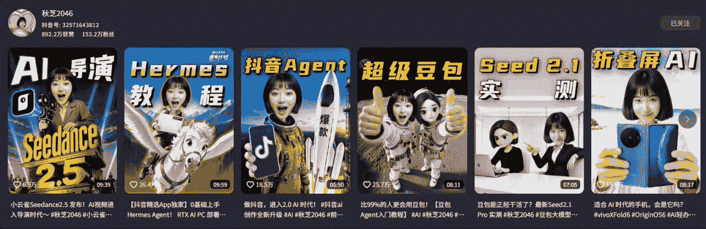
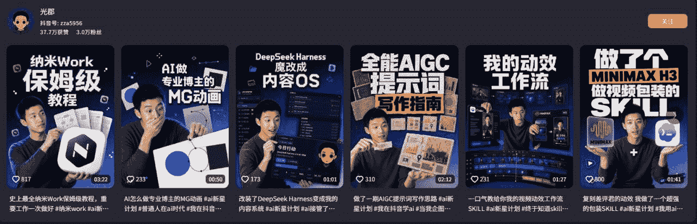
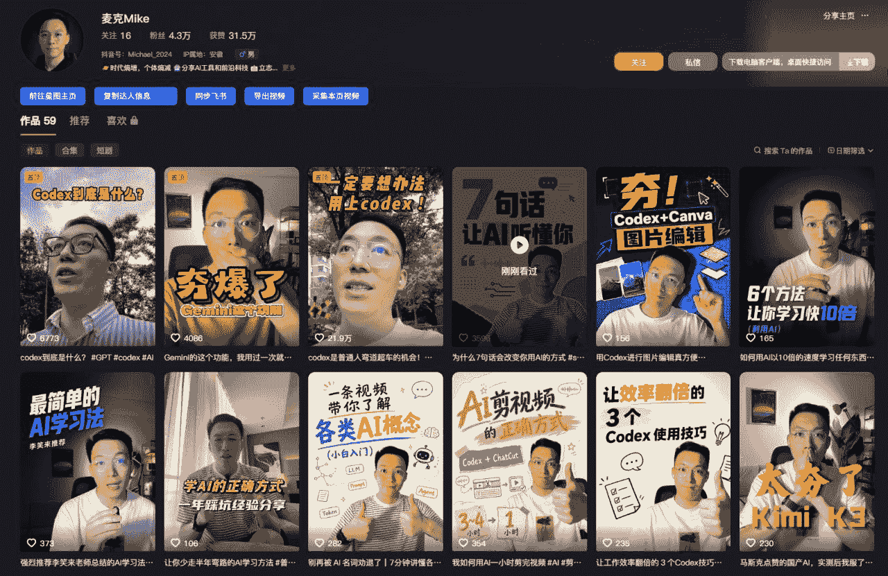
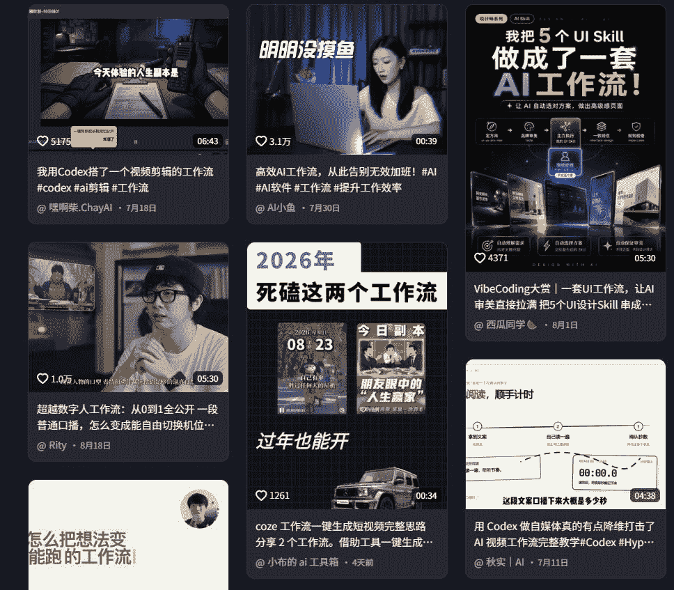

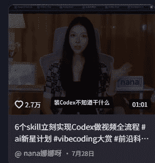
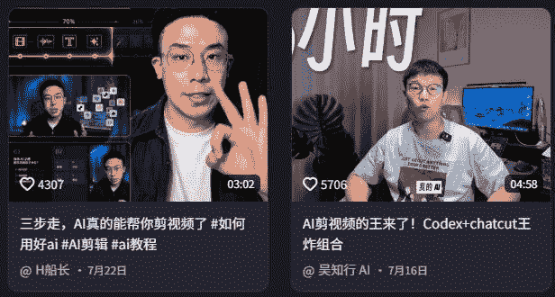

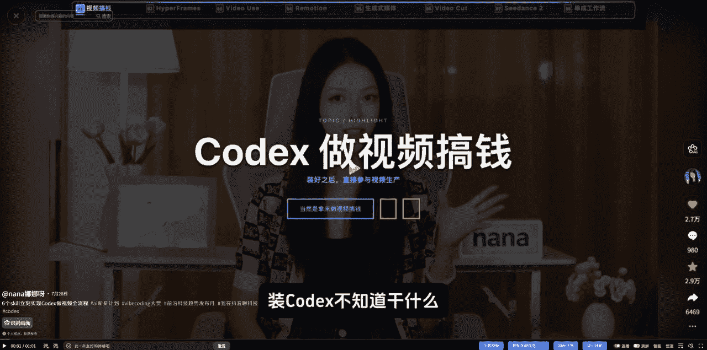
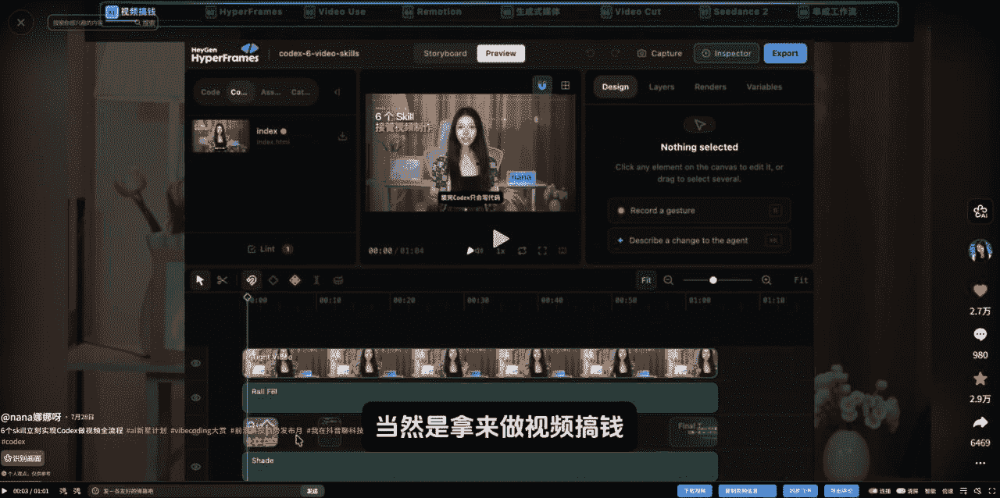
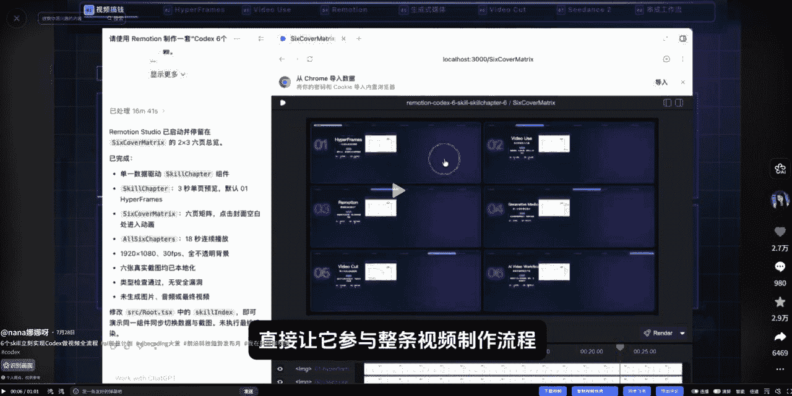
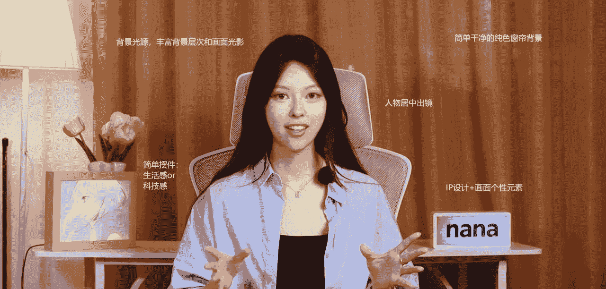

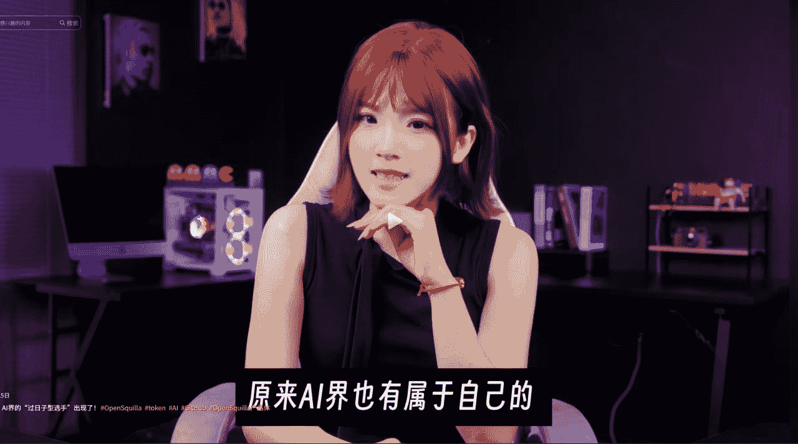

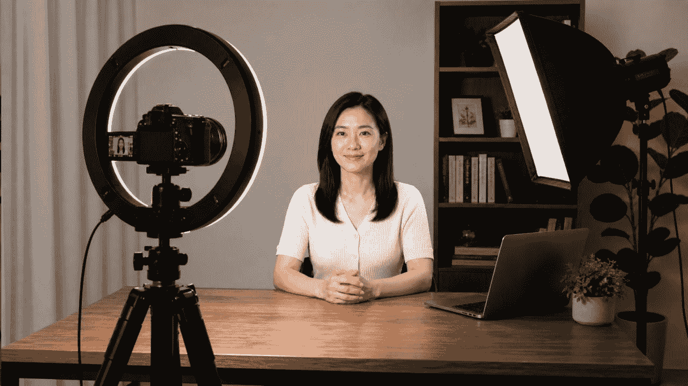
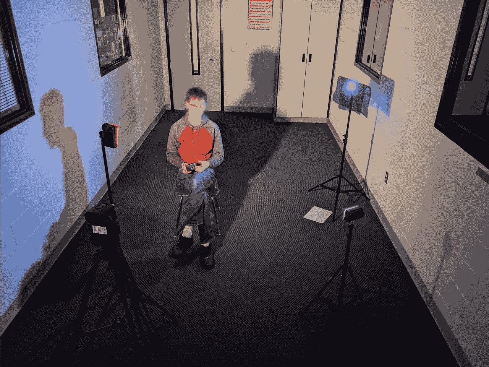
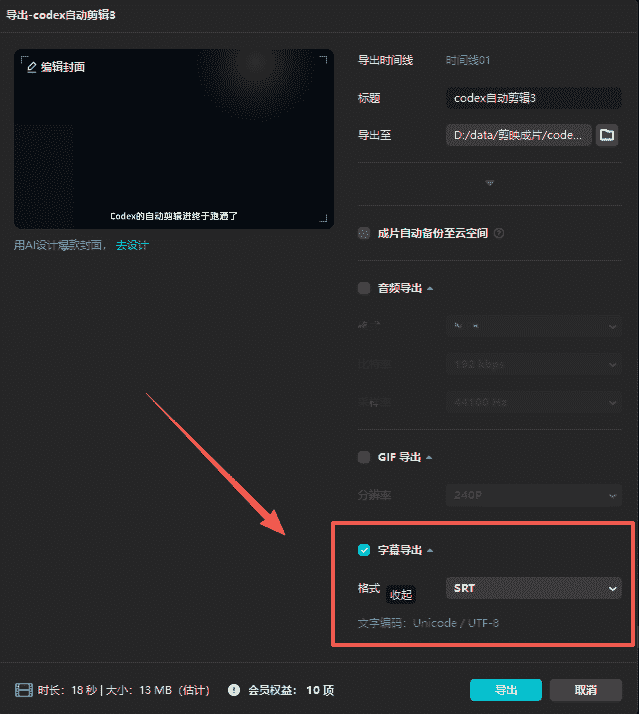
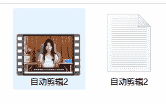
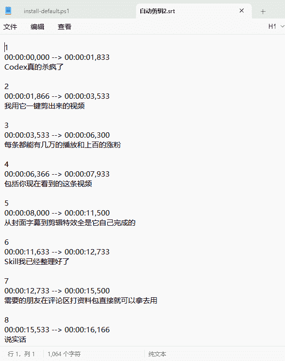
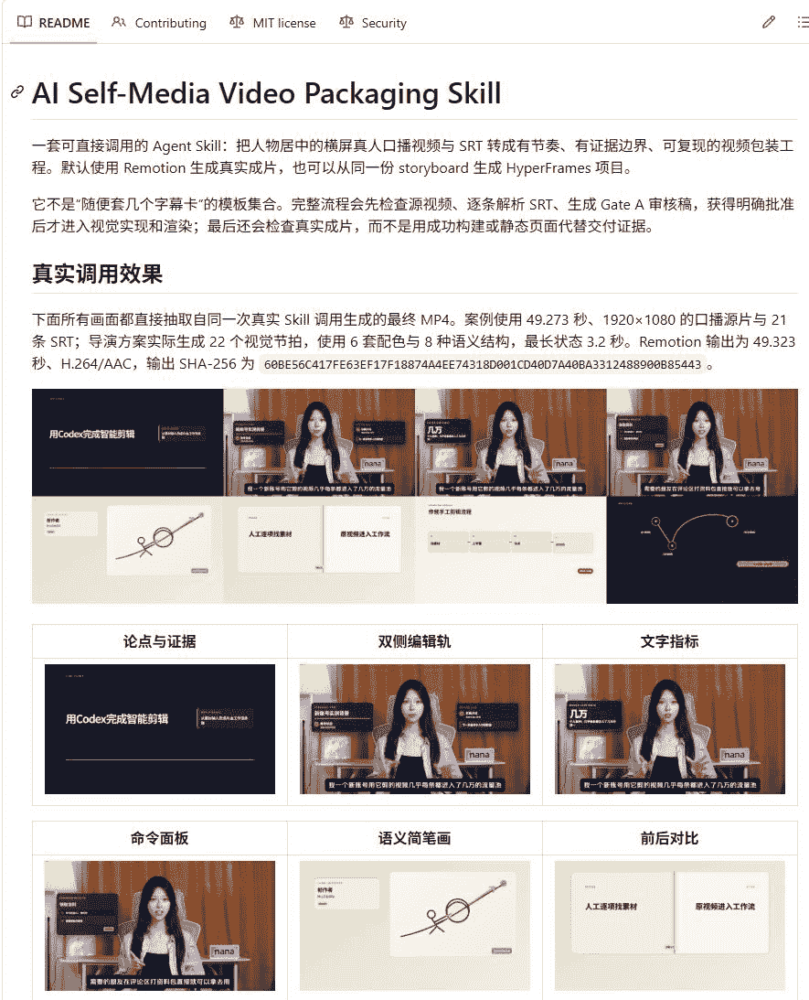

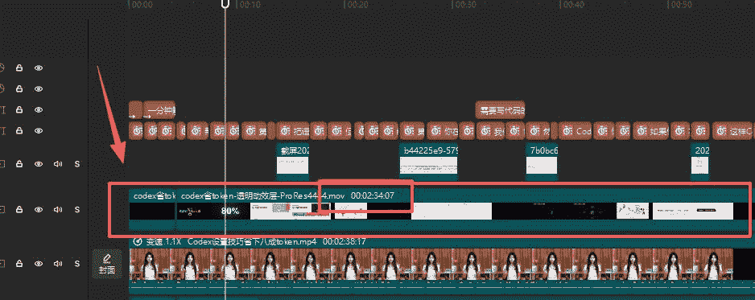
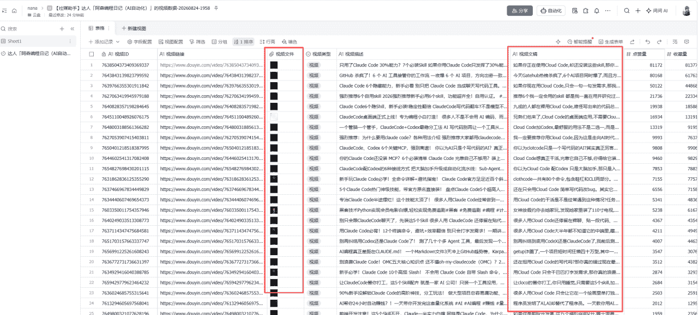
