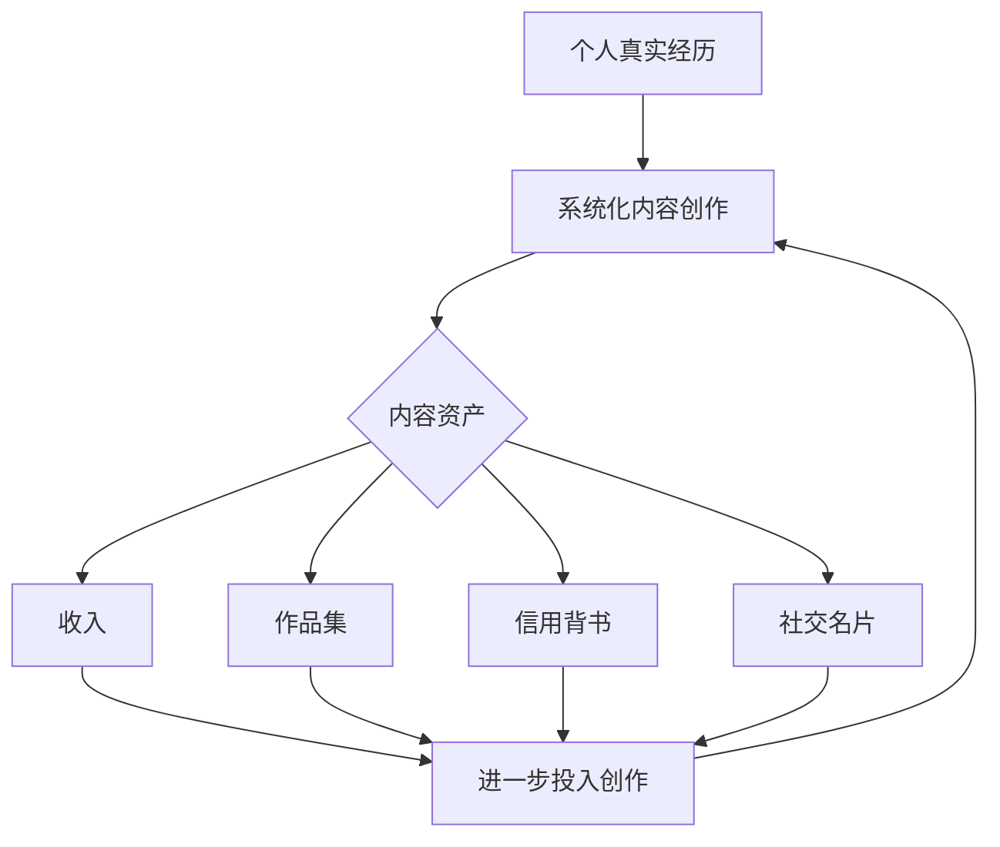
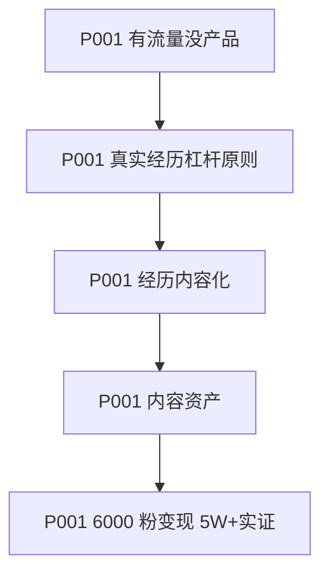
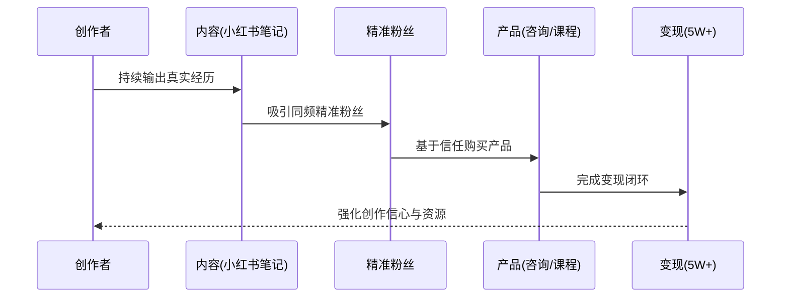

# 第二章 内容资产 —— 把经历变成可变现的杠杆

## 学习目标

- 识别有流量没产品的隐性损耗与信任透支风险
- 理解内容资产四重价值（收入、作品、信用、社交名片）
- 掌握真实经历杠杆原则：用真实换信任
- 能运用经历内容化方法形成可持续产出的素材库
- 能解析 6000 粉变现 5W+案例，理解粉丝数与变现弱相关

## 2.1 生活类比

想象你开了一家餐厅，装修精美、门庭若市，每天有大量顾客在门口排起长队。然而，你却没有备好足够的食材，也没有固定的菜单。顾客进来后，只能看到空荡荡的柜台，失望地离开。更糟糕的是，他们回去后会在朋友圈里告诉你"这家店徒有其表"，从此再也不来。这就是"有流量没产品"的真实写照。

反过来，想象你的邻居老王——他没有豪华的店面，只是把他多年来走南闯北、创业失败又爬起来的真实经历，一篇一篇地写成日记放在网上。他不假装自己是什么成功学大师，只是如实记录踩过的坑、流过的泪、挣到的钱。慢慢地，有人为他的经验付费咨询，有人买他的课程，还有人主动帮他介绍生意。老王没有传奇人生，但他把真实走过的路变成了一笔可以反复提取的资产——这就是内容资产。

## 2.2 概念地图

```
内容资产：把经历变成可变现的杠杆
├── 有流量没产品
│   ├── 核心坑位：流量大于粉丝数是致命伤
│   └── 三阶损耗：隐性损耗+机会成本+信任透支
├── 内容资产四重价值
│   ├── 收入/作品/信用/社交名片
│   └── 三大性质：累积性+多源性+长尾效应
├── 真实经历杠杆原则
│   ├── 反直觉主张：放大真实而非虚构传奇
│   └── 三大优势：可复制性+信任溢价+持久供给
├── 经历内容化
│   ├── 循环管线三动作：如实记录+提炼主题+持续产出
│   └── 边界：非流水账，需受众价值匹配
└── 6000 粉变现 5W+实证
    ├── 粉丝量是变现能力的弱相关变量
    ├── 每粉变现约 8.3 元
    └── 闭环验证：内容资产+真实经历+经历内容化+产品承接
```

## 2.3 有流量没产品：最大的认知陷阱

很多人把"粉丝少"当作失败的唯一原因，于是拼命追流量、上热门、蹭热点。但《把经历做成内容资产并变现 5W》这篇素材（下称 P001）给出了一句极其反直觉的判断——流量本身不是资产，被产品承接的流量才是。


> "最大的坑不是粉丝少，而是有流量没产品。"
> 
> ——《P001, p.1》

这句话值得拆成两层来理解。第一，粉丝少不是致命伤，因为即使只有 100 个粉丝，只要其中 10 个人购买了你的产品，你依然有收入；第二，有流量没产品才是致命伤，因为每一条来到你面前的目光，都是你花时间、花精力、甚至花钱换来的，它们到了你这里却没有任何东西可以"接住"——这就像你花大价钱租了一个黄金铺位，却不往货架上摆任何商品。

我们用一个简单的公式来表达这个逻辑。假设你的变现收入为 R，流量为 T，转化率为 c（即流量中愿意付费的比例），产品客单价为 p，那么：

$$
R = T \times c \times p
$$

来源：`[P001, p.1]`，概念：`有流量没产品`，关键公式：`变现收入公式`

这个公式展示了变现收入的三个杠杆：流量、转化率、客单价。它表面上看三者是乘数关系，但更深层的启示是——如果产品不存在，即 p = 0，那么无论流量 T 有多大，收入 R 都恒等于零。**流量是放大器，产品是引擎**，没有引擎的放大器只会放大噪音。

更进一步，有流量没产品的损失远不止收入归零。我们称之为**三阶损耗**，它层层递进：

| 损耗层级 | 表现 | 长期后果 |
|---------|------|---------|
| 隐性损耗 | 流量来了没接住，白费精力 | 创作动力枯竭，半途而废 |
| 机会成本 | 本可以用来做产品的时问被流量焦虑吞噬 | 永远停留在"追热点"的恶性循环 |
| 信任透支 | 用户来了两次发现没东西可买，不再回来 | 账号失去长期价值，沦为数字废墟 |

**来源：** `[P001, p.1]`，概念：`三阶损耗`

信任透支是最隐蔽也最致命的。用户第一次来你的主页看到优秀的笔记，期待你提供更多价值，却发现什么都没有下一次更新的预告、没有产品入口、没有可以去深入了解你的地方，他的期待落空了。两次落空之后，账号在用户心中就被永久标记为"不值得关注"。流量越大，这种信任透支的扩散面就越广。

所以，当你意识到自己陷入"流量焦虑"时，应该先停下来问一个问题——**我的产品在哪里？**这里的"产品"不一定是实物商品。课程是产品，咨询是产品，社群是产品，甚至一份精心整理的资料包也是产品。P001 明确指出：

> "产品不仅指实物，也包括课程、咨询、社群等服务。"
> 
> ——《P001, p.2》

这段话把产品的范围拓宽了。它告诉我们，产品的最小单位可以是一个"确定性的交付承诺"——用户知道来了你能给他什么、以什么形式给、多久能给到。有了这个承诺，流量才不再是过客，而是可以沉淀的资产。

## 2.4 内容资产：四重价值与三大性质

上一节我们论证了"没有产品"的危害，那么产品从哪里来？P001 给出的答案是——从你的系统化内容创作中来。当内容被系统性地创作、沉淀、复用之后，它就变成了一种可累积、可复利的资源，这就是**内容资产**。


> "内容资产不只是收入，也是作品、信用、社交名片。"
> 
> ——《P001, p.3》

这句话直接点出了内容资产的四重价值：收入、作品、信用、社交名片。很多人只盯着第一重——收入，却忽略了后三重的复利效应。让我们把每一重价值展开来看：

| 价值维度 | 具体体现 | 累积方式 |
|---------|---------|---------|
| 收入 | 课程、咨询、打赏、商单 | 一次创作，多次售卖 |
| 作品 | 可被检索、转载、引用的内容 | 时间越长，存量越厚 |
| 信用 | 读者基于长期阅读建立的信任 | 每篇真实内容都在为信用加分 |
| 社交名片 | 你的账号就是你的在线简历 | 谈判、合作、面试时直接展示 |

**来源：** `[P001, p.3]`，概念：`内容资产四重价值`

为什么把这四重价值称为"资产"而不是"内容"?因为资产的定义是"能够带来未来收益的资源"。一个普通的视频发出去，三天后就沉入信息海洋，它不构成资产；但一篇持续有人搜索、转载、引用的深度文章，会在发布后的每个月都为你带来源源不断的曝光——这就是资产与消耗品的区别。

P001 进一步总结出内容资产的三大性质，我们用下表呈现：

$$
\text{累积性}：\text{总量}(t) = \sum_{\tau=1}^{t} \text{产出}(\tau)
$$

$$
\text{多源性}：\text{单条内容可衍生} \geq 3 \text{个变现渠道}
$$

$$
\text{长尾效应}：\text{发布后第} n \text{个月的曝光量} > 0, \forall n
$$

来源：`[P001, p.3]`，概念：`内容资产三大性质`，关键公式：`累积性/多源性/长尾效应公式`

这三个公式展示了同一个核心观点：内容资产的价值不是线性的，而是指数级的。累积性意味着你发布得越早、坚持得越久，你拥有的资产总量越大；多源性意味着同一篇内容可以同时服务课程宣传、个人品牌、商务合作等多个目的，一份投入多种回报；长尾效应则提醒我们，优质内容的价值窗口远不止发布后的三天，它会持续牵引搜索流量、口碑传播和回头客。

我们可以用一个数据流图来理解内容资产如何被构建和变现：



这张循环图展示了内容资产的本质：它不是一个静态的仓库，而是一个**自我强化的飞轮**。收入、作品、信用、社交名片四重价值互相增强，并反过来为下一轮创作提供资源和信任基础。普通人一旦启动这个飞轮，不需要任何外部资本，就能慢慢滚大。

## 2.5 真实经历杠杆原则：用真实换信任

既然内容资产如此重要，那么什么样的内容最有可能形成资产？P001 提出了一个反直觉的答案：不是制造传奇，而是放大真实。


> "普通人最值得放大的不是传奇人生。"
> 
> ——《P001, p.4》

这句话直接否定了"内容创作者必须有人设光环"的迷思。我们看看市面上那些"月入百万""从 0 到 1 逆袭"的传奇叙事，它们确实吸睛，但问题在于——第一，这类内容极度内卷，你已经很难编出新花样；第二，虚构的传奇无法持续，你迟早会被读者追问细节，届时人设崩塌，信任归零。

相比之下，真实经历有三大不可替代的优势：

- **可复制性**：传奇无法复制，因为它是稀缺事件；但真实经历中的方法论、思维模式和避坑经验可以被提炼成可复用的框架，读者学了就能用。
- **信任溢价**：读者能分辨出你在说真话还是在编故事。真实经历天然带有细节和情感共鸣，这种信任会直接转化为付费意愿——人们愿意为"真实"多付钱。
- **持久供给**：你的经历在持续更新。只要你还在生活、工作、犯错、进步，你的素材库就永远不会枯竭。这种供给是自发的，不需要挤破脑袋想选题。

我们把这个原则表达为一个转化链：

$$
\text{真实经历} \xrightarrow{\text{放大}} \text{信任} \xrightarrow{\text{转化}} \text{变现}
$$

来源：`[P001, p.4]`，概念：`真实经历杠杆原则`，关键公式：`真实-信任-变现转化链`

这个公式展示了真实经历杠杆原则的完整逻辑链路。中间的关键词是**信任**——它是这个链条中的"放大器"。同样的内容，带着真实感的叙述能获得更高的信任度，而更高的信任度意味着更高的转化率（即前面变现公式中的 c）。换句话说，真实经历并不是直接变现，而是通过提升信任这一中间变量来间接地放大变现效率。

为什么普通人的真实经历值得放大？因为"普通人"恰恰意味着你的读者也是普通人，你们在生活场景、收入水平、困惑维度上是同构的。一个年薪百万的投行高管教你理财，你可能会觉得"他的方法我不适用"；但一个和你差不多的人告诉你他是怎么从负债到存下第一笔钱的，你会觉得"我也可以做到"。这种同理性是真实经历的核心杠杆。

以下是一个方法演进图，展示真实经历杠杆原则与其他概念之间的关系：



从上图可以看出，整个变现体系是一个从"识别坑"到"选对杠杆"再到"系统化执行"最后"实证验证"的完整链路。真实经历杠杆原则是其中的支点——它决定了你用什么样的原材料来建设内容资产。

## 2.6 经历内容化：把人生变成素材库

有了真实经历这个杠杆，下一步就是把它系统化地转换为可发布的内容。P001 给出了一个关键方法——**经历内容化**。


> "把真实走过的路做成内容。"
> 
> ——《P001, p.5》

这句话听起来简单，但做起来并不容易。很多人有丰富的生活经历，却输出极不稳定——今天有灵感写一篇，明天就断更两周。为什么？因为没有一个系统来支撑持续创作。经历内容化就是一个解决"创作断供"的系统方法。

它包含三个关键动作：

$$
\text{如实记录} \rightarrow \text{提炼主题} \rightarrow \text{持续产出}
$$

> 三动作循环管线方法（来源：《P001, p.5》）

这个公式展示了经历内容化作为一条循环管线，三个动作环环相扣，缺一不可：

- **如实记录**：养成随时记录的习惯，不加工、不美化，先把事实抓到手里。灵感是易逝的，但笔记是永久的。
- **提炼主题**：从记录中找出对读者有普遍价值的"课题"。比如"我今天是怎样被客户拒绝的"是流水账，但"被拒绝后我用的 3 个复盘框架"就是有主题的内容。
- **持续产出**：按照固定的节奏（每周 2-3 篇）输出，形成稳定预期。读者知道你在持续更新，才会持续回访。

需要特别强调一个边界：**经历内容化不等于流水账**。它指的是"从经历中提炼出对受众有价值的信息"，而非"把所有经历不分轻重都写出来"。评判标准很简单——你在写下每一个段落时，问自己：读者看完这段，是学到了一个方法、获得了一个启发，还是只是浪费了 30 秒？

我们用一个流程图来展示从经历到内容的加工管线：


这段流程图展示了经历内容化的完整生命周期。值得注意的节点是 C"标注情绪与节点"——它要求你在记录时不仅记下事实，还要记下你当时的感受和决策点，因为正是这些情绪和转折，才能在创作时引发读者的共鸣。同时，"匹配受众需求"提醒我们，内容化不是自嗨，它需要在"你的真实"和"读者的需求"之间找到交集。

我们再用一个表格对比"有经历但没内容化"和"经历内容化"的区别：

| 维度 | 有经历但没内容化 | 经历内容化 |
|------|----------------|-----------|
| 输出稳定性 | 灵感驱动，断断续续 | 系统驱动，持续稳定 |
| 素材积累 | 经历流失，无法复盘 | 笔记沉淀，随时提取 |
| 受众感知 | 关注度不集中 | 形成"这个人有干货"的心智 |
| 变现基础 | 无产品可承接 | 素材库即产品雏形 |

**来源：** `[P001, p.5]`，概念：`经历内容化 vs 无系统`

真正实施经历内容化，你不需要等"大事"发生才更新。洗衣服时想到的职场比喻、孩子生病时的育儿心得、被领导表扬后的方法论复盘——这些都是素材。关键在于你是否有**记录-提炼-输出**这个循环在自动运转。一旦这个循环跑起来，你会发现自己的素材库就像自来水龙头，拧开就有。

## 2.7 6000 粉变现 5W+实证：弱相关下的强转化

以上我们讨论的全是理念和方法，它们真的有效吗？P001 给出了一个非常具体的实证案例，这也是本章的压轴戏。


> "6000 粉小红书账号变现 5 万+"
> 
> ——《P001, p.6》

这个数字有多惊人？让我们做一些数据拆解。假设变现总额为 50,000 元，粉丝数为 6,000，那么：

$$
\text{每粉变现} = \frac{50{,}000}{6{,}000} \approx 8.3 \text{元/粉}
$$

来源：`[P001, p.6]`，概念：`6000 粉变现 5W+实证`，关键公式：`每粉变现率`

这个公式展示了每粉变现率的概念。在自媒体行业，每粉可变现 0.5 元已经很不错，能做到 1 元/粉就属于优秀水平，而 8.3 元/粉则表明这个账号的**信任密度**极高——绝大多数粉丝是"精准粉"，即因为信任你的专业能力而关注的，而不是因为一条爆款视频偶然路过的。

更重要的是，这个案例与前面的所有理论形成了闭环验证。我们可以把这个闭环表达为：

$$
\text{内容资产} + \text{真实经历} + \text{经历内容化} \xrightarrow{\text{产品承接}} 5\text{W+变现}
$$

来源：`[P001, p.6]`，概念：`变现闭环`，关键公式：`四要素闭环公式`

这个公式展示了整个案例的逻辑闭环：内容资产提供了可复利的曝光，真实经历杠杆建立信任，经历内容化保证持续供给，最终由产品承接（如咨询、课程、社群）将信任转化为实际收入。四者缺一不可。

我们进一步分析这个案例揭示的核心结论——**粉丝量与变现能力是弱相关**：

| 变量 | 相关性 | 解释 |
|------|-------|------|
| 粉丝量 → 变现 | 弱相关 | 10 万路人粉的购买力可能不如 6000 精准粉 |
| 产品匹配度 → 变现 | 强相关 | 用户是否会为你的产品付费，取决于产品是否真的解决他的问题 |
| 信任度 → 变现 | 强相关 | 读者越相信你这个人，越愿意为你的推荐付费 |

**来源：** `[P001, p.6]`，概念：`粉丝量弱相关结论`

这三点说明了一个重要的方式转变：从"追爆款涨粉"转变为"建信任提转化"。6000 粉是一个普通人努力半年就能达到的体量，它证明内容变现的门槛远比你想象的低——你不需要成为百万大 V，你只需要让信任你的人愿意为你买单。

我们用一个时序图来还原这个案例的变现路径：



这个时序图清晰地展示了账号从创作到变现的五个关键步骤。注意第二步到第三步的跳跃——粉丝从"看到内容"到"购买产品"之间，不需要经过"庞大流量"这个中间站。6000 个精准粉丝的购买力，完全可以超越 10 万泛粉。这正是本章所有概念落地的最终答案：**质量优先于数量，信任优先于流量**。

## 2.8 多源对照

本章的核心素材来源只有 P001 一篇（《把经历做成内容资产并变现 5W》），因此严格意义上的多源对照无法展开。但我们仍然可以在本文内部做一些交叉验证，并在后续章节中预留对照的框架。

**共识（内部自洽）：**

从 P001 全文来看，"有流量没产品是最大的坑""内容资产四重价值""真实经历杠杆原则""经历内容化""6000 粉变现 5W+"五个概念形成了一个自洽的论证闭环：前两个概念是问题识别与目标定义，第三、四个概念是路径选择，第五个是实证验证。这五个论点在逻辑上互相支撑，不存在内部矛盾。

**分歧（与外部理论的潜在张力）：**

我们在此标记两个值得在后续阅读中继续验证的分歧点，属于开放性问题 `[需要补充文献]`：

- **粉丝量与变现弱相关的普适性**：P001 基于一个小红书案例得出该结论，但如果内容平台从图文换成短视频、从女性消费领域换成 B 端服务领域，"弱相关"结论是否依然成立？我们需要更多平台的消融数据来交叉验证。
- **真实经历的下限与隐私边界**：P001 主张放大真实，但并没有讨论"真实经历的边界在哪里"——是全部坦露，还是有所保留？在职场安全、家庭关系、个人隐私等维度上，我们应该在哪条线上停止？这需要伦理层面的补充讨论。

## 2.9 设计中的取舍

**为什么不用"编故事"来做内容？**

编故事看起来吸引力更强，似乎更容易起量。但在 P001 的框架下，编故事有三个致命缺陷。第一，不可持续——你编了一个故事，为了维持它，你需要继续编第二个、第三个，直到某一天细节对不上而崩塌；而真实经历是取之不尽的，你的生活每天都在生产新素材。第二，无信任积累——读者一旦察觉你在编造，就会永久失去对账号的信任，且这种不信任会通过评论区、私信等方式传给你未来的所有读者，你一时的"内容爆款"换来的是长期的"信用破产"。第三，无法转化为付费——虚构故事和虚构人设很难承接付费产品，因为用户付费是基于对你能力的信任，而虚构的故事无法证明你真实具备解决问题的能力。真实经历则不然——你真正做到过的事，就是你产品的信用背书。

**这种设计的 trade-off 是什么？**

核心 trade-off 是**起量速度** vs **长期复利**。追求真实的路线起步慢，第一篇文章可能只有几十个阅读，因为真实的内容往往"不够劲爆"；而编故事路线起步快，一个戏剧性的人设可以迅速收割千万播放。但 P001 的案例证明，6000 粉就能变现 5W+，说明"慢"是相对的——你不需要巨大的量级就能实现可观的收入。你放弃的是"短期爆红"的可能性，换来的是"持续而稳定"的复利。另一个 trade-off 在内容深度上：真实经历的内容往往需要你有足够深度的思考和总结能力，否则容易变成流水账；这就要求你在"如实记录"和"提炼主题"之间找到平衡，这比搬运热点话题的创作方式要花费更多心力。但这份用心恰恰构成了你的内容壁垒——别人可以模仿你的选题，却无法复制你的人生。

## 2.10 动手练习

- 列出你过往一年中最有代表性的 5 段经历，为每一段经历写下 100 字以内的"事实摘要"，不加工、不美化，训练如实记录的能力
- 从上述 5 段经历中挑出 1 段，提炼出 3 个对读者可能有用的主题（例如"我是如何低成本试错的"），并写下每个主题的受众是谁
- 回顾你最近 30 天的内容发布记录（如果有），标注哪些是"有主题的内容"，哪些是"流水账"，分析两者的互动数据差异
- 估算你当前的变现收入公式 R = T × c × p 中各变量的取值，找到最薄弱的环节，并设计一个最小改进方案
- 拆解一个你关注的 1 万粉以下但变现良好的账号，用"内容资产四重价值"框架分析它分别在哪几重维度上做得最好

## 2.11 本章小结

这一章中我们系统地学习了内容资产的核心概念与实操路径。首先，我们识别了内容创作者最大的认知陷阱——有流量没产品，并用量化公式 R = T × c × p 解释了为什么没有产品时流量再多也会归零；其次，我们定义了内容资产的四重价值——收入、作品、信用、社交名片，并通过累积性、多源性、长尾效应三大性质论证了它为什么是"资产"而非"消耗品"；接着，我们引入了真实经历杠杆原则，证明了普通人最值得放大的不是传奇人生，而是真实走过的路，真实换信任，信任换变现；然后，我们拆解了经历内容化的三动作循环管线——如实记录、提炼主题、持续产出，并划清了它与流水账的边界；最后，我们用 6000 粉变现 5W+ 的实证案例验证了粉丝量与变现的弱相关关系，证明产品匹配度和信任度才是决定性变量。

本章我们一起学习了以下概念：

| 概念 | 解释 |
|------|------|
| 有流量没产品 | 最大的坑不是粉丝少，而是流量缺乏可承接的产品，导致变现归零、信任透支 |
| 内容资产 | 系统化内容形成的可持续复利资源，回报包含收入、作品、信用、社交名片四重价值 |
| 真实经历杠杆原则 | 普通人最值得放大的杠杆是真实走过的路，真实换信任，信任换变现 |
| 经历内容化 | 将个人经历系统转化为素材库，核心是如实记录、提炼主题、持续产出 |
| 6000 粉变现 5W+ | 粉丝量是变现能力弱相关因素，产品匹配度和信任度才是关键 |

这一章回答的核心问题是"为什么做、做什么"——为什么内容要当成资产来经营，做什么方向的内容最有价值。但还有一个问题我们尚未展开：**具体怎么做？** 从第一章的"有流量没产品"出发，你知道了内容资产的终点是产品，但"怎么把 6000 粉的信任转化为 5W+ 的收入"的具体路径——如何设计产品、如何定价、如何把一篇内容同时用于品牌建设和销售转化——还需要更细颗粒度的方法论。下一章中，我们将进一步拆解内容变现的完整流程，从内容创作到产品设计再到销售转化，为你提供一套可执行的落地方案。
