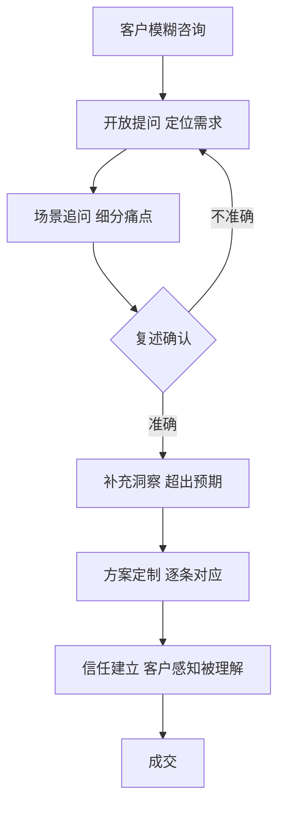
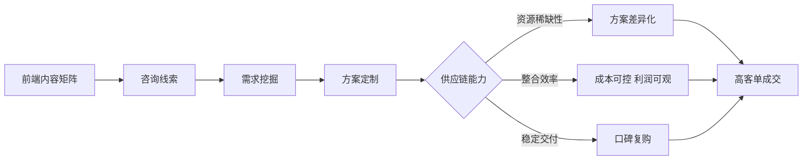
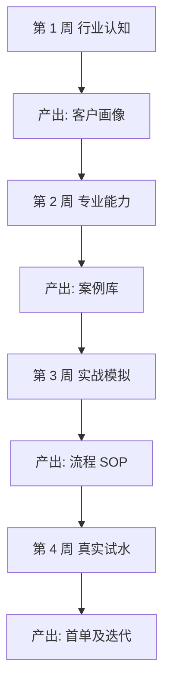

# 第五章 高客单转化 —— 从模糊咨询到成交的长链路能力

## 5.1 学习目标

- 理解高客单转化是长链路能力而非流量技巧
- 掌握从模糊咨询到成交的关键环节与需求感知机制
- 理解供应链壁垒与专业学习路径的支撑作用
- 能设计有效的需求挖掘与方案定制策略

## 5.2 生活类比

想象你第一次走进一家高端定制西装店。你心里只有一个模糊的念头——“我想买套像样的衣服”，但说不清场合、风格和预算。如果店员只是指着货架报价格，你多半扭头就走；但如果店员先请你坐下，问你“平时穿西装多吗？出席什么场合？喜欢修身还是宽松？”，再量体、选料、讨论袖口细节，最后给你出一个方案——你不仅愿意付几千块，还会觉得这钱花得值。高客单转化就是这样：客户付的不仅是那件西装，更是“这个人真的听懂了我的需求”的信任。你需要的不是一锤子买卖的销售话术，而是一条从模糊咨询到最终成交的完整链路——挖掘需求、定制方案、建立信任、交付承诺。这条链路跑通了，客单价和复购率自然水涨船高。

## 5.3 概念地图

```
高客单转化：从模糊咨询到成交的长链路能力
├── 长链路能力壁垒论
├── 定制方案付费需求感知
├── 供应链壁垒
└── 30 天学习路径
```

## 5.4 高客单转化

### 5.4.1 为什么高客单转化是长链路能力

> "旅游项目真正壁垒不是流量，而是长链路能力。"
> 
> ——《260806《小红书旅游：模糊咨询转 3 万客单》》

高客单服务的客户很少带着清晰的需求找上门。他们往往只有一个模糊的念头——“我想去欧洲”“我想办个有品质的婚礼”“我想给孩子找个好学校”。这种模糊性决定了你无法像卖快消品那样，靠一张详情页或一段话术直接成交。

我们来看一个典型的失败循环：客户带着模糊需求来咨询，客服只会报价格或推标准产品，客户感受不到被理解，信任无法建立，询单流失。这个循环的根源在于——**把高客单成交当成了流量生意**，以为只要曝光够多、话术够狠就能出单。

高客单转化其实是一条**长链路**，它包含五个环节：

- 需求挖掘：从客户的只言片语中定位真实意图
- 方案定制：基于需求设计个性化方案，而非推销现成产品
- 信任建立：通过专业表达和真诚沟通让客户相信你
- 内容支撑：用前期内容（笔记、案例、评测）铺垫专业形象
- 交付承诺：让客户对结果有合理预期，并在交付中兑现

这五个环节环环相扣，缺任何一环都会断裂。更重要的是，它**不止是销售技巧**，而是内容、需求洞察、专业知识和交付的综合能力。换句话说，长链路能力的本质是**系统能力**，不是单点技巧。

> 长链路能力壁垒论定义（来源：《260806》）

$$
\text{高客单转化能力} = f(\text{内容质量}, \text{需求洞察}, \text{专业知识}, \text{交付可靠性})
$$

这个公式展示了高客单转化能力是一个多变量的复合函数，任何一个变量为零，整体能力就趋近于零。这也是为什么单纯学话术、投流量很难奏效——它们只是这个函数中的一个变量。

### 5.4.2 定制方案付费需求感知

> "因为他感觉到你听懂了他的需求。"
> 
> ——《260806《小红书旅游：模糊咨询转 3 万客单》》

客户为什么愿意为定制方案付高价？答案不在于方案本身有多炫，而在于一个微妙的心理机制——**需求被听懂的感觉**。

这里的关键是“感知”二字。客户不是专家，他无法评估你的方案技术上是否最优，但他能感知到你是不是真的在听他说。这种感知来自互动细节：

- 你回问的问题是否切中他的痛点
- 你在方案里是否复述了他提过的具体场景
- 你是否能指出他自己都没意识到但确实存在的需求

当客户说出“他怎么这么懂我”时，信任就建立了，价格敏感度也随之下降。这就是定制方案付费的底层逻辑：**客户买的不是方案，是被理解的体验**。

> 定制方案付费需求感知定义（来源：《260806》）

$$
\text{付费意愿} = g(\text{被感知的理解深度}, \text{方案个性化程度})
$$

这个公式展示了付费意愿与两个因素正相关：客户感觉自己被理解的程度，以及方案与自身需求的匹配度。注意，第一个因素的权重通常远大于第二个——客户先用直觉判断你懂不懂他，再用理性评估方案好不好。

那么，如何在实战中触发这种感知？这里给出一个需求挖掘的标准流程：

```
Algorithm 1: 需求挖掘与方案定制流程
1. 开放提问：让客户描述理想中的结果（"你最想要的感觉是什么？")
2. 场景追问：定位具体使用场景与痛点（"在什么场合你会用到它？"）
3. 复述确认：用自己的话复述客户的需求，请客户确认
4. 补充洞察：指出客户未明说但客观存在的需求（"我注意到你也可能在意……"）
5. 方案呈现：将需求映射为方案亮点，逐条对应
6. 定价说明：解释定制成本构成，强化价值感知
```

这套流程的本质，是把“听懂需求”从玄学变成可执行的步骤。尤其是第 3 步“复述确认”和第 4 步“补充洞察”，它们是触发“你懂我”感觉的关键节点。第 3 步让客户感觉被尊重，第 4 步则让客户惊讶于你的专业深度——两者叠加，付费意愿自然上升。



这张图展示了从模糊咨询到成交的完整链路。注意中间的反馈回路——如果复述不准确，要回到需求挖掘环节重新提问。这条回路对最终成交至关重要，因为只有精确的理解才能带来“被听懂”的体验。

### 5.4.3 供应链壁垒

> "理解供应链才是真正壁垒。"
> 
> ——《260806《小红书旅游：模糊咨询转 3 万客单》》

前面两节我们讨论的是前端的转化能力，但真正决定你能否持续交付高客单服务的，是后端的**供应链整合能力**。

为什么说供应链是壁垒？因为前端的能力（话术、内容、需求洞察）是可学习的，假以时日别人也能掌握。但供应链——你能否在一段时间内稳定拿到优质房源、能否约到稀缺的专家档期、能否在旺季保证确定性体验——这些是短时间无法复制的。

具体来说，供应链壁垒体现在三个层次：

- 资源稀缺性：你掌握多少别人拿不到的优质供给（独家房源、行业专家、稀缺门票）
- 整合效率：你把多个供应商组合成完整体验方案的能力
- 稳定交付：即便在高峰期或突发情况下，你仍能保证交付质量

这三层叠加，决定了你的服务是“可复制的高客单”还是“一次性的运气”。前者是生意，后者是偶然。

> 供应链壁垒定义（来源：《260806》）

$$
\text{竞争壁垒} = \alpha \cdot \text{资源稀缺性} + \beta \cdot \text{整合效率} + \gamma \cdot \text{稳定交付}
$$

这个公式展示了竞争壁垒是三个供应链维度的加权组合。权重 α、β、γ 因行业而异：旅游行业资源稀缺性的权重最高，咨询服务整合效率更重要，而实体产品则最看重稳定交付。你的战略选择，本质上就是在分配这三个权重。

从数据流角度看，供应链如何支撑前端转化？我们可以用下图表示：



这张图揭示了高客单生意的本质循环：前端内容引流量，咨询挖掘需求，方案定制需要供应链支撑，供应链反过来决定方案的差异化和利润空间，最终好的交付带来口碑和复购，复购又反哺内容素材。这就是为什么我们说“表面是获客能力，底层是供应链能力”——没有底层支撑，前端的流量和话术都是空中楼阁。

### 5.4.4 需求感知与供应链如何协同

> 多源对照

在本节中，我们引入了两个看似独立的概念：需求感知（前端）和供应链（后端）。它们如何协同？让我们对照来看。

**共识**

- 两者都是高客单转化链路中不可或缺的环节
- 前端需求感知决定客户是否愿意付费，后端供应链决定你是否能持续交付
- 两者互相强化：好的供应链能支撑更定制化的方案，更懂客户又能反向指导供应链优化

**分歧**

- 素材强调“供应链才是真正壁垒”，似乎暗示后端比前端更重要。但如果前端需求感知能力太弱，供应链再强也无从施展——这更像是一种战略优先级判断，而非绝对孰轻孰重
- 素材将“用户感觉到被理解”描述为成交的关键触发点，这暗示前端感知力是成交的必要条件；但供应链能力也直接影响报价和交付体验，缺少它成交便不可持续

从实践角度看，这些分歧并不矛盾。它们更像是一枚硬币的两面：前端建立“为什么选你”的理由，后端提供“选了你之后”的兑现。高客单生意的完整闭环需要两者同时在线。

**设计中的取舍**

- **为什么不直接把供应链作为获客卖点，而非要绕一道需求感知？**  
  高客单客户天然对“广告式”承诺反感。如果直接宣传“我有独家房源”，客户会觉得你在推销，信任度会下降。相反，通过需求挖掘让客户自己感受到“你需要这种稀缺资源”，再由你来满足这个需要，客户的感知就从“你在卖我东西”转变为“你帮了我一个忙”。前者是交易，后者是关系，关系带来更高的客单价和复购率。

- **这种组合的 trade-off 是什么？**  
  需求感知做得好但供应链不足，会导致“承诺了但交付不了”的灾难性翻车，口碑一夜崩塌；供应链强大但需求感知弱，则可能造成“好资源卖不出去”的资源浪费。理想的策略是：先投入需求感知机制，跑通成交闭环，再逐步加码供应链。因为前者的试错成本低、反馈速度快，而后者需要较长周期。

- **为什么不一开始就铺开全行业的高客单服务？**  
  长链路能力具有极强的领域粘性，旅游行业跑通的方法未必适用于教育或咨询行业。这是因为前端内容、案例素材和目标客户群体的属性差异巨大。先聚焦单一垂直领域，建立“方法+供应链”的双壁垒，再考虑横向复制，是更稳妥的打法。

### 5.4.5 30 天学习路径

> "30 天学习路径。"
> 
> ——《260806《小红书旅游：模糊咨询转 3 万客单》》

聊完了前端转化和后端供应链，最后一个支柱是：**你如何快速建立专业能力？**

答案是 30 天集中学习路径。这条路径的设计逻辑是：高客单服务涉及的知识点多但深度可控，通过高强度、结构化的短期学习，可以让你在 1 个月内达到及格线，并在实战中持续精进。

30 天被划分为四个阶段，每个阶段有明确的产出：

| 阶段 | 时间 | 核心任务 | 阶段产出 |
|------|------|----------|----------|
| 第 1 周 | 1-7 天 | 行业认知搭建：理解目标客户群体、常见需求与痛点 | 客户画像与需求清单 |
| 第 2 周 | 8-14 天 | 专业能力构建：学习核心业务知识、典型案例拆解 | 案例库与常见问题解决方案 |
| 第 3 周 | 15-21 天 | 实战模拟练习：与潜在客户对话、演练需求挖掘与方案定制 | 标准话术与流程 SOP |
| 第 4 周 | 22-30 天 | 真实客户试水：在少量客户上跑通完整链路，迭代流程 | 首单案例与改进清单 |

这套路径的核心思想是**刻意练习**——不是泛泛地“学习”，而是每一周都有明确的目标和产出物，形成可以复用的资产。第一周的客户画像和需求清单将成为后续所有内容创作的素材来源，第二周的案例库让你在面对咨询时能够脱口而出，第三周的 SOP 让你不再临场发挥，第四周的真实试水则完成了从学到做的闭环。



这个路径的巧妙之处在于，它不是线性走完就结束，而是一个螺旋上升的过程。第 4 周的真实试水会暴露第一周认知的盲区，这时你回头补充行业认知，进入下一个 30 天的迭代。长链路能力的提升，就是这样一轮又一轮的 30 天累积出来的。

## 5.5 动手练习

- 选取你所在领域的一个高客单品类，写出客户从“首次咨询”到“完成交付”的全部触点清单（不少于 8 个触点），标出每个触点上你希望客户产生的情绪和行动
- 找一位朋友扮演“模糊需求客户”，练习需求挖掘的开放提问—场景追问—复述确认—补充洞察四步法，记录对方在哪一步说出“你好像懂我”
- 分析你所在领域的供应链现状：列出你当前能稳定掌握的 3 项稀缺资源，并标注它们与你目标客户的真实需求之间的匹配度
- 拆解一个你见过的成功定制方案（任何行业均可），反推出其背后的需求感知动作和供应链支撑逻辑
- 为自己制定一个 30 天学习路径，输出每周的明确产出物清单，并设定每周的验收标准

## 5.6 本章小结

这一章我们学习了高客单转化的完整图景，核心结论是：**高客单转化是长链路能力，不是流量技巧**。

我们首先讨论了长链路能力壁垒论——真正难以复制的不是获客手段，而是从内容到转化再到交付的系统能力。然后我们深入了定制方案付费需求感知，理解了客户愿意为定制买单的核心心理机制：“感觉到你听懂了他的需求”。接着我们探讨了供应链壁垒，明确了高客单生意表面上是获客问题，底层其实是供应链整合能力的竞争。最后我们给出了 30 天学习路径，说明如何通过结构化的短期集中学习快速建立专业基础。四者共同构成高客单转化的完整方法论。

本章我们一起学习了以下概念：

| 概念 | 解释 |
|------|------|
| 高客单转化 | 从模糊咨询到成交的完整长链路能力 |
| 长链路能力壁垒论 | 真正壁垒不是流量，而是内容、转化、专业知识和交付的系统能力 |
| 定制方案付费需求感知 | 客户愿意为定制付费，核心是感知到你听懂了他的需求 |
| 供应链壁垒 | 表面是获客能力，底层是供应链整合能力 |
| 30 天学习路径 | 以集中学习快速建立专业基础 |

下一章中，我们将进入第六章《内容生态位》，探讨如何在不同平台的内容生态中精准定位自己的差异化角色。我们将学习如何分析平台内容的供需情况和竞争格局，以及如何利用供给空白快速建立内容影响力——这是承接本章长链路能力的起点，因为内容正是高客单转化的第一环。
