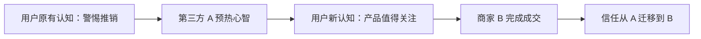

# 第六章 系统化承接 —— 从素人管理到 A 种 B 收

## 学习目标

- 理解模式的健康定义及其与单纯赚钱的区别
- 掌握 A 种 B 收的协作模式与信任转移逻辑
- 理解素人强筛的核心逻辑（意愿先于能力）
- 掌握商家筛选 5 条件的评估框架
- 能综合运用解析低成本高产出案例的杠杆效应
- 能区分流水与利润，识别方法论适用边界

## 6.1 生活类比：菜园里的种与收

想象你经营一个蔬菜摊。如果你每天亲自去菜地里播种、浇水、除虫，再亲自把菜运到市场卖掉，那么你既当农夫又当商贩，所有环节的信任、成本、风险都压在你一个人身上。但如果换一种做法：你在菜地旁立一块牌子，请社区里的热心邻居（他们与买家没有任何利益关系）来帮忙宣传"这个摊的菜是本地新摘的、不打药"，等买家因为邻居的推荐而对你的菜产生好奇和信任后，再由你完成最后的称重和收钱。这时候，宣传者和卖家是两个完全不同的人——前者负责"种"信任的种子，后者负责"收"成熟的果实。这就是本章要讲的系统化承接模型：把"让人相信"和"让人购买"拆成两个环节，由不同主体完成，先种后收，主体分离。

## 6.2 概念地图

```
系统化承接：从素人管理到 A 种 B 收
├── 模式健康（能赚钱≠模式健康）
├── A 种 B 收（第三方种草，承接方收割）
├── 素人强筛（管理的本质是筛选）
├── 商家筛选 5 条件（给合作方做体检）
└── 低成本高产出案例（3000 元撬动 50 万）
```

## 6.3 单元解析：赚钱不等于模式健康

很多人判断一个生意值不值得做，只看一个指标：赚不赚钱。但短期赚钱与模式健康是两回事。素材中明确提出了这个论断，称之为"定理"级别的判断。我们来拆解它。

> 原文摘录：

> "能赚钱不代表模式健康，合作模式必须提前设计好。"
> 
> ——《260804, p.1》

我们先问一个直觉问题：为什么很多项目短期营收亮眼，最终却崩盘？答案在于，营收是"结果"，而模式是"系统"。结果只能告诉你当时发生了什么，系统则决定未来会不会继续发生。只看结果，就像只看一个人今天的体重就判断他是否健康一样荒谬。

所以我们把"模式健康"定义为系统层面的三个可验证特性：

| 特性 | 含义 | 反例 |
|------|------|------|
| 可复制 | 换人、换地方仍能跑通 | 靠创始人个人关系拿单 |
| 可预测 | 产出与投入有稳定映射 | 靠运气爆单，下次归零 |
| 可退出 | 不依赖某个单一角色才能存续 | 少了某个核心就全盘停转 |

这个定义展示了"模式健康"作为一票否决项的用途：老板在合作设计前必须先回答三个问题——"换个人做还能成吗？能预估大概的产出吗？我万一要撤，系统会塌吗？"如果三个答案中有任何一个是否，那么赚钱也只是一次性的事件，不值得投入资源。

从运营视角看，素材的操盘手把这条定理当成了所有合作的前置约束：宁可慢，也要先设计好分工再动工；宁可放弃短期小利，也不在混乱模式上加杠杆。这就是为什么本章后续的每个环节都强调"先设计、再执行"。

## 6.4 单元解析：A 种 B 收 —— 主体分离的信任链条

上一节我们解释了"健康模式要提前设计"，这一节我们就来看一个具体的设计方案：A 种 B 收。

> 原文摘录：

> "用第三方视角完成用户心智的预热和定势，再让承接方完成成交。"
> 
> ——《260804, p.1》

先还原一个直觉困境：如果你是一个商家，你直接向潜在客户推销自己的产品，客户的第一反应往往是警惕——"你当然说自己的东西好"。这种天然的不信任感是任何自卖自夸式营销都绕不开的坎。

我们的解决方案是引入一个"中间层"：让一个与商家没有利益关系的第三方先去预热用户心智。我们把这种结构称为 **A 种 B 收**：

> A 种 B 收定义（来源：《260804, p.1》）

$$
\text{成交路径} = \underbrace{\text{第三方种子}(A)}_{\text{心智预热情感账户}} \rightarrow \underbrace{\text{商家收割}(B)}_{\text{成交收款信任兑现}}
$$

这个公式展示了 A 种 B 收的两段式结构：第一段由第三方（A）完成"种"，即用无利益冲突的视角向用户传递信息和建立初步信任；第二段由商家（B）完成"收"，即在用户已经产生兴趣和信任基础之后，完成最后的成交动作。核心在于"主体分离"——种的人和收的人不是同一个。

从信任转移的角度看，这个设计的高明之处在于：用户对"种"方的信任，会在成交环节被"迁移"到"收"方身上。我们把这个过程分解为三个信号，帮助你识别是否真正实现了"种"：

| 信号 | 说明 |
|------|------|
| 内容无利益声明 | A 明确表达"我与商家无关"，增强可信度 |
| 提前完成心智定势 | 用户先形成了"这个产品值得看"的印象 |
| 成交时阻力显著下降 | B 的推销话术不再被视为"自卖自夸" |

在素材的具体案例中，承接方只是把"种"出的认知顺势转化为购买行为，并不需要从零开始说服用户。这极大降低了成交环节的摩擦力，也让商家愿意为这种"被人提前铺好路"的成交方式付费。



从这个数据流图可以看到，整套系统的核心资产是"信任"，而它的流转路径是：由 A 建立，迁移到 B 兑现。这也就是为什么我们把 A 种 B 收称为"信任转移"机制——它并不创造新的信任，而是让信任从一个主体安全地转移给另一个主体。

## 6.5 单元解析：素人强筛 —— 管理的本质是筛选

当系统引来了大量素人参与者时，一个现实问题浮现：人很多，但质量参差。如果逐个培养，成本太高。素材里给出了一句极为精炼的判断。

> 原文摘录：

> "连群昵称都懒得改的人不值得管理。"
> 
> ——《260804, p.1》

我们先给出直觉：在任何大规模协作中，管理一个低意愿的人，成本往往远高于他的产出。与其在后面花大量时间改造，不如在入口处用极低成本信号把低意愿者挡在门外。这就是"素人强筛"的核心思想。

我们把它形式化为一个筛选逻辑：

> 素人强筛定义（来源：《260804, p.1》）

$$
\text{筛选决策} = \begin{cases}
\text{通过} & \text{if } \text{低成本信号}(\text{配合度}) \geq \text{阈值} \\
\text{淘汰} & \text{if } \text{低成本信号}(\text{配合度}) < \text{阈值}
\end{cases}
$$

这个公式展示了强筛的决策机制：它不是看素人的能力有多强（因为素人通常没有可评估的能力），而是看"配合度"这一个低维指标。改昵称这件事本身不产生任何商业价值，但它是一个极强的信号——它告诉系统这个人愿不愿意为进入这个系统付出哪怕一分钟的动作。

在实操中，强筛的"低成本"体现在两个维度：

| 维度 | 说明 |
|------|------|
| 动作成本低 | 只需改昵称、填表格、进群之类的动作 |
| 信号强度高 | 愿意做简单规定动作的人，后续配合度显著更高 |

这套方法的原理可以用"意愿先于能力"来概括：对素人而言，能力是可培养的，但意愿很难被外部改变。与其期待一个人从懒散转变成积极，不如在入口就筛掉懒散者。这也解释了"连群昵称都懒得改的人不值得管理"这句判断背后的逻辑：它不是对个人的贬低，而是对系统效率优化的理性计算。

## 6.6 单元解析：商家筛选 5 条件 —— 给合作方做体检

A 种 B 收的模式中，B 方（承接方）是整个链条的收尾者。如果 B 不具备承接能力，A 种得再好也会前功尽弃。因此，必须对商家进行筛选。

> 原文摘录：

> "商家筛选 5 条件。"
> 
> ——《260804, p.1》

直觉上，不是所有商家都值得接入系统。有的产品力差，用户来了留不住；有的服务跟不上，成交后又引发投诉；有的配合度低，根本不按约定执行。与其事后补救，不如事前用一个可复用的量化标准做"体检"。

**方法定义**（> 商家筛选 5 条件方法（来源：《260804, p.1》））

我们将评估分解为五个维度，每个维度占据一项，且采用一票否决制：

| 序号 | 筛选维度 | 考察问题 |
|------|----------|----------|
| 1 | 产品力 | 产品是否值得被推荐？有无明显硬伤？ |
| 2 | 接待力 | 商家是否有能力和场地承接进店用户？ |
| 3 | 配合度 | 商家是否愿意按系统规范执行？ |
| 4 | 结算能力 | 商家是否有清晰的财务和结算流程？ |
| 5 | 口碑基础 | 商家现有口碑是否支撑后续传播？ |

这套框架的本质是"一票否决"逻辑：任何一个维度不达标，即使总分看起来可以，商家也不能进入系统。原因是五个维度各自对应着系统链条中的不同环节：产品力对应"用户是否留下"，接待力对应"成交能否发生"，配合度对应"流程能否执行"，结算能力对应"利益能否分配"，口碑基础对应"后续能否二次传播"。任何一个短板都可能导致整个链条在某处断裂。

这个筛选方法在使用场景上与素人强筛形成一个对照：素人强筛用"低成本的单信号"快速淘汰，商家筛选用"多维度的体检表"精确把关。前者面向大量低质参与者，讲究效率；后者面向少数关键合作方，讲究准确。两个筛选互为补充，一起保障整条系统运行在健康轨道上。

## 6.7 多源对照：成本、杠杆与利润的界定

本节涉及一个具体的成果案例，我们对照"3000 元直接成本，3 个月商家约 50 万营收"这一数据，从成本性质、杠杆来源和利润口径三个层面进行多角度解读。

> 原文摘录：

> "3000 元直接成本，3 个月商家约 50 万营收。"
> 
> ——《260804, p.1》

### 共识

所有素材共同确认一个事实：这 3000 元不是传统意义上的"买流量"费用，而是系统启动的"催化剂"。它购买的是流程设计、筛选工具、初始物料和第三方铺垫等系统组件，而不是直接购买用户点击或曝光。这是一个结构性区别。

### 分歧

在如何解读产出性质上，我们列出不同视角：

| 视角 | 解读 |
|------|------|
| 素材原观点 | 50 万是可审计的商家流水，是系统运转的营收结果 |
| 谨慎视角 | 流水不等同于利润，商家还有货品成本、房租、人力等支出 |
| 杠杆视角 | 3000 元购买的是系统催化剂，后续放大靠系统的自我运转 |

三种视角并不矛盾，而是互补：素材原文强调"流水"这一可复核的事实；谨慎视角提醒我们区分流水与净利润，避免把营收误读为利润；杠杆视角则解释为何投入如此之小——因为系统一旦被催化剂启动，后续的扩张并不线性依赖等比例的资金投入。

小结一下：3000 元购买的不是流量，而是系统；50 万是商家的流水，不是净利润。理解这两点，才算真正读懂了案例的边界。

## 6.8 设计中的取舍：为什么不做"自己种自己收"的直接销售？

**为什么不用自卖自夸式的直接营销？** 因为在用户心智中，商家自卖自夸永远带着利益冲突，信任折价是结构性的、无法通过话术弥补的。引入第三方 A 来"种"，虽然增加了一层管理成本和协调环节，但换来的是最后一环 B"收"时极低的阻力。这是用一个可控的边际成本置换一个不可控的信任折价。

**这种设计的取舍是什么？** 取舍发生在两个维度。管理维度上，多了一个中间环节，意味着对 A 方的筛选和管控成本增加——这正是 6.5 节素人强筛要解决的问题。信任维度上，第三方"种"的信息若要有效，必须保持无利益声明的可信度，一旦 A 方也带有商业利益，种就失灵——这要求 A 方的收益结构与 B 方的成交结果解耦。所以整个系统的设计代价是"屏蔽自利动机"的复杂度，收益是"信任迁移"的高转化率。总的来说，这套方法适合场景是：高客单、低信任、信息不对称严重的品项，而不适合冲动型、低客单的标品。

## 6.9 动手练习

- 用一句话向朋友解释"能赚钱不等于模式健康"，并给出一个你见过的反例。
- 拿你所在的城市，尝试列出 3 个适合"A 种 B 收"模式的小众高客单品类，并说明它们的信任障碍在哪里。
- 把"连群昵称都懒得改的人不值得管理"翻译成一个筛选标准的伪代码，写明输入输出和淘汰条件。
- 用"产品力、接待力、配合度、结算能力、口碑基础"这 5 个维度，向你熟悉的某个实体店做一个简单打分（1-5 分），并写出一票否决的理由。
- 阅读一个真实的营销案例（如某新品牌冷启动），判断它的成本属于"流量购买"还是"催化剂投入"，用一章的逻辑证明你的判断。

## 6.10 本章小结

这一章我们围绕"系统化承接"展开，从"健康模式"的定义，经"A 种 B 收"的信任链条，到两个筛选机制的落地，最后用成本与利润的辨析收束。首先我们定义了"模式健康"与"赚钱"的区别，指出健康模式必须满足可复制、可预测、可退出三大特征。其次我们拆解了 A 种 B 收的结构，说明第三方"种"与商家"收"的主体分离，以及信任如何从 A 迁移到 B。接着我们分别讲解了两个筛选机制：素人强筛用低成本信号在入口淘汰低意愿者，商家筛选 5 条件用一票否决在合作前识别不合格承接方。随后我们对案例中的成本与产出做了多视角解读，厘清了"催化剂"与"流量"、"流水"与"利润"的边界。最后我们讨论了为什么"自己种自己收"效率更低，并给出了该方法的适用边界。

本章我们一起学习了以下概念：

| 概念 | 解释 |
|------|------|
| 模式健康 | 能赚钱≠模式健康，健康模式需具备可复制、可预测、可退出三大特征 |
| A 种 B 收 | A 用第三方视角预热心智，B 承接成交，主体分离、先种后收 |
| 信任转移 | 用户对种一方的信任迁移到收的成交环节 |
| 素人强筛 | 用低成本信号快速淘汰低意愿者，意愿先于能力 |
| 商家筛选 5 条件 | 按产品力、接待力、配合度等维度量化评估商家 |
| 杠杆效应 | 3000 元购买的是系统催化剂而非流量 |
| 流水与利润 | 50 万为商家流水（营收），不等于净利润 |

下一章中，我们将从"系统搭建"走向"落地执行"，讨论如何把本章设计的结构拆解为可操作的日任务清单，并进一步分析在真实运营中如何动态调整筛选标准，避免系统僵化。
