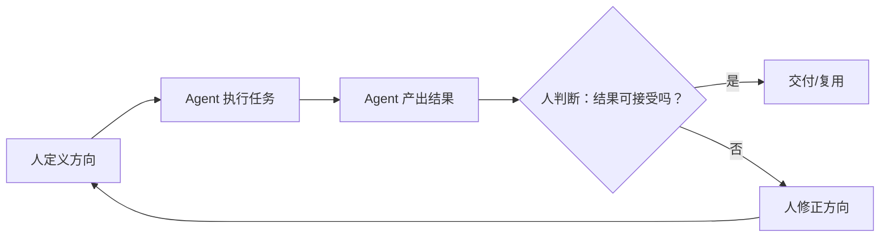

# 第七章 AI 杠杆 —— 把 Token 变成长期生产资料

## 学习目标

- 理解把 Token 从一次性消耗品转化为长期资产的必要性
- 掌握 know-how 杠杆论的核心逻辑与乘数效应
- 能识别并区分人机协作三阶段的角色迁移特征
- 能应用高频场景程序化的判断标准优化 Token 成本
- 能通过 40 亿 Token 实践理解大规模 AI 协作的成本效益平衡

## 7.1 生活类比：把一次性纸杯变成传家瓷器

想象你是一个手工艺人，每天用泥土捏造一次性纸杯，用完即弃。每只纸杯消耗相同的材料和工时，但你的技艺——那些关于泥料配比、窑温控制的经验——却始终留在你的脑子里。有一天，你突然意识到：如果不再把时间花在捏纸杯上，而是把技艺写成一本详细的工艺手册，交给十个学徒同时开工，那么每个学徒都能复制出你的水准。手册本身不随使用次数而损耗，反而越用越有价值。这就是本章的核心思想：**Token 就像一次性纸杯，而 know-how 就像工艺手册**。每次调用 AI 都是在消耗 Token 这种"泥土"，如果你只把对话结果用完就丢，那么每一次调用都是从零开始；但如果你把高质量的对话输出沉淀为可复用的代码、服务和 Skill，你就在把"泥土"烧成"瓷器"。廉价的 Token 只是原料，真正的资产是你提炼出的、可以被反复调用的生产能力。理解了这一点，你就掌握了 AI 时代最核心的财富积累逻辑——从消费算力到积累资本。

## 7.2 概念地图

```
AI 杠杆：把 Token 变成长期生产资料
├── know-how 杠杆论
├── 长期生产资料
├── 人机协作三阶段
├── 高频场景程序化
└── 40 亿 Token 实践
```

## 7.3 know-how 杠杆论：行业智慧的乘法效应

### 为什么单纯买 Token 无法形成复利

我们在第一章提到，规模化学习的关键在于"每一分 Token 都要有复利"。但这个直觉需要更精确的论证。来源素材开门见山地给出了一个核心命题。


> "行业 know-how+Agent=最大杠杆。"
> 
> ——《P001, p.2》

这短短一句话包含两个变量：行业 know-how（行业智慧）和 Agent（规模化执行）。我们逐层拆解。

**直觉：为什么需要杠杆？**

如果我们只是按需购买 Token，每次让 AI 回答一个问题，然后把答案忘掉，那么 Token 的消耗就像烧钱——你买了一堆算力，却什么也没留下来。这类似于你把钱花在请顾问上，顾问走了，知识也带走了。没有沉淀，就没有杠杆。

**形式化定义：**

> know-how 杠杆论定义（来源：《P001, p.2-3》）

$$Leverage = Know\text{-}how_{scarcity} \times Agent_{scale}$$

其中：

- $Know\text{-}how_{scarcity}$ 表示行业 know-how 的稀缺程度，取值范围 $[0,1]$，越稀缺越接近 1；
- $Agent_{scale}$ 表示 Agent 能够并行化、规模化执行的程度，取值范围 $[0,\infty)$；
- $Leverage$ 表示生产力回报的放大倍数。

这个公式展示了杠杆效应的两个乘数因子：稀缺性决定了"每一份执行值多少钱"，规模化决定了"能执行多少份"。两者相乘，才是真正的杠杆。如果你的 know-how 是公开常识（稀缺性趋近 0），或者 Agent 只能处理单一任务（规模化为 1），杠杆效应都无法体现。

**为什么是乘法而不是加法？**

我们先看加法的情况：假设你的 know-how 价值为 $a$，Agent 规模为 $b$，加法的总产出是 $a+b$——这意味着 know-how 和 Agent 各自独立贡献，互不增强。但真实场景中，一份稀缺的 know-how 被 Agent 复制一万次执行，价值是 $a \times 10000$，而不是 $a+10000$。乘法的本质是**复制性**：know-how 不会因为被使用而损耗，反而因为被执行次数增加而摊薄了研发成本。这与代码库的逻辑完全一致——写一次，跑一万次。

**但注意，杠杆也有下限。** 如果稀缺性为 0（即你的 know-how 是任何人都知道的常识），那么无论 Agent 规模多大，杠杆都是 0。这解释了为什么许多"AI 套壳"应用无法形成壁垒：它们调用的是一般化的模型能力，没有注入行业特有的方法论。真正稀缺的是你知道"这个行业的问题应该怎么拆解"，而不是"AI 能做什么"。

### 为什么 know-how 会流失


> "行业 know-how 没有沉淀会随人员流动流失。"
> 
> ——《P001, p.3》

这看似是一句常识，但我们可以用一个状态转移模型来理解它的深层含义。假设一个团队有 $n$ 个成员，每个成员掌握 $k_i$ 单位的行业 know-how。当第 $j$ 个成员离职时，团队保留的 know-how 为：

$$K_{retained} = \sum_{i \neq j} k_i$$

这个公式展示了人员流动导致的线性损失。但如果 know-how 被沉淀为 Agent 可执行的 Skill 或代码库，那么即使成员离职，Agent 仍然保留着他的贡献。这改变了损失函数的形式：

$$K_{retained}^{agent} = \sum_{i \neq j} k_i + \sum_{i = j} k_i^{agent}$$

这个公式展示了关键的区别：$\sum_{i = j} k_i^{agent}$ 表示离职成员的 know-how 以 Agent 形式留在了系统中，团队的知识总量不因人员流动而减少。这就是"长期生产资料"的雏形——把隐性知识转化为显性资产。

**关键方法：从"人带人"到"Agent 代代相传"**

> Layout-Aware Knowledge Transfer 方法（来源：《P001, p.4》）

传统模式下，know-how 的传承靠师徒制，速度慢、容量小、容易失真。Agent 模式则完全不同：

```
传统模式：人 → 人（一对一，慢，易失真）
Agent 模式：人 → Skill/代码 → Agent → 规模化执行（一对多，快，保真）
```

这段对比展示了"沉淀"的价值。传统模式中，know-how 的传播速度受限于人的带宽；而 Agent 模式中，Skill 是一次编写、无限复用的。关键不在于 Agent 有多聪明，而在于你的 know-how 是否被显式地编码进了 Agent 的指令集。如果你的 know-how 只存在于个别资深员工的脑子里，Agent 再强大也无从执行。

### 多源对照

本节内容仅来源于 `[P001]`，暂无多源对照。后续若有更多素材，可以在此补充不同作者对杠杆效应边界条件的讨论。[需要补充文献]

### 设计中的取舍

- 为什么不是"买更多 Token"而是"沉淀 Skill"？

单纯买 Token 解决的是当下的执行问题，不是积累问题。Token 是消耗品，用完即失效；Skill 是资本品，可反复调用。初看买 Token 的边际成本更低（按量付费），但长期来看，每次调用都支付全价，而沉淀 Skill 的初始成本高、边际成本趋近于零。这是典型的"租赁 vs. 购买"决策：租赁灵活但无资产，购买前期贵但长期省。

- 这种设计的 trade-off 是什么？

沉淀 Skill 的代价是前期投入高：你需要花时间把 know-how 显式化、调试 Agent 行为、建立评估标准。这些成本在短期看是浪费，但长期回报是倍数级的。反过来，不沉淀的代价是你的 AI 使用永远停留在"高级搜索引擎"水平，无法形成竞争壁垒。这里的取舍实质是"短期成本 vs. 长期资产"的权衡，没有绝对正确的答案，取决于你的时间窗口。

## 7.4 长期生产资料：把 Token 从原料变成资本

### 为什么 Token 是有时效性的消耗品


> "趁便宜应把 Token 沉淀为代码、工程化服务和 Skill 等长期可复用资产。"
> 
> ——《P001, p.5》

这句话提出一个关键的时间维度：**趁便宜**。这意味着 Token 的价格不是恒定的，而是有波动窗口的。我们用供给-需求的框架来理解：

> 长期生产资料定义（来源：《P001, p.5-6》）

$$Asset_{value}(t) = \sum_{usage=1}^{N} \frac{V_{output}}{Cost_{token}(t_0)}$$

其中 $V_{output}$ 表示 token 输出的长期价值，$Cost_{token}(t_0)$ 表示在时间 $t_0$ 的 Token 价格。关键在于：$Cost_{token}(t_0)$ 是**一次性支付**的，而 $V_{output}$ 是**长期收益**的，它通过每次复用来兑现。

这个公式展示了"趁便宜"的经济逻辑：如果你在 Token 价格低时大量购买并沉淀资产，你锁定的是一次性的低原料成本，而后续的每次复用都不再需要支付 Token 费用。反之，如果每次对话都是即时的，你就永远按当时的市场价格支付。

### 从"对话"到"资产"的转换

对话的本质是**有状态但无记录**的交互。你问一个问题，得到一个答案，对话结束，这段交互的价值只存在于那一个瞬间。而被沉淀的资产则不同：

| 对话（消耗品） | 沉淀资产（资本品） |
|---|---|
| 价值随对话结束而终结 | 价值随每次复用而累积 |
| 每次调用支付全价 | 一次沉淀，边际成本趋近于零 |
| 无法跨项目复用 | 可被多个主体并行使用 |
| 依赖人肉记忆 | 独立于人员流动而存在 |

以下是三种主流的沉淀形式及其适用性：

**代码**：把 AI 生成的解决方案固化为函数或库。适用场景是逻辑确定的过程，比如数据清洗、格式转换。

**工程化服务**：把 AI 能力封装为可调用的 API 或微服务。适用场景是标准化流程，比如客户分群、情感分析。

**Skill**：把 know-how 编码为 Agent 可执行的技能描述。适用场景是非结构化决策，比如投资分析、医疗诊断。

这三种形式的共同点是：它们都把一次性 Token 消费转化为可复用的生产能力。换句话说，你不再只是"问 AI 一个问题"，而是"教 AI 一个技能"，这个技能可以被无限次调用。

### 关键方法：趁便宜储备

> Cost-Weighted Asset Conversion 方法（来源：《P001, p.6-7》）

要让"趁便宜"从一句口号变成可执行的方法，需要引入成本信号：

```
1. 监控 Token 价格指数（单位成本的波动窗口）
2. 当成本低于长期均值时，加大高质量对话的频次和深度
3. 对每次高质量对话执行"沉淀判断"：
   - 这段对话蕴含可复用的方法吗？
   - 这段对话产出的逻辑是否能推广到同类问题？
   - 若是，立即转化为代码/服务/Skill
4. 将沉淀资产纳入团队共享库，降低未来的调用成本
```

这段方法展示了"趁便宜"的可操作性——它不是随机囤货，而是基于成本信号做有意识的资产转换决策。每一次对话都同时扮演两个角色：解决当下问题的"使用"，和生产未来能力的"投资"。

### 设计中的取舍

- 为什么不把所有对话都沉淀？

沉淀是有成本的：需要额外的时间来做代码化、测试、文档化、版本管理。如果所有对话都沉淀，你的维护成本会呈指数上升，最终压垮产出。取舍在于**沉淀的阈值**：只有那些"可推广到同类问题"且"预计会重复出现"的对话才值得沉淀。

- 为什么不是直接买 API 而是沉淀 Skill？

API 是按次计费的，每次调用都是全价。Skill 是自有的，一次开发、无限使用。但 Skill 的质量依赖你的工程能力，你需要持续调试 Agent 行为、评估输出质量。这里的 trade-off 是"工程开销 vs. 边际成本"，当你的调用量足够大时，沉淀 Skill 显然是更经济的；当调用量小时，直接买 API 反而更灵活。

## 7.5 人机协作三阶段：从执行者到决策者

### 角色迁移的本质


> "人的角色从执行者退到方向制定者和关键决策者。"
> 
> ——《P001, p.8》

我们先把"角色迁移"的本质说清楚：AI 不是替代你，而是接管你工作中越来越"下游"的部分，迫使你向"上游"移动。我们用一张数据流图来展示这个过程：



这张数据流图展示了三阶段的核心结构：方向由人设定，执行由 Agent 完成，结果由人验收。人的角色越往上移，决策权越集中，而执行性的劳动则逐渐被 Agent 吸收。恐惧 AI 替代的直觉其实是角色的迁移——不是岗位消失，而是岗位内容向上游压缩。

### 三阶段的演进

> Role Migration Framework 方法（来源：《P001, p.8-9》）

阶段演进如下：

**第一阶段 - 执行者（Executor）**：

在这个阶段，你直接操控 AI 完成具体任务——写邮件、处理表格、生成代码。你的价值来自"能熟练使用 AI"，你的产出质量高度依赖你每次输入的 prompt 质量。这个阶段的特点是**人机逐个交互**，Token 消耗密集但沉淀极少。

**第二阶段 - 方向制定者（Director）**：

你不再逐个指挥，而是制定任务框架：定义目标、拆分步骤、指定质量标准，让 Agent 自动化执行每个步骤。你的价值来自"能拆解问题的结构"，你的 token 消耗下降但单位 token 的产出上升。这个阶段的特点是**人设方向、Agent 执行**，Token 消耗发生在关键节点而非每个动作。

**第三阶段 - 关键决策者（Decision-Maker）**：

你只做 Agent 无法做的高风险判断：是否上线新功能、是否采纳 Agent 的推荐建议、是否调整战略方向。你的价值来自"能承担决策责任"，你的 Token 消耗进一步下降，但每次调用都服务于重大判断。这个阶段的特点是**人做决策、Agent 做所有前置劳动**。

| 阶段 | 人的角色 | 人的核心价值 | 典型 Token 消耗 |
|---|---|---|---|
| 执行者 | 新手操作员 | 熟练使用 AI | 高频、低质量 |
| 方向制定者 | 项目经理 | 拆解任务结构 | 中频、中质量 |
| 关键决策者 | 企业高管 | 承担风险责任 | 低频、高质量 |

三阶段的核心规律是：**角色越往上，人的稀缺性越高，但同时 Token 的杠杆率也越高**——一个方向决策可以调动 Agent 完成海量执行工作。决策权始终在人手里，不是技术限制，而是责任逻辑：Agent 无法为错误决策承担责任，人必须保留最终否决权。

### 为什么决策权不能交给 Agent


> "决策权始终保留在人手中。"
> 
> ——《P001, p.9》

理由有两层。第一层是责任归因：Agent 的决策缺乏法律和社会意义上的主体资格，如果 Agent 做出的决策导致重大损失，无法问责。第二层是价值偏好：Agent 基于训练数据和目标函数做优化，但人的决策需要考虑价值观、品牌形象、伦理边界等 Agent 无法量化的因素。保留决策权不是保守，而是对 Agent 能力边界清醒的认知。

### 多源对照

本节内容仅来源于 `[P001]`，暂无多源对照。随着更多素材积累，可以对比不同框架对"人机分工边界"的定义。[需要补充文献]

### 设计中的取舍

- 为什么不让人继续做执行？

人的执行成本高且速度慢。Agent 的执行速度是人的数百倍，且不会疲劳。但执行的质量依赖方向设定的质量，所以你需要投入更多时间在"想清楚"而非"做出来"上。取舍是：节省了执行时间，却增加了思考负担。

- 为什么不把方向制定也交给 Agent？

Agent 可以提出方向建议，但它缺乏对企业当下约束条件（现金流、团队能力、政策窗口）的全局感知。方向制定必须由人完成，因为人掌握 Agent 看不到的上下文。这里的 trade-off 是"全局信息的可得性 vs. 自动化程度"。谁掌握不可编码的信息，谁就掌握那一层的决策权。

## 7.6 高频场景程序化：释放 AI 的注意力

### 注意力的稀缺性


> "高频场景应该程序化。"
> 
> ——《P001, p.10》

为什么高频场景要程序化？我们需要引入"AI 注意力"这个资源的概念。每次 Agent 调用都消耗 Token，而 Token 不仅仅代表算力成本，还代表**模型推理的时间延迟**。在高频场景中，如果每次都调用 Agent，你会同时付出三笔成本：算力（Token 费用）、时间（等待模型推理）、注意力（你的精力被牵扯到重复性判断上）。

> 高频场景程序化定义（来源：《P001, p.10-11》）

$$Cost_{total} = Cost_{token} \times N + Cost_{latency} \times N + Cost_{human\_attention} \times N$$

其中 $N$ 是调用次数。当 $N$ 很大时，即使单次成本很低，总成本也会急剧放大。程序化就是把 $N$ 压到最小：

$$Cost_{program} = Cost_{initial\_dev} + Cost_{runtime} \times N_{reduced}$$

这个公式展示了程序化的经济逻辑：虽然存在一次性开发成本 $Cost_{initial\_dev}$，但后续运行时每笔成本极低，且 $N_{reduced}$ 远小于原来的 $N$。关键在于：程序化消除了"每次都调用 Agent"的边际开销，把决策逻辑固化成确定性路径。

### 两个判断标准

> Scenario-Programmatic Decision 方法（来源：《P001, p.10-12》）

如何判断一个场景是否应该程序化？两个标准：

- **高频**：这个场景多久出现一次？如果每天出现上百次，每次花费 3 秒的延迟和 0.1 元的 Token，一天下来就是 300 秒的浪费和 30 元的开销。积少成多，一个月就是近万元和 2.5 小时。
- **路径确定**：这个场景的解决路径是否稳定？如果每次的步骤都一样，只是输入数据不同，它就是一个确定性流程，完全可以固化为代码，不需要 Agent 每次都"重新思考"。

这两个标准组成了如下决策矩阵：

| | 高频 | 低频 |
|---|---|---|
| **路径确定** | 程序化（优先） | 可程序化但收益低 |
| **路径不确定** | 保留 Agent（但考虑半自动提取） | 保留 Agent（最低优先） |

程序化的逻辑是**把你从"思考重复问题"中解放出来**。人的注意力和 Token 都是稀缺资源，把它们花在重复的确定性问题上，是双重浪费。程序化之后，AI 的推理能力被保留在那些真正需要理解力、判断力和创造力的场景中。

### 40 亿 Token 实践：规模中的成本效益


> "日均消耗 40 亿 Token 的一周实践。"
> 
> ——《P001, p.12》

这一实践回答了前面所有理论的终极问题：在真实的高强度运行中，成本与效益的平衡点在哪？日均 40 亿 Token 是什么概念？我们做一个粗略的成本估算：

$$\text{Cost}_{week} = \text{40 亿/天} \times \text{7 天} \times \text{单价/万 Token}$$

假设单价为 0.1 元/万 Token（各家模型定价不同），一周的成本约为 28 万元。这给出了一个量级概念：**高强度运行需要真金白银**。因此必须回答一个问题：这 28 万元是否换来了超过 28 万元的产出？

> 40 亿 Token 实践定义（来源：《P001, p.12-13》）

$$ROI = \frac{\sum V_{saved} + \sum V_{created}}{Cost_{total}}$$

其中 $V_{saved}$ 是节省的原有成本（人力、时间、错误损失），$V_{created}$ 是新创造的价值（新增收入、知识资产沉淀）。

这个公式指出了评估的关键：Token 的消耗不是目的，产出才是。一周的实践不是为了"用完预算"，而是为了实证检验哪些场景值得继续保留 Agent 调用，哪些应该被程序化。

### 40 亿 Token 实践的操作步骤

> 一周高强度运行实验方法（来源：《P001, p.13》）

具体实践包含五个步骤：

**第一步：识别全部 AI 调用场景**。

列出所有 Agent 参与的流程，包括对话、自动化任务、批处理等。这一步的目的是获得完整的 Token 消耗图谱，知道钱花在了哪里。

**第二步：为每个场景标注频率与路径确定性**。

对每一类调用，先评估调用频率（日均几次），再评估解决路径是否稳定（每次是否用同样的推理链）。这一步是把"直觉"转化为"数据"。

**第三步：按"高频+路径确定"优先程序化**。

找出最高频且路径最确定的场景，优先固化。通常前 20%的场景占据 80%的 Token 消耗，程序化这些场景会立即释放大量注意力。

**第四步：监控程序化前后的 Token 消耗差异**。

对比程序化前后的 Token 总量和单次延迟。这个数据的价值在于量化"省下了多少"，为后续决策提供依据。

**第五步：评估保留场景的质量**。

对仍然需要 Agent 的场景，评估其输出质量是否支撑 Token 成本。如果质量一般且路径趋稳，考虑是否也有程序化空间。

这个执行序列展示了一个完整的闭环：**发现 → 标记 → 优化 → 验证 → 迭代**。一周实践的目的不是一次性的，而是建立一套持续优化的机制——每天 40 亿 Token 的压力之下，任何低效都会被放大。

### 多源对照

本节内容仅来源于 `[P001]`，暂无多源对照。40 亿 Token 实践是相对新颖的高强度实验，后续如果有类似量级的实践报告，可以对比不同规模下的 ROI 差异。[需要补充文献]

### 设计中的取舍

- 为什么不把所有场景都程序化？

程序化的前提是"路径确定"，而许多场景表面确定、内里复杂。比如客服场景看似高频且路径固定，但用户的表达千变万化，硬编码规则会导致体验急剧下降。取舍在于**确定的边界**——当场景的确定性不够强时，过于激进的程序化会牺牲质量，反过来增加人工介入成本。

- 为什么要保留一部分"低效"的 Agent 场景？

保留一部分 Agent 场景是为了探索：也许某个场景今天看起来路径不确定，但经过一段时间的 Agent 运行，你逐渐总结出规律，最终也可以程序化。Agent 场景是程序化的"孵化器"，如果全部程序化，你就丧失了路径优化的原材料。这里的取舍是"短期成本 vs. 长期学习"。

## 7.7 动手练习

- 统计你过去一周的 AI 调用记录，按场景分类，标注每个场景的日均调用次数和路径是否确定，识别出至少 3 个"高频且路径确定"的可程序化场景。
- 选择其中一个场景，编写一个固定的程序脚本替代原来的 Agent 调用，记录程序化前后的 Token 消耗和单次处理时间，用数据验证"高频场景程序化"的收益。
- 盘点你现有的 AI 对话记录，挑选 5 次高质量输出，将它们分别转化为代码片段、工具函数或标准操作流程，然后评估这些沉淀资产在未来一周被复用的次数。
- 模拟人机协作三阶段迁移：在接下来的三天里，记录你与 AI 的交互方式，统计其中属于"执行者"、"方向制定者"、"关键决策者"各占的比例，然后主动将执行类交互替换为方向制定类交互，观察效率和产出质量的变化。
- 估算你日常 AI 调用的真实成本（Token 费用+时间延迟+注意力消耗），画出高成本场景的帕累托图，列出前 20%的高频高成本场景，并规划它们的程序化路径。

## 7.8 本章小结

这一章中我们讨论了一个核心问题：如何把 Token 从一次性消耗品转化为长期生产资料，实现 AI 投入的复利效应。首先我们从 know-how 杠杆论入手，理解了行业 know-how 与 Agent 规模化执行的乘法关系，以及为什么单纯买 Token 无法形成复利。其次我们认识了长期生产资料的概念，知道"趁便宜"沉淀代码、服务和 Skill 可以锁定一次性的低原料成本，而后续的每次复用都不再需要支付 Token 费用。接着我们梳理了人机协作三阶段的演进路径——从执行者退到方向制定者再到关键决策者，认识到决策权始终保留在人手中，是因为责任归因和价值偏好的不可量化性。然后我们学习了高频场景程序化的判断标准——高频且路径确定，用这个双重标准来决定一个场景是保留 Agent 还是固化为程序逻辑。最后我们通过 40 亿 Token 实践的案例，理解了高强度运行中成本与效益平衡的实证方法，以及如何用 ROI 来决定 Token 的分配。

本章我们一起学习了以下概念：

| 概念 | 解释 |
|------|------|
| know-how 杠杆论 | 行业 know-how 与 Agent 规模化执行相乘，是放大生产力回报最显著的杠杆 |
| 长期生产资料 | 趁 Token 便宜把高质量输出沉淀为代码、服务和 Skill，从消费原料转为积累资本 |
| 人机协作三阶段 | 人的角色从执行者退到方向制定者，再退到关键决策者，决策权始终在人 |
| 高频场景程序化 | 高频且路径确定的场景应固化为程序逻辑，释放 AI 注意力 |
| 40 亿 Token 实践 | 日均 40 亿 Token 的高强度真实运行，实证检验成本与效益的平衡点 |

下一章中，我们将把这些成本与效益的方法论下沉到工程实践层面，探讨在真实的业务系统中如何搭建 Agent 编排架构——从单 Agent 到多 Agent 协作，从确定性流程到动态规划 —— 把本章建立的"Token 经济学"落到可执行的系统设计之中。

