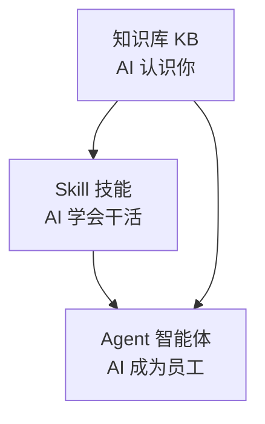
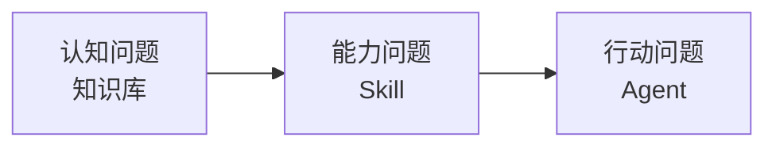

# 第八章 AI 三层递进：从“认识你”到“成为员工”

## 学习目标

-   理解 AI 能力从知识库到 Skill 再到 Agent 的三层递进关系
-   掌握各层级的核心定义与功能定位
-   理解三层之间的依赖关系与递进逻辑
-   能运用三层框架分析真实 AI 应用场景并规划提升路径

## 8.1 生活类比

想象一下，你要给一位新同事布置工作。第一天，你需要花大量时间向他介绍公司背景、项目历史、你的个人偏好——这是让他“认识你”。接下来，你发现他学会了你常用的 PPT 模板和报告格式，能熟练地按固定流程完成任务——这是让他“学会干活”。最终，你不再需要逐条交代细节，只需要说“把下周的营销方案整理好”，他自己就能拆解任务、调用各种工具、按时交付——这是让他“成为员工”。AI 能力的三层递进，正是沿着这条从陌生到熟练、从被动到主动的路径展开的：知识库解决“认识你”的问题，Skill 解决“学会干活”的问题，Agent 则让 AI 真正“成为员工”。

## 8.2 概念地图

```
AI 能力框架
├── 核心命题：三层递进构建 AI 能力演化路径
│   ├── 知识库（KB）——AI 认识你
│   ├── Skill（技能）——AI 学会干活
│   └── Agent（智能体）——AI 成为员工
├── 关键性质：递进性、可组合性、能力外延性
└── 实例：小红书内容营销的 AI 化
```

## 8.3 AI 三层递进

面对 AI，人们最常见的困惑是“AI 到底能帮我做什么”。这个问题的答案往往含糊不清，因为 AI 的能力边界太模糊了。但如果我们把 AI 的能力拆解成三个明确的层级，答案就会清晰许多：知识库（KB）让 AI 认识你，Skill 让 AI 学会干活，Agent 让 AI 成为员工。


> [P001, p.5] “知识库让 AI 认识你、Skill 让 AI 学会干活、Agent 让 AI 成为员工。”

这句话是整章的核心命题，它用三个动词精准定义了 AI 能力的三级台阶：**认识**、**干活**、**成为员工**。第一级是认知问题，第二级是能力问题，第三级是行动问题。三层合在一起，构成了一条完整的 AI 能力演化路径。

**核心定义与推导：**

> AI 三层递进定义（来源：《P001, p.5-6》）

AI 能力框架由三个递进层级组成：

```
层级一：知识库（KB）—— 解决“AI 认识你”的问题
层级二：Skill（技能）—— 解决“AI 学会干活”的问题
层级三：Agent（智能体）—— 解决“AI 成为员工”的问题
```

这个定义展示了 AI 能力从低到高的三级结构。每一层解决一个不同性质的问题，且层级之间存在严格的依赖关系：没有知识库，Skill 就缺乏执行所需的上下文；没有 Skill，Agent 就缺乏可调度的执行单元。

我们用一张表来对比三个层级的核心特征：

| 层级 | 核心问题 | 功能定位 | 关键产物 |
|------|---------|---------|---------|
| 知识库（KB） | 认知 | AI 认识你 | 背景、偏好、私有数据 |
| Skill（技能） | 能力 | AI 学会干活 | 可复用的标准化流程 |
| Agent（智能体） | 行动 | AI 成为员工 | 自主规划与任务执行 |

**关键性质：**

**性质 1：递进性**。知识库是起点，Agent 是终点，能力演进不可跳跃。你不能让一个不认识公司的 AI 直接当“员工”，它缺乏最基础的判断依据。

**性质 2：可组合性**。多个 Skill 可以被同一个 Agent 调度编排。Agent 就像一位项目经理，按需调用不同的 Skill 来完成任务。

**性质 3：能力外延性**。最底层的知识库决定了整个系统的认知上限，而 Agent 则把这种认知转化为实际的行动产出。

**数据流图：**



这张图展示了三层之间的数据流向：知识库为 Skill 提供执行上下文，Skill 为 Agent 提供执行能力，同时知识库也直接为 Agent 提供决策依据，因为 Agent 需要基于对“你”的理解来规划任务。

## 8.4 三层递进的逻辑关系

理解三层之间“为什么必须按这个顺序递进”，是本章的关键。我们来逐一剖析每一层为什么是不可跳过的。

**知识库是认知地基。** 任何高效合作都始于“了解对方”。AI 要为你工作，首先必须了解你的背景、偏好和私有数据。没有这一层，AI 的输出就像陌生人给出的泛泛建议，缺乏针对性。

**Skill 是能力封装。** 当 AI 认识了你之后，它可以把你反复执行的某些流程标准化，封装成可复用的 Skill。比如“如何写一份符合你风格的小红书笔记”“如何按你的模板生成周报”。Skill 的价值在于**复用**——同样的流程不必每次从头开始。

**Agent 是行动编排。** 有了认知和技能储备，AI 就可以更进一步：你只需下达一个目标，它自主拆解任务、调度多个 Skill、按顺序执行并交付结果。此时 AI 不再是工具，而是“员工”。

我们用一个递进关系图来总结：



这个递进图揭示了三层框架的内在逻辑：认知是基础、能力是桥梁、行动是归宿。每一步都为下一步铺路，不可跳跃。

**实例分析：小红书内容营销的 AI 化**

让我们用一个具体场景来检验这个框架。假设你想用 AI 做小红书内容营销：

| 层级 | 在此场景中的表现 |
|------|-----------------|
| 知识库 | 让 AI 学习你的品牌调性、历史爆文、目标人群画像 |
| Skill | 封装“爆文写作流程”“封面图生成流程”“评论区维护流程” |
| Agent | 你只需说“本周策划 3 篇种草笔记”，它自动调研选题、撰写、配图、排期发布 |

通过这个例子可以看到，三层递进不是抽象理论，而是可以直接指导你搭建 AI 应用的方法论。

## 8.5 设计中的取舍

**为什么不能跳过知识库直接上 Agent？**

因为 Agent 的决策质量取决于它的认知基础。一个不了解你业务背景的 Agent，即使拥有大量 Skill，也只能机械执行，无法做出符合你目标的判断。就像一位不了解公司文化的新员工，虽有专业技能，却常常在关键决策上“跑偏”。跳过知识库的代价，是 Agent 的输出缺乏针对性和准确性，最终需要你不断纠正，反而降低效率。

**为什么不把所有能力都塞进 Agent 一层？**

如果所有逻辑都堆在 Agent 层，系统会变得难以维护和扩展。把“知识”和“技能”分离出来，是为了让每一层都保持简单、可复用、可独立更新。当你的业务新增一种内容形式时，只需添加一个 Skill，而不必改动整个 Agent。这种分层的代价是需要多一点前期的架构设计，但换来的是长期的灵活性。

## 8.6 动手练习

-   梳理你日常工作中的一个重复性流程，尝试把它拆解为“知识库需要哪些背景信息”“Skill 需要封装哪些步骤”“Agent 如何编排这些步骤”。
-   任选一个你熟悉的 AI 产品（如 ChatGPT、Notion AI），分析它当前处于三层递进的哪个层级，并说明依据。
-   为你的个人知识库设计一个“AI 认识你”的内容清单，至少包括背景、偏好、私有数据三类，每类给出 2-3 个具体条目。

## 8.7 本章小结

这一章中我们讨论了 AI 能力的三层递进框架。首先以生活类比引入，把 AI 能力演进比作新员工从“认识你”到“学会干活”再到“成为员工”的过程。其次给出形式化定义，明确知识库、Skill、Agent 各自的定位与核心问题。接着分析了三层的递进逻辑与关键性质，特别是递进性、可组合性与能力外延性如何影响实际应用。然后通过小红书内容营销的实例，演示了如何用这个框架分析真实场景。最后讨论了设计中的取舍，包括“为什么不能跳过知识库”和“为什么要分层”两个核心问题。

本章我们一起学习了以下概念：

| 概念 | 解释 |
|------|------|
| AI 三层递进 | 从知识库（认知）→Skill（能力）→Agent（行动）的递进式 AI 能力框架 |
| 知识库（KB） | 让 AI 认识你，掌握背景、偏好与私有数据，解决认知问题 |
| Skill（技能） | 让 AI 学会干活，封装特定任务的可复用标准化流程 |
| Agent（智能体） | 让 AI 成为员工，自主规划与执行完整任务，调度多个 Skill |
| 递进性 | 知识库是起点，Agent 是终点，能力演进不可跳跃 |

下一章中，我们将学习“路径先于操作”——如何在搭建 AI 工作流时，先设计清晰的路径，再考虑具体的操作步骤。这一原则将帮助你避免在 AI 应用中的常见误区：盲目追求工具操作，而忽略了整体路径的规划。
