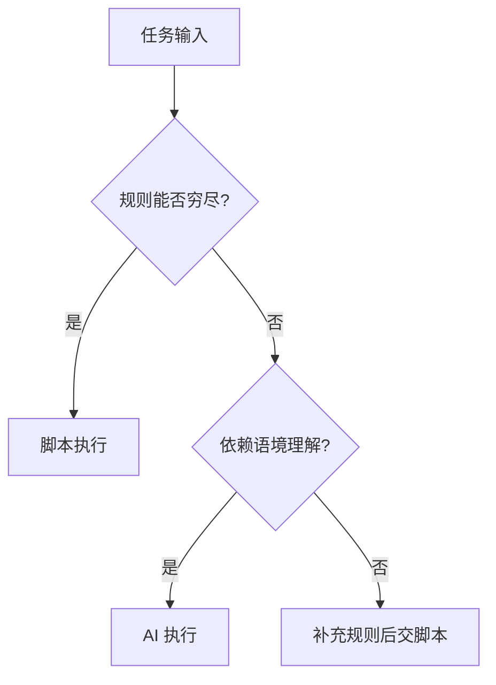
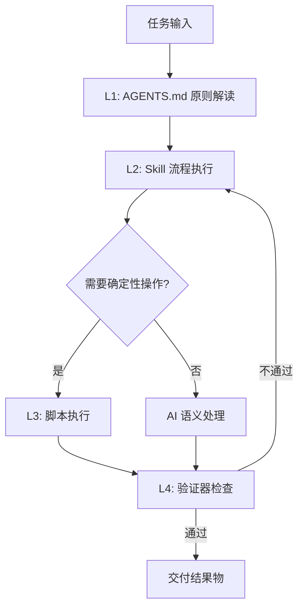

# 第十章 Skill 篇：让 AI 学会"怎么干活"

## 学习目标

- 理解 Skill 价值的本质：价值在工作流和结果物
- 掌握 Skill 设计三要素并独立设计一个 Skill
- 理解工具分工策略，能判断任务边界
- 掌握分层职责架构
- 掌握对标拆解为 Skill 的方法
- 理解 Skill 后置原则

## 10.1 生活类比

想象你要开一家咖啡店。如果你只是告诉店员"我要一杯好喝的咖啡"，他很难每次都做出同样品质的产品。但如果你写下一份标准作业流程——豆子磨多久、水温多少度、萃取时间几秒、奶泡打到什么程度——那么任何一个新店员照着做，都能稳定地出品一杯合格拿铁。这份流程本身就是可复用的资产：它可以被复制、被传授、被改进，甚至可以被出售。Skill 之于 AI，就像这份标准作业流程之于咖啡店——它的价值不在于某一次出品的内容，而在于那套能反复产出好结果的操作方法和最终交付物本身。

## 10.2 概念地图

```
Skill 篇：让 AI 学会怎么干活
├── Skill 价值论
├── Skill 设计三要素（怎么做/用什么/怎样算好）
├── 工具分工策略
├── 分层职责架构
├── 对标拆解为 Skill
└── Skill 后置原则
```

## 10.3 Skill 价值论

很多人用 AI 只停留在"聊得好"的层面——问一个问题得到一个不错的回答，然后就没有然后了。但真正有价值的产出不是某一次对话的内容，而是可复用的一整套工作流程和最终交付物。这就是 Skill 价值的核心命题。


> "Skill 的价值在工作流和结果物而非内容本身。"
> 
> ——《P001, p.5》

这句话看似简单，却颠覆了我们对 AI 使用的直觉。它的意思是：AI 产出的那个具体文档、那张图片、那段代码——这些"内容"本身并不可复用，下次你还需要从头再来；真正值得沉淀的，是产出这些内容的**方法流程**（怎么一步步做到）和**结果物形态**（最终交付什么标准的东西）。

**核心定义**（来源：`[P001, p.5-6]`，概念：`Skill 价值论`）

我们把 Skill 的价值拆成三个可检验的性质：

| 性质 | 含义 | 检验方式 |
|------|------|----------|
| 可复用性 | 同一 Skill 能否在不同输入上重复产出 | 换一批输入，输出是否仍然成立 |
| 可变现性 | 产出的结果物能否直接用于交易或交付 | 结果物是否有明确的市场接受方 |
| 沉淀性 | 流程能否脱离最初创建者独立运行 | 他人能否只凭 Skill 文档复现结果 |

这三条性质共同决定了一个 Skill 是不是"真资产"。可复用性保证它值得封装，可变现性保证它值得做，沉淀性保证它值得存。

**关键推断**——为什么价值在工作流而非内容？因为内容是一次性的，工作流是复发的。假设你写一篇小红书爆款笔记，这篇笔记本身只能发一次；但"如何产出爆款笔记"的流程（选题→标题→正文结构→封面→发布→复盘）可以在每个新选题上重新执行。当你把流程固化为 Skill，你就拥有了一个能量产内容的"机器"，而不是一次性的"产品"。

## 10.4 Skill 设计三要素

很多人在设计 Skill 时只告诉 AI"要什么"，却不说"怎么做""用什么""怎样算好"。结果 AI 给出的产出总是偏离预期。这就是 Skill 设计三要素要解决的问题。


> "Skill 设计三要素（怎么做/用什么/怎样算好）。"
> 
> ——《P002, p.3》

**核心定义**（来源：`[P002, p.3-4]`，概念：`Skill 设计三要素`）

一个合格的 Skill 必须同时回答三个问题：

$$
\text{Skill} = \langle \text{流程(怎么做)}, \text{工具(用什么)}, \text{质检(怎样算好)} \rangle
$$

| 要素 | 问题 | 示例（以"生成小红书爆款笔记"为例） |
|------|------|----------------------------------|
| 流程 | 怎么做？具体步骤是什么 | 选题→拆对标→写标题→写正文→配图 |
| 工具 | 用什么？哪些工具和脚本 | 小红书 AI 工作台、Python 脚本、图片库 |
| 质检 | 怎样算好？验收标准是什么 | 标题有情绪钩子、正文有故事线、封面有对比 |

这个公式展示了：一个缺了任何一元的 Skill 都是残缺的。只有流程没有工具，AI 不知道用什么执行；只有工具没有质检，产出好坏无法判断；只有质检没有流程，AI 不知道如何达到那个标准。

**三性质检验**——三要素设计的 Skill 具备三个性质：

- **可执行性**：AI 拿到 Skill 后，能从头到尾跑完整个流程，不需要中途追问；
- **可质检性**：每个环节有明确的验收标准，可以判断是否达标；
- **可组装性**：Skill 可以被其他 Skill 调用，作为更大工作流的一个环节。

如果你设计的 Skill 不具备这三性，很可能就是三要素中缺了一环。检查一下：你的 Skill 告诉 AI"每一步怎么做"了吗？告诉它"用什么工具"了吗？告诉它"输出什么标准才算好"了吗？

## 10.5 工具分工策略

当一个 Skill 变得越来越复杂，你会遇到一个棘手的问题：哪些任务应该交给 AI 的"语义理解"能力，哪些应该交给"确定性脚本"？选错了，要么效率低下，要么错误频出。


> "确定性任务用脚本，语义判断交给 AI。"
> 
> ——《P003, p.4》

**核心定义**（来源：`[P003, p.4-5]`，概念：`工具分工策略`）

这条策略给出一个明确的分界线：

$$
\text{任务类型} \rightarrow
\begin{cases}
\text{确定性任务} \rightarrow \text{脚本执行} \\
\text{语义判断任务} \rightarrow \text{AI 执行}
\end{cases}
$$

| 任务类型 | 特征 | 工具选择 | 示例 |
|----------|------|----------|------|
| 确定性任务 | 规则明确、输入输出映射固定 | 脚本 | 格式转换、正则匹配、去重、排序 |
| 语义判断任务 | 依赖语境理解、规则模糊 | AI | 判断文案是否有感染力、选题是否新颖 |

这个公式展示了工具分工的本质：把能用规则穷尽的交给脚本（快、准、便宜），把依赖语言理解的交给 AI（灵活、有判断力）。

**关键补充**——"看似确定但高度依赖语境"的情况。例如，判断一个文件名是否符合命名规范（如`2024_report_v3.docx`）——格式看起来是确定性的，但"是否属于该项目的报告范围"需要理解项目背景，这时应交给 AI。判断标准是：**规则的例外情况是否需要语境理解？如果需要，就交给 AI。**



这张图展示了工具分工的决策路径：先判断规则能否穷尽，能则用脚本；不能则再判断是否依赖语境，依赖则用 AI，否则补充规则回到脚本。

## 10.6 分层职责架构

当你把一个复杂的 Agent 系统（比如"AI 员工军团"）拆开来看，会发现它往往由规则、流程、命令混合在一起，文件越来越臃肿，维护越来越痛苦。分层职责架构就是为了解决这个问题。


> "AGENTS.md 存原则、Skill 存流程、脚本负责确定性、验证器兜底。"
> 
> ——《P003, p.6》

**核心定义**（来源：`[P003, p.6-7]`，概念：`分层职责架构`）

复杂 Agent 系统应该分成四个清晰层次，每层只负责一件事：

| 层次 | 存放内容 | 职责 | 示例 |
|------|----------|------|------|
| L1: AGENTS.md | 原则性指令 | 告诉 AI"应该怎么思考" | "始终遵循用户意图优先" |
| L2: Skill | 操作流程 | 告诉 AI"具体怎么做" | "生成周报的六步流程" |
| L3: 脚本 | 确定性执行 | 不依赖 AI 判断的重复操作 | "PDF 转文本""正则清洗" |
| L4: 验证器 | 质量兜底 | 检查产出是否符合标准 | "检查链接是否 404" |

这个分层架构的三个关键设计原则：

- **单向依赖**：上层可以调用下层，下层不能反向依赖上层。AGENTS.md 的原则指导 Skill 的设计，Skill 调用脚本和验证器，验证器只检查产出，不修改流程；
- **覆盖原则**：当上下层指令冲突时，下层优先。如果 Skill 中的流程与 AGENTS.md 的原则冲突，以 Skill 为准（因为 Skill 更具体、更贴近实际执行）；
- **可维护性**：修改一个层次不影响其他层次。改脚本不用动 Skill，改 Skill 不用动 AGENTS.md。

**数据流图**——一个任务从进入系统到产出结果，如何在四个层次间流转：



这张图展示了分层职责架构的数据流：原则解读决定方向，Skill 流程决定步骤，脚本处理确定性操作，验证器做最后兜底——不合格则回到流程重新执行。

## 10.7 对标拆解为 Skill

从零设计一个 Skill 很难，尤其当你面对"稳定产出爆款内容"这类目标时。一个更务实的起点是：找一个已经被市场验证的成功案例，逆向工程它，把它拆解成可操作的流程，然后固化为 Skill。


> "内容生产先把对标拆成 Skill 再稳定输出。"
> 
> ——《P004, p.3》

**核心定义**（来源：`[P004, p.3-5]`，概念：`对标拆解为 Skill`）

"对标拆解"的核心方法分为四步：

```
1. 选取对标：找 3-5 个已被验证的成功案例（如爆款笔记）
2. 逆向拆解：逐层分析每个案例的特征（标题结构、正文节奏、视觉风格）
3. 归纳共性：找出所有案例共有的可复制因子
4. 固化为 Skill：把共性因子写成流程、配好工具、定好质检标准
```

这四步的关键在于第二步和第三步的交替。逆向拆解时你在问"这个爆款为什么爆"，归纳共性时你在问"哪些因素是可复制的"。并非所有爆款特征都可复制（比如运气、时机），你要提取的是**可量化的结构因子**——标题有没有数字、正文有没有反转、开头有没有钩子——这些可以被公式化。

**关键属性**——好的对标拆解具备三个特征：

- **以终为始**：从结果（爆款）倒推过程（操作步骤），而非从过程猜测结果；
- **可量化复制**：每个拆出来的因子都有明确的判断标准（如"标题含数字"比"标题吸引人"更好判断）；
- **持续迭代**：每次执行后回到对标库，补充新案例，淘汰失效因子。

有一个常见的误区需要警惕：不要只拆一个案例就固化。一个案例可能是偶然，至少要拆解 3-5 个同类案例才能提取出可信的共性。

## 10.8 Skill 后置原则

了解了 Skill 的巨大价值后，你可能想立刻把所有任务都封装成 Skill。但经验告诉我们：一上来为所有任务建 Skill，会被复杂配置拖垮。这就是 Skill 后置原则的由来。


> "Skill 和总控 Agent 应在流程稳定重复后再增加。"
> 
> ——《P005, p.3》

>
> "一上来为所有任务建 Skill 会被复杂配置拖垮。"
> 
> ——《P005, p.4》

**核心定义**（来源：`[P005, p.3-4]`，概念：`Skill 后置原则`，视角：`critique/limitation`）

Skill 后置原则给出一个反直觉的时机判断：

$$
\text{建 Skill 的时机} = \text{流程稳定} \wedge \text{重复出现}
$$

即：**只有当某个流程已经被验证能稳定运行，并且你会重复使用它时，才值得封装为 Skill。**

**为什么后置而非前置？** 三个理由：

| 理由 | 说明 |
|------|------|
| 避免过度配置 | 早期流程不稳定，封装后频繁修改，维护成本高于收益 |
| 验证必要性 | 有些任务只做一次，封装是纯浪费 |
| 避免错误固化 | 把未验证的"坏流程"封装成 Skill，会让错误被重复执行 |

最稳妥的路径是：先用普通对话/手动跑通完整流程 → 验证产出稳定 → 记录操作步骤 → 再固化为 Skill。这也是"后置"的含义——Skill 不是起点，而是流程成熟后的自然沉淀。

**与"对标拆解为 Skill"的关系**：两者并不矛盾。对标拆解告诉你**拆什么**（拆成功案例），后置原则告诉你**何时封装**（流程稳定后）。拆解可以对标先行，但封装要后置。

## 10.9 多源对照

本章的六个核心概念主要来自四篇素材。其中两个概念（Skill 价值论、Skill 设计三要素）在素材中是作为原创定义提出的，而"工具分工策略"与"分层职责架构"则来自同一篇关于 AI Agent 员工的文章，呈现了不同的侧重。

### 共识

- 所有素材都认同 Skill 的价值在于**可复用的工作流**，而非单一产出内容；
- Skill 设计需要明确"怎么做"，仅告诉 AI"要什么"是不够的；
- 复杂系统需要分层，不能让规则、流程和命令混在一起。

### 分歧

- `[P001, p.5]`（Skill 价值论）强调结果物的**可变现性**，认为 Skill 的最终检验标准是能否做成生意；
- `[P003, p.4]`（工具分工策略）则侧重**效率边界**，认为分工的核心标准是"确定性 vs 语义"；
- `[P005, p.4]`（Skill 后置原则）则持**谨慎态度**，提醒过度封装反而增加维护负担，与"结果物可变现"的积极视角形成张力。这组分歧提示我们：Skill 的系统能力应该在实践中摸索，但封装时机应当保守。

## 10.10 设计中的取舍

**为什么不用"一上来就全建 Skill"的方案？** 因为 Skill 不是免费的——每个 Skill 都需要编写、测试、维护。当一个流程还没稳定时，你今天写的 Skill 明天就要改，花在维护上的时间超过了省下的时间。先跑通流程，验证稳定，再沉淀为 Skill，这是一种"延迟承诺"的策略：你推迟了封装的投入，换来了对流程真实形态的了解。

**这种设计的 trade-off 是什么？** 后置原则的代价是前期的"手工阶段"效率较低——在 Skill 还没有建立时，每次执行都需要从头引导 AI。但换来的收益是：一旦某个流程被证明值得封装，你封装的就是真实运行的流程，而非想象中的流程。前者的错误率远低于后者。这正是"欲速则不达"在 AI 工程中的体现。

**为什么不用脚本处理所有任务？** 脚本的优点是快、准、成本低，但它无法处理规则外的情况。语义判断任务（如"这条文案有没有感染力"）没有固定映射规则，脚本无法穷尽。反过来让 AI 处理所有任务也不行——AI 比脚本慢得多，且对简单重复操作（如格式转换）既不稳定也不经济。分工的本质是"把确定性交给机器，把判断力交给模型"。

## 10.11 动手练习

- 从你最近使用 AI 完成的一个任务出发，回答 Skill 设计三要素：流程是什么（怎么做）、用什么工具（用什么）、验收标准是什么（怎样算好）。如果三个问题中有一个答不上来，说明你的 Skill 设计还不完整。
- 将"生成周报"这个任务拆分为工具分工：列出其中哪些子任务是确定性的（适合脚本），哪些需要语义判断（适合 AI）。写出你划分的理由。
- 用对标拆解法，选取 3 篇你认为优秀的内容（小红书笔记、公众号文章、短视频脚本任选），拆解出共性因子并尝试固化为一个简单的 Skill 流程。
- 复盘你近期使用 AI 的某个场景，判断它是否满足 Skill 后置原则的两个条件（流程稳定、重复出现）。如果满足，尝试把它写成 Skill；如果不满足，说明理由。
- 画一张你自己项目的分层职责架构图：AGENTS.md 层、Skill 层、脚本层、验证器层分别放什么。标出各层之间的单向依赖关系。

## 10.12 本章小结

这一章我们系统地学习了如何让 AI"学会干活"——也就是 Skill 设计的方法论。首先我们理解了 Skill 价值的本质：它的价值在于可复用的工作流和交付的结果物，而非某一次的内容产出；其次我们掌握了 Skill 设计三要素——怎么做（流程）、用什么（工具）、怎样算好（质检标准），三者缺一不可；接着我们讨论了工具分工策略，明确了确定性任务交给脚本、语义判断交给 AI 的边界判断方法；然后我们学习了分层职责架构，理解了 AGENTS.md 存原则、Skill 存流程、脚本负责确定性执行、验证器兜底的系统设计；在此基础上我们掌握了对标拆解为 Skill 的方法，通过逆向工程把成功案例固化为可复制的流程；最后我们理解了 Skill 后置原则——先跑通流程并证明稳定重复后再沉淀为 Skill，避免过度封装带来的维护负担。

本章我们一起学习了以下概念：

| 概念 | 解释 |
|------|------|
| Skill 价值论 | Skill 的价值在于可复用的工作流和交付的结果物，而非内容本身 |
| Skill 设计三要素 | 怎么做（流程）、用什么（工具）、怎样算好（质检标准） |
| 工具分工策略 | 确定性任务交给脚本，语义理解任务交给 AI |
| 分层职责架构 | AGENTS.md 存原则、Skill 存流程、脚本负责确定性执行、验证器兜底 |
| 对标拆解为 Skill | 通过逆向工程把成功案例拆解为通用工作流并固化 |
| Skill 后置原则 | 先跑通流程并证明稳定重复后再沉淀为 Skill，避免过度封装 |

下一章中，我们将进入 Workflow 篇，学习如何把多个 Skill 组装成完整的自动化工作流。如果说 Skill 是"单个技能的封装"，那么 Workflow 就是"多个 Skill 的编排"——如何设计任务的流转路径、如何处理 Skill 之间的依赖关系、如何使用工作台将多个环节串联成一条流水线。这是从"让 AI 会干一件事"走向"让 AI 完成一整条业务"的关键一步。
