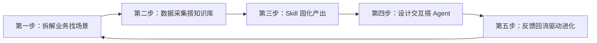
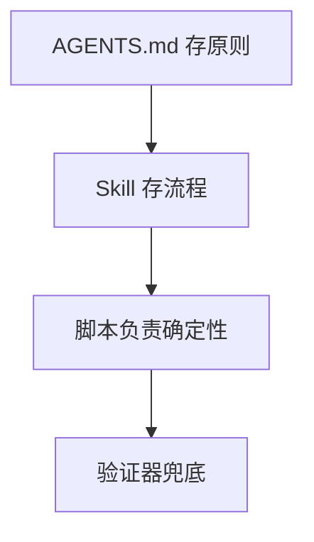

# 第十一章 Agent 篇：把流程装进"员工"

## 学习目标

-   理解真实任务起点原则
-   掌握五步法与 Agent 制作八步法
-   理解生产与质检分离原则
-   掌握人机协作四步流程与反馈回流机制
-   能判断任务是否适合 Agent 化

## 11.1 生活类比：从雇佣实习生到建立团队

想象你是一家创业公司的老板，业务逐渐繁忙，你决定雇一个实习生来分担工作。你犯的第一个错误往往是"先招人，再想让他干什么"——结果人招来了，却不知道安排什么活，最后实习生无所事事，你也浪费了工资。正确的做法是：先明确你手上有一件高频、耗时、规则清晰的事（比如整理客户名单），然后才去考虑"这件事适合交给谁、需要什么工具、流程怎么走"。

Agent 搭建的本质与此完全相同。很多人学 Agent 时第一反应是"哪个框架好用、哪个模型更强"，这相当于先招人再想岗位。而真实的工程经验恰恰相反：**先有真实难题，再有工具**。你从业务中提炼出一个高频、耗时、规则可描述的任务，然后才谈得上"搭建 Agent 员工"。这个类比贯穿本章所有方法——无论是五步法还是八步法，起点都是同一个：找到那件值得自动化的事。

## 11.2 概念地图

```
Agent 员工军团搭建
├── 起点原则：真实任务起点
├── 搭建方法：五步法 + Agent 制作八步法 + 人机协作四步流程
├── 稳定输出保障：纠偏沉淀验证循环 + 生产质检分离 + 分层职责架构
└── 系统进化：反馈回流机制 + 成果验证（12 个 Agent 月入 7w）
```

## 11.3 真实任务起点：先有难题，再有工具


> "搭建 Agent 第一步不是选工具而是从真实业务提炼任务。"
> 
> ——《P001, p.3》

这句话是整章的地基。绝大多数 Agent 项目失败，不是因为技术不够，而是因为起点选错了——先挑了工具，再四处找应用场景，结果 Agent 沦为玩具。正确的顺序是：从业务中找痛点，再判断它是否适合 Agent 化。

那么，什么样的任务适合 Agent 化？综合我们的素材，可以归纳出三条判断标准，我们称之为"任务三特征"：

1.  **高频**：任务反复出现，值得投入时间搭建自动化流程。
2.  **耗时**：任务耗人力，自动化后节省的时间值得回收。
3.  **规则可描述**：任务的执行逻辑可以被写成明确的步骤和判断条件。

只有同时满足这三条，Agent 才值得搭建。如果任务只出现一次、耗时三分钟、而且全靠直觉判断——那它更适合你亲手做，而不是交给 Agent。

除了这三特征，还需要从业务视角审视任务属性。一个好的 Agent 任务应当满足：

-   **业务导向**：任务必须直接服务某个具体业务目标，而不是"为了用 Agent 而用 Agent"。
-   **可拆解性**：任务能被拆成多个子步骤，每个子步骤有明确的输入和输出。
-   **可验收性**：任务的产出可以被客观判断对错或质量高低，只有可验收，纠偏和沉淀才有依据。

这三条属性加上前面的三特征，共同构成你判断"这活能不能交给 Agent"的完整清单。我们用一个表格来整理它们的分工：

| 判断维度 | 核心问题 | 对应的设计动作 |
|-----------|----------|---------------|
| 高频 | 这个任务多久出现一次？ | 决定是否值得投入搭建成本 |
| 耗时 | 人工做一次要多久？ | 决定自动化后的收益大小 |
| 规则可描述 | 执行的每一步能写清楚吗？ | 决定能否沉淀为 Skill 流程 |
| 业务导向 | 它在服务哪个业务目标？ | 决定 Agent 的职责定位 |
| 可拆解性 | 能拆成有明确输入输出的子步骤吗？ | 决定 Agent 的架构设计 |
| 可验收性 | 产出能被客观判断吗？ | 决定质检与纠偏的可行性 |

回顾生活类比，我们提到的"整理客户名单"就是典型：它高频（每周都要做）、耗时（每次两小时）、规则可描述（按行业分类、去重、补充联系方式）。而"给新客户写一封有创意的欢迎邮件"则不适合——它不高频、耗时短，而且创意无法客观验收。

## 11.4 五步法：搭建 Agent 员工的完整流水线


> "五步法：拆解业务找场景→数据采集搭知识库→Skill 固化产出→设计交互搭 Agent→反馈回流驱动进化。"
> 
> ——《P001, p.5》

五步法是目前掌握的最系统的 Agent 搭建方法论，它把"从业务到员工"的整个过程压缩成五个可执行的阶段。我们来逐层拆解每一步，并解释为什么必须按这个顺序。

**第一步：拆解业务找场景。** 这一步对应上一节的"真实任务起点"。你需要把整个业务流程摊开，找出其中高频、耗时、规则可描述的子任务。这一步的输出是若干候选任务清单，以及每个任务的优先级排序。

**第二步：数据采集搭知识库。** Agent 不是凭空工作的，它需要领域知识。这一步的工作是收集任务相关的数据——参考文档、历史案例、行业规范——并整理成知识库。知识库的质量直接决定 Agent 输出的质量上限。注意，知识库不是文件堆砌，而是"被组织过的、可检索的、与任务匹配的内容"。

**第三步：Skill 固化产出。** 当知识库就绪后，你需要把任务的执行步骤固化成 Skill。Skill 是 Agent 的"操作手册"——它描述了完成一个子任务的具体流程。在五步法的语境中，Skill 意味着把你的业务经验变成 Agent 可执行的程序化流程，而不是每次依赖模型的临场发挥。

**第四步：设计交互搭 Agent。** 有了 Skill，你需要设计 Agent 与外部世界的交互：它的输入是什么、输出给谁、如何与人或其他 Agent 协作。这一步是"组装"——把前面所有组件（知识库、Skill、模型、工具）装配成完整的 Agent 员工。

**第五步：反馈回流驱动进化。** 这一步是五步法的闭环，也是系统能否持续进化的关键。我们将在后面单独展开讨论反馈回流机制。

为了帮助你理解五步法中各步骤之间的关系，我们用一张流程图展示：



这张流程图的关键在于那条从第五步回到第一步的回流箭头——它表明五步法不是一次性的线性流程，而是一个持续迭代的闭环。Agent 上线后，从运行中收集反馈，反馈驱动下一轮的业务拆解和流程优化。这也是"员工军团"能不断进步的动力来源。

## 11.5 Agent 制作八步法与纠偏沉淀验证循环


> "Agent 制作八步法：经历真实执行、人工纠偏、规则沉淀、重新验证的过程。"
> 
> ——《P001, p.7》

如果说五步法是"从业务到员工"的宏观路径，那么 Agent 制作八步法则聚焦于"如何让一个 Agent 从生手变成熟练工"。它的核心思想很多人没有意识到：**关键不是写完美提示词，而是让它经历真实执行、人工纠偏、规则沉淀、重新验证的过程**。这里的"纠偏沉淀验证循环"（我们称之为修正循环）是理解八步法的钥匙。

**定义**（来源：[P001, p.7-8]，概念：纠偏沉淀验证循环）

$$
\text{稳定输出} = \text{真实执行} \rightarrow \text{人工纠偏} \rightarrow \text{规则沉淀} \rightarrow \text{重新验证}
$$

从修正循环这个公式可以看出，稳定产出不是靠一次写对提示词，而是靠一轮轮"执行-纠偏-沉淀-验证"的循环把问题磨平。每轮循环中，人工把 Agent 的错误纠正过来，把纠正的规则写回 Skill，再让 Agent 带着新规则重新执行，直到通过验证。

> Agent 制作八步法方法（来源：《P001, p.8》）

```
1. 明确任务定义与验收标准
2. 搭建最小可行 Agent（初版）
3. 在真实任务上执行，收集输出
4. 人工评估输出质量，标记错误
5. 分析错误根因，提取纠偏规则
6. 将规则沉淀到 Skill 或知识库
7. 用更新后的 Skill 重新执行
8. 验证输出质量是否达标，不达标则回到第 4 步
```

这段伪代码展示了修正循环如何被拆解为八个具体步骤。注意第 3 步提到"真实任务"——这与五步法的起点原则一脉相承，Agent 必须在真实场景中历练，而不是在理想化的测试集上自娱自乐。第 4-6 步对应修正循环的"纠偏"与"沉淀"，第 7-8 步对应"验证"。整个流程是一个环：只要验证不达标，就回到纠偏环节继续迭代。

那么，八步法与五步法是什么关系？我们分别理解：

- **五步法**回答的是"宏观搭建顺序"——从业务到知识库、Skill、组装再到反馈，讲的是系统级架构与节奏。
- **八步法**回答的是"单个 Agent 如何打磨"——它发生在五步法的第三步（Skill 固化）和第四步（搭 Agent）的交叉处，关注每个 Agent 内部如何在真实执行中变稳。

因此八步法是五步法在单个 Agent 上的"微观展开"。五步法给你路线图，八步法教你如何把一个具体的 Agent 训练成可靠的"员工"。

修正循环的价值在于它把"写提示词"这种艺术变成了"纠偏沉淀"这种工程。你不再追求一次写对，而是承认 Agent 必然犯错，然后把犯错-纠错-沉淀变成制度化流程。

在设计修正循环时，我们需要权衡两个方向：

- 为什么不追求一次性写完美提示词？因为 Agent 的知识覆盖和模型行为都存在不确定性，你无法预先穷举所有边界情况。修正循环通过在真实任务中暴露问题、逐个消化，比任何离线优化都更贴近实际。
- 这种设计的代价是什么？代价是冷启动阶段的"人工成本前置"——每轮循环都需要人工介入纠偏，这在初期很耗时。但收益是：一旦规则沉淀完成，后续的维护成本会急剧下降。

## 11.6 生产与质检分离：同一上下文不能既当运动员又当裁判


> "生产与质检必须分开。"
> 
> ——《P001, p.9》

这条原则短到只有一句话，但它是 Agent 工程质量的分水岭。我们给它的正式表述是：

**定义**（来源：[P001, p.9]，概念：生产与质检分离）

```
生产角色：负责执行任务，产出内容（运动员）
质检角色：负责评估产出的质量，判断是否符合验收标准（裁判）
约束条件：生产角色与质检角色不得共享同一个运行上下文
```

这个定义展示了"生产与质检分离"的核心约束，即生产与质检的角色、输入输出、上下文必须相互隔离。

为什么"不得共享同一上下文"这么关键？因为当你让同一个 Agent 既执行任务又评判自己的产出时，它会倾向于自我肯定而非客观判断——这就像考试时让学生自己改自己的卷子，他大概率会手下留情。此外，如果生产输出被用于质检的上下文，错误也会顺着同一条上下文路径悄悄传给质检环节，使质检失去独立性。

具体来说，如果生产与质检不分离，可能引入三类偏差：

- **自我确认偏差**：执行时的思路已经固化在上下文中，质检环节很难跳出它来挑毛病。
- **错误传播**：生产中产生的错误会污染上下文，质检环节基于被污染的信息做判断，更难发现真实缺陷。
- **缺乏盲点暴露**：真实任务中的盲点往往需要"外部视角"才能看出，同上下文天然缺乏这种外部性。

那么，分离具体怎么落地？我们做一个拆分：

- **角色层**：在生产型 Agent 之外，再建一个独立的质检型 Agent，两者的系统提示词和职责不同。
- **上下文层**：质检 Agent 只接收生产 Agent 的最终输出与验收标准，而不接触其内部推理过程。这样质检是基于产出与标准做客观比对，而不是顺着生产者的思路重走一遍。
- **流程层**：甚至可以在生产 Agent 完成后重置上下文，再让质检 Agent 带着验收标准从零开始审视产出，保证独立性。

最终，"生产与质检分离"让每一条输出都经过"先生产后裁判"的两道闸门，是 Agent 军团能稳定交付的质量底线。

结合前面的修正循环，我们可以清晰地看到两者的协作分工：

- **修正循环**负责"把一条 Skill 的执行质量从低磨到高"，它在生产侧的规则沉淀中起作用。
- **生产与质检分离**负责"持续把守质量底线，防止新的错误滑入产出"。

修正循环是打磨质量的机制，生产与质检分离是守住质量的结构；两者缺一不可。

## 11.7 分层职责架构：原则、流程、脚本与验证器的分工


> "AGENTS.md 存原则、Skill 存流程、脚本负责确定性、验证器兜底。"
> 
> ——《P001, p.10》

当你的 Agent 军团从 1 个发展到 12 个时，你需要一套架构来管理"员工"的行为边界。分层职责架构就是这套管理体系的核心。我们把它拆解成四层：

**定义**（来源：[P001, p.10]，概念：分层职责架构）



这张架构图之所以从上往下是"从模糊到确定"的，是因为每一层都在回答不同颗粒度的问题。各层职责与选型考量如下：

- **AGENTS.md（原则层）**：存放最高层的行为准则。告诉 Agent"应该遵守什么原则、不能做什么"。它适合存那些跨任务通用的价值约束，但缺点是无法覆盖具体执行细节。
- **Skill（流程层）**：存放具体任务的执行流程。告诉 Agent"这类任务应该按什么步骤做"。它比原则更具体，适合大部分常规工作，但面对异常情况时依然依赖模型的临场判断。
- **脚本（确定性层）**：可编程的确定性逻辑。凡是"判断条件清晰、不允许模型自由发挥"的步骤（比如文件解析、格式校验），都交给脚本执行。脚本保证确定性的代价是不够灵活，但它能把关键路径锁死。
- **验证器（兜底层）**：对 Agent 产出做最终校验。验证器是一个独立模块，用程序化规则或第二套机制检查输出是否符合要求。它是质量底线，但设计成本较高，通常只用于高价值产出。

设计这套分层架构时，核心权衡是"灵活性与确定性"之间的平衡。如果所有逻辑都写成脚本说话，Agent 将失去应对新情况的能力；如果所有逻辑都靠模型自由发挥，输出将难以稳定。分层架构的价值就在于：**用 Skill 存流程负责灵活应对，用脚本锁死必须确定的步骤，用验证器守住质量底线，用 AGENTS.md 定基调约束全局**。

## 11.8 人机协作四步流程与反馈回流机制


> "人机协作四步流程：人机协作不是人退居二线，而是人在关键节点做判断。"
> 
> ——《P001, p.12》

> "反馈回流是系统进化的关键。"
> 
> ——《P001, p.13》

我们把这两段素材放在一起解读，因为它们共同回答了一个问题："Agent 军团上线后，系统如何持续变好？"

先看人机协作四步流程。许多人误以为"自动化"就是人类撒手不管，但真实工程告诉我们恰恰相反——人在关键节点做判断，机器在重复环节出效率。人机协作的正确姿势是人与 Agent 各司其职，而不是 Agent 替代人。

**定义**（来源：[P001, p.12]，概念：人机协作四步流程）

```
1. 人定义验收标准（Agent 达标不达标，人说了算）
2. Agent 独立执行（执行环节机器全包，不打断）
3. 人审核关键产出（人在节点上做判断，标记问题）
4. 反馈回流给 Agent（人的反馈进入系统，驱动下一步进化）
```

这段伪代码展示了人机协作的核心结构：人只在两个点介入——开头定义标准、执行后审核产出。中间的执行环节完全交给 Agent。这样，人的精力用在最需要判断力的地方，而重复劳动交给机器。

再看反馈回流机制。修正循环解决的是"单个 Agent 如何一次比一次更稳"，而反馈回流要回答的是"整个 Agent 军团如何持续进化"。每一次人机协作中人的标记与纠偏，不只是修正当下产出，更是给系统提供进化的养料。

**定义**（来源：[P001, p.13]，概念：反馈回流机制）

$$
\text{Agent 军团能力}(t+1) = \text{Agent 军团能力}(t) + \text{回流}(反馈, 纠偏规则, 新沉淀的 Skill)
$$

这个公式展示了反馈回流的本质：系统在每一轮迭代中吸收反馈，把纠偏规则和新 Skill 沉淀下来，使得整个军团的"能力"随时间单调增长。这也再次呼应五步法的第五步——反馈回流驱动进化。反馈不是在系统外部做 QA，而是回流进系统内部，改变下一轮的执行。

现在，我们把修正循环、生产与质检分离、人机协作与反馈回流之间的分工理清：

- **人机协作四步流程**回答的是"人类在 Agent 工作流中站在哪"，核心定位是人在关键节点做判断。
- **修正循环**回答的是"单个 Agent 的 Skill 如何越磨越准"，靠真实执行与人工纠偏来沉淀规则。
- **生产与质检分离**回答的是"如何保证每次输出不滑坡"，用独立质检守住质量底线。
- **反馈回流**回答的是"系统如何整体进化"，它把前三个机制产生的经验回注进下一轮执行，让整个军团持续变强。

四者合在一起，构成了 Agent 军团"搭建-打磨-守门-进化"的完整闭环。

## 11.9 多源对照：五步法与八步法的互补关系

我们在本章中引入了两套搭建方法论：五步法（来自《Agent 员工军团搭建流程》）和八步法（来自《AI Agent 员工》）。它们都聚焦"如何搭建 Agent"，但有明显互补。

### 共识

两者都认同一个前提：**Agent 必须在真实任务中历练，而不是在理想化环境中预演**。五步法的第一步是"拆解业务找场景"，八步法的第三步是"在真实任务上执行"——它们都把真实场景放在核心位置。此外，两者都认同"反馈/纠偏环节不可省略"：五步法有反馈回流，八步法有规则沉淀。

### 分歧

- **[P001, p.5]** 的五步法视角是"宏观流水线"：它从业务层往下拆，关注知识库、Skill、Agent 组件和系统级反馈，起点是业务而非代码。
- **[P001, p.7]** 的八步法视角是"单 Agent 打磨"：它从执行质量切入，关注真实执行、人工纠偏、规则沉淀的微观循环。

一个管全局（从业务到军团），一个管单点（从生手到熟练工）——两套方法并不冲突，而是同一工程在不同尺度上的展开。

## 11.10 设计中值得思考的取舍

**为什么不用"完美提示词"策略而用修正循环？**

完美提示词策略假定你可以预先写出一段提示词，让 Agent 一开始就能稳定输出。但真实任务中，业务规则的边界永远比预想中复杂，你无法在冷启动阶段穷举所有边角情况。修正循环承认这一事实：它接受 Agent 会犯错，然后把错误当成索引去更新，每一轮周期都在把边界情况变成明确规则。它的代价是冷启动阶段的人工介入成本高，但换来的是长期稳定与可迁移的方法论。

**如何权衡自动化的"效率"与"质量"？**

反馈回流和人机协作提供的答案是分权：机器全包执行环节保障效率，人在"定义标准"与"审核产出"两个节点介入保障质量。这样做的好处是人的判断力被用在刀刃上；代价是，如果人的审核节点设计得过于密集，就会变成人在全程跟单，自动化收益被抵消。设计协作流程时，你需要刻意压缩"人审"的节点数，只保留高价值节点，把其他判断尽可能交给脚本与验证器。

## 11.11 动手练习

-   从你的日常工作或学习中找出一个高频、耗时、规则可描述的任务，用"任务三特征+三属性"清单评估它是否适合 Agent 化。
-   用五步法为上述任务画出一张完整的搭建路线图，标注每一步的输入输出与依赖关系。
-   为你的任务设计一个"修正循环"流程图，写下最少 5 条你可能需要在真实执行中沉淀的纠偏规则。
-   给你的 Agent 设计一个"生产与质检分离"的架构方案，说明质检 Agent 的输入、输出及验收标准。
-   设计一个反馈回流机制，明确：哪些反馈要回流、回流到哪个组件、如何驱动下一轮进化。
-   画出你理解的"五步法"与"八步法"的分工合作关系图，并标注各自适用的场景。

## 11.12 本章小结

这一章我们从"把流程装进员工"的目标出发，系统学习了 Agent 员工军团的搭建方法论。首先我们确立了对设计师和非设计师都普遍成立的**真实任务起点原则**——先有真实难题，再有工具；其次我们掌握了搭建 Agent 的两套互补方法：**五步法**（从业务到军团的宏观路径）与**八步法**（从生手到熟练工的微观打磨），并理解了修正循环——稳定产出的关键不是完美提示词，而是纠偏-沉淀-验证的闭环；接着我们讨论了**生产与质检分离**原则——同一上下文不能既当运动员又当裁判，以及**分层职责架构**——原则、流程、脚本、验证器各司其职；最后我们学习了**人机协作四步流程**与**反馈回流机制**——人是系统进化的引擎，反馈是军团成长的养料。整套方法论浓缩为一个原则：**把流程装进员工，把进化装进流程**。

本章我们一起学习了以下概念：

| 概念 | 解释 |
|------|------|
| 真实任务起点 | 先有真实难题，再有工具 |
| 五步法 | 拆场景→搭知识库→固化 Skill→搭 Agent→反馈回流 |
| Agent 制作八步法 | 经历真实执行、人工纠偏、规则沉淀、重新验证 |
| 纠偏沉淀验证循环 | 稳定产出的关键不是完美提示词，而是纠偏-沉淀-验证闭环 |
| 生产与质检分离 | 同一上下文不能既当运动员又当裁判 |
| 反馈回流机制 | 反馈回流是系统进化的关键 |
| 分层职责架构 | AGENTS.md 存原则、Skill 存流程、脚本负责确定性、验证器兜底 |
| Agent 军团成果 | 用五步法搭建 12 个 Agent 员工月入 7w |

感谢你读到这里——恭喜你，你不仅学会了搭建单个 Agent，还掌握了如何组建并运营一整个 Agent 员工军团。从真实任务起点到五步法，从修正循环到生产质检分离，从人机协作到反馈回流，你已经有了一套完整的"把流程装进员工"的工程方法论。在后续的实践中，愿你的第一个 Agent 员工早日上岗，愿你的员工军团不断壮大。
