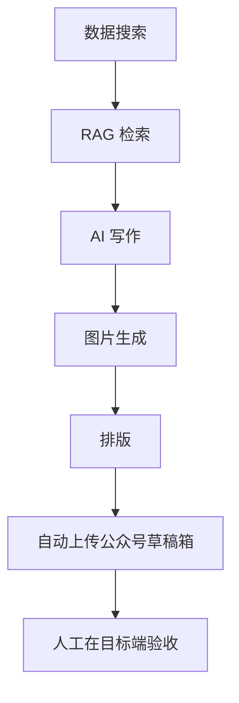
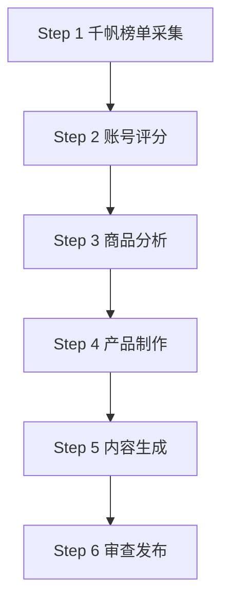

# 第十二章 实战篇 —— 让 Agent 军团"上战场"

## 学习目标

- 理解需求五要素拆解为何能让 AI 任务可执行可验收
- 掌握完整路径意识
- 理解 RAG 精准检索观
- 掌握手动先行原则
- 理解目标端回读验收
- 掌握六步流水线及其数据驱动特性


## 12.1 生活类比

假设你是一位新上任的餐厅主厨，老板说"把餐厅生意做好"，这个目标听起来很宏大，但完全无法执行。你不会直接去后厨开火，而是先问：今天有什么食材（输入）、顾客点什么菜（处理步骤）、菜品端上来长什么样（输出）、菜做糊了怎么办（失败重试）、顾客满意才算通过（验收标准）。当这一套流程被明明白白写下来之后，你才能标准化地复现。同样的道理，如果我们只是给 AI 一句"帮我写篇文章"，它只能靠猜，产出完全不可控。你需要像主厨一样，把任务拆成清晰的五要素：输入什么、怎么处理、输出什么、失败了重试、验收标准是什么。这就像给 AI 一张"菜谱"，而不是让它自由发挥。当我们把这个思路延伸到更复杂的工作流里，你会发现任何复杂的自动化系统，本质上都是一张张"菜谱"的组合。


## 12.2 概念地图

```
实战篇：让 Agent 军团上战场
├── 需求工程：需求五要素拆解 + 完整路径意识
├── 检索与知识组织：RAG 精准检索观
├── 自动化推进方法：手动先行原则 + 目标端回读验收
├── 工作台与流水线：端到端工作台 + 六步流水线
└── 数据决策与成果验证：数据驱动选需求 + 工作台成果案例
```


## 12.3 需求五要素拆解

当你把一个模糊的愿望交给 AI 时，它只能靠猜，产出不可控。而把任务显式拆解成输入、处理步骤、输出、失败重试、验收标准这五个要素，AI 的产出就变得可预期、可验收。完整性、可验收性、可重试性，是需求拆解的三大关键性质：完整性保证 AI 不遗漏环节，可验收性保证结果可判断，可重试性保证失败后可恢复。

> "要把需求拆成输入、处理步骤、输出、失败重试和验收标准再交给 AI。"
> 
> ——《260818, 公众号 99%自动化》

> 需求五要素拆解定义（来源：《260818, 公众号 99%自动化》）

需求五要素拆解是将任务描述重构为如下五个组件的规程：

```
1. 输入（Input）：任务需要什么素材/数据作为起点
2. 处理步骤（Process）：从输入到输出的中间操作序列
3. 输出（Output）：任务最终产出的形态与格式
4. 失败重试（Retry）：当结果不符合预期时如何恢复
5. 验收标准（Acceptance）：判断结果是否通过的门槛
```

这个拆解框架展示了三个本质特性。同样是"写一篇公众号推文"这个需求，不拆解时 AI 只能猜测文体、篇幅、素材来源和风格；而拆解后，输入是原始素材（例如产品文档），处理步骤是"提炼卖点→组织结构→撰写初稿"，输出是一篇 1500 字的图文推文，失败重试是"素材不足时回退到补充检索"，验收标准是"核心卖点全部覆盖且无事实错误"。这一过程把 AI 从"猜谜者"转变为"流水线上的执行者"，是后续所有自动化工作台的基石。

我们可以用一个伪代码来体现这五要素如何在需求描述中落地：

```
1. 输入：指定素材来源与格式
2. 处理：按固定步骤顺序执行
3. 输出：规定产出的结构与形态
4. 失败重试：设定回退与重试逻辑
5. 验收：对照标准逐项检查
```

这段伪代码展示了需求五要素在任务描述中的实现方式。每个要素都对应一处可见的描述，而非隐含的假设。需求五要素拆解，是解决"AI 产出不可控"这一核心痛点的手段。

你可能想问，为什么不能直接给 AI 一次性描述完任务？因为语言模型的输出质量严重依赖于输入约束的清晰度。五要素拆解为模型提供了结构化的约束空间，它不需要猜"用户到底想要什么"，而是把注意力集中在"如何更好地完成每个已知环节"。


## 12.4 完整路径意识

刚接触 AI 的多数人以为自己卡在"不会操作某个工具"，但真正的瓶颈往往不是操作，而是根本不知道整件事的完整路径长什么样。我们回想自己学一个新软件的经历：最难的时候往往不是某个按钮找不到，而是不清楚从输入到输出之间，到底要经过哪几站。

> "使用 AI 最难的不是操作，而是知道一件事情的完整路径。"
> 
> ——《260804, 用 Codex 把 IMA、Obsidian、飞书串成内容流转系统》

> [260818, 公众号 99%自动化] "路径先于操作、优先于工具。"（improve version）

> 完整路径意识定义（来源：《260804, ...]` 与 `[260818, ...》）

完整路径意识指在动手之前，先画出从原始输入到最终输出的整条链路，明确每一步的输入、输出与处理方式。它包含三层含义：

- 路径先于操作：先画地图，再走每一步，而不是边做边问工具怎么用
- 完整链路优先于局部技巧：知道从 A 到 Z 的全部中间站，胜过精通其中某一站的技巧
- 工具只是路径上的节点：工具永远服务于路径，而不是路径反过来迁就工具

完整的路径意识是"需求五要素拆解"在宏观层面的投影——五要素拆解管好单次任务，完整路径意识管好整个系统。当你在公众号自动化场景中，完整路径是"收集素材 → 检索/筛选 → 写作 → 配图 → 排版 → 上传草稿箱"；而在小程序虚拟产品的场景中，完整路径是"采需求 → 选品 → 做产品 → 发内容 → 审查发布"。有了这条路径，"操作"只是路径上各节点内的微观动作，路径才是战略层的判断。


## 12.5 RAG 精准检索观

初次尝试 RAG（检索增强生成）的人常有一个误区：觉得自己喂给 AI 的参考资料越多，AI 就越懂。结果往往是资料库里塞满了文档、噪声淹没了真正的信号，AI 反而不知道该依据什么。

> "RAG 的价值不是让 AI 读完所有资料，而是精准检索最相关的一小批证据。"
> 
> ——《260818, 公众号 99%自动化》

> RAG 精准检索观定义（来源：《260818, ...》）

RAG 的价值不在于"读得多"，而在于"找得准"。其核心主张是：

```
RAG = 证据驱动生成：不读全量，只读最相关的一小批证据
```

这个公式展示了 RAG 的本质——它是一个"证据筛选器"，而不是"信息搬运工"。检索到的证据质量，直接决定了生成内容的质量边界。喂再多泛泛的资料，也解决不了一个需要具体数据、具体人物原话支撑的写作任务；反而会把模型的注意力稀释到无关信息上。

RAG 还需要按"价值观 / 原话 / 案例 / 方法 / 风格"进行分层组织。每种类型服务于不同的生成需求：写作时需要"原话"来支撑引用，需要"案例"来增强说服力；设计产品时需要"方法"作为操作框架；品牌化输出时需要"价值观"和"风格"来统一调性。分层组织让检索不是"大海捞针"，而是"按图索骥"——每一类任务直接定位对应层，避免了跨层噪声。

**共识与会话**：在公众号 99% 自动化工作台设计中，RAG 分层是五层体系；在其他系统（如小红书虚拟产品工作台）里，同样有"对标拆解"的做法，但那是把"案例"层细化为更可操作的对标单元。共识是"精准优于全量"，分歧在于"分层维度的粗细"——前者按内容性质分五层，后者按商业目标拆对标。


## 12.6 手动先行原则

很多人在搭建自动化流程时，第一反应就是"直接写自动化代码"。但一旦将来流程出错，你就无法判断是流程设计错了，还是底层实现错了。

> "先手动跑通一条，再谈自动化。"
> 
> ——《260804, 用 Codex 把 IMA、Obsidian、飞书串成内容流转系统》

> 手动先行原则定义（来源：《260804, ...》）

手动先行原则指在搭建任何自动化系统之前，先手工完整跑通一次该流程。

手动流程是自动化的"参照实现"。一个手工跑通的流程，暴露的是真实的环节和隐性的步骤：哪一步需要人工判断、哪个格式在转换时会丢失、哪一个环节最耗时。自动化要去复刻一条已经被验证的路径，而不是凭空发明路径。同时，手工流程也是自动化上线后衡量效率提升的对比基线——只有知道手工要花多少时间，才能评判自动化值多少钱。

这与软件工程中的"测试先行"或"先写文档再写代码"有异曲同工之妙——先有参考行为，再有自动化实现。没有手动基线，自动化的"快"只是一个没有参照系的形容词。


## 12.7 目标端回读验收

自动化流程跑完，你要在哪里验收？很多人的答案是"在产出端看效果"，但这会漏掉只在目标端才会暴露的格式问题。

> "验收标准必须是到目标端重新打开读一遍。"
> 
> ——《260804, 用 Codex 把 IMA、Obsidian、飞书串成内容流转系统》

> 目标端回读验收定义（来源：《260804, ...》）

目标端回读验收指在成果最终被消费的目标端（如飞书文档、公众号草稿箱）重新打开、通读一遍，以此作为验收手段。

以一次内容流转为例：你在 Obsidian 里写好的 Markdown 文件，在编辑器里看起来一切都好。但你把它同步到飞书文档（目标端）后，才发现代码块的样式丢失、嵌入图片的链接失效、表格排版错乱。如果不回读目标端，这些错误永远不会被看见。同理，公众号推文在编辑后台看排版没问题，但发布后手机上图片变形——目标端恰恰是真实用户体验的还原点。

手动先行原则管的是"流程怎么走"，目标端回读验收管的是"结果怎么看"——两者配合，才是完整的闭环。


## 12.8 端到端工作台

单点 AI 工具只能解决单一环节。你会用 ChatGPT 写文章，也能用 Midjourney 生成图片，但每个环节之间靠人肉搬运，依然谈不上自动化。真正的自动化是把从数据到最终发布的全部环节串成一条流水线。

> "数据搜索、RAG 检索、AI 写作、图片生成、排版到自动上传公众号草稿箱。"
> 
> ——《260818, 公众号 99%自动化》

> 端到端工作台定义（来源：《260818, ...》）

端到端工作台是一个覆盖完整路径的自动化系统，它把数据搜索、RAG 检索、AI 写作、图片生成、排版、上传等多个环节串成一条流水线。

我们用一个数据流图来展示这条流水线：



这个数据流图展示了"端到端工作台"的三个关键性质：**全环节覆盖**（从数据到发布，没有断点）、**环节松耦合**（每个环节可独立替换或升级）、**可观测性**（每个环节的输出可检查，出现瓶颈可定位）。

与之前的单点 AI 工具应用相比，端到端工作台是把"点"连成"线"。它的价值不只是省去了人工搬移数据的时间，更重要的是消除了环节间传递信息的损耗：数据摘要在上一个环节被加工成了结构化格式，下一环节就能直接消费，不需要再解释一遍。这条流水线背后，正是"手动先行"验证过的完整路径，只是路径上的每一步都交给了工具。


## 12.9 六步流水线

单次任务拆解清楚之后，更进一步的问题是：如何批量地、可复用地产出？虚拟产品的上线过程涉及多个环节：找需求、评估账号、选商品、做产品、写内容、发布审查。逐一手工做，不仅易遗漏、而且低效。所以我们需要一条固定顺序的标准流水线。

> "千帆榜单采集→账号评分→商品分析→产品制作→内容生成→审查发布。"
> 
> ——《260817, 小红书 AI 工作台做虚拟产品》

> 六步流水线定义（来源：《260817, ...》）

六步流水线是一个固定顺序的标准化生产流程，将虚拟产品从选品到上架的完整链路划分为六步：



这个流水线图示展示了两个关键设计：**顺序是固定的**——每一步的输出是下一步的输入，不能跳步、不能倒序；**决策是数据驱动的**——流水线的起点不依赖人工灵感，而依赖榜单数据。与公众号工作台相比，六步流水线更强调"选品"环节，因为它面向的是虚拟产品电商场景，选品错了后续做得再好也是白费。

六步流水线还天然具备"可复用性"：同一条流水线可以生产多个不同的虚拟产品，每次只需要替换 Step 1 的数据源和 Step 4 的产品形态即可。流水线一旦搭建完成，新增一个产品只是跑一遍流程，而不是重新发明流程。


## 12.10 数据驱动选需求

选品是最容易出错的环节。靠人工刷榜单、凭直觉猜"什么会火"，不仅样本偏差大，还容易被个人偏好误导。我们应该把选品的第一依据交给官方数据。

> "找需求要用千帆官方数据而非人工刷榜单。"
> 
> ——《260817, 小红书 AI 工作台做虚拟产品》

> 数据驱动选需求定义（来源：《260817, ...》）

数据驱动选需求指以千帆官方榜单数据作为选品的第一依据，而不是依赖人工刷榜单的主观判断。

我们可以用一种形式化方式来表达这个问题：

```
人工刷榜 → 主观判断（样本偏差 + 个人偏好干扰）
官方榜单数据 → 客观输入（客观性 + 低成本 + 可时控）
```

这个公式展示了两种选品方式的根本分歧：人工刷榜受限于个人视野，只能看到自己圈子里的"热门"；而官方榜单是平台级的数据汇聚，反映的是整体市场趋势。后者具有三个关键特性：**客观性**（数据是平台统计的，不依赖个人感知）、**低成本性**（一次采集即可批量筛选，省去长期蹲守的精力）、**可时控性**（可以设定时间和周期，定时抓取，追踪趋势变化）。

数据驱动选需求的可取之处，在于它在流程最源头的环节就消灭了"拍脑袋"决策，让整个流水线的起点变得可复现、可对比。这也体现了"人做选择题，AI 做执行"的分工：数据帮人做更高阶的"选方向"决策，AI 负责流水线上的执行。


## 12.11 多源对照：不同素材对"自动化推进"的共识与分歧

### 共识

- 所有素材都认同"需求/路径必须先于工具"：`[260818]` 强调"路径先于操作"，`[260804]` 强调"先手动跑通"——两者都是"先有完整认知，再谈执行"。
- 所有素材都认同"目标端才是验收的最终场所"：`[260804]` 强调目标端回读；`[260818]` 把"自动上传公众号草稿箱"作为流水线终点，也是为了让最终产物在真实消费端接受检验。
- 所有素材都认同"AI 负责执行，人负责方向和验收"：`[260817]` 提出"人做选择题，AI 做执行"，与 `[260818]` 的"人在目标端验收"互为照应。

### 分歧

- **自动化程度的取舍**：`[260818]` 追求"99% 自动化"，尽量把每个环节都交给工具，人工只做最终验收；而 `[260817]` 的小红书工作台虽然也是流水线，但把"人"放在了更靠前的位置——"人选方向、定产品"，在选品环节保留更多人工判断。分歧点在于：自动化应该从哪个环节开始介入，以及哪些环节值得保留人工。
- **RAG 的使用深度**：`[260818]` 强调 RAG 是内容生成前的核心证据筛——"精准检索一小批"；`[260817]` 的"对标拆解为 Skill"则把案例学习放在产品设计环节，而非内容生成环节。两者都承认检索与组织的重要性，但前者服务于"写作"，后者服务于"产品定义"。


## 12.12 设计中的取舍

**为什么不用"一次喂全量资料给 AI"的方式？**

初用 RAG 时，我们很自然地认为资料越多 AI 越懂。但 `[260818]` 明确指出这会导致"噪声淹没信号"。全量喂入有三重代价：一是算力与时间成本随输入长度线性上升；二是模型注意力被无关信息稀释，关键证据反而拿不到高权重；三是输出风格变得更"平均"，缺乏聚焦的观点。取舍结果是：RAG 做精准筛选，宁可少而准，不可多而杂。

**为什么选"手动先行"而不是"直接搭自动化"？**

直接搭自动化的诱惑在于省时、一步到位。但 `[260804]` 点出了它的陷阱：一旦自动化流程出错，你无法判断是"流程设计不合理"还是"底层代码有 bug"。两者的调试成本完全不同。手动先行虽然多花一次时间，但它把"流程"与"实现"两个层次分离——先用一次手工跑通确认流程正确，再搭建自动化去复现，未来出错时就能立刻定位是流程还是实现的问题。

**为什么在流水线源头用官方数据，而不是自己刷榜？**

人工刷榜的直觉是"我在一线，我了解趋势"，但 `[260817]` 给出了反例：个人刷榜有样本偏差，你只看到你圈子里的人在买什么；同时有个人偏好干扰，你容易选自己感兴趣但市场不需要的方向。用官方数据虽然初期要写抓取逻辑，但换来的是客观、低成本、可时控的选品输入。取舍是：牺牲一点"个人感觉"，换取市场级的客观信号。


## 12.13 动手练习

- 挑一个你日常的重复任务（比如周报撰写、资料整理），按照"输入、处理步骤、输出、失败重试、验收标准"五要素写一份需求描述，并交给 AI 执行，检验产出是否可验收。
- 画一张你所在业务（或学习）流程的完整路径图，标注每个环节的输入、输出和负责人，找出当前最耗时的三个环节。
- 给你的 RAG 资料库设计一层分层的索引结构，明确每一层收录的资料类型和维护方式，写出一条检索样例验证效果。
- 选一条你尚未自动化的工作流程，先手工完整跑一遍，记录下每一步的操作、时长和易错点，作为后续自动化的基线。
- 把一条自动化流水线的输出，放到最终消费端（如飞书文档、微信公众号草稿箱、小红书发布页）重新打开通读，找出至少 2 处只在目标端才暴露的问题。
- 按六步流水线的顺序，选择一个虚拟产品（如电子模板、在线课程大纲），从官方需求数据出发，走完从"选需求"到"审查发布"的完整流程，记录每一步的耗时与产出。


## 12.14 本章小结

这一章我们走进了实战篇的核心——把前面章节的 AI 能力组织成一支能打硬仗的"Agent 军团"。首先，我们从需求工程出发，学习了"需求五要素拆解"，明确了"输入、处理、输出、失败重试、验收"的完整描述方式，让 AI 从"猜谜者"变成"执行者"；其次，我们讨论了"完整路径意识"，理解了路径先于操作、优先于工具，这是多数人真正卡住的地方；接着，我们对 RAG 建立了"精准检索观"，明白了证据不在多而在准，并按五层组织证据；然后我们学习了"手动先行"与"目标端回读验收"这两个自动化推进原则，前者保证流程正确，后者保证结果在真实场景达标；随后我们把视角放大到整个系统，学习了"端到端工作台"与"六步流水线"，把零散环节串成一条可复用的生产流水线；最后，我们用"数据驱动选需求"和"工作台成果案例"收官——前者让我们把选品决策交给客观数据，后者用"26 个虚拟产品、月被动收入 1-2 万"验证了整条流水线的商业有效性。

| 概念 | 解释 |
|------|------|
| 需求五要素拆解 | 把模糊愿望拆成输入、处理步骤、输出、失败重试、验收标准 |
| 完整路径意识 | 先看见整条处理链路再动手，路径先于操作、优先于工具 |
| RAG 精准检索观 | RAG 的价值在于精准定位最相关的一小批证据，而非全量读入 |
| 手动先行原则 | 先手动跑通一条完整流程，再谈自动化 |
| 目标端回读验收 | 在成果最终被消费的目标端重新打开通读验收 |
| 端到端工作台 | 把数据搜索、RAG、写作、图片、排版、上传串成完整自动化流水线 |
| 六步流水线 | 固定顺序的标准化六步生产流程 |
| 数据驱动选需求 | 以千帆官方榜单数据为选品第一依据 |
| 工作台成果案例 | 26 个虚拟产品、月被动收入 1-2 万，真实运营数据验证 |

下一章中，我们将走出"单兵作战"的工作台视角，站在"军团指挥"的高度，学习如何编排多个 Agent 协同完成更复杂的任务——包括角色分工、任务分解、状态同步与异常恢复。当流水线中的每一个环节都能被独立 Agent 接管时，我们就拥有了真正意义上的"Agent 军团"。
