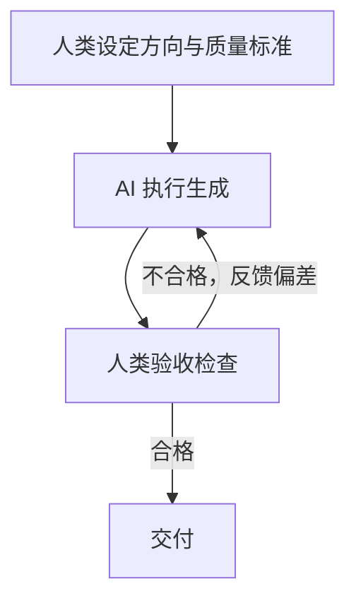

# 第十三章 虚拟产品生意方法论：从“会干活”到“能赚钱”

## 学习目标

- 理解红海机会论，破除蓝海必优思维惯性
- 掌握虚拟产品的二元构成（基础需求+体验创新）
- 理解着力点论，能分析产品卖不动的原因
- 掌握河流型生意与暴雨型生意的区别
- 理解 AI 改造旧需求而非凭空创造新需求
- 掌握 AI 执行+人选方向的分工原则

## 13.1 生活类比

你可以把这套方法论想象成在一条老街上开一家新店。很多人觉得应该去没人开店的地方“蓝海”，以为没有竞争就一定能赚钱。但你仔细观察，那些没有竞争对手的地方，往往意味着根本没有人流量——没有验证过的需求。真正热闹的老街虽然已经有很多店，但正因为热闹，说明这里的顾客已经被教育过、需求已经被验证、消费习惯已经养成。你不需要费劲解释“什么叫奶茶”或“什么叫火锅”，只需要思考一件事：我这家店和旁边那家店有什么不同，能让顾客非要走进我家而不是别家。老街上当然有激烈的竞争，但竞争本身就是一种免费的“市场信号”——它告诉你这里的钱是流动的、需求是真实的。而你真正要做的是在有限的产品空间里（虚拟产品构成论），找到那个让顾客觉得“这和我有关”的着力点（着力点论），然后像河流一样源源不断地经营，而不是像暴雨一样靠一次爆款打雷下雨后什么也不剩（河流型生意）。最后你要清楚自己和 AI 的定位：你是指南针，负责判断走向；AI 是发动机，负责往前冲。

## 13.2 概念地图

```
虚拟产品生意方法论
├── 市场选择：红海机会论
├── 产品设计：虚拟产品构成论 + 着力点论 + AI 改造旧需求
├── 生意模式：河流型生意
└── 人机分工：AI 执行+人选方向 + Skill 价值论
```

## 13.3 红海机会论

> [P001, p.5] “红海才是新手的机会。”

这是整个商业篇最具反直觉的一句断言。几乎所有创业劝退话术都在说“你要找蓝海”“远离竞争”，但这里给出了完全相反的判断。我们先理解直觉：

为什么红海反而是新手的优势场？因为红海是一个**已经被验证的市场**。需求真实存在，用户不需要被教育，付费意愿已经被无数前辈用真金白银测试过了。你不需要冒险猜测“市场需不需要这个东西”，你只需要回答“同一个需求，我怎么做得更好或更便宜”。

让我们把红海和蓝海放到一个对比视角里看：

| 维度 | 红海（竞争激烈） | 蓝海（无人竞争） |
|------|------------------|------------------|
| 需求验证程度 | 已被充分验证 | 存在高度不确定性 |
| 用户教育成本 | 极低，用户自带认知 | 极高，需从零解释 |
| 竞争参照系 | 丰富，可对标学习 | 无参照，全靠摸索 |
| 对新人友好度 | 较高，有前人路标 | 较低，试错成本高 |
| 失败风险 | 差异化不足则平庸 | 需求不存在则全灭 |

这个表格展示了红海与蓝海在五个维度的核心差异。注意最后一行：在红海里，最坏情况是“你做得平庸、没有特色”；在蓝海里，最坏情况是“你创造了一个根本不存在的需求，投入全部归零”。对新手而言，前者是可控的损失，后者是致命的赌博。

从方法论角度，我们可以把红海机会论拆解成三个推论：

1. **需求前置**：红海中的需求是前置于产品存在的。用户已经在为某个痛点付费了，你做的只是用新的方式去承接（这直接衔接 13.7 的 AI 改造旧需求）。
2. **教育成本归零**：在红海里，你不需要花钱和时间告诉用户“你有一个问题”，他们自己已经意识到了。
3. **竞争即免费教练**：每一个竞争对手的广告、定价、产品页面、用户评价，都是免费的市场调研报告。新手可以站在这些数据上快速逼近有效方案。

请注意，红海机会论并不是说“所有红海都适合你”。它的完整表述是：**红海是新手的机会，但你需要在这个红海里找到自己的着力点（13.5）**。没有着力点的红海，依然是炮灰的坟场。

## 13.4 虚拟产品构成论

> [P001, p.5] “虚拟产品=基础需求满足+体验创新。”

有了红海定位，我们就要回答：在红海里，我卖的产品到底由什么构成？这里给出了一个二元公式。我们把产品分为两类：实体产品与虚拟产品。二者在库存、物流、边际成本、迭代速度上有着根本不同的逻辑：

| 维度 | 实体产品 | 虚拟产品 |
|------|----------|----------|
| 边际成本 | 每多卖一件都有显著成本 | 趋近于零，可无限复制 |
| 库存 | 有库存、有积压风险 | 无库存、无仓储成本 |
| 迭代方式 | 改模具、改供应链，周期长 | 改文件、改内容，分钟级 |
| 交付方式 | 物流运输，有延迟 | 在线交付，即时完成 |
| 失败代价 | 压货压资金 | 仅损失开发时间 |

这张表格展示了实体与虚拟产品在五个核心维度的对立。绝大多数读者对实体产品有直觉，但对虚拟产品的“无限复制、即时交付”特性缺乏感知。虚拟产品的本质特征是：**第一次生产的边际成本可以很高，但第二次、第三次的成本趋近于零**。这意味着，你可以在体验层无限试错而不会破产。

现在把二元公式拆开：

$$
\text{虚拟产品} = \text{基础需求满足} + \text{体验创新}
$$

这个公式展示了虚拟产品的价值构成。**基础需求满足**是产品的“及格线”——它回答了“这个产品有没有用”的问题；**体验创新**是产品的“加分项”——它回答了“为什么选你不选别人”的问题。在红海里，基础需求满足大概率已经被无数人做到了，所有竞争者都及格了；增量价值全部来自体验层。

那么什么是“体验创新”？它的范围非常广：

- **形式层**：同样的指导内容，别人给 PDF 文档，你给可交互的在线工作台；
- **时间层**：别人一次性交付，你按月更新、陪伴式成长；
- **交付层**：别人只给内容，你附带 Skill 和模板，让结果物直接可落地；
- **情感层**：别人只是工具，你提供身份认同和群体归属。

体验创新的魔力在于它**可以低成本快速迭代**。因为虚拟产品的边际成本趋近于零，你今天就改掉体验层的任何一个环节，明天就能上线验证。这种迭代速度是实体产品无法想象的。

一个完整的虚拟产品思考框架应该这样运作：

```
假设验证：这个红海里最普遍的基础需求是什么？
         ↓
及格线确认：市面上所有竞争者是怎么满足这个需求的？（找到公因数）
         ↓
体验层设计：在交付形式、时效、结果物、情感四个维度上
            我能在哪一条上做得明显不同？
         ↓
最小验证：用最低成本推出一个体验创新版本，立刻测试用户留存
```

这条流程展示了从红海定位到体验创新的完整路径。关键转折在第 2 步到第 3 步——你必须诚实面对“及格线”已经饱和的事实，把创造力集中在增量体验上，而不是试图在及格线上做得比别人好 5%。

## 13.5 着力点论

> [P001, p.5] “产品卖不卖得出去取决于有没有着力点（与我有关）。”

这是从“产品视角”切换到“用户视角”的关键转折。假设你已经按照 13.4 做出了一个功能完善、内容优质、体验新鲜的虚拟产品，但依然卖不动。问题出在哪里？答案很可能不在产品本身，而在于**用户没有找到那个“与我有关”的连接点**。

我们把“着力点”定义清楚。着力点是一个高度个人化的感知触发点，它让潜在用户在接触到产品的第一瞬间，心里闪过一句话：“这说的是我，这对我有用。”

试着理解这个定义。一个产品可以有完美的功能描述、亮眼的性能参数，但如果用户无法在产品中找到自己的影子，这些描述就只是信息，而不是动力。反之，一个看似粗糙的产品，只要能让用户产生“这说的就是我”的代入感，购买决策就可能瞬间发生。

着力点有三个关键属性：

- **高度个人化**：它不是针对“所有人”的广谱卖点，而是能精准戳中某一类具体人群的词、场景或承诺。例如，同样是简历优化服务，“帮你突出薪资数字”比“帮你美化简历”更有着力点，因为它直指薪资谈判场景。
- **感知优先**：它必须是用户在 3 秒内就能感知到的元素——一句话、一张图、一个标题，而不是藏在页面深处需要读完三段才理解的价值。
- **杠杆性**：一个着力点能撬动整笔交易。它不是一个加分项，而是一票决定项。

如果把着力点放在售卖漏斗中，它处于什么位置？观察下面这一流程：

```
触达（广告/引流） → 第一次接触（着陆页/展示页） → 感知着力点 → 产生购买意愿 → 支付
```

这个流程展示了感知着力点位于第一次接触与购买意愿之间。着力点存在的意义，就是在“第一次接触”到“产生购买意愿”之间的惊险一跃中提供关键的杠杆力。如果没有着力点，用户会在第一次接触后就流失掉——这解释了为什么很多产品“功能好但卖不动”。

那么，如何找到你的着力点？我们给出以下方法：

```
1. 列出你的目标用户最常说的三句抱怨（例如：“我写了 30 版方案还是被老板打回”）
2. 从每句抱怨里提取一个具体的名词场景（“被老板打回”）
3. 把这个场景直接放进你的标题、副标题或第一屏文案里
4. 测试：把文案拿给三个目标用户看，问他们“第一反应是什么？”
```

这套方法展示了如何从用户抱怨反向推导着力点。核心原则是：着力点不是你说出来的，而是用户在自我描述中找到的。越具体的场景对应越强的“与我有关”感觉。

最后要区分两个容易混淆的概念：着力点不是“卖点”，不是“功能点”。卖点强调“我有多好”，着力点强调“你和我的关联”。在红海里，卖点已经被所有竞争对手说烂了，着力点才是你差异化突围的关键。

## 13.6 河流型生意

> [P001, p.5] “做河流型生意不做暴雨型生意。”

假设你已经在红海站稳、在体验层创新、找到了着力点，下一个问题就是：生意模式本身应该长什么样？这里给出一组关键对比——河流型 vs 暴雨型。

什么是暴雨型生意？它是指产品在极短时间内爆发式地获得一笔（或少数几笔）高额收入，然后迅速归于沉寂。典型例子包括：一次爆款课程、一场限时团购、一个突然走红的短视频工具。它们有一个致命的共性：**收入是脉冲式的，不可预测，不可依赖**。当暴雨结束后，你会面临“上次赚到了，下次在哪”的焦虑。而且暴雨型生意极其依赖运气——爆款之所以是爆款，正因为它的爆发不在你的掌控之中。

什么是河流型生意？河流的特点有三个：**持续流动、路径可循、日复一日**。用商业语言翻译就是：

| 特征 | 河流型生意 | 暴雨型生意 |
|------|-----------|-----------|
| 收入节奏 | 持续、稳定、可预期 | 脉冲式、爆发式、不可预测 |
| 增长来源 | 复购、会员、循环交付 | 一次性爆款、流量红利 |
| 心理压力 | 低，有稳定预期 | 高，永远在等下一场雨 |
| 可积累性 | 客户、口碑、资产逐日叠加 | 爆发结束后归零重来 |
| 依赖要素 | 系统化运营 | 运气和时机 |

这个表格展示了两种生意模式在五个维度上的根本差异。关键洞察：河流型生意的价值不在于单次水量，而在于**它每天都在流**。每天固定的流水，会让你在心理上从“赌徒”变成“经营者”，让你敢于投入长期资源——而长期资源的积累反过来又让河流更宽更深。

如何判断你的生意是河流还是暴雨？问自己一个问题：**如果我的产品今天上线、明天有人买、后天又有人买，而且不是靠打广告产生的，而是自然流入的——那么这些“后天”会持续多久？** 如果答案是“不确定”，那你就是暴雨；如果你能给出“只要我有持续供给，就会持续有人来”的机制，那你才是河流。

要实现河流型生意，你需要具备三个条件：

- **持续性**：产品必须有循环消费或持续更新的机制，而不是一次性买卖。例如，模板包可以月更、工作台可以按订阅、Skill 库可以持续添加。
- **可积累性**：每一笔交易都要留下资产——哪怕是一个老客户、一封好评邮件、一次转介绍。这些是河流的矿脉。
- **低心理压力**：一旦你不需要靠一场爆款来拯救业绩，你就能从容地打磨品质，而从容的打磨会进一步提高质量，形成正循环。

需要特别指出的是：河流型生意不是说完全放弃爆发式机会。它说的是，**生意的底盘必须是河流，暴雨只是偶尔的惊喜，不能反客为主**。如果你的收入结构是 90% 来自一场爆款，10% 来自日常流水，那你依然是暴雨型——只是碰巧下了一场大雨。

## 13.7 AI 改造旧需求

> [P001, p.5] “AI 用于改造旧需求而非凭空创造。”

在 13.3 我们提到红海需求前置。现在我们要把这一思维与 AI 结合，回答一个关键问题：AI 创业的正确姿势是什么？很多人一谈 AI 就兴奋地觉得“我要发明一个前所未有的新需求”，而这里给出了相反的判断：**一切长期存在但未被满足的旧需求，恰是 AI 的最佳舞台**。

为什么说服力来源于此？因为它同时避开了两个致命陷阱：

1. **需求陷阱**：凭空创造的新需求，最大的风险是它根本不存在。你花半年开发完一个 AI 工具，结果发现没有任何人想要它——因为“需求”本来就不存在。
2. **教育陷阱**：即使需求存在，如果用户从未意识到自己需要它，你要花大量成本去教育市场。而旧需求的用户已经被教育了十年二十年，你唯一需要做的事情是告诉他们：“你原来的解决方案，现在可以更快、更便宜、更好了。”

让我把“旧需求”的范围具象化。回看过去百年，人类的需求核心其实没怎么变：**求职、育儿、复购方案、整理文档、给老板汇报、管理财务、表达情感、处理纠纷**。变的一直是“满足方式”，而不是需求本身。而 AI 恰恰是一个新的满足方式——它的价值在于**替换或升级旧方案**，而不是发明新场景。

$$
\text{AI 商业价值} = \text{需求确定性} \times \text{旧方案的低效程度}
$$

这个公式展示了如何量化评估一个 AI 改造项目的商业价值。左边有两个因子：(1) 需求的确定性——越确定、越高频的需求，风险越低；(2) 旧方案的低效程度——旧方案越昂贵、越耗时、越低质量，用户被替换的意愿就越强。当且仅当两个因子都高时，AI 改造项目才有商业价值。如果需求不确定，风险压顶；如果旧方案已经高效，AI 的边际优势不足以让人更换。

我们还可以把“AI 改造旧需求”的一条核心理念提炼为流程：

```
旧需求场景识别 →旧方案痛点分析 → AI 替代方案设计 → 与旧方案对比验证 → 快速落地
```

这条流程展示了 AI 改造旧需求的标准路径。其核心优势在于第四步——“与旧方案对比验证”——因为需求已验证、痛点已知，你可以直接问目标用户一句：“如果有个方案能把原来需要 5 天的事情压缩到 2 小时，你要不要？”这句话的答案就决定了项目的生死。

这里需要划清一条边界：AI 改造旧需求 ≠ 排斥创新。它只是规定了你的需求必须“前置存在”。至于用 AI 的实现方式可以完全创新——用大语言模型生、用 Agent 执行、用工作台承载、用 Skill 封装——创新集中在方案层而非需求层。前者是安全的创新，后者是赌博。

## 13.8 AI 执行+人选方向

> [P001, p.5] “Skill 的价值在工作流和结果物而非内容本身。”

最后一个核心概念回答一个总被人忽视的问题：在人机协作的生意里，人的价值到底是什么？很多新手面对 AI 的习惯是：直接把一个任务丢给 AI，让它从头做到尾，交出完整结果。结果往往是“泛泛的、平庸的、像所有人都能做出来的东西”。原因在于——**AI 只有在明确方向下才有质量；没有方向的 AI 只是平均水平的复读机**。

这一条理念可以压缩成一张分工表：

| 环节 | 负责人 | 关键职责 |
|------|--------|----------|
| 需求判断 | 人（你） | 判断红海中的哪个痛点最痛 |
| 方向选择 | 人（你） | 决定体验层的创新维度与着力点 |
| 目标设定 | 人（你） | 设定交付物质量标准与价值取舍 |
| 内容生成 | AI | 执行生成、检索、整理、草拟 |
| 结果校验 | 人（你） | 兜底判断质量，矫正偏差 |
| 迭代优化 | 人 + AI | 人发现问题，AI 快速调整产出 |

这张分工表展示了“AI 执行+人选方向”全线落地时的角色分配。注意一个规律：**每一个“关键决策”都在人侧，每一个“重复执行”都在 AI 侧**。这不是分工的随意划分，而是由两者能力差异决定的——AI 没有判断力、没有品位、没有价值取舍能力；但这恰恰是人的不可替代的地方。

要理解“人的方向判断”如何转化为 AI 的执行质量，可以把它看作一个控制系统：



这张图展示了人机协作的闭环控制。人类的“方向设定”是输入信号，AI 是执行器，人的“验收检查”是反馈控制器。关键洞察在于：**质量不是由 AI 决定的，而是由人在验收环节的严格程度决定的**。如果你验收宽松，AI 就会持续产出平庸内容；如果你验收严苛并要求重做，AI 就能逼近高质量。

那么，为什么 Skill 位居于此？因为 Skill 的价值不是“能力”，而是“封装后的工作流”和“稳定的结果物”。一个优秀的 Skill：

- **固定工作流**：把“方向判断”之后的重复步骤（提取要点、生成报告、格式化输出）固化成可复用流程，这样每次 AI 都是同一套高质量流程；
- **产出结果物**：直接生成可直接交付的文件/模板/图表，而非零散回答；
- **内容可替换**：Skill 里的提示和流程是骨架，具体内容由每次的输入动态填充——这就是为什么说它的价值“在工作流和结果物而非内容本身”。

最终我们得到一个高效的人机分工闭环：

```
人定方向 → Skill 固化工作流 → AI 执行 → 人验收结果物 → 反馈迭代 → 方向微调
```

这个闭环展示了虚拟产品生意中人与 AI 共同作业的正确姿势。你的每一次成功实践，都可以通过 Skill 沉淀为下一次更高效的“固定动作”，产生复利效应。这就是为什么说：**人会随时间衰老，但 Skill 会随时间增值**。

## 13.9 多源对照

本节概念全部源自同一篇素材《用个人工作台+Skill 做虚拟产品生意》。虽然只有单一源头，但我们仍可以将其内部六个论点放在一起，看它们如何互相支撑、前后约束。

### 内在一致性

- 红海机会论决定了你的市场选择——从已验证需求切入；
- 虚拟产品构成论决定了你的产品结构——基础需求+体验创新；
- 着力点论决定了你的销售如何启动——在红海中找到“与我有关”的钩子；
- 河流型生意决定了你的模式——持续积累而非一次爆发；
- AI 改造旧需求决定了你的技术姿势——改造而非创造；
- AI 执行+人选方向决定了你的人机关系——方向在人在执行在 AI。

### 内在张力

- **红海 vs 着力点的张力**：红海意味着人人都在做同一需求，那么着力点必须足够尖锐才能在众多同样满足基础需求的产品中被选中——但这又意味着收入是不稳定的，与河流型生意的稳定性诉求存在摩擦。
- **河流 vs 爆款的张力**：完全的河流型生意天然排斥爆款思维，但在起步阶段你往往需要一次明显的曝光来打开局面。如何在不依赖爆款的前提下引来首波用户？素材没有给出明确答案，需要你自行在“预热-发布-持续运营”的节奏中摸索 [需要补充文献]。
- **AI 执行 vs 人的时差**：人的判断与反馈是慢速的，AI 的生成是快速的。在人反馈的间隙，如果缺乏 Skill 的流程固化，AI 很容易在不被监督时跑偏。这个“监督成本”在单人操作时如何控制，也未在素材中展开 [需要补充文献]。

### 待补足环节

- 河流型生意的“首波流量从哪来”，素材未说明获客与分销机制 [需要补充文献]
- Skill 的迭代与版本管理体系，素材未提供具体操作流程 [需要补充文献]
- Skill 的迭代与版本管理体系，素材未提供具体操作流程 [需要补充文献]

## 13.10 设计中的取舍

**为什么不是“先做蓝海再转红海”？**

很多人会说，我既然有 AI 能力，为什么不先去无人区淘金，等验证后再转向红海？这条路的致命问题在于：蓝海不仅没有竞争对手，更可能没有顾客。需求不确定意味着你的试错成本极高，而且蓝海中你得不到任何免费反馈——没有对手的定价、评论、广告可供你学习。红海虽然竞争激烈，至少市场上代表“真实需求”的信号是丰富的。新手需要免费的信号，而不是昂贵的猜测。

**这种设计的核心 trade-off 是什么？**

红海打法的核心代价是差异化难度加大。你进入一个所有玩家都已经成熟的市场，你必须在体验层、着力点、Skill 封装这些维度上做出足够明显的差异，否则就会成为红海里“另一个将就的选项”。但这个代价是可管理的——因为虚拟产品的迭代成本极低（13.4），你可以快速试错体验创新，而不是像实体产品一样压上一整条供应链。

**为什么不让 AI 自己选方向，而要把方向判断留给人？**

因为方向判断的本质是**价值取舍**——在多个可行方向中选择那个“长期价值更高”的。AI 没有价值观、没有偏好、无法判断“这个产品是否真心帮到人”。并且红海机会论中的需求判断和着力点识别都需要对人类的微妙情感有感知，这种感知来自生活阅历而非海量语料。让 AI 选方向的结果是：它会在平均选项上取中值，交出平庸的产品——而平庸的产品，在红海里根本没有生存资格。

## 13.11 动手练习

- 列出你熟悉的三个行业，分别描述每个行业的存量需求是什么、旧解决方案的低效点在哪里、AI 如何改造它，并打分决定哪个场景最有商业价值。
- 找出一个你曾经想做的“新需求”点子，然后尝试把它翻译成一个“旧需求场景中的具体痛点”，并验证这个痛点是否已有用户在论坛或社交平台上抱怨。
- 随便选一个你身边的小生意（餐饮、教育、代购等），分析它卖得动或卖不动的原因，用着力点论的三个属性逐一检查它的文案与展示是否具备“与我有关”的钩子。
- 为你当前正在做或最想做的一件事，设计一个最小规模的河流型生意模型：哪些环节可以复购、哪些环节可以积累、哪些环节不依赖爆款。
- 把一个工作台产品（比如简历生成或方案撰写）拆成两层：写出基础需求满足层有哪些功能、体验创新层你能改出至少三个不同的点来。
- 对自己最常见的一个 AI 使用场景，写出一个 Skill 的工作流骨架——包括输入条件、执行步骤、验收标准、输出物格式，并且和 AI 一起用这个小工作流跑通十次，至少记录一次失败案例并进行修正。

## 13.12 本章小结

这一章我们完整走了一遍“从会干活到能赚钱”的思维升级。首先我们用红海机会论打破了“蓝海必优”的惯性思维，理解了竞争激烈的市场对新手的真正价值——需求已验证、教育成本低、竞争者可对标。其次我们通过虚拟产品构成论拆解了产品的二元结构，明确了增量价值全在体验层，而体验层的低成本迭代是虚拟产品最大的红利。接着我们介绍着力点论，回答了“为什么功能好却卖不动”的问题——产品缺的不是质量，而是“与我有关”的触发点；然后我们引入河流型生意，区分了可持续与爆发式两种生意模式，主张用持续积累底盘来规避断档焦虑；再然后我们用 AI 改造旧需求原则，说明 AI 的商业价值在于替换低效旧方案而非凭空创造新市场；最后我们以 AI 执行+人选方向收束，强调人是方向判断者、AI 是执行层，且 Skill 的价值在于固化工作流和结果物。

本章我们一起学习了以下概念：

| 概念 | 解释 |
|------|------|
| 红海机会论 | 竞争激烈的存量市场对新手术是机会，因需求已验证、教育成本低 |
| 虚拟产品构成论 | 虚拟产品=基础需求满足+体验创新，增量价值来自体验层 |
| 着力点论 | 产品卖不动在于缺着力点；找到与我有关的钩子才能激活购买 |
| 河流型生意 | 持续稳定可重复的生意模式，规避断档焦虑 |
| AI 改造旧需求 | AI 应升级已存在的旧需求场景，而非凭空创造新市场 |
| AI 执行+人选方向 | 人负责方向判断与价值取舍，AI 负责执行落地 |

下一章中，我们将正式走出“方法论”的层面，进入“怎么搭工作台、怎么封装 Skill”的操作细节。你会看到理念如何一步步变成可以每天运行、每天产生结果物、每天积累资产的具体生意机器。如果说这一章是画地图，那下一章就是给你一台挖掘机和一套施工图。
