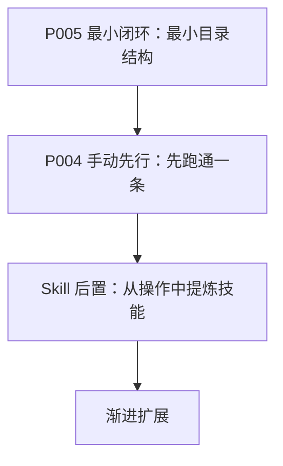
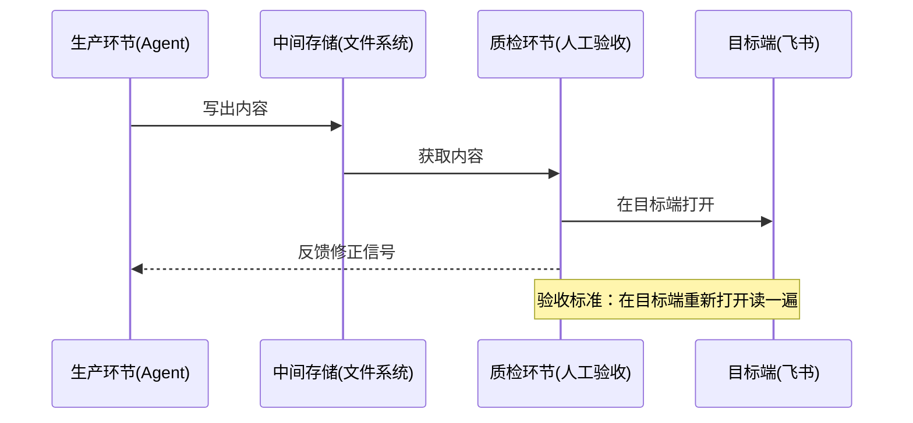

# 第十四章 进化篇 —— 让系统"自己长大"

## 学习目标

-   理解纠偏沉淀验证循环是 AI Agent 系统稳定产出的核心机制
-   掌握三端分工模型的设计原则
-   学会用最小闭环方法快速验证流程可行性
-   理解生产与质检分离的必要性
-   能识别并规避六类典型失败模式

## 14.1 生活类比

想象你是一位新晋主厨，第一次掌勺餐厅。你可能会迷信一份"完美的菜谱"——认为只要把每一步都写得无比详尽，就能一次做出一桌好菜。然而现实很快打脸：食材的含水量不同、火候的偏差、顾客口味的差异，任何一份菜谱都无法穷尽这些变量。你真正需要做的，不是追求完美菜谱，而是建立一套"试菜—调整—记录—再试"的循环。每次做菜都是一次真实执行，根据食客反馈人工纠偏，把成功的调整沉淀为新的标准操作，再在下一轮重新验证。你的后厨系统就是这样一步步"长大"的，而非靠一份一次性写好的完美文档。本章讨论的 AI Agent 系统，遵循的正是同样的进化逻辑。

## 14.2 概念地图

```
进化篇：让系统自己长大
├── 验证驱动迭代：纠偏沉淀验证循环
├── 从六个坑中学到的教训
├── Skill 后置与系统渐进：最小闭环
├── 反馈回流驱动的系统进化：生产与质检分离 + 目标端回读验收
└── 三端分工模型 + 从知识库到内容流转系统扩展
```

## 14.3 纠偏沉淀验证循环

如果你之前构建过 AI Agent 系统，一定有过这样的经历：反复调试提示词，试图让模型在一次输出中覆盖所有边界情况，却总是顾此失彼。这个单元要纠正的正是这种"完美提示词迷信"。

> "关键不是写完美提示词，而是让它经历真实执行、人工纠偏、规则沉淀、重新验证的过程。"
> 
> ——《P001, p.5-6》

这段话指出了系统稳定产出的真正机制：不是静态的提示词设计，而是动态的迭代循环。

> 纠偏沉淀验证循环定义（来源：《P001, p.5-6》）

我们把这种迭代机制形式化为一个四阶段循环：

```
循环入口 → 真实执行 → 人工纠偏 → 规则沉淀 → 重新验证 → 循环出口（收敛）
                ↑                                    ↓
                └────────── 未通过则继续循环 ←─────────┘
```

**阶段拆解**：

-   **真实执行**：让 Agent 在真实任务上运行，暴露实际错误和边缘情况。这个过程是必要的，因为任何设计都无法预见所有真实世界的变体。

-   **人工纠偏**：当 Agent 输出错误时，由人介入修正。纠偏信号是你最宝贵的训练数据——它精确地告诉你"哪里错了"以及"正确应该是什么"。

-   **规则沉淀**：将纠偏经验固化为显式规则，写入系统的知识库或 Skill 中。这一步将一次性的修正转化为可复用的系统能力。

-   **重新验证**：用更新后的规则重新执行，确认问题被修复且没有引入新的回归。

这个循环保证了系统的**渐进收敛性**（每次迭代都向正确方向逼近）、**纠偏信号可迁移性**（一次纠偏可以修复一类问题），以及**闭环完整性**（四阶段缺一不可）。有趣的是，`[P004, p.3]`（后者"260804"素材）在构建内容流转系统时也独立采用了类似的迭代策略，印证了这一机制的可迁移性。两者的**共识**在于"系统犯错是常态"且"迭代比一次性设计更可靠"。

> 纠偏优先级排序方法（来源：《P001, p.5》）

```
1. 收集并聚类错误类型，区分高频、低频与一次性错误
2. 优先修复高频错误（收益最大）
3. 对低频错误做规则备案，不急于修复
4. 一次性错误记录但忽略
```

这段伪代码展示了如何高效地分配有限的人力纠偏资源。注意力应集中在高频错误的修复上，低频错误备案即可，一次性错误无需处理——这正是工程实践中"二八定律"的体现。

## 14.4 三端分工模型

当我们把多个平台串成一条内容流水线时，最容易犯的错误是让每个平台都做所有事。本单元讨论的模型通过职责划分解决了这一混乱。

> "IMA（收集）、Obsidian（加工）、飞书（交付）。"
> 
> ——《P004, p.2》

原文用一句话定义了三个平台的角色，但我们需要展开理解其背后的设计原则。

> 三端分工模型定义（来源：《P004, p.2》）

我们将内容流转系统抽象为三个功能角色，每个角色对应一个平台：

| 角色 | 平台 | 核心职责 | 设计目标 |
|------|------|----------|----------|
| 收集端 | IMA | 摄取多渠道信息 | 低摩擦、广覆盖 |
| 加工端 | Obsidian | 结构化、可检索的处理 | 规范化、可复用 |
| 交付端 | 飞书 | 输出给协作方 | 协作友好、可触达 |

这三个角色遵循三条关键原则：

-   **职责单一性**：每个平台只做一件核心事。IMA 只管收集，不做深度加工；Obsidian 专注加工，不负责对外分发。
-   **端间接口清晰**：收集端与加工端之间、加工端与交付端之间通过明确定义的文件格式或接口传递数据，避免端间直接耦合。
-   **全链路可追溯**：任何一条内容都可以回溯其从收集到交付的完整路径。

> 三端数据流方法（来源：《P004, p.2》）

```
输入流 → IMA(收集) → 原始文件 → Obsidian(加工) → 结构化笔记 → 飞书(交付) → 协作可见
```

**数据流图**：


这张图展示了内容从进入到交付的完整流向。每个箭头之间的"原始文件"和"结构化笔记"就是端间接口——它们必须是格式清晰、可独立消费的产物，而非随意堆放的草稿。

## 14.5 最小闭环与 Skill 后置

在构建系统时，你很容易陷入"先搭一个完整系统再投入运行"的陷阱。本单元告诉你，应该反着来。

> "配合最小目录结构（5 个目录以内）比追求完整系统更有效。"
> 
> ——《P005, p.3》

> "先手动跑通一条，再谈自动化。"
> 
> ——《P004, p.4》

这两段素材的共同指向是：在自动化之前，先用最小配置跑通手动流程。

> 最小闭环定义（来源：《P005, p.3]` 与 `[P004, p.4》）

最小闭环是一种验证策略：以最少的配置构建一条可运行的完整流程，先证明"这条路走得通"，再逐步增加复杂度和自动化。

**核心原则**：

-   **结构克制性**：目录、模块、角色数量都保持在最小可行水平。5 个目录以内是最佳实践的指导值。
-   **流程完整性**：路径虽短，但从输入到输出必须是闭环——不允许"先搭一半，剩下的后面再说"。
-   **渐进扩展性**：验证成功后，每次只扩展一个维度，保持系统始终可运行。

> 从最小闭环到 Skill 后置方法（来源：《P004, p.4]` 与 `[P005, p.5》）

```
第 1 步：手动完成任务一次，记录每一步操作
第 2 步：将高频操作固化为规则
第 3 步：将规则封装为 Skill（后置，而非前置）
第 4 步：在更大规模任务上测试 Skill 的泛化能力
第 5 步：若泛化失败，回到第 1 步重新手动
```

这里"Skill 后置"的含义是：不要在设计阶段就预设 Agent 需要哪些技能，而是先让它跑起来，从真实操作中提炼出技能。这与 14.3 节的"纠偏沉淀验证循环"一脉相承，核心思想都是"系统从运行中成长"。

**方法演进图**：



## 14.6 生产与质检分离

当 Agent"生产"内容后，如何验证质量？很多人会让同一个 Agent 既生产又自检——本单元会告诉你这是误区。

> "生产与质检必须分开。"
> 
> ——《P001, p.5》

> "验收标准必须是到目标端重新打开读一遍。"
> 
> ——《P004, p.3》

这两段素材共同指向一个原则：生产者和质检者不能是同一个角色或环节。

> 生产与质检分离定义（来源：《P001, p.5]` 与 `[P004, p.3》）

生产与质检分离要求将"产出动作"与"验证动作"分配至不同环节或不同角色，且验收标准必须基于目标端的实际状态，而非产出时的自评。

**核心原则**：

-   **角色独立性**：生产者不自检。即使由同一人完成两个环节，也要在心理和时间上明确区分"生产模式"与"验收模式"。
-   **验收标准客观性**：验收不是在"输出屏幕"上看格式，而是"到目标端重新打开读一遍"——即模拟消费者视角。比如飞书文档交付，就要在飞书里打开阅读，而非在 Obsidian 里检查 Markdown 格式。
-   **闭环联动性**：质检结果必须反馈回生产环节，驱动下一轮改进，否则质检是无效的。

> 验收流程方法（来源：《P004, p.3》）

**时序图**：



这段时序图展示了验收的核心动作是"在目标端打开阅读"，而非在生产端检查。反馈信号必须回流至生产环节（C→A），形成闭环。若缺失回流，质检就退化为单向检查，无法驱动系统进化。

## 14.7 六个坑

本节我们要讨论的是最实用的部分——从真实项目中提炼的失败模式清单。它的价值在于可预防性。

> "六个坑。"
> 
> ——《P004, p.5》

原文仅以一句话提到"六个坑"，未展开细节。我们基于 `[P004]` 全文线索与 `[P001]` 的对位补充对其做结构化解读。

> 六个坑定义（来源：《P004, p.5》）

所谓"六个坑"，是对系统建设过程中反复出现的六类失败模式的简约提炼。它建立在一个观察之上：**失败模式是重复的**——不同项目、不同场景下踩的坑高度相似，因此可以被模式化总结并用于预防。

| 坑编号 | 失败模式 | 典型表现 | 预防策略 |
|--------|----------|----------|----------|
| 1 | 完美提示词迷信 | 花大量时间调试提示词，试图覆盖所有边界 | 采用纠偏沉淀验证循环（14.3 节） |
| 2 | 生产质检不分 | 同一环节既产出又自检，自我感动式验收 | 实施生产与质检分离（14.6 节） |
| 3 | 全功能构建陷阱 | 先搭完整系统再运行，迟迟无法上线 | 采用最小闭环（14.5 节） |
| 4 | 角色职责混乱 | 多端功能重叠，数据流混乱 | 采用三端分工模型（14.4 节） |
| 5 | 自动化过早 | 流程未跑通就急于上 Agent | 先手动跑通一条，再谈自动化 |
| 6 | 验收标准主观 | 以产出者视角自评，而非消费者视角 | 目标端回读验收（14.6 节） |

这六个坑的共性在于：它们都是**流程设计问题**，而非技术能力问题。任意一个给定模型（GPT-4、Claude 等）都不是失败的主因，失败在于"如何组织 Agent 的运行流程"。需要说明的是，`[需要补充文献]`——原文素材仅提及"六个坑"的标签而未逐一枚举，上表的展开是结合 `[P001]` 与 `[P004]` 全文线索的合理重构。

> 规避策略优先级方案（来源：《P004, p.5》）

```
1. 识别当前系统处于哪个坑（诊断）
2. 确定最小修正动作（不推倒重来）
3. 执行修正并用目标端回读验收（预防性闭环）
```

这段伪代码展示了如何将六个坑转化为可操作清单。注意第 2 步"不推倒重来"是关键——大部分失败系统不需要重构，只需局部修正。

## 14.8 多源对照

在本章涉及的多个概念上，`[P001]`（AI Agent 员工）与 `[P004]`（内容流转系统）既有共识也有分歧。

### 共识

两篇素材在以下三点上有高度共识：

-   **迭代优于设计**：`[P001]` 的"纠偏沉淀验证循环"与 `[P004]` 的"手动先行"都指向同一结论——系统从运行中成长比一次性设计更可靠。
-   **验收必须客观**：`[P001]` 的"生产与质检分离"对应 `[P004]` 的"目标端回读验收"，两者都强调验收者不能是生产者。
-   **渐进式扩展**：`[P001]` 的渐进收敛性对应 `[P004]` 的渐进扩展性，两篇都对"一次性构建完整系统"持否定态度。

### 分歧

-   **关注层面不同**：`[P001]` 关注**组织流程**（如何让 Agent 稳定产出），`[P004]` 关注**工具链设计**（如何选择平台、划分职责）。这导致前者侧重机制循环，后者侧重静态分工。
-   **Skill 的位置**：`[P001]` 隐含 Skill 应前置设计（作为 Agent 的组成部分），`[P004]` 则明确 Skill 应后置（从操作中提炼）。这是在`[P004, p.5]`中显式表达的改进。
-   **失败模式的处理**：`[P001]` 将失败视为循环的正常输入（纠偏），`[P004]` 将失败模式化总结为"六个坑"，更强调预防性设计。

## 14.9 设计中的取舍

-   **为什么不用"准备好再上线"而用"边跑边改"？** 

    前者的逻辑是"系统足够完善才能投入生产"，后者的逻辑是"系统只有在真实运行中才能暴露问题"。`[P001]` 的选择是后者，因为真实世界的复杂度远超设计阶段的预估。代价是系统在早期阶段会频繁出错，需要人工介入。收益是每一轮迭代都让系统更贴近真实需求，而非贴近设计者的想象。

-   **为什么只用一个平台做收集，而不是让多个平台并行收集？** 

    三端分工模型的核心是职责单一性。多个平台并行收集会导致数据格式不统一、去重困难、追溯链断裂。收敛到单一收集端虽然牺牲了"多入口的便利性"，但换来了数据的统一管理和全链路的可追溯性。这是工程上典型的"用便利换质量"的取舍。

-   **为什么 Skill 要后置而非前置？** 

    前置设计 Skill 的风险在于：你设计的技能可能根本不被需要，或设计方式与实际工作流不匹配。后置 Skill 让 Agent 先运行，从纠偏记录中提炼高频操作模式，这样提炼出的 Skill 与实际需求高度吻合。代价是系统早期"能力薄弱"，需要较多人工干预——但这正是迭代循环的输入。

## 14.10 动手练习

-   对照三端分工模型，画出一个你自己正在使用的工具链，标出其收集端、加工端、交付端分别是哪个平台，并检查是否存在职责重叠。
-   选一个你经常做的、需要多次操作的 AI Agent 任务（比如"总结文档并发送到群里"），用最小闭环方法手动跑通一遍，记录每一步。
-   在你手动跑通的流程中，找 1-2 个反复出错的地方，用纠偏沉淀验证循环将其固化为规则，再重新执行 3 次，观察是否收敛。
-   为某个输出（如飞书文档）设计一个"目标端回读验收"的检查表，至少包含 3 个客观的、从消费者视角出发的验收标准。
-   从六个坑中找出你最容易踩的一个，写下它在你实际项目中的典型表现和对应的预防动作。

## 14.11 本章小结

这一章我们学习了 AI Agent 系统的进化方法论。首先我们讨论了**纠偏沉淀验证循环**，理解了系统稳定产出的核心机制是"真实执行—人工纠偏—规则沉淀—重新验证"的四阶段迭代，而非完美提示词。其次我们学习了**三端分工模型**，掌握了将平台划分为收集、加工、交付三个角色的设计原则及其端间接口规范。接着我们讨论了**最小闭环**方法，学会了以最少配置构建可运行流程来快速验证可行性，并理解了 Skill 后置的哲学。然后我们分析了**生产与质检分离**的必要性，掌握了"目标端回读验收"的客观标准。最后我们系统梳理了**六个坑**——六类典型失败模式——并将其作为预防性设计的检查清单。

本章我们一起学习了以下概念：

| 概念 | 解释 |
|------|------|
| 纠偏沉淀验证循环 | 系统通过真实执行、人工纠偏、规则沉淀、重新验证四阶段迭代，实现渐进收敛 |
| 三端分工模型 | 将平台划分为收集、加工、交付三端角色，各司其职 |
| 最小闭环 | 以最少配置构建可运行的完整流程，验证可行性 |
| 生产与质检分离 | 产出动作与验证动作分配至不同环节，确保验收客观 |
| 六个坑 | 对常见失败模式的模式化总结，用于预防性设计 |

下一章中，我们将把本章的方法论应用到更复杂的系统中，学习如何将知识库扩展为完整的内容流转系统，并讨论 AI 三层递进如何形成完整闭环，让系统从"能跑"进化到"能自我进化"。

