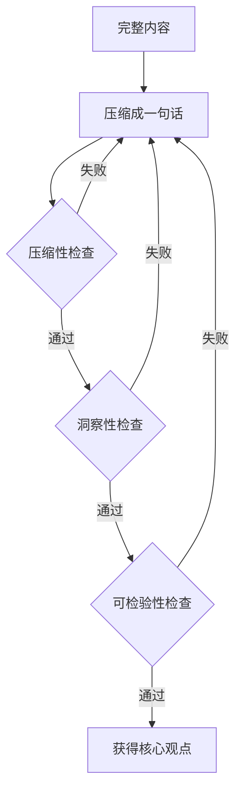
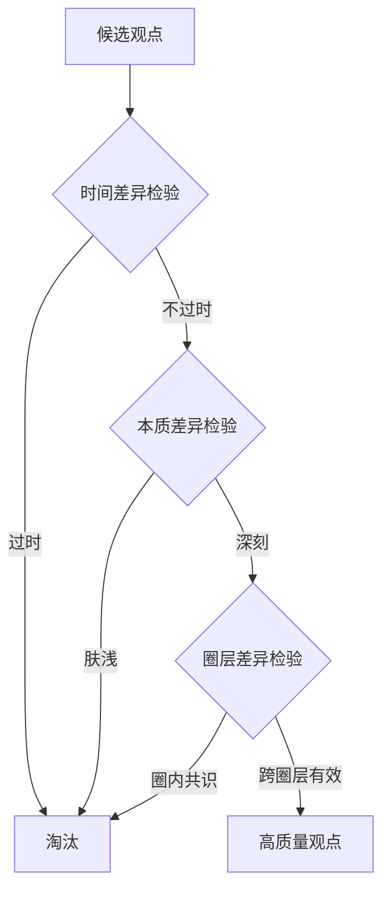

# 第十五章 做内容最怕的是不知道自己好不好

## 学习目标

-   理解内容无人问津困境的本质是反馈缺失导致的方向失明
-   掌握实质大于形式的质量评判标准
-   学会建立可复用的内容质量锚点
-   掌握观点提炼法
-   理解标准线索三要素的递进逻辑

## 15.1 生活类比

想象你在一间完全黑暗的房间里练习投篮。你投了上百次，每一次都感觉自己的姿势很标准、力度很到位，但你永远不知道球到底进了没有。没有灯，没有观众，没有任何反馈。你的动作是否会越来越好？恐怕不会。你只会越练越怀疑，甚至开始怀疑自己的手感是不是出了问题。做内容也是一样。你辛辛苦苦写完一篇文章、录完一条视频，发出去后石沉大海——没有点赞，没有评论，没有转发，甚至没有批评。你看着自己的作品，总觉得哪里不对，却又说不出来。这种状态最可怕的地方在于：你不是不努力，而是你根本不知道自己该往哪个方向努力。反馈缺失导致的方向失明，才是最耗人、最消磨创作热情的状态。而这一章，我们将讨论如何在没有外界反馈的情况下，为自己建立一套可靠的内部评判系统。

## 15.2 概念地图

```
做内容最怕不知道自己好不好
├── 内容无人问津的困境（反馈缺失→方向失明）
├── 实质大于形式（AI 时代评判标准）
├── 内容质量锚点
├── 观点提炼法
└── 标准线索三要素（时间差异→本质差异→圈层差异）
```

## 15.3 内容无人问津的困境

每一个内容创作者，几乎都经历过这样的时刻：精心打磨的作品发布后，播放量个位数，点赞寥寥无几，评论区一片寂静。你反复刷新后台数据，确认自己没有发错平台，然后陷入深深的自我怀疑——是我的选题不行？文笔太差？还是根本没人需要这些东西？

> "做内容最怕一种状态：辛苦做的内容没人看，也不知道问题出在哪。"
> 
> ——《260806, 原文》

这段话精准地刻画了内容创作中最令人焦虑的状态。它包含两层含义：第一层是"没人看"，即流量困境；第二层是"不知道问题出在哪"，即**诊断困境**。事实上，第二层才是更可怕的。

为什么"不知道问题出在哪"比"没人看"更可怕？因为"没人看"只是一个结果，而"不知道问题出在哪"意味着你没有可迭代的起点。如果知道自己选题不行，你可以换选题；如果知道自己表达不清，你可以练表达。但如果你完全不知道问题出在哪，你就等于在一个没有光的环境中闭着眼睛改稿——改一百遍也还是在原点打转。

我们把这种状态定义为**反馈缺失**导致的**方向失明**。用表 15-1 来对比一下有反馈和没有反馈的创作循环。

| 维度 | 有反馈的创作 | 反馈缺失的创作 |
|------|-------------|---------------|
| 迭代依据 | 观众反应、数据表现 | 自我感觉、猜测 |
| 改进方向 | 明确，可稳步提升 | 模糊，反复摇摆 |
| 心态变化 | 正反馈驱动持续产出 | 焦虑、耗竭、放弃 |
| 长期结果 | 复利增长 | 停滞或退步 |

这个表格揭示了反馈缺失的连锁反应：没有反馈 → 不知道好坏 → 无法迭代 → 内容停滞 → 更少反馈。这是一个恶性循环。破局的关键，不在于"更努力地创作"，而在于先解决"如何知道自己内容好不好"这个元问题。

## 15.4 实质大于形式

当我们终于意识到需要评判标准时，下一个问题自然浮现：以什么标准来评判？在 AI 时代，这个问题的答案正在发生根本性转变。

> "AI 时代对内容的要求从形式转向实质。"
> 
> ——《260806, p.1》

### 共识

不同时期的创作环境对"好内容"的定义不同。在互联网早期，内容稀缺，形式的新颖性本身就能吸引眼球——一篇排版精美的长文、一条剪辑炫酷的视频，单靠形式就能赢得关注。但 AI 时代，形式生产的门槛急剧降低：排版可以一键生成，视频可以 AI 剪辑，配图可以自动设计。当人人都有能力把形式做好时，形式本身就不再是区分优劣的维度。

### 形式时代的评判逻辑

在 AI 出现之前，形式是稀缺品。一个会精修图片的创作者，可以仅凭视觉美感获得大量关注。那时的评判逻辑是：

-   形式新颖 → 吸引注意力 → 产生传播
-   形式精美 → 产生信任 → 提升转化

### 实质时代的评判逻辑

AI 改变了这一切。当形式可以批量生产，评判标准自然转向了 AI 无法替代的部分——**你的思考**。

-   形式是公共的：任何人都能借助 AI 获得同等质量的形式
-   实质是私有的：只有你能提供自己独特的视角、经历与判断

这是两种评判逻辑的并置。我们用一个公式来概括这个转变：

$$
\text{内容价值}_{\text{AI 时代}} = \alpha \cdot \text{实质深度} + \beta \cdot \text{形式质量}, \quad \alpha \gg \beta
$$

这个公式展示了：在 AI 时代的内容价值评估中，实质深度（α）的权重远大于形式质量（β）。当形式门槛趋近于零时，β趋近于 1，而α则完全取决于你的不可替代性。换句话说，AI 能帮你把形式做到 80 分，但你自己的思考深度决定了内容最终能走多远。

具体来说，实质和形式在三个维度上存在系统性的差异，我们整理在表 15-2 中。

| 比较维度 | 形式 | 实质 |
|---------|------|------|
| 可复制性差异 | 可复制，AI 可以替代 | 不可复制，来自个体思考 |
| 长期价值差异 | 短命，新鲜感消退即贬值 | 长效，随时间沉淀增值 |
| 评估方式差异 | 主观感知（好看/顺眼） | 客观检验（能否引发思考） |

表 15-2 说明，当你评判自己的内容时，应该优先问"我的内容提供了什么独特的思考增量"，而不是"我的排版是否精美、剪辑是否流畅"。这并不意味着形式不重要，而是说形式应服务于实质，而非替代实质。

## 15.5 内容质量锚点

我们已经确立了"实质大于形式"的评判方向，但这还不够。知道"该看什么"和"具体怎么看"是两回事。你还需要一个具体的、可操作的工具来衡量自己的内容质量——我们称之为**内容质量锚点**。

> "做内容最怕的是不知道自己好不好。"
> 
> ——《260806, p.1》

### 为什么需要锚点？

内容创作者往往处于两种极端：要么过度自信，觉得自己写的东西都是精品；要么过度自卑，觉得什么都拿不出手。这两种状态的共同根源是**评判标准的内隐化**——你凭感觉判断好坏，而感觉是极度不稳定的。今天心情好就觉得内容是佳作，明天被拒稿就觉得一无是处。

锚点的作用，就是提供一个**外部化**的参考基准，让评判不依赖情绪波动。它具备三个核心属性，我们逐一解析。

### 属性一：主观性消除

锚点必须是客观的。它不是"我觉得好"，而是"它是否满足了某个可观察的条件"。比如，"我的文章是否提出了一个足够清晰的观点"就是一个可检验的问题——你能明确回答是或否。

### 属性二：可操作性

锚点必须能转化为行动。如果锚点是"要有深度"，那它不可操作，因为你不知道怎么执行。如果锚点是"把内容压缩成一句话后，这句话是否能让不了解背景的人有所启发"，那它就变得可操作了。

### 属性三：稳定性

锚点不应随外部环境波动。它不依赖于"今天热搜是什么""当前流行什么选题"，而是基于内容本身的内在属性。稳定的锚点让你在所有情况下都有一个平移的基准线。

这三个属性的关系可以用叠加来表示：

$$
\text{锚点质量} = \frac{\text{可检验性}}{\text{主观性}} \times \text{稳定性}
$$

这个公式展示了：锚点的有效性取决于它的可检验性（分子）与主观性（分母）的比值，再乘以稳定性系数。可检验性越高、主观性越低，锚点就越可靠；稳定性越高，锚点就越值得长期依赖。

### 如何建立你个人的锚点？

建立锚点的步骤并不复杂，但我们建议你按顺序执行：

1.  **写下你的内容类型**（图文、视频、播客等）。
2.  **列出你认为决定内容好坏的关键维度**（观点清晰度、信息密度、情感共鸣等）。
3.  **为每个维度设定一个可检验的检验语句**。例如，"观点清晰度"的检验语句可以是："如果只保留一句话，我的核心观点是否仍然完整？"
4.  **试用一周**，每次发完内容都用锚点评分。
5.  **修正**：如果某个锚点你无法执行，就替换它。

锚点不是一成不变的教条，而是你自己的内部质量基准线。有了它，你再也不需要依赖外部反馈来确认自己是否在进步——至少在"内容好不好"这个层面，你有了自己的度量衡。

## 15.6 观点提炼法

锚点解决的是"有没有标准"的问题，但标准本身还需要一个核心抓手。我们的建议是：**把内容压缩成一句话**。

> "差内容逻辑里藏着洞察，一句话就能点醒人。"
> 
> ——《260806, 原文》

### 为什么是"一句话"？

内容再长、再复杂，如果它是有价值的，它一定可以被压缩成一个核心观点——就像一篇论文可以被概括为摘要，一本书可以被概括为一句话。反过来，如果一个内容无法被压缩成一句话，往往意味着它没有真正的内核，只是形式上的堆砌。

观点提炼法的操作定义如下：

$$
\text{核心观点} = \text{compress}(\text{内容}, \text{一句话})
$$

其中 compress 表示"无损压缩"——即压缩后的这句话必须保留原内容最核心的洞察，而不是删减信息。这个公式展示了观点提炼法的本质挑战：**压缩是有损的**，你必须在保留洞察的前提下删除一切修辞。

### 如何检验你的提炼是否成功？

我们给出三个可操作的检验维度，它们不是空泛的"好不好"，而是具体的"能不能通过"。

**维度一：压缩性。** 你要能用一句话向一个完全不熟悉你内容的陌生人传达你的核心信息。如果对方听完后说"然后呢？"——说明压缩失败，你的内容没有真正的核心。

**维度二：洞察性。** 这句话是否能让人产生"啊，原来是这样"的感觉？如果一句话只是常识的重述，那么提炼出了观点，也不是有价值的观点。洞察性要求这句话包含某种认知增量，读者之前不知道的、或者没有明确意识到的。

**维度三：可检验性。** 把这句话单独拎出来，交给一个陌生读者——他是否能独立理解并有共鸣？如果必须依赖上下文才能成立，说明观点本身不够独立，或者你的内容过于依赖形式包装。

这三个维度共同构成了观点提炼法的"验收标准"。我们把它们的递进关系画成数据流图：



这个图展示了观点提炼法的循环过程：逐层过滤，通过所有检查后才能获得真正有效的核心观点。每一次检查失败都要求你回到原文重新提炼，而不是降低标准。

### 一个具体案例

假设你写了一篇 2000 字的文章，讨论"为什么年轻人越来越不爱发朋友圈"。你的观点提炼过程可能是这样的：

-   **首次压缩**："社交媒体改变了表达方式。"
-   **检验**：压缩性通过，但洞察性失败——这是常识。
-   **二次压缩**："朋友圈的消亡不是表达欲的衰退，而是表达环境的恶化。"
-   **检验**：洞察性通过——它提供了一种新的解释框架；可检验性通过——单拎出来也能引发讨论。
-   **结论**：这个观点可以作为你内容的锚点。写正文时，每一段都应该服务于支撑或展开这个核心观点。

## 15.7 标准线索三要素

观点提炼法解决的是"你的内容有没有观点"的问题。但下一个问题是：**你的观点够不够好、够不够新？** 我们还需要一套方法来判断观点的质量层级。这就是标准线索三要素——从时间差异、本质差异到圈层差异的递进判断。

> "时间差异→本质差异→圈层差异。"
> 
> ——《260806, p.1》

### 线索一：时间差异（过时了吗？）

时间差异是最基础的检验：你的观点是否已经过时？如果三年前就有人在讲同样的话，现在仍有大量内容在重复它，那你的观点大概率不具备时间上的新鲜度。

**检验方式**：问自己——"如果我的内容晚一年发，还有意义吗？"如果答案是"一样有意义"且"和现在发的效果没有区别"，说明你的内容可能在重复旧观点而非提供增量。

### 线索二：本质差异（深刻吗？）

通过时间差异检验后，进入第二层：你的观点是否触及了问题的本质？很多观点不过时但浮于表面。比如"自律很重要"——这句话永远不会过时，但它没有触及本质，因为它没有回答"为什么有人能够自律而有人不能"。

**检验方式**：问自己——"我的观点是现象描述还是机制解释？"现象描述是"大家都看到了什么"，机制解释是"为什么会出现这种现象"。本质差异要求你提供后者。

### 线索三：圈层差异（突破了吗？）

通过前两层检验后，你面对的是最难的挑战：你的观点是否只在自己的舒适圈内成立？一个观点可能"不过时"且"触及本质"，但它可能只是你所在圈层的共识——换个群体，它就不再适用甚至引发争议。

**检验方式**：问自己——"这个观点是否只是我所在圈层的常识？"如果你的观点能被另一个完全不同圈层的人认为是"新"的，那才算真正具备圈层差异。

### 三要素的递进关系

这三个要素不是并列关系，而是递进过滤关系：

$$
\text{观点质量} = f(\text{时间差异}, \text{本质差异}, \text{圈层差异}), \quad \text{越往后越难通过}
$$

这个公式展示了三要素的系统结构：它们是逐层过滤的漏斗，越往后越难通过，但通过后带来的价值增量也越大。按这个递进逻辑，评判顺序如图 15-3 所示。



图 15-3 展示了三要素的漏斗式过滤机制：一个观点必须依次通过时间、本质、圈层三层检验，才能被判定为高质量观点。

### 一个完整案例

假设你写了一条内容，观点是"短视频正在摧毁我们的专注力"。

-   **时间差异检验**：这不是新观点，三年前就有人说了。**淘汰或修正**。
-   修正后："短视频摧毁的不是专注力，而是我们容忍无聊的能力。"——更新颖，但还停留在现象层面。
-   **本质差异检验**：这个观点触及了"容忍无聊"这一心理机制，比单纯批判短视频更深一层。**通过**。
-   **圈层差异检验**：但"容忍无聊"是知识分子的共识，普通用户未必认同。**可能需要进一步突破**。
-   最终修正："短视频不是时间杀手，而是无聊耐受力下降后的必然选择。"——把因果倒转，从"短视频→坏结果"转变为"耐受力下降→短视频被需要"，实现了圈层差异。

这个案例展示了三要素如何驱动观点持续迭代。

## 15.8 设计中的取舍

### 为什么不用"数据表现"作为内容质量的锚点？

有人会问：平台给的播放量、点赞数不就是最客观的反馈吗？为什么要费劲建立内部锚点？

数据是**滞后且有偏的信号**。它反映的是"多少人点击了"，而不是"内容好不好"。一篇标题党文章可以拿到高点击，但它并没有实质价值。如果完全以数据为锚点，你就会陷入追逐流量的陷阱——为了迎合算法而牺牲内容质量，最终失去自己的独特定位。

内部锚点和外部数据的最优关系是互补的：锚点用来判断"内容好不好"，数据用来判断"分发效不效"。前者是质量标杆，后者是传播指标。用质量锚点指导内容生产，用数据反馈优化分发策略。

### 观点提炼法会不会把内容压缩得过于简单？

有创作者会说："我的内容很丰富，压缩成一句话会损失大量信息。"

这是我们听到最多的反驳。但它的误区在于混淆了"存储"和"传播"。你压缩出的核心观点不是内容的全部，而是内容的**骨架**。骨架的作用是让内容有结构性——你写正文时，每一段都在为这句话服务。正如一栋建筑需要承重结构，但承重结构不等于整栋建筑。观点提炼法是先立骨架，再添血肉。

诚然，有些内容天然不适合压缩——比如文学作品、情感散文。但这里需要澄清：这一章讨论的是**信息型内容**（教育、知识、观点类），而非审美型内容。如果你做的是文学创作，或许需要另一套评估体系。

## 15.9 动手练习

-   挑一篇你过去一周发布或写完但未发布的内容，用观点提炼法尝试压缩成一句话，然后对照三个检验维度逐项打分，写下哪一项没有通过以及你的修正方向。
-   列出五个你常看的同类创作者，分析他们的内容分别更偏重"形式"还是"实质"，用表 15-2 的三个维度为每位创作者打一个"实质/形式比"。
-   写下你自己的三条内容质量锚点，每条锚点必须满足"客观可检验"条件，然后用你最近一篇内容逐一检验。
-   找一条你认可的"好内容"，尝试把它的核心观点提炼出来，再用标准线索三要素逐层检验，判断它属于哪一层级的观点。
-   给自己设定一个"反常识挑战"：在接下来一周内，刻意选择一个与你所在圈层共识相反的角度来创作一条内容，观察效果以及你自己的感受。

## 15.10 本章小结

这一章我们围绕"做内容最怕的是不知道自己好不好"展开了系统讨论。首先我们剖析了内容无人问津的困境，揭示其本质是反馈缺失导致的方向失明——这不是努力不够的问题，而是缺乏可迭代的起点。其次我们确立了实质大于形式的评判方向，阐述了 AI 时代形式门槛降低后，实质成为稀缺品的必然逻辑。接着我们引入了内容质量锚点的概念，它提供外部化、可操作、稳定的内部评判标准，让你不再依赖外部反馈。然后我们介绍了观点提炼法，将内容压缩成一句话，通过压缩性、洞察性、可检验性三个维度检验内容的真伪价值。最后，我们提出了标准线索三要素——时间差异、本质差异、圈层差异——作为判断观点质量层级的递进过滤器。

本章我们一起学习了以下概念：

| 概念 | 解释 |
|------|------|
| 内容无人问津的困境 | 反馈缺失导致方向失明的被动状态 |
| 实质大于形式 | AI 时代内容质量从形式转向实质 |
| 内容质量锚点 | 外部化、可复用的判断基准 |
| 观点提炼法 | 把内容压缩成一句话检验洞察力 |
| 标准线索三要素 | 从时间差异→本质差异→圈层差异递进判断 |

下一章中，我们将在"内容资产篇"中继续深入，探讨如何把的高质量内容转化为可持续积累的资产——当你已经知道什么样的内容是好的，下一步就是学会如何用它构建长期复利。这将是内容资产篇中，从"质量判断"走向"资产构建"的关键一步。

