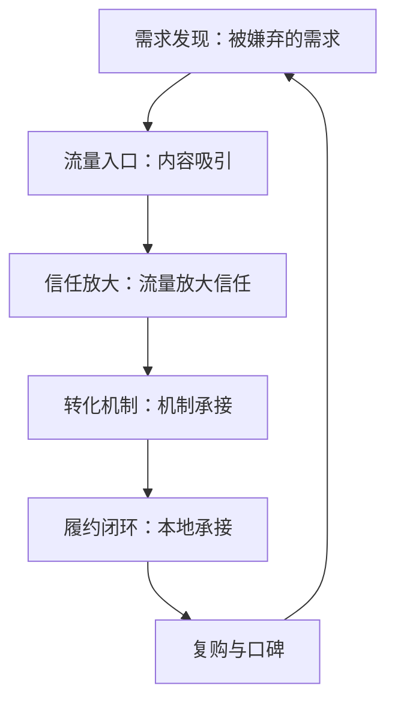
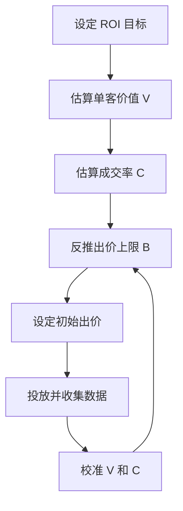

# 第十六章 流量篇 —— 流量的本质是"信任的放大器"

## 学习目标

- 理解流量认知重构的本质：流量是信任的放大器
- 掌握识别被嫌弃需求的判断标准
- 学会用内容+机制+承接的三要素框架搭建同城生意模型
- 能反推科学的出价区间并动态调整
- 能建立做内容与做生意的节奏化切换策略

## 16.1 生活类比

想象你是一个小城镇里的手艺人。镇上的人都知道你修表手艺好，虽然你店门口没有豪华招牌，也不在大马路上，但每个在你这里修过表的人，都会把亲戚朋友介绍过来。那些开在黄金地段、投放大广告的连锁店，反而因为竞争激烈，利润被房租和广告费吃掉了大半。这个场景和做流量生意惊人地相似：真正值钱的地方，往往不是人流最密集的十字路口，而是那些"不被追逐"的角落。流量本身不是目的，它只是把"信任"这个资产放大的工具——信任越浓、需求越真，流量带来的收益就越高。

## 16.2 概念地图

```
同城生意与流量
├── 流量认知重构：信任放大器
├── 被嫌弃的需求藏金
├── 同城生意三要素：内容+机制+承接
├── 出价逻辑
└── 生意与内容切换
```

## 16.3 流量认知重构

在开始讨论任何投放策略、内容技巧之前，我们需要先纠正一个根深蒂固的偏见：流量被丑化了。过去几年，短视频带货、直播电商中充斥的夸大宣传和割韭菜案例，让"流量"这个词几乎和"套路"画上了等号。于是很多人下意识地远离流量，或者只把它当作一种"不得不做的推广工具"。

（原文摘录：）

> "流量被丑化，钱散落在不被追逐的地方。"
> 
> ——《260825, p.1》

这句话点破了一个关键事实：正因为大多数人对流量抱有负面印象，不愿意认真研究它，那些真正理解和善用流量的人，反而在竞争极小的领域里获得了超额的回报。这就是价值的反转性——被忽视的地方，机会越大。

**核心定义**（来源：`[260825, p.1-2]`，概念：`流量认知重构`）

我们把流量重新定义为：

$$
\text{流量价值} = f(\text{需求真实度}, \text{信任浓度})
$$

这个公式展示了流量不是简单的"曝光次数"，而是两个变量的乘积。需求真实度指用户到底有多迫切地想要解决某个问题；信任浓度指内容生产者与用户之间的信任关系有多深。如果流量只是曝光但没有任何信任基础，它的转化率会极低；反之，哪怕曝光量不大，只要需求真实且信任浓度高，成交率会远超你想象。

**关键性质**

流量认知重构有三个核心属性：

| 属性 | 含义 | 反例 |
|------|------|------|
| 价值反转性 | 被忽视的流量因竞争少信任高而高转化 | 人人都抢的流量反而贵且转化差 |
| 信任主导性 | 流量放大的是信任，而非注意力 | 纯博眼球的内容涨粉快但变现差 |
| 需求锚定性 | 流量价值由背后的需求决定 | 泛娱乐流量看起来大但商业价值低 |

这三个性质说明，流量的好坏不取决于它的规模，而取决于它背后站着的需求与信任。我们可以用下面这张图来理解流量在我们整个生意模型中的位置：



**多源对照**

关于流量的本质，不同素材给出了互补的视角。

**共识**：[260825, p.1-3] 和 [260801, p.2] 都认为流量不是注意力的收割，而是信任的放大器。前者从认知角度强调流量被丑化导致的认知偏差，后者从操作层面强调同城生意中信任是本地用户转化的核心。

**分歧**：两篇素材在流量来源上侧重点不同。[260825, p.4] 更强调"被嫌弃的需求"天然自带信任，创作者只需要去发现；而 [260801, p.5] 则认为信任是通过内容和互动"做出来"的，需要主动构建。

现在我们已经完成了流量认知的重构，接下来需要回答一个更实际的问题：什么样的需求值得我们投入？这引出了"被嫌弃的需求藏金"。

## 16.4 被嫌弃的需求藏金

理解了流量是信任的放大器之后，下一个核心问题是：放大什么？答案是需求。但并不是所有需求都值得放大。大部分商家会本能地追逐显性需求——比如"想变美""想赚钱"这类大众化、容易被定义的需求。然而这些需求恰恰是竞争最激烈的红海赛道，广告单价被推得很高，利润却被摊薄。

（原文摘录：）

> "那些不起眼甚至被嫌弃的需求里藏着真金白银。"
> 
> ——《260825, p.3》

这里的"被嫌弃"有三个层次：第一，需求本身听起来太小，比如"帮老人修老旧收音机"；第二，目标人群看起来太窄，比如"某个小区的业主群"；第三，服务内容不够性感，比如"疏通下水道"。但恰恰是这些需求，满足了三个黄金条件。

**核心定义**（来源：`[260825, p.3-4]`，概念：`被嫌弃的需求`）

我们把被嫌弃的需求定义为满足以下三个属性的需求集合：

$$
\text{被嫌弃需求} = \{\text{需求} \mid \text{反规模性} \cap \text{弱替代性} \cap \text{强信任属性}\}
$$

这个公式展示了被嫌弃需求的充分必要条件：它不能是规模化的标准品（反规模性），它没有被大平台轻易替代的替代品（弱替代性），它强烈依赖信任关系才能成交（强信任属性）。三个条件同时满足时，这个需求虽然看起来"小"，但单位价值极高。

我们以同城生意为例，来看这三条属性的具体表现：

| 属性 | 含义 | 实例 |
|------|------|------|
| 反规模性 | 需求无法被标准化大规模满足 | 家政保洁、宠物寄养 |
| 弱替代性 | 大平台难以提供同质化服务 | 本地装修、维修服务 |
| 强信任属性 | 用户只信熟人推荐或长期口碑 | 月嫂、私教、牙医 |

**方法与操作建议**

> 被嫌弃需求的识别流程方法（来源：《260825, p.5》）

```
1. 列出周围人抱怨但没人解决的"小事"
2. 检查该需求是否是标准化大平台难以规模化的
3. 确认该需求是否依赖信任关系才能成交
4. 评估本地人群密度是否足以支撑一门生意
5. 若同时满足以上条件，即可作为流量内容的主攻方向
```

这段流程展示了：被嫌弃需求的发现不是靠灵感，而是靠系统化的筛选。每一步都在层层过滤：第一步是输入，第二、三步是验证"含金量"，第四步是验证"市场容量"，第五步是行动信号。

到这里我们已经明确了：要选择被嫌弃的需求作为切入点。那么具体怎么把需求变成一门"同城生意"？这就是下一小节要解决的问题。

## 16.5 同城生意三要素

很多人在同城生意上犯的错误是：以为投了本地流量就有生意。但实际上，单纯投流量非常低效，因为同城用户真正看重的是本地信任感——他们愿意为"身边人推荐"买单，而不愿意为一个陌生广告买单。这就要求做同城生意必须有一个完整的模型，而不只是一次投放。

（原文摘录：）

> "内容+机制+承接。"
> 
> ——《260801, p.1》

这句话是整篇文章最核心的公式。它把同城生意拆解成三个可操作、可迭代的模块。我们来看每个模块的职责和相互关系。

**核心定义**（来源：`[260801, p.1-2]`，概念：`同城生意三要素`）

我们把同城生意的成功概率定义为一个乘法关系：

$$
\text{同城生意} = \text{内容} \times \text{机制} \times \text{承接}
$$

这个公式展示了三个要素的乘法关系，意味着任何一个要素为零，整体就为零。内容做得再好，没有转化机制，流量就是浪费；机制设计得再巧妙，没有承接能力，口碑就会崩塌。三者缺一不可。

三个要素各有分工：

| 要素 | 功能 | 典型手段 |
|------|------|----------|
| 内容 | 吸引注意力、建立信任 | 本地探店、真实故事、使用场景 |
| 机制 | 驱动用户行动、促成转化 | 优惠券、限时折扣、预约制 |
| 承接 | 履约交付、维护口碑 | 服务落地、售后反馈、复购提醒 |

**关键特性**

这个三要素框架有三个重要特性，它们决定了你执行时需要注意的重点：

| 特性 | 含义 | 注意事项 |
|------|------|----------|
| 顺序性 | 先内容，再机制，最后承接 | 顺序错乱会导致流失 |
| 本地耦合性 | 每个要素都必须植根本地 | 通用内容无法建立本地信任 |
| 闭环性 | 三者需要形成循环 | 承接的好内容会反哺内容 |

三个特性告诉我们：同城生意不是三个独立任务的堆叠，而是一套有序耦合的系统。做内容时就要想着机制怎么接，设计机制时就要想着承接能不能落地。从头到尾都要带着本地思维来思考。

有了三要素的框架，我们自然面临一个关键问题：在投放时，我们到底应该花多少钱获得一个客户？这就是出价逻辑要回答的问题。

## 16.6 出价逻辑

做信息流投放时，商家最需要做出的决策不是"要不要投"，而是"花多少钱、怎么出价"。很多同城商家的心态是"先投起来看看"，结果预算烧完了也不知道问题出在哪。

（原文摘录：）

> "出价逻辑。"
> 
> ——《260801, p.3》

这一小段高度概括了核心思想：出价不应该是拍脑袋，而应该是一个从目标倒推的计算过程。

**核心定义**（来源：`[260801, p.3-4]`，概念：`出价逻辑`）

设 ROI（投入产出比）目标为 $R$，单客成交平均金额为 $V$，成交率为 $C$（即有效线索成交的概率），则单条线索可承受的获客成本上限 $B$ 为：

$$
B = \frac{V \times C}{R}
$$

这个公式展示了出价上限的来源：它不是由平台决定的，而是由你自己的生意模型决定的。分母是 ROI 目标，分子是单客户生命周期价值乘以成交率。当你把这两个数算清楚时，你就知道了每次出价的天花板——超过这个值，跑得越多亏得越多。

**关键特性**

出价逻辑有三个特性需要特别注意：

| 特性 | 含义 | 实操启示 |
|------|------|----------|
| 反推性 | 出价由 ROI 倒推 | 先定目标再算出价 |
| 动态性 | 出价需根据数据调整 | 每周复盘并更新成交率 |
| 配合性 | 出价需与承接能力协同 | 承接弱时降低出价 |

这三个特性揭示了出价不是一次性决策，而是一个持续迭代的控制过程。我们可以用下面的流程图来概括这个过程：



有了出价逻辑，我们就拥有了一个"做生意"的理性框架。但很多创作者还有另一个困扰——做内容和做生意如何平衡？这是下一节的核心。

## 16.7 生意与内容切换

做同城生意的创作者经常陷入一个两难：内容太硬广，掉粉；内容太软文，接不到单。这种"在做生意和做内容之间反复切换"的状态，就是本节的主题。很多创作者试图在每一条内容里同时完成"涨粉"和"成交"两个目标，结果两边都做不好。

（原文摘录：）

> "在做生意和做内容之间反复切换的创作者状态。"
> 
> ——《260801, p.6》

**核心定义**（来源：`[260801, p.6-7]`，概念：`生意与内容切换`）

我们把创作者的状态机抽象为两个模式：

$$
\text{模式}_{content}: \text{目标}=\text{泛涨粉}, \text{内容属性}=\text{娱乐性、故事性}
$$

$$
\text{模式}_{business}: \text{目标}=\text{精准转化}, \text{内容属性}=\text{功能性、说服性}
$$

这两个公式展示了内容与生意两种模式在目标和属性上的根本差异。泛内容追求的是覆盖面和涨粉速度，而生意模式追求的是精准和转化。两者逻辑上是冲突的：泛内容吸引来的粉丝不精准，生意内容又很难获得泛流量。试图用一套逻辑做两件事，必然两头落空。

**关键特性**

切换策略有三个核心特性：

| 特性 | 含义 | 实操要点 |
|------|------|----------|
| 时间分离性 | 两种模式交替而非混合 | 一三五做泛内容，二四六做转化 |
| 人设耦合性 | 切换不破坏人设一致性 | 用同一身份连接两种模式 |
| 节奏规律性 | 切换必须有固定节奏 | 粉丝能预判你的内容节奏 |

**可执行节奏方案**

| 星期 | 内容模式 | 目标 |
|------|----------|------|
| 周一至周三 | 泛内容（故事、日常） | 涨粉、维持流量池 |
| 周四至周五 | 生意模式（案例、转化） | 成交、获取线索 |
| 周末 | 互动、答疑 | 巩固信任、反馈收集 |

这张表展示的是一种典型的节奏：用前三天积累流量池，用中间两天收割转化，用周末维护关系。关键不在于具体星期安排，而在于**模式必须清晰**——粉丝能感觉到"今天你是来跟我聊天的"，也能感觉到"今天你在认真推荐一个东西"。两种模式交替带来的"确定性"本身也是信任的来源。

## 16.8 多源对照

在"流量认知重构"和"被嫌弃的需求"这两个概念上，两篇素材呈现出互补关系。

### 共识

两篇素材都承认流量不等于信任，流量只是放大器；需求的质量决定了放大后的收益上限。无论从 [260825] 的认知重构视角，还是 [260801] 的同城落地视角，最终都指向同一个结论：在低竞争、高信任的细分需求中做深，比在高竞争、低信任的大赛道中做广更赚钱。

### 分歧

[260825, p.4] 认为被嫌弃的需求是"客观存在"的，创作者的角色是"发现者"；而 [260801, p.2] 则认为需求需要"培育"——通过内容和互动让原本模糊的需求变得明确。前者偏向"淘金"哲学，后者偏向"耕种"哲学。实际执行中，两者并不矛盾：前期用淘金的心态选方向，中期用耕种的方式做深。

## 16.9 设计中的取舍

- 为什么不做纯泛流量而是聚焦被嫌弃的需求？
  泛流量虽然盘子大，但竞争激烈导致获客成本高、信任浓度低。被嫌弃的需求虽然单客价值看起来小，但因为竞争少、信任高，单位流量的 ROI 反而更高。这是典型的"做窄赛道、做深信任"策略。

- 内容模式与生意模式为何不能混合？
  因为两种模式的逻辑根本不同：内容模式靠情绪驱动，生意模式靠逻辑驱动。混合内容会让用户困惑（你到底是要娱乐我还是卖东西给我），导致两头都做不好。时间分离让用户形成心理预期，反而提高了两种模式的效率。

## 16.10 动手练习

1. 列出你所在城市的 10 个"被嫌弃的需求"，用反规模性、弱替代性、强信任属性三条标准逐一打分，选出得分最高的一个作为模拟项目。
2. 为选中的需求设计一个"内容+机制+承接"的完整方案：分别用 200 字描述三条内容的核心创意、转化机制的触发点、承接服务的闭环流程。
3. 假设你的 ROI 目标为 3:1，单客平均客单价为 2000 元，线索成交率为 20%，计算你的出价上限，并推导出不同 ROI 目标下的出价敏感性曲线。
4. 为自己制定一份一周内容排期表：标注每一天的内容模式（泛内容或生意模式），并说明模式切换的界限标准。
5. 回顾你过去一个月的发布内容（若有），用"时间分离性、人设耦合性、节奏规律性"三个维度评估你的切换质量，找出 1 条最需要改进的点。

## 16.11 本章小结

这一章中我们重新审视了流量的本质，并系统地拆解了同城生意的完整模型。首先，我们完成了流量认知重构，理解流量本质是信任的放大器而不是注意力的收割，被丑化的流量恰恰意味着低竞争高回报的机会；其次，我们掌握了识别被嫌弃需求的三个标准——反规模性、弱替代性、强信任属性——并用这些标准筛选高价值切入方向；接着，我们学习了同城生意三要素框架，内容负责吸引、机制负责转化、承接负责履约，三者缺一不可；然后，我们推导了科学的出价逻辑，从 ROI 目标反推获客成本上限并动态校准；最后，我们讨论了生意与内容切换的艺术，通过时间分离、人设耦合和节奏规律在涨粉与成交间找到平衡。

本章我们一起学习了以下概念：

| 概念 | 解释 |
|------|------|
| 流量认知重构 | 流量本质是信任的放大器，价值取决于需求真实度和信任浓度 |
| 被嫌弃的需求藏金 | 边缘需求因反规模性、弱替代性、强信任属性而带来丰厚回报 |
| 同城生意三要素 | 内容负责吸引，机制负责转化，承接负责履约 |
| 出价逻辑 | 从 ROI 目标反推获客成本上限，并动态调整的竞价策略 |
| 生意与内容切换 | 通过时间分离和节奏规律化在涨粉与成交间切换 |

下一章中，我们将继续从流量篇走向内容篇，深入学习如何在"被嫌弃的需求"中创作出真正的爆款内容，以及从流量到成交的完整闭环搭建。
