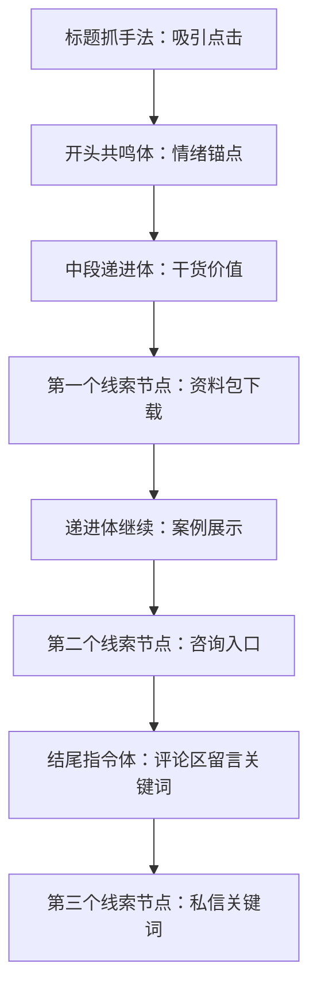

# 第十七章内容篇 —— 让内容直接"长出杠杆"

## 学习目标

-   理解给孩子看心法的本质是翻译而非简化
-   掌握爆款范式可拆解的方法
-   学会撰写三体式文章结构
-   掌握标题抓手法
-   能运用综合技巧写出直接收割业务线索的文章

## 17.1 生活类比

想象一下你在给一个 8 岁的孩子讲"为什么天会下雨"。你不会说"这是大气环流与海洋蒸发共同作用的结果"，你会说"天空有个看不见的大水壶，太阳把它烧开，水蒸气跑上去变成了云，云太重了就掉下来了"。注意，你并没有降低知识的深度，你还是讲清楚了水循环的全部环节，你只是换了一种孩子能懂的语法。做内容也一样。你写一篇文章，读者不是一个抽象的"受众"，而是一个注意力只有 8 岁的"孩子"——他不是不聪明，而是没耐心、没背景、没义务去理解你的专业术语。你的工作不是把知识变浅，而是把知识翻译成他的语言。这篇内容的杠杆，就藏在"翻译"这个动作里：翻译得越好，读的人越多，业务线索就越多。

## 17.2 概念地图

```
内容杠杆方法论
├── 给孩子看心法：把复杂度翻译成大白话
├── 爆款范式可拆解：爆款是配方
├── 三体式文章结构：开头共鸣→中间递进→结尾指令
├── 标题抓手法：收益前置+情绪激活
└── 一篇文章十条线索：内容即业务捕手
```

## 17.3 给孩子看心法

我们常犯的错误是：自己懂了，就觉得读者也懂了。这是内容生产者的第一错觉。素材原文给了我们一个极其朴素但极其有力的纠正工具——"给孩子看"。

> "做内容先给自己立一条心法：把内容给孩子看。"
> 
> ——《P260826, 方法定义》

这句话不是在讲育儿，而是在讲一种**读者视角的强制切换**。它要求我们在动笔之前，先问自己一个问题：如果坐在对面的是一个 8 岁的孩子，这段话他会怎么理解？如果他听不懂，那么这段内容就需要被翻译，而不是被删除。

**核心定义**（来源：`[P260826, 方法]`，概念：`给孩子看心法`）

我们不追求"把内容写到 8 岁"，我们追求"把内容翻译到所有年龄段都能听懂"。翻译有三层技术动作：

1.  **把抽象变具体**：把"杠杆效应"翻译成"撬动"，把"用户画像"翻译成"你的客户长什么样"。
2.  **把术语变比喻**：把"内容分发逻辑"翻译成"把种子撒到对的土壤里"。
3.  **把结构变故事**：把论点序列翻译成一个有主角、有冲突、有结局的叙述。

>

这一心法的普适性不仅适用于文章，也适用于短视频脚本、直播话术、产品文案。每一个内容形态里，那个"孩子"都在。你只要记住：**读者不需要你显得聪明，读者需要他自己显得聪明**。

## 17.4 爆款范式可拆解

很多创作者的潜意识里有一个迷思：爆款靠灵感，靠运气，靠天赋。素材原文直接否定了这个说法。

> "爆款是有具体配方可拆的。"
> 
> ——《P260826, 概念》

这个定义改变了一切。如果爆款是配方，那么它就有原料、有步骤、有火候、有检查清单。它不再是不可捉摸的玄学，而是一个可以被复盘、被复制、被迭代的工程问题。

**核心定义**（来源：`[P260826, 概念定义]`，概念：`爆款范式可拆解`）

配方拆解有三个关键属性：

| 属性 | 含义 | 对我们的启发 |
|------|------|--------------|
| 可复制性 | 同一配方可以产出多篇不同主题的爆款 | 方法论要高于单篇内容 |
| 结构性 | 配方包含固定的模块和次序 | 写作流程可标准化 |
| 可迭代性 | 每次产出后可以对比数据，调整配方 | 写作是测试而非创作 |

这三个属性保证了"爆款能力"是可以积累的。如果你不能拆解一篇爆款文章为什么爆，那你就无法在下一次复制它。反之，一旦你拆开了，你就拥有了一个稳定的内容杠杆。

>

这里的本质是：把"创作"转化为"工程"。工程意味着每一个变量都可被观测、被调整、被优化。这正是"一篇文章收割十条业务线索"这个目标能够成立的基础。

## 17.5 三体式文章结构

读者的注意力是离散的、碎片化的、容易被夺走的。如果你的文章开头没有在 3 秒内击中他的情绪，那么后面写得再好，也只是一篇自嗨文。素材原文给了我们一个标准的骨架。

> "开头共鸣场景→中间干货递进→结束给出明确行动指令。"
> 
> ——《P260826, 方法定义》

这个结构被概括为"三体式"：开头的**共鸣体**、中段的**递进体**、结尾的**指令体**。我们逐一拆解。

**核心定义**（来源：`[P260826, 方法]`，概念：`三体式文章结构`）

**共鸣体（开头）**：把读者此刻的状态写出来，让他觉得"这写的就是我"。

> 示例开头："你是不是写了一百篇公众号，阅读量还是卡在 300？别再自我感动了，问题不在你写得好不好，而在于你没掌握杠杆。"

这段开头没有讲任何干货，但它完成了一个动作：**让读者停下来**。它击中了一个做内容的人最痛的场景。

**递进体（中间）**：从低阶认知逐步升级到高阶认知，每一步都嵌套在前一步之上。

| 递进层级 | 内容 | 作用 |
|----------|------|------|
| 第一层 | 打破原有认知（爆款不是运气） | 制造认知失调 |
| 第二层 | 提供新框架（爆款是配方） | 给替代方案 |
| 第三层 | 给出具体步骤（三体式） | 提供行动路径 |
| 第四层 | 展示案例与结果（十条线索） | 提供证据 |

**指令体（结尾）**：给出明确的、低门槛的行动指令。

> 示例结尾："现在，请你打开你上一篇阅读量最高的文章，用三体式拆解它的开头，写到评论区，我会挑选 3 位送出一对一咨询。"

>

三段式设计遵循一个简单的心理逻辑：**共鸣让读者愿意读下去，递进让读者觉得学有所得，指令让读者愿意动起来**。没有指令的结尾是内容自杀——你把读者的情绪推到了顶点，却让他无处释放。

## 17.6 标题抓手法

读者是否点开一篇文章，判断发生在 1 秒内。标题是内容杠杆的第一级支点。

> "好标题是给文章留出带人入场的抓手。"
> 
> ——《P260826, 方法》

标题不是内容的一部分，标题是内容的第一扇门。它承担的不是总结职责，而是**进人**职责。

**核心定义**（来源：`[P260826, 方法]`，概念：`标题抓手法`）

标题遵循三个原则：**收益前置、情绪激活、承诺克制**。

| 原则 | 说明 | 好范例 | 坏范例 |
|------|------|--------|--------|
| 收益前置 | 点开能获得什么清晰可见 | 《一篇文章收割十条业务线索》 | 《我的内容创作心得》 |
| 情绪激活 | 触发好奇、焦虑、渴望 | 《别再写了，你的文章根本没杠杆》 | 《论内容创作的若干方法》 |
| 承诺克制 | 不虚假夸大，兑现宣传的收益 | 《用 3 个结构模板，把文章变成线索收割机》 | 《看完这篇你就能财务自由》 |

>

对照这三个原则，我们复盘几条常见标题的优劣。你会发现：好标题不是"写出来的"，而是"测出来的"。它像一张海报，要在大街上 3 米外就能被人识别出"这和我有关"。

## 17.7 一篇文章十条线索

传统内容写作的终点是"读完"，业务导向内容的终点是"转化"。素材原文把这一目标推到了极致。

> "一篇文章收割十条业务线索。"
> 
> ——《P260826, 发现》

这句话不是说每篇文章都要硬塞十个购买链接，而是指**单篇内容要在多个节点直接为业务带来至少十条可跟进的线索**。

**核心定义**（来源：`[P260826, 发现]`，概念：`一篇文章十条线索`）

这个目标的实现依赖三个设计动作：

1.  **线索密集**：同一篇文章内埋下多个可响应节点，例如评论区引导、私信关键词、文末二维码、资料包下载、直播预约。
2.  **强转化导向**：每一段内容的落点都指向"下一步行动"而非"理解结束"。
3.  **可验证性**：每条线索都可以被追踪来源，从而反推内容的杠杆效果。

以下是一篇文章内线索节点的布局示意：



>

一篇文章不是一篇"文"，它是一条**销售动线**。每一条线索的收割，都对应一个读者的"愿意程度"的锚点。素材原文传达的核心思想是：内容写得好不好，不再由阅读量定义，而由**线索量**定义。这个标准把内容部门和业务部门的 KPI 统一了。

## 17.8 设计中的取舍

-   **为什么不用"低阅读门槛"来替代"给孩子看"？**

"给孩子看"不是降低门槛，而是降低理解成本。降低门槛意味着删掉复杂度，这会导致内容变薄、价值变稀。而降低理解成本意味着保留全部深度，只是换一种表达方式。前者是在牺牲专业度换阅读量，后者是在不牺牲专业度的情况下追求阅读量。内容杠杆的本质是第二者，因为只有深度还在，读者才会信任你；只有信任在，业务线索才会产生。

-   **线索密集会不会伤害阅读体验？**

会。如果你在每段结尾都放一个二维码，读者会觉得这是一篇广告软文。解决方式是区分"线索密度"和"线索噪音"：密集但要隐蔽，设计要有节奏感。素材原文的策略是把线索放在"递进体"的高潮节点上，即读者最想要的时候给出行动入口，而非放在最烦的时候。

-   **爆款配方的复制会不会导致内容同质化？**

会，但这是可以接受的代价。配方决定的是骨架，主题决定的是血肉。同样的三体式结构，你可以写"如何做内容"，也可以写"如何开一家奶茶店"。骨架相同不影响内容的差异化。真正的风险恰好相反：不依赖配方，每一篇都凭感觉，才会导致产出不稳定，杠杆断裂。

## 17.9 动手练习

-   找出最近三个月你阅读量最高的一篇文章，用三体式拆解它的开头、中段、结尾，并对照本节的结构框架检查它是否符合配方。
-   用"收益前置+情绪激活"原则，为同一篇文章写三个备用标题，并给你身边的 5 个人投票选出最愿意点击的一个。
-   为你现有的业务设计一篇目标为"十条线索"的文章提纲，标注出每个线索节点的位置和对应的行动指令。
-   把你的专业技能用一句话翻译成 8 岁孩子能听懂的表达，再用这个表达改写你公众号的简介。

## 17.10 本章小结

这一章我们完整学习了"内容杠杆方法论"的五个核心模块。首先我们通过"给孩子看心法"理解了内容的本质是翻译而非简化；其次我们用"爆款范式可拆解"打破了爆款靠运气的迷思，确立了一套可复制、可迭代的配方体系；接着我们掌握了"三体式文章结构"这个实操骨架，明确了共鸣、递进、指令三个段落各自的职能；然后我们学习了"标题抓手法"的三大原则，给文章装上了带人入场的门；最后我们通过"一篇文章十条线索"的方法，把内容写作的终点从"读完"推进到了"转化"。

本章我们一起学习了以下概念：

| 概念 | 解释 |
|------|------|
| 给孩子看心法 | 把复杂度翻译成大白话而非降低深度 |
| 爆款范式可拆解 | 爆款背后有可辨认、可复制、可组合的结构配方 |
| 三体式文章结构 | 开头共鸣→中间递进→结尾指令 |
| 标题抓手法 | 收益前置+情绪激活，给文章装一扇进人的门 |
| 一篇文章十条线索 | 内容不止传播观点，还能在多个节点直接收割业务线索 |

下一章中，我们将离开"内容"这个侧写，进入内容杠杆的另一侧——**产品侧的抓手**。当内容已经把人带进来之后，我们需要一套机制把这些线索接住、养熟并转化为成交。下一章，我们就来拆解这套"线索承接"的完整链路。
