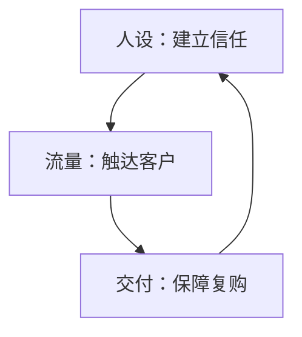
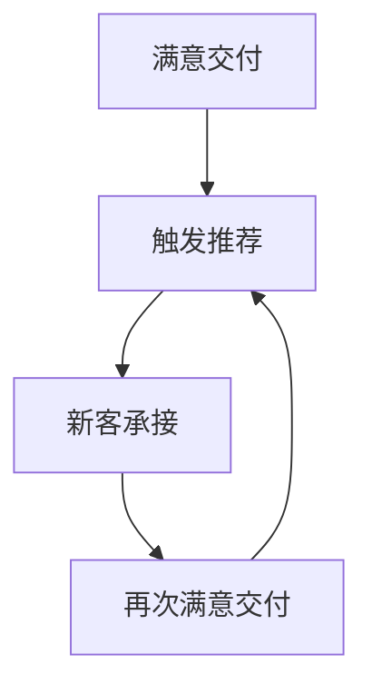

# 第十八章线索承接篇 —— 从获客到成交的“完整闭环”

## 学习目标

- 理解引流端三足法的核心逻辑与价值
- 掌握分层承接机制的设计原则
- 理解转介绍闭环的运作原理
- 能通过陆陆续续成交案例反推可落地的获客成交闭环

## 18.1 生活类比

想象你开了一家社区咖啡馆。如果你只是把招牌挂出去（流量），但没有一个有趣的店主人设（人设），客人来了也不知道为什么值得信任；如果你有人设也有客流，但咖啡品质不稳定（交付），客人喝过一次就不再来了，你只能不断花钱打广告拉新。这三件事就像三条腿的凳子：缺一条，凳子就倒了。更关键的是，这三条腿是相互支撑的——好的人设让流量转化率更高，稳定的交付让客人愿意帮你介绍新朋友，新朋友又带来更多流量。这就是引流端的“三足法”。而当你面对高客单客户时，类比就更贴切了：一个顾客第一次走进咖啡馆，你不可能直接让他办一张一万块的年卡。你得先让他喝一杯试饮（低门槛接触），再推荐一杯招牌拿铁（中等价位），最后才谈储值卡（高客单）。这就是分层承接的节奏感。最后，当这位顾客满意地离开时，你请他帮忙发个朋友圈，他介绍了三个朋友来——这就是转介绍的闭环。成交不是结束，而是下一轮获客的开始。

## 18.2 概念地图

```
线索承接篇：从获客到成交的完整闭环
├── 三足法：人设+流量+交付
├── 分层承接机制
├── 转介绍闭环
└── 陆陆续续成交案例
```

## 18.3 三足法：人设+流量+交付

在引流获客的实践中，很多从业者只盯着“流量”这个单一环节，结果发现投了钱、花了时间，却始终无法稳定成交。问题的根源在于：引流端是一个系统，而不是一个孤立动作。

> [260802《让同城高客单陆陆续续成交起来》] “引流端三条腿：人设、流量、交付构成稳定三角。”

这段素材用“三条腿”的比喻点出了引流端的核心结构。我们可以把它拆解成三个关键维度：

**人设**：客户为什么要相信你？人设不是自我包装，而是你专业能力、成功案例、价值观的对外呈现。它解决了“凭什么选你”的问题。在信任建立之前，任何高客单的推荐都会被本能拒绝。

**流量**：客户从哪里找到你？流量是触达的保障。没有流量，人设再完美也无从展示。流量的本质是“让潜在客户出现在你的视野里”，它是整个系统的输入端口。

**交付**：客户拿到结果后，体验如何？交付不是终点，而是下一轮信任的起点。稳定的交付质量决定了客户是否会复购、是否愿意转介绍，也决定了你的人设是否经得起检验。

这三个要素构成了一个**稳定三角**，如图 18-1 所示：



**图 18-1 三足法结构图**。人设带来信任，信任提高流量转化率；流量带来客户，客户体验交付；交付质量反哺人设口碑。三者互为因果，构成闭环。

这个三角结构的价值在于它的**稳定性**与**联动性**。稳定性意味着即便某个环节暂时薄弱，其他两条腿仍能支撑系统运转；联动性意味着任何一个环节的改善都会带动其他两个环节的上升——比如人设更强，同样的流量就能转化出更多客户，而更多成交客户又带来更多口碑素材，进一步强化人设。

在实际落地时，我们需要同时审视三个问题：**我的目标客户是谁、他们为什么相信我（人设）？我在哪里能找到他们（流量）？我能不能稳定交付他们期望的结果（交付）？** 三个问题缺一不可，否则整个引流端就会失衡。

## 18.4 分层承接机制

有了流量之后，下一个问题是：**如何把流量转化为成交？** 尤其当你的客单价较高时，这个问题变得格外棘手。

> [260802《让同城高客单陆陆续续成交起来》] “为高客单留出分层承接空间。”

这句话很短，但它揭示了高客单成交的核心逻辑：**高客单客户决策慢、顾虑多，一上来推高价会吓跑。**

如果客户第一次接触你，你直接抛出一个三万块的服务方案，绝大多数人会在三秒内关闭对话。这不是你的产品不好，而是**信任的阶梯还没搭好**。因此，我们需要设计一个**分层承接机制**——按客户的意愿度、预算和信任度，将客户分层，为每一层设计由轻到重的承接路径。

> 分层承接机制定义（来源：《260802《让同城高客单陆陆续续成交起来》》）

分层承接机制的核心公式可以概括为：

$$
\text{承接路径} = \sum_{i=1}^{n} \text{层}_i(\text{接触点}_i, \text{信任门槛}_i)
$$

其中层 1 到层 n 代表从轻到重的递进关系。每一层的信任门槛递增，接触点的深度也随之加深。

这个公式展示了分层承接的本质：**不是一次性成交，而是逐级递进的信任建设过程。**

具体来说，一个典型的分层承接路径可能包含以下几个层级，如表 18-1 所示。

| 层级 | 接触点设计 | 信任门槛 | 目标 |
|------|-----------|---------|------|
| 层 1：触达层 | 免费内容、公开课、短视频 | 低：只需要对方认识你 | 让客户知道你的存在 |
| 层 2：互动层 | 评论区答疑、私信咨询、免费诊断 | 中低：愿意花时间与你互动 | 建立初步信任 |
| 层 3：低客单试水 | 低价咨询、小额体验课、入门服务 | 中：愿意付小额费用 | 让客户体验你的专业度 |
| 层 4：正式成交 | 高客单方案、深度服务 | 高：信任度已充分建立 | 完成核心成交 |

**表 18-1 分层承接路径示例**

这个分层设计有三个关键原则：

**渐进性**：每一层都是下一层的铺垫。客户在每一层得到的体验，直接决定了他是否愿意进入下一层。如果层 2 的互动体验很差，他永远不会到达层 3。

**层次感**：每一层的信任门槛要适度递增，既不能跨度太大（否则客户会感到突然），也不能跨度太小（否则转化效率太低）。

**转化效率**：分层不是越多越好。每多一层，都会增加转化漏斗中的流失。因此，设计的目标是在“足够的渐进性”和“尽量少的层级”之间找到平衡。

在实践中，分层承接的操作方式如下：

```
1. 新流量进入后，先引导至层 1 触达层（免费内容）
2. 通过内容互动筛选出高意愿客户，进入层 2 互动层
3. 在互动中识别客户的预算与需求痛点
4. 为有明确需求且信任度较高的客户提供层 3 低客单试水
5. 层 3 客户体验良好后，自然过渡到层 4 正式成交
```

这套流程的核心洞察是：**高客单客户需要的不是“说服”，而是“逐渐信任的过程”。** 你把这个过程设计得越平滑，转化率就越高。

## 18.5 转介绍闭环

当客户完成成交后，很多人的第一反应是：终于结束了。但在成熟的获客体系中，**成交不是终点，而是下一轮获客的起点。**

> [260828《Agent 员工军团搭建流程》] “成交不是终点，转介绍才是真正的闭环。”

这句话点出了一个残酷的现实：**一次性成交的成本极高。** 如果每个客户只能贡献一单，那么你需要不断花钱买新流量来维持收入，一旦流量成本上升或投放停止，收入就会断崖式下跌。而转介绍机制则从根本上改变了这个经济模型。

> 转介绍闭环定义（来源：《260828《Agent 员工军团搭建流程》》）

转介绍闭环的运作逻辑可以用以下公式表示：

$$
\text{获客成本} = \frac{\text{总营销投入}}{\text{新客数}}
$$

当转介绍加入后：

$$
\text{获客成本}_{\text{转介绍}} = \frac{\text{总营销投入} - \text{转介绍转化收入}}{\text{新客数}}
$$

转介绍客户的新客成本趋近于零。

这两个公式的对比展示了转介绍的核心价值：**当一个客户满意后，你不需要再花一分钱广告费，就能通过他的推荐获得新客户。** 这相当于把“一次性的客户关系”变成了“可复利的资产”。

转介绍闭环的运作包含三个环节：

**满意交付**：转介绍的前提是客户对交付结果满意。没有这个前提，一切推荐机制都是空中楼阁。因此，转介绍闭环的起点其实是交付质量本身。

**触发推荐**：客户满意不等于他会主动推荐。你需要设计一个“推荐触发点”——比如交付完成后的感谢礼、推荐奖励、或者一个让客户觉得“推荐你就是帮朋友”的理由。

**新客承接**：被推荐来的新客户，因为带着“朋友的信任背书”，往往比陌生流量更容易成交。这意味着转介绍客户可以直接进入分层承接的较高层级，缩短转化周期。

这三个环节形成了一个循环，如图 18-2 所示：



**图 18-2 转介绍闭环示意图**。每个满意客户都可以成为新的获客渠道。

这个闭环的价值在于三个特性：

**循环性**：它不是一次性的动作，而是可以不断自我强化的系统。每一个新客户都有可能变成下一个推荐者。

**低获客成本**：转介绍客户的获客成本趋近于零，这意味着你的总获客成本会随着转介绍的增加而持续下降。

**信任传递**：转介绍的本质是信任的传递。朋友的推荐比任何广告都更有说服力，因此转介绍客户的信任起点更高，成交速度更快。

## 18.6 陆陆续续成交案例

理解了理论框架后，一个自然的问题是：**这套体系真的能落地吗？** 素材中给出了两个真实案例来验证这套打法的有效性。

> [260802《让同城高客单陆陆续续成交起来》] “让同城高客单陆陆续续成交。”

> [260828《Agent 员工军团搭建流程》] “用五步法搭建 12 个 Agent 员工，月入 7w。”

这两个案例分别对应了这套体系的**应用**与**规模化**。

**案例一：同城高客单的陆陆续续成交**

这个案例的特点在于“同城”和“高客单”两个关键词。同城意味着客户群体集中、转介绍的可能性高；高客单意味着单笔利润高，但决策周期长、顾虑多。这个案例正是三足法、分层承接和转介绍闭环三者的协同作用。

**案例二：Agent 员工军团**

第二个案例展示了如何借助工具将这套体系规模化。通过搭建 12 个 Agent 员工，每个 Agent 负责一个环节（例如一个负责内容引流、一个负责初步互动、一个负责交付跟进），从而将三足法中的“流量”和“交付”环节自动化，让整个体系在有限的个人精力下持续运转。

> 陆陆续续成交定义（来源：《260802《让同城高客单陆陆续续成交起来》]` + `[260828《Agent 员工军团搭建流程》》）

我们可以将这套体系的综合效果表示为一个持续稳定的成交流：

$$
\text{月收入} = \text{新客数} \times \text{客单价} + \sum_{\text{老客}} \text{复购/转介绍贡献}
$$

这个公式展示了“陆陆续续成交”的本质：**收入来自新客、复购和转介绍三条腿，而非依赖一次性的大单。**

从这两个案例中，我们可以反推出一个可落地的获客成交闭环，包含以下五个步骤：

```
第 1 步：明确人设（你是谁、凭什么信你）
第 2 步：搭建流量入口（内容、投放、转介绍）
第 3 步：设计分层承接路径（从免费内容到高客单成交）
第 4 步：保证交付质量（让客户拿到结果）
第 5 步：设置转介绍触发机制（让满意客户带来新客户）
```

这两个案例的共同特征是**持续性**和**可借鉴性**。它们不是偶然爆发的故事，而是体系化运作的结果——三足法保证了系统的稳定，分层承接保证了转化效率，转介绍闭环保证了获客成本不断下降，三者共同作用，才实现了“陆陆续续成交”的稳定状态。

## 18.7 多源对照

关于获客成交闭环的设计，两篇素材从不同角度给出了支撑，既有共识也有补充。

### 共识

两篇素材都认同“成交不是终点”这一核心主张。**[260802《让同城高客单陆陆续续成交起来》]** 从获客端强调人设、流量、交付三者缺一不可，而 **[260828《Agent 员工军团搭建流程》]** 从执行端展示了如何通过 Agent 工具将这套体系规模化。两者都认为，一个健康的获客体系必须是可持续运转的闭环，而非一锤子买卖。

### 分歧

**侧重点不同**：**[260802《让同城高客单陆陆续续成交起来》]** 侧重“人”的层面，强调人设的信任作用、分层承接的节奏感；而 **[260828《Agent 员工军团搭建流程》]** 侧重“工具”的层面，强调用 Agent 员工替代重复性工作，从而让个人精力聚焦于核心决策。

**规模化的路径不同**：前者更依赖个人 IP 的驱动，人设是核心引擎；后者则展现出更强的可复制性——人设可以被标准化、流程可以被数字化，从而突破个人精力的上限。

**二者的关系**：这不是相互矛盾的路线，而是同一体系在不同阶段的实现方式。起步阶段依赖个人的三足法打法建立信任和口碑；当客户量增大后，再用 Agent 工具将流程自动化，实现规模化。

## 18.8 设计中的取舍

**为什么不能只做流量，不管人设和交付？**

因为流量只是入口，不是闭环。你可以花钱买来大量点击和咨询，但如果客户不了解你、不信任你，这些流量只会停留在问价阶段；即使侥幸成交，如果交付质量差，客户也不会复购或转介绍，你只能不断重复“花钱买流量”这个循环。流量成本逐年上升，这种模式不可持续。

**这种设计的 trade-off 是什么？**

三足法的代价是**启动周期长**。你需要在人设上持续投入内容创作，建立信任是一个慢过程；你也需要在交付上投入足够精力，确保每个客户都满意，这比单纯追求成交量要慢得多。但回报是更低的长期获客成本、更高的复购率和更稳定的收入曲线。分层承接的代价是**转化周期被拉长**——相比一上来就推高客单，分层意味着你要多花几轮沟通才能完成成交。但好处是成交率显著提升，且客户一旦成交，忠诚度更高。转介绍闭环的代价是**需要专门设计推荐机制**——不能指望客户自然推荐，而是要主动设计触发点，这本身也需要投入精力设计。但回报是你拥有了一个几乎零成本的持续性获客渠道。

**为什么不把所有环节都交给 Agent 工具？**

因为人设的信任感无法完全由工具建立。Agent 可以帮你执行标准化的流程，但客户最终买单的，是对“你这个人”的判断。工具是放大器，不是替代者。正确的方式是：工具承担重复性工作（内容分发、初步互动、数据记录），你自身专注于需要判断力和个人魅力的环节（人设塑造、深度咨询、核心交付）。

## 18.9 动手练习

- 用三足法拆解你当前的获客体系，找出“最短的那条腿”并制定补强方案。
- 为你所在行业设计一套分层承接路径（至少 3 层），标明每层的接触点、信任门槛和转化目标。
- 为你的现有或理想客户设计一个转介绍触发机制，写出具体的推荐理由和奖励方案。
- 基于陆陆续续成交案例的五步法，绘制你自己的获客成交闭环流程图，并标注每一步的执行人（你个人还是 Agent 工具）和预计时间投入。

## 18.10 本章小结

这一章中我们学习了线索承接的完整闭环体系。首先我们理解了三足法的核心逻辑——人设、流量、交付构成引流端的稳定三角，三者互为支撑、缺一不可；其次我们掌握了分层承接机制的设计原则，理解了为什么高客单客户需要由轻到重的渐进式承接路径，以及如何通过四个层级搭建信任阶梯；接着我们探讨了转介绍闭环的运作原理，明白了成交不是终点而是下一轮获客的起点，并学习了如何设计推荐触发点让满意客户持续带来新客；然后我们通过同城高客单和 Agent 员工军团两个真实案例，验证了这套体系在实践中的有效性，并反推出了可落地的五步闭环打法；最后我们讨论了这套设计中的关键取舍，理解了为什么“慢”的信任建设在长期来看反而是“更快”的成交路径。

本章我们一起学习了以下概念：

| 概念 | 解释 |
|------|------|
| 三足法（人设+流量+交付） | 引流端的稳定三角，缺一不可 |
| 人设 | 建立客户信任，是转化的前提 |
| 流量 | 让客户找到你，是触达的保障 |
| 交付 | 保证复购与口碑，反哺人设与流量 |
| 分层承接机制 | 按意愿度/预算分层，设计由轻到重的承接路径 |
| 转介绍闭环 | 成交后通过机制引导老客户推荐新客 |
| 陆陆续续成交案例 | 用真实数据验证三足法与闭环打法的有效性 |

需要注意的是，这三足法与分层承接机制并不只是孤立的理论框架——它们之间有着紧密的联动关系：人设决定了客户愿意进入分层承接的哪一层级，分层承接的成功率决定了交付体验的起点，而交付质量又直接决定了转介绍是否会发生。整个体系是一条从信任建立到信任传递的完整链路。

下一章中，我们将继续沿着这条链路，深入探讨如何将这套获客成交闭环扩展到更广阔的场景，学习如何设计可复制、可规模化的流量系统，以及如何将单人 IP 的力量放大为企业级的增长引擎。
