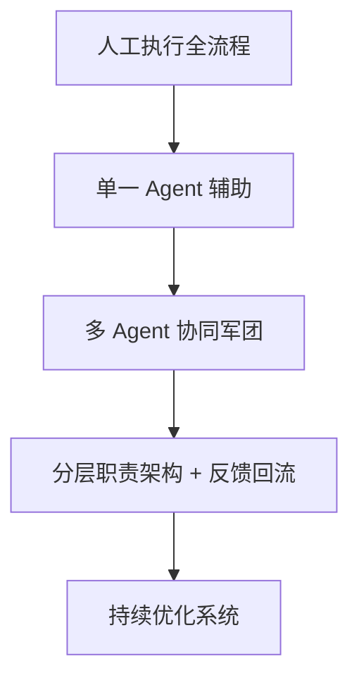
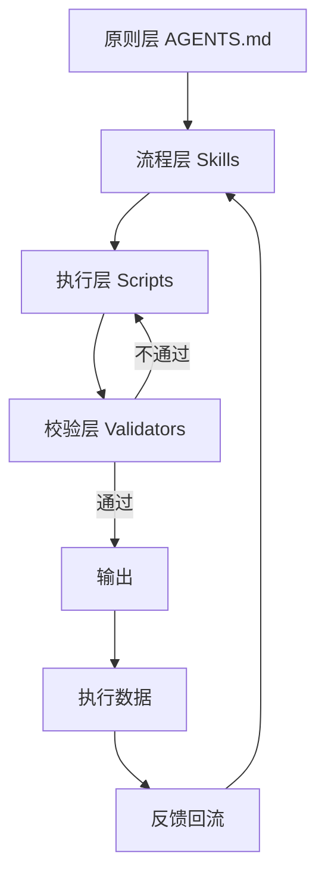

# 第十九章 Agent 军团篇 —— 用“自动化”放大经营能力

## 学习目标

- 理解专业化低门槛与教育前置在内容营销中的作用机制
- 掌握搭建 Agent 员工军团的五步流程与分层职责架构
- 理解反馈回流作为系统进化驱动力的闭环逻辑
- 能结合自身业务场景判断何时引入自动化

## 19.1 生活类比

想象你是一家小餐馆的老板。刚开始，你身兼数职：点菜、炒菜、收银、洗碗，一个人忙得团团转。虽然每件事都能做，但效率低、出错多、顾客体验也不稳定——高峰期甚至会漏单或上错菜。后来，你雇了厨师、服务员和收银员，每个人只做一件职责明确的事：厨师专心炒菜，服务员专注接待，收银员负责结账。餐馆的运转立刻变得流畅起来，你作为老板只需要定规矩：菜品标准是什么、服务流程是什么。而最妙的是，这些员工还会每天向你汇报：哪道菜客人最常点、哪个环节客人等得最久，你再根据这些反馈调整菜单和服务流程。这就是自动化经营的本质——用一套分工明确的“员工体系”替代人工重复劳动，同时让数据和反馈驱动系统持续进化。本章所讲的“Agent 军团”，正是把同样的逻辑搬到了线上经营中：用 AI 智能体充当你的虚拟员工，各司其职、协同作战，并依靠反馈回流不断升级。

## 19.2 概念地图

```
Agent 军团篇：用自动化放大经营能力
├── 客户体验层：专业化低门槛 + 教育前置
├── 自动化执行层：Agent 员工自动化 + Agent 军团成果
├── 系统架构层：分层职责架构
└── 进化循环层：反馈回流
```

## 19.3 专业化低门槛


> [P001, p.3] “让客户感受到专业和低决策门槛。”

在线上卖课的实践中，你面临的第一个挑战是：客户第一眼看见你的产品时，既缺乏专业知识来判断课程好坏，又对“买了有没有用”充满犹豫。如果页面内容过于复杂难懂，客户会因“看不懂”而流失；如果内容过于浅显随意，客户又会因“不专业”而产生怀疑——这就是双重困境。

**核心定义**（来源：`[P001, p.3-4]`，概念：`专业化低门槛`）

> **专业化低门槛**：内容设计的目标是让客户在接触产品的第一瞬间，同时触发两种感知——“这家很专业”和“购买很简单”。

这个定义揭示了内容营销的第一性原理：客户的决策成本由**信任感**和**理解成本**共同决定，二者缺一不可。只讲专业不讲易用，客户会被术语吓跑；只讲易用不讲专业，客户会担心质量。

**关键策略**：

| 策略维度 | 具体做法 | 解决的问题 |
|----------|---------|-----------|
| 信息密度 | 高密度呈现课程亮点、数据成果、专家背书 | 建立专业信任感 |
| 表达简洁 | 用一句话讲清“你能得到什么” | 降低理解成本 |
| 结构分层 | 先给结论、再给依据、最后给行动入口 | 引导客户快速决策 |

这套策略的本质是：把“专业感”和“轻松感”同时注入第一印象。专业感来自信息密度和数据支撑，轻松感来自表达简洁和路径清晰。二者结合，客户才会觉得“这个团队很懂行，而且我不需要费脑子就能决定买”。

## 19.4 教育前置


> [P001, p.8] “详情页把教育客户的成本前置。”

客户的购买疑虑往往集中在一点：**学了到底有没有用？** 这个问题如果不解决，后续任何转化动作都会受阻。与其等客户来问，不如把解释、证明、说服的动作提前到客户接触的第一站——也就是详情页。

**核心定义**（来源：`[P001, p.8-9]`，概念：`教育前置`）

> **教育前置**：将课程价值、学习路径、预期成果等信息结构化地呈现在详情页，在客户接触的最初阶段完成“教育”动作，从而降低后续沟通成本。

这个定义展示了内容营销的一个关键转变：**从“被动答疑”转向“主动教育”。** 传统模式下，客户带着疑虑来咨询，你需要花大量时间一对一解释；教育前置模式则是把最常被问到的几十个问题，预先用结构化内容回答完毕。

**成本前置的数学表达**：

设教育前置前的沟通成本为 $C_{before}$，教育前置后的沟通成本为 $C_{after}$，则有：

$$
C_{after} = C_{before} \times (1 - r_{education})
$$

其中 $r_{education}$ 表示详情页已覆盖客户疑虑的比例。

这个公式展示了“教育前置”的本质是一项**成本转移投资**：你在详情页投入的内容制作成本，换取了后续沟通成本的大幅下降。当 $r_{education}$ 足够高时（比如达到 80%），绝大多数客户的疑问在详情页就已被解决，转化链路自然畅通。

**教育前置的三要素**：

1. **价值呈现**：课程学完能获得什么具体结果
2. **路径展示**：从零基础到掌握能力的可视化学习路径
3. **信任构建**：真实学员案例、数据成果、专家背书

教育前置的核心逻辑是：**客户的信任不是靠销售“谈出来”的，而是靠内容“教出来”的。** 当你在详情页就把“为什么值得学”和“怎么学得会”讲清楚，客户带着充分理解来咨询，转化效率自然提升。

## 19.5 Agent 员工自动化


> [P002, p.2] “用 12 个 Agent 员工自动化执行引流、转化和交付全流程。”

当内容营销解决了“流量入口”的问题后，下一个瓶颈出现了：**人工执行全流程的成本高、速度慢、容易遗漏。** 一个客户从看到内容到完成购买、再到学完课程，中间涉及几十个步骤。人工操作时，任何一个环节的疏忽都会导致客户流失。

**核心定义**（来源：`[P002, p.2-3]`，概念：`Agent 员工自动化`）

> **Agent 员工自动化**：利用 AI 智能体（Agent）作为虚拟员工，自动承接引流、转化、交付全流程中的单一职责，通过分工明确的多 Agent 协同完成经营闭环。

这个定义揭示了自动化经营的核心设计原则：**每个 Agent 只负责一件职责明确的事，通过多个 Agent 的流程化协同覆盖完整业务链路。** 这种设计与工厂流水线的逻辑如出一辙——每个工位只做一件事，但串联起来就是完整的产品。

**Agent 员工军团的角色分配**：

| 阶段 | Agent 角色 | 核心职责 | 传统人工对应 |
|------|----------|---------|-------------|
| 引流 | 内容策划 Agent | 生成种草笔记、选题规划 | 内容运营 |
| 转化 | 咨询应答 Agent | 解答客户疑虑、推送详情页 | 销售客服 |
| 交付 | 学习陪伴 Agent | 推送课程、提醒进度、答疑 | 助教老师 |

**为什么选择 Agent 而非传统自动化工具？** 传统自动化（如 RPA）只能执行预先写死的规则，遇到未预见的场景就会卡住。而 Agent 具备**意图理解**和**灵活应对**能力——它能从客户的模糊表述中判断意图，并选择合适的应对策略。这正是处理复杂多变客户需求的关键。

**方法演进图**：



这个演进路径展示了从“人肉执行”到“Agent 军团”的进化逻辑：先是利用单个 Agent 替代重复劳动，再发展成多 Agent 分工协作，最终升级为带反馈回流的自适应系统。每一步的核心驱动力都是“效率提升”和“成本降低”。

## 19.6 分层职责架构


> [P002, p.5] “AGENTS.md 存原则、Skill 存流程、脚本负责确定性、验证器兜底。”

当多个 Agent 同时运行时，一个致命问题浮出水面：**职责重叠和标准不统一。** 比如，咨询 Agent 和内容 Agent 都需要理解课程价值，如果它们各自有一套理解方式，就会产生表述不一致、甚至互相矛盾的情况。分层职责架构正是为了解决这个问题而设计的。

**设计图纸**（> 分层职责架构方法（来源：《P002, p.5-6》））

| 层级 | 载体 | 职责 | 更新频率 |
|------|------|------|---------|
| 原则层 | `AGENTS.md` | 定义不可违背的业务原则和价值观 | 极低（手动） |
| 流程层 | `Skills` | 沉淀标准操作流程和最佳实践 | 低（人工审核） |
| 执行层 | 脚本（Scripts） | 确定性的步骤和话术模板 | 中（数据驱动） |
| 校验层 | 验证器（Validators） | 核验 Agent 输出质量，防止错误扩散 | 持续（自动） |

**架构分层图**：



这张架构图展示了分层设计的本质：**每一层只解决一类问题，并且对下层提供约束，对上层提供灵活性。** 原则层提供顶层约束（比如“不允许虚假宣传”），流程层沉淀方法（比如“咨询应答的标准流程”），执行层负责确定性输出（比如“具体话术”），验证器则兜底防错。

**为什么这样分层？** 核心考量是**稳定性梯度**：

1. 越上层越稳定：原则几乎不变，人工维护；越下层越灵活：脚本可以频繁更新。
2. **错误隔离**：脚本出错时，验证器能拦截；流程问题只需要更新 Skill 层，不需要动原则。
3. **可组合性**：新增一个 Agent 时，只需要定义它的脚本和 Skill，原则层无需改动。

这个架构的巧妙之处在于：**它用“分层”把“灵活”和“稳定”这一对矛盾统一起来。** 系统整体是稳定的（原则不变），但局部是灵活的（脚本可更新）。

## 19.7 Agent 军团成果


> [P002, p.8] “用五步法搭建 12 个 Agent 员工，月入 7w。”

当 Automation 方案落地后，成果是可量化的。一个五步法搭建的 12 个 Agent 的员工军团，可以实现月入 7 万的经营规模——这在之前的人工运营模式下，至少需要一个 3-5 人的全职团队。

**成果拆解**（来源：`[P002, p.8-9]`，实验：`Agent 军团成果`）

| 指标 | 人工模式 | Agent 军团模式 | 提升幅度 |
|------|---------|--------------|---------|
| 团队规模 | 3-5 人全职 | 1 人 + 12 个 Agent | 人力成本降低约 80% |
| 响应速度 | 分钟级 | 秒级即时响应 | 体验显著提升 |
| 覆盖面 | 单线程处理 | 并行处理多客户 | 转化漏斗不堵塞 |
| 月收入 | 受限于人手 | 7w+ | 规模复制性增强 |

**五步搭建法**：

```
第一步：盘点流程 —— 梳理引流、转化、交付全流程中的每一个环节
第二步：职责拆分 —— 将流程拆分为单一职责的模块
第三步：定义 Agent —— 每个模块对应一个 Agent，配置其 Skill 和脚本
第四步：搭建协同 —— 设计 Agent 之间的协作关系和触达规则
第五步：部署+优化 —— 上线运行，持续收集反馈并迭代
```

这段伪代码展示了 Agent 军团搭建的核心方法论：**流程盘点→职责拆分→Agent 定义→协同搭建→持续优化。** 每一步都为下一步提供输入，形成一个系统化的构建路径。值得注意的是，五步法的第一站不是“搭建 Agent”，而是“盘点流程”——说明自动化思考的起点是业务本身，而非技术工具。

**为什么能实现 7w 月入？** 关键在于**规模复制**：

- 人工模式：服务能力受限于个人精力，接 10 个客户就是极限。
- Agent 模式：每个 Agent 可以同时服务 100 个客户，且服务质量一致。

这种规模效应的数学表达是：

$$
R_{income} = N_{customers} \times P_{conversion} \times V_{course} - C_{operation}
$$

其中 $N_{customers}$ 为同时触达的客户数，$P_{conversion}$ 为转化率，$V_{course}$ 为客单价，$C_{operation}$ 为运营成本。Agent 军团模式通过提升 $N_{customers}$（并行处理）同时降低 $C_{operation}$（人工成本），双重作用放大营收。

## 19.8 多源对照

### 共识

两份素材在“为什么需要自动化”上达成一致：人工执行在规模化经营的瓶颈在于**成本高、速度慢、易遗漏**，而 Agent 自动化能同时解决这三个问题。另外，两者都强调“人员职责单一化”是系统稳定的前提——无论是人类员工还是 Agent，职责明确才能保证质量。

### 分歧

- [P001《小红书卖课 Solution 手册》] 强调自动化之前必须先解决“内容营销”问题：专业化低门槛和教育前置是流量的前提，Agent 只是放大规模的工具；
- [P002《Agent 员工军团搭建流程》] 则认为自动化的核心在于“系统架构”：只要分层职责架构设计得好，Agent 军团本身就能驱动业务增长，营销内容只是 Agent 执行的一个环节。

**共识与分歧的启示**：这两份素材的分歧点在于“先有流量还是先有系统”。我们的建议是：**先有流量验证，再有系统放大。** 先用最小人力验证内容营销的可行性，再搭建 Agent 军团放大效果——这也符合五步法“先盘点流程再定义 Agent”的顺序。

## 19.9 设计中的取舍

**为什么不用统一的“全能 Agent”而用 12 个分工 Agent？**

一个全能 Agent 看起来更简单——只需要一个 Agent 处理所有任务。但实际运行中，全能 Agent 面临两个致命问题：一是**上下文污染**：处理咨询时“输入”了太多内容策划的任务，导致输出质量下降；二是**调试困难**：出错时不知道是哪里出了问题。分工 Agent 的优势在于错误隔离和可定制性——某个 Agent 表现不佳时，只需单独优化它的 Skill 层，而不影响其他 Agent。

**分层的代价是什么？**

分层职责架构增加了系统的**复杂度**：你需要维护 AGENTS.md、Skills、脚本、验证器四层文件，每一层都有更新成本。尤其是初期的搭建成本不低——需要花时间梳理原则、沉淀流程、编写脚本。但这个代价换来的是**长期可维护性**：当业务变化时，只需更新对应层级的文件，而不是推倒重来。

**反馈回流需要多大的数据量才能见效？**

反馈回流的效果取决于你的业务量级。月入几百的小规模经营，反馈数据稀疏，优化周期长；月入几万的中规模经营，数据量足以支撑有效的迭代。这提醒我们：**反馈回流是一个规模依赖的系统设计**——业务量越大，自动化系统的进化速度越快。

## 19.10 动手练习

- 练习一：梳理你自己业务中的“引流-转化-交付”全流程，列出每个环节的具体任务和人工耗时，找出至少 3 个可以被 Agent 替代的重复性任务。
- 练习二：参考五步法，从你的业务中拆出 5 个最早可以自动化的环节，定义每个 Agent 的名称、职责范围、输入输出和关键 Skill 要求。
- 练习三：为你的 Agent 军团设计一份 AGENTS.md，写下 5 条不可违背的业务原则。思考：这些原则为什么应该是“原则”而不是“流程”？
- 练习四：模拟一次“反馈回流”迭代：选择一个 Agent 的脚本，描述它在执行中可能遇到的 3 种未预见场景，以及你会如何在脚本和 Skill 层分别修改它。
- 练习五：对照 19.8 的共识与分歧，评估你的业务：是“先做内容营销再做自动化”还是“先建系统再做营销”？给出你的判断理由。

## 19.11 本章小结

这一章我们学习了如何用“自动化”放大经营能力，核心是从人工执行的瓶颈出发，通过 Agent 军团实现引流、转化、交付全流程的自动化。首先，我们讨论了**专业化低门槛**——内容设计需要同时触发客户的信任感和轻松感，这是流量转化的前提。其次，我们介绍了**教育前置**——把解释、证明、说服的动作提前到详情页，用内容制的成本降低后续沟通成本。接着，我们详解了**Agent 员工自动化**——用 12 个单一职责的 Agent 替代人工全流程执行，通过分工协同实现规模复制。再往深处，我们探讨了**分层职责架构**——AGENTS.md 存原则、Skill 存流程、脚本负责确定性、验证器兜底，用分层设计统一“稳定”和“灵活”的矛盾。最后，我们讨论了**反馈回流**——将执行数据回流至定义层，驱动脚本→Skill→原则的多层迭代，让系统具备进化能力。通过五步法搭建的 12 个 Agent 军团可实现月入 7w，印证了自动化经营的可复制性和规模效应。

本章我们一起学习了以下概念：

| 概念 | 解释 |
|------|------|
| 专业化低门槛 | 同时触发信任感和轻松感的双重感知 |
| 教育前置 | 把课程价值和学习路径提前呈现在详情页，降低后续沟通成本 |
| Agent 员工自动化 | 用 12 个 AI 智能体承担引流转化交付等单一职责 |
| 分层职责架构 | AGENTS.md 存原则、Skill 存流程、脚本定步骤、验证器核验 |
| 反馈回流 | 将执行中的数据回流至定义层，驱动脚本→Skill→原则的多层迭代 |
| Agent 军团成果 | 五步法搭建 12 个 Agent 员工，可实现月入 7w |

下一章中，我们将把目光从“线上经营”转向“行业协作”，探讨聚合者模式——如何将闲散的 AI 能力与行业需求对接，构建一个不靠销售、靠系统自动聚合的中台生态。这一章将为你展示自动化经营的下一个进化方向：从“自己搭建 Agent 军团”到“聚合行业闲散产能”的平台级玩法。

