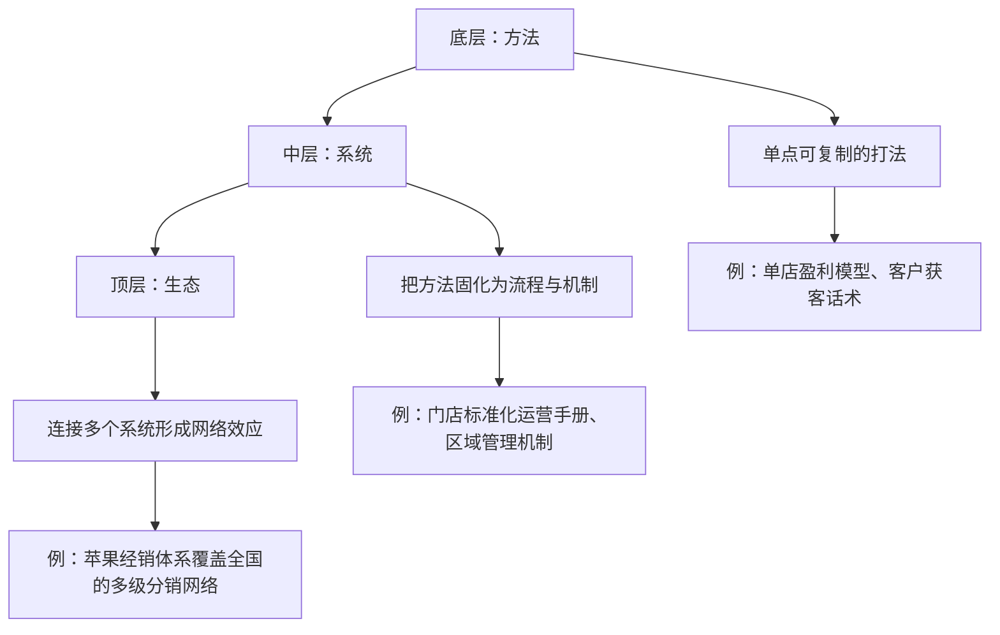

# 第二十章 生意模式篇：做大生意，先想清楚“模式”

> [TOC]

## 学习目标

- 理解模式决定论的核心主张及适用边界
- 掌握三层生态金字塔的层级结构及其递进关系
- 能辨析方法、系统、生态三个层级的组织能力要求
- 理解经销本质论的定义及关键特征
- 能用三层金字塔模型拆解其他行业

## 20.1 生活类比

把生意做大的过程，很像盖一栋楼。

如果你只关注“用什么砖”或者“墙刷什么颜色”，你只能算是一个优秀的泥瓦匠。但一栋摩天大楼能立起来，靠的不是某一块砖有多好，而是整套结构设计——承重墙在哪、电梯井怎么排、地基打多深、不同楼层之间的管线怎么走。产品就像那块砖，商业模式就像那套建筑图纸。

再想想开连锁奶茶店。你研发出一杯惊艳的奶茶（产品好），但最多开三五家店。真正让蜜雪冰城开到两万家店的，不是某一杯奶茶有多好，而是它的加盟模式、供应链体系、门店运营标准化——这些都是模式层面的设计。你单靠打磨产品，永远做不大；只有把“怎么复制”“怎么扩张”“怎么让别人帮你卖”这些想清楚，规模才会自然生长。

而经销这门生意更有意思。它表面上看起来就是“倒买倒卖”——低买高卖赚差价，但真正做得大的经销商，赚的从来不是差价，而是“信任的钱”。消费者为什么愿意从你这里买？因为你长期积累的信誉和连接价值。这就像一座桥的两端各有一个码头，真正值钱的不是桥上运的货，而是桥本身——它让两端能够持续、稳定、低信任成本地往来。把这层本质看透，你才算真正理解什么叫“模式”。

## 20.2 概念地图

```
生意模式论
├── 模式决定论：做大生意先想清楚模式
├── 三层生态金字塔：方法→系统→生态
└── 经销本质论：连接价值与信任传递
```

## 20.3 模式决定论：做大生意，先想清楚模式

让我们从一个最朴素的直觉出发：什么决定了生意能做多大？

> [P001, 260819《苹果经销是怎么做大的？》] “做大生意要想清楚的不是产品多好，而是模式多好。”

这句话看似简单，却道破了规模化的第一性原理。你可能会反驳：苹果的产品难道不好吗？当然好。但问题在于——产品好只能让你做出一个爆款，而模式好才能让你持续做出爆款，并且把爆款卖到全国乃至全球。

我们来拆解这句话背后的三层含义。以下是模式决定论的三个核心特征。

| 特征 | 含义 | 说明 |
|------|------|------|
| 全局性 | 模式从整体框架出发 | 统领产品、渠道、增长等局部决策，而非单点优化 |
| 杠杆性 | 模式是放大器 | 产品只是载体，好模式让同等的产品投入产出更大 |
| 前瞻性 | 模式设计需面向未来 | 今天的产品属于今天，明天的规模取决于今天设计好的模式 |

### 为什么产品力撑不起规模化？

产品再好，单靠产品力无法支撑规模化扩张。原因在于：产品力本质上是一个**局部变量**。你打磨出一款好产品，最多证明你有能力做好一件事。但规模化需要的是**可复制的系统**——怎么在不同区域保持同样品质？怎么管理几千名员工？怎么建设冷链物流？这些问题，产品力一个都回答不了。

我们可以用一个小公式来表达这个关系：

$$
\text{生意规模} = \text{产品力} \times \text{模式杠杆}
$$

来源：`[P001, 模式决定论]`，概念：`模式杠杆`

这个公式展示了：当模式杠杆趋于 1 时，你的生意规模约等于产品力本身——这就是大多数小生意的状态。只有当模式杠杆远大于 1 时，同样的产品力才能被放大成十倍甚至百倍的生意规模。所以，想要做大，你的工作重心应该从“打磨产品”转向“设计模式”。

### 三个特征的深入解读

**全局性**意味着，当产品、渠道、增长这些局部决策发生冲突时，以模式框架为最高优先级。比如，是否要开直营店？从单店盈利看可能是正数，但从模式复制角度看可能拖慢扩张速度——那么结论就变了。

**杠杆性**让你理解，为什么同样在苹果产业链里，有人做成了年营收百亿的经销商，有人做了十年还是个档口。差别不在产品——大家都卖同一款 iPhone——而在于各自的模式设计。

**前瞻性**提醒你，模式不能只在当下成立，它必须能适配三到五年的市场环境。苹果经销在 2010 年前后建立的多级分销体系，到了 2018 年依然有效，正是因为当初设计模式时就预留了扩展空间。

> **一句话总结**：产品解决“能不能做好”，模式解决“能不能做大”。想做大的生意人，把精力从前者转移到后者。

## 20.4 三层生态金字塔：方法、系统、生态

理解了模式决定论之后，自然要问：那好的模式长什么样？有没有一个通用的框架来帮我们设计和评估模式？

> [P001, 260819《苹果经销是怎么做大的？》] “用三层金字塔模型拆解苹果经销做大路径：方法、系统、生态。”

这个模型把一门生意从“能做”到“做大”的路径划分成三个层级。它的核心洞察是：**单点方法难以复制到多区域多品类**，而生态化的模式则可以。其方法是**自下而上构建**的，每一层都建立在前一层之上。



### 第一层：方法

方法层是你最先掌握的**单点可复制的打法**。比如一家苹果授权店怎么选址、怎么陈列、怎么接待客户、怎么做社群营销。这一层的特征是：**它解决的是“单店能不能活”的问题**。

但方法有一个天然瓶颈——它依赖个人能力。店长 A 的选址嗅觉很好，但店长 B 学不会。方法层的本质是经验，而经验擅长单点突破、不擅长规模复制。

### 第二层：系统

系统层的核心工作是**把方法固化为流程与机制**。当你好不容易验证了一套单店盈利模型，下一步不是拥抱复制，而是——先把它变成所有人都会用的工具。

以下是系统层要回答的关键问题。

- 怎么做店：把选址标准、装修规范、SKU 配比写成手册，让新人也能按图索骥。
- 怎么管人：建立店长培养、考核、晋升机制，让人才可以内部批量生产。
- 怎么控货：建立进销存系统、库存周转标准、区域调拨机制，让货在系统内高效流转。

**关键特征：可复制性**。系统层把“依赖于人”的方法变成“脱离人”的机制。走到这一层，你已经具备了开十家店的能力。

### 第三层：生态

生态层的核心是**连接多个系统，形成网络效应**。当你的系统在 A 城市跑通，又扩展到 B、C、D 城市之后，你会发现：物流网络可以共享、数据可以互通、区域之间的调货可以更高效——这时候，生意的价值不再等于单店利润之和，而等于整个网络协同产生的溢价。

生态层有三个重要特征。以下是三个层级的能力要求对比。

| 层级 | 核心能力 | 增长瓶颈 | 关键问题 |
|------|----------|----------|----------|
| 方法 | 单点经营能力 | 依赖个人、难以复制 | 单店能不能活？ |
| 系统 | 标准化与流程化能力 | 管理与组织成本上升 | 十家店怎么同时管好？ |
| 生态 | 网络协同与资源调度能力 | 生态治理与利益分配 | 百城千店怎么联动？ |

这个表格展示了三层金字塔从单点到网络的能力跃迁。你可以看到：每一层的能力要求完全不同，而大多数生意死在第一层到第二层的跨越上——因为老板不愿意把“自己的绝活”写成“别人的手册”。

**层级递进性**要求你自下而上构建，不能跳跃。没有扎实的方法，系统就是空中楼阁；没有成熟的系统，生态只会变成混乱的拼盘。苹果经销的路径正是如此：先是单店盈利模型跑通，再是区域管理系统标准化，最后才是全国性的网络协同。

> **一句话总结**：方法让单店活下来，系统让模式复制开去，生态让生意自动生长。

## 20.5 经销本质论：连接价值与信任传递

前面我们讨论了一般性的模式设计，现在我们把镜头对准一种被严重低估的商业模式——经销。

> [P001, 260819《苹果经销是怎么做大的？》] “三层金字塔模型拆解苹果经销做大路径：方法、系统、生态。”

经销看起来只是倒买倒卖——进货、加价、卖出，但流水线式的差价思维永远做不大。真正把经销做大的企业，其本质是**构建连接价值与信任传递的通道**。

我们来界定经销本质论的分析框架。

> 经销本质定义（来源：《P001, 经销本质论》）

$$
\text{经销价值} = \text{连接价值} + \text{信任价值}
$$

其中：
- **连接价值**：经销商把品牌与消费者之间的物理与信息距离缩到最短
- **信任价值**：消费者因为信赖经销商而降低购买决策成本

这个公式展示了经销不是简单的商品转售——商品转售赚的是差价，而经销做大赚的是“连接 + 信任”的复合价值。差价是线性增长的，而信任是复利增长的——这正是为什么有的经销能做到千亿规模，而多数倒买倒卖者始终是小生意。

我们来拆解经销本质的三大关键特征。

| 特征 | 含义 | 现实映射 |
|------|------|----------|
| 连接性 | 经销商是品牌与用户的桥梁 | 品牌触达不到的下沉市场，经销商可以 |
| 信任传递 | 消费者对经销商的信任可迁移给品牌 | 买 iPhone 不选官网选经销商，因为信任这家店 |
| 可复制性 | 连接与信任的模式可批量复制 | 同一套经销商体系在不同城市反复跑通 |

### 为什么“倒买倒卖”的标签是错的？

经销的原始形态确实像倒买倒卖，但这只是**表层交易**。真正让经销商做大的是它**积累的信任资产**。一个消费者第一次因为便宜走进你的店，第二次因为体验好又来，第三次介绍朋友来——这每一次交易，都在往你的“信任账户”里存钱。

这个信任积累过程可以形式化表达：

$$
T_{n+1} = T_n + \Delta T_{\text{体验}} - \Delta T_{\text{摩擦}}
$$

来源：`[P001, 经销本质论]`，概念：`信任传递`

这个公式展示了经销商的信任资产随每一次交易体验递增、随每一次交易摩擦递减。信任传递的核心是：**消费者买的不只是货，更是“从你这里买不会出错”的确定性**。这种确定性一旦建立，经销商就从一个商品中转站升级为一个信任节点。

### 信任传递的三个层次

第一层是**品牌信任**：品牌本身的知名度帮助经销商建立起初步信任。第二层是**渠道信任**：消费者在反复购买中，把对渠道的信赖内化为习惯。第三层是**社群信任**：经销商通过会员体系、客户社群与口碑推荐，把一次性买卖变成长期关系。

真正的经销霸主，把三层信任全部打通，这时消费者购买的不仅是 iPhone，更是一种“我在这家买，永远不会买到假货、永远享受好售后”的心理保障。

> **一句话总结**：经销商的资产不在仓库里，而在消费者的信任里。看懂这一点，你才看懂经销这门生意。

## 20.6 多源对照：三层金字塔在苹果经销中的应用

不同解读方式对“苹果经销为什么能做大”给出了不同层次的回答。这里我们基于《苹果经销是怎么做大的？》这一素材，做一个内部分析视角的对照。

### 拆解路径

用三层金字塔模型拆解苹果经销，可以做如下映射：

- **方法层**：单店盈利模型。选址、陈列、定价、获客的具体打法。解决“一家店怎么赚钱”。
- **系统层**：区域运营标准化。门店管理手册、员工培训体系、库存调度机制。解决“一百家店怎么管”。
- **生态层**：全国性的分销网络。多级经销商协同、数据共享、物流网络联动。解决“一千家店怎么长”。

### 关键启示

这个拆解揭示了一个容易被忽略的事实：苹果经销的护城河既不在产品（大家都卖一样的 iPhone），也不在单店体验（单店体验再好也撑不起千亿规模），而在**生态级的网络协同能力**——这才是模式真正值钱的地方。单个节点的优势是可复制的，但整个网络的结构优势无法被复制。

## 20.7 设计中的取舍

**为什么不能只靠产品力把生意做大？**

因为产品力是静态的、局部的。你打磨出一款好产品，只能证明你有能力做好一件事，而规模化需要的是可复制的系统——怎么在不同区域保持同样品质、怎么管理几千名员工、怎么建设供应链——这些问题产品力无法回答。产品力解决“能不能做好”，模式解决“能不能做大”，两者缺一不可，但做大这件事，模式是主变量。代价是你需要投入大量时间在看不见的地方——写手册、建流程、搭系统——这些工作的回报周期远长于产品迭代，对耐性要求极高。

**三层金字塔为什么必须自下而上构建？**

因为每一层的能力都建立在前一层的地基上。没有验证过的单店方法，系统标准化就是无源之水——你不知道该固化什么；没有成熟的系统，生态连接就是混乱的拼盘——你没有能力承接网络协同的复杂度。这个取舍的代价是速度：自下而上是稳健但缓慢的路径，远不如“先圈地再补课”来得快。但后者的风险是地基不稳、规模越大倒塌越快。稳健和速度的权衡，是每一位想做大生意的掌舵人都要做的决策。

**经销赚差价和赚信任，哪个更可持续？**

差价是线性收益，每一笔交易赚一笔钱，天花板低且容易被价格战击穿。信任是复利资产，每积累一分信任就能降低一分未来获客的成本。选择赚差价模式的代价是永远在找“更便宜的货源”，永远没有积累；选择赚信任模式的前期代价是增速慢、投入重，但跨越临界点之后，信任带来的复利会让边际成本持续下降。如果你只想做一门小生意，差价够了；如果你想做一门大生意，必须选择信任。

## 20.8 动手练习

- 练习 1：找一家你熟悉的连锁品牌（如瑞幸、名创优品），用三层金字塔模型拆解它的发展路径，标出三层各自的代表做法。
- 练习 2：假设你是一家区域经销商的老板，想要把生意从单城扩展到全省。按照方法→系统→生态的顺序，列出你每个层级要解决的三件事。
- 练习 3：回顾你最近三次购买决策，分析“信任”在其中的作用。你是因为信任品牌、信任渠道、还是信任某个具体的人而完成购买？
- 练习 4：对比直销和经销两种模式的信任传递方式，画出各自的信任链，指出哪种模式更容易产生复利效应。

## 20.9 本章小结

这一章我们从苹果经销做大的案例出发，系统拆解了生意模式设计的三层框架。

学习了模式决定论的核心主张——做大生意要先想清楚模式，产品只是载体而模式才是放大器；讨论了模式的三重特征：全局性、杠杆性和前瞻性；掌握了三层生态金字塔的结构——底层方法解决单店存活，中层系统解决规模复制，顶层生态解决网络协同；辨析了三种能力的递进关系与各自的组织要求；最后深入发掘了经销本质论——经销表面是倒买倒卖，本质是构建连接价值与信任传递的通道，信任是经销商最核心的复利资产。

本章我们一起学习了以下概念：

| 概念 | 解释 |
|------|------|
| 模式决定论 | 做大生意的关键在于商业模式设计，而非产品本身 |
| 全局性 | 模式从整体框架出发，统领产品、渠道、增长等局部决策 |
| 三层生态金字塔 | 生意做大路径：方法→系统→生态 |
| 经销本质论 | 经销的本质是构建连接价值与信任传递的通道 |
| 信任传递 | 经销的核心资产是消费者对渠道的信任 |

下一章中，我们将视角从“苹果怎么做大”切换到“生意如何系统化复制”，深入讨论系统化思维与运营标准化的方法论，帮助你打通从单点成功到规模复制的关键一跳。
