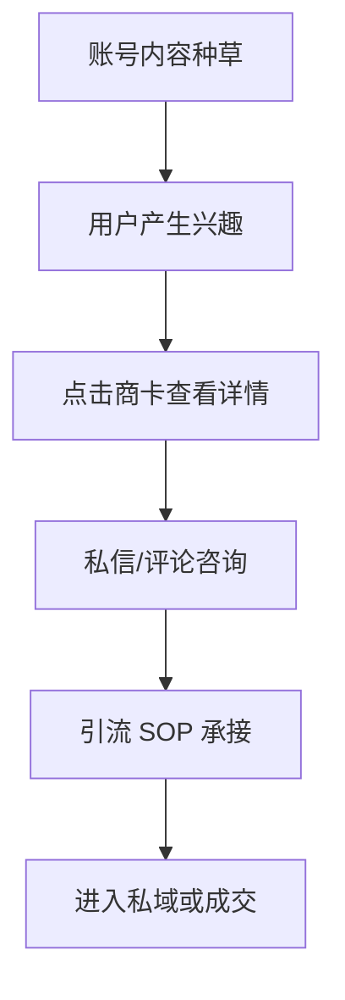

# 第二十一章 运营篇：把复杂运营拆成“可执行动作”

## 学习目标

- 理解一天读完并判断方法的三阶闭环
- 掌握全流程兼顾论的五维框架
- 理解 IP 单业务约束的心智绑定原理
- 掌握内容沉淀护城河的逻辑
- 理解招商成功率定律
- 掌握小红书运营三件套的链路设计

## 21.1 生活类比

想象你是一位餐厅主厨。每天早晨，菜市场送来几十种食材，你不可能每种都细细品尝再决定菜单——那样中午就来不及出菜了。你需要一种“快速筛选”的本领：一眼看出哪些食材新鲜、哪些适合今天的招牌菜，然后立刻拍板。同样，运营者每天面对的信息洪流远远超出人类阅读能力的上限。你不可能读完每一篇报告、每一份数据、每一条用户反馈，但你必须做出判断。这不是“读不完就算了”的借口，而是“读不完也要读完关键信息并形成判断”的职业素养。更进一步，开餐厅不能只管后厨炒菜——你还要管前厅服务、管采购成本、管月底回款、管外卖渠道。任何一环掉链子，餐厅都会亏损。运营也是一样，内容做得再好，如果不考虑转化、营收、回款，生意照样做不起来。本章我们将把这些运营智慧拆解成一套可执行的动作框架。

## 21.2 概念地图

```
运营篇：把复杂运营拆成可执行动作
├── 信息处理：一天读完并判断
├── 全局统筹：全流程兼顾论 + IP 单业务约束
├── 资产积累：内容沉淀护城河
├── 招商逻辑：招商成功率定律
└── 渠道获客：小红书运营三件套 + 上小红书获客动因
```

## 21.3 一天读完并判断

运营工作每天面对的信息量是惊人的：行业报告、竞品动态、用户评论、平台规则更新、团队日报……如果按照传统阅读方式逐字逐句读完，一天时间根本不够用。但运营决策又不能拖延——市场不会等你。这就产生了核心矛盾：**时间有限，信息无限**。解决之道不是“读得更快”，而是“带着判断去读”。


> [P001, p.1] “一天如何读完关键信息并形成判断。”

这句看似朴素的话，实际上定义了运营信息处理的三阶闭环：**筛选（选什么读）→ 阅读（怎么读）→ 判断（得出什么结论）**。三者缺一不可。很多人卡在第一步——什么都想读，结果什么都没读透；也有人卡在第三步——读完了，却不敢下结论。

**核心定义与推导：**

> 一天读完并判断定义（来源：《P001, p.1》）

我们把“一天读完并判断”拆解为三个动作，每个动作都对应一个时间约束和产出标准：

| 动作 | 时间约束 | 产出标准 |
|------|----------|----------|
| 筛选 | ≤ 30 分钟 | 确定今天必读的 Top 3 信息源 |
| 精读 | ≤ 3 小时 | 画出关键信息的逻辑链 |
| 判断 | ≤ 30 分钟 | 写出一段 300 字的结论 |

这个表格展示了“一天读完并判断”并非笼统的方法论口号，而是一套可执行的时间盒管理方案。它把“读完全部信息”这个不可能完成的任务，转换为“在有限时间内读完最关键信息并形成结论”这个可完成的任务。

这个方法有三个本质特征，我们逐一展开：

**时间约束性**。给每个环节设置硬性截止时间，防止陷入“无限阅读”的陷阱。没有截止时间的阅读，本质上不是工作，而是消遣。

**判断导向性**。阅读的终点不是“我读完了”，而是“我形成了判断”。判断可能是“今天重点做 A 不做 B”，也可能是“这个数据还不足以支撑决策，需要补充验证”。

**信息选择性**。不是所有信息都值得读。判断依据是：这条信息是否影响我今天的决策？如果不影响，哪怕它再重要，也放到“待读清单”里。

**关键方法：三遍过滤法**

> 三遍过滤法方法（来源：《P001, p.1》）

```
第一遍（5 分钟）：扫标题、摘要、结论，画出信息地图
第二遍（45 分钟）：只读与你当前决策相关的部分，标记关键证据
第三遍（10 分钟）：回看标记，形成书面判断
```

这段伪代码展示了一个可复制的高效阅读流程。第一遍用“扫描模式”建立全局认知，第二遍用“聚焦模式”深挖与决策相关的信息，第三遍用“收敛模式”把散落的信息压缩成一个判断。整个过程控制在 1 小时内，但产出的判断质量不低于“花一天读完”的效果。

### 如何判断“关键信息”？

实际操作中，“哪些算关键信息”是最高频的困惑。这里给出一个简单的判断标准：**一条信息是否关键，取决于它能否改变你的决策**。

- 如果读了这条信息之后，你的决策不变 → 它不关键，可以不读。
- 如果读了这条信息之后，你的决策改变（或原本不确定的决策变确定了）→ 它关键，必须精读。

这个方法同样适用于团队协作：当你需要向老板或同事汇报时，只需呈现“哪些信息改变了我们的判断”，而非罗列所有读过的内容。

## 21.4 全流程兼顾论

很多运营者有一种普遍倾向：只关注自己擅长的环节。做内容的人只盯着曝光量，做投放的人只盯着 ROI，做社群的人只盯着活跃度。但生意是一个完整的闭环，任何一个环节掉链子，整个盘面都会受影响。


> [P002, p.2] “全流程需要兼顾内容、转化、营收、渠道、回款。”

这段看似简单的陈述，实际上提出了运营的**五维框架**。我们把它拆解成一张运营体检表：

| 维度 | 核心问题 | 常见失衡表现 |
|------|----------|--------------|
| 内容 | 用户为什么来看？ | 只追热点，不建体系 |
| 转化 | 用户为什么下单？ | 流量大但转化率极低 |
| 营收 | 单笔能赚多少？ | 销量高但毛利为负 |
| 渠道 | 用户从哪来？ | 依赖单一平台 |
| 回款 | 钱什么时候到账？ | 账期过长导致现金流断裂 |

这张表展示了“全流程兼顾”并非抽象口号，而是可以逐项打分的运营体检标准。每个维度都可以用具体指标量化，比如内容看完播率、转化看下单率、营收看客单价、渠道看来源占比、回款看账期天数。

### 为什么“回款”容易被忽视？

在五个维度中，**回款**是绝大多数运营者最容易忽视的一环。原因在于：回款发生在交易完成之后，而运营者的注意力往往被“交易完成”这个节点吸引——觉得钱已经到手了。但实际情况是，很多业务（尤其是 B 端业务）采用的是“先货后款”模式，从发货到回款往往有 30-90 天的账期。

回款问题的本质是**现金流管理**。如果回款周期过长，即使账面营收很高，实际可支配资金依然紧张，甚至影响下一轮的投入。因此，全流程兼顾论要求运营者在设计业务时就考虑回款节奏，而不是等到账期到了才发现问题。

### 动态平衡优于静态最优

全流程兼顾论还有一个隐含假设：**五个维度并非独立最大化，而是动态平衡**。例如，过度压缩回款周期可能影响大客户的合作意愿（客户倾向于更长的账期），过度追求内容质量可能导致更新频率下降，影响渠道活跃度。因此，运营者要做的是在给定资源约束下，找到五个维度的平衡点，而非在单一维度上做到极致。

## 21.5 IP 单业务约束

在品牌扩张的诱惑面前，“IP 一定要做多品类”是个常见误区。很多 IP 拥有一定粉丝基础后，急于扩展品类——做美食的想卖课程，做教育的想卖零食。但用户心智中的标签是稀缺资源，一个 IP 往往只对应一个清晰的品类认知。


> [P002, p.3] “IP 只能支持一个业务。”

这句话揭示了一个关键规律。IP 的本质是**心智占位**——用户一想到某个品类，就联想到你这个 IP。比如提到“测评手机”你想到谁，提到“教做菜”你想到谁，提到“讲历史”你想到谁——每个 IP 都占据一个特定的心智格子。当你试图扩展品类时，你其实是在试图同时占据两个格子，但用户的大脑通常只愿意为你分配一个格子。

### 心智绑定的形成过程

来源：`[P002, p.3]`，概念：`IP 单业务约束`

```
1. IP 持续输出某品类内容 → 用户形成品类联想
2. 品类联想被反复强化 → 心智标签固化为“XX=这个 IP”
3. 用户产生该品类需求时 → 第一时间想到该 IP
```

这条链路展示了心智占位是一个**不可逆的积累过程**。一旦用户把你和某个品类绑定，这种联想不会因为你偶尔发一些其他品类的内容而改变——但如果你系统性地跨品类输出，反而会稀释原有的心智标签。

### 当“扩张”与“约束”冲突时怎么办？

IP 单业务约束并不意味着 IP 永远只能做一个业务。正确的扩展路径是：**先在一个业务上做到心智占位的极致，再考虑在关联品类上延伸**。

- 如果主业务还没做到行业前十，不建议开第二业务线。
- 如果要做第二业务线，建议以“子品牌”或“新号”切入，而非在主 IP 上混发。
- 跨品类扩张的最佳时机是主业务进入成熟期后，用户对 IP 的品类认知已经足够稳固，不会因为偶尔的“出圈”而动摇。

## 21.6 内容沉淀护城河

流量红利期靠“爆发力”起量的生意不少见——赶上平台红利，一条爆款视频带来几十万粉丝。但红利是会消退的。当流量红利消失后，真正决定业务能不能稳住的，是你积累了多少内容资产。


> [P002, p.4] “内容沉淀越厚生意越稳。”

这句话总结了运营的一个长期主义定律。内容的护城河效应可以用一个简单的正反馈循环来描述：

$$
\text{内容积累} \uparrow \Rightarrow \text{搜索流量入口} \uparrow \Rightarrow \text{品牌信任度} \uparrow \Rightarrow \text{转化率} \uparrow \Rightarrow \text{利润} \uparrow \Rightarrow \text{更多内容投入} \uparrow
$$

（来源：`[P002, p.4]`，概念：`内容沉淀护城河`）

这个公式展示了内容沉淀的**复利效应**：每一条内容都不只是一次性的曝光，而是在积累搜索权重、信任背书和转化潜力。时间越长，这个复利曲线的斜率越陡峭，后来者越难追上。

### 为什么内容护城河比流量护城河更持久？

流量型壁垒（如投放预算、渠道资源）是可以被更高预算或更强资源打破的。但内容沉淀的壁垒不同：

- **复利效应**：内容越老越值钱（持续被搜索、被引用），而非越老越贬值。
- **抗周期性**：即使平台规则变化、热门形式更替，已沉淀的优质内容依然在搜索引擎和站内推荐中持续贡献流量。
- **门槛效应**：新进入者需要从零开始积累内容厚度，这个时间成本无法用金钱压缩——写 1000 篇文章需要的时间，花再多钱也压缩不到一天。

### 内容沉淀的操作要领

内容沉淀不是“发得越多越好”，而是“发得越系统越好”。具体做法围绕三个原则：

**系统性**。围绕一个主题持续输出，形成内容矩阵。用户搜索“A 问题”找到你，搜索“A 的变体”也找到你，搜索“A 的上游问题”还找到你。

**结构分层**。把内容分为顶层认知（行业洞察）、中层方法（操作指南）、底层案例（真实复盘）。三层内容覆盖不同阶段的用户需求。

**持续迭代**。旧内容不是“死内容”——根据新数据和新认知定期修订旧文章，让它持续保持时效性。

## 21.7 招商成功率定律

很多项目方在招商遇冷时，第一反应是“招商团队话术不行”“销售激励不够”“渠道没铺好”。但这些归因往往回避了真正的问题。


> [P003, p.1] “招商成功率和项目本身吸引力成正比。”

这句话提出了招商领域的一个核心定律：**招商成功率与项目本身吸引力成正比**。换句话说，如果项目本身足够有吸引力，即使招商团队的销售话术平庸，也能吸引到精准的合作方；反之，如果项目本身没有吸引力，再好的招商话术也只是在“把垃圾包装成黄金”——能骗到一时，留不住长期。

### 正比关系的数学表达

我们可以用简单的函数关系来表达这个定律：

$$
S = k \cdot A
$$

其中 $S$ 表示招商成功率，$A$ 表示项目本身吸引力，$k$ 是招商团队的执行效率系数。

（来源：`[P003, p.1]`，概念：`招商成功率定律`）

这个公式展示了两个重要结论：第一，当 $A$ 趋近于零即项目毫无吸引力时，无论 $k$ 多大，成功率都趋近于零——话术不能无中生有；第二，当 $A$ 足够大时，即使 $k$ 不高，$S$ 依然可观——好项目自带吸引力，不需要过度销售。

### 归因偏向性：先查项目，再查团队

这个定律在实操中最直接的应用是**归因顺序**。当招商效果不佳时，首先应该审计的是“项目本身是否有吸引力”，而非“招商团队是否够努力”。

常见的项目吸引力评估维度包括：

- **市场空间**：这个品类是真需求还是伪需求？市场天花板有多高？
- **盈利模型**：单店/单代理的盈利模型是否跑得通？回本周期多长？
- **可复制性**：这套模式能否被合作方轻松学会并落地？还是高度依赖总部的个人能力？
- **竞争壁垒**：相比同类项目，该项目凭什么能胜出？是否有差异化优势？

如果这四个维度中有一半以上是模糊的，那问题大概率不在招商团队，而在项目本身。这时应该做的是优化项目设计，而不是换一批更会说话的招商人员。

## 21.8 小红书运营三件套

很多品牌做小红书的方式是“发笔记”——定期更新图文或短视频，然后期望自然获得流量和转化。但实际效果往往不理想。问题出在哪里？缺少承接路径。


> [P004, p.2] “商卡+账号+引流 SOP。”

这句话提出了小红书运营的核心链路——**三件套模型**：商卡（承接信任）、账号（内容输出）、引流 SOP（转化路径）。三者分工明确，缺一不可。

| 组成 | 职责 | 缺位后果 |
|------|------|----------|
| 商卡（店铺/商品卡） | 承接用户在内容中产生的信任，提供转化落点 | 有流量无转化，用户看完就走 |
| 账号（内容矩阵） | 持续输出专业内容，建立认知，积累信任 | 有承接但无流量入口，商卡成为空壳 |
| 引流 SOP（标准化流程） | 把“看过内容-感兴趣”的用户引导至私域或成交 | 有流量有承接但无转化路径，效率低 |

这张表展示了三件套的耦合关系：任何一个环节缺位，整个链路都会断掉。只发笔记不做商卡，用户“看完即走”；只有商卡不输出内容，商卡没有流量入口；有内容和商卡但没有引流 SOP，转化效率极低。

### 链路设计：从首次触达到成交

三件套的核心价值在于把小红书的流量从“一次性曝光”转化为“可沉淀的转化路径”。标准链路如下：



这条链路展示了从一个陌生用户到成交客户的完整路径。账号内容是入口，商卡是信任的承接站，引流 SOP 是转化的推动器。三者像流水线一样环环相扣，每一步都把用户向最终成交推近一步。

### 为什么引流 SOP 是“最容易被忽略的一环”？

大多数品牌能做到“有内容”和“有商卡”，但“有引流 SOP”的极少。原因在于：引流 SOP 需要把“人工判断”转化为“标准化动作”，这要求运营者对自己的用户足够了解——他们会在什么样的时间、用什么样的话术、在什么样的场景下产生信任。

一个可执行的引流 SOP 至少包含：

- 首次咨询的自动回复话术（24 小时内响应，标准化开场白）
- 日常种草笔记中植入 CTA（行动号召）的位置和方式
- 私信会话的标准流转路径（从提问到加微信的标准路径）
- 已成交用户的二次激活节奏（复购引导）

## 21.9 上小红书获客动因

品牌在渠道选择时面临“多平台军备竞赛”的压力：抖音有巨大流量，视频号有社交背书，淘宝有交易闭环，京东有物流优势……每个平台都有自己的强项。为什么还要专门去小红书获客？


> [P004, p.4] “到小红书上获客的原因主要有两个。”

这句话引出了平台选择的核心逻辑——**不是所有平台都适合所有品牌，每个平台都有自己独特的获客价值**。小红书的价值由两股力量构成。

### 动因一：内容生态优势

小红书的“种草-搜索-决策-购买”链路与其他平台有本质区别。在抖音，用户多数时间处于“被动接受推荐”的休闲状态；在小红书，用户往往带着明确的决策需求主动搜索——“哪款面霜适合油皮”“去大理住哪家民宿”“应届生简历怎么写”。

这种**搜索驱动的决策心智**意味着：小红书的用户不只是在消遣，更是在“做功课”。对品牌来说，这意味着内容可以长期沉淀在搜索结果中，持续影响用户决策，而不是像其他平台那样“发完就沉”。

### 动因二：用户决策心智优势

小红书的用户决策路径通常是“搜索→对比→种草→购买”。这一路径与品牌获客的两个核心需求高度匹配：

**精准触达**。用户主动搜索某个关键词时，已经表现出明确的需求意向，相比被动刷到的广告，转化意愿更强。

**信任构建**。小红书以真实用户分享为主要内容形态，用户在“使用心得”中获取信息，对内容的信任度高于传统的硬广。

这两个因素共同构成小红书获客的**绝对优势**。其他平台或许有更大的流量，但在“搜索型决策”这个场景下，小红书的内容沉淀价值是无可替代的。

### 平台选择的本质：不是“哪个平台流量大”，而是“哪个平台匹配我的决策场景”

在平台选择上，常见误区是“看流量选平台”——哪个平台日活高就去哪。但更合理的思路是**先定义用户的决策场景，再选择匹配的平台**：

| 用户决策场景 | 最适合的平台 | 原因 |
|--------------|--------------|------|
| 搜索型决策——“我要做功课再买” | 小红书 | 搜索内容沉淀丰富，信任度高 |
| 兴趣型决策——“刷到觉得喜欢就买” | 抖音/快手 | 强推荐算法，激发冲动消费 |
| 关系型决策——“朋友说好我才买” | 微信/视频号 | 社交背书强 |
| 价格型决策——“哪便宜去哪买” | 淘宝/拼多多 | 比价心智成熟 |

这张表展示了平台选择不应被“哪个平台流量最大”所绑架，而应由“你的用户在做决策的那一刻，最依赖哪个平台的信息”来驱动。

## 21.10 多源对照

本章涉及的多个概念有多篇素材支撑，我们对照它们的共识与差异。

### 共识

**运营需要系统性而非单点突破**。无论是当天读完并判断的效率方法论，还是小红书三件套的链路设计，所有素材都指向同一个核心信念：运营的竞争力来自系统化的流程设计，而非孤立的技术技巧。

**内容和生意是不可分的**。素材 [P002] 提出“内容沉淀越厚生意越稳”，与 [P004] 三件套中“账号内容输出”的定位完全一致：内容不是成本项，而是核心资产。

**归因要偏向内在因素而非外在话术**。[P003] 强调招商成功率先看项目吸引力，而非销售话术；这与 [P002] 对 IP 单业务约束的强调一致——问题往往出在内在定位，而非外在执行。

### 分歧

**关于 IP 扩张的时机**。[P002] 强调“IP 只能支持一个业务”，没有给出扩张的时间表；而 [P004] 的三件套模型实际上预设了“同一品牌可以同时运营多个内容账号”的前提，隐含了 IP 可以以子账号形式扩展的路径。这是两种对“扩张”的不同容忍度。

**关于“快速判断”的风险**。[P001] 强调“一天读完并判断”的高效率，但未讨论判断错误的风险控制；[P002] 则强调“内容沉淀”的长期主义，暗示快速判断可能是短视的。两者对“速度与质量”的优先序存在张力。

## 21.11 设计中的取舍

**为什么不是“读得越多越好”？**

很多运营者认为信息量是“越多越好”——读得越多，判断越准。但实际工作中，信息有边际收益递减规律：当你已经掌握了影响决策的关键信息后，继续增加信息输入并不会显著提高判断质量，反而会消耗时间成本和注意力带宽。因此，“一天读完并判断”的本质不是“读得多”，而是“在有限时间内抓取影响决策的关键信息”。这是速度与精度的取舍，而不是它们的妥协。

**这种设计的 trade-off 是什么？**

快速判断的代价是可能遗漏某些边缘信息——这些信息在当下看起来不重要，但未来可能成为关键变量。为了平衡这个风险，“一天读完并判断”要求最后一步“形成判断”时明确写出“我所依据的关键证据是什么、我可能错过的信息是什么”——把这个不确定性显性化，后续可以持续修正。

**为什么不是“所有平台都做”？**

多平台矩阵看起来能获得无限流量，但实际上每个平台都有不同的内容生态和用户心智，同时运营多个平台会分散资源、稀释内容质量。这意味着“全平台覆盖”在理论上美好，在实践中往往导致“每个平台都做不好”的结果。这也是为什么小红书三件套强调单一平台的确定性链路——在一个平台上做到闭环，比在五个平台上都做半吊子更有效。

## 21.12 动手练习

- 挑选三个你日常浏览的信息源，用“三遍过滤法”在 1 小时内完成阅读，写出一段 300 字的判断结论。
- 选择一个正在运营的品牌或个人 IP，画出其“内容-转化-营收-渠道-回款”五维体检表，标出最弱的一环。
- 调研一个你关注的 IP，判断它当前占据的“心智标签”是什么，列出它跨界扩张的三个可能风险和两个可行路径。
- 翻看任何品牌的小红书账号，评估其是否具备“商卡+账号+引流 SOP”三件套，指出缺失环节并写出补齐方案。

## 21.13 本章小结

这一章中我们学习了如何把复杂运营拆解成可执行动作。首先，我们从“一天读完并判断”出发，理解了信息处理的三阶闭环——筛选、精读、判断——以及如何用时间盒约束来对抗无限信息。其次，我们讨论了全流程兼顾论的五维框架，看到了内容、转化、营收、渠道、回款之间的动态平衡关系。接着，我们分析了 IP 单业务约束的心智绑定原理，理解了为什么一个 IP 只能占位一个品类。然后，我们探讨了内容沉淀护城河的复利逻辑——内容越厚生意越稳。再然后，我们拆解了招商成功率定律，明白了项目吸引力比招商话术更重要。最后，我们掌握了小红书运营三件套的链路设计和上小红书获客的两大动因。

本章我们一起学习了以下概念：

| 概念 | 解释 |
|------|------|
| 一天读完并判断 | 以输入筛选判断三阶闭环，一天内读关键信息并形成结论 |
| 全流程兼顾论 | 运营必须兼顾内容、转化、营收、渠道、回款五维精神 |
| IP 单业务约束 | IP 是心智占位，一个 IP 只能支持一个核心业务 |
| 内容沉淀护城河 | 内容积累越厚生意越稳，复利效应构成壁垒 |
| 招商成功率定律 | 招商成功率与项目本身吸引力成正比 |
| 小红书运营三件套 | 商卡（承接）+账号（内容）+引流 SOP（转化）三位一体 |
| 上小红书获客动因 | 平台选择基于内容生态与用户决策心智双重驱动 |

下一章中，我们将把视角从运营方法论转向更宏观的产业战略，探讨如何在不同品类间做战略选择与资源调配，把本章的“单点运营能力”升级为“全局战略视野”。
