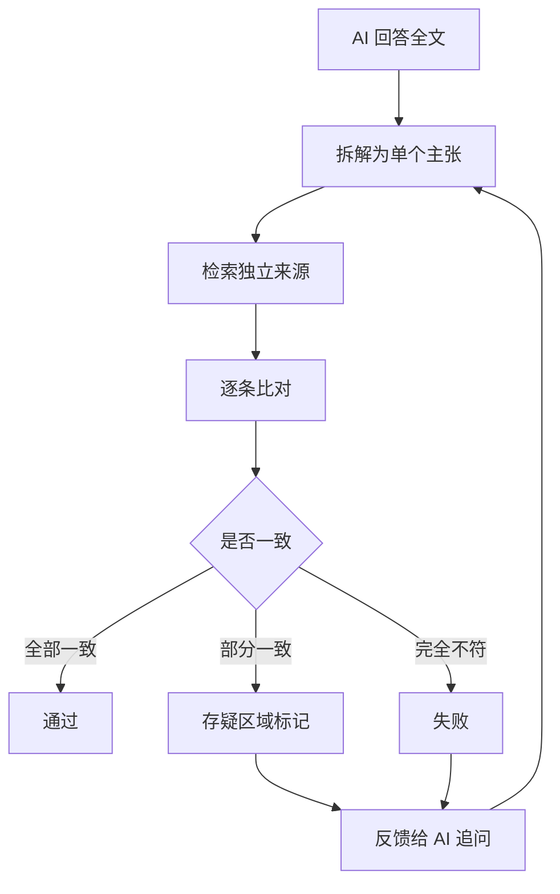

# 第二十二章 AI 审慎篇：如何正确思考和评估 AI 工具

## 学习目标

- 理解为什么需要系统化流程核查 AI 事实性回答
- 掌握 Fact-Check 链条的完整步骤与操作逻辑
- 区分 AI 回答的风格变化与能力退化
- 识别模型自我认知与用户基准之间的差异
- 能针对事实型问题设计简易验证路径

## 22.1 生活类比

想象你收到一封陌生人写来的信，字迹工整、措辞得体、语气笃定。你读完之后觉得"这封信说得很有道理"，于是照做，结果发现信息完全错误。为什么会这样？因为一封写得很有道理的信，并不等于它写的是事实。AI 的回答也是如此——它生成的内容在语法上无懈可击、在逻辑上自洽、在语气上自信，但这不意味着每一个字都有事实依据。我们需要的不是"这封情书打动了我"，而是"这些内容经得起核实"。这正是本章引入核查流程的直觉起点：当一个信息源变得足够流畅时，我们更需要一套外部验证机制，而不是继续加重对表达形式的信任。

## 22.2 概念地图

```
AI 审慎篇：如何正确思考和评估 AI 工具
├── 核心问题：AI 变差了吗
├── Fact-Check 链条：给 AI 回答装上验钞机
├── 风格变化论：风格变化≠智力退化
└── 基准差异论：用户心里的及格线各不相同
```

## 22.3 Fact-Check 链条：给 AI 回答装上验钞机

> "用 Fact-Check 链条识别 AI 的回答是否靠谱。"
> 
> ——《P001, p.3》

你有没有过这种经历：向 AI 提问一个专业问题，它给出的回答读起来头头是道，数据、年份、人物名字齐全，你几乎已经打算相信它了。然后你随手搜了一下，发现其中一条关键信息是错的。此时你的第一反应不是"我该更小心"，而是"这么流畅的回答怎么可能是错的？"

这个反应本身恰恰是需要被修正的。AI 生成内容的流畅性和它的正确性之间，并没有正相关关系。一个回答越流畅、越自信、越言之凿凿，我们反而越应该启动核查流程。事实核查的起点，就是你不再把"读起来对"当作"确实对"。

### 核心定义

> Fact-Check 链条定义（来源：《P001, p.3-4》）

Fact-Check 链条是一组逐层递进的验证步骤，用于判断 AI 回答中的事实性主张是否可被外部证据支持。它不是一个单一动作，而是一串有序的操作：

```
步骤 1：拆解 —— 把 AI 的回答拆成可以被检验的小主张
步骤 2：溯源 —— 对每个主张找到它可能依赖的知识来源
步骤 3：核对 —— 用独立的第三方来源（教科书、论文、官方文档）交叉验证
步骤 4：判定 —— 根据核对结果给出"通过/存疑/失败"的结论
步骤 5：反馈 —— 将结论反馈回 AI 对话，形成修正闭环
```

这段链条揭示了核查的本质：AI 的回答是一个"黑盒输出"，我们无法直接观察它的推理过程，所以只能通过**输出⁠→⁠主张⁠→⁠来源⁠→⁠验证**的路径来间接判断可靠性。其中拆解是最关键的一步——把一个长回答切成小块，你才能精准地定位哪句话有问题，而不是笼统地评判"整体可不可信"。

我们可以把这一流程形象化为一张数据流图：



这张图展示了 Fact-Check 链条的关键特征：它是一个**可循环**的流程。当发现存疑或失败时，你把问题反馈给 AI，让它重新回答，再对新回答重复整套验证。每一次循环都是一次"验钞"，直到回答中的所有主张都通过核对。

这里有一个容易忽略的细节：链条的每一步都要求我们"主动怀疑"。拆解时你要问：这句话是一个事实主张，还是一个修辞？溯源时你要问：这个数字可能出自哪份报告？核对时你要问：我搜到的是否足够权威？这种主动怀疑的态度，恰恰是我们面对流畅文本时最容易被抑制的认知行为。因此 Fact-Check 链条不只是一个流程，它更是一种认知姿态的矫正。

## 22.4 风格变化论：风格变≠变笨

> "ChatGPT 的回答风格变了而非变笨。"
> 
> ——《P001, p.5》

"你有没有觉得 ChatGPT 最近变笨了？"这类吐槽经常出现在论坛和社交媒体上。用户的感觉往往来自几个信号：回答变短了、语气更克制了、不再像以前那样洋洋洒洒输出大段内容，或者偶尔直接说"我无法回答这个问题"。这些变化在观感上很像"退化"，但我们需要追问一句：**这些变化到底属于哪个维度？**

### 核心定义

> 风格变化论定义（来源：《P001, p.5-6》）

风格变化论主张将 AI 的表现区分为两个正交维度：**风格**（语气、篇幅、措辞、结构组织）和**能力**（知识覆盖、推理精度、问题理解深度）。当观察到的变化属于风格维度时，不能据此推断能力维度发生了退化。

| 观察层面 | 属于风格 | 属于能力 |
|---------|---------|---------|
| 回答变短 | ✅ 风格 | ❌ |
| 语气更直接/更克制 | ✅ 风格 | ❌ |
| 多使用列表结构 | ✅ 风格 | ❌ |
| 事实性知识错误 | ❌ | ✅ |
| 逻辑推理断裂 | ❌ | ✅ |
| 对复杂问题理解失败 | ❌ | ✅ |

那么，什么情况下"变笨"的判断是合理的？只有当错误出现在能力维度——例如 AI 把 3+5 算成 7、在两个前提明显矛盾时仍给出错误结论、或者对常识性事实给出错误陈述——你才可以合理地谈论能力退步。但如果仅仅是"回答变短了""措辞更保守了"，这些更可能是产品策略调整、对齐训练强化、或者提示词模板更新导致的风格偏移。

这里有一个深层的原因值得注意：风格与能力的解耦并不是 AI 特有的现象。一个经验丰富的老师，有时写长篇大论，有时只写三行批注，你不能因为那个星期作业上的评语变短了，就断定这位老师头脑退化了。表达形式可以随语境调节，而认知能力是相对稳定的底层属性。我们在评估 AI 时，需要警惕这种"形式误读"的倾向——把表面的风格漂移当成了内在的能力衰减。

风格变化论的实用价值在于：它给了我们一个诊断框架。当你觉得 AI"变笨了"时，先别急着下结论。拿出过去和现在的回答做对比，然后把变化逐条归类到风格或能力两个维度中。如果全部落在风格维度，你的结论应该改为"AI 的风格变了"；只有当问题落在能力维度时，才进入 Fact-Check 链条做进一步验证。

## 22.5 基准差异论：及格线在谁手里

> "模型自我认知与用户基准的差异。"
> 
> ——《P001, p.7》

设想这样一个场景：你和朋友讨论某个 AI 工具。你说"它最近变强了"，对方却说"我觉得它越来越差了"。两个人面对的是同一个模型、同样的输入、相似的任务，结论却完全相反。这是怎么回事？—— 答案可能并不在模型身上，而在你们各自的**衡量基准**里。

### 核心定义

> 基准差异论定义（来源：《P001, p.7-8》）

基准差异论指出：任何对 AI 表现的评估，都同时涉及**模型内部状态**（模型实际的能力水平）和**用户外部参照系**（用户心中默认的评价标准）。这两者之间的偏差，是许多评估分歧的根源。

```
评估结果 = f(模型实际表现, 用户预期基准, 任务类型)

当 模型实际表现 ≥ 用户预期基准 → "变强了"
当 模型实际表现 < 用户预期基准 → "变弱了"
```

这个公式展示了评估的"双重参照系"本质：模型的表现本身是一个客观事实（虽然难以直接观测），但用户给出的评价却永远是通过自己心中的及格线过滤后的结果。同一个 85 分，给一个预期 60 分的人看，他会说"太好了"；给一个预期 95 分的人看，他会说"不行"。所以当两个人对同一模型给出相反评价时，最可能的解释不是模型性能发生了剧烈波动，而是两位用户的基准高度不同。

基准差异的背后往往藏着任务期待的不对称。一位用户拿 AI 做文学润色，一位用户拿 AI 做医学咨询，前者觉得"变好了"而后者觉得"变差了"是完全合理的——因为医学场景对精度的要求远高于文学场景，同样的出错率在不同任务中体验完全不同。这意味着当你看到"AI 变差/变好"的讨论时，应该先问一句：**评价者用的是什么任务？他的标准是什么？和我的一致吗？**

基准差异论与风格变化论之间有直接的方法论关联：风格变化论教你区分"变的是什么"，基准差异论教你理解"为什么两个人看到不同的变"。两者结合，就形成了一个完整的评估框架——先确定变化属于风格还是能力，再确认你的评分基准是否与观察者的基准一致。这样"AI 变差了吗"就不再是一个笼统的抱怨，而是一个可以被拆解验证的命题。

这个框架也意味着，最简单实用的操作路径是：**固定标准，再比较。** 给自己设定一组具体的任务和评分细则，在不同时间点用相同任务测试 AI，记录可量化的结果。这样你就在一定程度上绕开了基准漂移的干扰，形成自己可靠的纵向比较基线。

## 22.6 多源对照：三种判断如何串联

唯一素材源：`260824《AI 变差了吗？用 Fact-Check 来回答》`。本节为单一素材的三种理论主张，三者并非独立概念，而是同一问题下的**分层响应机制**。

### 共识

三者共享同一判断前提：对 AI 的评估必须"拆开来谈"，而不是笼统地说"变好/变差"。

- Fact-Check 链条负责回答**事实性主张是否成立**；
- 风格变化论负责回答**观察到的差异属于哪个维度**；
- 基准差异论负责回答**为什么不同人结论不同**。

它们共同构成了一条完整的判断链：先归类（风格/能力），再核查（链条），最后解释分歧（基准）。

### 分歧

在同一素材内部，三个概念的服务对象不同，分工不重叠，也不构成竞争关系。

- [P001, p.3-4] Fact-Check 链条的适用范围是**可验证的事实型主张**。对于观点、品味、预测类内容，链条的作用有限；
- [P001, p.5-6] 风格变化论只处理**形式变化与能力变化之间的混淆**，不涉及事实层面的检验；
- [P001, p.7-8] 基准差异论描述的是**评价者之间的参照系错位**，它既不能判定事实，也不能区分风格，只解释分歧的来源。

三者放在一起时产生了一个重要提醒：如果你在评估 AI 时忽略了风格/能力区分，下一步的 Fact-Check 也就失去了靶子；如果你忽略了基准差异，那么即便 Fact-Check 通过了，你依然可能因为预期过高而给出"变差了"的结论。所以完整的"AI 审慎评估"路径是：**先用风格变化论归类，再用基准差异论对齐参照系，最后用 Fact-Check 链条验证事实。**

## 22.7 设计中的取舍

**为什么不能直接排除"AI 变笨"的可能性，而要把这个命题拆成三个概念？**

直接回答"变笨了"或"没变笨"都会带来信息损失。宣称"没变笨"时，你忽略了风格变化对用户体感的真实影响；宣称"变笨了"时，你又可能把风格漂移误判成能力衰减，从而错误地归因于模型本身。拆成三个概念后，每个判断都对应一个具体的可操作步骤，而不是停留在印象层面。

**这种拆解的代价是什么？**

代价是评估过程变长：你需要先归类，再核对基准，再逐条验证事实。这个过程比"凭感觉"慢得多。但它的收益是判断可重复、可沟通——你可以把结论展示给另一个人，告诉他"我核对了哪三个来源，结论是通过/失败"，而不是只说"我觉得它变差了"。在需要严肃使用 AI 的场景（学术引用、医学建议、法律咨询）中，这个代价是值得支付的。

## 22.8 动手练习

- 从一个事实型问题出发（如"某城市的人口是多少"），向 AI 提问，然后完整执行一次 Fact-Check 链条的五个步骤，写出每一步操作。
- 收集同一 AI 在不同时间点的两次回答，比较两者在篇幅、语气、结构上的差异，判断这些差异属于风格还是能力。
- 请两位同学使用不同的预期标准（如一位要求"必须准确到小数点后两位"，一位只要求"大致正确"）评价同一 AI 回答，记录结论差异。
- 针对一个具体事实声称，同时使用搜索引擎、教科书索引、官方统计网站三个来源进行交叉验证，记录各来源的结论与差异。
- 设计一张你自己的基准记录表，其中包含五个任务类型，并在每次使用 AI 后填入可量化的评分，持续一周后纵向比较。

## 22.9 本章小结

这一章里，我们建立了一套审慎评估 AI 工具的方法框架。首先我们讨论了为什么需要引入核查流程：AI 的流畅表达本身就是误导性的，它的可信度与正确性并不挂钩；其次我们详细拆解了 Fact-Check 链条的五个步骤，强调从拆解主张到交叉验证再到反馈闭环的完整过程；接着我们区分了风格变化与能力退化这两条正交维度，避免把表达形式的漂移误判为智力的衰减；随后我们引入了基准差异论，解释为什么两个人对同一模型可能给出完全相反的评价；最后我们把三个概念串联成一条完整的评估路径——先归类，再对齐基准，再逐条核查事实。这套框架的核心精神是：对 AI 的任何判断都应该是可验证、可沟通、可重复的，而不是停留在"我觉得它变差了"的模糊感知层面。

本章我们一起学习了以下概念：

| 概念 | 解释 |
|------|------|
| AI 幻觉/流畅性误导 | AI 生成内容看似可信但可能出错，是引入核查流程的直接原因 |
| Fact-Check 链条 | 从 AI 回答出发通过回溯、核对、交叉验证形成闭环判断回答是否靠谱 |
| 风格变化论 | 回答风格变化≠底层智力或知识退化，需分开评估 |
| 基准差异论 | 模型内部自我认知与用户外部期待标准存在偏差导致评判不一致 |

下一章中，我们将进入 AI 审慎篇的下一部分，继续学习如何在具体场景中运用这套评估框架。你将看到当 AI 被用于摘要提取、事实性问答、以及低容错率的严肃任务时，这套"先归类、再对齐、后验证"的方法论如何落地运转。
