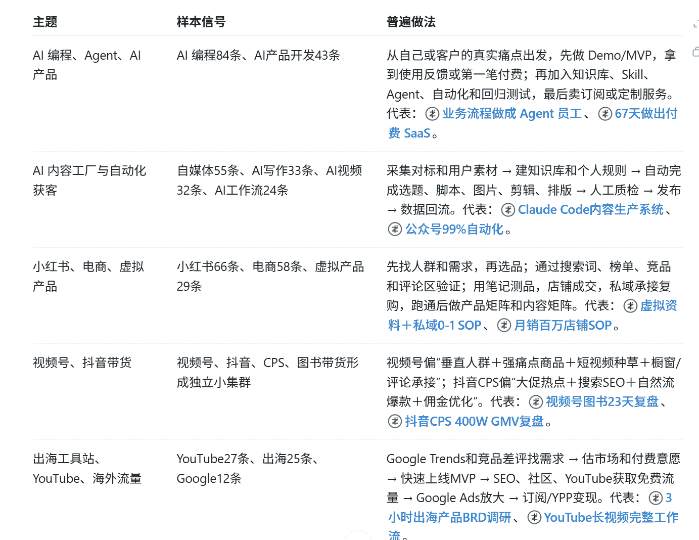
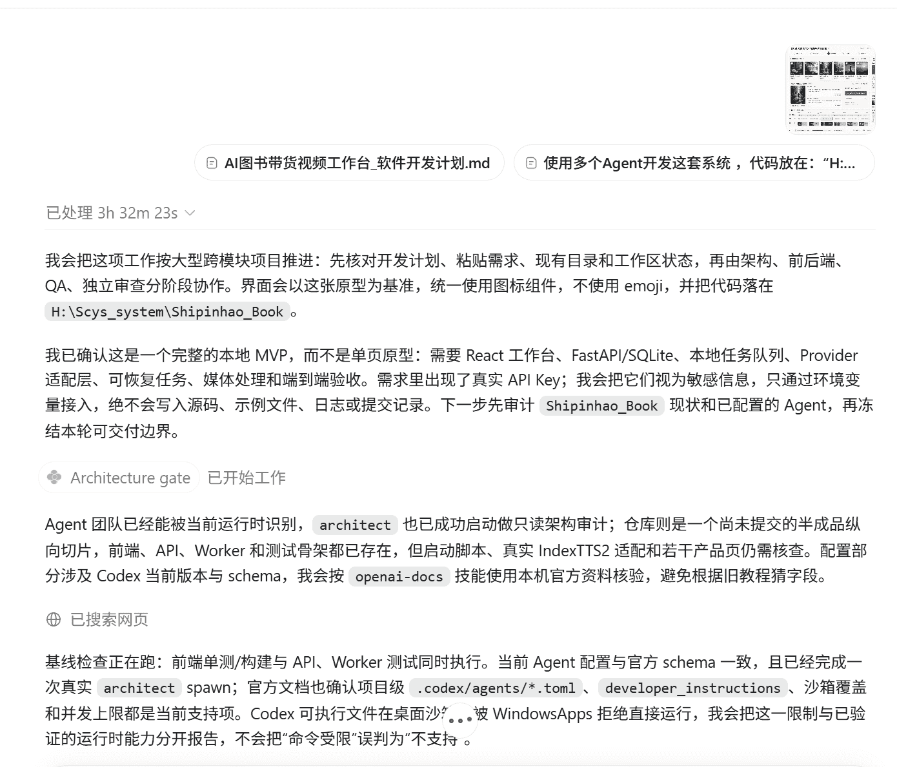
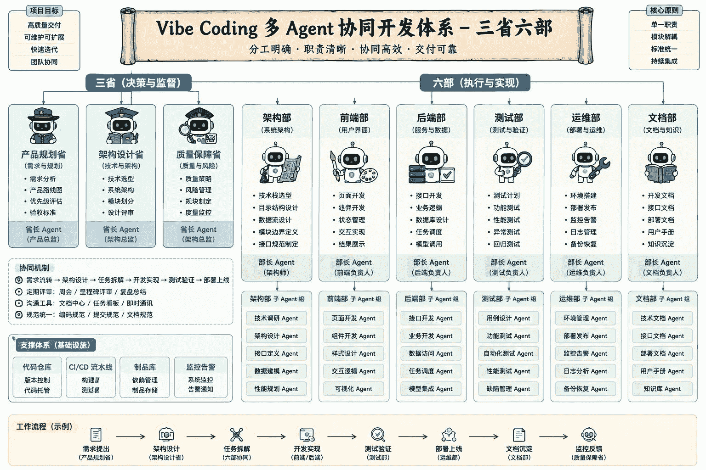

## 从赚钱精华帖到可上线系统：我用 MCP 与 Codex 跑通项目拆解闭环

260827 副业 SC 精华

整理：公众号懒人搜索，懒人专属群精选

懒人微信：lazyhelper1

## 写在前面

大家好，我是 Jason，龙哥盟传术师，目前在读人工智能博士，也是龙哥盟 AI Agent 航海教练。

本科读的是软件工程，初中起就用易语言入门编程，到今天从事软件开发已近十一年。博士阶段的研究方向集中在多模态与计算机视觉，同时保持对大模型、RAG、线性注意力、AI Agent 等课题的学习与实践。

特别感谢小武老师对稿件的修改建议，也感谢鑫鑫提供的 API 支持。近几年我越来越清晰地看到：技术本身并不是最难的部分，真正稀缺的能力是——从海量信息中挑出值得做的方向，并把一个模糊的业务设想拆解成 AI 可读、程序可执行的系统需求。

本文记录一次从信息到产品的端到端复盘：

- 用赚钱 MCP 进行赛道探测；
- 从精华帖与航海手册里提炼可复用的工作流；
- 将工作流转译为开发规格；
- 配合 Hermes、Codex 及多角色 Agent 完成站点开发；
- 上线部署及踩坑自救。

这不是工具罗列，而是一条可复制的信息到产品路径。若你正尝试 AI 编程，或想把赚钱经验固化成工具系统，希望能为你避开一些弯路。

## 一、起点：内测触发的思路链

一切始于我参与赚钱 MCP 内测。

先在 Hermes 上搭建了一套每日帖子巡检机制，让智能体自动抓取、整理社区新内容。实际使用一段时间后，最直观的感受是信息获取效率发生了质变。

过去浏览社区主要靠主动检索、收藏、人工归纳，信息量上来后容易出现三类困境：

- 看了很多内容，却辨不清哪些方向正在持续升温；
- 收藏了大量案例，却没有沉淀成可落地的项目清单；
- 学到了不少方法，最终仍停留在“我知道了”的层面。

接入 MCP 后，帖子不再只是阅读材料，而是可统计、可检索、可结构化处理的数据资产。

随后看到七天在赚钱好事中分享的“家属赚钱案例”，脑中立刻连成一条路线：是否可以先让 MCP 梳理近一年、半年、三个月的热门赛道分布，结合个人情况筛选项目、拆解流程，最后由 Codex 将流程转化为网站？

思路明确后路径清晰：

MCP 统计赛道方向  
→ 结合自身资源筛选  
→ 读取精华帖与航海手册  
→ 提炼可复用流程  
→ 生成产品与开发规格  
→ Codex 与多 Agent 联合开发  
→ 部署上线  
→ 回到真实业务验证

附上调研信号：

| 主题 | 样本信号 | 普遍做法 |

|---|---|---|

| AI 编程、Agent、AI 产品 | AI 编程 84 条、AI 产品开发 43 条 | 从自己或客户的真实痛点出发，先做 Demo/MVP，拿到使用反馈或第一笔付费；再加入知识库、Skill、Agent、自动化和回归测试，最后卖订阅或定制服务。代表：业务流程做成 Agent 员工、67 天做出付费 SaaS。 |

| AI 内容工厂与自动化获客 | 自媒体 55 条、AI 写作 33 条、AI 视频 32 条、AI 工作流 24 条 | 采集对标和用户素材 → 建知识库和个人规则 → 自动完成选题、脚本、图片、剪辑、排版 → 人工质检 → 发布 → 数据回流。代表：Claude Code 内容生产系统、公众号 99% 自动化。 |

| 小红书、电商、虚拟产品 | 小红书 66 条、电商 58 条、虚拟产品 29 条 | 先找人群和需求，再选品；通过搜索词、榜单、竞品和评论区验证；用笔记测品，店铺成交，私域承接复购，跑通后做产品矩阵和内容矩阵。代表：虚拟资料＋私域 0-1 SOP、月销百万店铺 SOP。 |

| 视频号、抖音带货 | 视频号、抖音、CPS、图书带货形成独立小集群 | 视频号偏“垂直人群＋强痛点商品＋短视频种草＋橱窗/评论承接”；抖音 CPS 偏“大促热点＋搜索 SEO＋自然流爆款＋佣金优化”。代表：视频号图书 23 天复盘、抖音 CPS 400W GMV 复盘。 |

| 出海工具站、YouTube、海外流量 | YouTube 27 条、出海 25 条、Google 12 条 | Google Trends 和竞品差评找需求 → 估市场和付费意愿 → 快速上线 MVP → SEO、社区、YouTube 获取免费流量 → Google Ads 放大 → 订阅/YPP 变现。代表：3 小时出海产品 BRD 调研、YouTube 长视频完整工作流。 |

| AI 企业服务、FDE、一人公司 | 至少 22 篇标题直接涉及 FDE/企业 AI，15 篇直接写一人公司 | 深入真实现场 → 摊开业务流程 → 找高频耗时的小痛点 → 做窄而深的付费试点 → 部署进客户工作流 → 验证是否持续使用 → 沉淀成垂直产品。代表：10+ 家付费内测的 FDE 七步法、一人公司做 AI 企业服务。 |

| 实际业务 | 卖什么、赚什么钱 | 具体怎么做 |

|---|---|---|

| 小红书虚拟资料 | PPT、课件、模板、知识库、行业资料；赚商品利润和私域复购 | 找细分人群需求 → 做原创资料 → 店铺上架 → 笔记测款 → 低价成交 → 私域承接 → 推产品矩阵。4 个月成交 3500 单案例 |

| 小红书实体电商 | 垂直品类商品；赚进销差价 | 找月销店铺和低粉爆款 → 选品 → 多笔记测品 → 放大高转化单品 → SOP 化运营 → 多店复制。月销百万店铺案例 |

| 视频号图书带货 | 健康、历史、教育等图书；赚 CPS 佣金 | 选受众明确的书 → 找爆款选题 → 真人或 AI 生成视频 → 挂橱窗 → 评论区引导 → 根据播放和成交不断改素材。23 天佣金复盘 |

| 抖音自然流 CPS | 大促商品、平台活动商品；赚成交佣金 | 找高热度商品和活动 → 做攻略/推荐视频 → 布局搜索关键词 → 吃自然流量 → 先跑通 GMV，再提高佣金率和流量精准度。400W GMV 复盘 |

| YouTube 内容生意 | AI 长视频、Shorts、故事、科普；赚广告分成、会员和赞赏 | 选可长期更新的赛道 → 找低粉爆款 → 拆脚本结构 → AI 生成配音和画面 → 稳定更新 → 过 YPP → 多账号放大。长视频案例 |

| 海外工具站／SaaS | 图片、视频、文本等垂直在线工具；赚订阅费 | Google Trends、Reddit 和竞品差评找需求 → 做 MVP → SEO 和社区获客 → 首批付费验证 → Google Ads 扩量 → 优化续费和 LTV。出海产品调研方法 |

| 国内 AI 软件／小程序 | 为某个细分场景解决问题的小程序、桌面软件；赚订阅、广告或定制费 | 从自身业务痛点做工具 → 先自用 → 用小红书等渠道验证 → 获得第一批付费 → 再开发正式版本。67 天 SaaS 案例 |

| AI 企业服务／FDE | 给企业搭 AI 员工、内容系统、销售系统和知识库；赚咨询费、项目费、年费 | 进入一个行业 → 盘业务流程 → 找高频重复工作 → 做小型付费试点 → 部署到实际工作 → 培训使用 → 产品化续费。FDE 付费内测案例 |

| 本地实体 AI 获客服务 | 给美容院、教培、健身房、餐饮等做内容获客或管理工具 | 用评论、聊天和销售录音找痛点 → 做内容 Skill、小程序或工作台 → 先收低价内测费 → 用效果案例签正式年费。已有案例采用“500 元内测、9800 元年费”的路径。实体老板 AI 变现案例 |

| AI 内容代运营／自动化交付 | 为公众号、小红书、短视频客户建设内容生产线 | 采集选题和对标 → 知识库沉淀客户资料 → 自动写作、配图、剪辑和排版 → 人工审核 → 按项目或月度收费。企业内容 AI 员工案例 |

那一刻我确认 MCP 的价值远不止监控。

它可以扮演：

- 赛道探测器；
- 社区需求分析器；
- 流程提炼器；
- 产品灵感库；
- AI 编程的业务输入层。

还有一个思路，用 MCP 蒸馏任意大 V，后续展开。多数人第一步就是让 Codex“给我做个网站”，但做哪类网站、解决谁的痛点、背后跑什么流程想不清，代码再快也会空转。

我这次想验证的路径是：先从真实业务内容里提炼流程，再让 AI 把流程做成系统。

## 二、为何这条路径可跑通

先说背景。我是 AI 方向的在读博士，软件科班出身，从易语言起步到现在已产品化十一年，也是赚钱 AI Agent 航海教练，我更关注的是如何把 Agent 嵌入具体业务，完成可重复的流程。

需要强调，这条路不要求你一定是资深程序员。

当下 Codex 已能承接大量前端、后端、数据、测试、部署工作。过去必须手写的代码，现在用自然语言即可生成，差异更多在时间和 Token 成本。

真正的门槛已转移到问题定义：

- 能否看懂项目如何赚钱、如何交付；
- 能否把业务拆成清晰步骤；
- 能否为每一步明确输入、处理逻辑、输出；
- 能否判断 AI 生成结果是否符合业务预期。

简单说：AI 编程降低了写代码门槛，却抬高了定义问题的价值。

我能跑通，一方面靠编程经验，另一方面靠科研与工程拆解的习惯。科研要从论文提炼问题、假设、实验路径；做产品要从案例提炼需求、流程、验证方法，思维内核相通。

## 三、核心链路：从帖子到网站

熟悉 MCP 与 AI 编程的读者可直接看流程。

### 第 1 步：用 MCP 做方向统计，找增量蓝海

先让赚钱 MCP 统计近一年、半年、三个月内，精华帖和赚钱好事的项目类型与数量分布。

要看三重视角：

- 哪些赛道长期有案例沉淀；
- 哪些赛道近三个月明显增长；
- 哪些赛道拥有持续更新的流程与航海资料。

注意：帖子多不等于适合做。

数量只是市场信号，不能直接替你做决策。

### 第 2 步：结合身份与资源筛选方向

我会把统计结果交给 Hermes，结合自身情况打分。筛选维度包括：

- 是否契合 AI 技术背景；
- 是否能复用现有 Hermes 与 Agent 能力；
- 是否有真实业务场景可落地；
- 是否能低成本验证；
- 是否能沉淀为工具、Skill 或流程；
- 是否贴近成交与交付。

我不会盲追帖子最多的方向，而是优先选资源有优势、能快速形成闭环的赛道。

最终我锁定了“AI 赋能本地生活流量”，同时为父母开发了一个视频号图书带货平台。

这和我正在探索的 AI 赋能本地商家、内容矩阵、获客工作流完全契合，也适合用系统承载。

### 第 3 步：搭建项目的信息地图

方向确定后，让 Codex 或 Hermes 列出相关资料清单：

- 方向相关的精华帖；
- 赚钱好事案例；
- 航海手册；
- 实操复盘；
- 涉及的平台、工具与资源。

此步不是直接总结，而是先建一张“信息地图”。一篇帖子往往只覆盖业务的一环，获客、交付、工具、变现、结果各有侧重。只有把资料拼在一起，才能还原完整链路。

### 第 4 步：从内容提炼 SOP

让 Agent 读取核心内容，提炼出：

- 目标用户是谁；
- 用户痛点是什么；
- 输入从何而来；
- 中间有哪些操作步骤；
- 每步需要哪些工具；
- 哪些环节需人工判断；
- 最终交付物是什么；
- 哪些环节可自动化；
- 哪些环节必须保留人工审核；
- 收费与复购如何形成。

我习惯让 Agent 按以下结构输出：

流程节点 → 输入 → 操作 → 判断条件 → 输出 → 所需资源 → 可否自动化 → 风险点

到这一步，经验帖才从“内容”变成“可执行流程”。

### 第 5 步：把 SOP 翻译成开发文档

SOP 写给人看，开发文档写给 Codex 和开发 Agent 看，两者不能通用。

比如 SOP 写“收集本地商家信息，分析账号问题，生成内容方案”，AI 需将其拆成模块、接口和状态。我的原则是：

一个业务节点，对应一个系统模块；一个系统模块，必须有明确的输入、处理逻辑和输出。

### 第 6 步：多角色分组开发

开发时我会分角色协作，期间也踩坑，后面会讲：

- 架构角色：技术栈、目录结构、数据流、模块边界；
- 前端角色：页面、表单、交互、结果展示；
- 后端角色：接口、数据库、任务流、模型调用；
- 测试角色：功能测试、异常流程、边界情况；
- 文档角色：部署说明、环境变量、使用手册。

前提是：所有角色必须基于同一份开发文档工作。前端理解 A、后端实现 B、测试拿到 C，角色越多项目死得越快。

### 第 7 步：生成部署文档并上线

开发完成后，让 Codex 依据项目实际情况生成部署文档，遇到问题实时沟通。例如服务器 5000 端口被占用，就让它调整端口。最后在宝塔面板手动完成部署与检查。

我不会让 Agent 完全接管线上服务器。域名、数据库、密钥、正式环境等环节，人工确认更稳妥。

## 四、实战案例：以《AI 同城流量超级术》为素材的 Vibe Coding 开发

参考资料：《AI 同城流量超级术》

本案例并非一次性把整套同城流量业务自动化，而是先抽取其中最标准化、最适合 AI 执行的“参考内容拆解—创意改造—视频生成—人工审核—成片交付”链路，产品化为可恢复、可审核、可更换 AI 服务商的视频生产工作台。

### 4.1 选择这篇精华帖的理由

第一，离真实业务很近。帖子讨论的不是抽象 AI 概念，而是如何用 AI 提升本地生活内容生产效率，最终服务同城获客，有明确场景和价值终点。

第二，具备强流程特征。多数环节可拆成输入、处理动作、判断条件、输出，只要流程能被稳定描述，就能被软件化；节点边界清晰，Codex 即可把自然语言经验转化为模块、接口和状态。

第三，适合验证“从方法论到可运行系统”的路径。过去精华帖停留在收藏、总结、照抄，这次要让流程变成每天可重复使用的生产工具。

第四，这篇帖子是我加入赚钱时最想落地的之一。

### 4.2 用 MCP 拆解精华帖：先找流程，后写代码

第一步不是直接让 Codex 生成页面，而是通过 MCP 读取精华帖，要求 AI 统一格式提炼全文：

- 核心流程节点；
- 各节点所需输入；
- 执行动作；
- 需人工判断的点；
- 各步输出；
- 依赖的模型、素材、平台或外部资源；
- 可自动化的步骤与必须人工审核的步骤。

拆解后，我没有把“选城、选品、内容生产、账号发布、投放、线索承接、成交复购”全部塞进首版。完整链路诱人但不确定性高。最终优先做边界清晰、重复率高 的内容生产段：

这一步最重要的产出不是代码，而是一张“业务动作—系统动作”映射表。它让我明确，当前系统解决的是同城流量业务中的内容供给问题，而非替代完整经营系统。

### 4.3 从流程到开发文档：把经验翻译成系统需求

为让 Codex 真正理解需求，我不用“帮我做个 AI 视频工具”这种模糊指令，而是把每个流程节点改写成独立模块，并定义输入、处理逻辑、判断条件和输出。

| SOP 节点 | 系统模块 | 输入 | 处理逻辑与判断条件 | 输出 |

|---|---|---|---|---|

| 素材建档 | 项目创建 | 项目名称、参考视频、人物或商品参考图、替换模式、素材授权确认 | 校验替换模式、必需素材与版权确认，保存文件并探测视频信息 | 项目 ID、素材目录、视频元信息 |

| 拆解参考内容 | 视频分析与拆镜 | 参考视频 | 识别场景切换，切分镜头，抽取首帧、中间帧和尾帧 | 镜头列表、镜头片段、参考关键帧 |

| 筛选可复用片段 | 镜头选择 | 镜头列表、人工选择结果 | 选中的镜头进入 AI 流程；未选镜头直接复用原片；支持合并与切分 | 最终镜头结构、待处理镜头清单 |

| 创意改造 | Prompt Engine | 项目模式、镜头时长、参考素材、用户补充要求 | 组合人物/商品替换规则、真实感规则、安全规则和用户指令 | 图片 Prompt、视频 Prompt、规则告警 |

“把一段视频的主角换成指定的人”——这话对人不难理解，但对程序来说，几乎是一道道未定义的公式。谁是主角？参考图从哪来？哪些段落要重做？什么时候允许调用付费接口？失败怎么续？成片存到哪里？这些问题不确定，机器就无法开工。

我这次做的，就是把这样一句含糊的需求，变成一条看得见、能验收、中断后还能接着跑的作业流。

大致流程是：先传上参考影片和人物素材，系统自行把影片切成若干小段；人工勾选出要重做的段落；接着为每个段落生成新的开头和结尾画面，并经人逐张确认通过；随后交给视频模型做成动态效果；产出后把片段长度拉回原始时长，尽量保留原片的节奏；最后把新片段和未改动的旧片段按顺序拼好，混入音轨，输出成片。每一步的进度都有记录，中途崩了也能从上次的位置继续。

开发上我采用了“骨架先行、血肉后填”的策略。系统被切成四层：入口层只管接收网页和接口请求、做参数校验、返回结果、触发后台作业；调度层负责协调分镜、画面生成、视频合成、节奏匹配和导出；能力层把FFmpeg、图像处理、视频模型、云存储都封装成可替换的插件；进度管理层用项目清单和场景标记来推进程，并借助加锁写入和备份做到能找回进度。

图片和视频能力最开始统一用仿真模式来跑通流程，联调阶段才切换到真实服务，比如ComfyUI或MiniMax。这样做不仅避免了业务逻辑与某家平台绑死，也防止测试期间不小心触发付费请求。

骨架立起来之后，我发现真正让编码工具稳定输出的，不是反复喊“代码要简洁”，而是把每个模块的职责边界划清楚。比如：入口层不接触视频文件；调度层不拼接请求参数；能力层不做业务判断；场景清单是唯一的权威数据源；只有通过人工确认的画面才能进入下一步；未选中的场景一律沿用原片，不调用模型；已有有效结果的任务绝不重复提交，避免二次消费；所有耗时操作都要提供可查询的进度接口，而不是让页面无限等待。边界明确后，生成的代码质量明显提升，重复逻辑也更容易被识别和合并。

具体实现时，我让三个开发角色分工协作。注意，这些是开发阶段的协作角色，并非上线后的常驻程序。负责前端的那个角色主要处理项目创建、场景挑选、画面预览与确认、进度展示、预览和下载；技术栈是Jinja2模板配上原生JavaScript和CSS，没有额外构建工具，迭代很快。负责后端的角色掌管API路由、媒体处理链路、提示词引擎、服务商适配、轮询、进度持久化和异常恢复。负责测试的角色则把每个模块的输入输出变成验证用例，覆盖媒体处理、项目清单、提示词、仿真全链路、路由安全和路径安全，并不断回归改动。每个主角色下面还有细分的子角色。前端关心用户操作是否顺畅，后端关心进度流转是否正确，测试关心异常场景是否可控，三者围绕同一套边界协同。

骨架跑通后，再按风险大小逐步替换仿真模块。先接本地FFmpeg、FFprobe、场景识别和画面抽取，把确定性的媒体处理落地；再接图像服务，完成首尾画面替换，并设置人工确认闸门；随后接入AutoDL或MiniMax的视频能力，处理提交、查询、下载、超时和配额异常；最后补充时长匹配、音频处理、时间线拼接和导出。每个阶段都有独立可验证的成果，即使真实模型接口没接通，也能先检查页面、进度和文件流转是否正常。

过程中有三个教训值得说。

第一个教训：为了省预算，我一度把复杂任务交给更便宜的模型。本以为都是写代码，能省则省，结果那个模型理解不了多模块、多步骤的复杂需求，几次改动互相覆盖，最后还得重写。预算倒是省了，时间却赔了不少。后来我按任务难度做了分配：整理、格式转换、基础文档交给低成本模型；单文件小改动交给普通编码模型；跨模块开发和复杂调试交给Codex；最终审查再来一道强模型加人工。所以选模型不能只看单价，还要看成功率和返工成本。

第二个教训：多人协作时，我不小心生成了近百个细分子角色。总控分配任务，子角色再拆任务，再生成新角色，看起来热闹，实际上项目几乎瘫痪。你根本不知道哪个结果是最新的，哪些改动可以合并，出了问题该找谁。最后我砍掉了所有无限拆分的逻辑，重新立下规矩：限制角色数量和层级；子角色不能再创建子角色；每个任务只有一个负责人；禁止多个角色同时改同一个文件；所有任务基于同一份开发文档；每个任务必须有验收标准；由总控角色汇总并跑测试。收敛之后效率反而更高。所以多角色协作的第一原则不是“多”，而是“可控”。

第三个教训：本机被大量并行开发任务拖到卡死。电脑同时跑很多任务，CPU、内存、磁盘瞬间拉满。需要说明的是，如果用的是云端模型驱动的CLI工具，推理一般不占用本地GPU，真正挤占资源的是并发进程、构建、测试、索引、浏览器和本地服务。我的解法是：限制并行数量；不同时启动过多构建和测试；长任务搬到服务器；本机只留轻量开发和最终检查；给开发任务设定资源上限；定期清理失控进程。调整后体验立刻好转。AI编程提升了产出速度，但你的电脑、工作记忆和精力不会自动同步扩容。

验证和发布我也完整走了一遍。开发环境是Python 3.11、FastAPI、Uvicorn、Jinja2加原生JavaScript。截至2026年8月，仓库里的回归报告显示：Python编译检查通过、前端JavaScript语法检查通过、离线验证用例253项全部通过，验证环境强制使用仿真模式，绝不调用真实或付费模型。验证范围不只覆盖正常路径，还包括进度文件、路径安全、任务并发锁、异常恢复、媒体处理这些容易在线上出问题的地方。

生产环境准备方面，容器打包、配置模板、存活检测、永久存储都准备好了。部署有两种方式：标准方式是Caddy先接流量，自动管理HTTPS，再反向代理到FastAPI容器；面板方式则是容器只监听本机端口，域名和证书交给面板软件Nginx处理。发布步骤包括配置校验、镜像构建、容器启动、健康检查路径`/readyz`、登录与小文件上传冒烟、真实模型冒烟、日志检查、数据卷备份和版本回滚。这里也要说清楚：当前仓库只能证明“已经具备可部署的架构和发布清单”，还不能证明系统已经在真实公网长期稳定运行。证书更新、正式云存储、真实模型、用真实浏览器做的全流程验收、负载测试等仍然列在发布前事项中，正式上线前还需要最后一轮生产验收。

最终产出的不是又一个“AI生成视频”的演示，而是一条把人工经验沉淀为标准化产线的系统。对于做本地流量的朋友，它的直接价值是：参考视频不再只是收藏夹里的灵感，而是可以被解剖成场景结构；人物或商品素材不再需要逐段手工替换；每次模型调用都有人工确认点；失败任务也不需要从零开始。更重要的是，系统会反过来推动流程模板变得清晰——哪些参考视频值得入库、哪些场景适合替换、什么样的画面能过审、单次生成成本多少、成片带来了多少真实转化，这些问题都会沉淀为下一轮规则。

这次实践让我有三个体会：

一、不是所有流程都值得立刻系统化。先挑高频、稳定、输入输出明确的环节，更容易做出第一版可用产品。

二、人工把关不是自动化的失败，而是质量闸门。做内容的过程里，对关键画面的确认既能守住品牌风险，也能避免错误结果烧掉更贵的合成费用。

三、直觉式编程的重点不在提示词长短，而在边界清晰。只要模块职责、进度流转、失败条件和验收标准都被讲清楚，编码工具才能从“代码生成器”变成可靠的协作者。

把整件事连起来看，就是一条完整的链路：搜集信息、定方向、研究案例、流程提炼、定义产品、搭建系统、发布验证。MCP帮我发现机会，流程模板帮我理解业务，Codex帮我完成开发，多角色帮我把复杂项目拆开并行。以前很多人卡在“不会写代码”，人工智能正在慢慢填平这个差距。但新的差距也会出现：有人只会生成几个页面，有人能完成一个功能，有人能从真实需求提炼流程再做产品，还有人能让产品回到业务里持续获得反馈。我更想锻炼的是后两种能力。写代码会越来越便宜，才会让需求判断、业务拆解和真实执行变得越来越贵。

这中间没有神秘步骤。从一篇高价值帖子，到一套流程模板，再到一个真正上线的网站，难点不在于任何一个工具，而在于能否把整条链串起来，并坚持执行到底。我验证到的是：MCP能让我看见机会，流程模板能让我理解业务，Codex能让我完成开发，但项目最终能否成立，取决于对真实需求的理解和持续的执行。

最后附上项目地址：视频制作平台 https://video.apimar.online/ ，欢迎试用和提建议。另外两个相关项目：保研问答 https://chat.baoyan.online/ ，短视频转文本工具 https://kb.apimar.online/ 。对SaaS和内容生产平台感兴趣的朋友，也可以直接联系我。

看完这篇复盘，你可能觉得懂了，但八成的人一到实操就会卡在第一步。工具和教程从来不是真正的壁垒，真正的壁垒是“立刻行动”和“信息鸿沟”。如果你想看更多前沿的变现玩法，和一群行动力很强的极客一起拿结果，欢迎加入我的核心圈子。这里只讲赚钱闭环和AI效率提升，已经沉淀了1000多个可落地的项目案例。

👉 查看圈子完整资产与加入门槛：https://lazyso.com/insider/

认同价值、准备好动手的，加我微信（lazyhelper1），备注“想动手”，谢绝闲聊。

