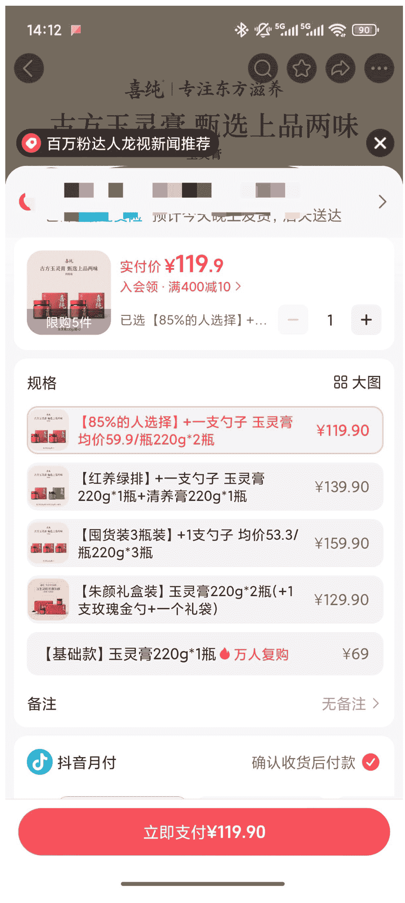
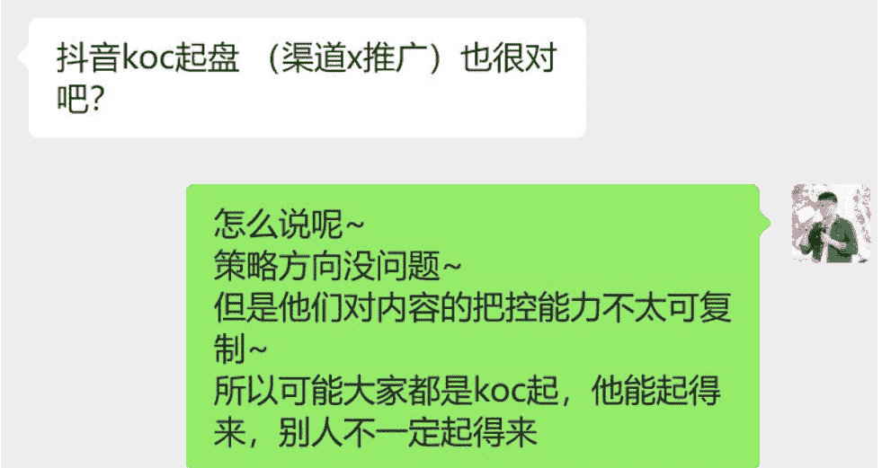
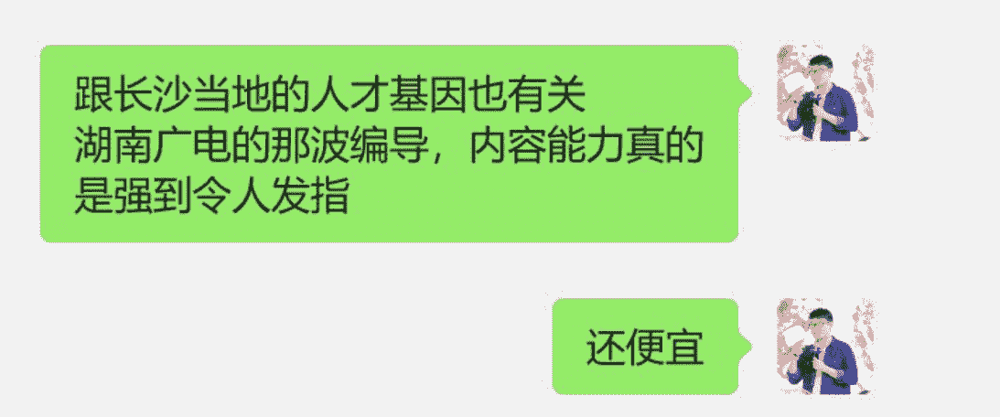
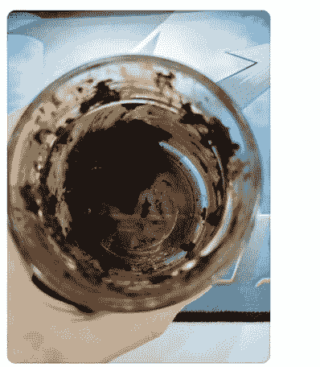
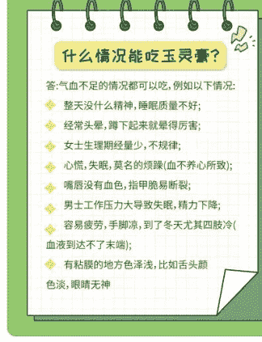
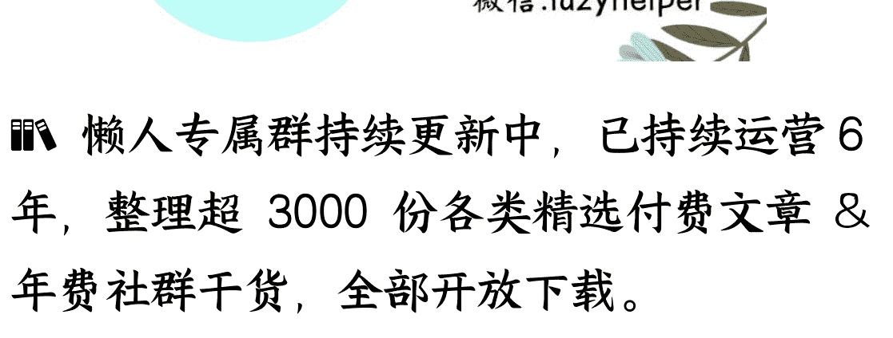

# 一周内 3 位 10 亿级滋补品牌大佬问我：喜纯你怎么看；我：挂逼！！

一周内，三位十亿级滋补品牌老板排队来问我同一个问题：喜纯你怎么看？我：挂逼。

先上两张截图感受一下：

喜纯是这两年窜起来的中式滋补新品牌。几个关键节点放在一起看，冲击感很强：2023年底注册公司，2024年初才进抖音，2024年7月单月销售额破千万，2025年2月直接单月破亿。第三方数据可能有些出入，但大趋势摆在那里。

如果只让我用一句话给结论： 用游戏圈的话讲，这就是开挂。

为什么说开挂？这家公司真正恐怖的，不是砸了多少广告费，而是几乎每一步都走得又快又准。像拿着完整攻略在打关卡，没有一步是废棋。企业最贵的成本，从来不是原料、生产、人力甚至营销预算，而是“走错路”付出的沉没成本。喜纯在我眼里，几乎没交过这部分学费。

查完工商资料更印证了这点。喜纯老板李鹤，出现在曦子科技的股东名单里；曦子科技是西子健康、西子电商的母公司，旗下品牌包括Fiboo、谷本日记、她练、Foyes。做健康食品的对这几个名字应该如雷贯耳。工商信息里还能看到，2024年5月15日，公司登记机关从长沙市雨花产业工商行政管理局变更为湖南省工商行政管理局，同日高管名单里李鹤退出、孔杰进入。

先交代一下，为什么这些大佬会来问我：一是合伙做过体量几亿的食品品牌，完整经历过从0.1到1；二是在平台管过行业、做过策略，参与过流量分配机制设计；三是最早在代运营公司搬过砖，实操细节还有体感；四是我亲手搞砸过两个滋补项目，失败教训也不缺。

下面用产品、价格、渠道、推广四段拆一拆。

## 产品：为什么偏偏是玉灵膏

新品牌最忌讳做标品。标品天生适合比价，一旦陷入比价战，赢家要么是头部品牌，要么是全产业链成本最优的玩家，新牌子根本没有位置。相比之下，保健更像标品，滋补更像非标，所以中式滋补对大健康新品牌更友好。

但纯非标也有坑：没有共识，教育成本高到离谱。总不能把用户拉到养生节目里讲一个小时，或者关进会议室听医疗讲座。好在滋补品类里藏着大量现成心智，比如以形补形、红色补血、黑色养发、白色养胃，以及那些耳熟能详的膏、汤、丸、散名字。在非标行业里找价值共识，用现成认知做开品切口，既绕开比价，又省下教育成本。我推测，玉灵膏就是因为这个逻辑被选中当爆品的。

选完品，接下来是配方工艺问题：创新，还是守古？我的答案很明确：守古。创新是巨头才玩得起的事情。你要是把小众原料换成更科学但还没规模化的，原料价格起伏就能让你一整年白干；你要是升级提取工艺，消费者肉眼看不到，反而要付出更高信任成本、拉长决策周期。新品牌扛不住这种不确定性。所以喜纯的玉灵膏，配方、工艺、剂型完全照清代王孟英《随息居饮食谱》来。膏体可以磨得更细吗？技术上可以，但消费者认知不接受；做成提取液吗？技术上也可以，但同样不被接受。甚至看上去有点“现代感”的西洋参也原样保留——但查完资料会发现完全没问题：西洋参在清代已经入药，1757年成书的《本草从新》就记过药性，清宫医案里也大量出现，王孟英用西洋参配伍龙眼肉，在当时是成熟实践。这些话外行听上去只觉得逻辑通，内行才知道，每一条都可能是真金白银换来的教训。

当然，药食同源、古方古法都有讲究，功效和方源说法又容易碰广告法，这个留到推广部分讲。

## 价格：69元背后的生意账

定价听起来很土，却是定生死的事情。很多渠道负责人沉迷流量打法，反而忽略了一个售价数字和毛利空间的决定性作用。

按1688上西洋参、龙眼肉、玻璃瓶的大致行情，再叠加包装、工艺、人工和大规模采购优势，69元一瓶的玉灵膏，物料成本压到20%以内并不难；扣除仓储、物流、耗材，销售毛利稳在75%以上。这个毛利在滋补行业属于常规水平，不算离谱。对比竞品，老字号雷允上、同仁堂、九芝堂的价格也在相似区间，喜纯69元/200g处于中间位置；但考虑到别人动辄上百年历史，一个2023年才注册的新品牌敢定这个价，其实是偏高的。更值得注意的是，同价位的直氏2024年在抖音卖出了1.9亿，说明这个总价带在内容电商里完全跑得通。

我推测喜纯内部是这么算账的：玉灵膏这个小品类，价值和功效有共识，但价格没有共识。新品牌只要把总价控制住，高一点毛利不影响转化，反而能腾出更多预算投流。内容做的不只是卖货，更是拉新客——拉第一次买玉灵膏的人。这批人对单价比价不敏感，只对总价敏感，我自己的经验是总价尽量不要破一百。

还有个很典型的微操： 单瓶购买和“两瓶立省+买赠”组合，按前面的毛利率粗算，在抖音ROI分别为2、1.75、1.5的时候，摊完管理费用后的人均利润差距非常惊人，甚至可能差出一倍。直播间在组品上更激进，客单价更高。这种细节看起来不起眼，但就是电商运营的本职：不性感，却很本质。

## 渠道：为什么必须从抖音起盘

有人会问，中式滋补在小红书不是更好做吗？答案简单：肉不够吃。百元以内的滋补单品，自营、直播、投流、达人分销全上，月销100万已经算顶尖玩家，想突破200万难如登天。反观抖音，月销200万可能只是刚上道。抖音对新手是雷区，但对老法师就是舒适区，喜纯团队明显属于后者。

那淘系呢？淘系核心是搜索。只要靠搜索，就必须回答一个问题：用户凭什么会搜这个关键词？搜“膏方”太泛，没有功效指向；搜“玉灵膏”不像普通人的日常行为；搜“喜纯”更不可能，新品牌除了运营自己没人会搜。所以起盘只能发生在内容平台，让目标用户从完全没概念，被内容直接带到A3甚至A4。

起盘第一步，重心应该放在哪里？短视频、直播、自营、分销、商城货架，答案大概率只有一个：KOC分销。这跟当年淘宝天猫用淘客起盘是同一套逻辑，纯佣、风险低、试错空间大。其他选项都有硬伤：自播成本高，主播、设备、投放、素材全是开支；有坑位费的KOL，头部看不上新品，中腰部只碰自己垂类，尾部达人你图他便宜，他图你没量也有坑位费；商城货架又回到淘系的老问题，初始曝光从哪来？

这套KOC打法也不只滋补品牌能用，我自己的业务换到抖音，同样可以这么起盘。上两张截图：

## 推广：KOC规模背后的两个半胜负手

很多人算KOC的账，以为找1000个达人，每人出1000块，就有100万。现实完全不是这样：找1000个KOC，至少900多个一单都不出，50多个做到100块以内，10多个做到1000块，两三个能做到10万，最厉害的一个可能一人就干了100万。

所以胜负手总结起来是两个半：内容用来抬概率，数量用来压概率，投放算半个，用来放大好内容、对抗低概率。

先说内容。圈子里最早流传的喜纯达人视频，是“25+女孩夏天要养好自己”那种调性，带经验分享、亲测、好物推荐标签。最近两条跑出来的内容数据更好，但你一翻就知道了，那两个达人其他带货视频的点赞经常不到20，播放量过千都悬。这里面大概率有投流加热，但也是因为内容已经好到算得过账，才敢继续加投。原视频录屏我看过，老板们可以自己感受。

评论区也很有意思。有人评论“脑子想划走，手已经下单”；有人说“本来想断案，结果看了一会儿就买了”；还有人提到自己做了小手术、姐姐买了几罐没吃，准备赶紧开封；也有人问真实测评到底有没有效果。AI医生都在评论区直接科普了一轮玉灵膏补气血、安神助眠。有个叫“周轶城是小猪”的用户说，身边朋友看她吃这个脸色变好了，也跟着开始吃。 作者“唐图图”回复了“哈哈入股不亏”，还专门补了一条“玉灵膏知识在这里哦，大家看情况行动”。提醒一句，别光看段子，要猜猜哪些评论是自己人埋的钩子。

再说数量。喜纯2024年全年铺了多少达人？我没法给精确总数，但按粉丝量分布看：500万以上的头部10个，100万到500万肩部20个，10万到100万腰部227个，1万到10万小达人982个，1万以下尾部1200个。加起来两千多个账号，这个密度才是KOC分销真正的护城河。没有数量，内容概率再高也不够看；没有内容，数量铺出去也只会浪费预算。数量和内容两条腿，再加上投流这根杠杆，才撑起了喜纯在抖音的爆发。

更细的可复制操作，文字实在太长，回头去视频号“李解的理解”蹲直播，我们在直播间慢慢拆。

说到底，喜纯产品选得准、毛利留得足、渠道选得狠、分销铺得厚，四关全过。这种对手，说一句“挂逼”真的不冤。

为什么隔壁自播月销千万，你却卡在百万上不去？

最近看到一份2024年全年的达人投放数据，挺有意思：粉丝量超过500万的头部账号只有10个，100万到500万的肩部账号20个，10万到100万的腰部账号227个，1万到10万的小达人982个，1万以下的尾部账号则有1200个。这个结构其实说明了一个问题——真正能撑起规模的，从来不是塔尖那一小撮人。

先聊投放。说实话，数据不透明，我也不敢乱下结论。但有一个体感很强烈：KOC分销的规模，是有天花板的。像喜纯团队，为了拉低参与门槛，已经把拍摄脚本和素人要求简化到极致了，但能覆盖到的量依然有限。想要再往上突破，就只能上直播——不管是达人直播还是品牌自播。短视频和直播，分属两个完全不同的流量池，如果再叠加付费投放，玩法就更加刺激了。

直播上了，那怎么突破直播规模？说实话，达人直播本质是商务拓展逻辑，这里不展开聊，因为真要拆解单品牌达播效果，太耗精力了。我们重点看自播。常规的人货场优化、话术打磨，都是精细活，也不多说。想深入讨论的，可以预约“李解的理解”视频号直播间，那里能聊得更尽兴。

做过自播的老板，大概都经历过这种灵魂拷问：隔壁品牌自播月销几千万，我同品类怎么就只有百万上下？明明天天研究他的直播间搭建、背景设计、话术，连主播都照着找了个差不多长相的，为什么差距还是这么大？

答案是投放。可“我也投了呀，钱没少花，利润早就打平甚至亏了，量还是上不去。” 那就看投放素材。“我也1:1照抄了他们的素材，为什么还是跑不动？” 问题出在人群规模。同样的素材，A1到A3人群的池子大小，直接决定了综合投放成本。打个比方：一对双胞胎，姐姐品学兼优，自己做IP，还经常参加线下聚会；妹妹性格内向，虽然长相和穿搭品味都跟姐姐差不多，但同样去找对象，姐姐明显更有优势——因为她圈子里的朋友早就认识她了。人群资产越厚，跑量越省；人群资产薄，再好的素材也容易白费。

为什么反复强调逻辑而不是具体案例？因为喜纯的投放素材我也刷过，系统主动推给我的并不多，不像KOC内容可以直接搜索，所以没法做针对性拆解。之前写过一篇另一个香氛类目的投放素材分析，发在龙哥盟，感兴趣的可以翻翻。

很多人说，电商最让人绝望的，是玩法每天都在变，今天的头部，明天就可能成为尘土。但为什么总有团队、总有品牌能穿越周期，始终留在牌桌上？因为电商的本质是消费品。玩法再变，底层的分析决策框架不会变。如果你还没拿过结果，别急着追潮流，先用扎实的框架跑通第一个结果；如果你已经有成功案例，更应该花时间去洞察那些成功品牌背后不变的本质——这才是持续成功的关键。电商世界没有捷径，但有方法。穿越周期，持续在场，不下牌桌。

最后，安利一下“小懒”的付费群——懒人专属群

这个群持续更新中，已经稳定运营6年，整理超过3000份各类精选付费文章和年费社群干货，全部开放下载。这些内容来自付费群内部，仅供有真实需求的朋友查阅。更新记录放在这里：https://lazy2025.top/blog/record2 ；备用地址（需梯子）：https://lazybook.fun/blog/record2