# 1.5万粉丝、8个月60个商单：一个人的智能内容制作流水线


> 小懒点评 | 这套路子适合没什么资源、但真想在智能内容上赚到钱的人，尤其适合在某个行业干过、想让自己被更多人看见的人；只想追热点、发测评凑热闹的可以划走。最值得抄的点是话题来源：留言区同一个问题被问三次以上，就是天然选题。让自动程序抓热门内容，再查一下私有资料库，单篇创作能从三小时降到30分钟以内。要注意两个坑：在红书聊豆包、即梦这类国产应用，容易触发限流；找中介接单，对方可能张口要45%返点。

各位好，我是龙哥。

2023年4月进入赚钱社群，之后成了社群的资深分享者。这几年试过不少方向，🛰️短视频、闲鱼、YouTube短片都跑通过从0到1。2025年开始，我把重心放在智能内容、付费课程和企业内训上。原因很简单：内容会带来信任，信任会带来生意。

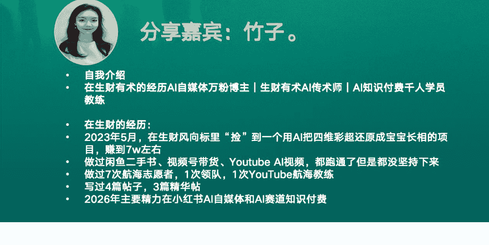

上月底在长沙做了一场智能应用沙龙，我分享的主题是《内容流水线：素材库+自动代理》。之后又组织了一次关于智能内容账号和资料库的闭门交流。这篇文章把两次分享合并成一套完整打法，从方向、话题、内容、商单到产品承接，再到用自动代理和资料库建立内容系统，一次性说清。

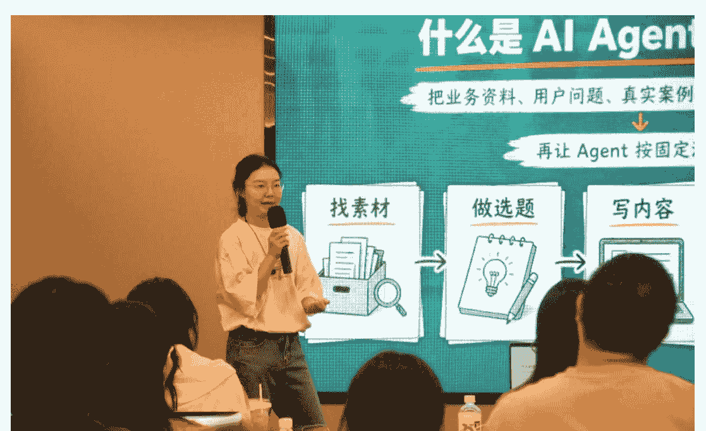

先说结果：账号现有1.5万关注者；2026年前8个月接了约60个智能应用类商单，月商单收益稳定过万。

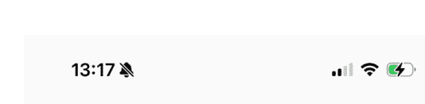

从后台流水能看出来：7月提现约1.08万，8月提现约1.51万，单笔合作款多在2500到2800元之间，平台会扣服务费。
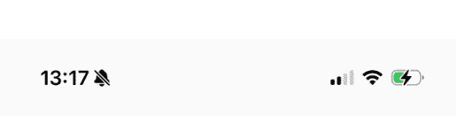

在我看来，比钱更值钱的是账号带来的身份。有作品、有案例、有持续输出，课程、咨询、企业内训因此都跑了起来。面向个人的智能应用课卖出一千多份；企业端也给平安、高校电商专业、地方人力资源机构和省级智能协会师资班做过内训。

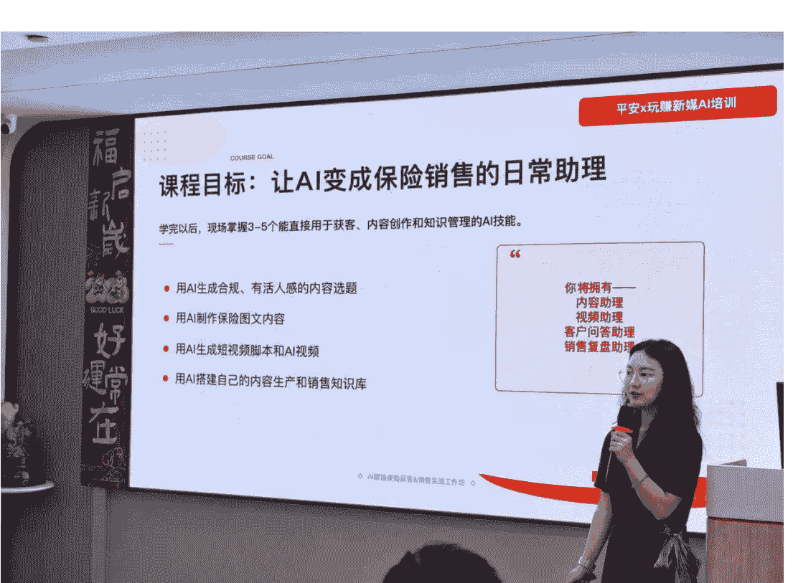

2026年6月4日，一所高校的官网发布了培训简报：6月2日，数字商务系和电子商务系邀请北京一家新媒体公司的讲师，为同学们讲解了“生成式智能在内容制作和商业场景中的落地”。现场还演示了豆包、即梦，带着学生实际操作了智能出图和视频生成。简报附有供稿、审核和终审信息，可见培训确有其事。

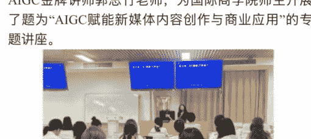

这次培训让我更确认一点：内容账号做到一定程度后，真正的天花板不是广告，而是能不能把影响力转成更深的产品和合作。

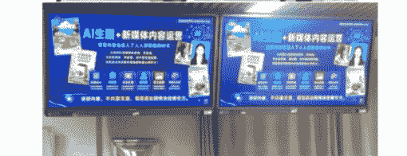

现在杀入智能内容，到底还来得及吗？我的看法是：如果只想追应用热点、做大众化教学，可以，适合起步，但会越来越挤，因为门槛低、供给多；如果想把账号当成入口，用来建立个人品牌、积累作品，帮特定人群解决实际难题，再对接自己的产品和服务，那就有门槛，但也值得长期做。

接下来，我从两种方向、方向设计、内容生产、商业承接，以及“自动代理+资料库”这套系统来拆解。

## 一、两种方向：教人玩应用，还是替人解决问题

很多人想做智能内容却不知道发什么。我一般把内容分为两种。

先看教学型。典型形式是应用测评、提示词分享、热点解读、教学拆解、应用清单、功能展示。用户看这些，是因为不知道有什么新应用、不会用某个功能、想跟上最新变化。

教学型的优点很明显：反馈快、话题多、容易出数据，用户愿意收藏，也容易接到应用方的合作。绘图、剪辑这类产品，尤其需要有人展示它们能带来什么。我今年的大多数商单都来自这条线。

缺点也藏在这里：内容同质化，一个话题火了马上被复制；收入还依赖平台规则，也看品牌投放，一旦账号出问题或预算缩水，收益就跟着晃。我之前有过一个万粉账号被永久封禁，后来申诉成功，但从那以后就不敢把宝全押在广告上。

如果只做教学和测评，账号很容易变成纯介绍产品的号，赚钱方式主要是广告。能接受这一点，当然也可以。

另一条是解决型。用户关心的不是应用有多酷，而是这能不能解决他的问题。这类内容需要先想清楚卖什么：课、咨询、陪跑、流程搭建，还是企业服务。然后反推内容。

举例：
- 对做内容的人，可以帮他们解决方向、话题、持续更新和赚钱问题，做课程、训练营、陪跑。
- 对教师，可以帮他们做课件、教案、题库、批改作业，做教师专属课程或定制服务。
- 对电商商家，可以帮他们做商品图、短视频、种草文案、带货脚本和客服话术，我接单时这类咨询非常多。

解决型的流量增速通常不如教学型，但胜在精准。应用会一直迭代，用户的难处长期都在。拿做内容的人来说，方向不清、话题枯竭、更新断档、变现困难，这些问题不会因为新应用出现而消失。加了智能应用，就能讲“怎么自动收集话题、怎么把更新流程标准化”。

这条路特别适合有行业积累的人。它的核心不是教你用某个应用，而是把过去的经验、流程和业务能力，用新技术放大。

对新手的建议：没有明显行业背景，可以从教学型开始，门槛低、反馈快；有行业背景，就尽早走“智能应用+具体人群+具体难题”的路线，做一个解决实际问题的人，而不是一个应用介绍号。

## 二、方向怎么定

很多人卡在方向，不知道怎么选。我用一个公式：

**方向 = 目标人群 × 高频任务 × 高价值难题 × 智能化方案 × 可以卖的产品**

拿10年HR经验的人举例。不要叫自己科技博主、职场博主，也别叫人力资源博主。应该一步步推导：服务3到10年职场人，帮他们用智能应用提高求职效率和面试表现，实现更好的职业跃迁。

这比“分享智能应用与职场经验”清楚得多，后面的每条内容都能往这条主线靠。

具体三步：

第一步，盘点自己的存量。做过什么、擅长什么、有什么真实案例、手里有什么产品和服务、愿意长期写什么。不要急着问哪个方向最赚，先看自己有什么别人复制不了的东西。

第二步，找准目标用户的真实痛点。人群越具体越好，比如“想用智能应用做账号，但卡在方向和稳定更新的独立做号人”“有服务但内容更新效率低的小团队主理人”“想用智能应用做课件、不知从哪下手的老师”。越具体，内容越好写。

第三步，反推变现。这个账号最终靠什么赚钱？商单、资料包、课、训练营、咨询陪跑，还是企业内训？不同变现方式决定不同内容。想做商单，就多做测评和应用场景；想卖课，就多讲方法、案例与复盘。

自己理不清，可以用我的“智能内容商业教练”技能：装进Workbuddy、Codex或ima资料库，对它说一句指令，它就会给出三份建议：方向怎么做、产品怎么设计、话题怎么选。

可以看看几个行业结合智能应用的方向案例。

## 三、用Codex和Obsidian搭内容系统

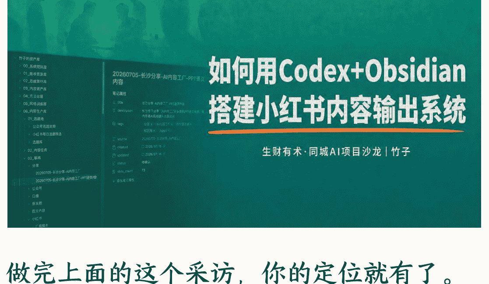

方向定了，下一道坎是稳定输出。靠意志力很难坚持，所以我用系统来对抗惰性。

这套系统不是要让程序批量堆字，而是把所有环节串起来：素材进库、程序读取、自动生成话题、话题变成不同平台的内容、发布和复盘、把反复出现的流程固化成标准动作：

```text
输入层: 用户问题 / 聊天记录 / 爆款笔记 / 产品资料 / 个人故事
    ↓
知识库层: 定位库 / 产品库 / 需求库 / 素材库 / 方法论库 / 内容库
    ↓
Agent 层: 读取资料 / 判断选题 / 生成内容 / 归档结果
    ↓
输出层：📕 / 口播 / 👸号 / 朋友圈 / 社群 / 销售内容
↓
复盘层：数据记录 / 好标题 / 好开头 / 用户反馈 / 下次优化
```

素材先入库，程序自动跑，生成一批话题后由人挑选，再分发到各个平台，发完看数据，再把常见流程沉淀成可以复用的技能。

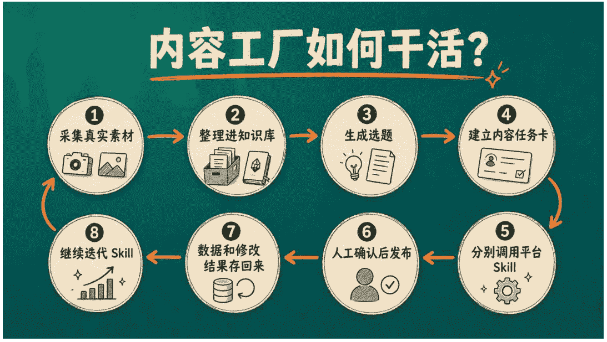

在这个结构里，Obsidian承担资料存储，Codex承担流程执行，Skill的作用是把重复动作变成标准脚本，最终决策由人来做。

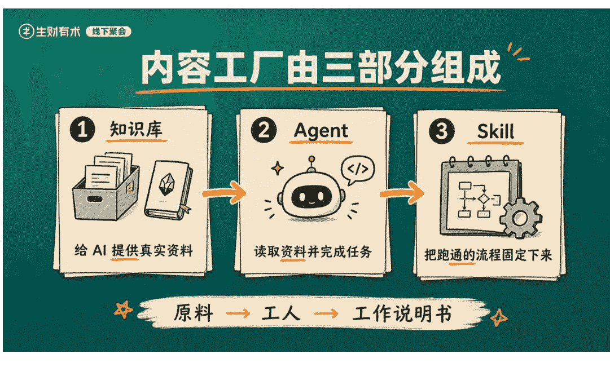

以前找话题，我要重新打开平台、翻一遍资料、临时想角度。现在让程序按关键词抓热门内容，再把方向、产品、用户难题和过往案例喂进去，它会先列一批候选，我只负责做选择。

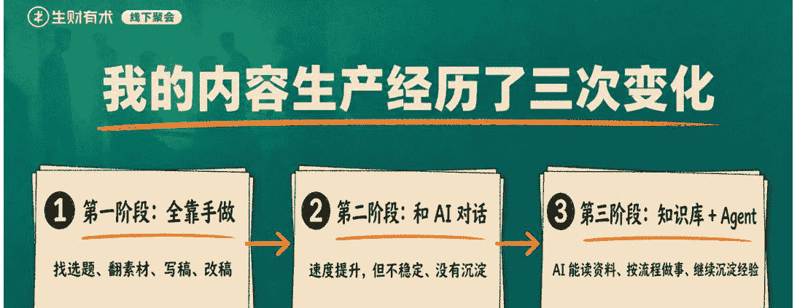

原来写一篇内容可能要小半天，现在能压缩到30分钟左右，更新频率和阅读数据都稳住了。

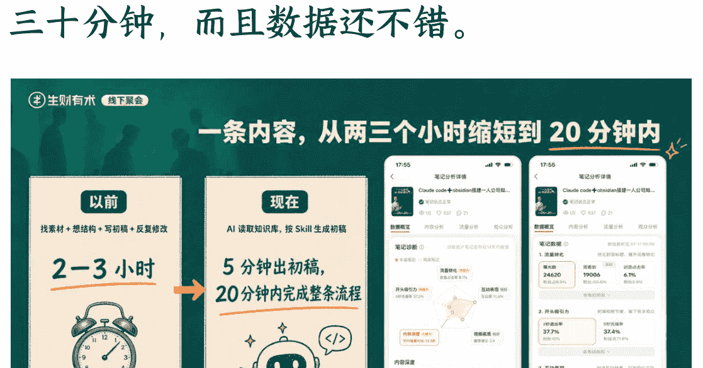

真正有用的资料库，一定要围绕工作场景来搭。如果你做内容账号、小团队、付费内容或咨询项目，可以用这个结构去建：

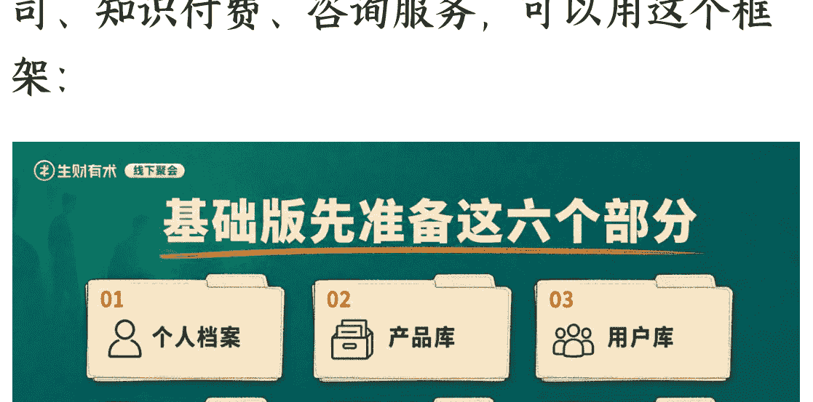

装好Codex、Workbuddy和Obsidian后，用一段初始提示词生成资料库框架，再把自己的业务装进去，就能跑起来。这就是我目前完整的做法。

```text
请帮我在当前文件夹创建一套“AI 内容工厂”的 Obsidian 知识库骨架。

适用场景：
我是一名自媒体内容创作者，需要持续输出📕、口
播、👸号、朋友圈内容。

请创建以下文件夹：
1. 01_老板说明书
2. 02_产品库
3. 03_客户需求库
4. 04_素材案例库
5. 05_方法论库
6. 06_内容生产库
7. _模板

要求：
1. 每个文件夹里创建 README.md，说明这个库放什么、
   不放什么、怎么用。
2. 创建 首页.md，作为整个知识库入口。
3. 在 _模板 里创建：
   - 用户问题卡.md
   - 素材案例卡.md
   - 选题卡.md
   - 📕成稿卡.md
   - 内容复盘卡.md
4. 所有文件使用 Obsidian Markdown 格式，带
   frontmatter。
```

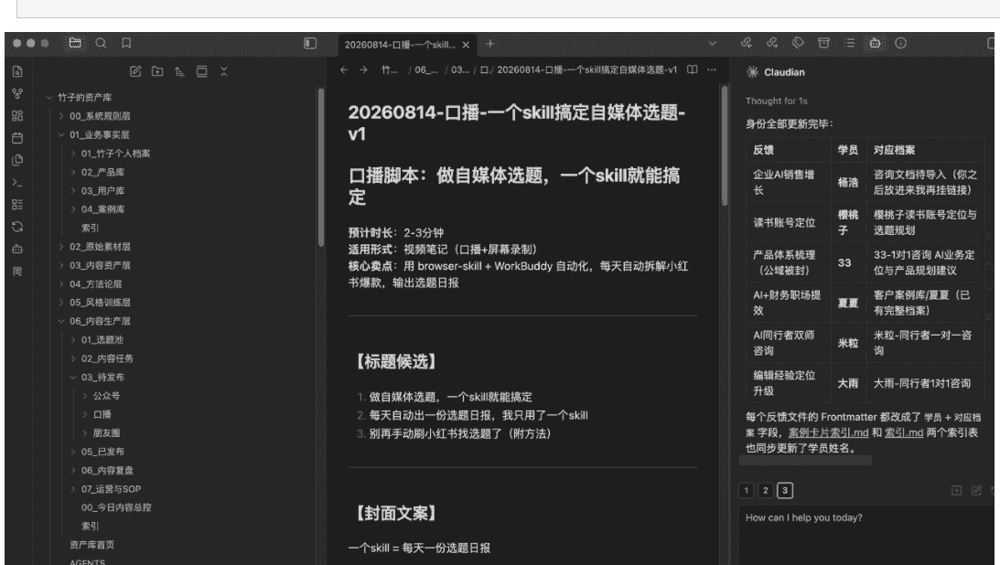

首个仓位可称作个人档案库，也常被叫做老板说明书。把“我是谁”拆成可检索的要素来保存：从业履历、关键成果、表达习惯、价值取向、经历故事、内容底线、偏好与拒绝的表达方式。

### ②生成有术 线下聚会

### 老板说明书：先让模型了解你

- 曾经承担过哪些项目，留下哪些可验证的成果
- 当前在运营哪类业务
- 擅长的范围与不擅长的范围
- 受众画像
- 口语化与书面化表达特征
- 绝对不出现的话题与表述

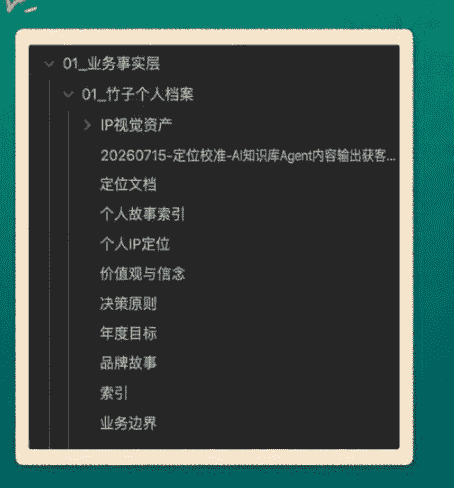

该模块的用意是让模型越来越贴近你的个人风格。不少人吐槽模型写得不像自己，根本原因是模型对你缺乏基本认知。它不清楚你的经历脉络，不了解你的说话方式，不明白你看重什么，也不知道哪些表述是你底线。

若想提升相似度，就不能每次在对话框里临时交代。请把这些要素沉淀为长期资产。

若自填成本高，可做一个访谈式技能边聊边归档：

### 写不动老板说明书就让模型来访谈

`.agents/skills/知识库采访机器人/`

- 启动“知识库采访机器人”Skill 开始基础访谈。
- 每次仅提一个问题，你以口语作答。
- 信息不足时可追问一个具体事例。
- 访谈收尾后，整理进六大资产库。

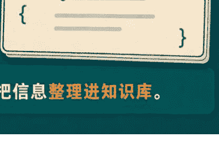

用语音作答约半小时，系统会把信息归档到知识库。

此版本是在航海家大课叁斤老师公开的访谈 skill 基础上做出的迭代，可直接下载部署。

第二个仓位，产品库。收纳课程、资料合集、训练营、咨询、陪跑、企业服务等。

每个产品至少补齐：

- 产品定义
- 适合人群与不适合人群
- 解决的痛点
- 价格与权益
- 交付流程
- 用户常见顾虑、案例与反馈

产品库的价值在于让内容能够自然承接商业。当选题与定位与产品偏离时，它可判断这篇内容是否值得投入。

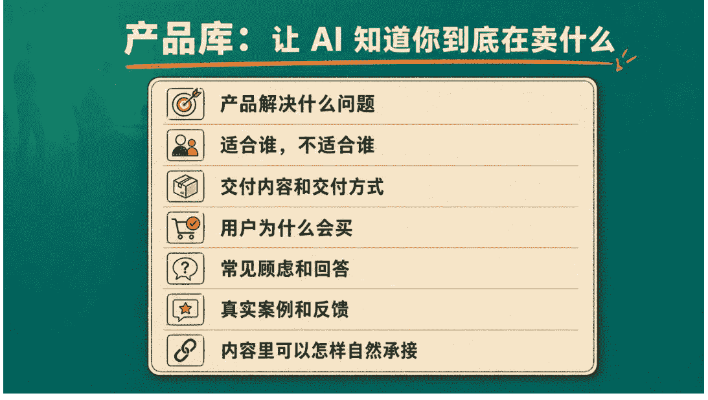

**第三个仓位，用户需求库。** 汇集评论区提问、私信提问、学员反馈、咨询记录、高频FAQ、用户原话。此库极为关键。

真正优质的选题，多半不是闭门想出来的，而是用户反复追问出来的。例如用户会问：我该选哪个AI自媒体赛道？我每天用AI写稿为何仍断更？账号有播放为何无咨询？想接广告需多少粉丝？不露脸能否先做图文？这类问题本身就是选题。

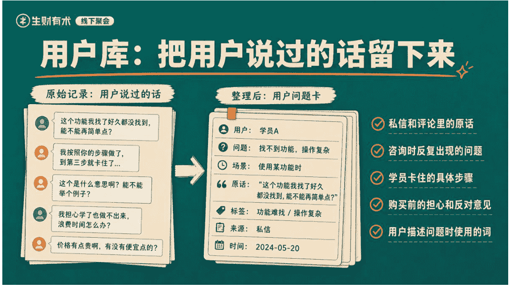

第四个仓位，素材案例库。收存个人案例、学员案例、商单案例、企业培训案例、平台爆款素材、失败复盘。

内容要具备说服力，观点之外需要故事、过程、结果、前后对比。

例如本文开头展示我的结果，不是为了炫耀，而是证明这套方法并非纸上谈兵，而是在账号、商单、课程与培训中跑通的。案例越丰富，内容越有底气。

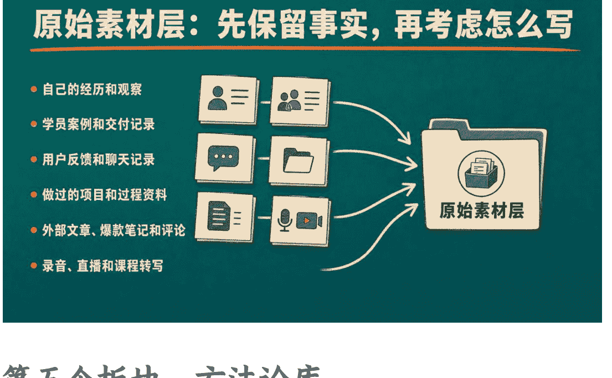

### 第五个仓位，方法论库。

收纳业务相关的方法论，如定位方法论、选题方法论、图文写作规范、口播脚本规范、商单SOP、内容复盘方法、一鱼多吃流程。方法论库的作用是让模型按你的方法输出，形成你自己的观点体系。

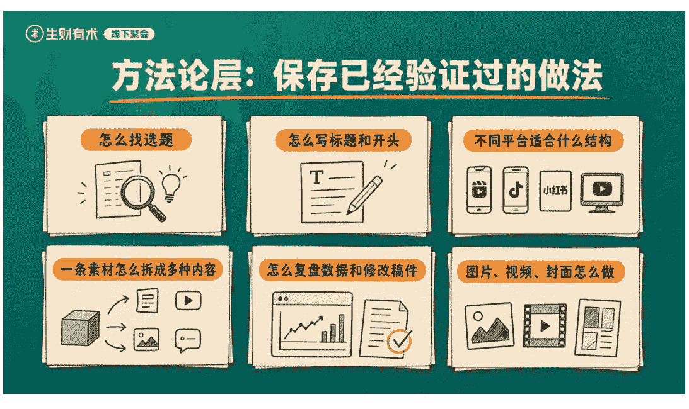

第六个仓位，内容生产库。收纳选题池、内容任务卡、各平台待发稿、已发内容与数据复盘。作用是让内容从构思到发布再到复盘形成闭环。

很多人写完即止。真正的内容系统必须复盘：哪条标题点击高？哪个开头留人？哪个选题带来咨询？哪个内容适合延展成系列？评论区出现哪些新问题？这些都要回流进知识库。

沉淀两三个月后，你可以询问知识库：从已发内容看，哪类选题最匹配账号？哪些标题结构表现更好？哪些内容更容易带来私信？哪些用户问题反复出现？

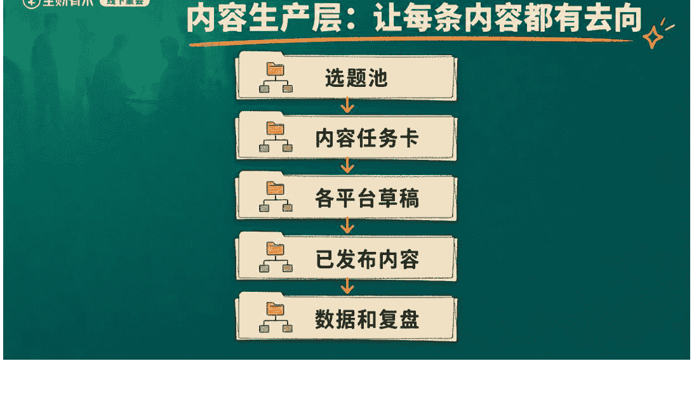

这些复盘信息可直接在 agent 中提供，让它写入数据复盘文档，从而持续迭代知识库与输出方法。以上是我做自媒体时使用的框架，若你是其他业务，知识库的存放项也会不同。可先把业务讲清楚，让模型依据业务、素材来源与日常任务，设计更适配的框架。

我想搭建一个适合我业务的AI内容工厂知识库。

我的业务是：

[说明你做什么，比如电商 / 咨询 / 教育 / 本地门店 / 企业销售]

我的目标用户是：

[说明用户是谁]

我每天或每周需要输出的内容是：

[比如📕、短视频脚本、商品文案、朋友圈、社群内容、直播脚本、销售话术]

我的素材来源包括：

[比如客户咨询、评论区、商品资料、用户评价、案例、课程、直播回放、同行爆款]

我希望这个知识库帮我解决的问题是：

[比如不知道发什么、素材太乱、话术重复写、内容不稳定、团队协作混乱]

请你根据我的情况，设计一套 Obsidian 知识库框架。

输出要求：

1. 给我 6-10 个一级文件夹。

2. 每个文件夹说明放什么、不放什么。

3. 告诉我新手最先应该填哪 5 个文件。

4. 给我 3 个模板：素材卡、选题卡、成稿卡。

5. 最后给我一段可以直接复制给 Codex 执行的建库指令。

## 四、如何用 Agent+skill 辅助选题和素材采集

定位清晰、知识库搭建后，可让 agent 帮你把业务相关素材整理进知识库，支撑生产。

内容生产包含做什么与怎么做。做什么即选题，接下来讲选题挖掘。

很多人最痛苦的是不知今日写什么。打开📕刷同行、翻热点、看评论区，刷着刷着一小时过去，注意力被短视频带走，最后仍空白。我也曾如此。

早期我们靠手工记录在表格。现在可交给 agent。

选题主要来自两处：

1. 平台关键词下的爆款内容
2. 用户反复提出的疑问、真实场景、未解困惑与你的判断或方法，来源可是用户咨询、社群答疑、同行或自有内容的评论区中出现频次超过3次的内容。

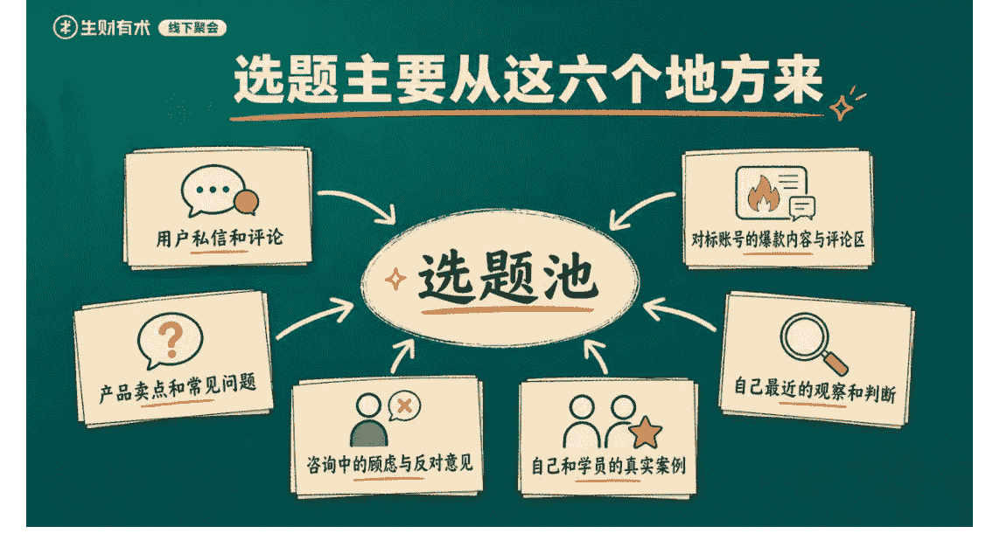

现下这两个动作都能交给 agent 完成。例如用关键词抓取爆款选题：

### 方法一：Browser skill 与配套浏览器插件

https://github.com/Tencent/BrowserSkill 安装该 Browser skill 与配套浏览器插件，即可按设定的关键词获取选题。

浏览器插件：

打开 Chrome，访问：

```
https://chromewebstore.google.com/detail/lhcmgoofomhgciiibhipgmkggnoenaoi
```

点击「添加到 Chrome」

安装完成后，点击浏览器右上角的扩展图标确认弹窗显示 已连接（绿色）即为成功

### 拆解📕AI自媒体爆款选题

选题我已跑完，以下是本次采集的核心发现：

数据采集量：6个关键词 × 每个8条 = 50条笔记，全部附带短链接，精读了5篇最高互动的笔记正文和评论区。

5条趋势洞察：

1. AI工作流SOP类是最高流量密码——给出具体SOP+工具组合的笔记收藏率极高（如Skill搭建笔记1.6万收藏比6.7收藏，收藏比1.6）

2. “一人公司/从口写变方案”——评论区不再是质疑质疑，而是追问“我这个行业能不能复制”

3. 「单子」焦虑催生方法论需求——先打从再给方法类的笔记结构仍有效

4. 变现渠道是最大信息量——评论区最高频问题不是“怎么做”而是“在哪变现”

5. 社恐/不露脸自媒体从小众走向主流——AI漫画、条漫等形式吸引大量社恐人群入场

8个精选选题已全部完成“借骨架换血肉”——保持标笔记的标题格式和内容结构，换成你自己的AI自媒体个人IP案例（母等博主转写经历、16+Skill体系、AI的官方工产方法、1499字阅读流099条变现在里）。

评论区痛点TOP3：变现渠道不清楚、Skill选择困难、真实性质疑。今天你想做什么？ @@ 引用对话文件，\ 调技能指令

### 2026-08-17-AI自媒体选题日报

AI自媒体个人IP·📕选题日报

- 采集时间：2026年8月17日

- 采集关键词：AI自媒体 / AI个人IP / AI赚钱 1 / 超级个体 1 一人公司 / 单人

- 数据来源：📕实时搜索（共采集 50+ 笔记，精选 5 篇爆文 + 评论区）

### 一、今日爆款数据总览

| # | 笔记标题 | 博主 |

| --- | --- | --- |

| 1 | 30W粉！WorkBuddy搭建自媒体工作台教程！ | 一只鱼饼 |

| 2 | 发现自媒体起号最快方式：用AI把内容陌生化 | 子于维 |

| 3 | 1个人做5个号，自媒体届的拼好饭来了 | 歌子倾城 |

| 4 | AI领域挑战 14用AI赚自媒体副业（月副斜打） | 钱要在刀刀上 |

| 5 | Howto用AI启动自己的自媒体IP分身？ | 乙南 |

| 6 | 想做自媒体的人请去趟这条路雷店！ | 小梨爱面包 |

| 7 | 吃到代码Red1 如何用3天跑通📕变现？ | 大嘴吃卡Nika |

| 8 | 工具我好不好用到使用带体感的品味 | 发现橘子 |

这个你可以自己定义输出的报告形式、保存到知识库的路径，还可以创建定时任务，比如每周帮你抓取一次这一周的选题。

### 方法二：obsidian 里的插件-xiaohongshu importer +workbuddy 转写提取逐字稿

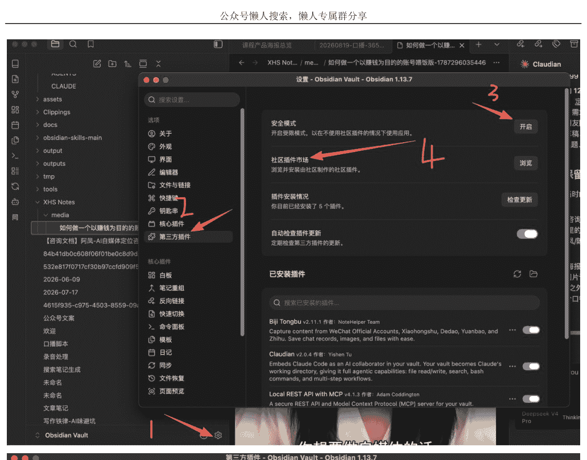

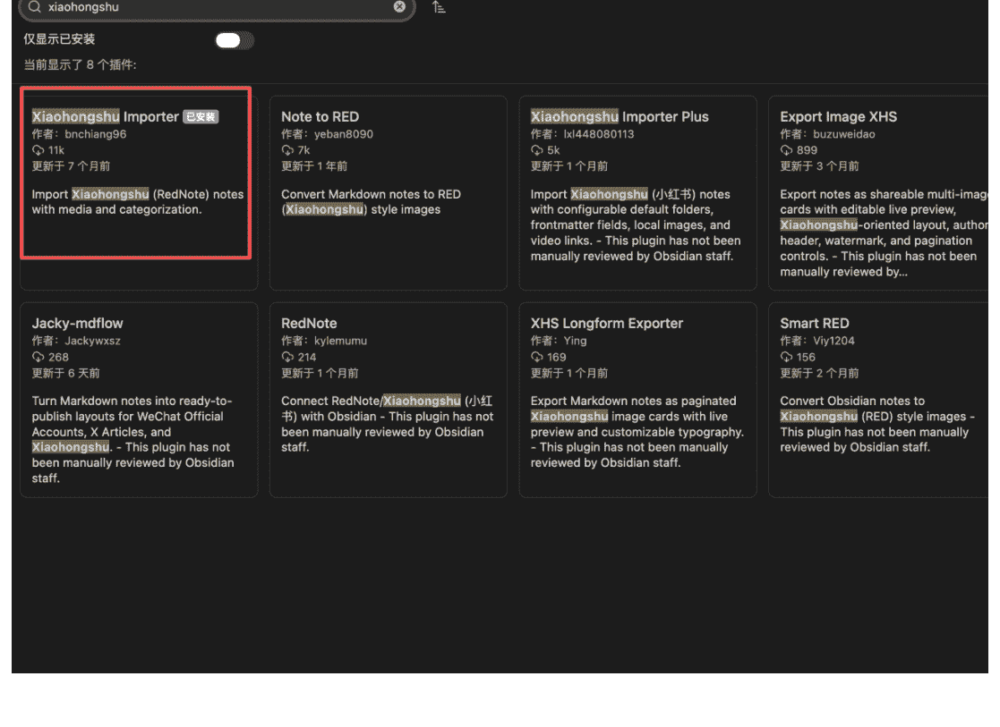

安装之后，你就能看到 obsidian 侧边栏里有一个书的图标：

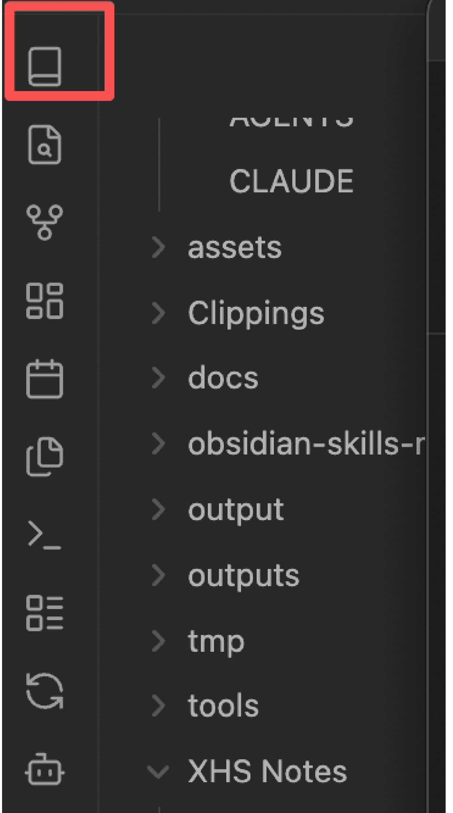

点击就可以输入📕的链接（电脑网页版），就可以把这篇内容采集出来了，不过只能采集图片、文字、视频，视频的逐字稿是没有的

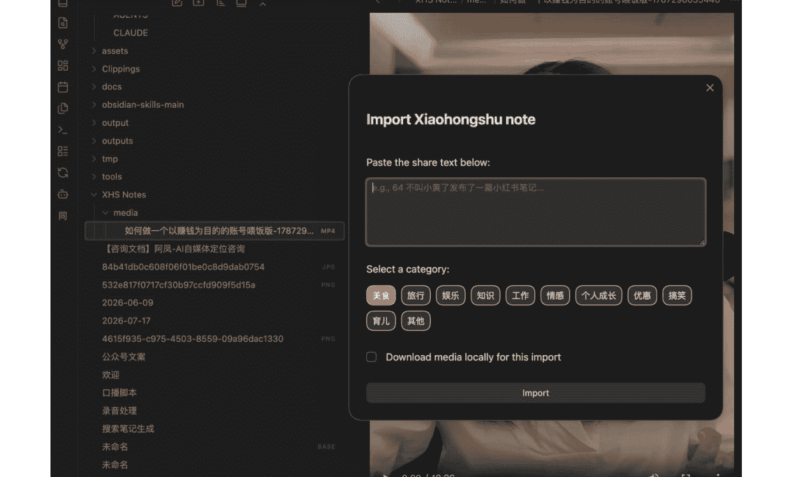

可以同步在 workbuddy 里做一个定时任务，每天固定时间，把当天采集的视频全部转写成文字放进 obsidian 知识库里

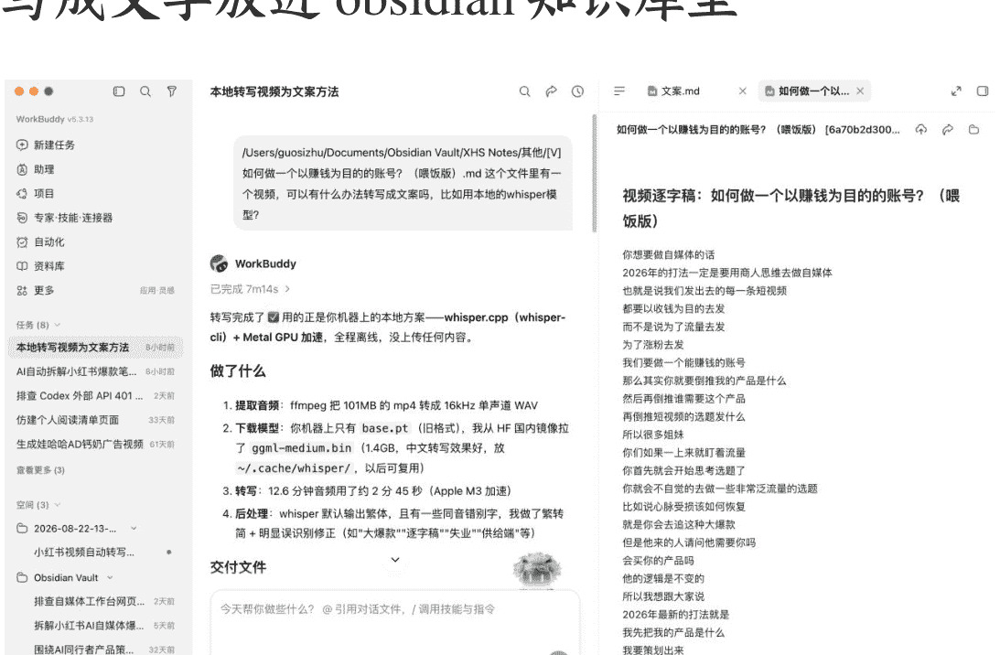

直接复制下面这段发给 WorkBuddy 就行（把两个路径替换成自己的）：

### 用法就 3 句话：

我想搭建一个「本地视频自动转写」的流程，请帮我完成：

1. 检查环境：whisper-cli (whisper.cpp) 和 ffmpeg 是否已安装，没有就用 Homebrew 装；

    检查 ~/ .cache/whisper/ggm1-medium.bin 模型是否存在，没有就从 hf-mirror.com 下载

    `(curl -L -o ~/ .cache/whisper/ggm1-medium.bin https://hf-mirror.com/ggerganov/whisper.cpp/resolve/main/ggm1-medium.bin`

2. 写一个通用转写脚本 transcribe_to_kb.py，功能：

    - ffmpeg 提取 16kHz 单声道音频 → whisper-cli 用 ggml-medium 模型转写（中文）→

    - 繁体转简体（用 zhconv，没装就 pip 装）→ 生成带 frontmatter 的 Markdown 逐字稿，

    - 可选输出简体 srt 字幕，转写的临时文件自动清理

3. 用这个脚本把视频 <填：你的视频路径> 转写一遍，给我看效果

4. 建一个定时任务（每天一次）：自动扫描文件夹 <填：你要监控的视频文件夹>，

    - 发现新视频就转写，把 md 存到素材库 <填：你的素材库文件夹>，

    - 素材库里已有的视频自动跳过，不重复处理

遇到缺的环境组件你自己装，最后告诉我整个流程跑通没有。

### 方法三：还有一种更简单的方式

📕的笔记转发给问点点（📕自带的 ai），发送“总结视频逐字稿”，就可以直接提取视频号的转发给元宝，抖音的发给豆包然后复制保存到 obsidian 素材库里，或者复制发给 workbuddy/codex 让它们来按固定格式保存

## 五、AI 自媒体内容输出指南

### 1. 一鱼多吃：选题内容卡+不同平台 skill

很多人提到内容工厂就想到“一鱼多吃”。一个选题产出📕、口播、👸号、朋友圈、社群文案。思路没错。

但有大坑：不要让 AI 一次性把所有平台文案打包生成。因为不同平台逻辑不同。📕图文需要封面、标题、收藏点与卡片结构。

短视频口播需要前3秒钩子与听感。👸号长文需要完整论证、故事案例与结构递进。朋友圈需要像当天真实发出的个人表达。

同一选题，先建一张内容任务卡，再分别调用不同平台的写作 skill。

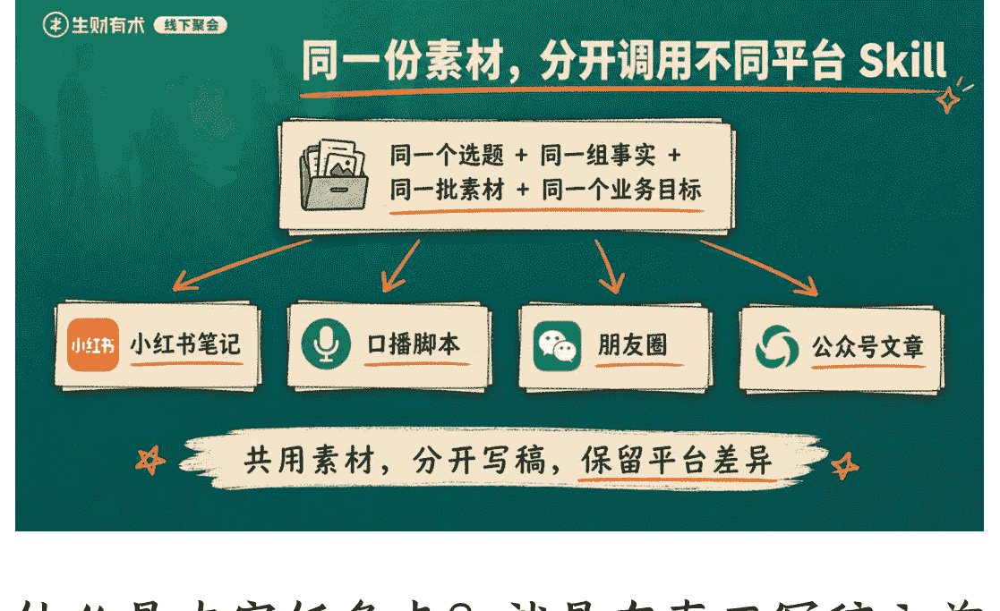

什么是内容任务卡？即在写稿前把核心信息理清。它至少包括：

- 内容面向谁
- 对方正在面临的具体问题
- 希望讲透的核心观点是什么
- 可使用的真实案例、用户原话与方法
- 是否需要商业承接
- 适合发到哪个平台
- 不同平台各自的切入角度

##### ② 龙哥盟 线下聚会

#### 内容任务卡提示词（上）：先让 Agent 找齐资料

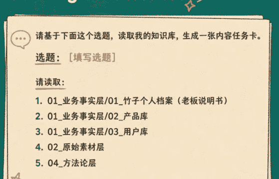

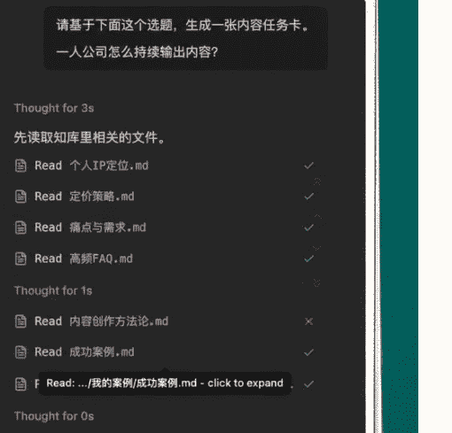

##### ② 龙哥盟 线下聚会

#### 内容任务卡提示词（下）：把事实和角度锁定

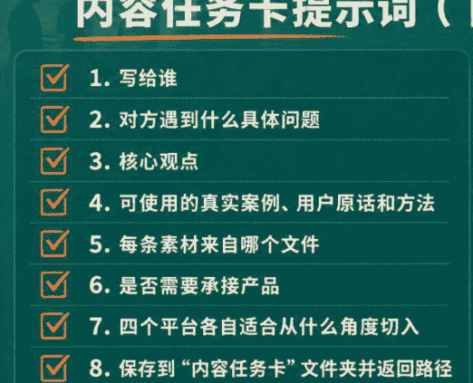

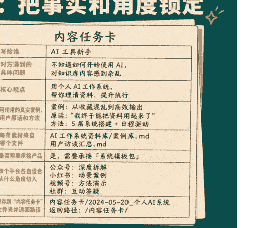

⚠️ 先不要写平台正文，也不要补写知识库里没有的案例和数据。✨

举例，比如我要写选题：做自媒体没有方向？你缺一个自媒体商业教练 skill 那它的选题内容卡片可这样设计：

不同平台的切入角度可这样规划：

你可以做一个选题卡片 skill，让它输出这类报告：

【选题名称】

一、内容目标

这篇内容最终希望用户产生什么认知/行动？

二、目标用户

这次具体写给谁？

他现在处于什么阶段？

三、具体场景

他最近会在什么情况下遇到这个问题？

四、用户原话

他会怎么描述自己的问题？

至少记录 3-5 句真实表达。

五、核心矛盾

他以为问题是什么？

真正的问题是什么？

六、核心观点

这篇内容只允许讲透一个什么观点？

七、认知反差

旧认知：

新认知：

八、论据素材

- □ 自己经历

- □ 学员案例

- □ 咨询案例

- □ 用户原话

- □ 数据

- □ 方法论

- □ 失败案例

- □ 对比案例

九、方法/解决方案

准备提供什么框架、步骤或工具？

十、商业承接

- □ 不承接

- □ 引流资料

- □ Skill

- □ 低价产品

- □ 正价课程

- □ 咨询/陪跑

十一、平台拆解

📕：

用户为什么会点开？

封面角度：

正文切入：

适合 CTA：

口播：

前 3 秒观点：

核心冲突：

案例：

结尾 CTA：

👸号：

文章的大问题：

核心方法论：

需要展开的案例：

承接方式：

朋友圈：

真实场景：

个人观察：

认知：

产品/行动：

十二、一句话母题

如果所有内容最后只能让用户记住一句话：

______

然后再去调用不同平台的 skill，比如口播脚本 skill，👸号长文 skill 来写内容。这样比直接给一个选题让 ai 写效果更好。

### 2. 爆款内容二创 skill

如果你要基于上面提取的爆款文案做二创，在二创前可先和 AI 沟通清楚：你是只想改表达，观点和结构不变，类似洗稿；还是想保留选题、开头钩子、表达框架，换成你自己的观点、案例素材。

沟通完先让 AI 按参考文案输出一版二创，你确认 ok 再把它固化成一个二创 skill。

我这边用的这个版本本身是不联动知识库的，倘若你想让它自动调取你知识库里的案例资料，可以让 workbuddy 或者 codex 帮你改一改，你只需告诉它去知识库的哪个位置取素材，随后把改完的 skill 装上就能直接用了。

### 3. 封面与标题文案

封面图我基本都是丢给 GPT 来做，把自己的头像和相关素材上传，让它按我的要求排版并加上标题文字即可。要是你想把封面做成固定风格，也可以把它做成一个 skill，之后在 codex 里直接喂素材，让它调用该 skill 保持同一套视觉输出。

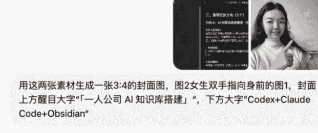

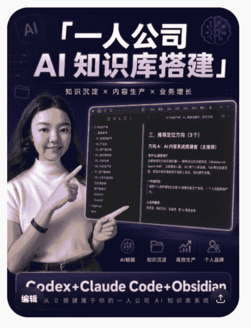

封面上的主标题和正文里的标题，完全可以分开设想，一个主要用来拉点击，一个主要用来做搜索曝光。标题和文案的提炼我也做了一个 skill，可以直接根据内容自动生成：

## 六、从零起步，先跑通这个最小闭环

看到这里你可能会想，这套 agent 加知识库的体系会不会太重？其实还好，大部分活都能交给 codex 来跑。

如果你是刚入门，建议先别追求全自动，先把最小闭环跑通。

- 第一步，先把定位访谈做了。
- 第二步，把知识库的大框架搭起来。
- 第三步，开始整理素材，先整理 10 条真实的用户问题和案例。

可以从评论区、私信、社群、咨询对话、聊天记录里扒，也可以从你观察到的目标用户痛点里提炼。注意别写大词。比如别写“不会做内容”。要写得具体：每天都不知道发什么。写一个脚本要花三小时。发了好多干货却没人来咨询。想做 AI 自媒体却不知道选哪个方向。

- 第四步，让 AI 去找 5-10 个选题方向。
- 第五步，挑一个选题先做一张内容任务卡。先把这次内容是写给谁、解决什么问题、用什么案例、最后要承接哪个产品想清楚再开工。
- 第六步，先选一个平台发出去。新手建议从图文起步，因为门槛低、成本低、方便做测试。如果你想更快建立信任，就早点做真人出镜口播，因为现在 AI 内容泛滥，用户更在意真实的人。
- 第七步，发完一定要复盘。别只看点赞收藏数，要看：哪个标题点击率高？哪个开头留住人？评论区冒出了哪些新问题？有没有人来私信咨询？这条内容能不能延展成下一条？
- 第八步，把复盘结果和数据反馈沉淀回知识库。这一步很关键。

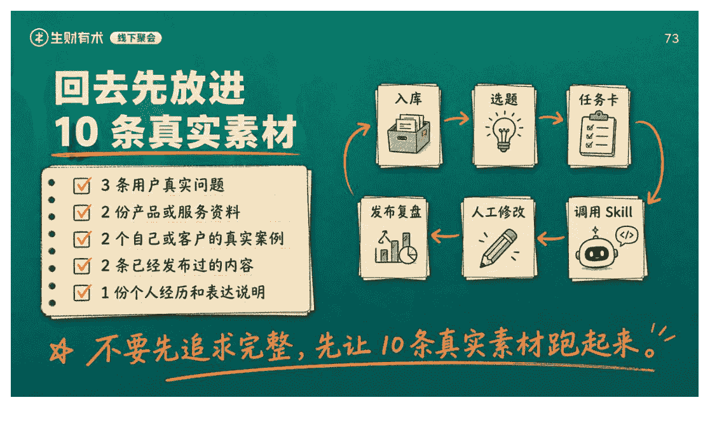

你的知识库不是一次性建完就完事的，它是随着每一次内容发布、每一次用户反馈、每一次产品迭代慢慢累积起来的。所以新手不要一上来就想自动化。先把下面这个循环跑顺：

定位 -> 用户问题 -> 选题 -> 内容 -> 发布 -> 复盘 -> 入库。

等这个闭环稳定了，再去考虑更复杂的多 Agent、Skill 协同。

## 七、做 AI 自媒体的一些避坑提醒

1. 很多人担心讲 AI 工具会不会踩线：

这个确实有风险，特别是提到国内的即梦和豆包，这两个在📕很容易被判定为引流第三方，因为平台上有很多创作者在发隐形广告，只要你提到品牌名就容易被限流，这也能理解，不走平台合作，平台拿不到分成嘛。所以聊到这两个工具时最好别露品牌名，当然这只是概率问题。

不过聊国外的工具，比如 codex、claude code 这类反而流量不错，因为大家都知道国外工具不会在国内投放，属于纯干货分享，但别公开聊网络访问相关的话题。

2. 内容里用了 AI 生成素材的话，记得主动标注“含 AI 生成内容”。主动标注对流量没有负面影响。

3. 上半年水下 AI 工具广告还有点市场，但 7 月平台集中清了一波把这类内容全违规了，所以接广告尽量走官方渠道。报价时记得预留平台服务费和返点空间，现在品牌中介抽成很凶，我见过要 45% 的，确保自己到手价符合预期。

4. 最好别聊批量生产内容、批量做号之类的敏感点。我之前账号就被永久封过一次，后来申诉才回来，理由就是教别人批量运营账号，其实我只是一笔带过“可以生成多张图片”。所以日常措辞要谨慎。

以上就是 7 月和 8 月的组局分享完整版， hope 对你有帮助～


看完这份 SOP，你可能觉得自己学会了。但现实是 90% 的人一动手就卡在第一步。

工具和教程是最不值钱的壁垒，真正值钱的是“立刻开干”和“圈层信息差”。


我们不谈概念，只拆商业闭环、榨取 AI 效率。圈子里已经沉淀了 1000+ 跑通的套利实战案例。

- 查看圈子数字资产合集与入场门槛：

    https://lazyso.com/insider/


备注：【实操上车】，不闲聊


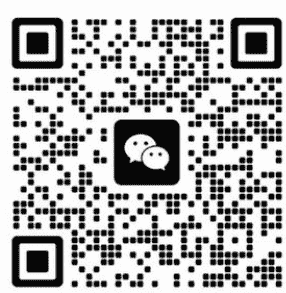
