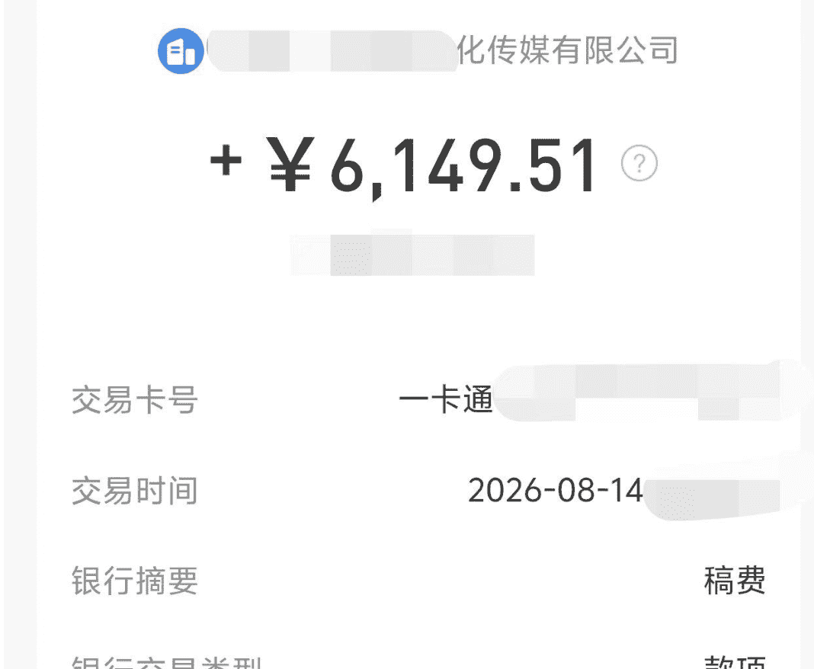
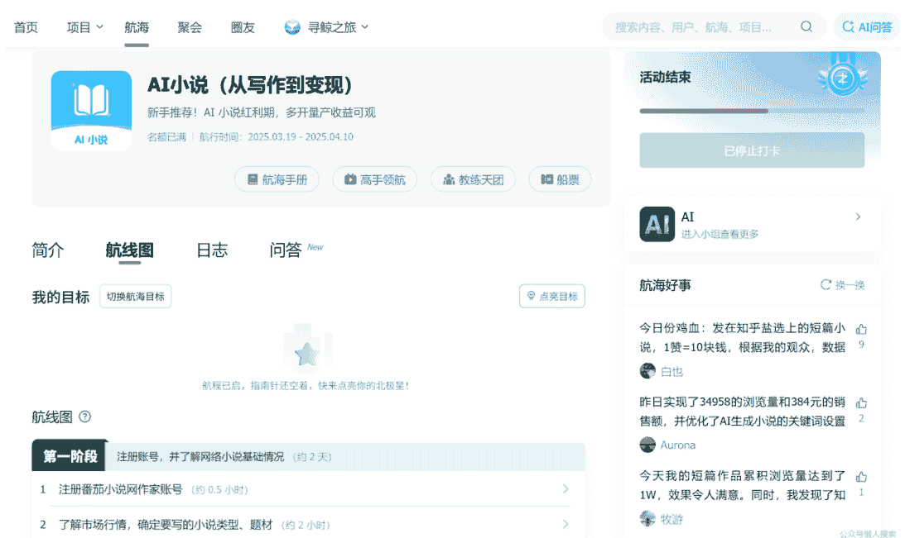
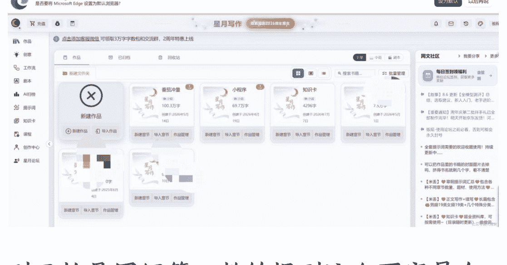
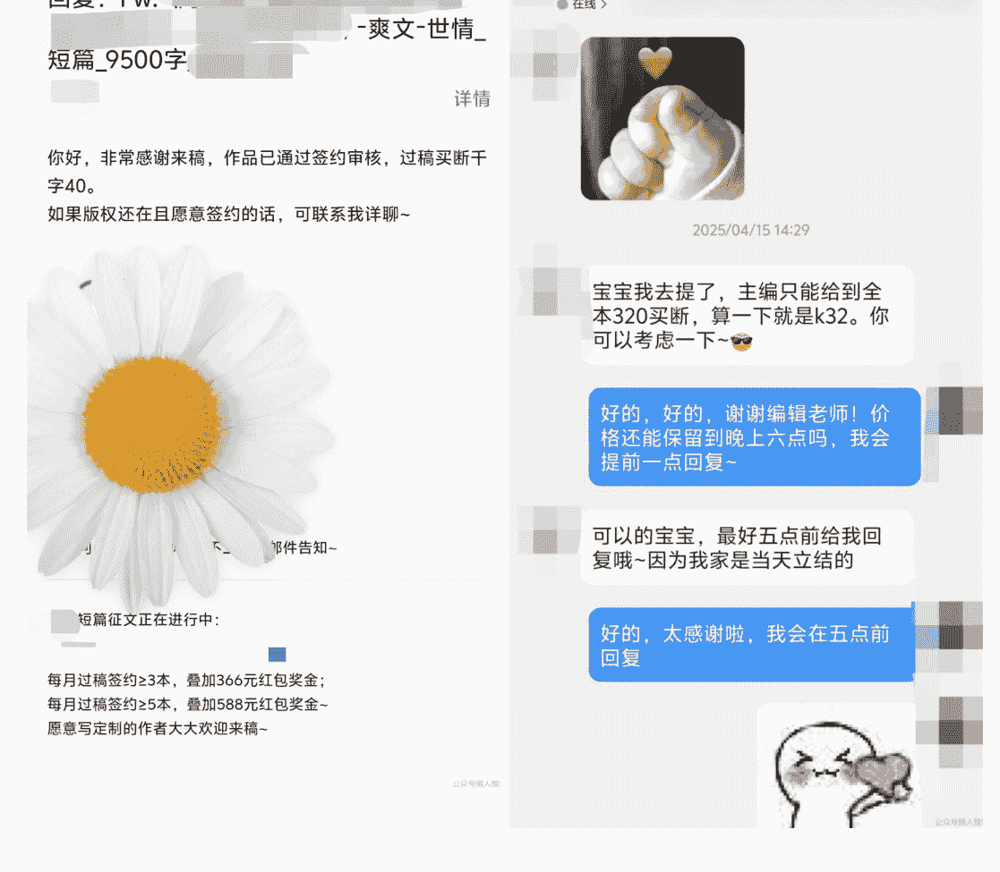
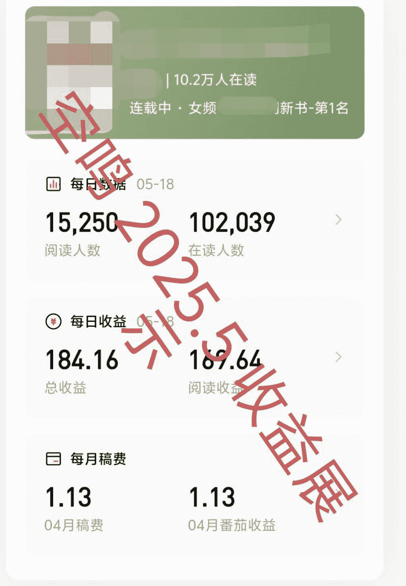
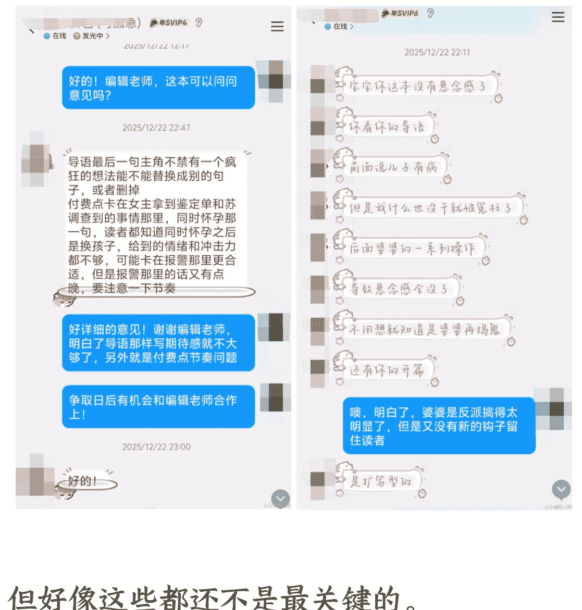
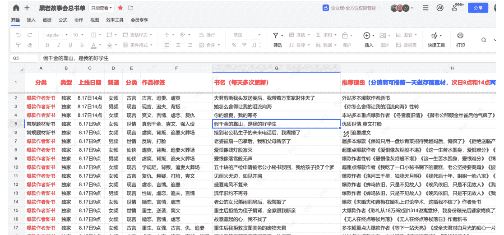
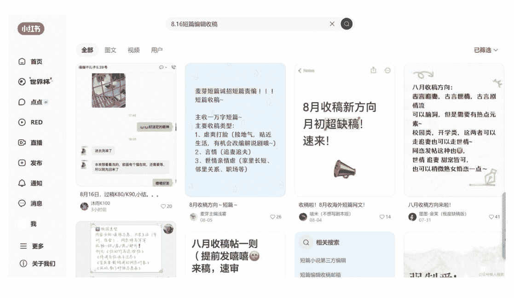

# 从航海变现 700 到单月最高变现 6000+，AI 小说现在还能做吗，分享我这一年来的实战复盘

## AI 小说副业一年复盘：从航海首单 700 到单月 6000+，这条路现在还能走吗

- 260901 副业 SC 精华
- 整理：👸号懒人搜索，懒人专属群精选
- 懒人微信：lazylhelper1

> **小懒判断**｜适合沉迷网文、能扛住废稿的白领做兼职；不吃长短篇网文、追求现钱到手快的别碰。最有操作感的是网文怎么积攒：每日巡书单与编辑范文各两三篇入库，五天内同题材扎堆出现就是风口，上周爆款是千金认错下周就得换成状元代笔，月产 3 至 5 篇每篇 4 小时稳拿 2000 到 6000。雷区在于 AI 文与对标剧情高度重合即构成抄袭，编辑盯榜单一眼就能识破，新人废掉 5 到 10 篇很常见。

大家好，我是空鸣。白天上班，夜里用 AI 写短篇小说做副业。

去年三月，我报了赚钱的 AI 小说航海营。

那时我本人就是写长篇的老手，看到“AI 写小说”四个字第一反应是嗤之以鼻。情绪张力、人设塑造、节奏冲突，哪一项不是手感活，AI 真能写出能卖钱的稿子？

结果航海期间，我靠 AI 投稿两篇短篇，拿到 700 元左右稿费，长篇也在番茄跑通，首月收益 3000+。

我以为� Formula 就行，市场很快给我上课。去年十一月再回短篇，六连废。直到我开始研究市场、建自己的素材池，过稿才重新稳定下来。

现在平均每月兼职 3 到 5 篇短篇，每篇投入约 4 小时，月入 2000 到 6000 元，单篇起量后分成最高冲到 3000+。

今天不讲提示词套路，只聊一年里我踩过的坑和真实的市场逻辑：AI 写小说还值不值得做，我是怎么从连环废稿翻盘的，以及现在想入场的人该怎么起步。

## 01/怎么入坑 AI 写小说

第一次接触是在去年三月的航海营。

前面两个副业项目都卡住了，这期航海正好开了 AI 小说方向，于是我蹭进去看看。

我的第一直觉是这事不靠谱，AI 写不出合格小说。

大学时我写过很久长篇，我太清楚小说需要的功力，觉得当时模型做不到。

抱着试试心态报名，没想到跟完一期就真香了。

航海里我就用 AI 搞出两篇短篇卖掉，赚了 700+，长篇也第一月就赚到 3000+。

### AI 小说到底怎么变现

## 02/变现路径

长短篇的赚钱方式不一样。

长篇一般是三十万到上百万字，挂在起点、晋江、番茄等平台靠订阅或广告分成。作者选站注册，发文签约后日更 4000-6000 字靠数据上榜或算法推流赚钱。

番茄是免费阅读靠广告，起点晋江是付费订阅。AI 角度更适合番茄，流量分发不挑榜，签约门槛低，读者接受度高。

短篇一般一万字左右，通过投稿或平台分成卖钱。

现在主要有三条渠道。

知乎：注册作者投稿，按数据分成。上限高，一篇三五千，大神几万也有，但绑定制作人，审美不合就拒稿，收益可能只剩几毛。

番茄短故事：站内分发+站外引流，靠广告分成。上限也高，下限是几十篇只剩几毛。

小程序：各家工作室或公司自建站，挂抖音小说小程序，通过📕招编辑收稿。模式分保底和买断。

保底是过稿给一笔基础费，后续起量再分。起量后收益扣掉保底再分成，超过保底部分才有钱分，叫破保底。

新手保底常见 K30，即千字 30 元，一万字 300 元。净收益 1000 元，扣保底 300 剩 700，五五分作者得 350。

买断比保底每千字高约 5 元，但只拿过稿费，后续收益归甲方。

短篇是篇稿制，不像长篇要写半年一年。

番茄最易投，直接发文机器审核。投稿小程序要找编辑邮箱，难度稍大但过稿有保底。知乎门槛最高，收益也最高。

另外还有短剧改编费，一般三五千到一两万。红果和番茄关联，所以番茄文更容易被改编。

我现在主要写小程序风短篇，有保底兜底，还能赌起量分成。

## 03/第一轮验证

从怀疑到确认靠的就是航海期的实操。

航海手册给了流程：找对标、下素材、AI 生成大纲、扩写润色、人工修改。

我没完全照做。

长篇背景让我看不上 AI 直接出的大纲，过于像原作。改到不像，剧情又不顺。

小说核心是情绪体验。AI 生成的片段情绪断层，就得改。

当时我只会手改：先拆对标的剧情顺序、情绪曲线、节奏，再按这个来调整。

第一篇短篇花了七八小时。AI 确实能补我不擅长的题材、人设、台词，还更快。

短篇是我原本认为最难用 AI 写的，结果反而先跑通了。首篇世情文 K40 卖出，第二篇追妻 K32 卖出。

长篇验证更直接。

番茄长篇要写到 8 万字才见分晓。我拿个弃坑脑洞，前两万字手写，后面全 AI。

在星月写作试了几个热门长篇词，找到一个手感好的。每天半小时想 200 字细纲，AI 扩到 2000 字，不满意就重抽，AI 味句子删掉，细节手动修。

就这么粗糙地做，新书榜第一，上架月 3000+。

在对 AI 不熟的情况下，我跑通了并拿到稿费，确认 AI 写小说能赚钱。

当时我更偏爱长篇，短篇花七八小时太费。但是工作压力大，五月身体出状况要吃药休养，没法日更。

到十一月能抽空时，我转回短篇，时间可控。

## 04/转短篇后为何连连被拒

我主攻短篇，按对标节奏情绪写，正文问题不大，结果连续不过稿。

四五月好发，十一月市场变脸，两月六篇全废。

停下来找原因。

📕刷干货，赚钱看教练精华，才知道编辑邮箱不看，更多看 🐧 小窗。

我加了十几个编辑 🐧 投，还是不过。问编辑原因，卡点期待不足、悬疑感弱、导语啰嗦。

真正致命的是两个被忽略点：提示词用法和网感。

## 05/提示词瓶颈怎么破：AI 做什么，人做什么

用 AI 写一篇短篇还需 6-8 小时，一周写 1-2 篇，哪有质变速度。

我买了教练推荐的课，学到三月雨老师的提示词用法。

方法本身变化不大，关键是使用节奏。

导语生成时有灵感就追问，让 AI 融合我的想法。剧情不行不等正文出来再改，细纲阶段就追问迭代。有灵感匮乏时让 AI 先堆素材，我再拼凑。

慢慢明白，高质量短篇需要自己把控导语、付费点、前四章细纲，AI 负责扩写和灵感激发。

课上提到的素材库，帮我解决了网感问题。

## 06/短篇网感到底是什么

没网感的人总觉得自己写得还行，就是卖不出去。

其实选题就错了。

我开始积累素材库，先用黑岩书单
https://docs.qq.com/sheet/DYVWNwaVJZV2ZxTW13?tab=q1ans7&t=1786896546003&nrc=1

再看📕编辑每天的收稿和例文，按最新排序，记下题材类型、迭代方向。

每天两三篇入库，表头从书名、导语、导语写法、噱头元素，到框架、创新逻辑链，越写越全。

没扫几十篇就明白了：短篇要追热点，且热点会滚动迭代。

书单上五天内五六篇同题材扎堆就是信号。上周爆的现代真假千金+性别错认，下周就得换成古代+事业错认，比如状元被污蔑抄袭实为武状元。

小程序收稿就是按风向走，写旧热点很难过稿。

学会追风向后，我半年后迎来了第一篇过稿。第二篇更顺利直接起量，编辑还让我性转重写成男主视角。

起量那篇靠素材库和框架创新才做到。拿到破保底分成 1000+ 时心情复杂，之前几篇根本过不了稿，现在只隔了两周。

写作水平没变，提示词也没变，只是更贴合市场，在该创新的地方做了创新。

这时我才真正理解网感：题材层面是知道现在火什么、噱头是什么、过去怎么玩、怎么翻新嫁接；文本层面是对节奏、情绪、信息量的综合把控。

回看废稿，要么题材晚了没迭代，要么噱头无聊，付费点期待感不足。

破保底后心态反而出问题。怕不起量，启动困难，拖延严重。二月本该乘胜追击，我只写了春节前一篇，节后交一篇。春节后收稿提价需求大，我也没跟上，月底才补一篇保全勤。

没想到节后那篇又起量了，还蹭上了一个持续三四个月的大热点。

起量后别人会迭代我的优点，编辑再拿去当例文让我写下一篇。

## 07/现在的兼职投入与工作流

现在每月写 3-5 篇，每篇约 4 小时，几乎每月起量，月入 2000-6000 元。不起量就是保底 2000+，起量破保底分成最高 3000+，总收益就上 6000。

坦白讲，我的AI小说产量并不算高，一个月算下来常常就是个位数。但如果肯放低质量标准去冲量，一个月三十篇完全没有压力，靠数量也能把收益做得相当好看。真正卡住我的，还是“心力”这两个字——专注度和写作状态都有限，加上睡眠、家人、运动一样都不想压缩，留给写小说的时间自然就被挤掉了。

简单拆解一下，我固定跑的工作流大概是这样的。

第一步，确定导语。工作日找编辑要几篇例文，把有迭代感的放进星月，用提示词生成全新导语，再结合自己的灵感反复修改，确定之后发给编辑确认。整个过程大约半小时到一小时。

第二步，磨细纲。把提示词切换成大纲模式，让AI生成细纲。没灵感时，就让AI不断抛出矛盾冲突，挑顺眼的拼凑在一起；有灵感时，就按自己的感觉让AI照着生成。每一章都要亲手过，前四章必须紧扣主线，冲突层层递进，付费点钩子得能勾住读者。这一步也要花上一小时左右。付费点之后的细纲不用太讲究，但我习惯在第五六章埋一次矛盾冲突的解决，第七八章再埋一次，这样对起量更有利。

第三步，写正文。先生成前四章，把AI味浓的词句全部删掉，再往情感不到位的地方补上一两句情绪表达，大约一小时。

第四步，给编辑把关。把自己满意的付费点前内容发给编辑，对方要么直接通过，要么给修改意见，改完后再把后六章写完、提交，全程一个多小时。这套流程能跑顺，是因为我和这位编辑是从定制合作开始认识的——他们家单价不高但要求少，文风也和我合拍，所以容易出量。新人没有这个基础的话，就先自己收集例文，写完直接投稿，慢慢混熟一两个编辑后，再请对方帮忙看付费点前内容或导语。

那AI小说到底适合什么人做？

我的答案是：对文字有感觉、本身爱看小说、也愿意耐心试一段时间的人。反过来，如果连当下的长短篇内容都看不进去，那就别勉强了。像追妻火葬场、世情文这些题材，内心不认同也读不进去的话，扫榜拆文的时候根本养不出网感，做起来只能靠运气，市场一旦波动就很难接住。

短篇市场目前还有红利，但要求也在同步变高。每个月都能刷到📕上有人入行，从废稿直接卖到K30甚至K50，只用了一个月。可要知道，短篇最低就是K30，从0走到这一步，对市场的理解、对正文的把控都得有实质提升，过稿之前连废5到10篇稿子都是正常节奏。而且收稿门槛一直在抬升——去年随手卖K40的稿子，今年可能就卖不出去了，只能靠常扫榜、勤更新来应对。

新人想入场，最要紧的是吃透榜单：多刷榜单文、多看编辑的例文和收稿方向。有AI辅助，前期技巧可以少学一点，但拆文能力不能缺——你得看得懂一篇文是怎么搭起来的，好在哪里、为什么好，才能慢慢攒起自己的素材库，也才知道让AI动哪里。上手阶段，可以试着对榜单文替换两三个元素，模仿着写。前几篇卖不掉太正常了，放到番茄上放着就行。等导语、第一章、付费点钩子都过关了，过稿就会变得轻松许多。

但要提醒一句：AI生成的内容，一定要对照例文检查有没有重复，剧情务必大改。如果只改了个壳、和例文重合度太高，既涉嫌抄袭，也很难过稿。编辑每天都在看新榜单，对内容熟得很；有的编辑甚至会在收稿时问你是参考哪本例文写的，然后拿原文从头到尾比对。所以细纲那一步最好就把剧情整个替换掉，最后自己修文润色时再仔细查一遍。同一个梗可以反复写，关键是换人设、换背景、换人物关系，让剧情大部分不同，能再叠加一些新元素更好，这样更容易写出新剧情。另外，有一类编辑对AI文非常排斥，这类编辑小窗投稿直接避开；也有一部分编辑压根不在意，甚至她们自己的例文就是AI写的，多投这类编辑更合适。

最后聊聊怎么应对市场变化。

我从2025年3月开始写到现在，已经碰过两轮变化：一轮是收稿要求突然抬高，普遍过不了稿；一轮就是眼下第三方收稿减少。能做的其实就两条：一是持续提升水平，盯紧市场风向，跟它一起变；二是开拓别的渠道——以前我只写小程序，现在会去尝试知乎、番茄，甚至短剧编剧方向。

第一条听着像废话，其实是真经验。去年五月，只要稿子里带热点元素、情绪节奏过关就能过稿；到了十一月，得是迭代爆款文才更容易被收。我自己最直观的感受是：以前从新闻里挖素材就能天马行空地写，付费点往前卡还是往后卡都行；现在必须更多参考例文和爆款，把相关元素排列组合，光靠热点新闻抓个噱头不够用了。但只要学会了排列组合，后面再组合就不难了，收稿要求真变了，大不了把SOP更新一遍。

比起实操问题，心态更容易崩。很多人会反复纠结：这是不是说明短篇不赚钱了？我还要不要继续做？

我一般用两个标准来判断。

第一个标准：新人还容不容易赚到钱。

从新人的视角算一笔账：纯靠自己摸索，靠📕上的干货帖学习，半个月到一个月就能卖出一篇稿子，至少300块。一个月卖10篇K30，就是月入3000；有了第一篇打底，废稿会越来越少，拼一点每天写一篇，一个月收益能做到1.5万。📕每个月都会有这样的作者冒出来——纯手搓都能做到，有AI只会更容易。只要新人靠努力在第二个月就能摸到这个数，这个市场就还有红利，就值得做。

这里分享一个小故事。我从大学起就在写长篇，亲眼看过长篇市场的一轮轮变化：早先是潇湘、红袖最火，经营不善后云起顶上，再后来是晋江，然后换成番茄。2023年晋江流量下滑，原本月入三五万的中层作者，收益普遍掉了一档，很多人感慨小说快没落了。但恰恰是2023年，番茄冲上巅峰，不少新人写几个月就月入三五万。到了2025年，番茄似乎也开始乏力，大神新文都可能没量、没收益，可同一年正是短剧编剧最风光的时候——写一个能过红果的剧本就是8万，手快的话半个月就能写完一本。某个网站的变化、某块市场的波动，不代表整个大盘都变了。需求还在，流量去了哪里，我们跟到哪里就行。

第二个标准：自己在这行还能不能相对轻松地赚钱。

流量下滑的市场就完全不能做吗？也不是。去年我认识了一个刚到晋江写文的朋友，按当时的下跌趋势，我本来以为她会很难。结果她告诉我月收益3000+，跟前几年晋江巅峰期新人入场的水平一模一样。后来想通了：大批人走了之后，蛋糕重新够分，市场又回到了平衡。流量看着少了，赚钱难度未必变大，甚至别人都撤了，你反而能轻松赚到。对我来说，AI小说难度确实在涨，但拿同样的时间去试AI视频等项目，绝不可能这么轻松，花这么少的时间拿到同样的收益。按时薪来算，这个项目就还能做。

先把眼前的钱落袋，剩下的时间再去看新机会。这就是我的经验，希望真能帮上你。

读到这里，你可能觉得已经把套路记牢了，可绝大多数人真正动手时，第一关就会卡住。

工具和教程永远是最低门槛，真正把人分开的，是马上执行的能力，以及有没有一个能提供一手信息的小圈子。

想看全网最新的变现玩法，和一群执行力极强的人一起下场拿结果，欢迎围观我的核心私域【懒人专属群】。这里只说干货，专注两件事：把商业闭环讲透、把AI的价值压到极致。圈内已经沉淀了1000+跑通的套利实战局。

查阅圈子完整数字资产与上车门槛：https://lazyso.com/insider/

认同价值、准备好下场干活的，扫码加我微信（lazyhelper1），备注【实操上车】，不闲聊。

