# 外卖CPS做满一年后，我用Codex上线两个小程序，终于把流量攥在自己手里

260908 副业 SC 精华

整理：👸号懒人搜索，**懒人专属群**精选

懒人微信：lazyhelper1

> **小懒判断**｜有现成流量在手、想借AI搭小程序把生意落进自家阵地的副业人，可以细读；盘子还是空白、指望头一个产品直接起飞的朋友，建议绕行。整套SPEC追问模板，才是这篇帖子里最值钱的东西——让AI用苏格拉底式的连环发问，一百多轮下来，把脑中的模糊想法硬生生收成MVP与不做清单。排班项目当时反复返工一周，恰恰就是漏了这步。另外微信认证和备案的顺序是固定死扣：认证先行、备案在后，顺序弄反白白多烧6天。

# 前言

我是伍拾陆，一个半路出家、代码基础约等于零的普通人。

去年7月我进了外卖CPS的mini航海，一路做到现在，身边慢慢聚起了一批实实在在的回头客。前一篇帖子里聊过，想把CPS这摊生意继续放大。最初设想过铺账号矩阵、经营私域、把内容分发到更多平台，可跑了一段时间就发现，这些路数跟我的情况不对味，问题依旧卡在根上：**流量和成交命脉全押在平台手里，我始终没有一个自己说了算的接入口。** 5月AI大航海第一次正经学AI编程，随即冒出个新念头——为什么不自己建个小程序？

算起来，这也是我个人头一遭用AI做出一款能完整上线的产品。

6月底到7月中旬，我全程开着Codex，一口气开发并发布了两个微信小程序：一个是照着赚钱里那条中标信息做的排班找同休工具；一个是围绕CPS业务搭的优惠券聚合小程序。

从需求定义、页面设计、功能开发，到测试、提审、最终发布，全程一格格趟着走完。

作为外行，这趟下来最有价值的不是手里多了两个成品，而是验证了一个判断——零基础的人靠AI，同样能把一个点子迅速孵化成能上线的产品。所以我打算以纯小白的视角，把借助Codex从0到1跑完全程的经历原原本本写出来。

全文分四个板块：先说我为什么用小程序做放大器；再交一份小白可直接复制的SOP手册；然后复盘两个产品遇到的那些坑和应对；最后留几条给圈友的建议。

## 第一板块：我为什么选择小程序来做放大

### 一、我想要的不是多开几个账号，而是一个能握得住流量的稳定容器

外卖CPS的常规玩法，无非是加量生产内容、把号铺到更多平台、把用户导进私域，最后再引到成交环节。

我不能说这些方法没用，但放在我的处境里，缺点太扎眼。首先，CPS是典型的营销型业务，平台随时可能给警告甚至封号，规则一旦变动，以前的内容和链路说废就废。其次，用户这回看完笔记，下回真买的时候，还得自己翻笔记、找口令、私聊问活动，体验碎得很。第三，我跑CPS已经满一年了，有真实用户，也有每月更新的活动内容，却始终没有一个固定入口能把它们沉淀下来。最后，我就是个普通人，精力、账号、现金流都很有限，做矩阵和私域既没经验也玩不转，眼下还处在摸索阶段，稳字最重要。

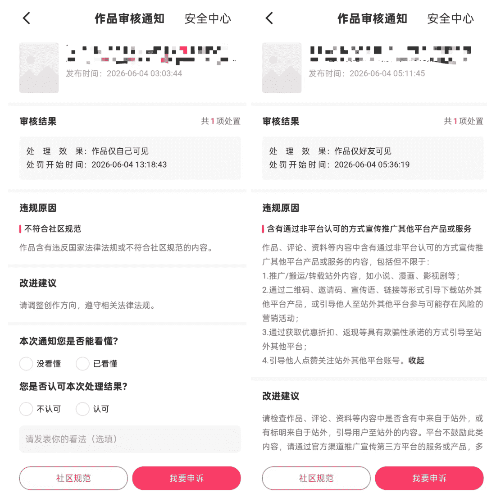

（当时想顺手把号矩阵做起来，发了618的内容，差点把稳定流量弄没，那天还少收了约几十块佣金）

后来我在深海圈学AI编程，也通过圈友的精华帖摸清了小程序的整套搭建路子。小程序正好补上了我缺失的那一环，它能把原本散落在视频内容里的访客，汇成一条稳定流向微信小程序的路径，对我正在做的CPS是实打实的放大。

就我的业务而言，这是一个很短的闭环：

用户要叫外卖、订房或出行时，打开小程序，挑好对应平台，复制当下的优惠口令，回到官方App就能领券。

### 二、第一个开工的项目不是CPS，而是找同休排班

我真正动手做的第一款小程序，是给倒班人群用的找同休工具，灵感来自赚钱里的一条中标信息。这类人的痛点是：班表自己都记不住，想约人一起休息，还得挨个问谁哪天有空。

我又去翻了翻那篇笔记的评论区，反馈相当强，很多人催着要小程序，还有人把场景延伸到了医护、铁路、电力、民航和酒店等行业。

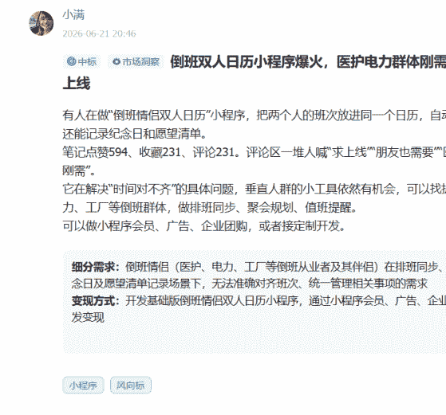

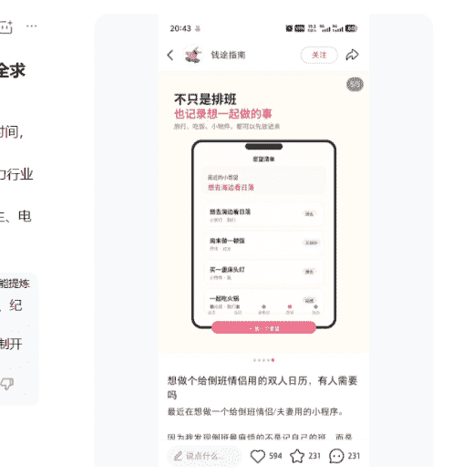

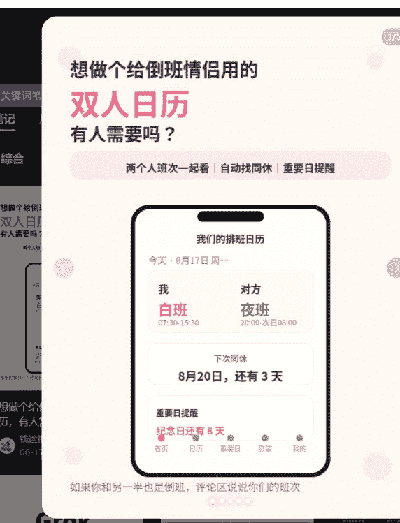

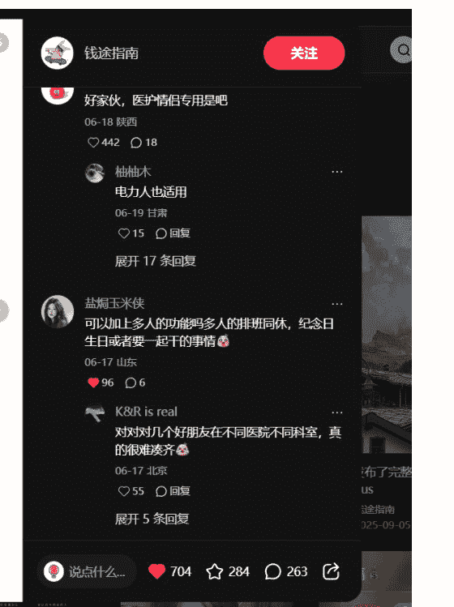

为了验证需求真伪，我发了一篇📕笔记。

当时想，痛点这么清楚，几天怎么也能做完。

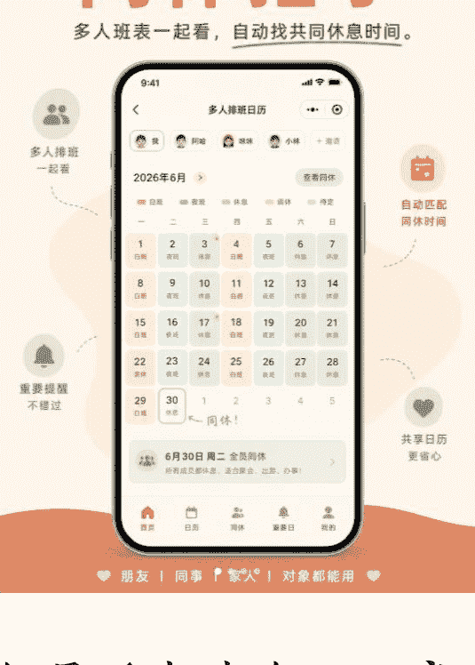

后来才明白，我验证的只是“需求确实存在”，至于产品第一版该有什么功能、长成什么样，完全没有概念。于是AI提一条建议，我就往里加一个功能，代码越堆越厚，范围从双人排班一路扩到多人排班，又塞进生日、纪念日等杂七杂八的提醒，Bug也跟着膨胀。我东一榔头西一棒槌地修错，整整一周连最核心的功能都没跑通，只能先按下暂停键。

### 三、排班项目搁置后，我从CPS本身找到了确定性

停了排班项目，我转头去翻圈友的帖子找经验，看到HP圈友分享的优惠券聚合小程序，一下子想通了：

> 与其从零找一个全新项目，不如围着自己已经跑了一年的CPS业务，做一个确定性更高、能把手头流量放大的小程序。

这个方向有几个天生带确定性的条件：用户消费前本来就有找优惠的习惯，不用培养；活动口令在我手里持续更新，不用先做产品再补内容；复制口令后，官方App能直接识别，用户放心。不过最初我选的是“短链接+口令”的形态，在体验版试运行时就卡了壳，短链接怎么都跳不过去，只好把产品收敛成“复制口令，再到官方App领券”的简洁版。

更关键的是，这次我没急着写代码，而是先用SPEC方法让AI不停地追问，把模糊的“优惠券聚合小程序”收敛成一个能上路的最小可用版本。

所以，CPS小程序虽然动手在后，却抢先上线。

## 第二板块：小白可以直接照做的小程序SOP手册

### 第1步，找需求，定方向

找需求是产品开发的第一步棋。需求的本质，是有人愿意为某件事付出代价。

现在做产品讲究**“需求倒做”**——**先锁定用户的痛点，再设计产品，最后才写代码。**

很多人刚接触小程序时，压根不知道自己该做个什么。

这时可以借用小排老师的产品自查方案，问自己四个关键问题：

- 哪些人？
- 什么场合？
- 愿意掏多少？
- 解决什么麻烦？

实在没有方向，可以去赚钱的中标和风向标里翻翻，那里时常会冒出适合做成小程序的需求。

**我的头一个小程序，灵感就是在赚钱中标里捡到的。** 平时刷📕，也可以多留意评论区，最好找发布时间在一周或一个月以内、评论量大的笔记。

锁定笔记后，用Chrome的“社媒助手”插件批量抓取评论，注意用小号登录以免被封。抓完把评论丢给AI分析，看看大家在抱怨什么、痛点集中在哪，方向基本就浮出来了。此外还有几条路子：

1. 发一篇📕帖子，直接描述场景和烦恼；
2. 去目标用户群里提问；
3. 翻同类产品的差评、评论和求助帖；

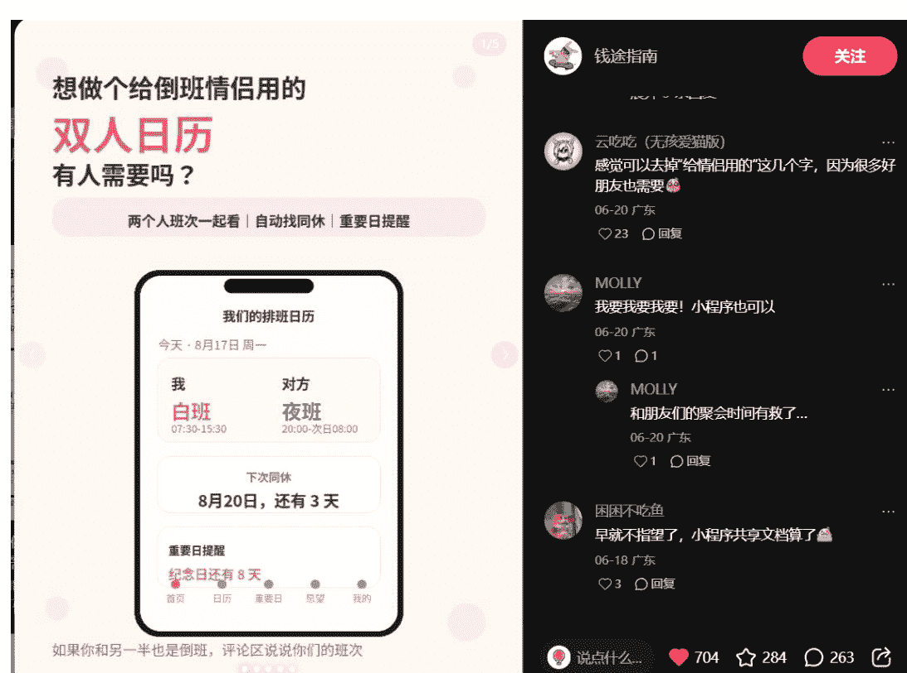

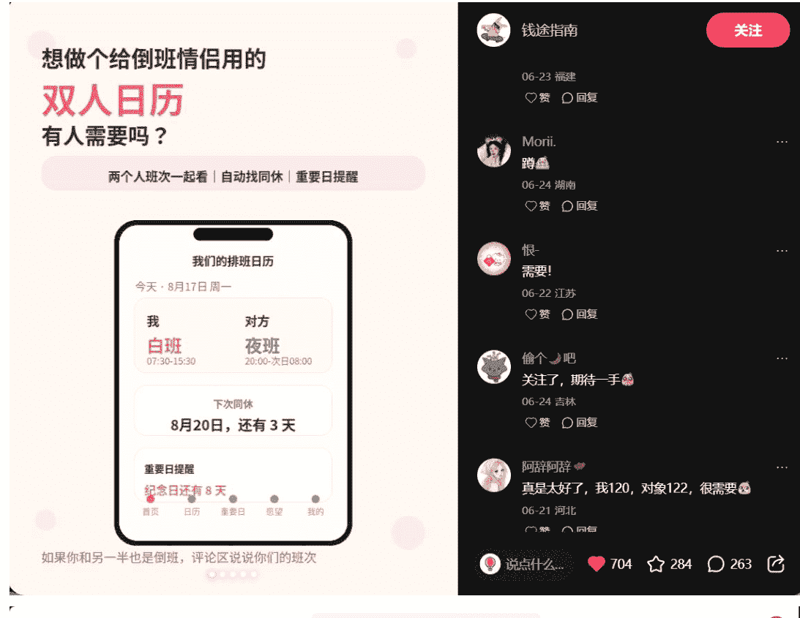

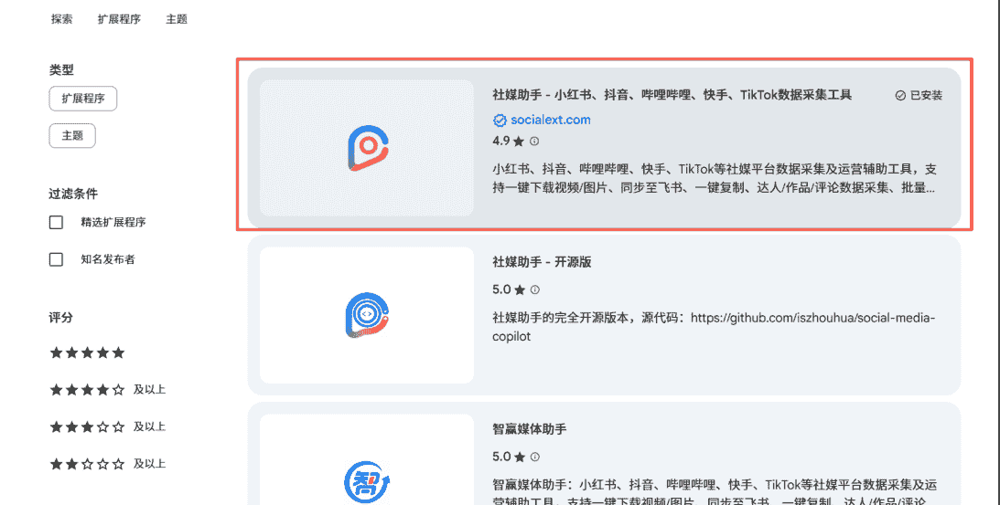

### 第2步，先定定位，再划边界，最后锁MVP

- **定位**：决定方向，也就是给谁的什么麻烦做解药；
- **边界**：圈定范围，明确哪几样不做、哪个场景不管；
- **MVP**：在定位和边界之内，选出最小但能验证的那一版。

初步验证完需求，再用SPEC方法把完整需求梳理出来，圈好边界，省得后续开发时到处碰壁。

**下面是我在AI编程深海圈学到的SPEC提示词 我手上有个想法，想先讲给你听。但在敲下任何代码之前，请你把自己当成一个格外较真、近乎执拗的产品经理。**

你的活儿不是写代码，也不是给我出主意。

你的活儿是变身成苏格拉底，一个问题接一个问题地盘问，直到把我下面这些藏着掖着的东西统统挖干净：

我没想明白的隐含前提（我默认不用说破、其实完全没交代的事）；我没考虑清楚的边界（报错怎么兜、空数据怎么兜、撤销怎么兜）；我可能在偷懒（拿“先随便弄出来”假装“我已经想透了”）；我也可能在自欺（错把“我想要”当成“用户想要”）。

一轮只准发一个问。等问到第N个问题，你判断已经挖得差不多时，再把所有结论汇成一份完整的需求文档。

下面是我的原始想法，你可以开问了：

这里的N不必是个确数，它象征的是**“一直追问到真相浮出水面”——需要敲定的四件事是：用户是谁、边界在哪里、哪些不做、验收标尺是什么。** 我在开发CPS小程序前，就靠这套SPEC让AI连珠炮似的问了一百多个问题，里面大多数是我完全没想到的死角。所以，重点不在问答轮次，而在于最终清楚第一版该长成什么样。

需求彻底清晰后，就可以动手开发了。

### 第3步，微信小程序开发指南

#### 1. 新手词汇表

**AppID**：小程序独一无二的身份编号。

**微信开发者工具**：用来创建、编译、预览和上传小程序代码的桌面程序。

**Codex**：能读取项目文件、修改代码并运行检查的AI编程工具。做小程序很烧token，预算够的话建议直接上Pro，Plus会卡得难受。

**Git**：能让代码回到过去任一版本的版本管理工具。暂时不会用也没关系，至少复制一份完整项目留作备份。

**CloudBase**：为小程序提供云数据库、云函数和文件存储的后端服务。

**云函数**：跑在云端的一段代码，适合处理权限、数据校验等不能暴露在前端的操作。

#### 2. 动工前备齐这些料

1. 微信小程序账号和对应的AppID；
2. 微信开发者工具；
3. Codex，或其它能读取项目文件的AI编程工具；
4. 一个干净的项目文件夹；
5. 已敲定的SPEC与“不做清单”；
6. Git版本记录，或至少一份可恢复的备份；
7. 真实测试样本、测试微信号、测试手机；
8. 完成账号与本地项目准备；是否创建CloudBase环境，等确认数据是否需要跨设备共享后再定。

#### 3. 账号注册指南

赚钱三月小程序航海手册里，账号注册和环境搭建的步骤写得很细，这里我就不重复了，链接直达：

https://scys.com/activity/9632/course/148?chapterId=9617

#### 4. 官方地址汇总

微信公众平台： https://mp.weixin.qq.com/

微信开发者工具下载： https://developers.weixin.qq.com/miniprogram/dev/devtools/download.html

微信小程序开发文档： https://developers.weixin.qq.com/miniprogram/dev/framework/

腾讯云CloudBase微信小程序快速开始： https://docs.cloudbase.net/quick-start/frameworks/wechat-miniprogram

#### 5. 流程简述

1. 先去微信公众平台，按官方最新指引注册小程序账号，确认主体、服务类目和计划启用的能力都能过审，再拿下AppID。
2. 安装微信开发者工具，用自己的微信登录，新建一个空白项目，确认它能够正常编译和预览。
3. 代码要放在独立目录里，别让AI在空目录上假装读到了配置——如果目录是空的，先让开发者工具生成一套基础骨架。
4. 把已确认的需求文档放入项目目录，让Codex先做一次只读检查，明确指出缺了哪些文件，而不是一打开目录就大动干戈。
5. 确认项目入口、页面目录和云端配置后，建立第一次Git记录或完整备份，然后才进入功能开发。
6. 每完成一步就保存一次结果，不要将账号注册、环境配置和功能写入塞进同一轮。

**验收标准**

微信开发者工具能正常打开并编译项目；SPEC已放进去；知道报错去哪个面板看；当前版本有可回退的基线；前端代码里没有AppSecret、云API密钥或任何管理凭据。

**避坑提示**

别把AppID、云环境ID和管理密钥混为一谈。AppID是用来识别小程序的，密钥是用来拿更高权限的，不能因为AI说“帮您配置”就允许它写进前端。

#### 6. 命名、备案与认证

**发布流程**

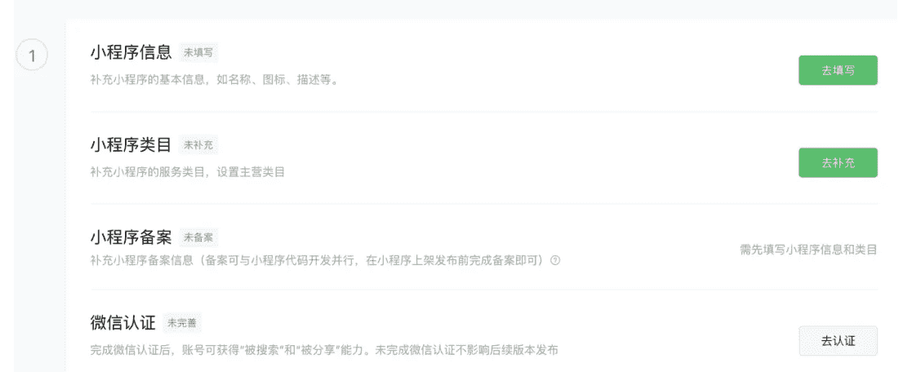

- 写代码前，命名、备案、认证这三件事最好一次性理清，全落定了再开工。
- 微信认证需要交30元。
- 小程序信息、服务类目、备案内容要和认证信息完全一致。
- **切记：认证在前，备案在后。** 若先交了备案，认证却不通过，备案材料还要重新走一轮，又是好几天。
- 我第一次就是照着官方发布流程从上到下点，先备了案，再做认证；结果两项信息对不上，只好把备案改了重新交，前前后后提交两次审核，6天就这么耗掉了（如下图）。
- **每个小程序功能不同，审核快慢也不一样。** 我做的找同休小程序，审一次大概要3天。
- 审核一般在工作日进行，最好周一、周二递交；拖到周五的话，大概

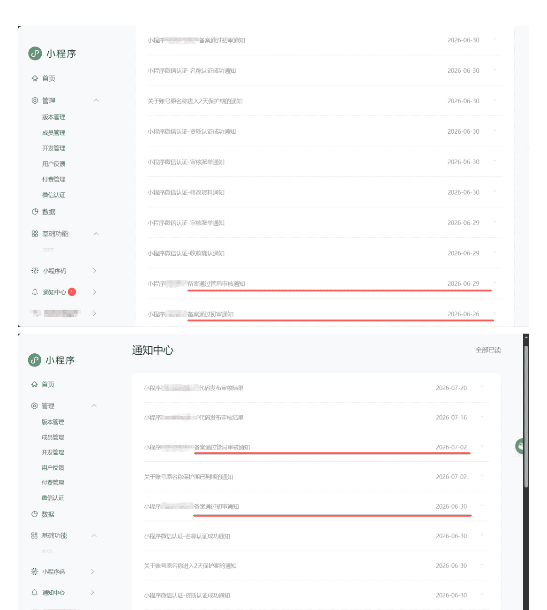

#### 7. 代码和流程，不懂就问AI

我本来就不懂代码，开发时遇到那些看不懂的代码和流程，都是直接截图抛给AI：这段是干嘛的、下一步怎么做、这个报错怎么解，Codex基本都能兜住。

另外，用Codex做小程序时，推理模型不必每次都顶到最高档，长期开极高它会想太多，净做些无用功。小程序代码并没有多难，平时推理档是5.6sol的时候，用中档或高档就行了，个别情况再上极高，既省token又能提速。

### 第4步，多人/跨设备功能，先定真相源

真相源，说白了就是在所有数据里的一本“最终账本”。

要做多人或跨设备的功能，头一件事就是拍板：到底哪份数据说了算。我的习惯是把数据划成三类：

第一类，只属于自己看的临时数据，比如草稿、页面偏好，放本地就行。

第二类，需要多人多端同时看到的数据，比如小组、成员和班表，这种必须放云端，全员只认同一份。

第三类，来自第三方平台的数据，比如这笔优惠到底有没有成交，小程序自己说了不算。

云端写失败时，要给用户明确的失败提示，不能偷偷伪造“好像创建成功了”的假象。

还有一条容易被漏掉的规矩：记录的动作必须和真实动作严格对齐。用户点击，不等于他真的复制了；复制走了，不代表券领到了；页面打开过，也不等于成交了。机器只能记录自己真实观察到的那一步。

做多用户产品还得想清楚一件事：系统靠什么区分用户。第一版不上账号密码登录，并不代表不需要区分身份；小组成员、班表、权限，都得绑定在一个稳定的用户标识上。

**验收标准**

能说清每类数据存在哪、谁能读写、失败后怎么办。多人场景里，设备A写入后，设备B在有权限的前提下也可以读到。

### 第5步，画逻辑地图，每轮给AI执行指标

每轮开工前，先让Codex回答四个问题：要改什么；辐射到哪里；哪里不能碰；拿什么验证。

**逻辑地图开发法，就是在动代码前，先把“这个功能是什么、用户怎么用、系统怎么跑、数据放哪、规则是什么、怎么验收”全部摊开画清楚。** 这个思路是郭东超老师在深海圈直播里分享的。

拿“创建任务”功能来举例。

常规做法是：想到哪写到哪，先把页面做出来，再补接口，最后才发现校验忘了、测试也没做。

逻辑地图法则先拆一遍：

- 它属于什么能力？——任务管理
- 出现在哪个页面？——任务列表页
- 用户点哪个按钮？——创建任务按钮
- 用户做了什么？——填写任务并提交
- 系统的完整流程？——校验内容、调用接口、保存数据、刷新列表
- 调了什么接口？——创建任务接口
- 存了什么数据？——任务记录和列表缓存
- 哪些规则必须守？——任务标题不能为空
- 怎么确认没问题？——测试空标题、正常创建、列表刷新

这么拆完，功能就不是一团乱麻，而是一张可以追踪的地图。

再打个比方，把开发比作修路：

- CAP是这条路通向的目的地
- PAGE是途经的站点
- UI是从哪个站上车
- ACT是乘客这一路的动作
- FLOW是整条行车路线
- API、STORE、RULE、TEST则是路边的设施：接口、数据、规则、验收点

前五个是主干，后四个是配套。只画路线不看配套，路可能走不通；只埋头写代码不看地图，功能八成会漏。

它最重要的价值，在于让每个功能都能答上九个问题：做什么？在哪做？点什么？谁来做？怎么流转？调什么接口？存什么数据？哪些规则不能破？怎么验收？

动手之前，那四个问题还得过一遍：改什么？影响哪里？不能动什么？怎么验证？

这套方法不是为了把文档写厚重，而是让开发过程少一点猜。地图人能看明白，AI也能照着改。

**验收标准**

Codex说得出这轮改了哪些地方、影响了哪些模块，改完后需求和代码对得上，而且这一轮可以单独回退。

**避坑提示**

别用“还有哪里可以优化”“帮我全面检查”这类话。它们没有停止条件，AI会顺自己的想法越改越多，token消耗也跟着失控。

#### 第六步：先打通技术路径，再回头打磨界面

凡是牵涉微信生态能力、外部站点、文字识别、支付、定位、剪贴板这类模块，别急着把完整页面一口气搭出来。更聪明的做法是先做一个最小验证：放一个按钮，备一条真实数据，找一台实体手机，把最关键的那条通路跑一遍。

比如要打开外部活动页面，先只做一个含 web-view 的壳子，试试域名能不能正常跳转；要做 OCR 识别，就拿一张真实截图去发起请求，确认服务端是否真的给了响应。

如果技术路线走不通，先留存现象和证据，再商量下一步，不必立刻换方案继续堆代码。

**通过判定**
最没把握的外部依赖，必须在真机上给出结论：行、不行，还是暂缓。不行的，要有实打实的依据。

**提醒**
模拟器和开发调试工具只能证明部分情况，许多故障是非得真机上手才会显形。

#### 第七步：按四个层次核验，真机与真实数据优先

核验一共拆成四个层级：

最底层，看代码和自动化用例。

再往上，在开发者工具里确认页面能不能正常渲染、按钮有没有反馈。

第三级，换成真实业务素材——也就是用户日后真会粘进来、填进去的内容，绝不是随手编的样例。

最顶层，真机搭配真实账号。凡是牵涉多人的功能，至少要准备两台设备、两组账号一起跑。

**自动化用例全绿，并不等于真机就能顺畅运行。通过判定**

每条关键路径都要留有测试痕迹；多人板块完成双账号双设备联调；解析类能力用真实原文核验；暂时没测到的，如实标注"未验证"。

**提醒**
测试素材不能靠现编，得到真实场景里去取。自造样本能过，并不等于真实用户那边不会出事。

#### 第八步：送审之前，把隐私、权限和回退方案过一遍

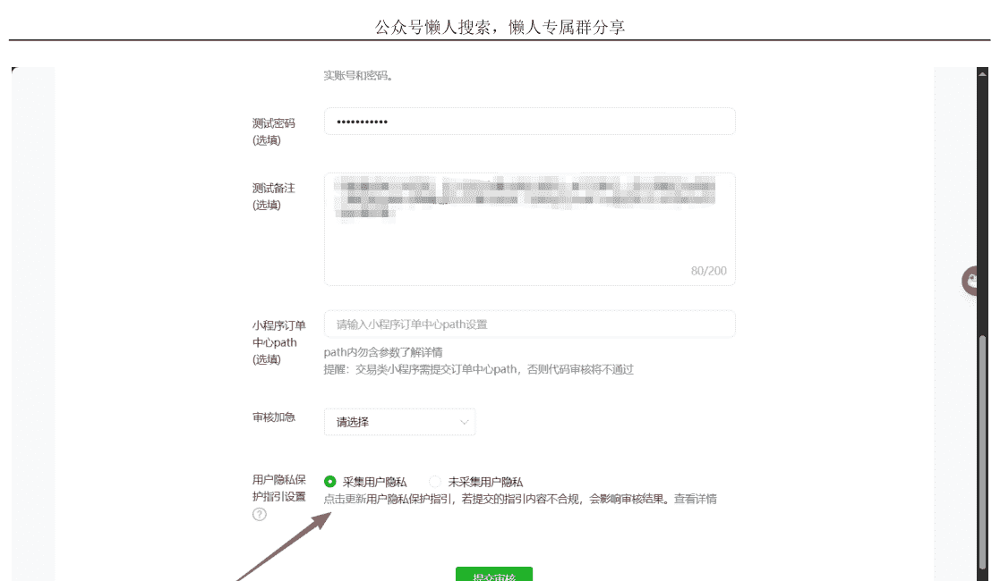

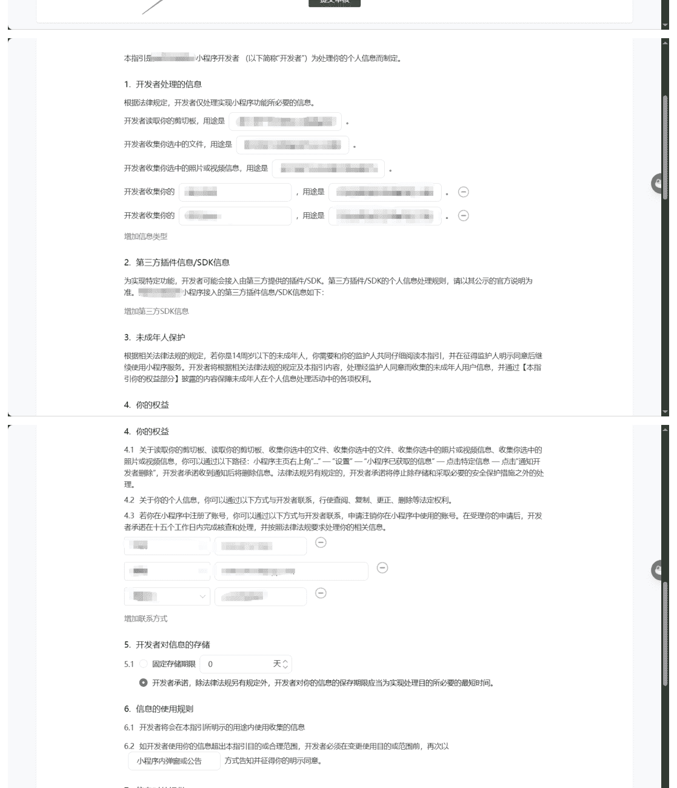

准备提审时，凡是涉及采集用户隐私的场景，要把应用实际调用的系统能力（像剪贴板、相册、定位）一件件列清楚，再对照微信的规则逐条说明。用到的才申报，没碰过的绝不多申请。

同时还得检查：前端是否残留密钥、数据存储的修改权限是否过宽、云环境配置是否正确、代码和数据各自的回退路径是什么。程序能回滚，不代表数据会跟着自动回滚。

**通过判定**
隐私声明和代码真正调用的能力一一对应，前端找不出密钥，数据库权限锁定在最小范围。

#### 第九步：代码写完了，离开线还远着呢

代码完工并不是终点。传包、过审、发布、能被用户搜到、能被用户真正使用，这五个节点彼此独立，一个都不能混为一谈。

每推进一个节点，都把版本号与时间记下来；任何一环出状况，就地停下排查，别把"已提交"顺手写成"已上线"。具体的审核口径，一切以微信官方当前的最新说明为准。

**通过判定**
后台显示目标版本为已发布状态，用非开发者身份的账号能正常进入，核心能力在线可用。

#### 第十步：为每一个版本留下痕迹

正式发布、重大回滚、中途暂停，这三种情形都要做回顾。回顾时把需求文档、Git 记录、测试产出、真机日志等按时间线归档，尽量完整还原当时发生了什么。

尤其要把"开发收工"和"用户真正用上"这两件事分开，别拿前者去顶替后者。回顾得出的结论，要写回下一版的需求说明里。

**通过判定**
回顾不是记流水账，每一条结论都能对着截图、线上记录或原始事实找到出处。

#### 第十一步：应用做出来了，怎么冷启动？

推广这件事，我能分享的经验其实很有限。当时就是让身边熟人先试用，大家觉得可以，再帮忙转发给各自的朋友，配合我自己的 CPS 账号慢慢渗透，上线约半个月，累计了 200 多个用户。

概括起来无非两条路：需求来自熟人圈，就先请朋友们内测，好用再托他们扩散；需求是从公域里挖出来的，就把内容发在自己的公域账号上持续引流，比如👸号、📕、抖音。

> 这也和龙哥之前提过的"📕养成系产品"不谋而合：📕负责种草图、沉淀人群，应用负责承接流量、完成支付转化。

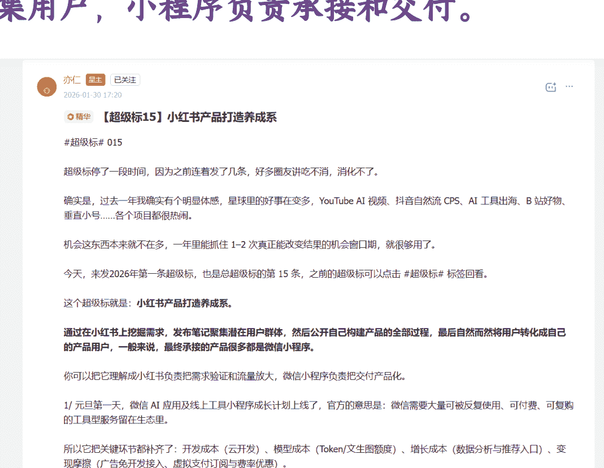

| 小程序活跃概况 | 数值 |
| :--- | :--- |
| 累计用户数 | 207 人 |
| 日访问人数 | 33 人 |
| 日打开次数 | 41 次 |
| 日访问页面数 | 61 |

| 新增用户概况 | 数值 |
| :--- | :--- |
| 新增用户 | 27 人 |
| 新用户当日打开次数 | 33 次 |
| 总添加人数 | 0 人 |
| 新添加人数 | 0 人 |

## 第三部分：我撞过的墙，以及后来的解法

## 一、痛点是真实的，但"有人需要"不等于"我知道怎么做首版"

排班应用的创意来自赚钱的中标信息，不是凭空拍脑袋。为了确认它有没有市场，我发了一篇📕笔记试探，评论区热度远超预期，足以说明痛点成立。

但问题恰恰出在这里：我把"用户确实存在这一需求"，直接等同于"我清楚首版该长什么样"。有人提多人协作，我就加上；有人提纪念日，我也加进去；再后来，日期提醒、反馈问卷、使用指南、新功能投票……全被塞进了第一版。

这些功能拆开看，哪一个都能说出道理；可攥在一起，却把一个"帮大家找到共同休息日"的轻巧工具，搞成了一台笨重的排班机器。

> 需求验证充其量证明这件事值得投入，它无法替你决定第一版究竟做什么。

## 二、没有 SPEC，AI 只会一个劲地帮你做加法

找同休项目起步时，我压根没用 SPEC 去框定边界，总是撞见一个问题就修一个问题，冒出个想法就添个功能，到后来连我自己都说不清什么时候才算做到头。

回过头看，主线从一开始就是清楚的：建组或进组、拉成员填表、自动算出共同的休息日。但我没有把这条主线变成一道不许随意突破的藩篱，反而把一大堆需求丢给 codex，还叫它自己不停补漏。每一次对话结束，看起来都像往前挪了一步：界面更完整了，测试数字也更好看了。真正缺的其实是三件事：这一版做什么、不做什么、做到何种程度就停下验收。

AI 不会好心帮你圈定边界。你只要丢给它一句"继续优化"，它就会照着大众产品的范式，把登录、设置、提醒、统计、后台一一配齐。

SPEC 的价值，不在于把 PRD 打磨得无懈可击，而在于逼你在落笔写代码之前，就想明白哪些做、哪些不做。

## 三、首屏入口堆成山，越收拾越乱

找同休应用曾有某个版本，首页密密匝匝挤满了入口：登录、填表、导入文件、创建小组、加入小组、邀请成员、当日班次、共同休息结果、纪念日、反馈、手册、版本投票……其中还掺着好几个重复项和点了没反应的死入口。

我一度把大量时间花在微调按钮摆位、字号大小、热区范围、卡片留白上。后来才算看透：首页拥挤的根源，是我始终没想清楚用户跨进这个应用的第一瞬间应该做什么。

解法其实简单：还没建组，就推建组或进组；已经进组但没填表，就推填表；数据齐了，才把共同休息结果端出来。让页面跟着任务进度走，只露出当下最该做的那一件事，而不是把全部功能摊在台面上。

## 四、本地缓存的存在，把单机 Demo 包装成了多人产品

单机原型用本地缓存确实顺手；可当产品需要建组、发邀请码、换设备加入、多端同步班表时，本地数据就不再具备充当正式数据的资格。

这些问题在我项目里真真切切地发生过：云端建组失败，页面却自动生成了一个本地小组；换了一台手机，邀请码怎么都查不到；成员明明加入了，两边的班表却互不可见；A 设备存了新班表，日历上仍旧是旧数字。这些毛病都不是多弹几个提示框能掩盖的，真正的症结是：**凡是多人产品，就必须有一份所有设备共同承认的云端数据源。**

图片 OCR 又牵出另一类麻烦：它并非只依赖代码，还要依赖云端服务、密钥、地区节点和调用额度。哪怕代码一行未动，部署参数填错一个，用户那边照样冒出"解析失败"。所以外部依赖必须单独拿真机跑原型，绝不能等页面全部完工才想起来测。

## 五、排班项目反复返工，我干脆停下来换了方向

头一回碰 AI 产品，我的手法实在稚嫩，Bug 一个接一个，返工一轮接一轮。扛了一段时间，我选择停手。不是需求不存在，而是没有路线图的硬撑，只会搭进去更多返工时间。

后来翻看圈友的帖子，我冒出个念头：围绕自己的 CPS 生意做一个应用。这回我没急着写代码，而是先让 SPEC 驱动 AI 一个接一个地盘问，把模糊的"优惠券聚合应用"收敛成一句话：当用户有意消费、又嫌价格偏高时，用最少的操作帮他拿到一张此刻能用的优惠券。

这句定位一定，不做清单也就跟着浮出水面：不搞登录、不搞个人中心、不搞站内交易、不搞自动比价，更不许把"点了一下按钮"吹成"领券成功"。用户侧只留进首页、找平台、复制口令、去官方应用使用四步；运营侧只留粘文案、识口令、人工核对、发布云端、前台读取五步。两条回路都通了，第一版就自然成立。

## 六、自动化测试一路绿灯，真实文案一粘上去就翻车

做 CPS 应用时，有一次自动化用例全部通过。可当我把影刀整理出来的那一批真实推广文案粘进后台，识别结果几乎全军覆没。

原因很清楚：测试时用的是我自己编的工整样本，而真实文案里掺杂着栏目标题、表情符号、活动名称、活动说明和口令。

应对之道是：把真实原文直接并入回归测试，重新校准解析规则，再把识别出的每一条口令放到官方 App 里逐一验证。其中有一条口令反复测试都没法稳定识别，我干脆把它从库里移除了。

真实场景的测试，有时会反过来改写产品的范围。这件事比守住一个漂亮的通过率重要得多。

## 七、短链接在真机上全军覆没，20 个活动最后砍到 11 条口令

项目初期，我主打的是活动短链接，口令是后来才加的。我当时的直觉是：点链接比复制口令少一步，应该拿短链当主路径更顺畅。

在开发者工具里调试，一切显得顺风顺水；到了体验版，真机一测，那一批短链竟然一条都打不开，系统反复提示业务域名校验不过。来回试了多次，我终于认清现实：短链在真实的微信环境里根本走不通，而且用户面对来路不明的链接，天然就会警惕。

于是我把路径改为：先复制口令，再去官方应用兑券。表面上是多了一点波折，转化率也许会受影响；但最关键的那个"领取"动作，被放到了用户更容易卸下防备的地方。

## 八、让影刀 RPA 接管口令更新的重复劳动

CPS 的活动口令一直在滚动变化，前端如果长期挂着旧口令，用户就领不到券，所以必须定期更新应用里的口令。而每次更新，都要反复进后台、找活动、开推广弹窗、复制新口令、替换旧口令、再发布。这套流程倒不复杂，就是机械重复。

一开始，我寄希望于 codex 把这套流程全自动跑下来。可真跑起来才发现，网页登录态、浏览器限制、站方反自动化策略，横在面前一道又一道，根本走不通。

这件事让我明白：那些要登录、要点来点去、还设有反脚本机制的后台，更适合交给模拟真人操作的工具。于是我把采集环节交给了影刀 RPA。

影刀当"手"：在已登录的页面上负责搜索、打开、复制活动口令，整理进同一个文件；后台程序当"脑"：负责读取文件、分类、过滤；最后由我把关。就算页面操作偶尔失手，也不会殃及即将发布的内容。

驯服影刀的过程，坑着实不少：

- 登录状态拿不到，就先手动登录，再让它接管；
- 弹窗没合上，下一轮就会卡住，所以每次循环都要带上关弹窗的动作；
- 抓取页面内容不稳定，就改成点复制键、直接读剪贴板；
- 搜到相似活动时，只认约定的关键词，绝不让近似结果冒名顶替；
- AI 额度不够，就别老让它反复改流程，把活动清单做成变量就行；
- 采集失败的日志，要加异常过滤，防止被当成有效口令收进来。

> 自动化的目的从来不是完全甩开人，而是把重复的活交给工具，把关键的判断攥在自己手里。

## 第四部分：给圈友的几句实在话

## 一、要找切入点，优先选自带流量的业务

排班项目痛点不假，可我对用户的理解和前期铺垫都欠火候，最后用户量平平，只能算作第一个练手的 AI 产品。CPS 应用做起来明显轻松，原因是我手里本来就握着长期流量，商业转化水到渠成。

两个项目走完，我最大的体会是：**先盘一盘自己手里有什么——真实用户、持续内容、行业认知、交付能力、渠道或者稳定数据。一个人做应用，贴着已有的资产开工，确定性要高得多。**

## 二、需求得到了验证，MVP 仍要再验证

公域帖子里评论多、点赞多，评论区一片"想要"，只能说明这个方向值得关注，不能证明登录、提醒、模板、社区、复杂设置都该挤进第一版。

往后每收到一条功能建议，先问自己三句话：它是不是目标用户反复撞上的问题？没有它，第一条完整链路还通不通？它能不能靠现有资源就跑起来？三个问题但凡有一个答不上来，就先扔进备选池。

## 三、零代码，不等于零判断

AI 把做应用的门槛压下来了，却没把判断的门槛一并降下去。

代码看不懂完全没关系，代码本来就是给 AI 读的，遇到报错直接截图问它就行；但业务的全流程，你必须自己在脑子里跑通，还得说得清这个作品到底解决了用户的哪个具体问题。

## 四、真实链路先闭合，再追求页面好看

排班应用的完工线，不是页面能把班表展示出来，而是多设备、多账号之间能共享数据、算出共同休息日。CPS 应用的完工线，也不是按钮能点，而是口令能复制、能被官方 App 认出来、线上用户可以顺顺利利走完整个流程。

页面可以逐版变精致，功能可以慢慢加，但数据真相源和主干链路，必须排在最前面打通。

## 五、别把 AI 的话当成圣旨

有一段时间，我对 AI 的提议近乎盲从，加了许多并不必要的功能，还大刀阔斧"优化"了不少代码。

恰好那时 GPT-5.6 发布了，我就把已经用 GPT-5.5 写好的代码翻出来，又用 5.6 整整齐齐优化了一遍。想不到优化完，原有界面彻底大变样，Bug 反而比从前更多，整个应用几乎没法用。最后不得不回退到 5.5 的版本，token 烧了不少，时间也白搭进去一大截。

## 六、技术门槛一直在降低，差的只是出发

如今各家大模型越来越强，技术正在走向平权，从冒出 idea 到应用上线之间的距离已经非常短。拥有自己的微信应用早已不是什么难事，真正难的是迈出第一步。

圈子里的老话常说：别想太多，先下场把手弄脏。做应用的过程中，你一定会碰上五花八门的问题，而每一步恰恰都在为你积累经验。刚起步时可能两眼一抹黑，没关系，不懂就问 AI。

微信应用只是 AI 产品里最基础的一种，你在它身上练出来的手感，完全能迁移到别处——搭自己的自动化工作台、养 AI 员工、弄 Agent，全都用得上。

生在这个时代，大家都是弄潮儿。希望这篇记录能给想做、或正在做应用的朋友一点点参考。

---

看完这份 SOP，你多半觉得已经懂了，可真到动手，九成的人会卡在第一步。

工具与教程从来不是最硬的壁垒，真正的壁垒是"说干就干"和"圈层信息差"。

如果你想知道全网最新的变现玩法，也想和一群执行力爆表的极客一起下场拿结果，欢迎来到我的核心私域：【懒人专属群】。

我们不谈虚的，只做商业闭环的拆解和 AI 效率的榨取。圈内已经沉淀了 1000+ 跑通的套利实战案例。

- 查看圈子的完整数字资产与加入门槛：[https://lazyso.com/insider/](https://lazyso.com/insider/)

觉得值得、也准备好动手的，扫码加我微信（lazyhelper1）

备注：【实操上车】，无事勿扰

微信：lazyhelper1